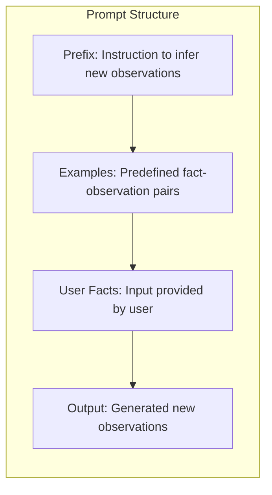
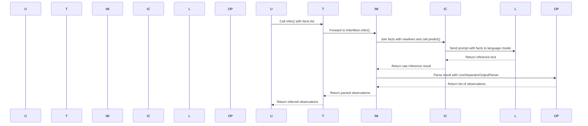
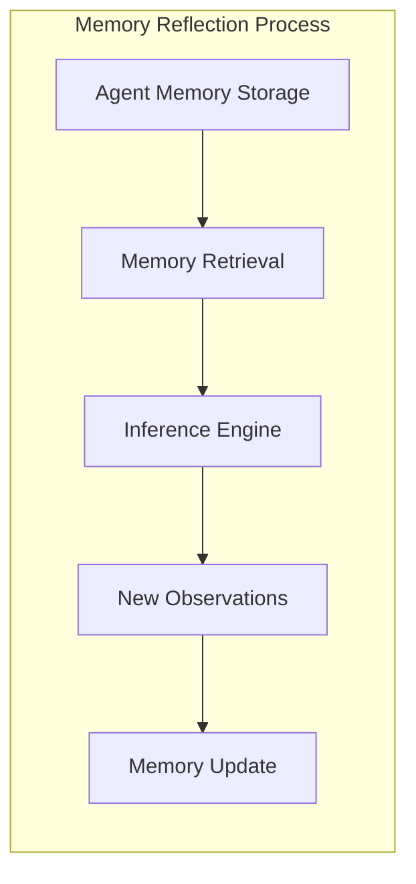
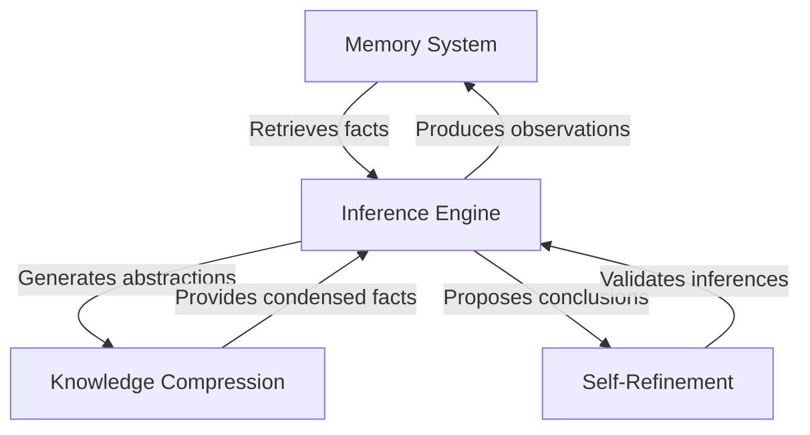

<!-- source: DeepWiki mcp.deepwiki.com · repo jina-ai/thinkgpt · page 2.5 Inference Engine · fetched 2026-10-26 -->

# Inference Engine

<details>
<summary>Relevant source files</summary>

The following files were used as context for generating this wiki page:

- [README.md](README.md)
- [thinkgpt/infer.py](thinkgpt/infer.py)

</details>


The ThinkGPT Inference Engine provides the capability to generate logical deductions and derive new insights based on existing knowledge. This component enables ThinkGPT to make educated guesses and extend its understanding beyond explicitly provided information, simulating a form of reasoning similar to human inference.

For information about memory management, see [Memory Management System](#2.1). For content summarization, see [Knowledge Compression](#2.2).

## Purpose and Scope

The Inference Engine serves as a critical reasoning component that:

1. Takes established facts or knowledge as input
2. Applies logical reasoning to derive new observations or conclusions
3. Expands the agent's knowledge through deduction rather than direct memorization
4. Implements a key capability described in the Generative Agents research paper

Sources: [README.md:16-17](), [thinkgpt/infer.py:1-79]()

## Architecture and Integration

The Inference Engine is implemented using the mixin pattern, consistent with ThinkGPT's overall architecture, allowing for modular integration into the main ThinkGPT class.

```mermaid
classDiagram
    class "InferMixin" {
        +infer_chain: InferChain
        +infer(facts: List[str], instruction_hint: str) -> List[str]
    }
    
    class "InferChain" {
        +predict(instruction_hint: str, **kwargs) -> str
    }
    
    class "LLMChain" {
        <<Langchain>>
    }
    
    class "ThinkGPT" {
        +memory: DocumentArray
        +infer(facts: List[str], instruction_hint: str) -> List[str]
    }
    
    LLMChain <|-- InferChain
    InferMixin <|-- ThinkGPT
    InferMixin *-- InferChain : uses
```

The Inference Engine integrates with the broader ThinkGPT architecture through:

1. The `InferMixin` class that adds inference capabilities to the main ThinkGPT class
2. The `InferChain` class that handles the actual inference process using the language model
3. Prompt templates that guide the LLM to produce logical inferences

Sources: [thinkgpt/infer.py:52-68]()

## Implementation Details

### Prompt Engineering

The Inference Engine uses few-shot prompting to guide the LLM. The system contains predefined examples that demonstrate the inference pattern:



Example templates include:
- Water state changes (freezing/boiling) to demonstrate physical inference
- Plant photosynthesis requirements to demonstrate biological inference

Sources: [thinkgpt/infer.py:11-49]()

### Core Components

#### InferChain

The `InferChain` class extends Langchain's `LLMChain` and is responsible for:
- Managing the prompt template for inference
- Handling the interaction with the language model
- Processing the output

```python
class InferChain(LLMChain):
    def __init__(self, **kwargs):
        super().__init__(prompt=INFERENCE_PROMPT, **kwargs)

    def predict(self, instruction_hint: str = '', **kwargs: Any) -> str:
        return super().predict(instruction_hint=instruction_hint, **kwargs)
```

Sources: [thinkgpt/infer.py:52-58]()

#### InferMixin

The `InferMixin` class provides the public API for inference and is responsible for:
- Converting the input facts into a structured format
- Calling the inference chain
- Parsing the results into a list of observations

```python
class InferMixin:
    infer_chain: InferChain

    def infer(self, facts: List[str], instruction_hint: str = '') -> List[str]:
        result = self.infer_chain.predict(
            facts="\n".join(facts), instruction_hint=instruction_hint
        )
        return LineSeparatorOutputParser().parse(result)
```

Sources: [thinkgpt/infer.py:61-68]()

## Data Flow Process



Sources: [thinkgpt/infer.py:61-68]()

## Usage Examples

### Basic Usage

The Inference Engine can be used to derive new observations from a set of facts:

```python
from thinkgpt.llm import ThinkGPT

llm = ThinkGPT(model_name="gpt-3.5-turbo")

inferred_observations = llm.infer(
    facts=[
        "Klaus Mueller is writing a research paper",
        "Klaus Mueller enjoys reading a book on gentrification",
        "Klaus Mueller is conversing with Ayesha Khan about exercising"
    ]
)

print(inferred_observations)
# Example output:
# ['Klaus Mueller is interested in multiple topics',
#  'Klaus Mueller may have a diverse range of interests and hobbies']
```

Sources: [thinkgpt/infer.py:71-78](), [README.md:216-227]()

### Replay and Expand Agent Memory

One of the key applications of the Inference Engine is in generative agents that can reflect on their memories and derive new insights:



This capability allows agents to exhibit more human-like behavior by not just storing facts but also deriving insights from their experiences - a concept introduced in the Generative Agents research paper cited in the README.

Sources: [README.md:216-227]()

## Integration with Other ThinkGPT Components

The Inference Engine complements other ThinkGPT components:

1. **Memory System**: The inference engine can process facts retrieved from the memory system
2. **Knowledge Compression**: Inferred observations can provide higher-level abstractions of knowledge
3. **Self-Refinement**: Inferences can be validated and refined through the self-refinement system



Sources: [README.md:5-9](), [README.md:216-227]()

## Technical Constraints and Considerations

When using the Inference Engine, consider the following:

1. **Quality of Input Facts**: The quality of inferences depends on the quality and relevance of input facts
2. **Instruction Hints**: The optional `instruction_hint` parameter can guide the inference process toward specific types of observations
3. **LLM Limitations**: Inferences are limited by the reasoning capabilities of the underlying language model
4. **Verification**: Inferred observations should be treated as hypotheses that may require verification

Sources: [thinkgpt/infer.py:64-67]()

---

