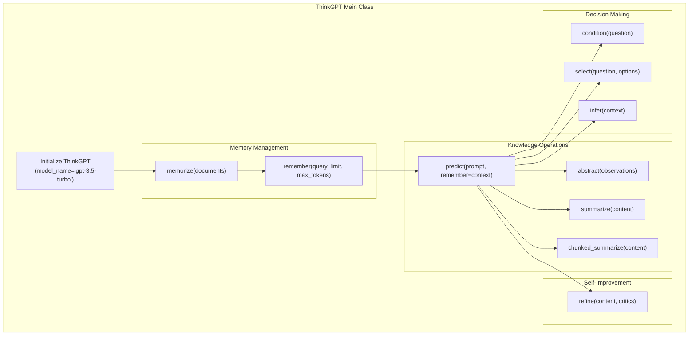
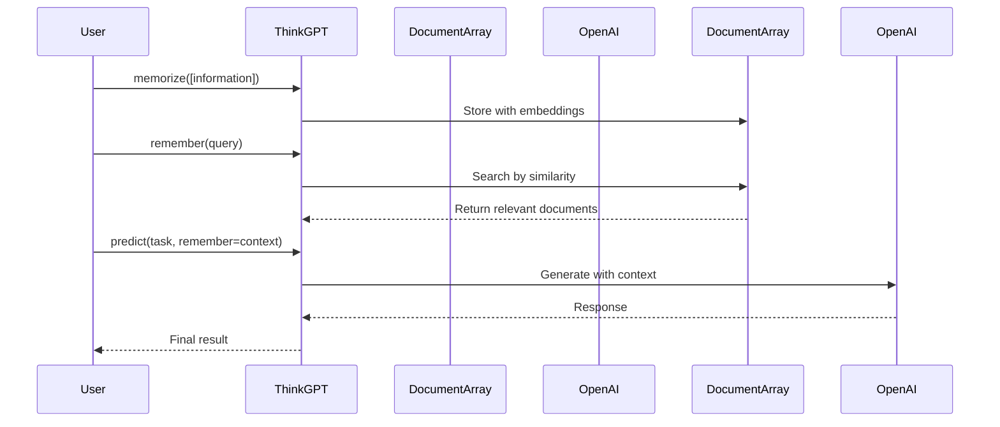

<!-- source: DeepWiki mcp.deepwiki.com · repo jina-ai/thinkgpt · page 3 Getting Started · fetched 2026-10-26 -->

# Getting Started

<details>
<summary>Relevant source files</summary>

The following files were used as context for generating this wiki page:

- [README.md](README.md)
- [pyproject.toml](pyproject.toml)

</details>


This page provides comprehensive instructions for installing and using ThinkGPT, a Python library that extends LLM capabilities with advanced cognitive functions. For more complex application scenarios, see [Advanced Usage](#4).

## Installation Requirements

ThinkGPT can be installed using pip:

```shell
pip install git+https://github.com/alaeddine-13/thinkgpt.git
```

The library requires Python 3.7 or higher and has the following dependencies as specified in the pyproject.toml:

| Dependency | Version Requirement |
|------------|---------------------|
| openai     | ^0.27.4             |
| tiktoken   | ^0.3.3              |
| docarray   | <=0.21.0            |
| langchain  | ^0.0.141            |

Sources: [pyproject.toml:9-14]()

## Basic Setup

To start using ThinkGPT, you need to initialize it with your preferred language model:

```python
from thinkgpt.llm import ThinkGPT

# Initialize with the desired model
llm = ThinkGPT(model_name="gpt-3.5-turbo")
```

This creates a ThinkGPT instance that extends Langchain's ChatOpenAI with enhanced capabilities like memory management, knowledge compression, and self-refinement.

Sources: [README.md:31-36]()

## ThinkGPT Core Functionality

The following diagram illustrates the key functional components available in ThinkGPT:



Sources: [README.md:12-19](), [README.md:30-164]()

## Working with Memory

ThinkGPT's memory system allows storing and retrieving information using embedding-based similarity search.

### Adding Information to Memory

```python
# Memorize a single piece of information
llm.memorize(['DocArray is a library for representing, sending and storing multi-modal data.'])

# Memorize multiple pieces of information
llm.memorize([
    'DocArray allows you to send your data, in an ML-native way.',
    'This means there is native support for Protobuf and gRPC, on top of HTTP and serialization.'
])
```

### Retrieving From Memory

```python
# Retrieve relevant information (default is top 5 results)
relevant_info = llm.remember('What is DocArray?')

# Limit the number of results
single_result = llm.remember('Sending data with DocArray', limit=1)

# Limit by token count
token_limited = llm.remember('DocArray features', max_tokens=1000)
```

### Using Memory with Predictions

```python
# Retrieve relevant context and use it for prediction
context = llm.remember('DocArray schemas')
response = llm.predict(
    'Implement a DocArray schema with image and TorchTensor fields', 
    remember=context
)
```

Sources: [README.md:39-74]()

## Data Flow Diagram

The following diagram illustrates the typical data flow when using ThinkGPT:



Sources: [README.md:39-74]()

## Knowledge Compression

ThinkGPT provides methods to compress knowledge to fit within the LLM's context window limitations.

### Content Summarization

For large content that needs to be condensed:

```python
# One-shot summarization (for content within context window)
summary = llm.summarize(
    large_content,
    max_tokens=1000,
    instruction_hint='Pay attention to code snippets and technical terms.'
)

# Chunked summarization (for very large content)
summary_large = llm.chunked_summarize(
    very_large_content,
    max_tokens=4096,
    instruction_hint='Focus on preserving technical details.'
)
```

### Rule Abstraction

Extract high-level patterns or rules from specific examples:

```python
# Extract language patterns from examples
rules = llm.abstract(observations=[
    "in tunisian, I did not eat is \"ma khditech\"",
    "I did not work is \"ma khdemtech\"",
    "I did not go is \"ma mchitech\"",
])
```

This produces a generalized rule:
```
['Negation in Tunisian Arabic uses "ma" + verb + "tech" where "ma" means "not" and "tech" at the end indicates the negation in the past tense.']
```

Sources: [README.md:100-137]()

## Natural Language Decision Making

ThinkGPT enables using natural language for conditional logic in your code.

### Condition Evaluation

```python
# Evaluate a condition in natural language
is_error = llm.condition('Does this represent an error message? "IndentationError: unexpected indent"')
# Returns: True
```

### Option Selection

```python
# Select from options
selected = llm.select(
    question="Which animal is the king of the jungle?",
    options=["Lion", "Elephant", "Tiger", "Giraffe"]
)
# Returns: ['Lion']

# With specified number of choices
multiple = llm.select(
    question="Which of these are mammals?",
    options=["Lion", "Eagle", "Dolphin", "Snake"],
    num_choices=2
)
```

Sources: [README.md:142-160]()

## Self-Refinement

ThinkGPT can improve content based on feedback or criticism:

```python
# Refine code based on error messages
refined_code = llm.refine(
    content="""
    import re
        print('hello world')
    """,
    critics=[
        'File "/Users/user/PyCharm2022.3/scratches/scratch_166.py", line 2',
        "  print('hello world')",
        'IndentationError: unexpected indent'
    ],
    instruction_hint="Fix the code snippet based on the error provided."
)
```

Result:
```
import re
print('hello world')
```

Sources: [README.md:76-98]()

## Complete Example: Language Learning

Here's a practical example showing how to teach ThinkGPT a new language and then use that knowledge:

```python
from thinkgpt.llm import ThinkGPT

# Initialize
llm = ThinkGPT(model_name="gpt-3.5-turbo")

# Extract rules from examples
rules = llm.abstract(observations=[
    "in tunisian, I did not eat is \"ma khditech\"",
    "I did not work is \"ma khdemtech\"",
    "I did not go is \"ma mchitech\"",
], instruction_hint="output the rule in french")

# Memorize the rules
llm.memorize(rules)

# Memorize additional vocabulary
llm.memorize("in tunisian, I studied is \"9rit\"")

# Translate using the learned rules and vocabulary
task = "translate to Tunisian: I didn't study"
result = llm.predict(task, remember=llm.remember(task))
# Result: "ma 9ritech"
```

Sources: [README.md:165-185]()

## Complete Example: Learning About a Library

This example demonstrates teaching ThinkGPT about a technical library and generating code based on that knowledge:

```python
from thinkgpt.llm import ThinkGPT
from examples.knowledge_base import knowledge

# Initialize
llm = ThinkGPT(model_name="gpt-3.5-turbo")

# Memorize library documentation
llm.memorize(knowledge)

# Generate code using the learned knowledge
task = 'Implement python code that uses thinkgpt to learn about docarray v2'
result = llm.predict(task, remember=llm.remember(task, limit=10))
```

Sources: [README.md:187-215]()

## ThinkGPT Architecture and Code Structure

This diagram shows how the ThinkGPT class relates to its underlying code components:

```mermaid
classDiagram
    class "ChatOpenAI" {
        <<Langchain>>
        +__call__()
        +generate()
    }
    
    class "ThinkGPT" {
        +memory: DocumentArray
        +embeddings_model: OpenAIEmbeddings
        +model_name: str
        +memorize(documents)
        +remember(query, limit, max_tokens)
        +predict(prompt, remember)
        +generate(prompt)
    }
    
    class "MemoryMixin" {
        +memorize(documents)
        +remember(query, limit, max_tokens)
    }
    
    class "AbstractMixin" {
        +abstract(observations)
    }
    
    class "RefineMixin" {
        +refine(content, critics)
    }
    
    class "SummarizeMixin" {
        +summarize(content)
        +chunked_summarize(content)
    }
    
    class "SelectMixin" {
        +select(question, options)
    }
    
    class "ConditionMixin" {
        +condition(question)
    }
    
    class "InferMixin" {
        +infer(context)
    }
    
    ChatOpenAI <|-- ThinkGPT
    MemoryMixin <|-- ThinkGPT
    AbstractMixin <|-- ThinkGPT
    RefineMixin <|-- ThinkGPT
    SummarizeMixin <|-- ThinkGPT
    SelectMixin <|-- ThinkGPT
    ConditionMixin <|-- ThinkGPT
    InferMixin <|-- ThinkGPT
```

Sources: [README.md:12-19]()

## Next Steps

Now that you've learned the basics of ThinkGPT, you can explore more specific examples and advanced usage:

1. [Language Learning Examples](#3.1) - Detailed examples of using ThinkGPT for language learning
2. [Library Teaching Examples](#3.2) - Examples of teaching ThinkGPT about libraries
3. [Condition and Selection Examples](#3.3) - More examples of natural language conditions and selections
4. [Advanced Usage](#4) - More sophisticated applications including memory expansion and self-critique

For complete API documentation, see [API Reference](#5).

Sources: [README.md:161-238]()

---

