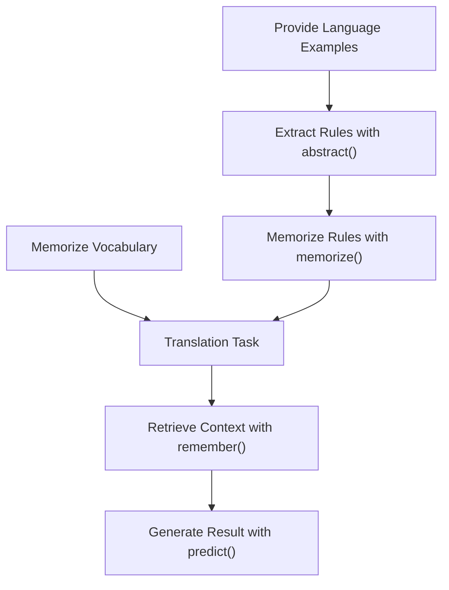
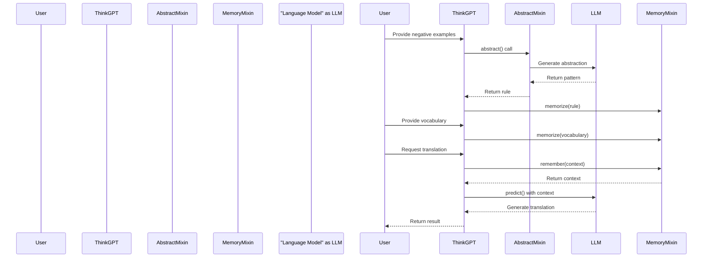
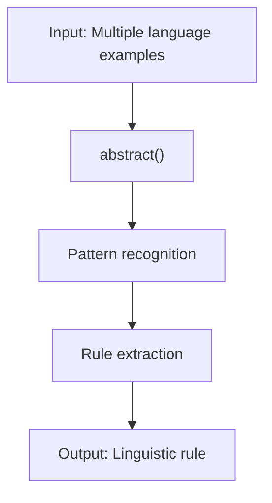
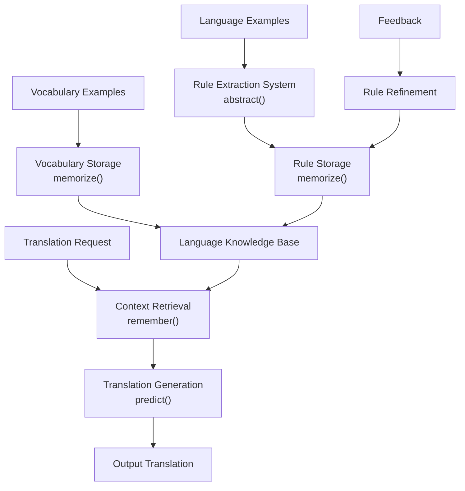

<!-- source: DeepWiki mcp.deepwiki.com · repo jina-ai/thinkgpt · page 3.1 Language Learning Examples · fetched 2026-10-26 -->

# Language Learning Examples

<details>
<summary>Relevant source files</summary>

The following files were used as context for generating this wiki page:

- [README.md](README.md)
- [examples/teach_tunisian.py](examples/teach_tunisian.py)

</details>


## Introduction

This page demonstrates how to use ThinkGPT for language learning tasks. It focuses on how the system can learn language patterns from examples, extract grammatical rules, and apply those rules to new contexts.

For information on teaching ThinkGPT about programming libraries rather than natural languages, see [Library Teaching Examples](#3.2).

Sources: [README.md:166-186]()

## Language Learning Workflow

The typical workflow for using ThinkGPT in language learning applications follows this pattern:



Sources: [examples/teach_tunisian.py:1-15](), [README.md:166-186]()

## Tunisian Language Example Implementation

The repository includes an example of teaching ThinkGPT to understand and translate Tunisian Arabic negation patterns in past tense.

### Core Workflow

The implementation in the Tunisian example demonstrates:

1. Providing examples of negative past tense formations in Tunisian
2. Using `abstract()` to extract the general pattern/rule
3. Memorizing the extracted rule and additional vocabulary
4. Applying the rule to translate a new phrase

Here's the key component interaction:



Sources: [examples/teach_tunisian.py:1-15]()

### Code Example Analysis

The Tunisian language learning example consists of four key steps:

1. **Rule Extraction**: The code provides three examples of negation in Tunisian Arabic to the `abstract()` method, which extracts the pattern that negation uses "ma" + verb + "tech".

```python
rules = llm.abstract(observations=[
    "in tunisian, I did not eat is \"ma khditech\"",
    "I did not work is \"ma khdemtech\"",
    "I did not go is \"ma mchitech\"",
])
```

2. **Rule Memorization**: The extracted rule is stored in memory.

```python
llm.memorize(rules)
```

3. **Vocabulary Memorization**: A new vocabulary item is memorized.

```python
llm.memorize("in tunisian, I studied is \"9rit\"")
```

4. **Translation Generation**: The system combines the learned rule with the vocabulary to produce a translation.

```python
task = "translate to Tunisian: I didn't study"
llm.predict(task, remember=llm.remember(task))
# Result: "ma 9ritech"
```

Sources: [examples/teach_tunisian.py:5-15]()

## Key Methods for Language Learning

### The `abstract()` Method

The `abstract()` method is crucial for language learning as it identifies patterns and extracts general rules from specific examples:



In the Tunisian example, `abstract()` examines three examples of negative past tense verbs to extract the negation pattern that "Negation in Tunisian Arabic uses 'ma' + verb + 'tech'".

Sources: [examples/teach_tunisian.py:5-9](), [README.md:125-137]()

### Memory System for Language Learning

ThinkGPT's memory system plays a vital role in language learning by:

1. **Storing knowledge**: The `memorize()` method stores rules and vocabulary
2. **Retrieving context**: The `remember()` method retrieves relevant information when needed

This enables the system to build a knowledge base of language information and apply it to new situations.

| Method | Function | Example in Code |
|--------|----------|----------------|
| `memorize()` | Stores language rules and vocabulary | [examples/teach_tunisian.py:10-12]() |
| `remember()` | Retrieves relevant context for tasks | [examples/teach_tunisian.py:15]() |
| `predict()` | Applies retrieved knowledge to tasks | [examples/teach_tunisian.py:15]() |

Sources: [README.md:39-67](), [examples/teach_tunisian.py:10-15]()

## Advanced Language Learning System Architecture

The basic pattern demonstrated in the Tunisian example can be extended to more complex language learning applications:



Sources: [README.md:166-186]()

## Best Practices

When using ThinkGPT for language learning tasks:

| Practice | Description |
|----------|-------------|
| Provide clear examples | Use consistent examples that isolate specific language patterns |
| Use sufficient examples | Typically 3-5 examples are needed for accurate rule extraction |
| Guide the abstraction | Use `instruction_hint` parameter to focus on specific language aspects |
| Test incrementally | Verify understanding after teaching each new concept |
| Organize memory effectively | Group related language concepts for better retrieval |

Example of using instruction hints to guide abstraction:

```python
rules = llm.abstract(
    observations=[...],
    instruction_hint="output the rule in french"
)
```

Sources: [README.md:171-175]()

## Technical Implementation

Language learning in ThinkGPT relies on several key components:

```mermaid
classDiagram
    class "ThinkGPT" {
        +abstract()
        +memorize()
        +remember()
        +predict()
    }
    
    class "AbstractMixin" {
        +abstract()
    }
    
    class "MemoryMixin" {
        +memorize()
        +remember()
    }
    
    class "AbstractChain" {
        +_call()
    }
    
    class "Language Model" {
        +generate()
    }
    
    "ThinkGPT" --|> "AbstractMixin"
    "ThinkGPT" --|> "MemoryMixin"
    "AbstractMixin" --> "AbstractChain"
    "AbstractChain" --> "Language Model"
    "MemoryMixin" --> "DocumentArray"
```

The language learning process leverages:

1. **AbstractMixin**: Provides the `abstract()` method that powers rule extraction
2. **MemoryMixin**: Handles the storage and retrieval of language information
3. **AbstractChain**: Implements the LLM chain that performs the abstraction logic
4. **ThinkGPT Class**: Coordinates all components and provides a unified interface

Sources: [README.md:12-18]()

## Potential Extensions

The language learning capabilities demonstrated in the basic example can be extended in several ways:

1. **Multiple rule learning**: Extract different grammatical rules (e.g., verb conjugation, noun cases)
2. **Cross-linguistic comparisons**: Use the system to identify patterns across different languages
3. **Customized instruction hints**: Guide the abstraction process for specialized linguistic features
4. **Feedback loops**: Incorporate feedback to refine extracted rules

Sources: [README.md:166-186]()

---

