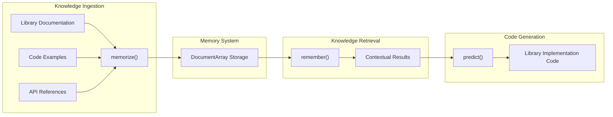
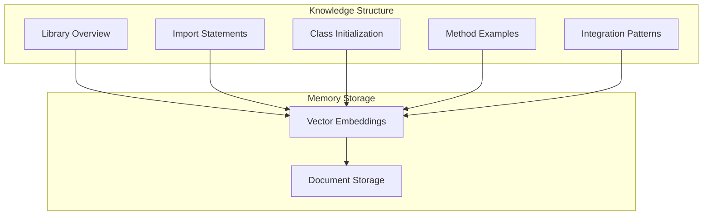
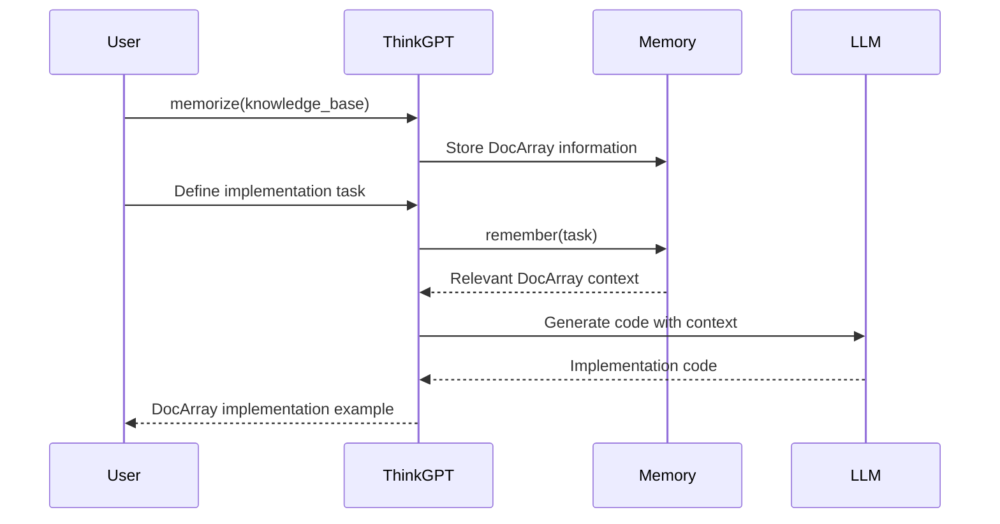
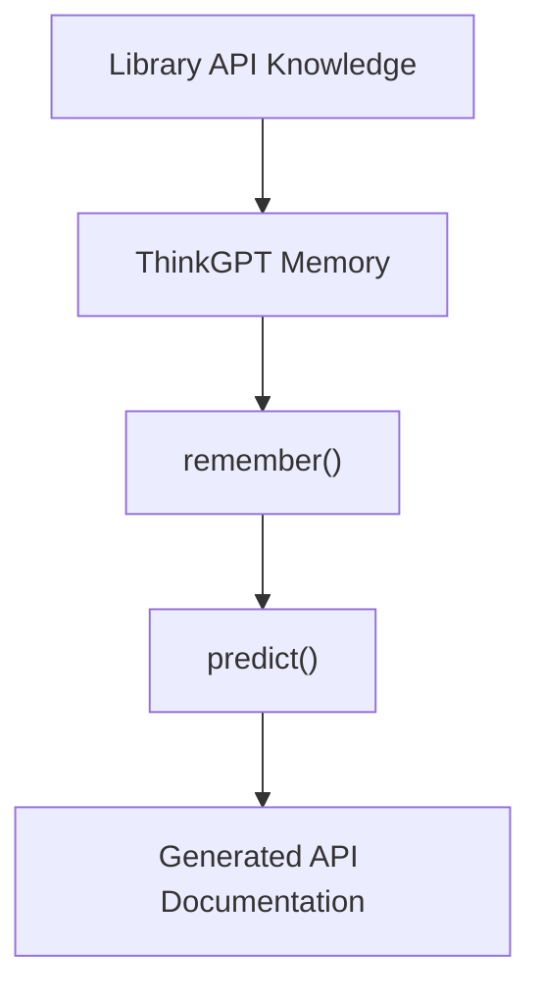
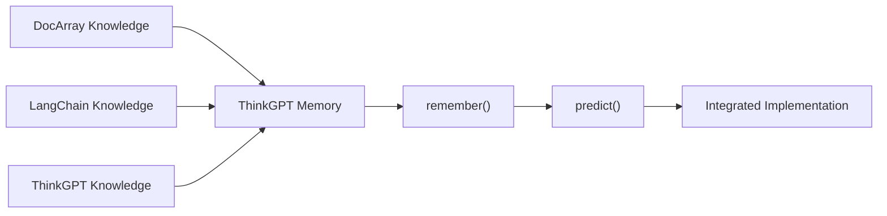
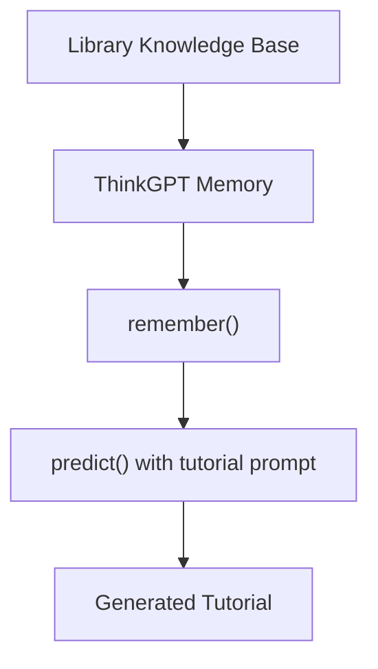

<!-- source: DeepWiki mcp.deepwiki.com · repo jina-ai/thinkgpt · page 3.2 Library Teaching Examples · fetched 2026-10-26 -->

# Library Teaching Examples

<details>
<summary>Relevant source files</summary>

The following files were used as context for generating this wiki page:

- [README.md](README.md)
- [examples/knowledge_base.py](examples/knowledge_base.py)
- [examples/teach_this_library.py](examples/teach_this_library.py)

</details>


## Purpose and Scope

This document demonstrates how to use ThinkGPT to learn about programming libraries and generate code or documentation based on that knowledge. The examples focus specifically on teaching ThinkGPT about library APIs, syntax, and usage patterns, then leveraging that knowledge to generate accurate code implementations. For examples of teaching language patterns rather than code libraries, see [Language Learning Examples](#3.1).

## Overview of Library Teaching Process

ThinkGPT can store knowledge about programming libraries in its memory system and retrieve relevant information when needed to generate code or documentation. This capability is especially useful for:

1. Creating example code for new libraries
2. Generating documentation based on library knowledge
3. Building code that integrates multiple libraries based on stored knowledge
4. Teaching others how to use a library by generating tutorials



Sources: [README.md:188-199](), [examples/teach_this_library.py:1-9]()

## Implementation Architecture

When teaching ThinkGPT about libraries, the system leverages several core components to store knowledge, retrieve relevant context, and generate accurate implementation code:

```mermaid
classDiagram
    class "ThinkGPT" {
        +memorize()
        +remember()
        +predict()
    }
    
    class "Knowledge Base" {
        +Library documentation
        +API references
        +Code examples
    }
    
    class "Memory System" {
        +DocumentArray
        +OpenAIEmbeddings
        +Vector storage
    }
    
    class "LLM Interface" {
        +ChatOpenAI
        +Context handling
        +Query processing
    }
    
    class "Code Generation" {
        +Implementation examples
        +Tutorial creation
        +Documentation
    }
    
    "Knowledge Base" --> "ThinkGPT" : Input
    "ThinkGPT" --> "Memory System" : Stores in
    "Memory System" --> "ThinkGPT" : Retrieves from
    "ThinkGPT" --> "LLM Interface" : Processes through
    "LLM Interface" --> "Code Generation" : Produces
```

Sources: [README.md:166-197](), [examples/teach_this_library.py:1-9]()

## Basic Library Teaching Example

The following example demonstrates how to teach ThinkGPT about DocArray V2 and then generate code based on that knowledge:

1. First, create a ThinkGPT instance
2. Memorize knowledge about libraries
3. Define a task that requires this knowledge
4. Retrieve relevant context using `remember()`
5. Generate code using `predict()`

Here's how the implementation looks:

```
# Create ThinkGPT instance
llm = ThinkGPT(model_name="gpt-3.5-turbo")

# Memorize knowledge
llm.memorize(knowledge)  # knowledge contains DocArray information

# Define task and generate code
task = 'Implement python code that uses thinkgpt to learn about docarray v2...'
context = llm.remember(task, limit=10, sort_by_order=True)
result = llm.predict(task, remember=context)
```

Sources: [examples/teach_this_library.py:1-9](), [README.md:188-197]()

## Knowledge Representation

The library teaching examples rely on a structured knowledge base that contains information about different libraries. This knowledge is stored as text snippets that describe library functionality, code examples, and usage patterns.

### Knowledge Structure

The knowledge base typically contains:

1. Library descriptions and overviews
2. Import statements and initialization
3. Function/class usage examples
4. Code patterns and idioms



Sources: [examples/knowledge_base.py:1-52]()

### Example Knowledge Base

The knowledge base for the library teaching example includes information about multiple libraries:

| Library | Knowledge Types | Example Content |
|---------|-----------------|-----------------|
| LangChain | Import statements, class usage | `from langchain.llms import OpenAI` |
| DocArray | Overview, schema definition | Class definition with typed fields |
| ThinkGPT | Import, initialization, method usage | Memorization and prediction examples |

Sources: [examples/knowledge_base.py:1-52]()

## DocArray Teaching Example Walkthrough

Let's examine the process of teaching ThinkGPT about DocArray and then having it generate implementation code:

1. **Knowledge Ingestion**: The system memorizes information about DocArray, including:
   - Library overview: "DocArray allows you to represent your data, in an ML-native way"
   - Schema definition patterns
   - Class structure with typed fields

2. **Task Definition**: Request code that uses ThinkGPT to learn about DocArray v2

3. **Memory Retrieval**: The system retrieves relevant contexts about:
   - DocArray representation capabilities
   - Schema definition syntax
   - ThinkGPT methods for memorization and prediction

4. **Code Generation**: ThinkGPT generates complete implementation code that demonstrates:
   - Importing the necessary components
   - Creating a ThinkGPT instance
   - Memorizing DocArray information
   - Using that memory for prediction

The complete data flow looks like:



Sources: [examples/teach_this_library.py:1-9](), [README.md:188-201]()

## Generated Code Analysis

The code generated by ThinkGPT in the library teaching example demonstrates a complete workflow:

```python
from thinkgpt.llm import ThinkGPT
from docarray import BaseDoc
from docarray.typing import TorchTensor, ImageUrl

llm = ThinkGPT(model_name="gpt-3.5-turbo")

# Memorize information
llm.memorize('DocArray V2 allows you to represent your data, in an ML-native way')

# Predict with the memory
memory = llm.remember('DocArray V2')
llm.predict('write python code about DocArray v2', remember=memory)
```

This code demonstrates:
1. Proper import statements for both libraries
2. Correct initialization of the ThinkGPT model
3. Memorization of DocArray knowledge
4. Retrieval of relevant context
5. Prediction using the retrieved context

Sources: [README.md:201-215]()

## Practical Applications

### API Documentation Generation

ThinkGPT can be taught about a library's API and then generate comprehensive documentation examples:



### Code Completion

By teaching ThinkGPT about multiple libraries, it can generate code that correctly integrates them:



### Tutorial Creation

The system can generate step-by-step tutorials based on library knowledge:



Sources: [README.md:166-185](), [README.md:188-215]()

## Best Practices

For effective library teaching with ThinkGPT:

1. **Structured Knowledge Base**: Organize library information in logical groups
2. **Include Complete Examples**: Provide full usage examples rather than fragments
3. **Cover Import Statements**: Always include proper import syntax
4. **Balance Breadth and Depth**: Include both high-level overviews and detailed examples
5. **Include Error Handling**: Add knowledge about common errors and their resolutions
6. **Use the `sort_by_order=True` Parameter**: When retrieving knowledge about sequential processes like coding

Sources: [examples/teach_this_library.py:8](), [examples/knowledge_base.py:1-52]()

## Related Capabilities

The library teaching functionality works well with other ThinkGPT capabilities:

1. **Self-Refinement**: Generated code can be refined using error messages
2. **Knowledge Abstraction**: Complex library patterns can be abstracted into rules
3. **Memory Expansion**: Library knowledge can be expanded through inference

For more advanced usage patterns combining these capabilities, see [Advanced Usage](#4).

Sources: [README.md:75-98](), [README.md:100-137]()

---

