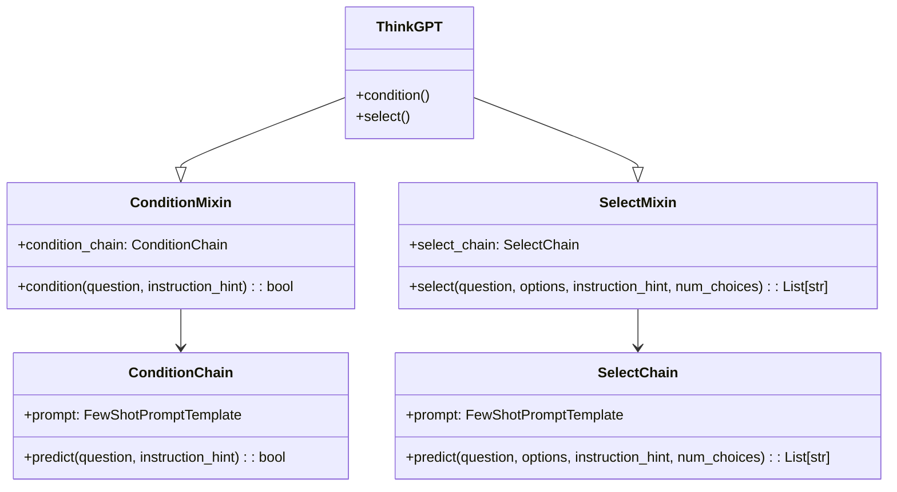
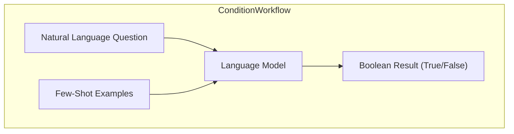
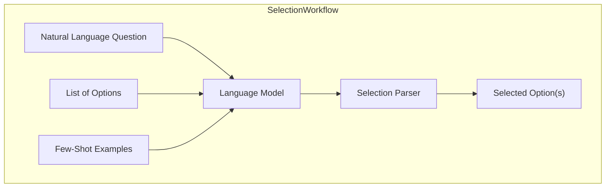
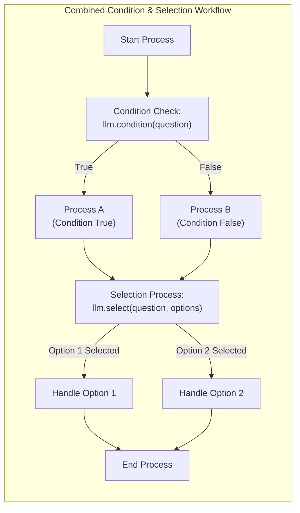

<!-- source: DeepWiki mcp.deepwiki.com · repo jina-ai/thinkgpt · page 3.3 Condition and Selection Examples · fetched 2026-10-26 -->

# Condition and Selection Examples

<details>
<summary>Relevant source files</summary>

The following files were used as context for generating this wiki page:

- [examples/natural_language_condition.py](examples/natural_language_condition.py)
- [thinkgpt/condition.py](thinkgpt/condition.py)
- [thinkgpt/gpt_select.py](thinkgpt/gpt_select.py)

</details>


## Introduction

This document provides practical examples and technical details for using the natural language condition checking and option selection capabilities in the ThinkGPT framework. These capabilities enable LLMs to evaluate logical conditions and make categorical selections using natural language, enhancing their decision-making abilities.

For general information about ThinkGPT's natural language interfaces, see [Natural Language Interfaces](#2.4).

Sources: [thinkgpt/condition.py:1-72](), [thinkgpt/gpt_select.py:1-95]()

## Understanding ThinkGPT Condition and Selection Mechanisms

ThinkGPT implements two crucial natural language interfaces:

1. **Condition checking**: Evaluates whether a statement is true or false
2. **Option selection**: Chooses one or more options from a given list

These capabilities are implemented through dedicated chains and mixins that integrate with the main ThinkGPT class.



Sources: [thinkgpt/condition.py:62-67](), [thinkgpt/gpt_select.py:83-88]()

## Natural Language Conditions

The condition system allows ThinkGPT to evaluate whether a statement is true or false, using natural language.

### How Conditions Work



The condition system:
1. Takes a natural language question as input
2. Uses few-shot examples to teach the LLM how to respond with "True" or "False"
3. Parses the LLM output into a boolean value
4. Returns the boolean result for program control flow

Sources: [thinkgpt/condition.py:9-31](), [thinkgpt/condition.py:42-60]()

### Example Usage

Here's how to use the condition functionality:

```python
from thinkgpt.llm import ThinkGPT

llm = ThinkGPT(model_name="gpt-3.5-turbo")

# Simple condition check
is_correct = llm.condition("Is 2+2 equal to 4?")
print(is_correct)  # True

# Condition with additional instructions
knows_python = llm.condition(
    "Is Python a statically typed language?",
    instruction_hint="Consider the default typing behavior, not optional type hints."
)
print(knows_python)  # False

# Using conditions for control flow
task = 'generate python code that uses langchain to send a request to OpenAI'
if not llm.condition(f'Do you know all the requirements to achieve the following task? {task}'):
    llm.memorize(knowledge_base)
```

Sources: [examples/natural_language_condition.py:1-11](), [thinkgpt/condition.py:66-67]()

## Selection Mechanism

The selection system allows ThinkGPT to choose one or more options from a given list, based on a natural language question.

### How Selections Work



The selection system:
1. Takes a natural language question and a list of options
2. Uses few-shot examples to teach the LLM how to select options
3. Parses the LLM output to extract valid selections
4. Returns a list of selected options

Sources: [thinkgpt/gpt_select.py:9-44](), [thinkgpt/gpt_select.py:51-80]()

### Example Usage

Here's how to use the selection functionality:

```python
from thinkgpt.llm import ThinkGPT

llm = ThinkGPT(model_name="gpt-3.5-turbo")

# Single selection
animal = llm.select(
    question="Which animal is known as the king of the jungle?",
    options=["Lion", "Elephant", "Tiger", "Giraffe"]
)
print(animal)  # ['Lion']

# Multiple selection
carnivores = llm.select(
    question="Which animals are carnivores?",
    options=["Lion", "Elephant", "Tiger", "Giraffe"]
)
print(carnivores)  # ['Lion', 'Tiger']

# Selection with constraint
top_three = llm.select(
    question="Which are the most populous countries?",
    options=["China", "India", "USA", "Indonesia", "Pakistan", "Brazil"],
    num_choices=3
)
print(top_three)  # ['China', 'India', 'USA']
```

Sources: [thinkgpt/gpt_select.py:75-80](), [thinkgpt/gpt_select.py:86-88]()

## Combined Usage Patterns

Both condition and selection capabilities can be combined to create powerful decision-making workflows.



### Practical Example: Knowledge-Based Decision Making

```python
from thinkgpt.llm import ThinkGPT

llm = ThinkGPT(model_name="gpt-3.5-turbo")

# Define a task
task = "Implement a REST API using FastAPI"

# Check if the model has necessary knowledge
if not llm.condition(f"Do you have sufficient knowledge about {task}?"):
    # If not, memorize relevant information
    llm.memorize(fastapi_documentation)
    
    # Verify learning occurred
    if llm.condition(f"Do you now understand how to {task}?"):
        print("Learning successful")
    else:
        print("Further learning needed")

# Determine implementation approach
approach = llm.select(
    question=f"What's the best approach for {task}?",
    options=[
        "Synchronous endpoints with Pydantic models",
        "Asynchronous endpoints with background tasks",
        "GraphQL integration with FastAPI",
        "WebSocket-based real-time API"
    ],
    instruction_hint="Consider performance and maintainability"
)

print(f"Selected approach: {approach[0]}")

# Generate implementation based on selected approach
implementation = llm.predict(
    f"Implement {task} using the {approach[0]} approach",
    remember=llm.remember(task)
)
```

Sources: [examples/natural_language_condition.py:1-11](), [thinkgpt/condition.py:66-67](), [thinkgpt/gpt_select.py:86-88]()

## Implementation Details

### Condition Implementation

The condition functionality is implemented through:

1. **ConditionMixin**: A mixin class that provides the `condition` method to ThinkGPT
2. **ConditionChain**: A specialized LLMChain that handles the condition checking
3. **ConditionOutputParser**: Parses the LLM output into a boolean value

The condition system uses few-shot learning with predefined examples like:
- "Is the sky blue?" → "True"
- "Do humans have three arms?" → "False"
- "Is water wet?" → "True"

Sources: [thinkgpt/condition.py:9-22](), [thinkgpt/condition.py:42-68]()

### Selection Implementation

The selection functionality is implemented through:

1. **SelectMixin**: A mixin class that provides the `select` method to ThinkGPT
2. **SelectChain**: A specialized LLMChain that handles the selection process
3. **SelectOutputParser**: Parses the LLM output into a list of selected options

The selection system uses few-shot learning with predefined examples that demonstrate both single and multiple selection scenarios.

Sources: [thinkgpt/gpt_select.py:9-30](), [thinkgpt/gpt_select.py:51-88]()

## Customization Options

Both the condition and selection systems offer customization through the `instruction_hint` parameter, which allows you to provide additional context or constraints for the evaluation.

### Condition Customization

```python
# Basic condition
result = llm.condition("Is Python easy to learn?")

# With instruction hint
result = llm.condition(
    "Is Python easy to learn?",
    instruction_hint="Consider someone with prior programming experience in JavaScript"
)
```

Sources: [thinkgpt/condition.py:66-67]()

### Selection Customization

```python
# Basic selection
result = llm.select(
    question="Which frameworks are best for web development?",
    options=["React", "Angular", "Vue", "Svelte", "Next.js"]
)

# With instruction hint and number constraint
result = llm.select(
    question="Which frameworks are best for web development?",
    options=["React", "Angular", "Vue", "Svelte", "Next.js"],
    instruction_hint="Consider developer experience and community support",
    num_choices=2
)
```

Sources: [thinkgpt/gpt_select.py:75-80](), [thinkgpt/gpt_select.py:86-88]()

## Summary

ThinkGPT's condition and selection capabilities provide a powerful way to add decision-making abilities to language models using natural language interfaces. These features enable:

1. Boolean evaluation of natural language statements
2. Single or multiple selection from options
3. Control flow based on LLM knowledge and reasoning
4. Complex decision-making workflows

By combining these capabilities with ThinkGPT's other features like memory management and refinement, you can create sophisticated applications that leverage the reasoning power of language models while maintaining programmatic control.

Sources: [thinkgpt/condition.py:1-72](), [thinkgpt/gpt_select.py:1-95](), [examples/natural_language_condition.py:1-11]()

---

