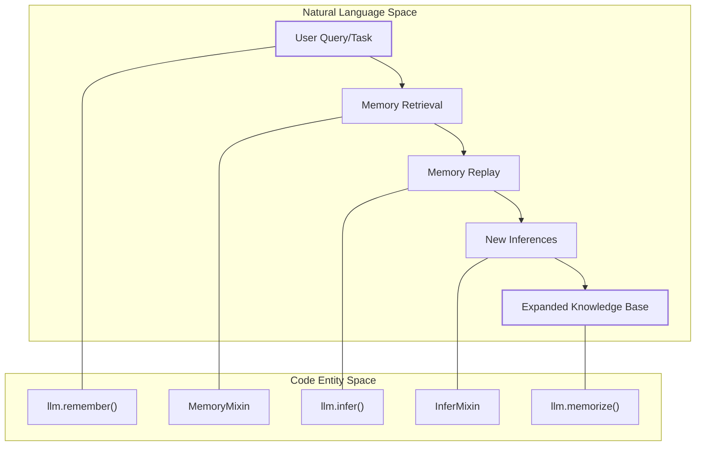
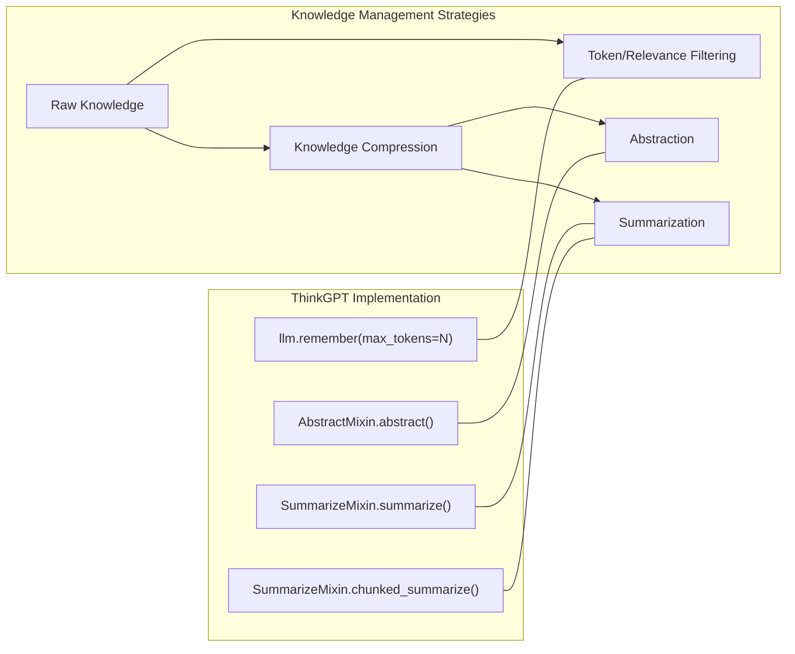
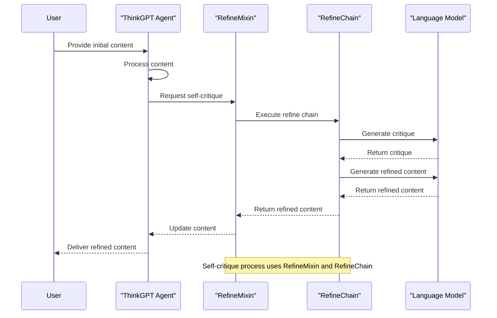
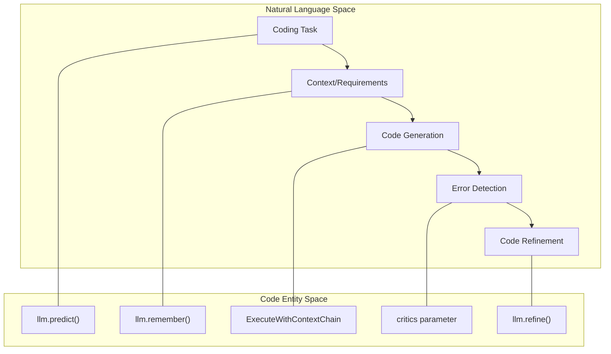
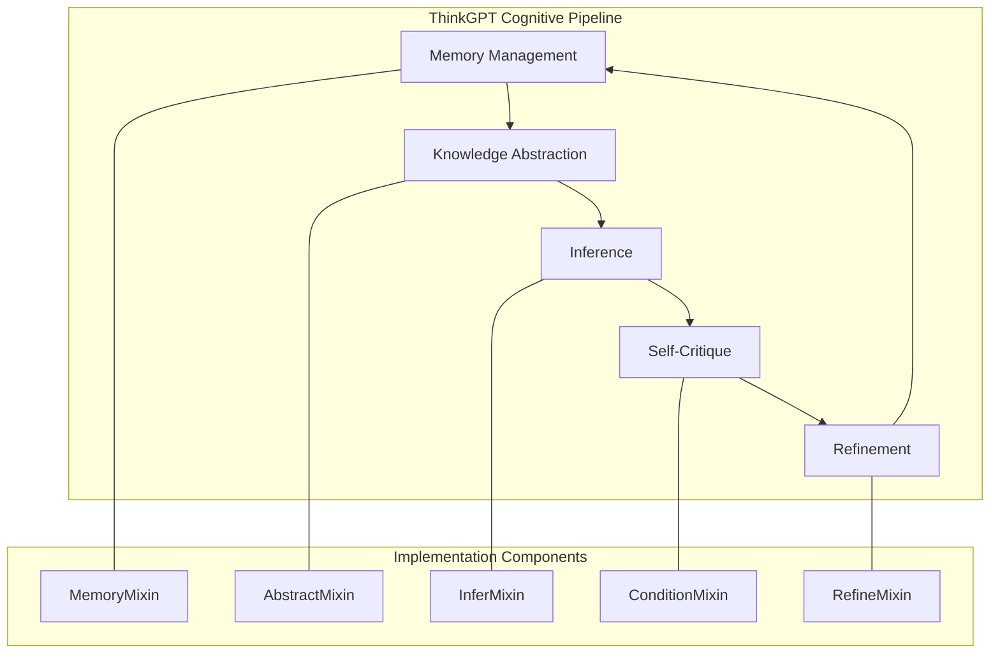

<!-- source: DeepWiki mcp.deepwiki.com · repo jina-ai/thinkgpt · page 4 Advanced Usage · fetched 2026-10-26 -->

# Advanced Usage

Relevant source files

The following files were used as context for generating this wiki page:

- [README.md](README.md)
- [thinkgpt/llm.py](thinkgpt/llm.py)

## Purpose and Scope

This document covers advanced techniques and sophisticated use cases for the ThinkGPT library. It focuses on leveraging ThinkGPT's cognitive capabilities beyond basic usage to create more powerful AI applications. For basic installation and simple usage examples, see [Getting Started](#3).

The advanced usage techniques presented here will help you implement sophisticated memory management, self-refinement mechanisms, and code generation applications with ThinkGPT.

Sources: [README.md:11-20](), [README.md:163-165]()

## Advanced Memory Management & Expansion

ThinkGPT provides powerful mechanisms for managing, expanding, and utilizing agent memory beyond simple storage and retrieval. These techniques enable the creation of more sophisticated agents with improved reasoning capabilities.

### Memory Replay and Expansion

Memory replay allows agents to revisit stored memories and derive new insights, similar to how humans reflect on past experiences to form new connections. ThinkGPT implements this concept through the combination of memory retrieval and inference.

**Memory Replay Example (from examples/replay_expand_memory.py)**:

1. Store initial observations about an agent
2. Retrieve those memories using `remember()`
3. Generate new insights using `infer()`
4. Add those new insights back to memory

This technique enables ThinkGPT to progressively expand its knowledge base through reflection, similar to the concept introduced in the "Generative Agents" research paper.

Sources: [README.md:216-227](), [thinkgpt/llm.py:14-15]()

### Context Management for Large Knowledge Bases

When working with large knowledge bases that exceed the context window of the language model, ThinkGPT offers several strategies:

1. **Token-limited retrieval**: Retrieve only enough documents to fit within a specified token limit
2. **Relevance-based filtering**: Select the most relevant documents based on embedding similarity
3. **Knowledge compression**: Use summarization or abstraction to compress knowledge

**Advanced retrieval parameters**:
- `max_tokens`: Limit the total tokens in retrieved memories
- `limit`: Maximum number of documents to retrieve
- `sort_by_order`: Sort results by original insertion order instead of relevance

Sources: [README.md:52-67](), [README.md:100-123]()

## Self-Critique & Refinement

ThinkGPT's self-refinement capabilities enable the creation of agents that can evaluate and improve their own knowledge and outputs through a process of critique and refinement.

### Self-Critique Workflow

The self-critique process involves:

1. Generating initial content
2. Identifying issues or areas for improvement
3. Refining the content based on the critique

This technique is particularly effective for:

| Application | Description | Example Use |
|-------------|-------------|-------------|
| Code refinement | Fix errors in generated code | Fix syntax or logical errors in code |
| Content improvement | Enhance accuracy or clarity | Refine explanations or descriptions |
| Knowledge correction | Update incorrect information | Correct factual errors in memory |

Sources: [README.md:76-98](), [README.md:229-238](), [thinkgpt/llm.py:13]()

### Implementing Self-Critique Cycles

To implement iterative refinement cycles with ThinkGPT:

1. Start with content that needs refinement
2. Use the `refine()` method with appropriate critics
3. Optionally, provide instruction hints to guide the refinement process
4. Memorize the refined content using `memorize()`

The refinement process can be applied to:
- Code snippets (fixing syntax errors)
- Knowledge statements (correcting factual errors)
- Generated content (improving clarity or accuracy)

Sources: [README.md:229-238](), [thinkgpt/llm.py:53-54]()

## Code Generation & Refinement

ThinkGPT can be used for sophisticated code generation and refinement tasks, enabling applications such as self-healing code generation and intelligent programming assistants.

### Code Generation Process

The code generation and refinement workflow involves:

1. Providing a programming task in natural language
2. Retrieving relevant context from memory (documentation, examples)
3. Generating initial code
4. Identifying errors or issues
5. Refining the code to address the issues

Sources: [README.md:76-98](), [thinkgpt/llm.py:12-13]()

### Self-Healing Code Generation

Self-healing code generation involves:

1. Generating code based on a natural language description
2. Executing the code or analyzing it for errors
3. Using the error messages as critics for refinement
4. Generating improved code that addresses the identified issues

This technique enables ThinkGPT to progressively improve generated code until it meets requirements and is free of errors, similar to the approach used in projects like gptdeploy and wolverine mentioned in the documentation.

**Example application**:
- Generate initial code for a task
- Capture any syntax or runtime errors
- Feed errors as critics to `refine()` method
- Continue refinement until code works correctly

Sources: [README.md:76-98](), [README.md:98-99]()

### Teaching ThinkGPT About Programming Libraries

ThinkGPT can be taught about programming libraries and frameworks to improve code generation capabilities:

1. Memorize documentation about the library
2. Abstract patterns and best practices from examples
3. Use the memorized knowledge to generate code that follows library conventions

**Example**: Teaching ThinkGPT about the DocArray library to generate proper DocArray code:

1. Memorize DocArray documentation
2. Retrieve relevant context when generating DocArray-related code
3. Generate code that properly uses DocArray classes and methods

Sources: [README.md:187-215]()

## Combining Advanced Techniques

The most powerful ThinkGPT applications combine multiple advanced techniques to create sophisticated cognitive systems.

### Cognitive Enhancement Pipeline

By combining these techniques, you can create applications that:

1. Build a knowledge base through memory management
2. Compress and abstract that knowledge for more efficient use
3. Make inferences to expand the knowledge base
4. Critique and refine the knowledge to improve accuracy
5. Apply the refined knowledge to generate high-quality outputs

This cognitive pipeline enables ThinkGPT to overcome limitations of standard LLMs and approach more sophisticated reasoning capabilities.

Sources: [thinkgpt/llm.py:23-59](), [README.md:12-18]()

## Performance Considerations

When implementing advanced ThinkGPT features, consider the following performance factors:

| Technique | Performance Considerations | Optimization Strategies |
|-----------|---------------------------|------------------------|
| Memory management | Large memory stores can be expensive to search | Use appropriate embedding models, limit retrieval size |
| Knowledge compression | Compression operations consume tokens | Batch compression operations, store compressed results |
| Self-refinement | Iterative refinement increases API usage | Limit refinement cycles, use specific instruction hints |
| Code generation | Complex code generation can require multiple attempts | Use targeted examples in memory, structure tasks incrementally |

Sources: [README.md:52-67](), [README.md:100-123]()

## Conclusion

This document has covered advanced usage techniques for ThinkGPT, focusing on memory management and expansion, self-critique and refinement, and code generation. By combining these techniques, you can create sophisticated AI applications that overcome the limitations of standard language models.

For detailed API reference information, see [API Reference](#5).

Sources: [README.md:11-20](), [README.md:163-165]()

---

