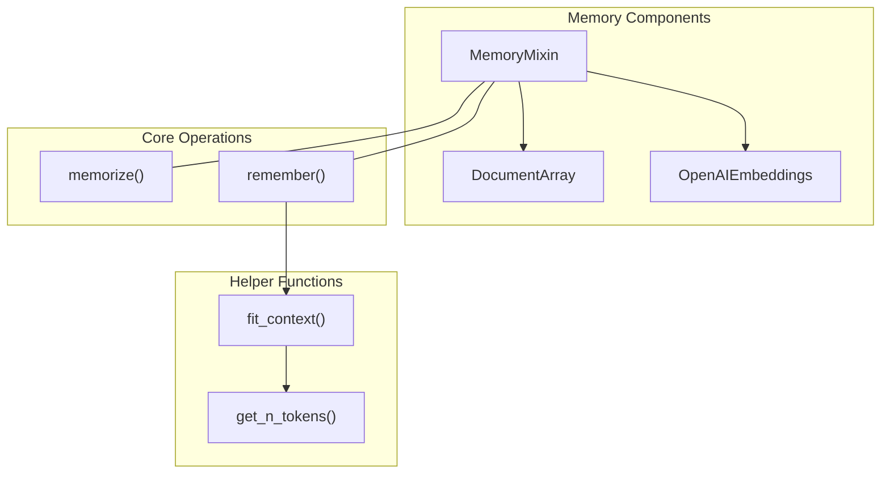
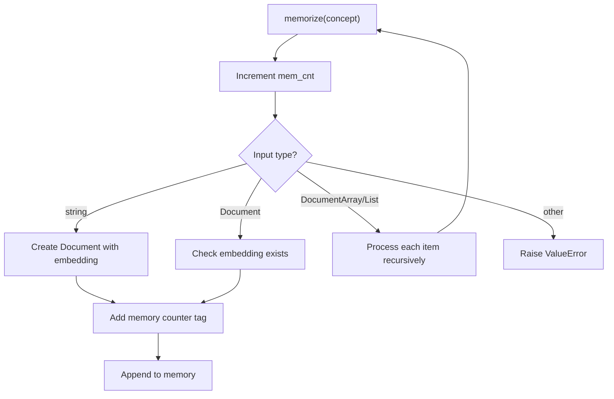
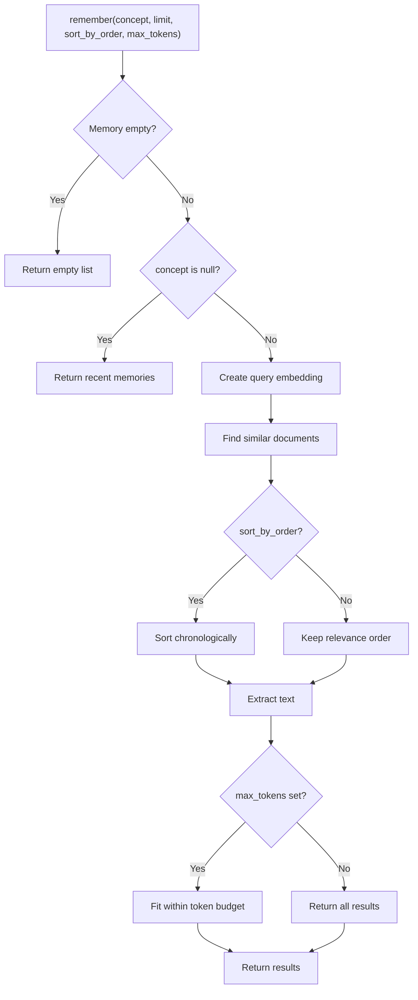
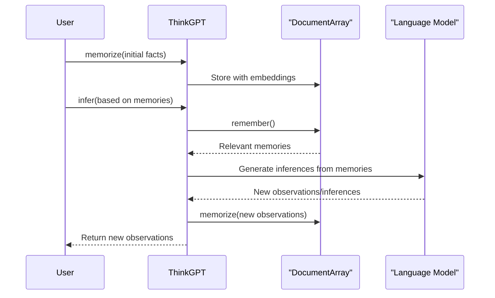
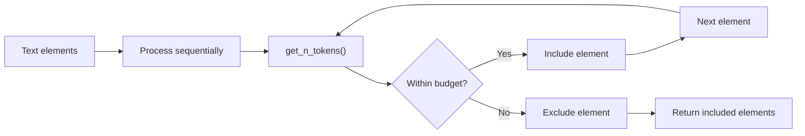
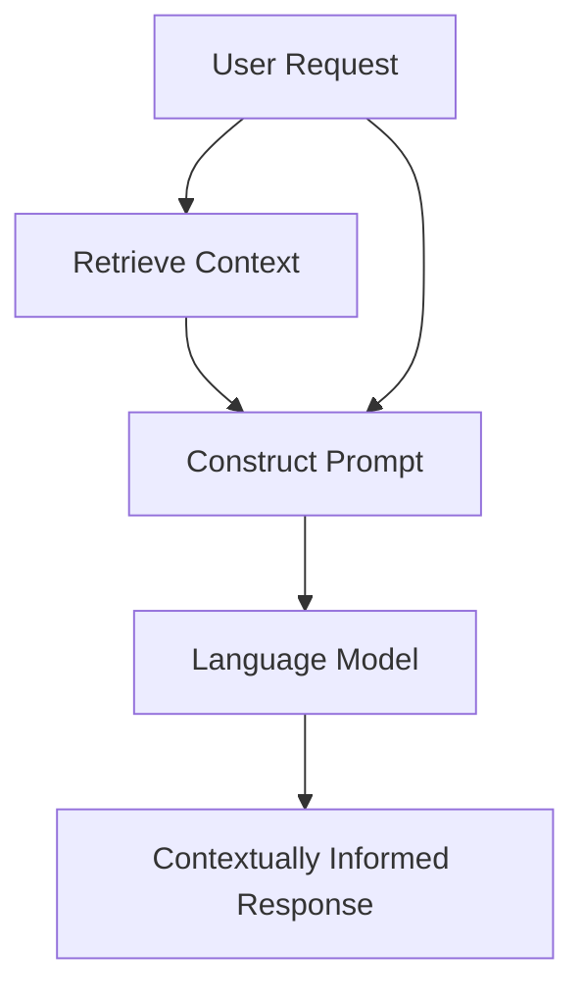
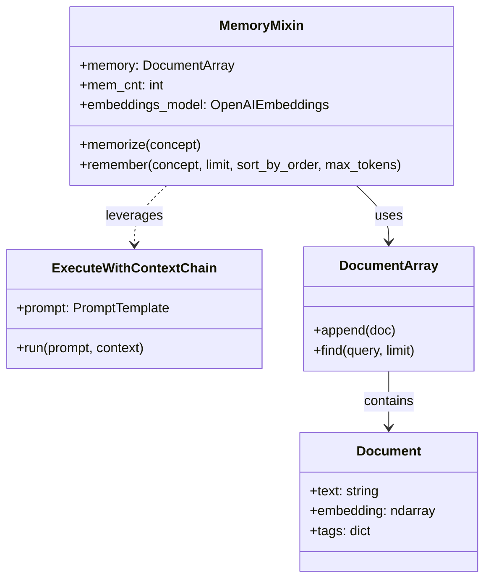

<!-- source: DeepWiki mcp.deepwiki.com · repo jina-ai/thinkgpt · page 4.1 Memory Management & Expansion · fetched 2026-10-26 -->

# Memory Management & Expansion

<details>
<summary>Relevant source files</summary>

The following files were used as context for generating this wiki page:

- [examples/replay_expand_memory.py](examples/replay_expand_memory.py)
- [thinkgpt/helper.py](thinkgpt/helper.py)
- [thinkgpt/memory.py](thinkgpt/memory.py)

</details>


## Purpose and Scope

This document covers ThinkGPT's memory management system, which enables language models to maintain and expand persistent knowledge beyond a single conversation. It details how ThinkGPT stores information, retrieves relevant context, handles token constraints, and expands knowledge through inference.

For information about knowledge compression techniques used alongside memory management, see [Knowledge Compression](#2.2).

## Memory System Architecture

ThinkGPT's memory system is built on the `MemoryMixin` class, which provides memory storage and retrieval functionality through vector embeddings.



**Memory Architecture Diagram**

Sources: [thinkgpt/memory.py:26-30]()

The primary components:
- `MemoryMixin`: Provides methods for storing and retrieving information
- `DocumentArray`: Vector store that maintains documents with embeddings
- `OpenAIEmbeddings`: Service that converts text into vector representations
- Helper functions in `helper.py` for token management

## Core Memory Operations

### Memorizing Information

The `memorize()` method adds information to the agent's memory, supporting various input types:



**Memorization Process Flow**

Sources: [thinkgpt/memory.py:31-44]()

The memorization process:
1. Increments the memory counter (`mem_cnt`) to track chronological order
2. Processes the input based on its type:
   - String: Creates a Document with embedding and counter tag
   - Document: Ensures embedding exists and adds counter tag
   - DocumentArray/List: Recursively processes each item
3. Appends processed documents to the memory store

### Retrieving Information

The `remember()` method retrieves relevant context from memory based on a query:



**Memory Retrieval Process Flow**

Sources: [thinkgpt/memory.py:46-66](), [thinkgpt/helper.py:46-55]()

Key aspects of the retrieval process:
1. Handles edge cases (empty memory, null query)
2. Creates embeddings for semantic search
3. Finds similar documents based on embedding similarity
4. Optionally sorts results chronologically using the memory counter
5. Extracts text from matched documents
6. Applies token budget constraints when specified

## Memory Expansion Techniques

ThinkGPT can expand its knowledge base by inferring new information from existing memories:



**Memory Expansion Process**

Sources: [examples/replay_expand_memory.py:1-20]()

This technique allows ThinkGPT to:
1. Start with a base set of factual memories
2. Use `remember()` to retrieve relevant information
3. Generate new insights with `infer()` based on existing memories
4. Store these inferences as new memories with `memorize()`
5. Build an increasingly rich knowledge base over time

## Context Management and Token Constraints

Managing token limits is essential for effective memory utilization. ThinkGPT provides tools to handle these constraints:



**Token Budget Management Process**

Sources: [thinkgpt/helper.py:39-55]()

The `fit_context()` function ensures that retrieved memories fit within token limits:
1. Estimates token count for each text element using `get_n_tokens()`
2. Includes elements in order until the token budget is reached
3. Returns the maximum number of elements that fit within constraints

## Using Context in LLM Operations

Retrieved memories are incorporated into LLM operations using the `ExecuteWithContextChain`:



**Context Integration Process**

Sources: [thinkgpt/memory.py:12-23]()

The `ExecuteWithContextChain` uses a template that combines context and user request:
```
Given a context information, reply to the provided request
Context: {context}
User request: {prompt}
```

This integration ensures LLM responses leverage relevant memories for more informed and contextually appropriate outputs.

## Advanced Usage Examples

### Memory Expansion Through Inference

This example demonstrates how to expand memory through inference and reflection:

```python
from thinkgpt.llm import ThinkGPT

llm = ThinkGPT(model_name="gpt-3.5-turbo")

# Load initial memories
old_memory = [
    "Klaus Mueller is writing a research paper",
    "Klaus Mueller enjoys reading a book on gentrification",
    "Klaus Mueller is conversing with Ayesha Khan about exercising"
]

# Memorize the initial facts
llm.memorize(old_memory)

# Generate inferences based on existing memories
new_observations = llm.infer(facts=llm.remember())

# Store the inferences as new memories
llm.memorize(new_observations)
```

Sources: [examples/replay_expand_memory.py:1-20]()

This technique allows the system to:
- Start with explicit facts or observations
- Draw connections between existing memories
- Generate new insights or hypotheses
- Store these derived insights as new memories
- Incrementally build a richer understanding through this process

## Memory Management Class Structure

The following diagram illustrates the class structure for ThinkGPT's memory management system:



**Memory System Class Structure**

Sources: [thinkgpt/memory.py:19-66]()

---

