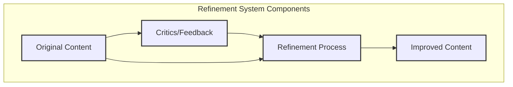
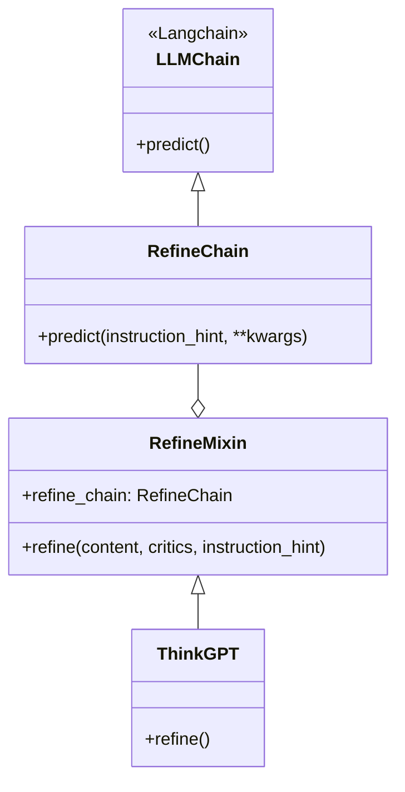
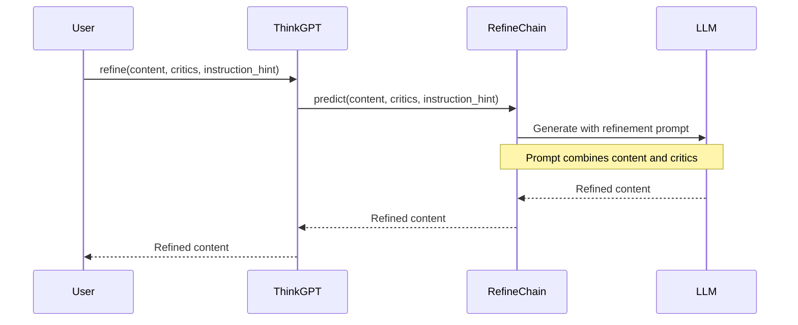
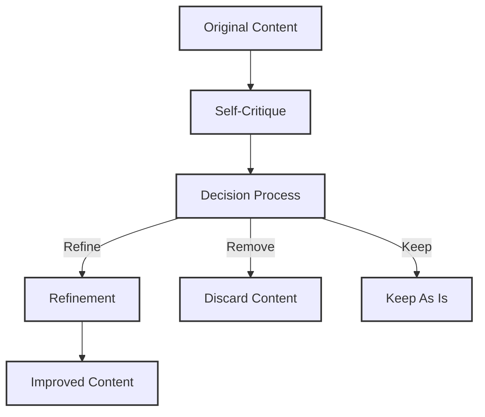
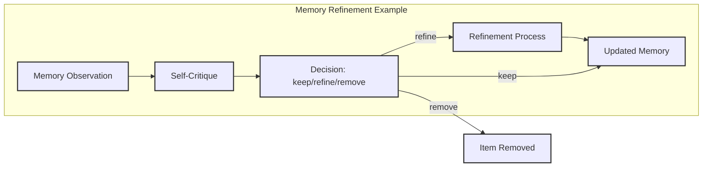
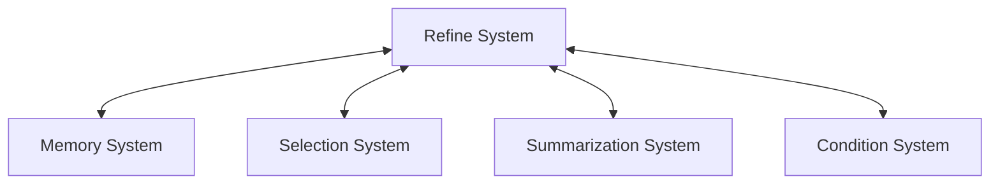

<!-- source: DeepWiki mcp.deepwiki.com · repo jina-ai/thinkgpt · page 4.2 Self-Critique & Refinement · fetched 2026-10-26 -->

# Self-Critique & Refinement

<details>
<summary>Relevant source files</summary>

The following files were used as context for generating this wiki page:

- [examples/replay_criticize_refine.py](examples/replay_criticize_refine.py)
- [thinkgpt/refine.py](thinkgpt/refine.py)

</details>


## Purpose and Scope

This document covers ThinkGPT's self-critique and refinement capabilities, which enable language models to evaluate their own outputs and improve them based on feedback. The refinement system provides a structured approach for content improvement through critique identification and targeted refinement. For information about general knowledge compression techniques, see [Knowledge Compression](#2.2), or for code-specific refinement patterns, see [Code Generation & Refinement](#4.3).

## Overview

ThinkGPT's refinement system provides a structured mechanism allowing language models to improve content based on critique. This capability forms a key cognitive function that enables iterative improvement of knowledge, responses, and generated content.



Sources: [thinkgpt/refine.py:1-51]()

## Core Components

The refinement system consists of two primary components:

1. **RefineChain**: An LLMChain implementation that processes the original content and critics to generate improved content
2. **RefineMixin**: A mixin class that adds refinement capabilities to the ThinkGPT class



Sources: [thinkgpt/refine.py:19-37]()

### RefineChain

The `RefineChain` class extends Langchain's `LLMChain` and uses a prompt template specifically designed for refinement tasks. The prompt template takes three key inputs:

1. `content`: The original content to be refined
2. `critics`: Feedback or criticism about the content
3. `instruction_hint`: Optional guidance on how to perform the refinement

Sources: [thinkgpt/refine.py:19-27]()

### RefineMixin

The `RefineMixin` class adds the `refine` method to ThinkGPT, creating a clean interface for refinement operations. This method takes the original content, a list of critics, and an optional instruction hint, then returns the refined content.

Sources: [thinkgpt/refine.py:30-36]()

## Refinement Workflow

The refinement process typically follows this sequence:



Sources: [thinkgpt/refine.py:30-36](), [examples/replay_criticize_refine.py:29-32]()

## Self-Critique Implementation

While refinement provides the mechanism for improving content, self-critique enables the agent to identify issues with its own content. The full self-critique and refinement cycle typically involves:

1. **Content Generation**: Creating initial content or retrieving from memory
2. **Critique**: Evaluating the content for errors, inconsistencies, or areas of improvement
3. **Decision**: Determining whether to keep, refine, or discard the content
4. **Refinement**: Improving content based on the critique



Sources: [examples/replay_criticize_refine.py:19-37]()

## Practical Example: Memory Refinement

One practical application of self-critique and refinement is refining an agent's memory to correct inaccuracies or misconceptions. The example below demonstrates how ThinkGPT can:

1. Review its own memories
2. Generate critique for each memory item
3. Decide whether to keep, refine, or remove each item
4. Apply refinement to create improved memory items



Sources: [examples/replay_criticize_refine.py:19-40]()

### Example Implementation

This implementation pattern demonstrates the full cycle of critique and refinement for memory items:

1. Retrieve observations from memory
2. For each observation:
   - Generate critique
   - Decide to keep, refine, or remove
   - Apply refinement when needed
3. Store the updated observations back to memory

The example shown in [examples/replay_criticize_refine.py]() demonstrates this pattern with Fibonacci sequence knowledge, correcting an erroneous memory item that incorrectly stated "the second number in Fibonacci sequence is 2" to "The corrected observation is that the second number in the Fibonacci sequence is 1."

Sources: [examples/replay_criticize_refine.py:1-52]()

## Technical Implementation

### Refinement Prompt

The refinement process uses a specific prompt template to guide the language model:

```
Based on the critics, fix the content provided to you. {instruction_hint}:
content:
{content}
---------
critics:
{critics}
---------
```

This template structures the refinement task by clearly separating the original content from the critics and providing space for optional instruction hints.

Sources: [thinkgpt/refine.py:9-17]()

### API Reference

The `refine` method provides a straightforward interface for content refinement:

| Parameter | Type | Description |
|-----------|------|-------------|
| `content` | str | The original content to be refined |
| `critics` | List[str] | List of criticisms or feedback about the content |
| `instruction_hint` | str | Optional guidance on how to perform the refinement |
| **Returns** | str | The refined content |

Sources: [thinkgpt/refine.py:33-36]()

## Advanced Usage Patterns

### Self-Critique Loop

The most powerful application of the refinement system is implementing a self-critique loop, where the agent:

1. Generates content
2. Critiques its own output
3. Refines based on its critique
4. Optionally repeats until quality criteria are met

This pattern can be particularly effective for complex reasoning tasks, creative writing, and code generation where iterative improvement leads to higher quality outputs.

### Guided Refinement with Instruction Hints

The `instruction_hint` parameter provides flexibility in guiding the refinement process. Example use cases include:

- "Fix grammar and spelling errors only"
- "Improve clarity and conciseness"
- "Ensure technical accuracy without changing the overall structure"
- "Just give the new observation and nothing else"

This controlled refinement allows for targeted improvements rather than wholesale rewriting.

Sources: [examples/replay_criticize_refine.py:30](), [thinkgpt/refine.py:9-17](), [thinkgpt/refine.py:26-27]()

## Integration with Other ThinkGPT Components

The refinement system integrates well with other ThinkGPT capabilities:

- **Memory Management**: Refine stored memories to improve accuracy
- **Selection**: Choose between multiple refinement options
- **Summarization**: Refine summaries for improved accuracy and clarity
- **Condition Evaluation**: Refine conditions to make them more precise



Sources: [examples/replay_criticize_refine.py:1-52]()

## Summary

ThinkGPT's Self-Critique & Refinement capabilities enable language models to evaluate and improve their own content, establishing a feedback loop that leads to progressively better results. By combining structured critique with targeted refinement, these capabilities address one of the core limitations of traditional language models: the inability to revise their own outputs based on identified flaws.

The implementation, centered around the `RefineMixin` and `RefineChain` classes, provides a flexible framework for refinement that can be applied to a wide range of content types and use cases.

---

