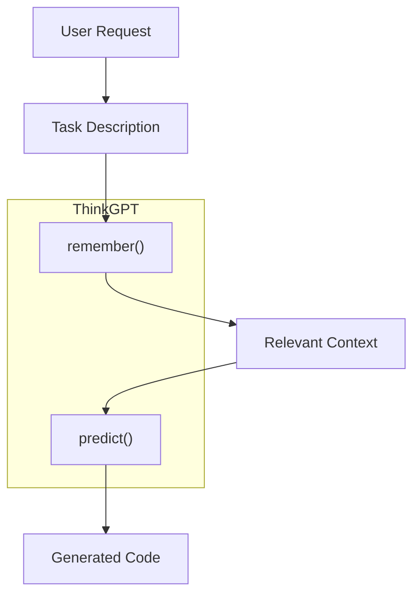
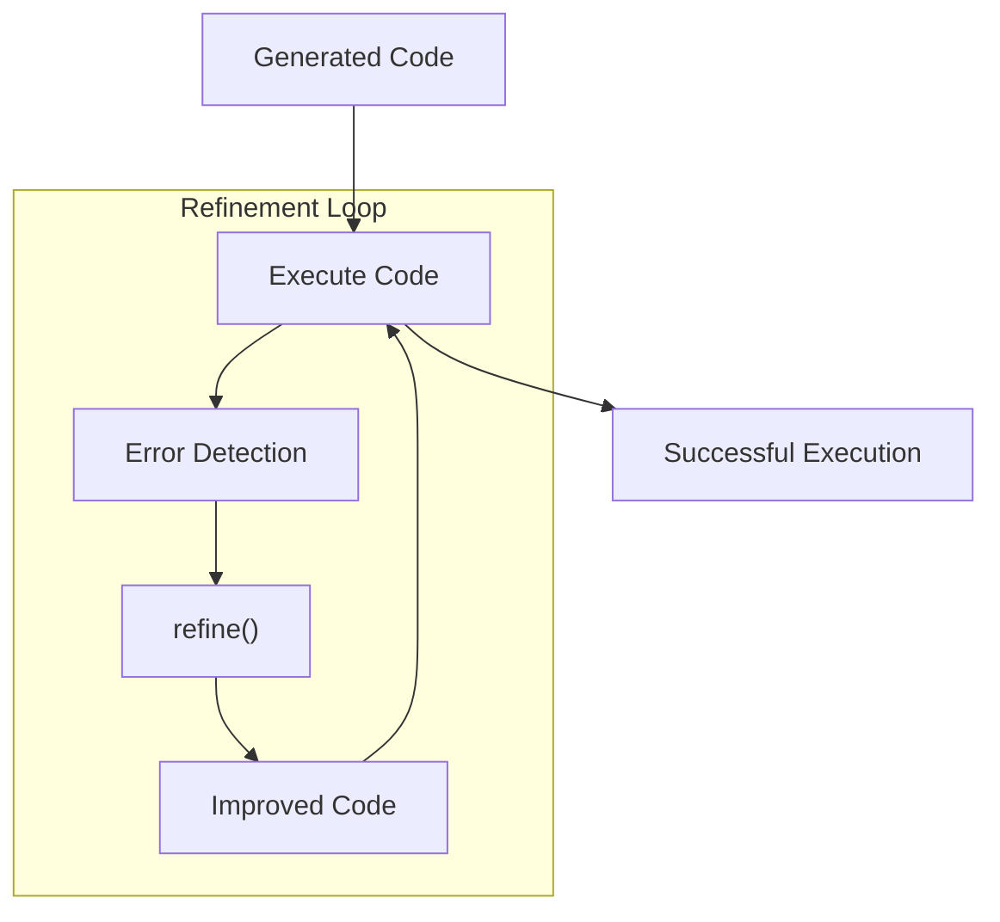
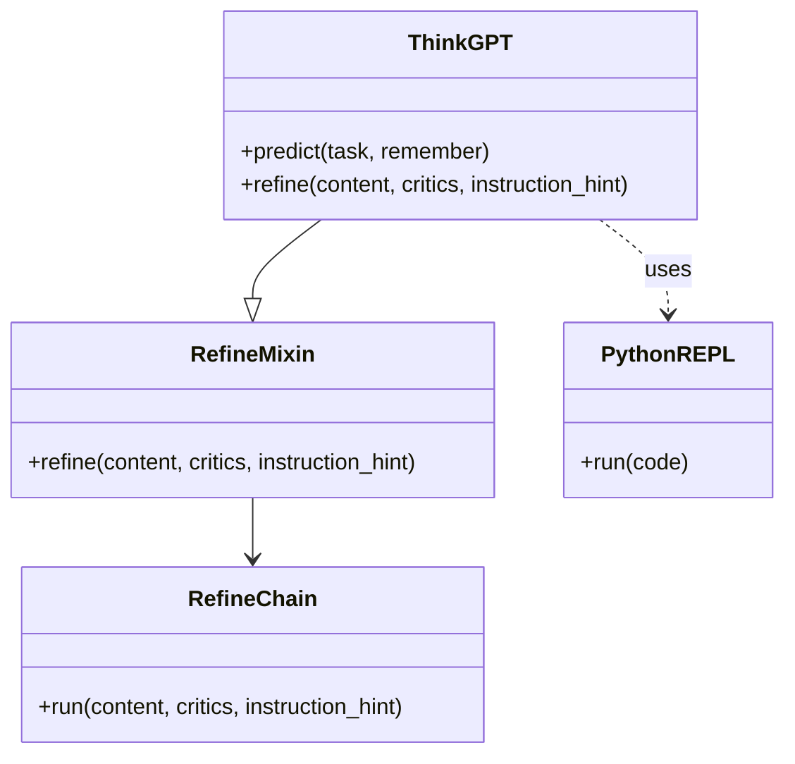
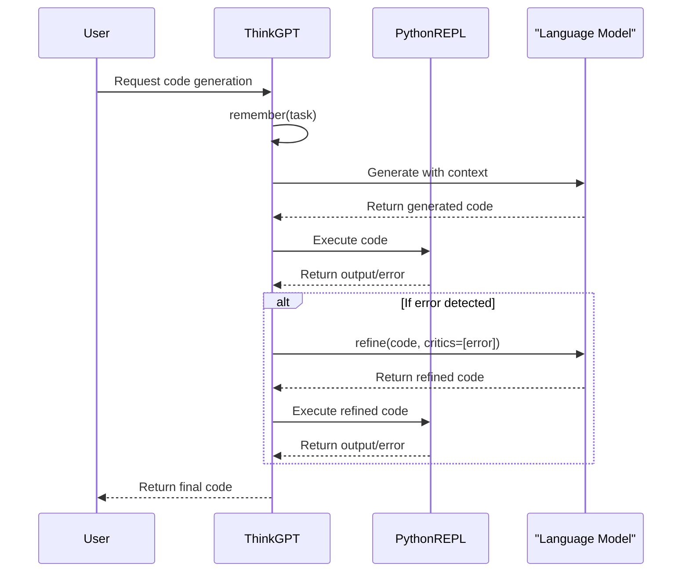

<!-- source: DeepWiki mcp.deepwiki.com · repo jina-ai/thinkgpt · page 4.3 Code Generation & Refinement · fetched 2026-10-26 -->

# Code Generation & Refinement

<details>
<summary>Relevant source files</summary>

The following files were used as context for generating this wiki page:

- [examples/__init__.py](examples/__init__.py)
- [examples/code_self_refinement.py](examples/code_self_refinement.py)
- [examples/teach_remember_refine.py](examples/teach_remember_refine.py)

</details>


## Purpose and Scope

This document explains how ThinkGPT enables the generation and refinement of code through its specialized capabilities. It covers the mechanics of code generation using language models, error detection, and the iterative refinement process that improves code quality. This page focuses specifically on code-related tasks, while general content refinement is covered in [Self-Refinement System](#2.3).

## Code Generation Capabilities

ThinkGPT provides robust capabilities for generating code across various programming languages, with particular strength in Python. When generating code, ThinkGPT leverages its memory system to retrieve relevant context and examples, improving the quality and relevance of the generated code.

### Generation Process



Sources: [examples/teach_remember_refine.py:10-11]()

The process begins with a natural language request that describes the code to be generated. ThinkGPT then:

1. Analyzes the request to understand the requirements
2. Retrieves relevant information from memory using the `remember()` function
3. Constructs appropriate instructions for the language model
4. Generates code that satisfies the original request

### Key Components for Code Generation

| Component | Purpose | Usage |
|-----------|---------|-------|
| `predict()` | Primary method for generating code | Converts natural language request into code |
| `remember()` | Retrieves relevant context | Enhances generation with specific knowledge |
| `memorize()` | Stores knowledge for future use | Allows pre-loading of code examples or documentation |

Sources: [examples/teach_remember_refine.py:7-11]()

## Code Refinement System

The refinement system enables ThinkGPT to improve and fix code based on feedback, errors, or additional requirements. This creates an iterative development process where code quality increases with each refinement cycle.

### Refinement Process



Sources: [examples/teach_remember_refine.py:12-19](), [examples/code_self_refinement.py:5-15]()

### Components and Implementation



Sources: [examples/teach_remember_refine.py:1-2](), [examples/code_self_refinement.py:1]()

### Error Handling and Critics

The refinement process relies on a system of "critics" - feedback elements that identify issues in the generated code. Critics can be:

1. Runtime errors captured from code execution
2. Syntax errors detected by parsers
3. Linting issues or style violations
4. Custom feedback from users or tests

When provided with critics, the `refine()` method analyzes the issues and creates improved code that addresses the identified problems.

## Implementation Details

### Code Generation and Refinement Workflow



Sources: [examples/teach_remember_refine.py:11-20]()

### PythonREPL Integration

ThinkGPT utilizes a `PythonREPL` helper class that enables:

1. Direct execution of generated Python code
2. Capture of both successful outputs and error messages
3. Integration of execution results into the refinement cycle

This real-time execution and feedback loop is essential for effective code refinement.

## Example Use Cases

### Simple Code Generation

The system can generate code based on natural language descriptions:

```
Task: "generate python code that uses langchain to send a request to OpenAI LLM and ask it suggest 3 recipes"
```

ThinkGPT generates the appropriate Python code using its knowledge of the Langchain library.

Sources: [examples/teach_remember_refine.py:9-11]()

### Error Correction

When code contains errors, ThinkGPT can refine it based on error messages:

```
Error: "IndentationError: unexpected indent"
```

The system analyzes the error and produces corrected code with proper indentation.

Sources: [examples/code_self_refinement.py:10-14]()

### Customized Refinement Instructions

ThinkGPT allows custom instruction hints to guide the refinement process:

| Parameter | Example | Purpose |
|-----------|---------|---------|
| `content` | Original code | The code to be refined |
| `critics` | Error messages | Feedback for improvement |
| `instruction_hint` | "Fix the code snippet based on the error provided" | Guidance for the refinement |

Sources: [examples/code_self_refinement.py:5-15](), [examples/teach_remember_refine.py:15-19]()

## Best Practices

For optimal results when using code generation and refinement:

1. Provide clear, detailed task descriptions
2. Pre-load ThinkGPT with relevant documentation or examples using `memorize()`
3. Use the `remember()` function to retrieve context for complex tasks
4. Implement iterative refinement cycles for challenging code generation tasks
5. Supply specific error messages or feedback as critics
6. Use custom instruction hints to guide the refinement process

By following these practices, ThinkGPT can effectively generate high-quality code and progressively improve it through refinement cycles.

---

