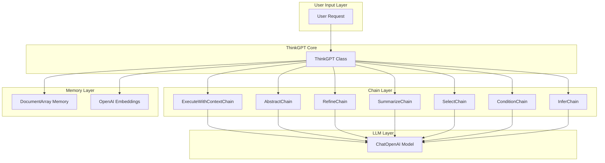
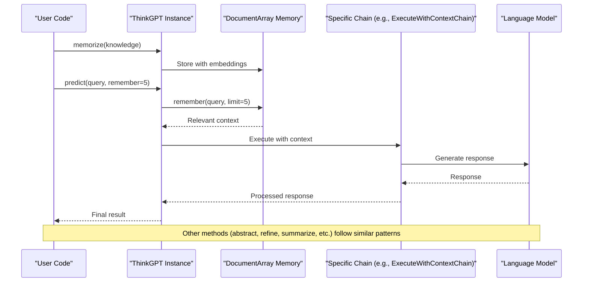
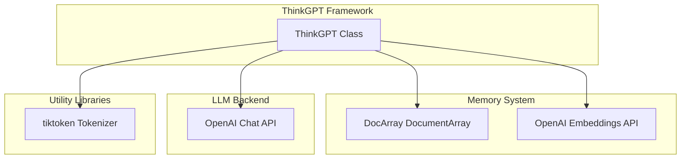

<!-- source: DeepWiki mcp.deepwiki.com · repo jina-ai/thinkgpt · page 5 API Reference · fetched 2026-10-26 -->

# API Reference

<details>
<summary>Relevant source files</summary>

The following files were used as context for generating this wiki page:

- [README.md](README.md)
- [thinkgpt/helper.py](thinkgpt/helper.py)
- [thinkgpt/llm.py](thinkgpt/llm.py)
- [thinkgpt/memory.py](thinkgpt/memory.py)

</details>


## Purpose and Scope

This document provides comprehensive API documentation for the ThinkGPT library. It covers the main classes, mixins, chains, and utility functions that power ThinkGPT's capabilities. For installation and basic usage examples, see [Getting Started](#3), and for more advanced usage patterns, refer to [Advanced Usage](#4).

The API Reference is organized by component type, focusing on method signatures, parameters, and return values to serve as a technical reference for developers implementing ThinkGPT in their projects.

## API Architecture Overview

The ThinkGPT API is structured around a central `ThinkGPT` class that inherits capabilities from multiple specialized mixins, each implementing a specific cognitive function. The class uses a chain-based architecture for executing operations through the language model.

### Class Inheritance Diagram

```mermaid
classDiagram
    class "ChatOpenAI" {
        <<Langchain>>
    }
    
    class "ThinkGPT" {
        +memory: DocumentArray
        +embeddings_model: OpenAIEmbeddings
        +mem_cnt: int
        +generate()
        +predict()
    }
    
    class "MemoryMixin" {
        +memorize()
        +remember()
    }
    
    class "AbstractMixin" {
        +abstract()
    }
    
    class "RefineMixin" {
        +refine()
    }
    
    class "SummarizeMixin" {
        +summarize()
        +chunked_summarize()
    }
    
    class "SelectMixin" {
        +select()
    }
    
    class "ConditionMixin" {
        +condition()
    }
    
    class "InferMixin" {
        +infer()
    }
    
    "ChatOpenAI" <|-- "ThinkGPT"
    "MemoryMixin" <|-- "ThinkGPT"
    "AbstractMixin" <|-- "ThinkGPT"
    "RefineMixin" <|-- "ThinkGPT"
    "SummarizeMixin" <|-- "ThinkGPT"
    "SelectMixin" <|-- "ThinkGPT"
    "ConditionMixin" <|-- "ThinkGPT"
    "InferMixin" <|-- "ThinkGPT"
```

Sources: [thinkgpt/llm.py:23-83](). [thinkgpt/memory.py:26-66]()

### Chain-Based Processing Architecture



Sources: [thinkgpt/llm.py:23-83](). [thinkgpt/memory.py:26-66]()

## ThinkGPT Class

The core class that integrates all ThinkGPT functionality.

### Initialization

```python
ThinkGPT(
    memory: DocumentArray = None,
    execute_with_context_chain: ExecuteWithContextChain = None,
    abstract_chain: AbstractChain = None,
    refine_chain: RefineChain = None,
    condition_chain: ConditionChain = None,
    select_chain: SelectChain = None,
    infer_chain: InferChain = None,
    summarize_chain: SummarizeChain = None,
    verbose=True,
    **kwargs
)
```

| Parameter | Type | Description |
|-----------|------|-------------|
| `memory` | `DocumentArray` | Storage for remembered information. If None, creates a new DocumentArray. |
| `execute_with_context_chain` | `ExecuteWithContextChain` | Chain for executing with context. If None, creates a new one. |
| `abstract_chain` | `AbstractChain` | Chain for abstracting rules. If None, creates a new one. |
| `refine_chain` | `RefineChain` | Chain for refining content. If None, creates a new one. |
| `condition_chain` | `ConditionChain` | Chain for evaluating conditions. If None, creates a new one. |
| `select_chain` | `SelectChain` | Chain for selecting options. If None, creates a new one. |
| `infer_chain` | `InferChain` | Chain for making inferences. If None, creates a new one. |
| `summarize_chain` | `SummarizeChain` | Chain for summarizing content. If None, creates a new one. |
| `verbose` | `bool` | Whether to output detailed logs. Default is True. |
| `**kwargs` | | Additional kwargs passed to the underlying ChatOpenAI model (e.g., model_name). |

Sources: [thinkgpt/llm.py:30-59]()

### Core Methods

#### generate

```python
generate(
    prompts: List[List[str]], 
    stop: Optional[List[str]] = None, 
    remember: Union[int, List[str]] = 0
) -> LLMResult
```

Generates responses to prompts, optionally using remembered information as context.

| Parameter | Type | Description |
|-----------|------|-------------|
| `prompts` | `List[List[str]]` | List of prompts to generate responses for. Currently only works with a single prompt. |
| `stop` | `Optional[List[str]]` | Optional list of strings that signal the end of generation. |
| `remember` | `Union[int, List[str]]` | Either a number of memories to retrieve, or a list of specific memories to use as context. |

**Returns**: `LLMResult` - The generation results.

Sources: [thinkgpt/llm.py:62-77]()

#### predict

```python
predict(
    prompt: str, 
    stop: Optional[List[str]] = None, 
    remember: Union[int, List[str]] = 0
) -> str
```

Higher-level convenience method to generate a single response to a prompt.

| Parameter | Type | Description |
|-----------|------|-------------|
| `prompt` | `str` | The prompt to respond to. |
| `stop` | `Optional[List[str]]` | Optional list of strings that signal the end of generation. |
| `remember` | `Union[int, List[str]]` | Either a number of memories to retrieve, or a list of specific memories to use as context. |

**Returns**: `str` - The generated text response.

Sources: [thinkgpt/llm.py:79-82]()

## Memory Management

### MemoryMixin

Adds memory capabilities to the ThinkGPT class.

#### memorize

```python
memorize(concept: Union[str, Document, DocumentArray, List])
```

Stores information in the memory system for later retrieval.

| Parameter | Type | Description |
|-----------|------|-------------|
| `concept` | `Union[str, Document, DocumentArray, List]` | Information to store. Can be a string, Document, DocumentArray, or List of these. |

Sources: [thinkgpt/memory.py:31-44]()

#### remember

```python
remember(
    concept: Union[str, Document] = None, 
    limit: int = 5, 
    sort_by_order: bool = False, 
    max_tokens: Optional[int] = None
) -> List[str]
```

Retrieves relevant information from memory based on a query concept.

| Parameter | Type | Description |
|-----------|------|-------------|
| `concept` | `Union[str, Document]` | Query to find relevant memories. If None, returns the most recent memories. |
| `limit` | `int` | Maximum number of memories to retrieve. Default is 5. |
| `sort_by_order` | `bool` | If True, sorts results by chronological order. Default is False. |
| `max_tokens` | `Optional[int]` | If specified, limits total tokens of returned memories. |

**Returns**: `List[str]` - List of relevant memory texts.

Sources: [thinkgpt/memory.py:46-66]()

### ExecuteWithContextChain

Chain for executing a request with provided context information.

```python
ExecuteWithContextChain(**kwargs)
```

Initialized with the `EXECUTE_WITH_CONTEXT_PROMPT` template and any additional LLMChain parameters.

Sources: [thinkgpt/memory.py:20-24]()

## Knowledge Processing

### AbstractMixin

Adds rule abstraction capabilities to ThinkGPT.

#### abstract

```python
abstract(
    observations: List[str], 
    instruction_hint: str = None
) -> List[str]
```

Extracts general rules or patterns from specific observations.

| Parameter | Type | Description |
|-----------|------|-------------|
| `observations` | `List[str]` | List of specific examples or observations. |
| `instruction_hint` | `str` | Optional instructions to guide the abstraction process. |

**Returns**: `List[str]` - List of abstracted rules or patterns.

Sources: [README.md:125-137]()

### SummarizeMixin

Adds summarization capabilities to ThinkGPT.

#### summarize

```python
summarize(
    content: str, 
    max_tokens: int = None, 
    instruction_hint: str = None
) -> str
```

Summarizes content in a single operation.

| Parameter | Type | Description |
|-----------|------|-------------|
| `content` | `str` | Text content to summarize. |
| `max_tokens` | `int` | Maximum tokens in the summary. |
| `instruction_hint` | `str` | Optional guidance for the summarization process. |

**Returns**: `str` - Summarized content.

#### chunked_summarize

```python
chunked_summarize(
    content: str, 
    max_tokens: int = None, 
    instruction_hint: str = None
) -> str
```

Breaks large content into chunks, summarizes each chunk, then combines summaries.

| Parameter | Type | Description |
|-----------|------|-------------|
| `content` | `str` | Text content to summarize. |
| `max_tokens` | `int` | Maximum tokens in the final summary. |
| `instruction_hint` | `str` | Optional guidance for the summarization process. |

**Returns**: `str` - Summarized content.

Sources: [README.md:102-122]()

## Self-improvement

### RefineMixin

Adds self-refinement capabilities to ThinkGPT.

#### refine

```python
refine(
    content: str, 
    critics: List[str], 
    instruction_hint: str = None
) -> str
```

Refines content based on critics or feedback.

| Parameter | Type | Description |
|-----------|------|-------------|
| `content` | `str` | Original content to refine. |
| `critics` | `List[str]` | List of criticisms or feedback. |
| `instruction_hint` | `str` | Optional guidance for the refinement process. |

**Returns**: `str` - Refined content.

Sources: [README.md:78-96]()

## Decision Making

### ConditionMixin

Adds natural language condition evaluation to ThinkGPT.

#### condition

```python
condition(
    query: str, 
    instruction_hint: str = None
) -> bool
```

Evaluates a natural language condition query.

| Parameter | Type | Description |
|-----------|------|-------------|
| `query` | `str` | The condition to evaluate. |
| `instruction_hint` | `str` | Optional guidance for the evaluation process. |

**Returns**: `bool` - True if the condition is met, False otherwise.

Sources: [README.md:142-148]()

### SelectMixin

Adds option selection capabilities to ThinkGPT.

#### select

```python
select(
    question: str, 
    options: List[str], 
    num_choices: int = None,
    instruction_hint: str = None
) -> List[str]
```

Selects the best option(s) from a list based on a question.

| Parameter | Type | Description |
|-----------|------|-------------|
| `question` | `str` | The question to evaluate options against. |
| `options` | `List[str]` | List of options to choose from. |
| `num_choices` | `int` | Number of options to select. If None, selects any number deemed appropriate. |
| `instruction_hint` | `str` | Optional guidance for the selection process. |

**Returns**: `List[str]` - Selected option(s).

Sources: [README.md:149-162]()

## Inference

### InferMixin

Adds inference capabilities to ThinkGPT.

#### infer

```python
infer(
    context: Union[str, List[str]], 
    instruction_hint: str = None
) -> List[str]
```

Makes inferences or deductions based on context.

| Parameter | Type | Description |
|-----------|------|-------------|
| `context` | `Union[str, List[str]]` | The context information to make inferences from. |
| `instruction_hint` | `str` | Optional guidance for the inference process. |

**Returns**: `List[str]` - List of inferences or deductions.

Sources: [README.md:216-227]()

## Utility Functions

### get_n_tokens

```python
get_n_tokens(input: str, model_name: str = 'gpt-3.5-turbo') -> int
```

Counts the number of tokens in a string for a specific model.

| Parameter | Type | Description |
|-----------|------|-------------|
| `input` | `str` | The input text to count tokens for. |
| `model_name` | `str` | The model to use for token counting. Default is 'gpt-3.5-turbo'. |

**Returns**: `int` - Number of tokens.

Sources: [thinkgpt/helper.py:39-43]()

### fit_context

```python
fit_context(text_elements: List[str], max_tokens: int) -> List[str]
```

Filters a list of text elements to fit within a token limit.

| Parameter | Type | Description |
|-----------|------|-------------|
| `text_elements` | `List[str]` | List of text elements to filter. |
| `max_tokens` | `int` | Maximum number of tokens to allow. |

**Returns**: `List[str]` - Filtered list of text elements.

Sources: [thinkgpt/helper.py:46-55]()

### PythonREPL

Simulates a standalone Python REPL (Read-Eval-Print Loop).

```python
PythonREPL(globals: Optional[Dict] = None, locals: Optional[Dict] = None)
```

| Parameter | Type | Description |
|-----------|------|-------------|
| `globals` | `Optional[Dict]` | Global variables for execution context. |
| `locals` | `Optional[Dict]` | Local variables for execution context. |

#### run

```python
run(command: str) -> Tuple[str, Optional[str]]
```

Executes a Python command in the REPL environment.

| Parameter | Type | Description |
|-----------|------|-------------|
| `command` | `str` | Python code to execute. |

**Returns**: `Tuple[str, Optional[str]]` - Tuple of (output, error). Error is None if no error occurred.

Sources: [thinkgpt/helper.py:16-36]()

### LineSeparatorOutputParser

Parser that splits text by line breaks.

```python
LineSeparatorOutputParser()
```

#### parse

```python
parse(text: str) -> List[str]
```

Parses text by splitting on newlines.

| Parameter | Type | Description |
|-----------|------|-------------|
| `text` | `str` | Text to parse. |

**Returns**: `List[str]` - List of lines from the text.

Sources: [thinkgpt/helper.py:10-13]()

## API Usage Data Flow

The following diagram illustrates the typical data flow when using ThinkGPT's API:



Sources: [thinkgpt/llm.py:62-82](). [thinkgpt/memory.py:31-66]()

## Integration with External Systems

ThinkGPT integrates with several external components:



Sources: [thinkgpt/llm.py:23-59](). [thinkgpt/memory.py:31-66](). [thinkgpt/helper.py:39-43]()

---

