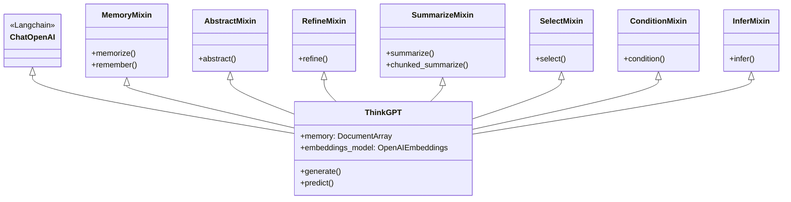
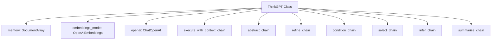
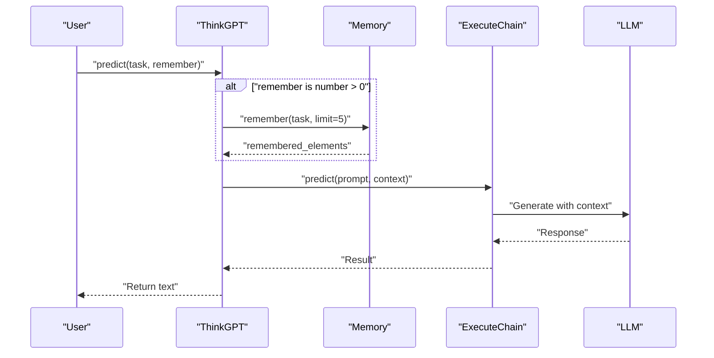
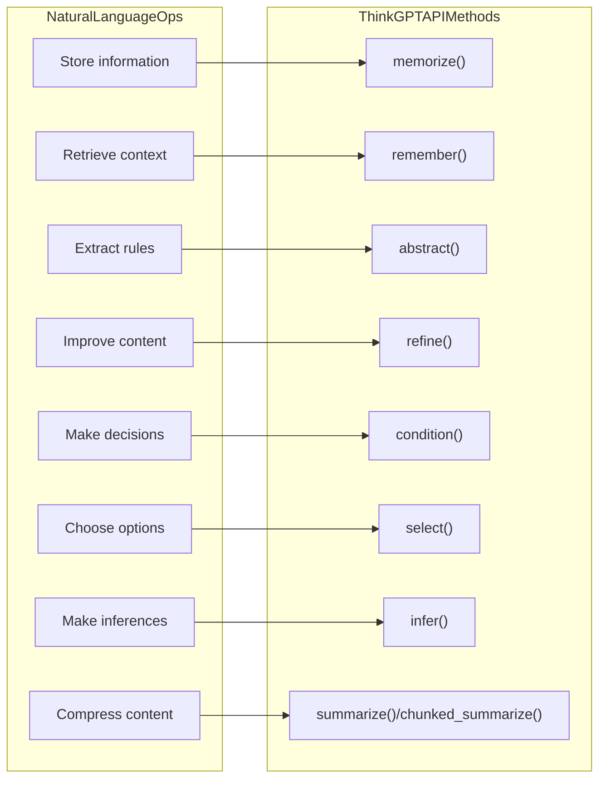
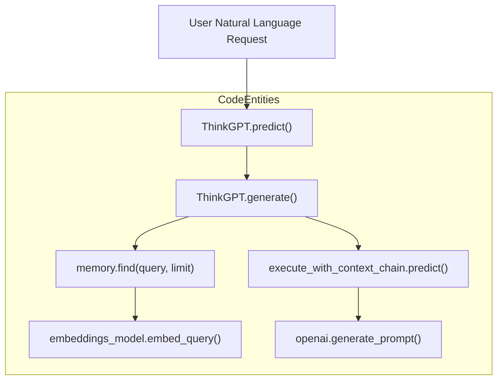

<!-- source: DeepWiki mcp.deepwiki.com · repo jina-ai/thinkgpt · page 5.1 ThinkGPT Class API · fetched 2026-10-26 -->

# ThinkGPT Class API

<details>
<summary>Relevant source files</summary>

The following files were used as context for generating this wiki page:

- [README.md](README.md)
- [thinkgpt/llm.py](thinkgpt/llm.py)

</details>


This document provides comprehensive technical documentation for the `ThinkGPT` class, which serves as the primary entry point for the ThinkGPT library. The class extends OpenAI's language models with advanced capabilities like memory management, abstraction, self-refinement, and cognitive functions.

For information about the individual mixin classes that provide specific capabilities to ThinkGPT, see [Mixin Classes API](#5.2). For details on the specialized chain implementations, see [Chain Classes API](#5.3).

## Class Overview

The `ThinkGPT` class inherits from Langchain's `ChatOpenAI` class and multiple mixin classes that provide specialized cognitive capabilities.

### Class Hierarchy Diagram



Sources: [thinkgpt/llm.py:23-59]()

## Initialization

### Constructor Parameters

```python
def __init__(self,
             memory: DocumentArray = None,
             execute_with_context_chain: ExecuteWithContextChain = None,
             abstract_chain: AbstractChain = None,
             refine_chain: RefineChain = None,
             condition_chain: ConditionChain = None,
             select_chain: SelectChain = None,
             infer_chain: InferChain = None,
             summarize_chain: SummarizeChain = None,
             verbose=True,
             **kwargs):
```

| Parameter | Type | Default | Description |
|-----------|------|---------|-------------|
| `memory` | DocumentArray | None | Storage for documents and their embeddings |
| `execute_with_context_chain` | ExecuteWithContextChain | None | Chain for executing prompts with context |
| `abstract_chain` | AbstractChain | None | Chain for extracting rules from examples |
| `refine_chain` | RefineChain | None | Chain for refining content based on feedback |
| `condition_chain` | ConditionChain | None | Chain for evaluating natural language conditions |
| `select_chain` | SelectChain | None | Chain for selecting from options |
| `infer_chain` | InferChain | None | Chain for making inferences |
| `summarize_chain` | SummarizeChain | None | Chain for summarizing content |
| `verbose` | bool | True | Whether to print verbose output |
| `**kwargs` | Any | - | Additional parameters passed to the ChatOpenAI constructor |

Sources: [thinkgpt/llm.py:30-59]()

### Internal Components



Sources: [thinkgpt/llm.py:42-59]()

## Core Methods

### `generate`

Generates responses from prompts with optional memory context.

```python
def generate(
    self, prompts: List[List[str]], stop: Optional[List[str]] = None, remember: Union[int, List[str]] = 0
) -> LLMResult:
```

| Parameter | Type | Default | Description |
|-----------|------|---------|-------------|
| `prompts` | List[List[str]] | Required | List of prompts to generate responses for (currently only supports a single prompt) |
| `stop` | Optional[List[str]] | None | Optional list of stop sequences |
| `remember` | Union[int, List[str]] | 0 | If int > 0, automatically retrieve relevant memory. If list, use provided strings as memory |

Returns an `LLMResult` containing the generated text.

Sources: [thinkgpt/llm.py:62-77]()

### `predict`

A simplified interface to `generate` that returns the generated text directly.

```python
def predict(
    self, prompt: str, stop: Optional[List[str]] = None, remember: Union[int, List[str]] = 0
) -> str:
```

| Parameter | Type | Default | Description |
|-----------|------|---------|-------------|
| `prompt` | str | Required | The prompt to generate a response for |
| `stop` | Optional[List[str]] | None | Optional list of stop sequences |
| `remember` | Union[int, List[str]] | 0 | If int > 0, automatically retrieve relevant memory. If list, use provided strings as memory |

Returns the generated text as a string.

Sources: [thinkgpt/llm.py:79-82]()

### Prediction Flow Diagram



Sources: [thinkgpt/llm.py:62-82]()

## Natural Language to Code Entity Mapping

### Cognitive Operations to API Methods



Sources: [thinkgpt/llm.py:23-24](), [README.md:32-37]()

### User Request to Code Execution Flow



Sources: [thinkgpt/llm.py:62-82]()

## Inherited Methods

The `ThinkGPT` class inherits methods from several mixin classes that provide specialized cognitive capabilities:

### Memory Management
- `memorize(documents)`: Stores information in the long-term memory
- `remember(query, limit=5, max_tokens=None, sort_by_order=False)`: Retrieves relevant information from memory

### Knowledge Extraction and Compression
- `abstract(observations, instruction_hint=None)`: Extracts rules or patterns from examples
- `summarize(content, max_tokens=None, instruction_hint=None)`: Summarizes content to fit within token limits
- `chunked_summarize(content, max_tokens=4000, instruction_hint=None)`: Handles very large content by chunking

### Refinement and Decision Making
- `refine(content, critics, instruction_hint=None)`: Refines content based on feedback or criticism
- `condition(query)`: Evaluates a natural language condition and returns True/False
- `select(question, options, num_choices=None)`: Selects options from a provided list
- `infer(knowledge, question, instruction_hint=None)`: Makes inferences based on provided knowledge

Sources: [thinkgpt/llm.py:23-24](), [README.md:13-19]()

## Basic Usage Example

```python
from thinkgpt.llm import ThinkGPT

# Initialize with default settings
llm = ThinkGPT(model_name="gpt-3.5-turbo")

# Store information in memory
llm.memorize(['DocArray is a library for representing, sending and storing multi-modal data.'])

# Retrieve from memory and use in prediction
context = llm.remember('DocArray definition')
response = llm.predict('What is DocArray?', remember=context)
print(response)
```

Sources: [README.md:32-37]()

## Complete Method Parameter Reference

Please refer to the [Mixin Classes API](#5.2) documentation for detailed information about all the parameters for each method inherited from the mixin classes.

Sources: [thinkgpt/llm.py:23-24]()

---

