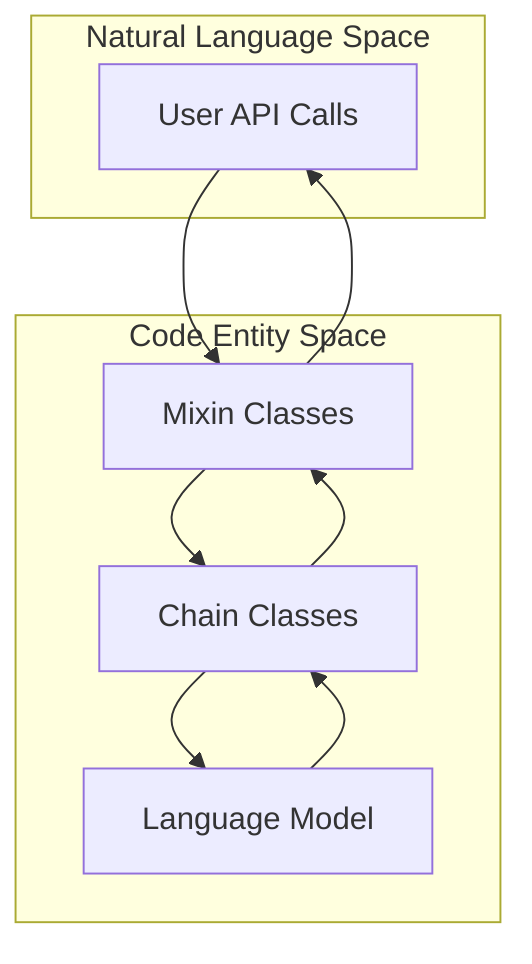
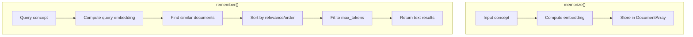
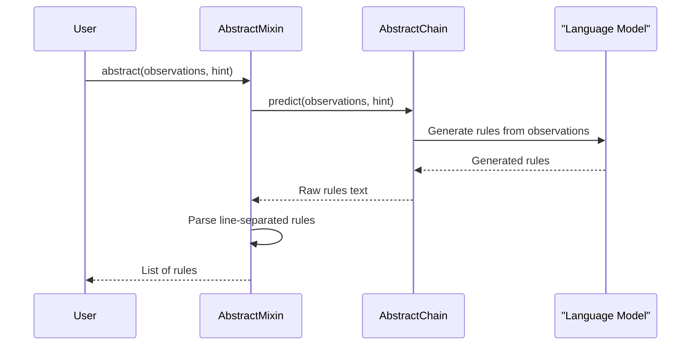
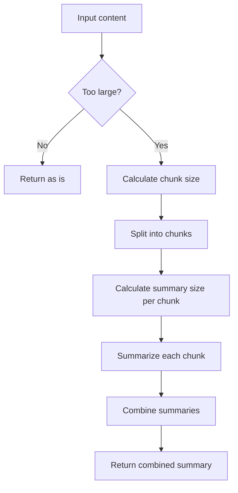
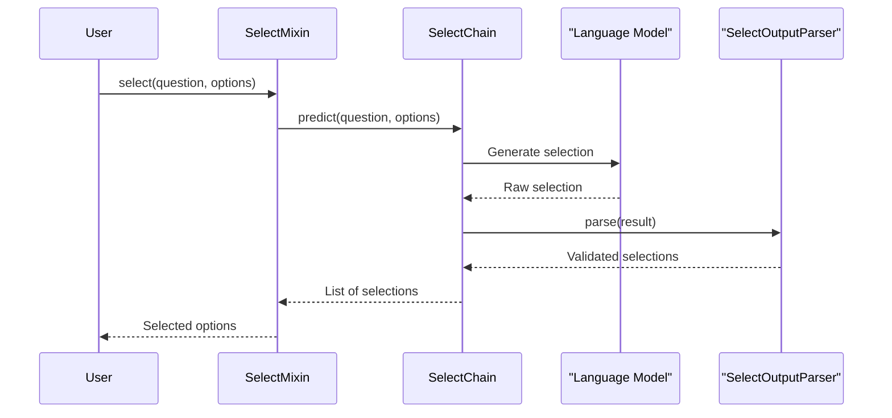
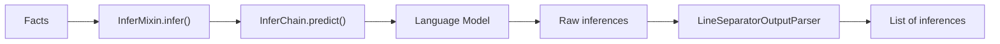
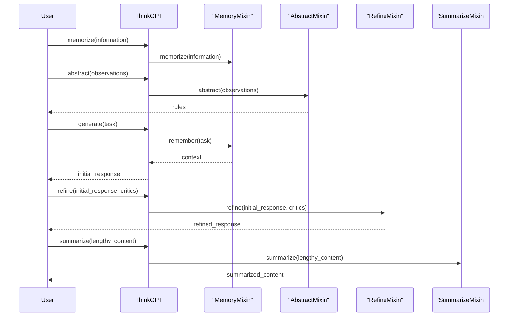

<!-- source: DeepWiki mcp.deepwiki.com · repo jina-ai/thinkgpt · page 5.2 Mixin Classes API · fetched 2026-10-26 -->

# Mixin Classes API

Relevant source files

The following files were used as context for generating this wiki page:

- [thinkgpt/abstract.py](thinkgpt/abstract.py)
- [thinkgpt/condition.py](thinkgpt/condition.py)
- [thinkgpt/gpt_select.py](thinkgpt/gpt_select.py)
- [thinkgpt/helper.py](thinkgpt/helper.py)
- [thinkgpt/infer.py](thinkgpt/infer.py)
- [thinkgpt/memory.py](thinkgpt/memory.py)
- [thinkgpt/refine.py](thinkgpt/refine.py)
- [thinkgpt/summarize.py](thinkgpt/summarize.py)

This page documents the mixin classes that extend the functionality of the ThinkGPT class. These mixins provide modular capabilities such as memory management, knowledge abstraction, content refinement, summarization, option selection, condition evaluation, and inference. For information about the main ThinkGPT class, see [ThinkGPT Class API](#5.1).

## Mixin Architecture Overview

ThinkGPT uses a composition-based design pattern where specialized functionality is encapsulated in mixin classes. Each mixin focuses on a specific cognitive capability and is paired with a corresponding "Chain" class that handles the actual LLM interactions.

```mermaid
classDiagram
    class ThinkGPT {
        <<Main Class>>
    }
    
    class MemoryMixin {
        +memorize(concept)
        +remember(concept, limit, sort_by_order, max_tokens)
    }
    
    class AbstractMixin {
        +abstract(observations, instruction_hint)
    }
    
    class RefineMixin {
        +refine(content, critics, instruction_hint)
    }
    
    class SummarizeMixin {
        +summarize(content, max_tokens, instruction_hint)
        +chunked_summarize(content, max_tokens, instruction_hint)
    }
    
    class SelectMixin {
        +select(question, options, instruction_hint, select_chain, num_choices)
    }
    
    class ConditionMixin {
        +condition(question, instruction_hint)
    }
    
    class InferMixin {
        +infer(facts, instruction_hint)
    }
    
    ThinkGPT --|> MemoryMixin
    ThinkGPT --|> AbstractMixin
    ThinkGPT --|> RefineMixin
    ThinkGPT --|> SummarizeMixin
    ThinkGPT --|> SelectMixin
    ThinkGPT --|> ConditionMixin
    ThinkGPT --|> InferMixin
```

Sources: [thinkgpt/memory.py](), [thinkgpt/abstract.py](), [thinkgpt/refine.py](), [thinkgpt/summarize.py](), [thinkgpt/gpt_select.py](), [thinkgpt/condition.py](), [thinkgpt/infer.py]()

## Mixin-Chain Relationship

Each mixin is paired with a corresponding Chain class that handles the specific prompt engineering and LLM interactions. The mixin provides a user-friendly interface while delegating the actual LLM work to the chain.

Sources: [thinkgpt/memory.py:26-66](), [thinkgpt/abstract.py:84-100](), [thinkgpt/refine.py:20-36](), [thinkgpt/summarize.py:19-59](), [thinkgpt/gpt_select.py:63-88](), [thinkgpt/condition.py:54-67](), [thinkgpt/infer.py:52-68]()

## Memory Management (MemoryMixin)

`MemoryMixin` provides long-term memory capabilities, allowing ThinkGPT to store and retrieve information using semantic embeddings.

### Methods

| Method | Parameters | Return Type | Description |
|--------|------------|-------------|-------------|
| `memorize` | `concept`: Union[str, Document, DocumentArray, List] | None | Stores information in memory with embeddings |
| `remember` | `concept`: Union[str, Document] = None `limit`: int = 5 `sort_by_order`: bool = False `max_tokens`: Optional[int] = None | List[str] | Retrieves relevant information from memory |

### Memory Flow

Sources: [thinkgpt/memory.py:26-66]()

## Knowledge Abstraction (AbstractMixin)

`AbstractMixin` extracts rules or patterns from a list of observations, enabling ThinkGPT to generalize from examples.

### Methods

| Method | Parameters | Return Type | Description |
|--------|------------|-------------|-------------|
| `abstract` | `observations`: List[str] `instruction_hint`: str = '' | List[str] | Extracts rules from a list of observations |

### Abstraction Process

Sources: [thinkgpt/abstract.py:84-100](), [thinkgpt/abstract.py:16-52]()

## Content Refinement (RefineMixin)

`RefineMixin` enables content refinement based on criticism or feedback, allowing ThinkGPT to improve outputs iteratively.

### Methods

| Method | Parameters | Return Type | Description |
|--------|------------|-------------|-------------|
| `refine` | `content`: str `critics`: List[str] `instruction_hint`: str = '' | str | Refines content based on provided criticisms |

Sources: [thinkgpt/refine.py:30-36]()

## Content Summarization (SummarizeMixin)

`SummarizeMixin` provides summarization capabilities, helping ThinkGPT compress information to fit within token limits.

### Methods

| Method | Parameters | Return Type | Description |
|--------|------------|-------------|-------------|
| `summarize` | `content`: str `max_tokens`: int = 4096 `instruction_hint`: str = '' | str | Summarizes content to fit within token limit |
| `chunked_summarize` | `content`: str `max_tokens`: int = 4096 `instruction_hint`: str = '' | str | Handles large content by breaking it into chunks, summarizing each, then combining |

### Chunked Summarization

Sources: [thinkgpt/summarize.py:34-59]()

## Option Selection (SelectMixin)

`SelectMixin` provides functionality for selecting one or more options from a list based on a natural language question.

### Methods

| Method | Parameters | Return Type | Description |
|--------|------------|-------------|-------------|
| `select` | `question`: str `options`: List[str] `instruction_hint`: str = '' `select_chain`: Optional[SelectChain] = None `num_choices`: int = None | List[str] | Selects options from a list based on a question |

### Selection Process

Sources: [thinkgpt/gpt_select.py:83-88](), [thinkgpt/gpt_select.py:9-30]()

## Natural Language Conditions (ConditionMixin)

`ConditionMixin` allows evaluation of natural language conditions, returning boolean results.

### Methods

| Method | Parameters | Return Type | Description |
|--------|------------|-------------|-------------|
| `condition` | `question`: str `instruction_hint`: str = '' | bool | Evaluates a natural language condition (true/false) |

Sources: [thinkgpt/condition.py:63-67](), [thinkgpt/condition.py:9-22]()

## Inference Engine (InferMixin)

`InferMixin` provides inference capabilities, generating new observations from existing facts.

### Methods

| Method | Parameters | Return Type | Description |
|--------|------------|-------------|-------------|
| `infer` | `facts`: List[str] `instruction_hint`: str = '' | List[str] | Generates new observations based on provided facts |

### Inference Process

Sources: [thinkgpt/infer.py:61-68](), [thinkgpt/infer.py:20-41]()

## Integration Example

The following diagram shows how the mixins integrate with ThinkGPT and are used in a typical workflow:

Sources: [thinkgpt/memory.py:26-66](), [thinkgpt/abstract.py:84-100](), [thinkgpt/refine.py:30-36](), [thinkgpt/summarize.py:34-59]()

## Summary

The mixin classes of ThinkGPT provide modular cognitive capabilities that extend the base functionality of language models. By understanding these mixins, developers can effectively utilize the full range of ThinkGPT's capabilities or extend it with custom functionality by following the same pattern.

Each mixin follows a consistent design pattern:
1. A public interface method in the mixin class
2. A corresponding chain class that handles LLM prompting
3. Clear parameter passing and result parsing

This modular design makes the system highly extensible and maintainable.

---

