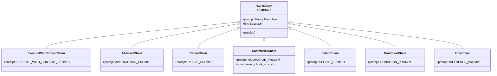
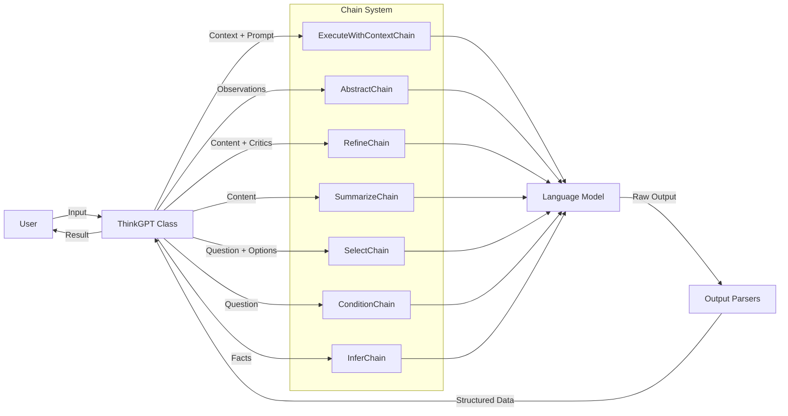
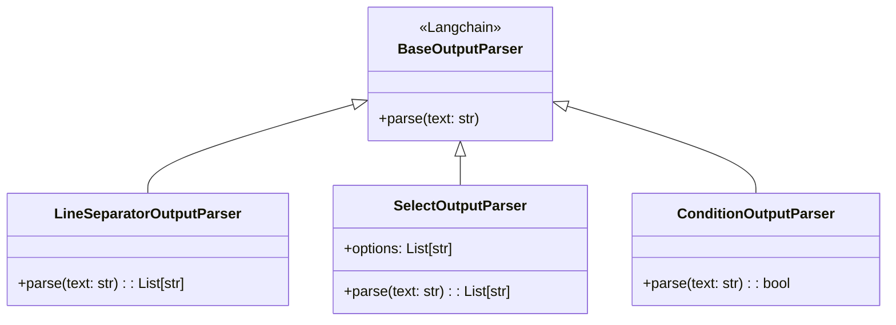
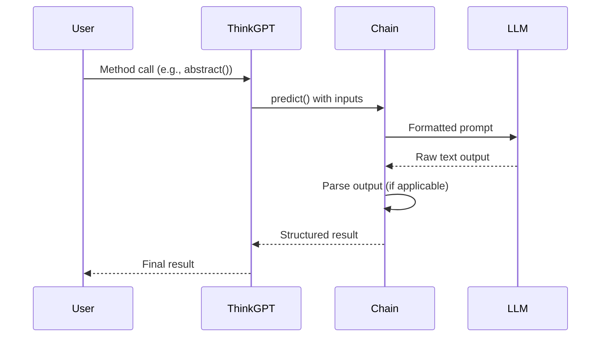

<!-- source: DeepWiki mcp.deepwiki.com · repo jina-ai/thinkgpt · page 5.3 Chain Classes API · fetched 2026-10-26 -->

# Chain Classes API

<details>
<summary>Relevant source files</summary>

The following files were used as context for generating this wiki page:

- [thinkgpt/abstract.py](thinkgpt/abstract.py)
- [thinkgpt/condition.py](thinkgpt/condition.py)
- [thinkgpt/gpt_select.py](thinkgpt/gpt_select.py)
- [thinkgpt/helper.py](thinkgpt/helper.py)
- [thinkgpt/infer.py](thinkgpt/infer.py)
- [thinkgpt/memory.py](thinkgpt/memory.py)
- [thinkgpt/refine.py](thinkgpt/refine.py)
- [thinkgpt/summarize.py](thinkgpt/summarize.py)

</details>


## Purpose and Scope

This document provides comprehensive documentation of the specialized chain classes within ThinkGPT. These chain classes form the core operational components that bridge between natural language inputs and structured outputs. Each chain encapsulates a specific cognitive function, extending LangChain's `LLMChain` class to provide ThinkGPT's specialized capabilities.

For information about the Mixin classes that integrate these chains into the ThinkGPT system, see [Mixin Classes API](#5.2).

## Chain Architecture Overview

### Chain Inheritance Structure

Each chain in ThinkGPT inherits from LangChain's `LLMChain` class, adding specialized prompt templates and often custom output parsers to transform the language model's text output into structured data.



Sources: [thinkgpt/memory.py:20-23](), [thinkgpt/abstract.py:84-90](), [thinkgpt/refine.py:20-27](), [thinkgpt/summarize.py:19-31](), [thinkgpt/gpt_select.py:63-80](), [thinkgpt/condition.py:54-60](), [thinkgpt/infer.py:52-58]()

### Chain Integration Flow

The following diagram illustrates how chain classes are integrated within the ThinkGPT system, connecting user inputs to language model outputs through specialized processing:



Sources: [thinkgpt/memory.py](), [thinkgpt/abstract.py](), [thinkgpt/refine.py](), [thinkgpt/summarize.py](), [thinkgpt/gpt_select.py](), [thinkgpt/condition.py](), [thinkgpt/infer.py]()

## Chain Classes in Detail

### ExecuteWithContextChain

The `ExecuteWithContextChain` provides the core functionality for executing user requests with retrieved context.

**Purpose**: Execute user requests by incorporating relevant context from the agent's memory.

**Implementation Details**:
- Uses the `EXECUTE_WITH_CONTEXT_PROMPT` template
- Takes a user prompt and context as input
- Returns the language model's response

**Example Usage**:
```python
chain = ExecuteWithContextChain(llm=ChatOpenAI())
response = chain.predict(prompt="What did I learn yesterday?", context="Yesterday you learned about Python generators.")
```

Sources: [thinkgpt/memory.py:20-23](), [thinkgpt/memory.py:12-16]()

### AbstractChain

The `AbstractChain` extracts rules or patterns from examples.

**Purpose**: Extract abstract rules, principles, or patterns from a set of observations.

**Implementation Details**:
- Uses the `ABSTRACTION_PROMPT` template with few-shot examples
- Takes a list of observations as input
- Returns extracted rules or principles
- Uses `LineSeparatorOutputParser` to convert output to a list of strings

**Example Usage**:
```python
chain = AbstractChain(llm=ChatOpenAI())
rules = chain.predict(observations="\n".join([
    "in tunisian, I did not eat is 'ma khditech'",
    "I did not work is 'ma khdemtech'",
    "I did not go is 'ma mchitech'",
]))
```

Sources: [thinkgpt/abstract.py:84-90](), [thinkgpt/abstract.py:52-71]()

### RefineChain

The `RefineChain` refines content based on feedback or criticism.

**Purpose**: Improve content based on specific criticisms or feedback.

**Implementation Details**:
- Uses the `REFINE_PROMPT` template
- Takes content and critics as input
- Returns refined content

**Example Usage**:
```python
chain = RefineChain(llm=ChatOpenAI())
refined_code = chain.predict(
    content="print('hello world')",
    critics="Indentation error in the code",
    instruction_hint="Fix the code snippet based on the error provided"
)
```

Sources: [thinkgpt/refine.py:20-27](), [thinkgpt/refine.py:9-17]()

### SummarizeChain

The `SummarizeChain` compresses information while preserving key points.

**Purpose**: Summarize content to reduce length while maintaining important information.

**Implementation Details**:
- Uses the `SUMMARIZE_PROMPT` template
- Takes content, max_tokens, and instruction_hint as input
- Returns summarized content
- Contains `summarizer_chunk_size` parameter for processing large content

**Example Usage**:
```python
chain = SummarizeChain(llm=ChatOpenAI())
summary = chain.predict(
    content="Artificial intelligence (AI) is intelligence demonstrated by machines...",
    instruction_hint="Keep the summary concise",
    max_tokens=50
)
```

Sources: [thinkgpt/summarize.py:19-31](), [thinkgpt/summarize.py:11-16]()

### SelectChain

The `SelectChain` chooses one or more options from a provided list.

**Purpose**: Choose the correct answer(s) for a question from provided options.

**Implementation Details**:
- Uses a few-shot learning prompt with examples of question answering
- Takes a question and list of options as input
- Has optional parameters for instruction_hint and num_choices
- Uses `SelectOutputParser` to convert output to a list of selected options

**Example Usage**:
```python
chain = SelectChain(llm=ChatOpenAI())
selected = chain.predict(
    question="Which animal is known as the king of the jungle?",
    options=["Lion", "Elephant", "Tiger", "Giraffe"]
)
```

Sources: [thinkgpt/gpt_select.py:63-80](), [thinkgpt/gpt_select.py:51-60]()

### ConditionChain

The `ConditionChain` evaluates natural language statements as boolean values.

**Purpose**: Determine whether a statement is true or false.

**Implementation Details**:
- Uses the `CONDITION_PROMPT` template with few-shot examples
- Takes a question (statement) as input
- Uses `ConditionOutputParser` to convert text output to boolean
- Returns True, False, or an error message

**Example Usage**:
```python
chain = ConditionChain(llm=ChatOpenAI())
result = chain.predict(question="Is 2+2 equal to 4?")
```

Sources: [thinkgpt/condition.py:54-60](), [thinkgpt/condition.py:42-52]()

### InferChain

The `InferChain` generates new observations or facts from existing information.

**Purpose**: Infer new observations based on given facts.

**Implementation Details**:
- Uses the `INFERENCE_PROMPT` template with few-shot examples
- Takes a list of facts as input
- Uses `LineSeparatorOutputParser` to convert output to a list of inferences
- Returns a list of new observations or inferences

**Example Usage**:
```python
chain = InferChain(llm=ChatOpenAI())
inferences = chain.predict(facts="\n".join([
    "Klaus Mueller is writing a research paper",
    "Klaus Mueller enjoys reading a book on gentrification"
]))
```

Sources: [thinkgpt/infer.py:52-58](), [thinkgpt/infer.py:43-49]()

## Chain Comparison Table

| Chain Class | Input | Output | Primary Purpose | Output Parser |
|-------------|-------|--------|-----------------|---------------|
| ExecuteWithContextChain | Context, Prompt | Text | Execute request with context | None |
| AbstractChain | Observations | Rules (List) | Extract rules from examples | LineSeparatorOutputParser |
| RefineChain | Content, Critics | Refined content | Improve content based on feedback | None |
| SummarizeChain | Content, max_tokens | Summarized content | Compress information | None |
| SelectChain | Question, Options | Selected options (List) | Choose from options | SelectOutputParser |
| ConditionChain | Question | Boolean | Evaluate true/false statements | ConditionOutputParser |
| InferChain | Facts | Inferences (List) | Generate new observations | LineSeparatorOutputParser |

Sources: [thinkgpt/memory.py](), [thinkgpt/abstract.py](), [thinkgpt/refine.py](), [thinkgpt/summarize.py](), [thinkgpt/gpt_select.py](), [thinkgpt/condition.py](), [thinkgpt/infer.py](), [thinkgpt/helper.py:10-13]()

## Custom Chain Implementation

To extend ThinkGPT with a custom chain, follow these steps:

1. Create a new chain class that inherits from `LLMChain`
2. Define a prompt template for your chain
3. Implement a custom output parser if needed
4. Create a corresponding mixin class for integration with ThinkGPT

Example structure:

```python
# Define prompt template
CUSTOM_PROMPT = PromptTemplate(
    template="Process the following input: {input}",
    input_variables=["input"]
)

# Define chain class
class CustomChain(LLMChain):
    def __init__(self, **kwargs):
        super().__init__(prompt=CUSTOM_PROMPT, **kwargs)
    
    def predict(self, input: str, **kwargs) -> str:
        return super().predict(input=input, **kwargs)

# Define mixin
class CustomMixin:
    custom_chain: CustomChain
    
    def custom_function(self, input: str) -> str:
        return self.custom_chain.predict(input=input)
```

Sources: [thinkgpt/abstract.py:84-90](), [thinkgpt/refine.py:20-27](), [thinkgpt/gpt_select.py:63-80]()

## Output Parsers

ThinkGPT uses several output parsers to convert raw language model output into structured data:



- **LineSeparatorOutputParser**: Splits text output by line breaks
- **SelectOutputParser**: Parses selected options, validating against the provided options list
- **ConditionOutputParser**: Converts "true"/"false" text to boolean values

Sources: [thinkgpt/helper.py:10-13](), [thinkgpt/gpt_select.py:51-60](), [thinkgpt/condition.py:42-52]()

## Chain Data Flow

The following diagram illustrates how data flows through the chain system:



In this process:
1. User calls a method on ThinkGPT (e.g., `abstract()`, `select()`, etc.)
2. ThinkGPT delegates to the appropriate chain (e.g., `AbstractChain`, `SelectChain`)
3. The chain formats the input into a prompt for the language model
4. The language model generates a text response
5. If applicable, the chain uses an output parser to convert the text into structured data
6. The structured result is returned to ThinkGPT and ultimately to the user

Sources: [thinkgpt/abstract.py:93-100](), [thinkgpt/refine.py:30-36](), [thinkgpt/gpt_select.py:83-88]()

---

