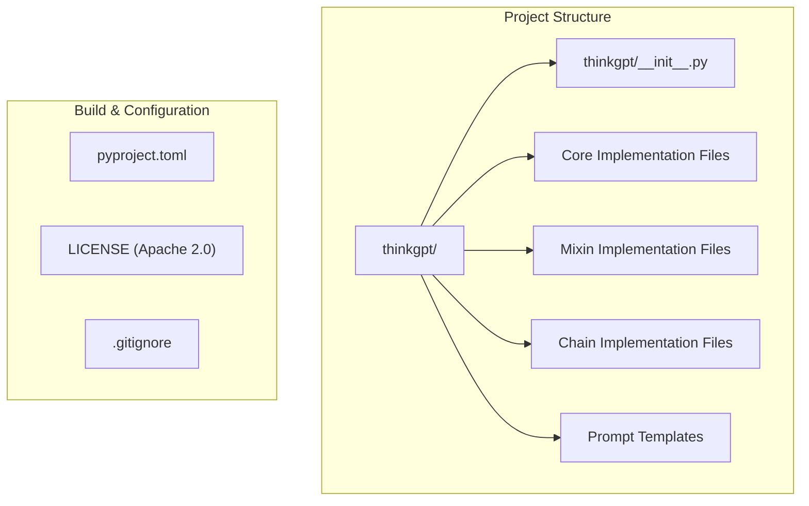
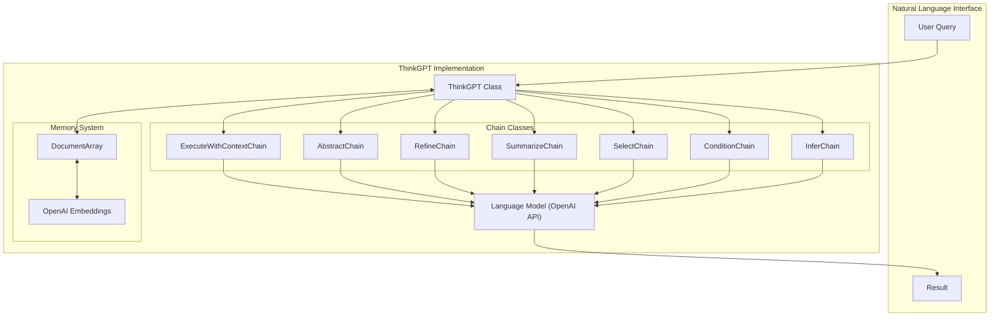
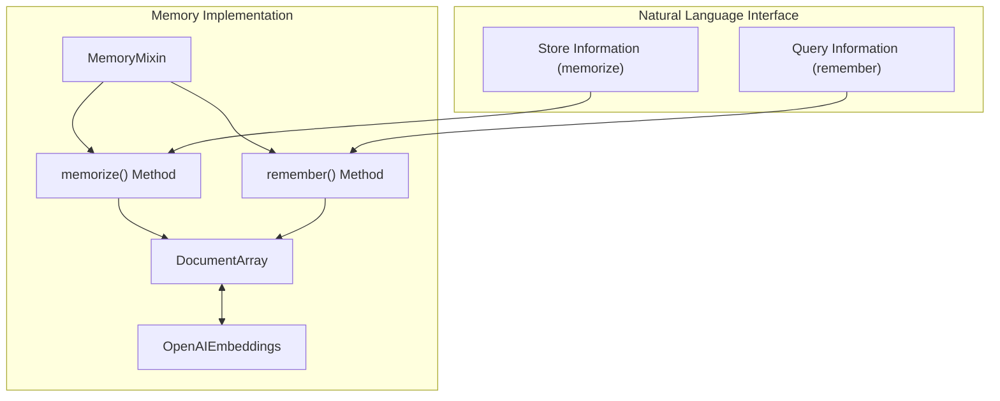
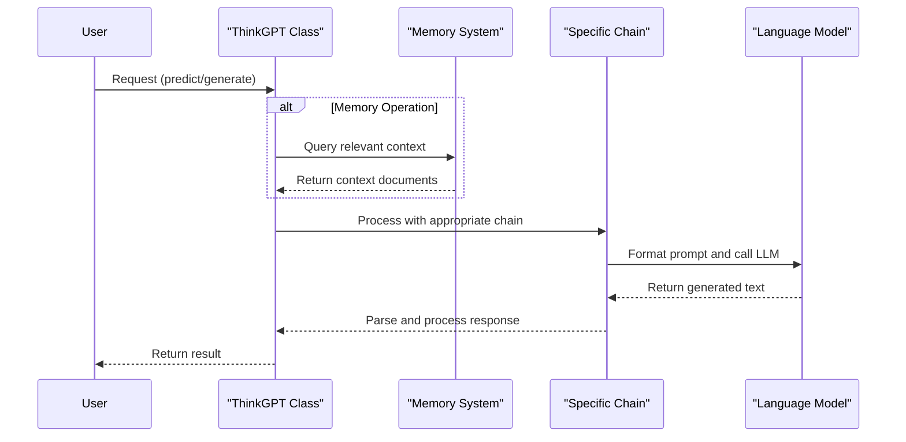
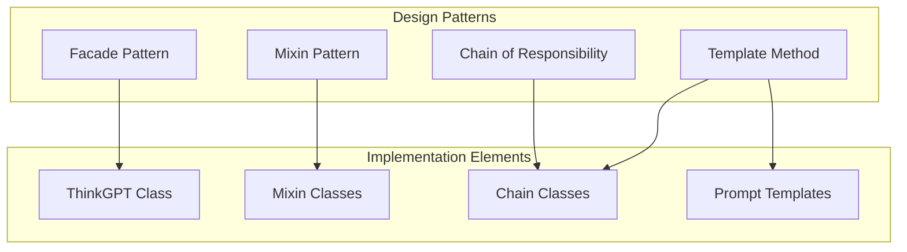

<!-- source: DeepWiki mcp.deepwiki.com · repo jina-ai/thinkgpt · page 6 Technical Details · fetched 2026-10-26 -->

# Technical Details

<details>
<summary>Relevant source files</summary>

The following files were used as context for generating this wiki page:

- [.gitignore](.gitignore)
- [LICENSE](LICENSE)
- [pyproject.toml](pyproject.toml)
- [thinkgpt/__init__.py](thinkgpt/__init__.py)

</details>


This page provides an in-depth technical overview of ThinkGPT's implementation, project structure, and dependencies. For information about using ThinkGPT's API, see [API Reference](#5).

## Project Structure

ThinkGPT follows a modular architecture using Python's mixin pattern to implement different capabilities through specialized components.



Sources: [pyproject.toml:1-20](), [.gitignore:1-130](), [LICENSE:1-202](), [thinkgpt/__init__.py:1]()

## Dependencies and Requirements

ThinkGPT is built on several key dependencies that enable its functionality:

| Dependency | Version | Purpose |
|------------|---------|---------|
| Python | >=3.7,<4.0 | Runtime environment |
| openai | ^0.27.4 | OpenAI API integration for language models |
| tiktoken | ^0.3.3 | Token counting for OpenAI models |
| docarray | <=0.21.0 | Document storage and embedding-based search |
| langchain | ^0.0.141 | Base LLM chain functionality |

ThinkGPT implements a Chain of Thought architecture for language models, with specialized components for memory management, abstract reasoning, and self-refinement.

Sources: [pyproject.toml:9-14]()

## Class Hierarchy and Architecture

ThinkGPT uses a mixin-based architecture to compose functionality. The main `ThinkGPT` class inherits from Langchain's `ChatOpenAI` class and incorporates multiple mixin classes that add specific capabilities.

```mermaid
classDiagram
    class "ChatOpenAI" {
        <<Langchain Base>>
        +model_name: str
        +temperature: float
        +generate()
    }
    
    class "ThinkGPT" {
        +memory: DocumentArray
        +embeddings_model
        +generate()
        +predict()
    }
    
    class "MemoryMixin" {
        +memorize(text)
        +remember(query)
    }
    
    class "AbstractMixin" {
        +abstract(examples)
    }
    
    class "RefineMixin" {
        +refine(content, feedback)
    }
    
    class "SummarizeMixin" {
        +summarize(content)
        +chunked_summarize(content)
    }
    
    class "SelectMixin" {
        +select(query, options)
    }
    
    class "ConditionMixin" {
        +condition(statement)
    }
    
    class "InferMixin" {
        +infer(context, question)
    }
    
    ChatOpenAI <|-- ThinkGPT
    ThinkGPT *-- MemoryMixin
    ThinkGPT *-- AbstractMixin
    ThinkGPT *-- RefineMixin
    ThinkGPT *-- SummarizeMixin
    ThinkGPT *-- SelectMixin
    ThinkGPT *-- ConditionMixin
    ThinkGPT *-- InferMixin
```

Sources: Based on the architecture overview diagrams provided

## Chain Implementation

ThinkGPT implements specialized LLM chains for each cognitive function. These chains handle the prompt construction, LLM interaction, and response parsing for different operations.



Sources: Based on the architecture overview diagrams provided

## Memory System Implementation

ThinkGPT's memory system is built on DocArray, providing persistent storage and semantic retrieval of information:



Sources: Based on the architecture overview diagrams provided

## Data Flow During Operation

The typical data flow in ThinkGPT follows a pattern where user input is processed through relevant chains, potentially enriched with memory context, and then passed to the LLM for generation.



Sources: Based on the architecture overview diagrams provided

## Design Patterns

ThinkGPT leverages several design patterns to achieve its functionality:

1. **Mixin Pattern**: Used to modularize different capabilities (memory, abstraction, refinement).
2. **Chain of Responsibility**: Each specialized chain handles a specific type of processing.
3. **Facade Pattern**: The ThinkGPT class provides a simplified interface to the underlying complexity.
4. **Template Method Pattern**: Used in the chain implementations to standardize LLM interactions.



Sources: Based on the architecture overview diagrams provided

## Performance Considerations

ThinkGPT's implementation includes several optimization strategies:

1. **Embedding Caching**: Embeddings are generated once and stored to minimize API calls.
2. **Chunked Processing**: Large content is processed in manageable chunks to work within model context limits.
3. **Selective Memory Retrieval**: Only the most relevant memory items are retrieved to optimize context usage.
4. **Token Management**: The library carefully manages token counts to avoid exceeding model limits.

## Development Guidelines

When extending ThinkGPT:

1. **New Capabilities**: Implement as a new mixin class and corresponding chain class.
2. **Prompt Optimization**: Store prompts as templates with clearly defined variables.
3. **Error Handling**: Include robust error handling, especially for API interactions.
4. **Documentation**: Keep docstrings updated with examples.

## Dependency Management

ThinkGPT is managed using Poetry for dependency management and packaging, as shown in the pyproject.toml file. This ensures reproducible builds and simplifies the installation process.

Sources: [pyproject.toml:1-20]()