# Page: Introduction to ThinkGPT

# Introduction to ThinkGPT

<details>
<summary>Relevant source files</summary>

The following files were used as context for generating this wiki page:

- [README.md](README.md)
- [thinkgpt/llm.py](thinkgpt/llm.py)

</details>


## Purpose and Scope

This document provides an overview of the ThinkGPT library, a Python framework designed to implement Chain of Thoughts for Large Language Models (LLMs). It covers the core concepts, architecture, and capabilities of ThinkGPT, explaining how it helps solve key limitations of LLMs while adding advanced reasoning capabilities. For detailed documentation on specific components, please refer to the respective sections in [Core Architecture](#2) and [API Reference](#5).

Sources: [README.md:1-9]()

## What is ThinkGPT?

ThinkGPT is a Python library that extends LLMs with cognitive abilities like memory, self-refinement, knowledge compression, and inference. It addresses three major limitations of standard LLMs:

1. **Limited Context Window**: ThinkGPT solves this with long-term memory and knowledge compression techniques
2. **Limited Reasoning Capabilities**: ThinkGPT enhances one-shot reasoning with higher-order reasoning primitives
3. **Lack of Persistence**: ThinkGPT adds the ability to maintain and recall information across multiple interactions

The library provides an intuitive API built on top of LangChain and DocArray, making it straightforward to integrate advanced cognitive capabilities into applications powered by models like GPT-3.5-Turbo and GPT-4.

Sources: [README.md:5-9](), [thinkgpt/llm.py:22-28]()

## Core Architecture

ThinkGPT's architecture is built around a central class that incorporates multiple specialized components through Python's mixin pattern. This design provides modularity while maintaining an easy-to-use interface.

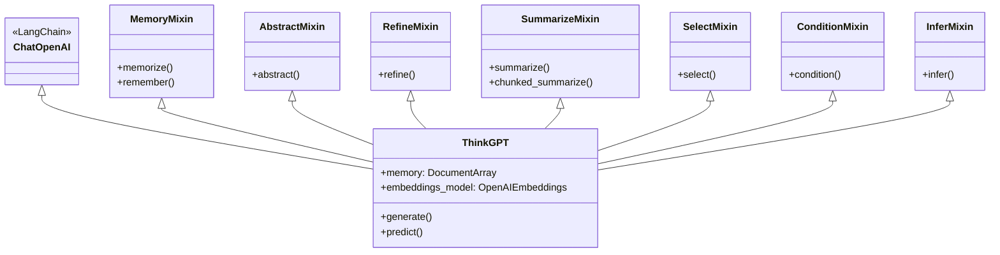

The `ThinkGPT` class inherits from Langchain's `ChatOpenAI` while incorporating multiple mixins that provide specialized cognitive abilities. Each mixin corresponds to a specific functionality and is backed by a specialized chain implementation to handle its operations.

Sources: [thinkgpt/llm.py:22-59]()

## Workflow and Data Flow

The following diagram illustrates how data flows through ThinkGPT during typical operations:

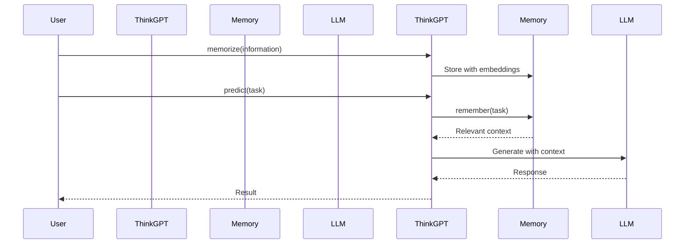

The diagram shows how ThinkGPT serves as an intelligent layer between the user and the underlying LLM, adding memory management and context retrieval capabilities.

Sources: [thinkgpt/llm.py:62-82](), [README.md:39-50]()

## Key Features

ThinkGPT provides several core capabilities that extend traditional LLMs:

### Memory Management

ThinkGPT enables LLMs to store and retrieve information across multiple interactions using vector embeddings. This creates a form of long-term memory that can be queried semantically.

```python
# Store information in memory
llm.memorize(['DocArray is a library for representing, sending and storing multi-modal data.'])

# Retrieve relevant information
llm.remember('What is DocArray?')

# Predict with remembered context
llm.predict('What can I do with DocArray?', remember=llm.remember('DocArray capabilities'))
```

Sources: [README.md:39-67]()

### Knowledge Compression

ThinkGPT offers two approaches to compress knowledge to fit within an LLM's context window:

1. **Summarization**: Condenses large text into shorter summaries while preserving key information
   - One-shot summarization for content within context limits
   - Chunked summarization for very large content that exceeds context limits

2. **Abstraction**: Extracts higher-level rules or patterns from specific examples
   - Infers general rules from observations
   - Creates more compact representations of knowledge

Sources: [README.md:100-137]()

### Self-Refinement

ThinkGPT can improve its own outputs by incorporating feedback or criticism:

```python
refined_content = llm.refine(
    content="Original content with issues",
    critics=["Issue 1", "Issue 2"],
    instruction_hint="Fix the issues identified in the critics"
)
```

This enables iterative improvement of generated content, particularly useful for code generation and correction.

Sources: [README.md:76-98]()

### Natural Language Interface

ThinkGPT provides intuitive ways to express program logic in natural language:

1. **Conditions**: Evaluate natural language statements as boolean conditions
   ```python
   if llm.condition('Is this text expressing a positive sentiment?'):
       # Handle positive sentiment
   ```

2. **Selection**: Choose from multiple options based on natural language understanding
   ```python
   selected = llm.select(
       question="Which category does this product belong to?",
       options=["Electronics", "Clothing", "Food", "Books"]
   )
   ```

Sources: [README.md:142-160]()

### Inference

ThinkGPT can make educated guesses and derive new information based on existing knowledge, allowing for more sophisticated reasoning:

```python
new_observations = llm.infer(
    observations=["Existing fact 1", "Existing fact 2"],
    instruction_hint="Derive new insights from these observations"
)
```

Sources: [README.md:219-228]()

## System Component Diagram

The following diagram illustrates the main components of ThinkGPT and their relationships:

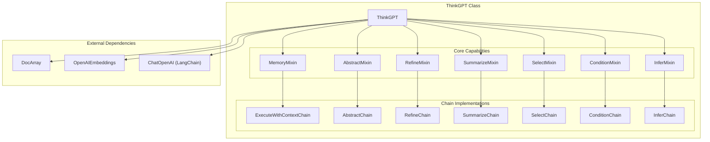

This diagram shows how the ThinkGPT class integrates various mixins and chains to provide its capabilities, while leveraging external dependencies like DocArray, OpenAI embeddings, and LangChain's ChatOpenAI.

Sources: [thinkgpt/llm.py:1-59]()

## Getting Started

To start using ThinkGPT, you need to install it and set up your OpenAI API key:

```shell
pip install git+https://github.com/alaeddine-13/thinkgpt.git
```

Then you can create a ThinkGPT instance and start using its features:

```python
from thinkgpt.llm import ThinkGPT

# Initialize ThinkGPT
llm = ThinkGPT(model_name="gpt-3.5-turbo")

# Store information in memory
llm.memorize(['DocArray is a library for representing, sending and storing multi-modal data.'])

# Query with memory retrieval
result = llm.predict('What is DocArray?', remember=llm.remember('DocArray definition'))
```

For more detailed usage instructions and examples, please refer to [Getting Started](#3).

Sources: [README.md:22-37]()

## Use Cases

ThinkGPT enables numerous advanced applications, including:

1. **Language Learning**: Teaching and learning new languages by abstracting rules from examples
2. **Library Documentation**: Learning about code libraries and generating examples
3. **Agent Memory Replay**: Creating agents that can replay memories to infer new observations
4. **Self-Criticism and Refinement**: Agents that can critique and refine their own knowledge
5. **Code Generation and Refinement**: Generating and automatically fixing code based on error messages

For detailed examples of these use cases, see [Advanced Usage](#4).

Sources: [README.md:163-239]()

## Next Steps

This introduction has provided an overview of ThinkGPT's features, architecture, and capabilities. For more detailed information, please explore the following sections:

- [Core Architecture](#2) - Detailed explanation of ThinkGPT's design
- [Getting Started](#3) - Installation and basic usage examples
- [Advanced Usage](#4) - More sophisticated use cases and techniques
- [API Reference](#5) - Comprehensive API documentation

Sources: [README.md:1-239]()

---

# Page: Core Architecture

# Core Architecture

<details>
<summary>Relevant source files</summary>

The following files were used as context for generating this wiki page:

- [README.md](README.md)
- [pyproject.toml](pyproject.toml)
- [thinkgpt/llm.py](thinkgpt/llm.py)

</details>


## Purpose and Scope

This document describes the core architecture of ThinkGPT, a Python library that implements Chain of Thoughts for Large Language Models (LLMs). It focuses on the central design patterns, component relationships, and system organization. The core architecture serves as the foundation for enabling enhanced LLM capabilities including memory management, knowledge compression, self-refinement, natural language interfaces, and inference.

For detailed information about specific subsystems, see:
- [Memory Management System](#2.1) - Documentation of ThinkGPT's memory storage and retrieval system
- [Knowledge Compression](#2.2) - Details on summarization and abstraction capabilities
- [Self-Refinement System](#2.3) - Information on content improvement mechanisms
- [Natural Language Interfaces](#2.4) - Documentation on condition and selection capabilities
- [Inference Engine](#2.5) - Information on how ThinkGPT derives new knowledge

## Design Philosophy

ThinkGPT employs a modular, extensible architecture that enhances LLMs with cognitive capabilities. The system follows these key design principles:

1. **Compositional Architecture**: The main ThinkGPT class combines multiple specialized mixins, each adding a specific cognitive capability
2. **Chain-based Processing**: Leverages Langchain's chain concept for specialized operations
3. **Memory-centric Design**: Built around a persistent memory system using DocArray to overcome LLM context limitations
4. **Cognitive Augmentation**: Extends LLMs with higher-order reasoning capabilities

Sources: [README.md:5-9](), [thinkgpt/llm.py:23-82]()

## Core Components

### ThinkGPT Class

The central `ThinkGPT` class serves as the main entry point and orchestrates all functionality. It inherits from Langchain's `ChatOpenAI` and incorporates multiple mixins to provide enhanced capabilities.

#### ThinkGPT Inheritance Structure

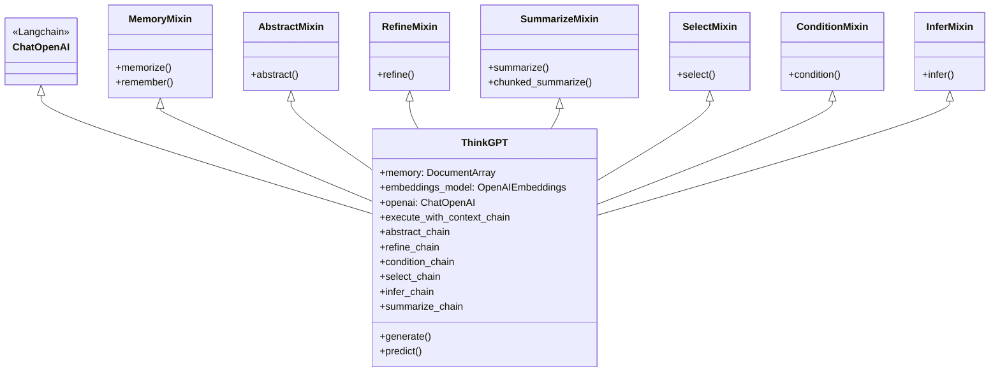

Sources: [thinkgpt/llm.py:23-26]()

### Mixin Architecture

ThinkGPT uses a composition-based architecture where each mixin adds a specific cognitive capability:

| Mixin | Functionality | Key Methods |
|-------|--------------|-------------|
| MemoryMixin | Provides persistent memory capabilities | `memorize()`, `remember()` |
| AbstractMixin | Enables extraction of rules from examples | `abstract()` |
| RefineMixin | Implements self-refinement based on feedback | `refine()` |
| SummarizeMixin | Provides content summarization capabilities | `summarize()`, `chunked_summarize()` |
| SelectMixin | Enables option selection from alternatives | `select()` |
| ConditionMixin | Implements natural language condition evaluation | `condition()` |
| InferMixin | Provides inference capabilities | `infer()` |

Sources: [thinkgpt/llm.py:12-19]()

### Chain System

Each mixin is paired with a specialized chain implementation that handles the actual processing. These chains extend Langchain's `LLMChain` and implement the specialized logic for each cognitive capability.

#### Chain System Architecture

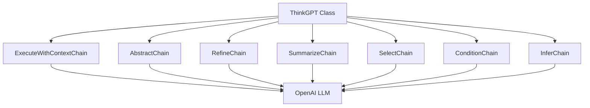

Sources: [thinkgpt/llm.py:47-59]()

## Initialization Process

The `ThinkGPT` class is initialized with various configuration options and component chains. The initialization process involves setting up the memory system, embedding model, and specialized chains.

#### Component Initialization Flow

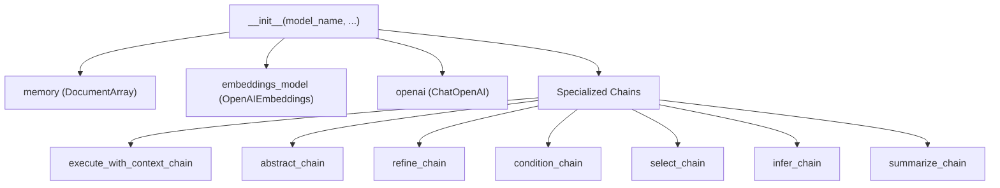

Sources: [thinkgpt/llm.py:30-59]()

## Data Flow and Operation Model

The following sequence diagram illustrates the typical data flow when using ThinkGPT's memory and prediction capabilities.

#### Prediction Flow with Memory

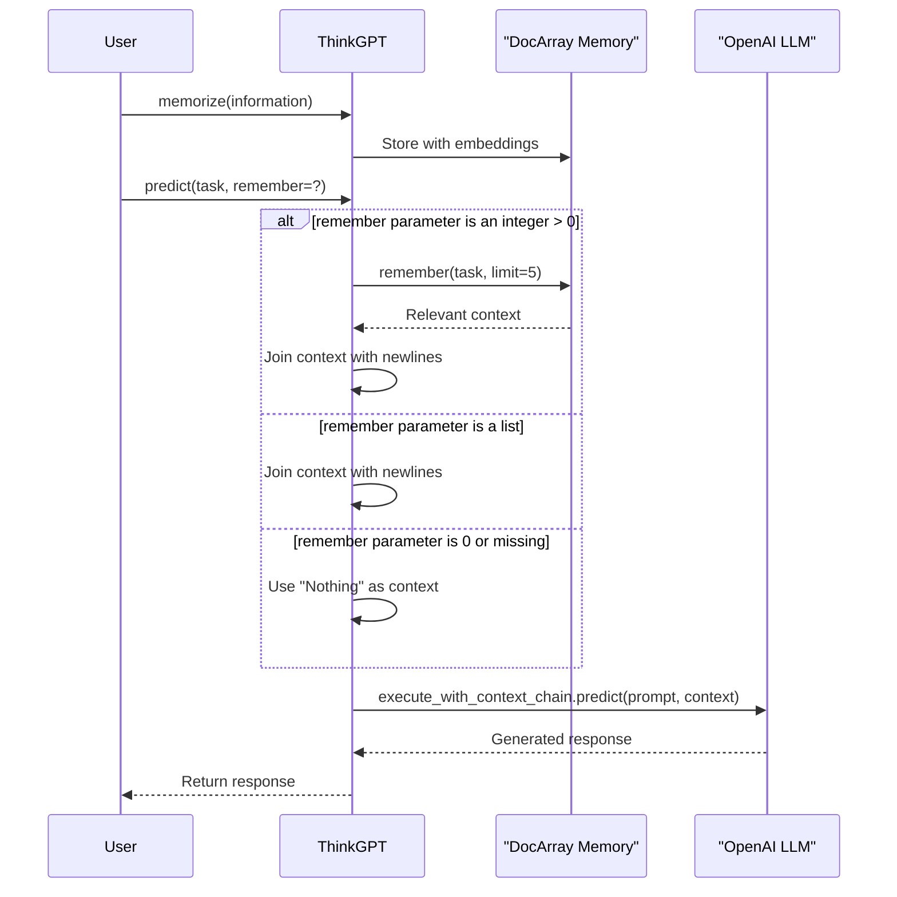

Sources: [thinkgpt/llm.py:62-82]()

## Core Implementation Details

The `ThinkGPT` class implements two key methods that facilitate interaction with the LLM:

1. `generate()` - Processes prompts and returns generated content as an `LLMResult`
2. `predict()` - A convenience wrapper around `generate()` that returns just the text

The implementation shows how ThinkGPT integrates context from memory:

```python
def generate(
        self, prompts: List[List[str]], stop: Optional[List[str]] = None, remember: Union[int, List[str]] = 0
) -> LLMResult:
    # only works for single prompt
    if len(prompts) > 1:
        raise Exception('only works for a single prompt')
    prompt = prompts[0][0]
    if isinstance(remember, int) and remember > 0:
        remembered_elements = self.remember(prompt, limit=5)
        result = self.execute_with_context_chain.predict(prompt=prompt, context='\n'.join(remembered_elements) if remembered_elements else 'Nothing')
    elif isinstance(remember, list):
        result = self.execute_with_context_chain.predict(prompt=prompt, context='\n'.join(remember))
    else:
        result = self.execute_with_context_chain.predict(prompt=prompt, context='Nothing')

    return LLMResult(generations=[[Generation(text=result)]])
```

Sources: [thinkgpt/llm.py:62-77]()

## Key Dependencies

ThinkGPT relies on several external dependencies to provide its functionality:

| Dependency | Version | Purpose |
|------------|---------|---------|
| langchain | ^0.0.141 | Provides foundation for chain-based processing |
| docarray | <=0.21.0 | Used for document storage and retrieval |
| openai | ^0.27.4 | API client for OpenAI models |
| tiktoken | ^0.3.3 | Token counting for OpenAI models |

Sources: [pyproject.toml:9-14]()

## Component Interactions

The components in ThinkGPT interact through a well-defined pattern:

#### Component Interaction Flow

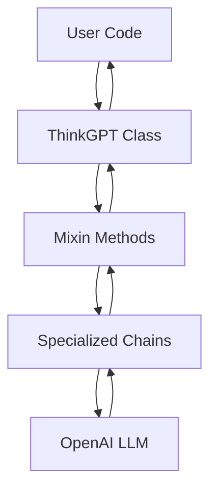

The primary workflow follows these steps:
1. User code calls a method on the ThinkGPT instance
2. The ThinkGPT class delegates to the appropriate mixin method
3. Mixin methods use specialized chains for processing
4. Chains interact with the OpenAI LLM and return results
5. Results flow back up the chain to the user

Sources: [thinkgpt/llm.py:23-82]()

## Usage Model

The primary usage pattern for ThinkGPT involves:

1. Creating a ThinkGPT instance
2. Storing information in memory using `memorize()`
3. Retrieving relevant information using `remember()`
4. Generating responses with `predict()`, optionally using remembered context
5. Using specialized cognitive capabilities (abstract, refine, summarize, etc.)

#### Typical Usage Flow

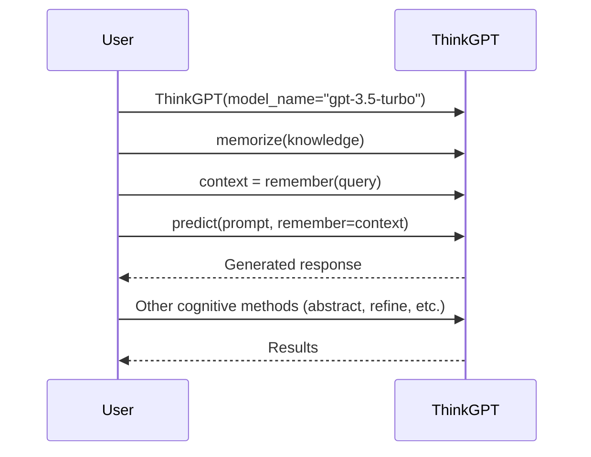

Basic usage example:

```python
from thinkgpt.llm import ThinkGPT

# Initialize ThinkGPT with OpenAI model
llm = ThinkGPT(model_name="gpt-3.5-turbo")

# Store information in memory
llm.memorize(['DocArray is a library for representing, sending and storing multi-modal data.'])

# Generate a response using relevant context from memory
response = llm.predict('what is DocArray?', remember=llm.remember('DocArray definition'))
```

Sources: [README.md:30-37](), [README.md:167-186]()

---

# Page: Memory Management System

# Memory Management System

<details>
<summary>Relevant source files</summary>

The following files were used as context for generating this wiki page:

- [README.md](README.md)
- [thinkgpt/helper.py](thinkgpt/helper.py)
- [thinkgpt/memory.py](thinkgpt/memory.py)

</details>


## Purpose and Scope

The Memory Management System is a core component of ThinkGPT that enables Large Language Models (LLMs) to overcome their context window limitations by implementing long-term memory. This system allows ThinkGPT to store information, retrieve relevant context when needed, and manage memory within token constraints. This document covers the memory architecture, components, operations, and integration patterns within ThinkGPT.

For information about knowledge compression through summarization and abstraction, see [Knowledge Compression](#2.2).

Sources: [README.md:7-8](), [README.md:13-14]()

## Memory System Architecture

The ThinkGPT Memory Management System bridges the gap between the short-term context window of LLMs and long-term persistent memory through a semantic embedding-based approach.

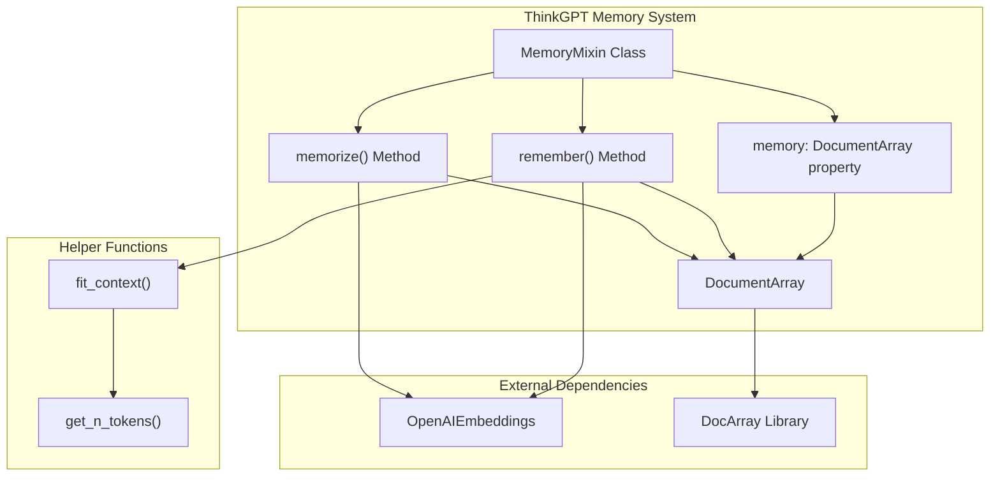

Sources: [thinkgpt/memory.py:26-66](), [README.md:40-67]()

## Core Components

### MemoryMixin

The `MemoryMixin` class provides memory functionality to the ThinkGPT system. It's designed as a mixin that can be incorporated into the main ThinkGPT class. This class manages:

1. A `DocumentArray` instance to store memory documents
2. A counter `mem_cnt` to track the chronological order of memories
3. An `OpenAIEmbeddings` model to create vector embeddings

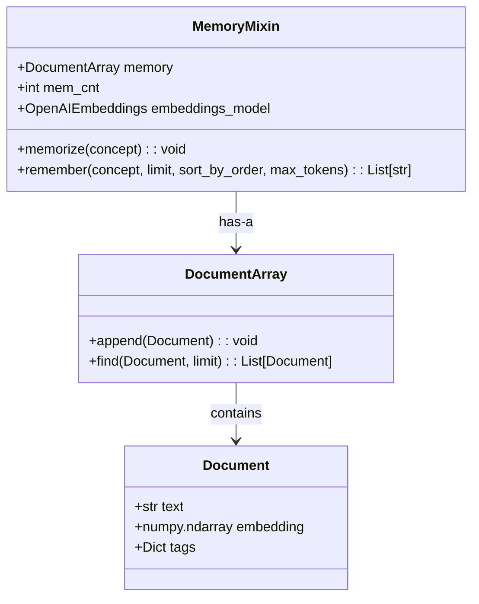

Sources: [thinkgpt/memory.py:26-30]()

### DocumentArray

DocumentArray is a data structure from the DocArray library that stores and manages a collection of Document objects. It provides vector search capabilities that enable semantic retrieval of memories based on embeddings. Each Document in the array contains:

- Text content (the actual memory)
- Vector embedding (for semantic search)
- Tags (metadata such as memory counter)

Sources: [thinkgpt/memory.py:8](), [README.md:20]()

### OpenAI Embeddings

The system uses OpenAI's embedding models to convert text into vector representations. These embeddings enable semantic search by finding conceptually similar content, not just keyword matches.

Sources: [thinkgpt/memory.py:6]()

## Memory Operations

### Memorizing Information

The `memorize()` method stores new information in the DocumentArray. It can accept:
- A string (converted to a Document with embedding)
- A Document object
- A list of strings or Documents
- A DocumentArray

For each item, the system:
1. Generates embeddings (if needed)
2. Assigns a memory counter for chronological tracking
3. Stores the item in the DocumentArray

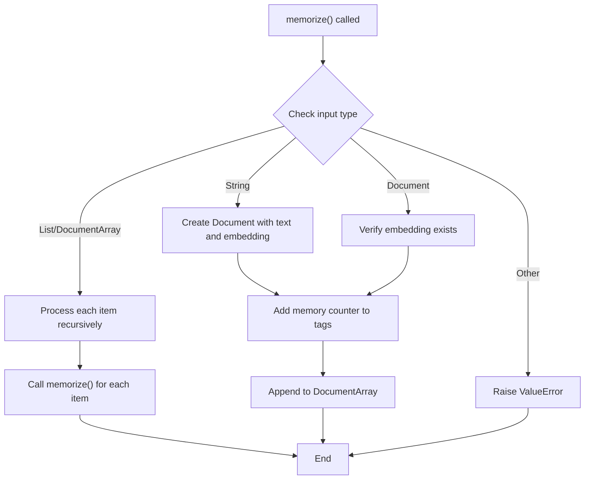

Sources: [thinkgpt/memory.py:31-44](), [README.md:41-44]()

### Retrieving Information

The `remember()` method retrieves relevant information from memory based on:
- A query string or Document (converted to embedding for semantic search)
- Optional parameters for limiting results and sorting

The retrieval process:
1. Converts the query to an embedding (if needed)
2. Performs similarity search in the DocumentArray
3. Optionally sorts results chronologically
4. Optionally limits tokens to fit context windows
5. Returns a list of text strings

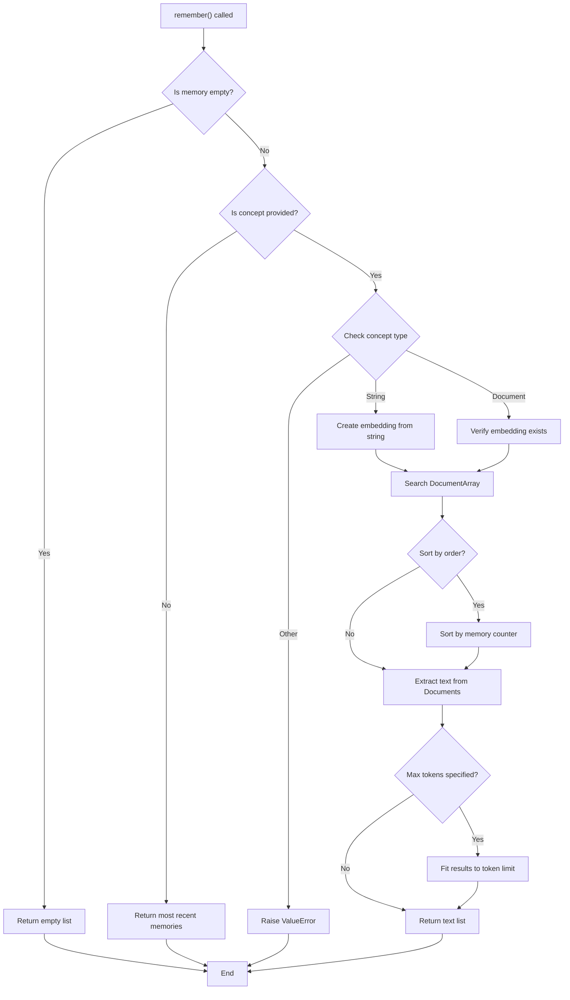

Sources: [thinkgpt/memory.py:46-66](), [README.md:46-67]()

### Token Management

The Memory Management System includes functions to manage token limitations within LLM context windows:

- `get_n_tokens()`: Counts the number of tokens in a string using tiktoken
- `fit_context()`: Trims a list of text elements to fit within a token limit

These functions help ensure that retrieved memories can fit within the LLM's context window.

Sources: [thinkgpt/helper.py:39-55](), [README.md:59-67]()

## Integration with ThinkGPT

The Memory Management System integrates with ThinkGPT through the `ExecuteWithContextChain` which enables the execution of tasks with relevant context retrieved from memory.

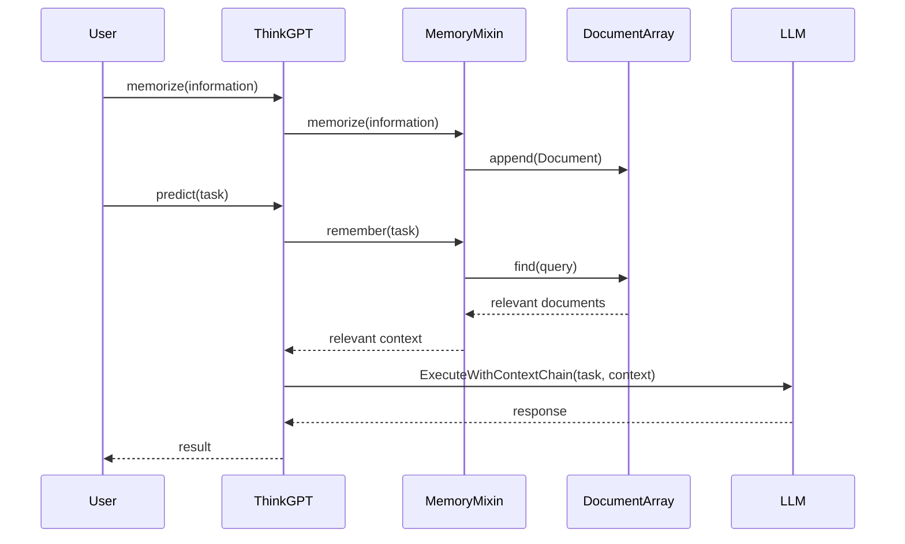

The typical workflow involves:
1. Storing information using `memorize()`
2. When executing a task with `predict()`, retrieving relevant context with `remember()`
3. Using the `ExecuteWithContextChain` to generate a response that incorporates the context

Sources: [thinkgpt/memory.py:12-23](), [README.md:36-37]()

## API Usage Examples

### Basic Memory Operations

```python
# Initialize ThinkGPT with memory capabilities
from thinkgpt.llm import ThinkGPT
llm = ThinkGPT(model_name="gpt-3.5-turbo")

# Store information in memory
llm.memorize(['DocArray is a library for representing, sending and storing multi-modal data.'])

# Retrieve and use relevant context for a task
llm.predict('what is DocArray?', remember=llm.remember('DocArray definition'))
```

### Managing Token Limits

```python
# Retrieve memories with token limit constraints
from thinkgpt.helper import get_n_tokens

results = llm.remember('query', max_tokens=1000, limit=1000)
print(get_n_tokens(''.join(results)))  # Will not exceed 1000 tokens
```

### Chronological Memory Retrieval

```python
# Retrieve memories sorted by their chronological order
chronological_memories = llm.remember('query', limit=5, sort_by_order=True)
```

Sources: [README.md:31-67]()

## Memory System Implementation Details

The memory system is implemented through a combination of:

| Component | Purpose | Key Functions |
|-----------|---------|---------------|
| MemoryMixin | Provides memory capabilities | memorize(), remember() |
| DocumentArray | Stores and retrieves documents | append(), find() |
| OpenAIEmbeddings | Creates vector representations | embed_query() |
| Helper Functions | Manages token limits | get_n_tokens(), fit_context() |
| ExecuteWithContextChain | Executes tasks with context | run() |

The system uses embedding-based similarity search rather than traditional keyword search, allowing it to find conceptually related information even when exact terms don't match.

Sources: [thinkgpt/memory.py:1-66](), [thinkgpt/helper.py:39-55]()

---

# Page: Knowledge Compression

# Knowledge Compression

<details>
<summary>Relevant source files</summary>

The following files were used as context for generating this wiki page:

- [README.md](README.md)
- [thinkgpt/abstract.py](thinkgpt/abstract.py)
- [thinkgpt/summarize.py](thinkgpt/summarize.py)

</details>


Knowledge Compression in ThinkGPT provides mechanisms to condense, summarize, and abstract information so it can fit within the context limits of language models. This system helps overcome one of the main limitations of LLMs - their finite context window - by providing methods to compress knowledge while preserving essential information.

For information about Memory Management, which handles storing and retrieving information, see [Memory Management System](#2.1).

## Architecture Overview

The Knowledge Compression subsystem consists of two main components:

1. **Summarization** - Reduces content length while preserving key information
2. **Abstraction** - Extracts high-level rules or patterns from specific observations

These components are implemented through two key mixins that are incorporated into the main `ThinkGPT` class:

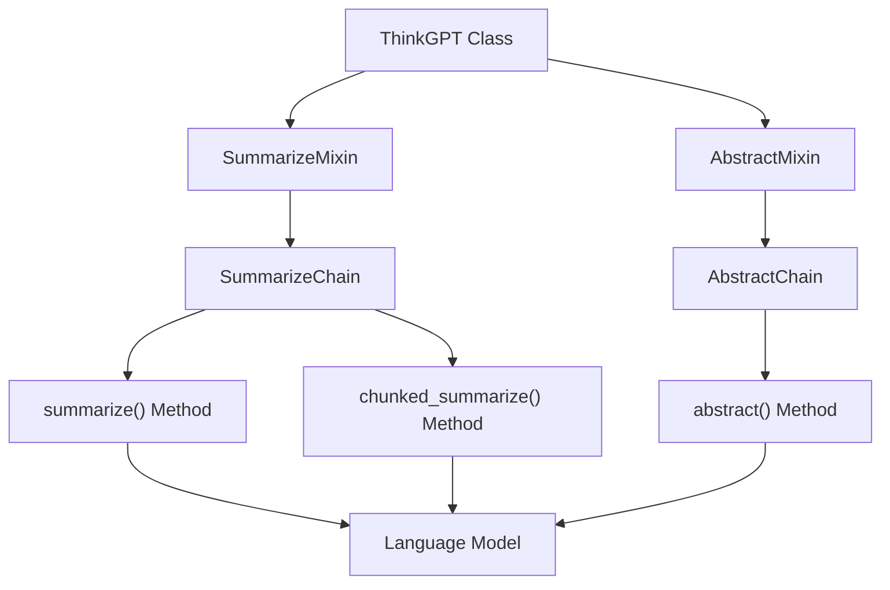

Sources: [thinkgpt/summarize.py](), [thinkgpt/abstract.py]()

## Class Architecture

The Knowledge Compression subsystem is organized into a set of specialized classes:

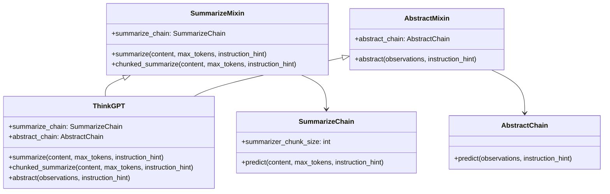

Sources: [thinkgpt/summarize.py:34-59](), [thinkgpt/abstract.py:93-100]()

## Summarization Component

The Summarization component provides methods to condense content while preserving essential information. It offers two main approaches:

### One-shot Summarization

The `summarize()` method processes content in a single LLM call. This method is suitable for content that doesn't exceed the LLM's context length limit.

```python
def summarize(self, content: str, max_tokens: int = 4096, instruction_hint: str = '') -> str:
    response = self.summarize_chain.predict(
        content=content, instruction_hint=instruction_hint, max_tokens=max_tokens
    )
    return response
```

Sources: [thinkgpt/summarize.py:37-42]()

### Chunked Summarization

The `chunked_summarize()` method handles large content by:
1. Breaking it into manageable chunks
2. Summarizing each chunk separately
3. Combining the summaries

This approach overcomes the context length limitation of language models by processing content in pieces.

```python
def chunked_summarize(self, content: str, max_tokens: int = 4096, instruction_hint: str = '') -> str:
    num_tokens = self.summarize_chain.llm.get_num_tokens(content)
    if num_tokens > max_tokens:
        avg_chars_per_token = len(content) / num_tokens
        chunk_size = int(avg_chars_per_token * self.summarize_chain.summarizer_chunk_size)
        chunks = textwrap.wrap(content, chunk_size)
        summary_size = int(max_tokens / len(chunks))
        result = ""
        for chunk in chunks:
            result += self.summarize(content=chunk, max_tokens=summary_size, instruction_hint=instruction_hint)
    else:
        return content
    return result
```

Sources: [thinkgpt/summarize.py:44-59]()

## Abstraction Component

The Abstraction component extracts high-level rules or patterns from specific observations. This allows for compressing knowledge by identifying general principles rather than storing numerous specific examples.

```python
def abstract(self, observations: List[str], instruction_hint: str = '') -> List[str]:
    result = self.abstract_chain.predict(
        observations="\n".join(observations), instruction_hint=instruction_hint
    )
    return LineSeparatorOutputParser().parse(result)
```

This method leverages few-shot learning by providing examples to the LLM to help it understand how to extract rules. The examples cover domains such as:
- Traffic rules
- Mathematical sequences
- Physics principles

Sources: [thinkgpt/abstract.py:93-100](), [thinkgpt/abstract.py:16-51]()

## Processing Workflow

The following sequence diagram illustrates how data flows through the Knowledge Compression system:

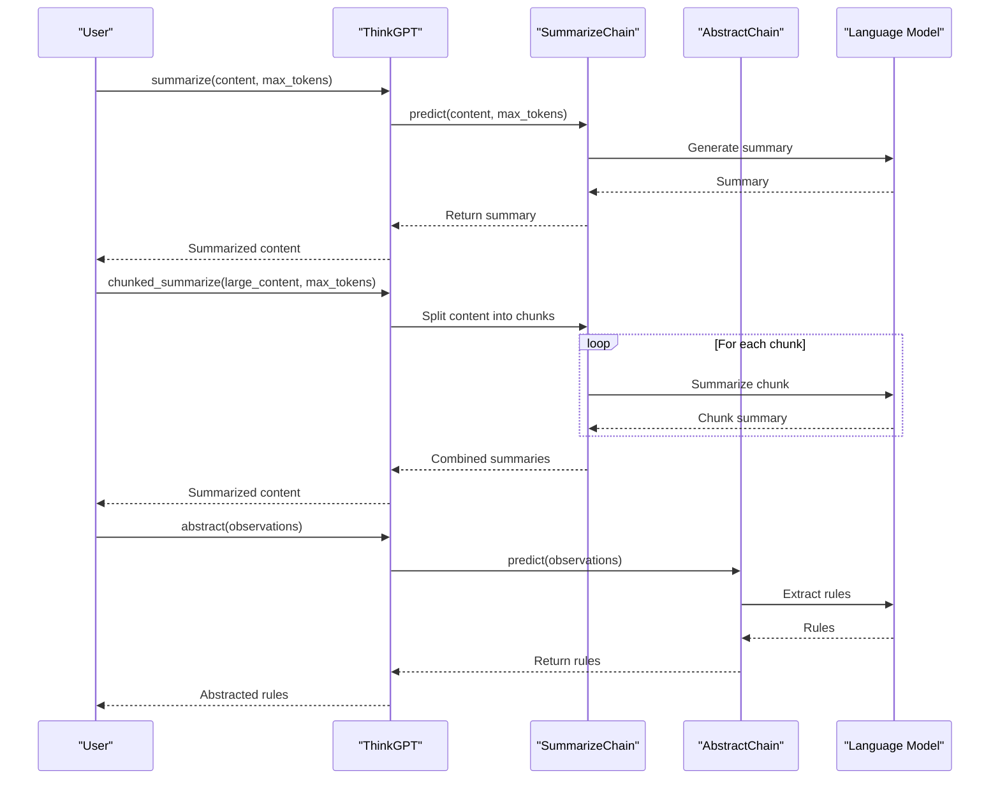

Sources: [thinkgpt/summarize.py:37-59](), [thinkgpt/abstract.py:93-100]()

## Prompt Templates

The system uses specialized prompt templates to guide the LLM in summarization and abstraction tasks:

### Summarization Prompt

```
Shorten the following memory chunk of an autonomous agent from a first person perspective, using at most {max_tokens} tokens. {instruction_hint}:
content:
{content}
---------
```

Source: [thinkgpt/summarize.py:11-16]()

### Abstraction Prompt

The abstraction prompt uses a few-shot approach with examples, followed by:

```
Extract rules from the following observations. Put each rule in a separate line. {instruction_hint}
Observations:
{observations}
Rules:
```

Source: [thinkgpt/abstract.py:54-71]()

## Usage Examples

### Basic Summarization

```python
from thinkgpt.llm import ThinkGPT

llm = ThinkGPT(model_name="gpt-3.5-turbo")

# Summarize content
summary = llm.summarize(
  large_content,
  max_tokens=1000,
  instruction_hint='Pay attention to code snippets, links and scientific terms.'
)
```

### Chunked Summarization for Very Large Content

```python
from thinkgpt.llm import ThinkGPT

llm = ThinkGPT(model_name="gpt-3.5-turbo")

# Summarize very large content by chunking
summary = llm.chunked_summarize(
  very_large_content,
  max_tokens=4096,
  instruction_hint='Pay attention to code snippets, links and scientific terms.'
)
```

### Abstracting Rules from Observations

```python
from thinkgpt.llm import ThinkGPT

llm = ThinkGPT(model_name="gpt-3.5-turbo")

# Extract rules from observations
rules = llm.abstract(observations=[
    "in tunisian, I did not eat is \"ma khditech\"",
    "I did not work is \"ma khdemtech\"",
    "I did not go is \"ma mchitech\"",
])
# Result: "Negation in Tunisian Arabic uses 'ma' + verb + 'tech' where 'ma' 
# means 'not' and 'tech' at the end indicates the negation in the past tense."
```

Sources: [README.md:100-137]()

## Integration with ThinkGPT

Knowledge Compression integrates with other ThinkGPT components to enable advanced capabilities:

| Component Integration | Description |
|----------------------|-------------|
| Memory Management    | Compressed knowledge can be stored in memory for later retrieval |
| Self-Refinement      | Compressed knowledge can be refined using feedback |
| Inference Engine     | Compressed rules can be used for making inferences |

This integration allows ThinkGPT to:
1. Store more information within context limits
2. Extract high-level principles from specific examples
3. Condense large amounts of information without losing critical details

## Key Implementation Insights

- The `SummarizeChain` has a configurable `summarizer_chunk_size` (default: 3000) that determines how large each chunk should be in tokens during chunked summarization.
- The `AbstractChain` uses a fixed set of examples that demonstrate rule extraction across different domains to guide the LLM through few-shot learning.
- Both components support custom `instruction_hint` parameters, allowing fine-tuned guidance for specific use cases.

Sources: [thinkgpt/summarize.py:19-31](), [thinkgpt/abstract.py:84-90]()

## Summary

The Knowledge Compression subsystem addresses one of the key limitations of LLMs - finite context windows - by providing mechanisms to:

1. Summarize content to reduce its size while preserving key information
2. Extract high-level rules and patterns from specific observations

Through these techniques, ThinkGPT can work with larger amounts of information than would otherwise fit in the LLM's context window, enabling more complex reasoning and knowledge management capabilities.

---

# Page: Self-Refinement System

# Self-Refinement System

<details>
<summary>Relevant source files</summary>

The following files were used as context for generating this wiki page:

- [README.md](README.md)
- [examples/__init__.py](examples/__init__.py)
- [examples/code_self_refinement.py](examples/code_self_refinement.py)
- [thinkgpt/refine.py](thinkgpt/refine.py)

</details>


## Purpose and Scope

The Self-Refinement System in ThinkGPT provides a structured mechanism to improve content based on specific feedback or criticism. This component enables the refinement of model-generated outputs such as text or code by addressing critics and incorporating feedback. The system is particularly valuable for code correction, content improvement, and iterative refinement scenarios.

For information about related knowledge processing capabilities, see [Knowledge Compression](#2.2).

## Architecture Overview

The Self-Refinement System is implemented through two primary components: the `RefineMixin` class and the `RefineChain` class, which work together to enable content refinement functionality in ThinkGPT.

### Component Architecture Diagram

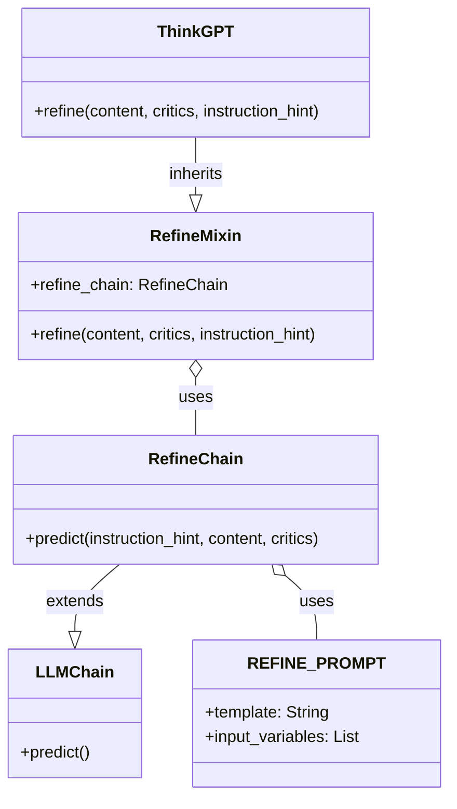

Sources: [thinkgpt/refine.py:20-36]()

### Core Components

1. **REFINE_PROMPT**: A PromptTemplate that formats content, critics, and instruction hints for the language model.
2. **RefineChain**: A specialized LLMChain that manages the refinement process using the prompt template.
3. **RefineMixin**: A mixin class that adds the `refine` method to the ThinkGPT class.

## Refinement Process Flow

The following diagram illustrates how data flows through the Self-Refinement System:

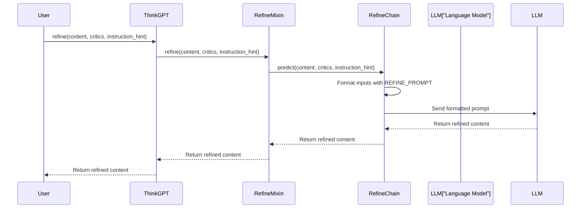

Sources: [thinkgpt/refine.py:30-36]()

## API Reference

The Self-Refinement System is accessed through the `refine` method provided by the `RefineMixin` class:

```python
def refine(self, content: str, critics: List[str], instruction_hint: str = '') -> str
```

### Parameters

| Parameter | Type | Description |
|-----------|------|-------------|
| `content` | str | The original content that needs refinement |
| `critics` | List[str] | A list of criticisms or feedback points |
| `instruction_hint` | str | Optional guidance for the refinement process (default: '') |

### Return Value

| Type | Description |
|------|-------------|
| str | The refined content |

Sources: [thinkgpt/refine.py:33-36]()

## Natural Language to Code Entity Mapping

The following diagram maps natural language concepts in the Self-Refinement System to specific code entities:

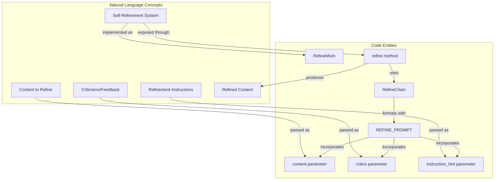

Sources: [thinkgpt/refine.py:1-36]()

## Implementation Details

### Prompt Template

The refinement prompt template is defined in `REFINE_PROMPT`:

```
Based on the critics, fix the content provided to you. {instruction_hint}:
content:
{content}
---------
critics:
{critics}
---------
```

This template structures how content and criticism are presented to the language model.

Sources: [thinkgpt/refine.py:9-17]()

### RefineChain Class

The `RefineChain` extends LangChain's `LLMChain` to handle refinement:

```python
class RefineChain(LLMChain):
    """Prompts the LLM to request to remember memory as needed"""
    def __init__(self, **kwargs):
        super().__init__(prompt=REFINE_PROMPT, **kwargs)

    def predict(self, instruction_hint: str = '', **kwargs: Any) -> str:
        return super().predict(instruction_hint=instruction_hint, **kwargs)
```

Sources: [thinkgpt/refine.py:20-27]()

### RefineMixin Class

The `RefineMixin` class adds refinement capabilities to ThinkGPT:

```python
class RefineMixin:
    refine_chain: RefineChain

    def refine(self, content: str, critics: List[str], instruction_hint: str = '') -> str:
        return self.refine_chain.predict(
            content=content, critics="\n".join(critics), instruction_hint=instruction_hint
        )
```

Sources: [thinkgpt/refine.py:30-36]()

## Common Applications

### Code Refinement

One of the most frequent applications is fixing code based on error messages:

```python
from thinkgpt.llm import ThinkGPT

llm = ThinkGPT(model_name="gpt-3.5-turbo")

fixed_code = llm.refine(
    content="""
    import re
        print('hello world')
    """,
    critics=[
        'IndentationError: unexpected indent'
    ],
    instruction_hint="Fix the code snippet based on the error provided."
)
```

Example output:
```
import re
print('hello world')
```

Sources: [examples/code_self_refinement.py:1-15](), [README.md:76-98]()

### Content Improvement

The system can refine written content based on specific feedback:

```python
refined_text = llm.refine(
    content="This text has spaeling and grammer errors.",
    critics=[
        "Contains spelling errors",
        "Contains grammar errors"
    ],
    instruction_hint="Correct the spelling and grammar errors."
)
```

### Self-Critique and Knowledge Refinement

The Self-Refinement System can be integrated with memory replay to enable agents to critique and refine their own knowledge, as demonstrated in the examples:

```mermaid
flowchart TD
    A["Agent Memory"] --> B["Memory Replay"]
    B --> C["Self-Critique"]
    C --> D["Refinement"]
    D --> E["Updated Memory"]
    E --> A
```

This approach is based on techniques described in the "Self-Refine: Iterative Refinement with Self-Feedback" paper.

Sources: [README.md:229-238]()

## Best Practices

For effective use of the Self-Refinement System:

1. **Specific critics**: Provide detailed, specific criticism for better targeted refinement
2. **Clear instruction hints**: Use instruction hints to guide the refinement process
3. **Iterative refinement**: For complex issues, use multiple refinement steps
4. **Appropriate scoping**: Ensure content fits within model context limits

Sources: [README.md:76-98](), [examples/code_self_refinement.py:1-15]()

## Limitations

- The quality of refinement depends on the specificity and clarity of criticisms
- Large content may exceed the language model's context window
- Highly technical refinements may require specialized instruction hints

---

# Page: Natural Language Interfaces

# Natural Language Interfaces

<details>
<summary>Relevant source files</summary>

The following files were used as context for generating this wiki page:

- [README.md](README.md)
- [thinkgpt/condition.py](thinkgpt/condition.py)
- [thinkgpt/gpt_select.py](thinkgpt/gpt_select.py)

</details>


This document covers ThinkGPT's natural language interfaces, which provide intuitive ways to integrate LLM-powered decision-making into code. The two primary interfaces are Natural Language Conditions and Natural Language Selection, which allow code to evaluate statements and choose options using natural language processing capabilities.

These interfaces bridge the gap between human language and programmatic decision-making, enabling more flexible and intuitive applications.

## Architecture Overview

The Natural Language Interfaces component consists of two primary mixins that are incorporated into the main ThinkGPT class, along with their corresponding chain implementations:

```mermaid
classDiagram
    class ThinkGPT {
        +memory: DocumentArray
        +generate()
        +predict()
    }
    
    class ConditionMixin {
        +condition_chain: ConditionChain
        +condition(question, instruction_hint)
    }
    
    class SelectMixin {
        +select_chain: SelectChain
        +select(question, options, instruction_hint, num_choices)
    }
    
    class ConditionChain {
        +predict(question, instruction_hint)
    }
    
    class SelectChain {
        +predict(question, options, instruction_hint, num_choices)
    }
    
    ConditionMixin <|-- ThinkGPT
    SelectMixin <|-- ThinkGPT
    
    ConditionMixin --> ConditionChain: uses
    SelectChain <-- SelectMixin: uses
    
    ConditionChain --|> LLMChain: extends
    SelectChain --|> LLMChain: extends
```

Sources: [thinkgpt/condition.py:63-67](), [thinkgpt/gpt_select.py:83-88]()

## Data Flow

The following diagram illustrates how data flows through the Natural Language Interfaces components:

```mermaid
sequenceDiagram
    participant User as "User Code"
    participant ThinkGPT as "ThinkGPT"
    participant Chain as "ConditionChain/SelectChain"
    participant LLM as "Language Model"
    participant Parser as "OutputParser"
    
    User->>ThinkGPT: condition(question) or select(question, options)
    ThinkGPT->>Chain: predict(question, ...)
    Chain->>LLM: Generate with few-shot examples
    LLM-->>Chain: Raw text response
    Chain->>Parser: parse(text)
    Parser-->>Chain: Structured result (bool/List[str])
    Chain-->>ThinkGPT: Structured result
    ThinkGPT-->>User: Result
```

Sources: [thinkgpt/condition.py:66-67](), [thinkgpt/gpt_select.py:87-88]()

## Natural Language Condition

The condition interface evaluates natural language statements and returns a boolean result. It allows code to make decisions based on complex linguistic criteria that would be difficult to express programmatically.

```mermaid
flowchart TD
    Input["Natural Language Question"] --> ConditionMethod["ThinkGPT.condition()"]
    ConditionMethod --> ConditionChain["ConditionChain"]
    ConditionChain --> FewShotPrompt["FewShotPromptTemplate with Examples"]
    FewShotPrompt --> LLM["Language Model"]
    LLM --> RawOutput["Raw Text Output (true/false)"]
    RawOutput --> ConditionOutputParser["ConditionOutputParser"]
    ConditionOutputParser --> BooleanResult["Boolean Result (True/False)"]
```

### Implementation Details

The condition functionality is implemented through the following components:

1. **ConditionMixin**: Adds the `condition` method to the `ThinkGPT` class, providing a simple interface for condition evaluation.

2. **ConditionChain**: A specialized `LLMChain` that:
   - Takes a natural language question
   - Uses a few-shot prompting approach with predefined examples
   - Returns a boolean result after parsing the LLM output

3. **ConditionOutputParser**: Converts the LLM's text output into a boolean value by matching against "true" or "false" (case-insensitive).

The system uses few-shot learning with examples like:
- "Is the sky blue?" → "True"
- "Do humans have three arms?" → "False"
- "Is water wet?" → "True"

Sources: [thinkgpt/condition.py:9-31](), [thinkgpt/condition.py:42-67]()

### Usage Example

```python
from thinkgpt.llm import ThinkGPT

llm = ThinkGPT(model_name="gpt-3.5-turbo")

# Evaluate a natural language condition
is_error = llm.condition('Does this represent an error message? "IndentationError: unexpected indent"')
print(is_error)  # True

# Use in conditional logic
if llm.condition("Is quantum computing faster than classical computing for all problems?"):
    print("Handling quantum computing case...")
else:
    print("Handling classical computing case...")
```

Sources: [README.md:142-148]()

## Natural Language Selection

The selection interface allows the LLM to choose one or more options from a list based on a natural language question. This provides a powerful way to delegate complex selection tasks to the language model.

```mermaid
flowchart TD
    Question["Natural Language Question"] --> SelectMethod["ThinkGPT.select()"]
    Options["List of Options"] --> SelectMethod
    SelectMethod --> SelectChain["SelectChain"]
    SelectChain --> FewShotPrompt["FewShotPromptTemplate with Examples"]
    FewShotPrompt --> LLM["Language Model"]
    LLM --> RawOutput["Raw Text Output (selected options)"]
    RawOutput --> SelectOutputParser["SelectOutputParser"]
    SelectOutputParser --> SelectedOptions["List of Selected Options"]
```

### Implementation Details

The selection functionality is implemented through the following components:

1. **SelectMixin**: Adds the `select` method to the `ThinkGPT` class, providing a simple interface for option selection.

2. **SelectChain**: A specialized `LLMChain` that:
   - Takes a natural language question and a list of options
   - Formats the options as a newline-separated list
   - Uses a few-shot prompting approach with predefined examples
   - Can be configured to select a specific number of options
   - Returns a list of selected options after parsing the LLM output

3. **SelectOutputParser**: Converts the LLM's text output into a list of selected options by:
   - Splitting the response by newlines
   - Matching each line against the provided options (case-insensitive)
   - Returning a list of matched options

The system uses few-shot learning with examples like:
- "Which animal is known as the king of the jungle?" with options "Lion", "Elephant", "Tiger", "Giraffe" → "Lion"
- "Which of these are plants?" with options "Lily", "Giraffe", "Cactus", "Rose" → "Lily\nCactus\nRose"

Sources: [thinkgpt/gpt_select.py:9-42](), [thinkgpt/gpt_select.py:51-88]()

### Usage Example

```python
from thinkgpt.llm import ThinkGPT

llm = ThinkGPT(model_name="gpt-3.5-turbo")

# Single selection
king = llm.select(
    question="Which animal is the king of the jungle?",
    options=["Lion", "Elephant", "Tiger", "Giraffe"]
)
print(king)  # ['Lion']

# Multiple selection
mammals = llm.select(
    question="Which of these are mammals?",
    options=["Lion", "Shark", "Eagle", "Dolphin"]
)
print(mammals)  # ['Lion', 'Dolphin']

# Constrained selection (exact number of choices)
top_three = llm.select(
    question="Which are the three largest mammals?",
    options=["Elephant", "Blue Whale", "Giraffe", "Hippopotamus", "Lion"],
    num_choices=3
)
print(top_three)  # Example: ['Blue Whale', 'Elephant', 'Hippopotamus']
```

Sources: [README.md:149-160](), [thinkgpt/gpt_select.py:86-88]()

## Advanced Usage

### Custom Instruction Hints

Both interfaces accept an `instruction_hint` parameter that allows you to provide additional guidance to the LLM:

```python
# Providing instruction hints
result = llm.condition(
    "Is this code correct? print('Hello, world')",
    instruction_hint="Pay special attention to syntax errors."
)

result = llm.select(
    question="Which elements are transition metals?",
    options=["Sodium", "Iron", "Copper", "Calcium", "Zinc"],
    instruction_hint="Consider the position in the periodic table."
)
```

Sources: [thinkgpt/condition.py:66-67](), [thinkgpt/gpt_select.py:86-88]()

### System Integration

The Natural Language Interfaces are designed to integrate seamlessly with other ThinkGPT components and application code:

```mermaid
flowchart LR
    subgraph "Application Code"
        AppLogic["Application Logic"]
    end

    subgraph "ThinkGPT System"
        ThinkGPT["ThinkGPT"]
        
        subgraph "Natural Language Interfaces"
            direction TB
            ConditionMethod["condition()"]
            SelectMethod["select()"]
        end
        
        subgraph "Other ThinkGPT Components"
            Memory["Memory Management"]
            Abstract["Rule Extraction"]
            Refine["Self-Refinement"]
            Summarize["Summarization"]
        end
    end
    
    AppLogic --> ConditionMethod: "Uses for decisions"
    AppLogic --> SelectMethod: "Uses for options"
    
    ConditionMethod --> LLM["Language Model"]
    SelectMethod --> LLM
    
    LLM --> DecisionResult["Boolean/Selection Results"]
    DecisionResult --> AppLogic: "Informs application behavior"
```

Sources: [README.md:12-19]()

## Practical Applications

### Intelligent Decision Making

Natural Language Conditions enable more intuitive decision trees in code:

```python
# Error handling with natural language understanding
error_message = "IndentationError: unexpected indent"
if llm.condition(f'Does this represent an error message? "{error_message}"'):
    print("Detected an error, attempting to fix...")
    # Apply self-refinement to fix code
    
# Sentiment analysis
feedback = "I am very disappointed with the service I received."
if llm.condition(f'Does this text express negative sentiment? "{feedback}"'):
    print("Negative sentiment detected, escalating to customer support...")
    # Trigger support escalation workflow
```

### Smart Selection Systems

Natural Language Selection can be used for sophisticated option filtering:

```python
# Dynamic content categorization
content = "How to implement a neural network in PyTorch"
categories = ["Machine Learning", "Web Development", "DevOps", "Mobile Development", "Database"]
content_category = llm.select(
    question=f"Which category best fits this content: '{content}'?",
    options=categories
)

# Multiple relevant frameworks selection
task = "Build a real-time data dashboard with interactive visualizations"
frameworks = ["React", "Angular", "Vue", "D3.js", "Plotly", "Highcharts", "Flask", "Django"]
recommended_tools = llm.select(
    question=f"Which frameworks/libraries would be most suitable for this task: '{task}'?",
    options=frameworks,
    num_choices=3
)
```

## Limitations and Best Practices

When using the Natural Language Interfaces, keep in mind:

1. **Determinism**: LLM decisions aren't fully deterministic - the same input may produce different outputs across calls.

2. **Complexity Balance**: Too complex or ambiguous questions may lead to unpredictable results.

3. **Option Formatting**: The selection system works best with concise, distinct options.

4. **Performance**: Each call requires an LLM API call, which adds latency and potential costs.

Best practices:

1. Use specific, clear questions for more reliable results
2. Include instruction hints to guide the LLM's reasoning
3. Implement fallback logic for cases where the LLM might return unexpected results
4. Consider caching results for frequently used conditions or selections

## Summary

ThinkGPT's Natural Language Interfaces provide a bridge between human language and code logic through:

- **Natural Language Conditions**: Convert natural language statements into boolean decisions
- **Natural Language Selection**: Choose appropriate options from a list based on natural language criteria

These interfaces make it easier to incorporate LLM-powered decision-making into applications, enabling more flexible, intuitive, and powerful systems that can reason about complex criteria expressed in natural language.

Sources: [README.md:12-19](), [README.md:142-160](), [thinkgpt/condition.py](), [thinkgpt/gpt_select.py]()

---

# Page: Inference Engine

# Inference Engine

<details>
<summary>Relevant source files</summary>

The following files were used as context for generating this wiki page:

- [README.md](README.md)
- [thinkgpt/infer.py](thinkgpt/infer.py)

</details>


The ThinkGPT Inference Engine provides the capability to generate logical deductions and derive new insights based on existing knowledge. This component enables ThinkGPT to make educated guesses and extend its understanding beyond explicitly provided information, simulating a form of reasoning similar to human inference.

For information about memory management, see [Memory Management System](#2.1). For content summarization, see [Knowledge Compression](#2.2).

## Purpose and Scope

The Inference Engine serves as a critical reasoning component that:

1. Takes established facts or knowledge as input
2. Applies logical reasoning to derive new observations or conclusions
3. Expands the agent's knowledge through deduction rather than direct memorization
4. Implements a key capability described in the Generative Agents research paper

Sources: [README.md:16-17](), [thinkgpt/infer.py:1-79]()

## Architecture and Integration

The Inference Engine is implemented using the mixin pattern, consistent with ThinkGPT's overall architecture, allowing for modular integration into the main ThinkGPT class.

```mermaid
classDiagram
    class "InferMixin" {
        +infer_chain: InferChain
        +infer(facts: List[str], instruction_hint: str) -> List[str]
    }
    
    class "InferChain" {
        +predict(instruction_hint: str, **kwargs) -> str
    }
    
    class "LLMChain" {
        <<Langchain>>
    }
    
    class "ThinkGPT" {
        +memory: DocumentArray
        +infer(facts: List[str], instruction_hint: str) -> List[str]
    }
    
    LLMChain <|-- InferChain
    InferMixin <|-- ThinkGPT
    InferMixin *-- InferChain : uses
```

The Inference Engine integrates with the broader ThinkGPT architecture through:

1. The `InferMixin` class that adds inference capabilities to the main ThinkGPT class
2. The `InferChain` class that handles the actual inference process using the language model
3. Prompt templates that guide the LLM to produce logical inferences

Sources: [thinkgpt/infer.py:52-68]()

## Implementation Details

### Prompt Engineering

The Inference Engine uses few-shot prompting to guide the LLM. The system contains predefined examples that demonstrate the inference pattern:

```mermaid
flowchart TD
    subgraph "Prompt Structure"
        direction TB
        A["Prefix: Instruction to infer new observations"] --> 
        B["Examples: Predefined fact-observation pairs"] -->
        C["User Facts: Input provided by user"] -->
        D["Output: Generated new observations"]
    end
```

Example templates include:
- Water state changes (freezing/boiling) to demonstrate physical inference
- Plant photosynthesis requirements to demonstrate biological inference

Sources: [thinkgpt/infer.py:11-49]()

### Core Components

#### InferChain

The `InferChain` class extends Langchain's `LLMChain` and is responsible for:
- Managing the prompt template for inference
- Handling the interaction with the language model
- Processing the output

```python
class InferChain(LLMChain):
    def __init__(self, **kwargs):
        super().__init__(prompt=INFERENCE_PROMPT, **kwargs)

    def predict(self, instruction_hint: str = '', **kwargs: Any) -> str:
        return super().predict(instruction_hint=instruction_hint, **kwargs)
```

Sources: [thinkgpt/infer.py:52-58]()

#### InferMixin

The `InferMixin` class provides the public API for inference and is responsible for:
- Converting the input facts into a structured format
- Calling the inference chain
- Parsing the results into a list of observations

```python
class InferMixin:
    infer_chain: InferChain

    def infer(self, facts: List[str], instruction_hint: str = '') -> List[str]:
        result = self.infer_chain.predict(
            facts="\n".join(facts), instruction_hint=instruction_hint
        )
        return LineSeparatorOutputParser().parse(result)
```

Sources: [thinkgpt/infer.py:61-68]()

## Data Flow Process

```mermaid
sequenceDiagram
    participant "User" as U
    participant "ThinkGPT" as T
    participant "InferMixin" as IM
    participant "InferChain" as IC
    participant "LLM" as L
    participant "OutputParser" as OP

    U->>T: Call infer() with facts list
    T->>IM: Forward to InferMixin.infer()
    IM->>IC: Join facts with newlines and call predict()
    IC->>L: Send prompt with facts to language model
    L-->>IC: Return inference text
    IC-->>IM: Return raw inference result
    IM->>OP: Parse result with LineSeparatorOutputParser
    OP-->>IM: Return list of observations
    IM-->>T: Return parsed observations
    T-->>U: Return inferred observations
```

Sources: [thinkgpt/infer.py:61-68]()

## Usage Examples

### Basic Usage

The Inference Engine can be used to derive new observations from a set of facts:

```python
from thinkgpt.llm import ThinkGPT

llm = ThinkGPT(model_name="gpt-3.5-turbo")

inferred_observations = llm.infer(
    facts=[
        "Klaus Mueller is writing a research paper",
        "Klaus Mueller enjoys reading a book on gentrification",
        "Klaus Mueller is conversing with Ayesha Khan about exercising"
    ]
)

print(inferred_observations)
# Example output:
# ['Klaus Mueller is interested in multiple topics',
#  'Klaus Mueller may have a diverse range of interests and hobbies']
```

Sources: [thinkgpt/infer.py:71-78](), [README.md:216-227]()

### Replay and Expand Agent Memory

One of the key applications of the Inference Engine is in generative agents that can reflect on their memories and derive new insights:

```mermaid
flowchart TD
    subgraph "Memory Reflection Process"
        direction TB
        A["Agent Memory Storage"] --> 
        B["Memory Retrieval"] -->
        C["Inference Engine"] -->
        D["New Observations"] -->
        E["Memory Update"]
    end
```

This capability allows agents to exhibit more human-like behavior by not just storing facts but also deriving insights from their experiences - a concept introduced in the Generative Agents research paper cited in the README.

Sources: [README.md:216-227]()

## Integration with Other ThinkGPT Components

The Inference Engine complements other ThinkGPT components:

1. **Memory System**: The inference engine can process facts retrieved from the memory system
2. **Knowledge Compression**: Inferred observations can provide higher-level abstractions of knowledge
3. **Self-Refinement**: Inferences can be validated and refined through the self-refinement system

```mermaid
flowchart TD
    Memory["Memory System"] -->|"Retrieves facts"| Infer["Inference Engine"]
    Infer -->|"Produces observations"| Memory
    
    Infer -->|"Generates abstractions"| Compress["Knowledge Compression"]
    Compress -->|"Provides condensed facts"| Infer
    
    Infer -->|"Proposes conclusions"| Refine["Self-Refinement"]
    Refine -->|"Validates inferences"| Infer
```

Sources: [README.md:5-9](), [README.md:216-227]()

## Technical Constraints and Considerations

When using the Inference Engine, consider the following:

1. **Quality of Input Facts**: The quality of inferences depends on the quality and relevance of input facts
2. **Instruction Hints**: The optional `instruction_hint` parameter can guide the inference process toward specific types of observations
3. **LLM Limitations**: Inferences are limited by the reasoning capabilities of the underlying language model
4. **Verification**: Inferred observations should be treated as hypotheses that may require verification

Sources: [thinkgpt/infer.py:64-67]()

---

# Page: Getting Started

# Getting Started

<details>
<summary>Relevant source files</summary>

The following files were used as context for generating this wiki page:

- [README.md](README.md)
- [pyproject.toml](pyproject.toml)

</details>


This page provides comprehensive instructions for installing and using ThinkGPT, a Python library that extends LLM capabilities with advanced cognitive functions. For more complex application scenarios, see [Advanced Usage](#4).

## Installation Requirements

ThinkGPT can be installed using pip:

```shell
pip install git+https://github.com/alaeddine-13/thinkgpt.git
```

The library requires Python 3.7 or higher and has the following dependencies as specified in the pyproject.toml:

| Dependency | Version Requirement |
|------------|---------------------|
| openai     | ^0.27.4             |
| tiktoken   | ^0.3.3              |
| docarray   | <=0.21.0            |
| langchain  | ^0.0.141            |

Sources: [pyproject.toml:9-14]()

## Basic Setup

To start using ThinkGPT, you need to initialize it with your preferred language model:

```python
from thinkgpt.llm import ThinkGPT

# Initialize with the desired model
llm = ThinkGPT(model_name="gpt-3.5-turbo")
```

This creates a ThinkGPT instance that extends Langchain's ChatOpenAI with enhanced capabilities like memory management, knowledge compression, and self-refinement.

Sources: [README.md:31-36]()

## ThinkGPT Core Functionality

The following diagram illustrates the key functional components available in ThinkGPT:

```mermaid
flowchart TD
    subgraph "ThinkGPT Main Class"
        initialization["Initialize ThinkGPT\n(model_name='gpt-3.5-turbo')"]
        
        subgraph "Memory Management"
            memorize["memorize(documents)"]
            remember["remember(query, limit, max_tokens)"]
        end
        
        subgraph "Knowledge Operations"
            predict["predict(prompt, remember=context)"]
            abstract["abstract(observations)"]
            summarize["summarize(content)"]
            chunked_summarize["chunked_summarize(content)"]
        end
        
        subgraph "Self-Improvement"
            refine["refine(content, critics)"]
        end
        
        subgraph "Decision Making"
            condition["condition(question)"]
            select["select(question, options)"]
            infer["infer(context)"]
        end
    end
    
    initialization --> memorize
    memorize --> remember
    remember --> predict
    predict --> refine
    predict --> condition
    predict --> select
    predict --> abstract
    predict --> summarize
    predict --> chunked_summarize
    predict --> infer
```

Sources: [README.md:12-19](), [README.md:30-164]()

## Working with Memory

ThinkGPT's memory system allows storing and retrieving information using embedding-based similarity search.

### Adding Information to Memory

```python
# Memorize a single piece of information
llm.memorize(['DocArray is a library for representing, sending and storing multi-modal data.'])

# Memorize multiple pieces of information
llm.memorize([
    'DocArray allows you to send your data, in an ML-native way.',
    'This means there is native support for Protobuf and gRPC, on top of HTTP and serialization.'
])
```

### Retrieving From Memory

```python
# Retrieve relevant information (default is top 5 results)
relevant_info = llm.remember('What is DocArray?')

# Limit the number of results
single_result = llm.remember('Sending data with DocArray', limit=1)

# Limit by token count
token_limited = llm.remember('DocArray features', max_tokens=1000)
```

### Using Memory with Predictions

```python
# Retrieve relevant context and use it for prediction
context = llm.remember('DocArray schemas')
response = llm.predict(
    'Implement a DocArray schema with image and TorchTensor fields', 
    remember=context
)
```

Sources: [README.md:39-74]()

## Data Flow Diagram

The following diagram illustrates the typical data flow when using ThinkGPT:

```mermaid
sequenceDiagram
    participant User
    participant ThinkGPT
    participant "Memory" as DocumentArray
    participant "LLM" as OpenAI
    
    User->>ThinkGPT: memorize([information])
    ThinkGPT->>DocumentArray: Store with embeddings
    
    User->>ThinkGPT: remember(query)
    ThinkGPT->>DocumentArray: Search by similarity
    DocumentArray-->>ThinkGPT: Return relevant documents
    
    User->>ThinkGPT: predict(task, remember=context)
    ThinkGPT->>OpenAI: Generate with context
    OpenAI-->>ThinkGPT: Response
    ThinkGPT-->>User: Final result
```

Sources: [README.md:39-74]()

## Knowledge Compression

ThinkGPT provides methods to compress knowledge to fit within the LLM's context window limitations.

### Content Summarization

For large content that needs to be condensed:

```python
# One-shot summarization (for content within context window)
summary = llm.summarize(
    large_content,
    max_tokens=1000,
    instruction_hint='Pay attention to code snippets and technical terms.'
)

# Chunked summarization (for very large content)
summary_large = llm.chunked_summarize(
    very_large_content,
    max_tokens=4096,
    instruction_hint='Focus on preserving technical details.'
)
```

### Rule Abstraction

Extract high-level patterns or rules from specific examples:

```python
# Extract language patterns from examples
rules = llm.abstract(observations=[
    "in tunisian, I did not eat is \"ma khditech\"",
    "I did not work is \"ma khdemtech\"",
    "I did not go is \"ma mchitech\"",
])
```

This produces a generalized rule:
```
['Negation in Tunisian Arabic uses "ma" + verb + "tech" where "ma" means "not" and "tech" at the end indicates the negation in the past tense.']
```

Sources: [README.md:100-137]()

## Natural Language Decision Making

ThinkGPT enables using natural language for conditional logic in your code.

### Condition Evaluation

```python
# Evaluate a condition in natural language
is_error = llm.condition('Does this represent an error message? "IndentationError: unexpected indent"')
# Returns: True
```

### Option Selection

```python
# Select from options
selected = llm.select(
    question="Which animal is the king of the jungle?",
    options=["Lion", "Elephant", "Tiger", "Giraffe"]
)
# Returns: ['Lion']

# With specified number of choices
multiple = llm.select(
    question="Which of these are mammals?",
    options=["Lion", "Eagle", "Dolphin", "Snake"],
    num_choices=2
)
```

Sources: [README.md:142-160]()

## Self-Refinement

ThinkGPT can improve content based on feedback or criticism:

```python
# Refine code based on error messages
refined_code = llm.refine(
    content="""
    import re
        print('hello world')
    """,
    critics=[
        'File "/Users/user/PyCharm2022.3/scratches/scratch_166.py", line 2',
        "  print('hello world')",
        'IndentationError: unexpected indent'
    ],
    instruction_hint="Fix the code snippet based on the error provided."
)
```

Result:
```
import re
print('hello world')
```

Sources: [README.md:76-98]()

## Complete Example: Language Learning

Here's a practical example showing how to teach ThinkGPT a new language and then use that knowledge:

```python
from thinkgpt.llm import ThinkGPT

# Initialize
llm = ThinkGPT(model_name="gpt-3.5-turbo")

# Extract rules from examples
rules = llm.abstract(observations=[
    "in tunisian, I did not eat is \"ma khditech\"",
    "I did not work is \"ma khdemtech\"",
    "I did not go is \"ma mchitech\"",
], instruction_hint="output the rule in french")

# Memorize the rules
llm.memorize(rules)

# Memorize additional vocabulary
llm.memorize("in tunisian, I studied is \"9rit\"")

# Translate using the learned rules and vocabulary
task = "translate to Tunisian: I didn't study"
result = llm.predict(task, remember=llm.remember(task))
# Result: "ma 9ritech"
```

Sources: [README.md:165-185]()

## Complete Example: Learning About a Library

This example demonstrates teaching ThinkGPT about a technical library and generating code based on that knowledge:

```python
from thinkgpt.llm import ThinkGPT
from examples.knowledge_base import knowledge

# Initialize
llm = ThinkGPT(model_name="gpt-3.5-turbo")

# Memorize library documentation
llm.memorize(knowledge)

# Generate code using the learned knowledge
task = 'Implement python code that uses thinkgpt to learn about docarray v2'
result = llm.predict(task, remember=llm.remember(task, limit=10))
```

Sources: [README.md:187-215]()

## ThinkGPT Architecture and Code Structure

This diagram shows how the ThinkGPT class relates to its underlying code components:

```mermaid
classDiagram
    class "ChatOpenAI" {
        <<Langchain>>
        +__call__()
        +generate()
    }
    
    class "ThinkGPT" {
        +memory: DocumentArray
        +embeddings_model: OpenAIEmbeddings
        +model_name: str
        +memorize(documents)
        +remember(query, limit, max_tokens)
        +predict(prompt, remember)
        +generate(prompt)
    }
    
    class "MemoryMixin" {
        +memorize(documents)
        +remember(query, limit, max_tokens)
    }
    
    class "AbstractMixin" {
        +abstract(observations)
    }
    
    class "RefineMixin" {
        +refine(content, critics)
    }
    
    class "SummarizeMixin" {
        +summarize(content)
        +chunked_summarize(content)
    }
    
    class "SelectMixin" {
        +select(question, options)
    }
    
    class "ConditionMixin" {
        +condition(question)
    }
    
    class "InferMixin" {
        +infer(context)
    }
    
    ChatOpenAI <|-- ThinkGPT
    MemoryMixin <|-- ThinkGPT
    AbstractMixin <|-- ThinkGPT
    RefineMixin <|-- ThinkGPT
    SummarizeMixin <|-- ThinkGPT
    SelectMixin <|-- ThinkGPT
    ConditionMixin <|-- ThinkGPT
    InferMixin <|-- ThinkGPT
```

Sources: [README.md:12-19]()

## Next Steps

Now that you've learned the basics of ThinkGPT, you can explore more specific examples and advanced usage:

1. [Language Learning Examples](#3.1) - Detailed examples of using ThinkGPT for language learning
2. [Library Teaching Examples](#3.2) - Examples of teaching ThinkGPT about libraries
3. [Condition and Selection Examples](#3.3) - More examples of natural language conditions and selections
4. [Advanced Usage](#4) - More sophisticated applications including memory expansion and self-critique

For complete API documentation, see [API Reference](#5).

Sources: [README.md:161-238]()

---

# Page: Language Learning Examples

# Language Learning Examples

<details>
<summary>Relevant source files</summary>

The following files were used as context for generating this wiki page:

- [README.md](README.md)
- [examples/teach_tunisian.py](examples/teach_tunisian.py)

</details>


## Introduction

This page demonstrates how to use ThinkGPT for language learning tasks. It focuses on how the system can learn language patterns from examples, extract grammatical rules, and apply those rules to new contexts.

For information on teaching ThinkGPT about programming libraries rather than natural languages, see [Library Teaching Examples](#3.2).

Sources: [README.md:166-186]()

## Language Learning Workflow

The typical workflow for using ThinkGPT in language learning applications follows this pattern:

```mermaid
graph TD
    A["Provide Language Examples"] --> B["Extract Rules with abstract()"]
    B --> C["Memorize Rules with memorize()"]
    D["Memorize Vocabulary"] --> E["Translation Task"]
    C --> E
    E --> F["Retrieve Context with remember()"]
    F --> G["Generate Result with predict()"]
```

Sources: [examples/teach_tunisian.py:1-15](), [README.md:166-186]()

## Tunisian Language Example Implementation

The repository includes an example of teaching ThinkGPT to understand and translate Tunisian Arabic negation patterns in past tense.

### Core Workflow

The implementation in the Tunisian example demonstrates:

1. Providing examples of negative past tense formations in Tunisian
2. Using `abstract()` to extract the general pattern/rule
3. Memorizing the extracted rule and additional vocabulary
4. Applying the rule to translate a new phrase

Here's the key component interaction:

```mermaid
sequenceDiagram
    participant "User" as User
    participant "ThinkGPT" as ThinkGPT
    participant "AbstractMixin" as AbstractMixin
    participant "MemoryMixin" as MemoryMixin
    participant "Language Model" as LLM
    
    User->>ThinkGPT: Provide negative examples
    ThinkGPT->>AbstractMixin: abstract() call
    AbstractMixin->>LLM: Generate abstraction
    LLM-->>AbstractMixin: Return pattern
    AbstractMixin-->>ThinkGPT: Return rule
    ThinkGPT->>MemoryMixin: memorize(rule)
    User->>ThinkGPT: Provide vocabulary
    ThinkGPT->>MemoryMixin: memorize(vocabulary)
    User->>ThinkGPT: Request translation
    ThinkGPT->>MemoryMixin: remember(context)
    MemoryMixin-->>ThinkGPT: Return context
    ThinkGPT->>LLM: predict() with context
    LLM-->>ThinkGPT: Generate translation
    ThinkGPT-->>User: Return result
```

Sources: [examples/teach_tunisian.py:1-15]()

### Code Example Analysis

The Tunisian language learning example consists of four key steps:

1. **Rule Extraction**: The code provides three examples of negation in Tunisian Arabic to the `abstract()` method, which extracts the pattern that negation uses "ma" + verb + "tech".

```python
rules = llm.abstract(observations=[
    "in tunisian, I did not eat is \"ma khditech\"",
    "I did not work is \"ma khdemtech\"",
    "I did not go is \"ma mchitech\"",
])
```

2. **Rule Memorization**: The extracted rule is stored in memory.

```python
llm.memorize(rules)
```

3. **Vocabulary Memorization**: A new vocabulary item is memorized.

```python
llm.memorize("in tunisian, I studied is \"9rit\"")
```

4. **Translation Generation**: The system combines the learned rule with the vocabulary to produce a translation.

```python
task = "translate to Tunisian: I didn't study"
llm.predict(task, remember=llm.remember(task))
# Result: "ma 9ritech"
```

Sources: [examples/teach_tunisian.py:5-15]()

## Key Methods for Language Learning

### The `abstract()` Method

The `abstract()` method is crucial for language learning as it identifies patterns and extracts general rules from specific examples:

```mermaid
graph TD
    A["Input: Multiple language examples"] --> B["abstract()"]
    B --> C["Pattern recognition"]
    C --> D["Rule extraction"]
    D --> E["Output: Linguistic rule"]
```

In the Tunisian example, `abstract()` examines three examples of negative past tense verbs to extract the negation pattern that "Negation in Tunisian Arabic uses 'ma' + verb + 'tech'".

Sources: [examples/teach_tunisian.py:5-9](), [README.md:125-137]()

### Memory System for Language Learning

ThinkGPT's memory system plays a vital role in language learning by:

1. **Storing knowledge**: The `memorize()` method stores rules and vocabulary
2. **Retrieving context**: The `remember()` method retrieves relevant information when needed

This enables the system to build a knowledge base of language information and apply it to new situations.

| Method | Function | Example in Code |
|--------|----------|----------------|
| `memorize()` | Stores language rules and vocabulary | [examples/teach_tunisian.py:10-12]() |
| `remember()` | Retrieves relevant context for tasks | [examples/teach_tunisian.py:15]() |
| `predict()` | Applies retrieved knowledge to tasks | [examples/teach_tunisian.py:15]() |

Sources: [README.md:39-67](), [examples/teach_tunisian.py:10-15]()

## Advanced Language Learning System Architecture

The basic pattern demonstrated in the Tunisian example can be extended to more complex language learning applications:

```mermaid
graph TD
    A["Language Examples"] --> B["Rule Extraction System\nabstract()"]
    C["Vocabulary Examples"] --> D["Vocabulary Storage\nmemorize()"]
    B --> E["Rule Storage\nmemorize()"]
    D --> F["Language Knowledge Base"]
    E --> F
    G["Translation Request"] --> H["Context Retrieval\nremember()"]
    F --> H
    H --> I["Translation Generation\npredict()"]
    I --> J["Output Translation"]
    K["Feedback"] --> L["Rule Refinement"]
    L --> E
```

Sources: [README.md:166-186]()

## Best Practices

When using ThinkGPT for language learning tasks:

| Practice | Description |
|----------|-------------|
| Provide clear examples | Use consistent examples that isolate specific language patterns |
| Use sufficient examples | Typically 3-5 examples are needed for accurate rule extraction |
| Guide the abstraction | Use `instruction_hint` parameter to focus on specific language aspects |
| Test incrementally | Verify understanding after teaching each new concept |
| Organize memory effectively | Group related language concepts for better retrieval |

Example of using instruction hints to guide abstraction:

```python
rules = llm.abstract(
    observations=[...],
    instruction_hint="output the rule in french"
)
```

Sources: [README.md:171-175]()

## Technical Implementation

Language learning in ThinkGPT relies on several key components:

```mermaid
classDiagram
    class "ThinkGPT" {
        +abstract()
        +memorize()
        +remember()
        +predict()
    }
    
    class "AbstractMixin" {
        +abstract()
    }
    
    class "MemoryMixin" {
        +memorize()
        +remember()
    }
    
    class "AbstractChain" {
        +_call()
    }
    
    class "Language Model" {
        +generate()
    }
    
    "ThinkGPT" --|> "AbstractMixin"
    "ThinkGPT" --|> "MemoryMixin"
    "AbstractMixin" --> "AbstractChain"
    "AbstractChain" --> "Language Model"
    "MemoryMixin" --> "DocumentArray"
```

The language learning process leverages:

1. **AbstractMixin**: Provides the `abstract()` method that powers rule extraction
2. **MemoryMixin**: Handles the storage and retrieval of language information
3. **AbstractChain**: Implements the LLM chain that performs the abstraction logic
4. **ThinkGPT Class**: Coordinates all components and provides a unified interface

Sources: [README.md:12-18]()

## Potential Extensions

The language learning capabilities demonstrated in the basic example can be extended in several ways:

1. **Multiple rule learning**: Extract different grammatical rules (e.g., verb conjugation, noun cases)
2. **Cross-linguistic comparisons**: Use the system to identify patterns across different languages
3. **Customized instruction hints**: Guide the abstraction process for specialized linguistic features
4. **Feedback loops**: Incorporate feedback to refine extracted rules

Sources: [README.md:166-186]()

---

# Page: Library Teaching Examples

# Library Teaching Examples

<details>
<summary>Relevant source files</summary>

The following files were used as context for generating this wiki page:

- [README.md](README.md)
- [examples/knowledge_base.py](examples/knowledge_base.py)
- [examples/teach_this_library.py](examples/teach_this_library.py)

</details>


## Purpose and Scope

This document demonstrates how to use ThinkGPT to learn about programming libraries and generate code or documentation based on that knowledge. The examples focus specifically on teaching ThinkGPT about library APIs, syntax, and usage patterns, then leveraging that knowledge to generate accurate code implementations. For examples of teaching language patterns rather than code libraries, see [Language Learning Examples](#3.1).

## Overview of Library Teaching Process

ThinkGPT can store knowledge about programming libraries in its memory system and retrieve relevant information when needed to generate code or documentation. This capability is especially useful for:

1. Creating example code for new libraries
2. Generating documentation based on library knowledge
3. Building code that integrates multiple libraries based on stored knowledge
4. Teaching others how to use a library by generating tutorials

```mermaid
flowchart LR
    subgraph "Knowledge Ingestion"
        A["Library Documentation"] --> B["memorize()"]
        C["Code Examples"] --> B
        D["API References"] --> B
    end
    
    subgraph "Memory System"
        B --> E["DocumentArray Storage"]
    end
    
    subgraph "Knowledge Retrieval"
        E --> F["remember()"]
        F --> G["Contextual Results"]
    end
    
    subgraph "Code Generation"
        G --> H["predict()"]
        H --> I["Library Implementation Code"]
    end
```

Sources: [README.md:188-199](), [examples/teach_this_library.py:1-9]()

## Implementation Architecture

When teaching ThinkGPT about libraries, the system leverages several core components to store knowledge, retrieve relevant context, and generate accurate implementation code:

```mermaid
classDiagram
    class "ThinkGPT" {
        +memorize()
        +remember()
        +predict()
    }
    
    class "Knowledge Base" {
        +Library documentation
        +API references
        +Code examples
    }
    
    class "Memory System" {
        +DocumentArray
        +OpenAIEmbeddings
        +Vector storage
    }
    
    class "LLM Interface" {
        +ChatOpenAI
        +Context handling
        +Query processing
    }
    
    class "Code Generation" {
        +Implementation examples
        +Tutorial creation
        +Documentation
    }
    
    "Knowledge Base" --> "ThinkGPT" : Input
    "ThinkGPT" --> "Memory System" : Stores in
    "Memory System" --> "ThinkGPT" : Retrieves from
    "ThinkGPT" --> "LLM Interface" : Processes through
    "LLM Interface" --> "Code Generation" : Produces
```

Sources: [README.md:166-197](), [examples/teach_this_library.py:1-9]()

## Basic Library Teaching Example

The following example demonstrates how to teach ThinkGPT about DocArray V2 and then generate code based on that knowledge:

1. First, create a ThinkGPT instance
2. Memorize knowledge about libraries
3. Define a task that requires this knowledge
4. Retrieve relevant context using `remember()`
5. Generate code using `predict()`

Here's how the implementation looks:

```
# Create ThinkGPT instance
llm = ThinkGPT(model_name="gpt-3.5-turbo")

# Memorize knowledge
llm.memorize(knowledge)  # knowledge contains DocArray information

# Define task and generate code
task = 'Implement python code that uses thinkgpt to learn about docarray v2...'
context = llm.remember(task, limit=10, sort_by_order=True)
result = llm.predict(task, remember=context)
```

Sources: [examples/teach_this_library.py:1-9](), [README.md:188-197]()

## Knowledge Representation

The library teaching examples rely on a structured knowledge base that contains information about different libraries. This knowledge is stored as text snippets that describe library functionality, code examples, and usage patterns.

### Knowledge Structure

The knowledge base typically contains:

1. Library descriptions and overviews
2. Import statements and initialization
3. Function/class usage examples
4. Code patterns and idioms

```mermaid
graph TD
    subgraph "Knowledge Structure"
        A["Library Overview"]
        B["Import Statements"]
        C["Class Initialization"]
        D["Method Examples"]
        E["Integration Patterns"]
    end
    
    subgraph "Memory Storage"
        F["Vector Embeddings"]
        G["Document Storage"]
    end
    
    A --> F
    B --> F
    C --> F
    D --> F
    E --> F
    
    F --> G
```

Sources: [examples/knowledge_base.py:1-52]()

### Example Knowledge Base

The knowledge base for the library teaching example includes information about multiple libraries:

| Library | Knowledge Types | Example Content |
|---------|-----------------|-----------------|
| LangChain | Import statements, class usage | `from langchain.llms import OpenAI` |
| DocArray | Overview, schema definition | Class definition with typed fields |
| ThinkGPT | Import, initialization, method usage | Memorization and prediction examples |

Sources: [examples/knowledge_base.py:1-52]()

## DocArray Teaching Example Walkthrough

Let's examine the process of teaching ThinkGPT about DocArray and then having it generate implementation code:

1. **Knowledge Ingestion**: The system memorizes information about DocArray, including:
   - Library overview: "DocArray allows you to represent your data, in an ML-native way"
   - Schema definition patterns
   - Class structure with typed fields

2. **Task Definition**: Request code that uses ThinkGPT to learn about DocArray v2

3. **Memory Retrieval**: The system retrieves relevant contexts about:
   - DocArray representation capabilities
   - Schema definition syntax
   - ThinkGPT methods for memorization and prediction

4. **Code Generation**: ThinkGPT generates complete implementation code that demonstrates:
   - Importing the necessary components
   - Creating a ThinkGPT instance
   - Memorizing DocArray information
   - Using that memory for prediction

The complete data flow looks like:

```mermaid
sequenceDiagram
    participant User
    participant ThinkGPT
    participant Memory
    participant LLM
    
    User->>ThinkGPT: memorize(knowledge_base)
    ThinkGPT->>Memory: Store DocArray information
    
    User->>ThinkGPT: Define implementation task
    ThinkGPT->>Memory: remember(task)
    Memory-->>ThinkGPT: Relevant DocArray context
    
    ThinkGPT->>LLM: Generate code with context
    LLM-->>ThinkGPT: Implementation code
    ThinkGPT-->>User: DocArray implementation example
```

Sources: [examples/teach_this_library.py:1-9](), [README.md:188-201]()

## Generated Code Analysis

The code generated by ThinkGPT in the library teaching example demonstrates a complete workflow:

```python
from thinkgpt.llm import ThinkGPT
from docarray import BaseDoc
from docarray.typing import TorchTensor, ImageUrl

llm = ThinkGPT(model_name="gpt-3.5-turbo")

# Memorize information
llm.memorize('DocArray V2 allows you to represent your data, in an ML-native way')

# Predict with the memory
memory = llm.remember('DocArray V2')
llm.predict('write python code about DocArray v2', remember=memory)
```

This code demonstrates:
1. Proper import statements for both libraries
2. Correct initialization of the ThinkGPT model
3. Memorization of DocArray knowledge
4. Retrieval of relevant context
5. Prediction using the retrieved context

Sources: [README.md:201-215]()

## Practical Applications

### API Documentation Generation

ThinkGPT can be taught about a library's API and then generate comprehensive documentation examples:

```mermaid
graph TD
    A["Library API Knowledge"] --> B["ThinkGPT Memory"]
    B --> C["remember()"]
    C --> D["predict()"]
    D --> E["Generated API Documentation"]
```

### Code Completion

By teaching ThinkGPT about multiple libraries, it can generate code that correctly integrates them:

```mermaid
graph LR
    A["DocArray Knowledge"] --> B["ThinkGPT Memory"]
    C["LangChain Knowledge"] --> B
    D["ThinkGPT Knowledge"] --> B
    B --> E["remember()"]
    E --> F["predict()"]
    F --> G["Integrated Implementation"]
```

### Tutorial Creation

The system can generate step-by-step tutorials based on library knowledge:

```mermaid
graph TD
    A["Library Knowledge Base"] --> B["ThinkGPT Memory"]
    B --> C["remember()"]
    C --> D["predict() with tutorial prompt"]
    D --> E["Generated Tutorial"]
```

Sources: [README.md:166-185](), [README.md:188-215]()

## Best Practices

For effective library teaching with ThinkGPT:

1. **Structured Knowledge Base**: Organize library information in logical groups
2. **Include Complete Examples**: Provide full usage examples rather than fragments
3. **Cover Import Statements**: Always include proper import syntax
4. **Balance Breadth and Depth**: Include both high-level overviews and detailed examples
5. **Include Error Handling**: Add knowledge about common errors and their resolutions
6. **Use the `sort_by_order=True` Parameter**: When retrieving knowledge about sequential processes like coding

Sources: [examples/teach_this_library.py:8](), [examples/knowledge_base.py:1-52]()

## Related Capabilities

The library teaching functionality works well with other ThinkGPT capabilities:

1. **Self-Refinement**: Generated code can be refined using error messages
2. **Knowledge Abstraction**: Complex library patterns can be abstracted into rules
3. **Memory Expansion**: Library knowledge can be expanded through inference

For more advanced usage patterns combining these capabilities, see [Advanced Usage](#4).

Sources: [README.md:75-98](), [README.md:100-137]()

---

# Page: Condition and Selection Examples

# Condition and Selection Examples

<details>
<summary>Relevant source files</summary>

The following files were used as context for generating this wiki page:

- [examples/natural_language_condition.py](examples/natural_language_condition.py)
- [thinkgpt/condition.py](thinkgpt/condition.py)
- [thinkgpt/gpt_select.py](thinkgpt/gpt_select.py)

</details>


## Introduction

This document provides practical examples and technical details for using the natural language condition checking and option selection capabilities in the ThinkGPT framework. These capabilities enable LLMs to evaluate logical conditions and make categorical selections using natural language, enhancing their decision-making abilities.

For general information about ThinkGPT's natural language interfaces, see [Natural Language Interfaces](#2.4).

Sources: [thinkgpt/condition.py:1-72](), [thinkgpt/gpt_select.py:1-95]()

## Understanding ThinkGPT Condition and Selection Mechanisms

ThinkGPT implements two crucial natural language interfaces:

1. **Condition checking**: Evaluates whether a statement is true or false
2. **Option selection**: Chooses one or more options from a given list

These capabilities are implemented through dedicated chains and mixins that integrate with the main ThinkGPT class.

```mermaid
classDiagram
    class ThinkGPT {
        +condition()
        +select()
    }
    
    class ConditionMixin {
        +condition_chain: ConditionChain
        +condition(question, instruction_hint): bool
    }
    
    class SelectMixin {
        +select_chain: SelectChain
        +select(question, options, instruction_hint, num_choices): List[str]
    }
    
    class ConditionChain {
        +prompt: FewShotPromptTemplate
        +predict(question, instruction_hint): bool
    }
    
    class SelectChain {
        +prompt: FewShotPromptTemplate
        +predict(question, options, instruction_hint, num_choices): List[str]
    }
    
    ThinkGPT --|> ConditionMixin
    ThinkGPT --|> SelectMixin
    ConditionMixin --> ConditionChain
    SelectMixin --> SelectChain
```

Sources: [thinkgpt/condition.py:62-67](), [thinkgpt/gpt_select.py:83-88]()

## Natural Language Conditions

The condition system allows ThinkGPT to evaluate whether a statement is true or false, using natural language.

### How Conditions Work

```mermaid
flowchart LR
    subgraph "ConditionWorkflow"
        direction LR
        NLQ["Natural Language Question"]
        FewShotPrompt["Few-Shot Examples"]
        LLM["Language Model"]
        BooleanResult["Boolean Result (True/False)"]
        
        NLQ --> LLM
        FewShotPrompt --> LLM
        LLM --> BooleanResult
    end
```

The condition system:
1. Takes a natural language question as input
2. Uses few-shot examples to teach the LLM how to respond with "True" or "False"
3. Parses the LLM output into a boolean value
4. Returns the boolean result for program control flow

Sources: [thinkgpt/condition.py:9-31](), [thinkgpt/condition.py:42-60]()

### Example Usage

Here's how to use the condition functionality:

```python
from thinkgpt.llm import ThinkGPT

llm = ThinkGPT(model_name="gpt-3.5-turbo")

# Simple condition check
is_correct = llm.condition("Is 2+2 equal to 4?")
print(is_correct)  # True

# Condition with additional instructions
knows_python = llm.condition(
    "Is Python a statically typed language?",
    instruction_hint="Consider the default typing behavior, not optional type hints."
)
print(knows_python)  # False

# Using conditions for control flow
task = 'generate python code that uses langchain to send a request to OpenAI'
if not llm.condition(f'Do you know all the requirements to achieve the following task? {task}'):
    llm.memorize(knowledge_base)
```

Sources: [examples/natural_language_condition.py:1-11](), [thinkgpt/condition.py:66-67]()

## Selection Mechanism

The selection system allows ThinkGPT to choose one or more options from a given list, based on a natural language question.

### How Selections Work

```mermaid
flowchart LR
    subgraph "SelectionWorkflow"
        direction LR
        Question["Natural Language Question"]
        Options["List of Options"]
        FewShotExamples["Few-Shot Examples"]
        LLM["Language Model"]
        Parser["Selection Parser"]
        SelectedOptions["Selected Option(s)"]
        
        Question --> LLM
        Options --> LLM
        FewShotExamples --> LLM
        LLM --> Parser
        Parser --> SelectedOptions
    end
```

The selection system:
1. Takes a natural language question and a list of options
2. Uses few-shot examples to teach the LLM how to select options
3. Parses the LLM output to extract valid selections
4. Returns a list of selected options

Sources: [thinkgpt/gpt_select.py:9-44](), [thinkgpt/gpt_select.py:51-80]()

### Example Usage

Here's how to use the selection functionality:

```python
from thinkgpt.llm import ThinkGPT

llm = ThinkGPT(model_name="gpt-3.5-turbo")

# Single selection
animal = llm.select(
    question="Which animal is known as the king of the jungle?",
    options=["Lion", "Elephant", "Tiger", "Giraffe"]
)
print(animal)  # ['Lion']

# Multiple selection
carnivores = llm.select(
    question="Which animals are carnivores?",
    options=["Lion", "Elephant", "Tiger", "Giraffe"]
)
print(carnivores)  # ['Lion', 'Tiger']

# Selection with constraint
top_three = llm.select(
    question="Which are the most populous countries?",
    options=["China", "India", "USA", "Indonesia", "Pakistan", "Brazil"],
    num_choices=3
)
print(top_three)  # ['China', 'India', 'USA']
```

Sources: [thinkgpt/gpt_select.py:75-80](), [thinkgpt/gpt_select.py:86-88]()

## Combined Usage Patterns

Both condition and selection capabilities can be combined to create powerful decision-making workflows.

```mermaid
flowchart TD
    subgraph "Combined Condition & Selection Workflow"
        direction TB
        Start["Start Process"]
        ConditionCheck["Condition Check:
          llm.condition(question)"]
        SelectionProcess["Selection Process:
          llm.select(question, options)"]
        ProcessA["Process A
          (Condition True)"]
        ProcessB["Process B
          (Condition False)"]
        ProcessOption1["Handle Option 1"]
        ProcessOption2["Handle Option 2"]
        End["End Process"]
        
        Start --> ConditionCheck
        ConditionCheck -->|"True"| ProcessA
        ConditionCheck -->|"False"| ProcessB
        ProcessA --> SelectionProcess
        ProcessB --> SelectionProcess
        SelectionProcess -->|"Option 1 Selected"| ProcessOption1
        SelectionProcess -->|"Option 2 Selected"| ProcessOption2
        ProcessOption1 --> End
        ProcessOption2 --> End
    end
```

### Practical Example: Knowledge-Based Decision Making

```python
from thinkgpt.llm import ThinkGPT

llm = ThinkGPT(model_name="gpt-3.5-turbo")

# Define a task
task = "Implement a REST API using FastAPI"

# Check if the model has necessary knowledge
if not llm.condition(f"Do you have sufficient knowledge about {task}?"):
    # If not, memorize relevant information
    llm.memorize(fastapi_documentation)
    
    # Verify learning occurred
    if llm.condition(f"Do you now understand how to {task}?"):
        print("Learning successful")
    else:
        print("Further learning needed")

# Determine implementation approach
approach = llm.select(
    question=f"What's the best approach for {task}?",
    options=[
        "Synchronous endpoints with Pydantic models",
        "Asynchronous endpoints with background tasks",
        "GraphQL integration with FastAPI",
        "WebSocket-based real-time API"
    ],
    instruction_hint="Consider performance and maintainability"
)

print(f"Selected approach: {approach[0]}")

# Generate implementation based on selected approach
implementation = llm.predict(
    f"Implement {task} using the {approach[0]} approach",
    remember=llm.remember(task)
)
```

Sources: [examples/natural_language_condition.py:1-11](), [thinkgpt/condition.py:66-67](), [thinkgpt/gpt_select.py:86-88]()

## Implementation Details

### Condition Implementation

The condition functionality is implemented through:

1. **ConditionMixin**: A mixin class that provides the `condition` method to ThinkGPT
2. **ConditionChain**: A specialized LLMChain that handles the condition checking
3. **ConditionOutputParser**: Parses the LLM output into a boolean value

The condition system uses few-shot learning with predefined examples like:
- "Is the sky blue?" → "True"
- "Do humans have three arms?" → "False"
- "Is water wet?" → "True"

Sources: [thinkgpt/condition.py:9-22](), [thinkgpt/condition.py:42-68]()

### Selection Implementation

The selection functionality is implemented through:

1. **SelectMixin**: A mixin class that provides the `select` method to ThinkGPT
2. **SelectChain**: A specialized LLMChain that handles the selection process
3. **SelectOutputParser**: Parses the LLM output into a list of selected options

The selection system uses few-shot learning with predefined examples that demonstrate both single and multiple selection scenarios.

Sources: [thinkgpt/gpt_select.py:9-30](), [thinkgpt/gpt_select.py:51-88]()

## Customization Options

Both the condition and selection systems offer customization through the `instruction_hint` parameter, which allows you to provide additional context or constraints for the evaluation.

### Condition Customization

```python
# Basic condition
result = llm.condition("Is Python easy to learn?")

# With instruction hint
result = llm.condition(
    "Is Python easy to learn?",
    instruction_hint="Consider someone with prior programming experience in JavaScript"
)
```

Sources: [thinkgpt/condition.py:66-67]()

### Selection Customization

```python
# Basic selection
result = llm.select(
    question="Which frameworks are best for web development?",
    options=["React", "Angular", "Vue", "Svelte", "Next.js"]
)

# With instruction hint and number constraint
result = llm.select(
    question="Which frameworks are best for web development?",
    options=["React", "Angular", "Vue", "Svelte", "Next.js"],
    instruction_hint="Consider developer experience and community support",
    num_choices=2
)
```

Sources: [thinkgpt/gpt_select.py:75-80](), [thinkgpt/gpt_select.py:86-88]()

## Summary

ThinkGPT's condition and selection capabilities provide a powerful way to add decision-making abilities to language models using natural language interfaces. These features enable:

1. Boolean evaluation of natural language statements
2. Single or multiple selection from options
3. Control flow based on LLM knowledge and reasoning
4. Complex decision-making workflows

By combining these capabilities with ThinkGPT's other features like memory management and refinement, you can create sophisticated applications that leverage the reasoning power of language models while maintaining programmatic control.

Sources: [thinkgpt/condition.py:1-72](), [thinkgpt/gpt_select.py:1-95](), [examples/natural_language_condition.py:1-11]()

---

# Page: Advanced Usage

# Advanced Usage

<details>
<summary>Relevant source files</summary>

The following files were used as context for generating this wiki page:

- [README.md](README.md)
- [thinkgpt/llm.py](thinkgpt/llm.py)

</details>


## Purpose and Scope

This document covers advanced techniques and sophisticated use cases for the ThinkGPT library. It focuses on leveraging ThinkGPT's cognitive capabilities beyond basic usage to create more powerful AI applications. For basic installation and simple usage examples, see [Getting Started](#3).

The advanced usage techniques presented here will help you implement sophisticated memory management, self-refinement mechanisms, and code generation applications with ThinkGPT.

Sources: [README.md:11-20](), [README.md:163-165]()

## Advanced Memory Management & Expansion

ThinkGPT provides powerful mechanisms for managing, expanding, and utilizing agent memory beyond simple storage and retrieval. These techniques enable the creation of more sophisticated agents with improved reasoning capabilities.

### Memory Replay and Expansion

Memory replay allows agents to revisit stored memories and derive new insights, similar to how humans reflect on past experiences to form new connections. ThinkGPT implements this concept through the combination of memory retrieval and inference.

```mermaid
flowchart TD
    subgraph "Natural Language Space"
        Query["User Query/Task"] --> Memory["Memory Retrieval"]
        Memory --> Replay["Memory Replay"]
        Replay --> Inference["New Inferences"]
        Inference --> KnowledgeBase["Expanded Knowledge Base"]
    end

    subgraph "Code Entity Space"
        Query --- RememberMethod["llm.remember()"]
        Memory --- MemoryMixin["MemoryMixin"]
        Replay --- InferMethod["llm.infer()"]
        Inference --- InferMixin["InferMixin"]
        KnowledgeBase --- MemorizeMeth["llm.memorize()"]
    end

    style Query stroke-width:2px
    style KnowledgeBase stroke-width:2px
```

**Memory Replay Example (from examples/replay_expand_memory.py)**:

1. Store initial observations about an agent
2. Retrieve those memories using `remember()`
3. Generate new insights using `infer()`
4. Add those new insights back to memory

This technique enables ThinkGPT to progressively expand its knowledge base through reflection, similar to the concept introduced in the "Generative Agents" research paper.

Sources: [README.md:216-227](), [thinkgpt/llm.py:14-15]()

### Context Management for Large Knowledge Bases

When working with large knowledge bases that exceed the context window of the language model, ThinkGPT offers several strategies:

1. **Token-limited retrieval**: Retrieve only enough documents to fit within a specified token limit
2. **Relevance-based filtering**: Select the most relevant documents based on embedding similarity
3. **Knowledge compression**: Use summarization or abstraction to compress knowledge

```mermaid
flowchart LR
    subgraph "Knowledge Management Strategies"
        direction TB
        Raw["Raw Knowledge"] --> Filter["Token/Relevance Filtering"]
        Raw --> Compress["Knowledge Compression"]
        Compress --> A["Abstraction"]
        Compress --> S["Summarization"]
    end

    subgraph "ThinkGPT Implementation"
        direction TB
        F["llm.remember(max_tokens=N)"] --- Filter
        AM["AbstractMixin.abstract()"] --- A
        SM["SummarizeMixin.summarize()"]--- S
        SCM["SummarizeMixin.chunked_summarize()"] --- S
    end
```

**Advanced retrieval parameters**:
- `max_tokens`: Limit the total tokens in retrieved memories
- `limit`: Maximum number of documents to retrieve
- `sort_by_order`: Sort results by original insertion order instead of relevance

Sources: [README.md:52-67](), [README.md:100-123]()

## Self-Critique & Refinement

ThinkGPT's self-refinement capabilities enable the creation of agents that can evaluate and improve their own knowledge and outputs through a process of critique and refinement.

### Self-Critique Workflow

```mermaid
sequenceDiagram
    participant User
    participant Agent as "ThinkGPT Agent"
    participant RM as "RefineMixin"
    participant RC as "RefineChain"
    participant LLM as "Language Model"
    
    User->>Agent: Provide initial content
    Agent->>Agent: Process content
    Agent->>RM: Request self-critique
    RM->>RC: Execute refine chain
    RC->>LLM: Generate critique
    LLM-->>RC: Return critique
    RC->>LLM: Generate refined content
    LLM-->>RC: Return refined content
    RC-->>RM: Return refined content
    RM-->>Agent: Update content
    Agent-->>User: Deliver refined content
    
    Note over RM,RC: Self-critique process uses RefineMixin and RefineChain
```

The self-critique process involves:

1. Generating initial content
2. Identifying issues or areas for improvement
3. Refining the content based on the critique

This technique is particularly effective for:

| Application | Description | Example Use |
|-------------|-------------|-------------|
| Code refinement | Fix errors in generated code | Fix syntax or logical errors in code |
| Content improvement | Enhance accuracy or clarity | Refine explanations or descriptions |
| Knowledge correction | Update incorrect information | Correct factual errors in memory |

Sources: [README.md:76-98](), [README.md:229-238](), [thinkgpt/llm.py:13]()

### Implementing Self-Critique Cycles

To implement iterative refinement cycles with ThinkGPT:

1. Start with content that needs refinement
2. Use the `refine()` method with appropriate critics
3. Optionally, provide instruction hints to guide the refinement process
4. Memorize the refined content using `memorize()`

The refinement process can be applied to:
- Code snippets (fixing syntax errors)
- Knowledge statements (correcting factual errors)
- Generated content (improving clarity or accuracy)

Sources: [README.md:229-238](), [thinkgpt/llm.py:53-54]()

## Code Generation & Refinement

ThinkGPT can be used for sophisticated code generation and refinement tasks, enabling applications such as self-healing code generation and intelligent programming assistants.

### Code Generation Process

```mermaid
graph TB
    subgraph "Natural Language Space"
        Task["Coding Task"] --> Context["Context/Requirements"]
        Context --> Generation["Code Generation"]
        Generation --> Validation["Error Detection"]
        Validation --> Refinement["Code Refinement"]
    end
    
    subgraph "Code Entity Space"
        Task --- PromptMethod["llm.predict()"]
        Context --- RememberMethod["llm.remember()"]
        Generation --- ExecuteChain["ExecuteWithContextChain"]
        Validation --- CriticInput["critics parameter"]
        Refinement --- RefineMethod["llm.refine()"]
    end
```

The code generation and refinement workflow involves:

1. Providing a programming task in natural language
2. Retrieving relevant context from memory (documentation, examples)
3. Generating initial code
4. Identifying errors or issues
5. Refining the code to address the issues

Sources: [README.md:76-98](), [thinkgpt/llm.py:12-13]()

### Self-Healing Code Generation

Self-healing code generation involves:

1. Generating code based on a natural language description
2. Executing the code or analyzing it for errors
3. Using the error messages as critics for refinement
4. Generating improved code that addresses the identified issues

This technique enables ThinkGPT to progressively improve generated code until it meets requirements and is free of errors, similar to the approach used in projects like gptdeploy and wolverine mentioned in the documentation.

**Example application**:
- Generate initial code for a task
- Capture any syntax or runtime errors
- Feed errors as critics to `refine()` method
- Continue refinement until code works correctly

Sources: [README.md:76-98](), [README.md:98-99]()

### Teaching ThinkGPT About Programming Libraries

ThinkGPT can be taught about programming libraries and frameworks to improve code generation capabilities:

1. Memorize documentation about the library
2. Abstract patterns and best practices from examples
3. Use the memorized knowledge to generate code that follows library conventions

**Example**: Teaching ThinkGPT about the DocArray library to generate proper DocArray code:

1. Memorize DocArray documentation
2. Retrieve relevant context when generating DocArray-related code
3. Generate code that properly uses DocArray classes and methods

Sources: [README.md:187-215]()

## Combining Advanced Techniques

The most powerful ThinkGPT applications combine multiple advanced techniques to create sophisticated cognitive systems.

### Cognitive Enhancement Pipeline

```mermaid
graph TD
    subgraph "ThinkGPT Cognitive Pipeline"
        Memory["Memory Management"] --> Abstract["Knowledge Abstraction"]
        Abstract --> Infer["Inference"]
        Infer --> Critique["Self-Critique"]
        Critique --> Refine["Refinement"]
        Refine --> Memory
    end
    
    subgraph "Implementation Components"
        Memory --- MM["MemoryMixin"]
        Abstract --- AM["AbstractMixin"]
        Infer --- IM["InferMixin"]
        Critique --- CondM["ConditionMixin"]
        Refine --- RM["RefineMixin"]
    end
```

By combining these techniques, you can create applications that:

1. Build a knowledge base through memory management
2. Compress and abstract that knowledge for more efficient use
3. Make inferences to expand the knowledge base
4. Critique and refine the knowledge to improve accuracy
5. Apply the refined knowledge to generate high-quality outputs

This cognitive pipeline enables ThinkGPT to overcome limitations of standard LLMs and approach more sophisticated reasoning capabilities.

Sources: [thinkgpt/llm.py:23-59](), [README.md:12-18]()

## Performance Considerations

When implementing advanced ThinkGPT features, consider the following performance factors:

| Technique | Performance Considerations | Optimization Strategies |
|-----------|---------------------------|------------------------|
| Memory management | Large memory stores can be expensive to search | Use appropriate embedding models, limit retrieval size |
| Knowledge compression | Compression operations consume tokens | Batch compression operations, store compressed results |
| Self-refinement | Iterative refinement increases API usage | Limit refinement cycles, use specific instruction hints |
| Code generation | Complex code generation can require multiple attempts | Use targeted examples in memory, structure tasks incrementally |

Sources: [README.md:52-67](), [README.md:100-123]()

## Conclusion

This document has covered advanced usage techniques for ThinkGPT, focusing on memory management and expansion, self-critique and refinement, and code generation. By combining these techniques, you can create sophisticated AI applications that overcome the limitations of standard language models.

For detailed API reference information, see [API Reference](#5).

Sources: [README.md:11-20](), [README.md:163-165]()

---

# Page: Memory Management & Expansion

# Memory Management & Expansion

<details>
<summary>Relevant source files</summary>

The following files were used as context for generating this wiki page:

- [examples/replay_expand_memory.py](examples/replay_expand_memory.py)
- [thinkgpt/helper.py](thinkgpt/helper.py)
- [thinkgpt/memory.py](thinkgpt/memory.py)

</details>


## Purpose and Scope

This document covers ThinkGPT's memory management system, which enables language models to maintain and expand persistent knowledge beyond a single conversation. It details how ThinkGPT stores information, retrieves relevant context, handles token constraints, and expands knowledge through inference.

For information about knowledge compression techniques used alongside memory management, see [Knowledge Compression](#2.2).

## Memory System Architecture

ThinkGPT's memory system is built on the `MemoryMixin` class, which provides memory storage and retrieval functionality through vector embeddings.

```mermaid
graph TD
    subgraph "Memory Components"
        MM["MemoryMixin"]
        DA["DocumentArray"]
        EM["OpenAIEmbeddings"]
    end
    
    subgraph "Core Operations"
        MEM["memorize()"]
        REM["remember()"]
    end
    
    subgraph "Helper Functions"
        GNT["get_n_tokens()"]
        FC["fit_context()"]
    end
    
    MM --- MEM
    MM --- REM
    MM --> DA
    MM --> EM
    
    REM --> FC
    FC --> GNT
```

**Memory Architecture Diagram**

Sources: [thinkgpt/memory.py:26-30]()

The primary components:
- `MemoryMixin`: Provides methods for storing and retrieving information
- `DocumentArray`: Vector store that maintains documents with embeddings
- `OpenAIEmbeddings`: Service that converts text into vector representations
- Helper functions in `helper.py` for token management

## Core Memory Operations

### Memorizing Information

The `memorize()` method adds information to the agent's memory, supporting various input types:

```mermaid
flowchart TD
    MEM["memorize(concept)"] --> INC["Increment mem_cnt"]
    INC --> TYPE{"Input type?"}
    
    TYPE -->|"string"| STR["Create Document with embedding"]
    TYPE -->|"Document"| DOC["Check embedding exists"]
    TYPE -->|"DocumentArray/List"| LIST["Process each item recursively"]
    TYPE -->|"other"| ERR["Raise ValueError"]
    
    STR --> TAG["Add memory counter tag"]
    DOC --> TAG
    
    TAG --> APPEND["Append to memory"]
    LIST --> MEM
```

**Memorization Process Flow**

Sources: [thinkgpt/memory.py:31-44]()

The memorization process:
1. Increments the memory counter (`mem_cnt`) to track chronological order
2. Processes the input based on its type:
   - String: Creates a Document with embedding and counter tag
   - Document: Ensures embedding exists and adds counter tag
   - DocumentArray/List: Recursively processes each item
3. Appends processed documents to the memory store

### Retrieving Information

The `remember()` method retrieves relevant context from memory based on a query:

```mermaid
flowchart TD
    REM["remember(concept, limit, sort_by_order, max_tokens)"] --> EMPTY{"Memory empty?"}
    
    EMPTY -->|"Yes"| RETURN_EMPTY["Return empty list"]
    EMPTY -->|"No"| CONCEPT_NULL{"concept is null?"}
    
    CONCEPT_NULL -->|"Yes"| RECENT["Return recent memories"]
    CONCEPT_NULL -->|"No"| QUERY["Create query embedding"]
    
    QUERY --> SEARCH["Find similar documents"]
    SEARCH --> SORT{"sort_by_order?"}
    
    SORT -->|"Yes"| CHRONO["Sort chronologically"]
    SORT -->|"No"| KEEP["Keep relevance order"]
    
    CHRONO --> TEXT["Extract text"]
    KEEP --> TEXT
    
    TEXT --> TOKEN_CHECK{"max_tokens set?"}
    
    TOKEN_CHECK -->|"Yes"| FIT["Fit within token budget"]
    TOKEN_CHECK -->|"No"| ALL["Return all results"]
    
    FIT --> RESULT["Return results"]
    ALL --> RESULT
```

**Memory Retrieval Process Flow**

Sources: [thinkgpt/memory.py:46-66](), [thinkgpt/helper.py:46-55]()

Key aspects of the retrieval process:
1. Handles edge cases (empty memory, null query)
2. Creates embeddings for semantic search
3. Finds similar documents based on embedding similarity
4. Optionally sorts results chronologically using the memory counter
5. Extracts text from matched documents
6. Applies token budget constraints when specified

## Memory Expansion Techniques

ThinkGPT can expand its knowledge base by inferring new information from existing memories:

```mermaid
sequenceDiagram
    participant User
    participant ThinkGPT
    participant Memory as "DocumentArray"
    participant LLM as "Language Model"
    
    User->>ThinkGPT: memorize(initial facts)
    ThinkGPT->>Memory: Store with embeddings
    
    User->>ThinkGPT: infer(based on memories)
    ThinkGPT->>Memory: remember()
    Memory-->>ThinkGPT: Relevant memories
    ThinkGPT->>LLM: Generate inferences from memories
    LLM-->>ThinkGPT: New observations/inferences
    ThinkGPT->>Memory: memorize(new observations)
    ThinkGPT-->>User: Return new observations
```

**Memory Expansion Process**

Sources: [examples/replay_expand_memory.py:1-20]()

This technique allows ThinkGPT to:
1. Start with a base set of factual memories
2. Use `remember()` to retrieve relevant information
3. Generate new insights with `infer()` based on existing memories
4. Store these inferences as new memories with `memorize()`
5. Build an increasingly rich knowledge base over time

## Context Management and Token Constraints

Managing token limits is essential for effective memory utilization. ThinkGPT provides tools to handle these constraints:

```mermaid
flowchart LR
    ITEMS["Text elements"] --> PROCESS["Process sequentially"]
    PROCESS --> COUNT["get_n_tokens()"]
    COUNT --> CHECK{"Within budget?"}
    CHECK -->|"Yes"| INCLUDE["Include element"]
    CHECK -->|"No"| EXCLUDE["Exclude element"]
    INCLUDE --> NEXT["Next element"]
    NEXT --> COUNT
    EXCLUDE --> RETURN["Return included elements"]
```

**Token Budget Management Process**

Sources: [thinkgpt/helper.py:39-55]()

The `fit_context()` function ensures that retrieved memories fit within token limits:
1. Estimates token count for each text element using `get_n_tokens()`
2. Includes elements in order until the token budget is reached
3. Returns the maximum number of elements that fit within constraints

## Using Context in LLM Operations

Retrieved memories are incorporated into LLM operations using the `ExecuteWithContextChain`:

```mermaid
graph TD
    REQUEST["User Request"] --> CONTEXT["Retrieve Context"]
    CONTEXT --> PROMPT["Construct Prompt"]
    REQUEST --> PROMPT
    PROMPT --> LLM["Language Model"]
    LLM --> RESPONSE["Contextually Informed Response"]
```

**Context Integration Process**

Sources: [thinkgpt/memory.py:12-23]()

The `ExecuteWithContextChain` uses a template that combines context and user request:
```
Given a context information, reply to the provided request
Context: {context}
User request: {prompt}
```

This integration ensures LLM responses leverage relevant memories for more informed and contextually appropriate outputs.

## Advanced Usage Examples

### Memory Expansion Through Inference

This example demonstrates how to expand memory through inference and reflection:

```python
from thinkgpt.llm import ThinkGPT

llm = ThinkGPT(model_name="gpt-3.5-turbo")

# Load initial memories
old_memory = [
    "Klaus Mueller is writing a research paper",
    "Klaus Mueller enjoys reading a book on gentrification",
    "Klaus Mueller is conversing with Ayesha Khan about exercising"
]

# Memorize the initial facts
llm.memorize(old_memory)

# Generate inferences based on existing memories
new_observations = llm.infer(facts=llm.remember())

# Store the inferences as new memories
llm.memorize(new_observations)
```

Sources: [examples/replay_expand_memory.py:1-20]()

This technique allows the system to:
- Start with explicit facts or observations
- Draw connections between existing memories
- Generate new insights or hypotheses
- Store these derived insights as new memories
- Incrementally build a richer understanding through this process

## Memory Management Class Structure

The following diagram illustrates the class structure for ThinkGPT's memory management system:

```mermaid
classDiagram
    class MemoryMixin {
        +memory: DocumentArray
        +mem_cnt: int
        +embeddings_model: OpenAIEmbeddings
        +memorize(concept)
        +remember(concept, limit, sort_by_order, max_tokens)
    }
    
    class ExecuteWithContextChain {
        +prompt: PromptTemplate
        +run(prompt, context)
    }
    
    class DocumentArray {
        +append(doc)
        +find(query, limit)
    }
    
    class Document {
        +text: string
        +embedding: ndarray
        +tags: dict
    }
    
    MemoryMixin --> DocumentArray: uses
    DocumentArray --> Document: contains
    MemoryMixin ..> ExecuteWithContextChain: leverages
```

**Memory System Class Structure**

Sources: [thinkgpt/memory.py:19-66]()

---

# Page: Self-Critique & Refinement

# Self-Critique & Refinement

<details>
<summary>Relevant source files</summary>

The following files were used as context for generating this wiki page:

- [examples/replay_criticize_refine.py](examples/replay_criticize_refine.py)
- [thinkgpt/refine.py](thinkgpt/refine.py)

</details>


## Purpose and Scope

This document covers ThinkGPT's self-critique and refinement capabilities, which enable language models to evaluate their own outputs and improve them based on feedback. The refinement system provides a structured approach for content improvement through critique identification and targeted refinement. For information about general knowledge compression techniques, see [Knowledge Compression](#2.2), or for code-specific refinement patterns, see [Code Generation & Refinement](#4.3).

## Overview

ThinkGPT's refinement system provides a structured mechanism allowing language models to improve content based on critique. This capability forms a key cognitive function that enables iterative improvement of knowledge, responses, and generated content.

```mermaid
flowchart TD
    subgraph "Refinement System Components"
        content["Original Content"]
        critics["Critics/Feedback"]
        refinement["Refinement Process"]
        improved["Improved Content"]
    end
    
    content --> critics
    critics --> refinement
    content --> refinement
    refinement --> improved
    
    classDef component stroke:#333,stroke-width:2px;
    class content,critics,refinement,improved component;
```

Sources: [thinkgpt/refine.py:1-51]()

## Core Components

The refinement system consists of two primary components:

1. **RefineChain**: An LLMChain implementation that processes the original content and critics to generate improved content
2. **RefineMixin**: A mixin class that adds refinement capabilities to the ThinkGPT class

```mermaid
classDiagram
    class LLMChain {
        <<Langchain>>
        +predict()
    }
    
    class RefineChain {
        +predict(instruction_hint, **kwargs)
    }
    
    class RefineMixin {
        +refine_chain: RefineChain
        +refine(content, critics, instruction_hint)
    }
    
    class ThinkGPT {
        +refine()
    }
    
    LLMChain <|-- RefineChain
    RefineMixin <|-- ThinkGPT
    RefineChain --o RefineMixin
```

Sources: [thinkgpt/refine.py:19-37]()

### RefineChain

The `RefineChain` class extends Langchain's `LLMChain` and uses a prompt template specifically designed for refinement tasks. The prompt template takes three key inputs:

1. `content`: The original content to be refined
2. `critics`: Feedback or criticism about the content
3. `instruction_hint`: Optional guidance on how to perform the refinement

Sources: [thinkgpt/refine.py:19-27]()

### RefineMixin

The `RefineMixin` class adds the `refine` method to ThinkGPT, creating a clean interface for refinement operations. This method takes the original content, a list of critics, and an optional instruction hint, then returns the refined content.

Sources: [thinkgpt/refine.py:30-36]()

## Refinement Workflow

The refinement process typically follows this sequence:

```mermaid
sequenceDiagram
    participant User
    participant ThinkGPT
    participant RefineChain
    participant LLM
    
    User->>ThinkGPT: refine(content, critics, instruction_hint)
    ThinkGPT->>RefineChain: predict(content, critics, instruction_hint)
    RefineChain->>LLM: Generate with refinement prompt
    Note over RefineChain,LLM: Prompt combines content and critics
    LLM-->>RefineChain: Refined content
    RefineChain-->>ThinkGPT: Refined content
    ThinkGPT-->>User: Refined content
```

Sources: [thinkgpt/refine.py:30-36](), [examples/replay_criticize_refine.py:29-32]()

## Self-Critique Implementation

While refinement provides the mechanism for improving content, self-critique enables the agent to identify issues with its own content. The full self-critique and refinement cycle typically involves:

1. **Content Generation**: Creating initial content or retrieving from memory
2. **Critique**: Evaluating the content for errors, inconsistencies, or areas of improvement
3. **Decision**: Determining whether to keep, refine, or discard the content
4. **Refinement**: Improving content based on the critique

```mermaid
flowchart TD
    content["Original Content"]
    critique["Self-Critique"]
    decision["Decision Process"]
    refinement["Refinement"]
    new_content["Improved Content"]
    discard["Discard Content"]
    keep["Keep As Is"]
    
    content --> critique
    critique --> decision
    decision -->|"Refine"| refinement
    decision -->|"Remove"| discard
    decision -->|"Keep"| keep
    refinement --> new_content
    
    classDef process stroke:#333,stroke-width:2px;
    class content,critique,decision,refinement,new_content,discard,keep process;
```

Sources: [examples/replay_criticize_refine.py:19-37]()

## Practical Example: Memory Refinement

One practical application of self-critique and refinement is refining an agent's memory to correct inaccuracies or misconceptions. The example below demonstrates how ThinkGPT can:

1. Review its own memories
2. Generate critique for each memory item
3. Decide whether to keep, refine, or remove each item
4. Apply refinement to create improved memory items

```mermaid
flowchart LR
    subgraph "Memory Refinement Example"
        direction TB
        observation["Memory Observation"]
        critique["Self-Critique"]
        decision["Decision: keep/refine/remove"]
        refinement["Refinement Process"]
        new_memory["Updated Memory"]
    end
    
    observation --> critique
    critique --> decision
    decision -->|"refine"| refinement
    refinement --> new_memory
    decision -->|"keep"| new_memory
    decision -->|"remove"| removed["Item Removed"]
    
    classDef entity stroke:#333,stroke-width:2px;
    class observation,critique,decision,refinement,new_memory,removed entity;
```

Sources: [examples/replay_criticize_refine.py:19-40]()

### Example Implementation

This implementation pattern demonstrates the full cycle of critique and refinement for memory items:

1. Retrieve observations from memory
2. For each observation:
   - Generate critique
   - Decide to keep, refine, or remove
   - Apply refinement when needed
3. Store the updated observations back to memory

The example shown in [examples/replay_criticize_refine.py]() demonstrates this pattern with Fibonacci sequence knowledge, correcting an erroneous memory item that incorrectly stated "the second number in Fibonacci sequence is 2" to "The corrected observation is that the second number in the Fibonacci sequence is 1."

Sources: [examples/replay_criticize_refine.py:1-52]()

## Technical Implementation

### Refinement Prompt

The refinement process uses a specific prompt template to guide the language model:

```
Based on the critics, fix the content provided to you. {instruction_hint}:
content:
{content}
---------
critics:
{critics}
---------
```

This template structures the refinement task by clearly separating the original content from the critics and providing space for optional instruction hints.

Sources: [thinkgpt/refine.py:9-17]()

### API Reference

The `refine` method provides a straightforward interface for content refinement:

| Parameter | Type | Description |
|-----------|------|-------------|
| `content` | str | The original content to be refined |
| `critics` | List[str] | List of criticisms or feedback about the content |
| `instruction_hint` | str | Optional guidance on how to perform the refinement |
| **Returns** | str | The refined content |

Sources: [thinkgpt/refine.py:33-36]()

## Advanced Usage Patterns

### Self-Critique Loop

The most powerful application of the refinement system is implementing a self-critique loop, where the agent:

1. Generates content
2. Critiques its own output
3. Refines based on its critique
4. Optionally repeats until quality criteria are met

This pattern can be particularly effective for complex reasoning tasks, creative writing, and code generation where iterative improvement leads to higher quality outputs.

### Guided Refinement with Instruction Hints

The `instruction_hint` parameter provides flexibility in guiding the refinement process. Example use cases include:

- "Fix grammar and spelling errors only"
- "Improve clarity and conciseness"
- "Ensure technical accuracy without changing the overall structure"
- "Just give the new observation and nothing else"

This controlled refinement allows for targeted improvements rather than wholesale rewriting.

Sources: [examples/replay_criticize_refine.py:30](), [thinkgpt/refine.py:9-17](), [thinkgpt/refine.py:26-27]()

## Integration with Other ThinkGPT Components

The refinement system integrates well with other ThinkGPT capabilities:

- **Memory Management**: Refine stored memories to improve accuracy
- **Selection**: Choose between multiple refinement options
- **Summarization**: Refine summaries for improved accuracy and clarity
- **Condition Evaluation**: Refine conditions to make them more precise

```mermaid
flowchart TD
    refine_system["Refine System"]
    memory["Memory System"]
    select["Selection System"]
    summarize["Summarization System"]
    condition["Condition System"]
    
    refine_system <--> memory
    refine_system <--> select
    refine_system <--> summarize
    refine_system <--> condition
```

Sources: [examples/replay_criticize_refine.py:1-52]()

## Summary

ThinkGPT's Self-Critique & Refinement capabilities enable language models to evaluate and improve their own content, establishing a feedback loop that leads to progressively better results. By combining structured critique with targeted refinement, these capabilities address one of the core limitations of traditional language models: the inability to revise their own outputs based on identified flaws.

The implementation, centered around the `RefineMixin` and `RefineChain` classes, provides a flexible framework for refinement that can be applied to a wide range of content types and use cases.

---

# Page: Code Generation & Refinement

# Code Generation & Refinement

<details>
<summary>Relevant source files</summary>

The following files were used as context for generating this wiki page:

- [examples/__init__.py](examples/__init__.py)
- [examples/code_self_refinement.py](examples/code_self_refinement.py)
- [examples/teach_remember_refine.py](examples/teach_remember_refine.py)

</details>


## Purpose and Scope

This document explains how ThinkGPT enables the generation and refinement of code through its specialized capabilities. It covers the mechanics of code generation using language models, error detection, and the iterative refinement process that improves code quality. This page focuses specifically on code-related tasks, while general content refinement is covered in [Self-Refinement System](#2.3).

## Code Generation Capabilities

ThinkGPT provides robust capabilities for generating code across various programming languages, with particular strength in Python. When generating code, ThinkGPT leverages its memory system to retrieve relevant context and examples, improving the quality and relevance of the generated code.

### Generation Process

```mermaid
flowchart TD
    User["User Request"] --> Task["Task Description"]
    Task --> Remember["remember()"]
    Remember --> Context["Relevant Context"]
    Context --> Predict["predict()"]
    Predict --> Code["Generated Code"]
    
    subgraph "ThinkGPT"
        Remember
        Predict
    end
```

Sources: [examples/teach_remember_refine.py:10-11]()

The process begins with a natural language request that describes the code to be generated. ThinkGPT then:

1. Analyzes the request to understand the requirements
2. Retrieves relevant information from memory using the `remember()` function
3. Constructs appropriate instructions for the language model
4. Generates code that satisfies the original request

### Key Components for Code Generation

| Component | Purpose | Usage |
|-----------|---------|-------|
| `predict()` | Primary method for generating code | Converts natural language request into code |
| `remember()` | Retrieves relevant context | Enhances generation with specific knowledge |
| `memorize()` | Stores knowledge for future use | Allows pre-loading of code examples or documentation |

Sources: [examples/teach_remember_refine.py:7-11]()

## Code Refinement System

The refinement system enables ThinkGPT to improve and fix code based on feedback, errors, or additional requirements. This creates an iterative development process where code quality increases with each refinement cycle.

### Refinement Process

```mermaid
flowchart TD
    Code["Generated Code"] --> Execute["Execute Code"]
    Execute --> Error["Error Detection"]
    Execute --> Success["Successful Execution"]
    Error --> Refine["refine()"]
    Refine --> ImprovedCode["Improved Code"]
    ImprovedCode --> Execute
    
    subgraph "Refinement Loop"
        Execute
        Error
        Refine
        ImprovedCode
    end
```

Sources: [examples/teach_remember_refine.py:12-19](), [examples/code_self_refinement.py:5-15]()

### Components and Implementation

```mermaid
classDiagram
    class ThinkGPT {
        +predict(task, remember)
        +refine(content, critics, instruction_hint)
    }
    
    class RefineMixin {
        +refine(content, critics, instruction_hint)
    }
    
    class RefineChain {
        +run(content, critics, instruction_hint)
    }
    
    class PythonREPL {
        +run(code)
    }
    
    ThinkGPT --|> RefineMixin
    RefineMixin --> RefineChain
    ThinkGPT ..> PythonREPL : uses
```

Sources: [examples/teach_remember_refine.py:1-2](), [examples/code_self_refinement.py:1]()

### Error Handling and Critics

The refinement process relies on a system of "critics" - feedback elements that identify issues in the generated code. Critics can be:

1. Runtime errors captured from code execution
2. Syntax errors detected by parsers
3. Linting issues or style violations
4. Custom feedback from users or tests

When provided with critics, the `refine()` method analyzes the issues and creates improved code that addresses the identified problems.

## Implementation Details

### Code Generation and Refinement Workflow

```mermaid
sequenceDiagram
    participant User
    participant ThinkGPT
    participant PythonREPL
    participant LLM as "Language Model"
    
    User->>ThinkGPT: Request code generation
    ThinkGPT->>ThinkGPT: remember(task)
    ThinkGPT->>LLM: Generate with context
    LLM-->>ThinkGPT: Return generated code
    ThinkGPT->>PythonREPL: Execute code
    PythonREPL-->>ThinkGPT: Return output/error
    
    alt If error detected
        ThinkGPT->>LLM: refine(code, critics=[error])
        LLM-->>ThinkGPT: Return refined code
        ThinkGPT->>PythonREPL: Execute refined code
        PythonREPL-->>ThinkGPT: Return output/error
    end
    
    ThinkGPT-->>User: Return final code
```

Sources: [examples/teach_remember_refine.py:11-20]()

### PythonREPL Integration

ThinkGPT utilizes a `PythonREPL` helper class that enables:

1. Direct execution of generated Python code
2. Capture of both successful outputs and error messages
3. Integration of execution results into the refinement cycle

This real-time execution and feedback loop is essential for effective code refinement.

## Example Use Cases

### Simple Code Generation

The system can generate code based on natural language descriptions:

```
Task: "generate python code that uses langchain to send a request to OpenAI LLM and ask it suggest 3 recipes"
```

ThinkGPT generates the appropriate Python code using its knowledge of the Langchain library.

Sources: [examples/teach_remember_refine.py:9-11]()

### Error Correction

When code contains errors, ThinkGPT can refine it based on error messages:

```
Error: "IndentationError: unexpected indent"
```

The system analyzes the error and produces corrected code with proper indentation.

Sources: [examples/code_self_refinement.py:10-14]()

### Customized Refinement Instructions

ThinkGPT allows custom instruction hints to guide the refinement process:

| Parameter | Example | Purpose |
|-----------|---------|---------|
| `content` | Original code | The code to be refined |
| `critics` | Error messages | Feedback for improvement |
| `instruction_hint` | "Fix the code snippet based on the error provided" | Guidance for the refinement |

Sources: [examples/code_self_refinement.py:5-15](), [examples/teach_remember_refine.py:15-19]()

## Best Practices

For optimal results when using code generation and refinement:

1. Provide clear, detailed task descriptions
2. Pre-load ThinkGPT with relevant documentation or examples using `memorize()`
3. Use the `remember()` function to retrieve context for complex tasks
4. Implement iterative refinement cycles for challenging code generation tasks
5. Supply specific error messages or feedback as critics
6. Use custom instruction hints to guide the refinement process

By following these practices, ThinkGPT can effectively generate high-quality code and progressively improve it through refinement cycles.

---

# Page: API Reference

# API Reference

<details>
<summary>Relevant source files</summary>

The following files were used as context for generating this wiki page:

- [README.md](README.md)
- [thinkgpt/helper.py](thinkgpt/helper.py)
- [thinkgpt/llm.py](thinkgpt/llm.py)
- [thinkgpt/memory.py](thinkgpt/memory.py)

</details>


## Purpose and Scope

This document provides comprehensive API documentation for the ThinkGPT library. It covers the main classes, mixins, chains, and utility functions that power ThinkGPT's capabilities. For installation and basic usage examples, see [Getting Started](#3), and for more advanced usage patterns, refer to [Advanced Usage](#4).

The API Reference is organized by component type, focusing on method signatures, parameters, and return values to serve as a technical reference for developers implementing ThinkGPT in their projects.

## API Architecture Overview

The ThinkGPT API is structured around a central `ThinkGPT` class that inherits capabilities from multiple specialized mixins, each implementing a specific cognitive function. The class uses a chain-based architecture for executing operations through the language model.

### Class Inheritance Diagram

```mermaid
classDiagram
    class "ChatOpenAI" {
        <<Langchain>>
    }
    
    class "ThinkGPT" {
        +memory: DocumentArray
        +embeddings_model: OpenAIEmbeddings
        +mem_cnt: int
        +generate()
        +predict()
    }
    
    class "MemoryMixin" {
        +memorize()
        +remember()
    }
    
    class "AbstractMixin" {
        +abstract()
    }
    
    class "RefineMixin" {
        +refine()
    }
    
    class "SummarizeMixin" {
        +summarize()
        +chunked_summarize()
    }
    
    class "SelectMixin" {
        +select()
    }
    
    class "ConditionMixin" {
        +condition()
    }
    
    class "InferMixin" {
        +infer()
    }
    
    "ChatOpenAI" <|-- "ThinkGPT"
    "MemoryMixin" <|-- "ThinkGPT"
    "AbstractMixin" <|-- "ThinkGPT"
    "RefineMixin" <|-- "ThinkGPT"
    "SummarizeMixin" <|-- "ThinkGPT"
    "SelectMixin" <|-- "ThinkGPT"
    "ConditionMixin" <|-- "ThinkGPT"
    "InferMixin" <|-- "ThinkGPT"
```

Sources: [thinkgpt/llm.py:23-83](). [thinkgpt/memory.py:26-66]()

### Chain-Based Processing Architecture

```mermaid
graph TD
    subgraph "User Input Layer"
        UserRequest["User Request"]
    end
    
    subgraph "ThinkGPT Core"
        ThinkGPTClass["ThinkGPT Class"]
    end
    
    subgraph "Chain Layer"
        ExecuteWithContextChain["ExecuteWithContextChain"]
        AbstractChain["AbstractChain"]
        RefineChain["RefineChain"]
        SummarizeChain["SummarizeChain"]
        SelectChain["SelectChain"]
        ConditionChain["ConditionChain"]
        InferChain["InferChain"]
    end
    
    subgraph "Memory Layer"
        DocumentArrayMem["DocumentArray Memory"]
        EmbeddingsModel["OpenAI Embeddings"]
    end
    
    subgraph "LLM Layer"
        ChatOpenAIModel["ChatOpenAI Model"]
    end
    
    UserRequest --> ThinkGPTClass
    ThinkGPTClass --> ExecuteWithContextChain
    ThinkGPTClass --> AbstractChain
    ThinkGPTClass --> RefineChain
    ThinkGPTClass --> SummarizeChain
    ThinkGPTClass --> SelectChain
    ThinkGPTClass --> ConditionChain
    ThinkGPTClass --> InferChain
    
    ExecuteWithContextChain --> ChatOpenAIModel
    AbstractChain --> ChatOpenAIModel
    RefineChain --> ChatOpenAIModel
    SummarizeChain --> ChatOpenAIModel
    SelectChain --> ChatOpenAIModel
    ConditionChain --> ChatOpenAIModel
    InferChain --> ChatOpenAIModel
    
    ThinkGPTClass --> DocumentArrayMem
    ThinkGPTClass --> EmbeddingsModel
```

Sources: [thinkgpt/llm.py:23-83](). [thinkgpt/memory.py:26-66]()

## ThinkGPT Class

The core class that integrates all ThinkGPT functionality.

### Initialization

```python
ThinkGPT(
    memory: DocumentArray = None,
    execute_with_context_chain: ExecuteWithContextChain = None,
    abstract_chain: AbstractChain = None,
    refine_chain: RefineChain = None,
    condition_chain: ConditionChain = None,
    select_chain: SelectChain = None,
    infer_chain: InferChain = None,
    summarize_chain: SummarizeChain = None,
    verbose=True,
    **kwargs
)
```

| Parameter | Type | Description |
|-----------|------|-------------|
| `memory` | `DocumentArray` | Storage for remembered information. If None, creates a new DocumentArray. |
| `execute_with_context_chain` | `ExecuteWithContextChain` | Chain for executing with context. If None, creates a new one. |
| `abstract_chain` | `AbstractChain` | Chain for abstracting rules. If None, creates a new one. |
| `refine_chain` | `RefineChain` | Chain for refining content. If None, creates a new one. |
| `condition_chain` | `ConditionChain` | Chain for evaluating conditions. If None, creates a new one. |
| `select_chain` | `SelectChain` | Chain for selecting options. If None, creates a new one. |
| `infer_chain` | `InferChain` | Chain for making inferences. If None, creates a new one. |
| `summarize_chain` | `SummarizeChain` | Chain for summarizing content. If None, creates a new one. |
| `verbose` | `bool` | Whether to output detailed logs. Default is True. |
| `**kwargs` | | Additional kwargs passed to the underlying ChatOpenAI model (e.g., model_name). |

Sources: [thinkgpt/llm.py:30-59]()

### Core Methods

#### generate

```python
generate(
    prompts: List[List[str]], 
    stop: Optional[List[str]] = None, 
    remember: Union[int, List[str]] = 0
) -> LLMResult
```

Generates responses to prompts, optionally using remembered information as context.

| Parameter | Type | Description |
|-----------|------|-------------|
| `prompts` | `List[List[str]]` | List of prompts to generate responses for. Currently only works with a single prompt. |
| `stop` | `Optional[List[str]]` | Optional list of strings that signal the end of generation. |
| `remember` | `Union[int, List[str]]` | Either a number of memories to retrieve, or a list of specific memories to use as context. |

**Returns**: `LLMResult` - The generation results.

Sources: [thinkgpt/llm.py:62-77]()

#### predict

```python
predict(
    prompt: str, 
    stop: Optional[List[str]] = None, 
    remember: Union[int, List[str]] = 0
) -> str
```

Higher-level convenience method to generate a single response to a prompt.

| Parameter | Type | Description |
|-----------|------|-------------|
| `prompt` | `str` | The prompt to respond to. |
| `stop` | `Optional[List[str]]` | Optional list of strings that signal the end of generation. |
| `remember` | `Union[int, List[str]]` | Either a number of memories to retrieve, or a list of specific memories to use as context. |

**Returns**: `str` - The generated text response.

Sources: [thinkgpt/llm.py:79-82]()

## Memory Management

### MemoryMixin

Adds memory capabilities to the ThinkGPT class.

#### memorize

```python
memorize(concept: Union[str, Document, DocumentArray, List])
```

Stores information in the memory system for later retrieval.

| Parameter | Type | Description |
|-----------|------|-------------|
| `concept` | `Union[str, Document, DocumentArray, List]` | Information to store. Can be a string, Document, DocumentArray, or List of these. |

Sources: [thinkgpt/memory.py:31-44]()

#### remember

```python
remember(
    concept: Union[str, Document] = None, 
    limit: int = 5, 
    sort_by_order: bool = False, 
    max_tokens: Optional[int] = None
) -> List[str]
```

Retrieves relevant information from memory based on a query concept.

| Parameter | Type | Description |
|-----------|------|-------------|
| `concept` | `Union[str, Document]` | Query to find relevant memories. If None, returns the most recent memories. |
| `limit` | `int` | Maximum number of memories to retrieve. Default is 5. |
| `sort_by_order` | `bool` | If True, sorts results by chronological order. Default is False. |
| `max_tokens` | `Optional[int]` | If specified, limits total tokens of returned memories. |

**Returns**: `List[str]` - List of relevant memory texts.

Sources: [thinkgpt/memory.py:46-66]()

### ExecuteWithContextChain

Chain for executing a request with provided context information.

```python
ExecuteWithContextChain(**kwargs)
```

Initialized with the `EXECUTE_WITH_CONTEXT_PROMPT` template and any additional LLMChain parameters.

Sources: [thinkgpt/memory.py:20-24]()

## Knowledge Processing

### AbstractMixin

Adds rule abstraction capabilities to ThinkGPT.

#### abstract

```python
abstract(
    observations: List[str], 
    instruction_hint: str = None
) -> List[str]
```

Extracts general rules or patterns from specific observations.

| Parameter | Type | Description |
|-----------|------|-------------|
| `observations` | `List[str]` | List of specific examples or observations. |
| `instruction_hint` | `str` | Optional instructions to guide the abstraction process. |

**Returns**: `List[str]` - List of abstracted rules or patterns.

Sources: [README.md:125-137]()

### SummarizeMixin

Adds summarization capabilities to ThinkGPT.

#### summarize

```python
summarize(
    content: str, 
    max_tokens: int = None, 
    instruction_hint: str = None
) -> str
```

Summarizes content in a single operation.

| Parameter | Type | Description |
|-----------|------|-------------|
| `content` | `str` | Text content to summarize. |
| `max_tokens` | `int` | Maximum tokens in the summary. |
| `instruction_hint` | `str` | Optional guidance for the summarization process. |

**Returns**: `str` - Summarized content.

#### chunked_summarize

```python
chunked_summarize(
    content: str, 
    max_tokens: int = None, 
    instruction_hint: str = None
) -> str
```

Breaks large content into chunks, summarizes each chunk, then combines summaries.

| Parameter | Type | Description |
|-----------|------|-------------|
| `content` | `str` | Text content to summarize. |
| `max_tokens` | `int` | Maximum tokens in the final summary. |
| `instruction_hint` | `str` | Optional guidance for the summarization process. |

**Returns**: `str` - Summarized content.

Sources: [README.md:102-122]()

## Self-improvement

### RefineMixin

Adds self-refinement capabilities to ThinkGPT.

#### refine

```python
refine(
    content: str, 
    critics: List[str], 
    instruction_hint: str = None
) -> str
```

Refines content based on critics or feedback.

| Parameter | Type | Description |
|-----------|------|-------------|
| `content` | `str` | Original content to refine. |
| `critics` | `List[str]` | List of criticisms or feedback. |
| `instruction_hint` | `str` | Optional guidance for the refinement process. |

**Returns**: `str` - Refined content.

Sources: [README.md:78-96]()

## Decision Making

### ConditionMixin

Adds natural language condition evaluation to ThinkGPT.

#### condition

```python
condition(
    query: str, 
    instruction_hint: str = None
) -> bool
```

Evaluates a natural language condition query.

| Parameter | Type | Description |
|-----------|------|-------------|
| `query` | `str` | The condition to evaluate. |
| `instruction_hint` | `str` | Optional guidance for the evaluation process. |

**Returns**: `bool` - True if the condition is met, False otherwise.

Sources: [README.md:142-148]()

### SelectMixin

Adds option selection capabilities to ThinkGPT.

#### select

```python
select(
    question: str, 
    options: List[str], 
    num_choices: int = None,
    instruction_hint: str = None
) -> List[str]
```

Selects the best option(s) from a list based on a question.

| Parameter | Type | Description |
|-----------|------|-------------|
| `question` | `str` | The question to evaluate options against. |
| `options` | `List[str]` | List of options to choose from. |
| `num_choices` | `int` | Number of options to select. If None, selects any number deemed appropriate. |
| `instruction_hint` | `str` | Optional guidance for the selection process. |

**Returns**: `List[str]` - Selected option(s).

Sources: [README.md:149-162]()

## Inference

### InferMixin

Adds inference capabilities to ThinkGPT.

#### infer

```python
infer(
    context: Union[str, List[str]], 
    instruction_hint: str = None
) -> List[str]
```

Makes inferences or deductions based on context.

| Parameter | Type | Description |
|-----------|------|-------------|
| `context` | `Union[str, List[str]]` | The context information to make inferences from. |
| `instruction_hint` | `str` | Optional guidance for the inference process. |

**Returns**: `List[str]` - List of inferences or deductions.

Sources: [README.md:216-227]()

## Utility Functions

### get_n_tokens

```python
get_n_tokens(input: str, model_name: str = 'gpt-3.5-turbo') -> int
```

Counts the number of tokens in a string for a specific model.

| Parameter | Type | Description |
|-----------|------|-------------|
| `input` | `str` | The input text to count tokens for. |
| `model_name` | `str` | The model to use for token counting. Default is 'gpt-3.5-turbo'. |

**Returns**: `int` - Number of tokens.

Sources: [thinkgpt/helper.py:39-43]()

### fit_context

```python
fit_context(text_elements: List[str], max_tokens: int) -> List[str]
```

Filters a list of text elements to fit within a token limit.

| Parameter | Type | Description |
|-----------|------|-------------|
| `text_elements` | `List[str]` | List of text elements to filter. |
| `max_tokens` | `int` | Maximum number of tokens to allow. |

**Returns**: `List[str]` - Filtered list of text elements.

Sources: [thinkgpt/helper.py:46-55]()

### PythonREPL

Simulates a standalone Python REPL (Read-Eval-Print Loop).

```python
PythonREPL(globals: Optional[Dict] = None, locals: Optional[Dict] = None)
```

| Parameter | Type | Description |
|-----------|------|-------------|
| `globals` | `Optional[Dict]` | Global variables for execution context. |
| `locals` | `Optional[Dict]` | Local variables for execution context. |

#### run

```python
run(command: str) -> Tuple[str, Optional[str]]
```

Executes a Python command in the REPL environment.

| Parameter | Type | Description |
|-----------|------|-------------|
| `command` | `str` | Python code to execute. |

**Returns**: `Tuple[str, Optional[str]]` - Tuple of (output, error). Error is None if no error occurred.

Sources: [thinkgpt/helper.py:16-36]()

### LineSeparatorOutputParser

Parser that splits text by line breaks.

```python
LineSeparatorOutputParser()
```

#### parse

```python
parse(text: str) -> List[str]
```

Parses text by splitting on newlines.

| Parameter | Type | Description |
|-----------|------|-------------|
| `text` | `str` | Text to parse. |

**Returns**: `List[str]` - List of lines from the text.

Sources: [thinkgpt/helper.py:10-13]()

## API Usage Data Flow

The following diagram illustrates the typical data flow when using ThinkGPT's API:

```mermaid
sequenceDiagram
    participant User as "User Code"
    participant ThinkGPT as "ThinkGPT Instance"
    participant Memory as "DocumentArray Memory"
    participant Chain as "Specific Chain (e.g., ExecuteWithContextChain)"
    participant LLM as "Language Model"
    
    User->>ThinkGPT: memorize(knowledge)
    ThinkGPT->>Memory: Store with embeddings
    
    User->>ThinkGPT: predict(query, remember=5)
    ThinkGPT->>Memory: remember(query, limit=5)
    Memory-->>ThinkGPT: Relevant context
    ThinkGPT->>Chain: Execute with context
    Chain->>LLM: Generate response
    LLM-->>Chain: Response
    Chain-->>ThinkGPT: Processed response
    ThinkGPT-->>User: Final result
    
    Note over User,LLM: Other methods (abstract, refine, summarize, etc.) follow similar patterns
```

Sources: [thinkgpt/llm.py:62-82](). [thinkgpt/memory.py:31-66]()

## Integration with External Systems

ThinkGPT integrates with several external components:

```mermaid
graph TD
    subgraph "ThinkGPT Framework"
        ThinkGPT["ThinkGPT Class"]
    end
    
    subgraph "Memory System"
        DocumentArray["DocArray DocumentArray"]
        OpenAIEmbeddings["OpenAI Embeddings API"]
    end
    
    subgraph "LLM Backend"
        ChatOpenAI["OpenAI Chat API"]
    end
    
    subgraph "Utility Libraries"
        tiktoken["tiktoken Tokenizer"]
    end
    
    ThinkGPT --> DocumentArray
    ThinkGPT --> OpenAIEmbeddings
    ThinkGPT --> ChatOpenAI
    ThinkGPT --> tiktoken
```

Sources: [thinkgpt/llm.py:23-59](). [thinkgpt/memory.py:31-66](). [thinkgpt/helper.py:39-43]()

---

# Page: ThinkGPT Class API

# ThinkGPT Class API

<details>
<summary>Relevant source files</summary>

The following files were used as context for generating this wiki page:

- [README.md](README.md)
- [thinkgpt/llm.py](thinkgpt/llm.py)

</details>


This document provides comprehensive technical documentation for the `ThinkGPT` class, which serves as the primary entry point for the ThinkGPT library. The class extends OpenAI's language models with advanced capabilities like memory management, abstraction, self-refinement, and cognitive functions.

For information about the individual mixin classes that provide specific capabilities to ThinkGPT, see [Mixin Classes API](#5.2). For details on the specialized chain implementations, see [Chain Classes API](#5.3).

## Class Overview

The `ThinkGPT` class inherits from Langchain's `ChatOpenAI` class and multiple mixin classes that provide specialized cognitive capabilities.

### Class Hierarchy Diagram

```mermaid
classDiagram
    class ChatOpenAI {
        <<Langchain>>
    }
    
    class ThinkGPT {
        +memory: DocumentArray
        +embeddings_model: OpenAIEmbeddings
        +generate()
        +predict()
    }
    
    class MemoryMixin {
        +memorize()
        +remember()
    }
    
    class AbstractMixin {
        +abstract()
    }
    
    class RefineMixin {
        +refine()
    }
    
    class SummarizeMixin {
        +summarize()
        +chunked_summarize()
    }
    
    class SelectMixin {
        +select()
    }
    
    class ConditionMixin {
        +condition()
    }
    
    class InferMixin {
        +infer()
    }
    
    ChatOpenAI <|-- ThinkGPT
    MemoryMixin <|-- ThinkGPT
    AbstractMixin <|-- ThinkGPT
    RefineMixin <|-- ThinkGPT
    SummarizeMixin <|-- ThinkGPT
    SelectMixin <|-- ThinkGPT
    ConditionMixin <|-- ThinkGPT
    InferMixin <|-- ThinkGPT
```

Sources: [thinkgpt/llm.py:23-59]()

## Initialization

### Constructor Parameters

```python
def __init__(self,
             memory: DocumentArray = None,
             execute_with_context_chain: ExecuteWithContextChain = None,
             abstract_chain: AbstractChain = None,
             refine_chain: RefineChain = None,
             condition_chain: ConditionChain = None,
             select_chain: SelectChain = None,
             infer_chain: InferChain = None,
             summarize_chain: SummarizeChain = None,
             verbose=True,
             **kwargs):
```

| Parameter | Type | Default | Description |
|-----------|------|---------|-------------|
| `memory` | DocumentArray | None | Storage for documents and their embeddings |
| `execute_with_context_chain` | ExecuteWithContextChain | None | Chain for executing prompts with context |
| `abstract_chain` | AbstractChain | None | Chain for extracting rules from examples |
| `refine_chain` | RefineChain | None | Chain for refining content based on feedback |
| `condition_chain` | ConditionChain | None | Chain for evaluating natural language conditions |
| `select_chain` | SelectChain | None | Chain for selecting from options |
| `infer_chain` | InferChain | None | Chain for making inferences |
| `summarize_chain` | SummarizeChain | None | Chain for summarizing content |
| `verbose` | bool | True | Whether to print verbose output |
| `**kwargs` | Any | - | Additional parameters passed to the ChatOpenAI constructor |

Sources: [thinkgpt/llm.py:30-59]()

### Internal Components

```mermaid
graph TD
    ThinkGPTClass["ThinkGPT Class"] --> MemoryDoc["memory: DocumentArray"]
    ThinkGPTClass --> EmbeddingsModel["embeddings_model: OpenAIEmbeddings"]
    ThinkGPTClass --> OpenAIModel["openai: ChatOpenAI"]
    
    ThinkGPTClass --> ExecuteChain["execute_with_context_chain"]
    ThinkGPTClass --> AbstractChain["abstract_chain"]
    ThinkGPTClass --> RefineChain["refine_chain"]
    ThinkGPTClass --> ConditionChain["condition_chain"]
    ThinkGPTClass --> SelectChain["select_chain"]
    ThinkGPTClass --> InferChain["infer_chain"]
    ThinkGPTClass --> SummarizeChain["summarize_chain"]
```

Sources: [thinkgpt/llm.py:42-59]()

## Core Methods

### `generate`

Generates responses from prompts with optional memory context.

```python
def generate(
    self, prompts: List[List[str]], stop: Optional[List[str]] = None, remember: Union[int, List[str]] = 0
) -> LLMResult:
```

| Parameter | Type | Default | Description |
|-----------|------|---------|-------------|
| `prompts` | List[List[str]] | Required | List of prompts to generate responses for (currently only supports a single prompt) |
| `stop` | Optional[List[str]] | None | Optional list of stop sequences |
| `remember` | Union[int, List[str]] | 0 | If int > 0, automatically retrieve relevant memory. If list, use provided strings as memory |

Returns an `LLMResult` containing the generated text.

Sources: [thinkgpt/llm.py:62-77]()

### `predict`

A simplified interface to `generate` that returns the generated text directly.

```python
def predict(
    self, prompt: str, stop: Optional[List[str]] = None, remember: Union[int, List[str]] = 0
) -> str:
```

| Parameter | Type | Default | Description |
|-----------|------|---------|-------------|
| `prompt` | str | Required | The prompt to generate a response for |
| `stop` | Optional[List[str]] | None | Optional list of stop sequences |
| `remember` | Union[int, List[str]] | 0 | If int > 0, automatically retrieve relevant memory. If list, use provided strings as memory |

Returns the generated text as a string.

Sources: [thinkgpt/llm.py:79-82]()

### Prediction Flow Diagram

```mermaid
sequenceDiagram
    participant User as "User"
    participant ThinkGPT as "ThinkGPT"
    participant Memory as "Memory"
    participant Chain as "ExecuteChain"
    participant LLM as "LLM"
    
    User->>ThinkGPT: "predict(task, remember)"
    
    alt "remember is number > 0"
        ThinkGPT->>Memory: "remember(task, limit=5)"
        Memory-->>ThinkGPT: "remembered_elements"
    end
    
    ThinkGPT->>Chain: "predict(prompt, context)"
    Chain->>LLM: "Generate with context"
    LLM-->>Chain: "Response"
    Chain-->>ThinkGPT: "Result"
    ThinkGPT-->>User: "Return text"
```

Sources: [thinkgpt/llm.py:62-82]()

## Natural Language to Code Entity Mapping

### Cognitive Operations to API Methods

```mermaid
graph LR
    subgraph "NaturalLanguageOps"
        Memorize["Store information"]
        Remember["Retrieve context"]
        Extract["Extract rules"]
        Improve["Improve content"]
        Decide["Make decisions"]
        Choose["Choose options"]
        Deduce["Make inferences"]
        Compress["Compress content"]
    end
    
    subgraph "ThinkGPTAPIMethods"
        MemorizeMethod["memorize()"]
        RememberMethod["remember()"]
        AbstractMethod["abstract()"]
        RefineMethod["refine()"]
        ConditionMethod["condition()"]
        SelectMethod["select()"]
        InferMethod["infer()"]
        SummarizeMethod["summarize()/chunked_summarize()"]
    end
    
    Memorize --> MemorizeMethod
    Remember --> RememberMethod
    Extract --> AbstractMethod
    Improve --> RefineMethod
    Decide --> ConditionMethod
    Choose --> SelectMethod
    Deduce --> InferMethod
    Compress --> SummarizeMethod
```

Sources: [thinkgpt/llm.py:23-24](), [README.md:32-37]()

### User Request to Code Execution Flow

```mermaid
graph TD
    NLRequest["User Natural Language Request"] --> Predict["ThinkGPT.predict()"]
    
    subgraph "CodeEntities"
        Predict --> Generate["ThinkGPT.generate()"]
        Generate --> ExecuteChain["execute_with_context_chain.predict()"]
        Generate --> MemoryDA["memory.find(query, limit)"]
        MemoryDA --> EmbeddingsModel["embeddings_model.embed_query()"]
        ExecuteChain --> OpenAIModel["openai.generate_prompt()"]
    end
```

Sources: [thinkgpt/llm.py:62-82]()

## Inherited Methods

The `ThinkGPT` class inherits methods from several mixin classes that provide specialized cognitive capabilities:

### Memory Management
- `memorize(documents)`: Stores information in the long-term memory
- `remember(query, limit=5, max_tokens=None, sort_by_order=False)`: Retrieves relevant information from memory

### Knowledge Extraction and Compression
- `abstract(observations, instruction_hint=None)`: Extracts rules or patterns from examples
- `summarize(content, max_tokens=None, instruction_hint=None)`: Summarizes content to fit within token limits
- `chunked_summarize(content, max_tokens=4000, instruction_hint=None)`: Handles very large content by chunking

### Refinement and Decision Making
- `refine(content, critics, instruction_hint=None)`: Refines content based on feedback or criticism
- `condition(query)`: Evaluates a natural language condition and returns True/False
- `select(question, options, num_choices=None)`: Selects options from a provided list
- `infer(knowledge, question, instruction_hint=None)`: Makes inferences based on provided knowledge

Sources: [thinkgpt/llm.py:23-24](), [README.md:13-19]()

## Basic Usage Example

```python
from thinkgpt.llm import ThinkGPT

# Initialize with default settings
llm = ThinkGPT(model_name="gpt-3.5-turbo")

# Store information in memory
llm.memorize(['DocArray is a library for representing, sending and storing multi-modal data.'])

# Retrieve from memory and use in prediction
context = llm.remember('DocArray definition')
response = llm.predict('What is DocArray?', remember=context)
print(response)
```

Sources: [README.md:32-37]()

## Complete Method Parameter Reference

Please refer to the [Mixin Classes API](#5.2) documentation for detailed information about all the parameters for each method inherited from the mixin classes.

Sources: [thinkgpt/llm.py:23-24]()

---

# Page: Mixin Classes API

# Mixin Classes API

<details>
<summary>Relevant source files</summary>

The following files were used as context for generating this wiki page:

- [thinkgpt/abstract.py](thinkgpt/abstract.py)
- [thinkgpt/condition.py](thinkgpt/condition.py)
- [thinkgpt/gpt_select.py](thinkgpt/gpt_select.py)
- [thinkgpt/helper.py](thinkgpt/helper.py)
- [thinkgpt/infer.py](thinkgpt/infer.py)
- [thinkgpt/memory.py](thinkgpt/memory.py)
- [thinkgpt/refine.py](thinkgpt/refine.py)
- [thinkgpt/summarize.py](thinkgpt/summarize.py)

</details>


This page documents the mixin classes that extend the functionality of the ThinkGPT class. These mixins provide modular capabilities such as memory management, knowledge abstraction, content refinement, summarization, option selection, condition evaluation, and inference. For information about the main ThinkGPT class, see [ThinkGPT Class API](#5.1).

## Mixin Architecture Overview

ThinkGPT uses a composition-based design pattern where specialized functionality is encapsulated in mixin classes. Each mixin focuses on a specific cognitive capability and is paired with a corresponding "Chain" class that handles the actual LLM interactions.

```mermaid
classDiagram
    class ThinkGPT {
        <<Main Class>>
    }
    
    class MemoryMixin {
        +memorize(concept)
        +remember(concept, limit, sort_by_order, max_tokens)
    }
    
    class AbstractMixin {
        +abstract(observations, instruction_hint)
    }
    
    class RefineMixin {
        +refine(content, critics, instruction_hint)
    }
    
    class SummarizeMixin {
        +summarize(content, max_tokens, instruction_hint)
        +chunked_summarize(content, max_tokens, instruction_hint)
    }
    
    class SelectMixin {
        +select(question, options, instruction_hint, select_chain, num_choices)
    }
    
    class ConditionMixin {
        +condition(question, instruction_hint)
    }
    
    class InferMixin {
        +infer(facts, instruction_hint)
    }
    
    ThinkGPT --|> MemoryMixin
    ThinkGPT --|> AbstractMixin
    ThinkGPT --|> RefineMixin
    ThinkGPT --|> SummarizeMixin
    ThinkGPT --|> SelectMixin
    ThinkGPT --|> ConditionMixin
    ThinkGPT --|> InferMixin
```

Sources: [thinkgpt/memory.py](), [thinkgpt/abstract.py](), [thinkgpt/refine.py](), [thinkgpt/summarize.py](), [thinkgpt/gpt_select.py](), [thinkgpt/condition.py](), [thinkgpt/infer.py]()

## Mixin-Chain Relationship

Each mixin is paired with a corresponding Chain class that handles the specific prompt engineering and LLM interactions. The mixin provides a user-friendly interface while delegating the actual LLM work to the chain.

```mermaid
flowchart TD
    subgraph "Natural Language Space"
        User["User API Calls"]
    end
    
    subgraph "Code Entity Space"
        Mixins["Mixin Classes"]
        Chains["Chain Classes"]
        LLM["Language Model"]
    end
    
    User --> Mixins
    Mixins --> Chains
    Chains --> LLM
    LLM --> Chains
    Chains --> Mixins
    Mixins --> User
    
    classDef nls fill:#f9f9f9,stroke:#333,stroke-width:1px
    classDef ces fill:#f9f9f9,stroke:#333,stroke-width:1px
```

Sources: [thinkgpt/memory.py:26-66](), [thinkgpt/abstract.py:84-100](), [thinkgpt/refine.py:20-36](), [thinkgpt/summarize.py:19-59](), [thinkgpt/gpt_select.py:63-88](), [thinkgpt/condition.py:54-67](), [thinkgpt/infer.py:52-68]()

## Memory Management (MemoryMixin)

`MemoryMixin` provides long-term memory capabilities, allowing ThinkGPT to store and retrieve information using semantic embeddings.

### Methods

| Method | Parameters | Return Type | Description |
|--------|------------|-------------|-------------|
| `memorize` | `concept`: Union[str, Document, DocumentArray, List] | None | Stores information in memory with embeddings |
| `remember` | `concept`: Union[str, Document] = None<br>`limit`: int = 5<br>`sort_by_order`: bool = False<br>`max_tokens`: Optional[int] = None | List[str] | Retrieves relevant information from memory |

### Memory Flow

```mermaid
flowchart TD
    subgraph "memorize()"
        M1["Input concept"] --> M2["Compute embedding"]
        M2 --> M3["Store in DocumentArray"]
    end
    
    subgraph "remember()"
        R1["Query concept"] --> R2["Compute query embedding"]
        R2 --> R3["Find similar documents"]
        R3 --> R4["Sort by relevance/order"]
        R4 --> R5["Fit to max_tokens"]
        R5 --> R6["Return text results"]
    end
```

Sources: [thinkgpt/memory.py:26-66]()

## Knowledge Abstraction (AbstractMixin)

`AbstractMixin` extracts rules or patterns from a list of observations, enabling ThinkGPT to generalize from examples.

### Methods

| Method | Parameters | Return Type | Description |
|--------|------------|-------------|-------------|
| `abstract` | `observations`: List[str]<br>`instruction_hint`: str = '' | List[str] | Extracts rules from a list of observations |

### Abstraction Process

```mermaid
sequenceDiagram
    participant User
    participant AbstractMixin
    participant AbstractChain
    participant LLM as "Language Model"
    
    User->>AbstractMixin: abstract(observations, hint)
    AbstractMixin->>AbstractChain: predict(observations, hint)
    AbstractChain->>LLM: Generate rules from observations
    LLM-->>AbstractChain: Generated rules
    AbstractChain-->>AbstractMixin: Raw rules text
    AbstractMixin->>AbstractMixin: Parse line-separated rules
    AbstractMixin-->>User: List of rules
```

Sources: [thinkgpt/abstract.py:84-100](), [thinkgpt/abstract.py:16-52]()

## Content Refinement (RefineMixin)

`RefineMixin` enables content refinement based on criticism or feedback, allowing ThinkGPT to improve outputs iteratively.

### Methods

| Method | Parameters | Return Type | Description |
|--------|------------|-------------|-------------|
| `refine` | `content`: str<br>`critics`: List[str]<br>`instruction_hint`: str = '' | str | Refines content based on provided criticisms |

Sources: [thinkgpt/refine.py:30-36]()

## Content Summarization (SummarizeMixin)

`SummarizeMixin` provides summarization capabilities, helping ThinkGPT compress information to fit within token limits.

### Methods

| Method | Parameters | Return Type | Description |
|--------|------------|-------------|-------------|
| `summarize` | `content`: str<br>`max_tokens`: int = 4096<br>`instruction_hint`: str = '' | str | Summarizes content to fit within token limit |
| `chunked_summarize` | `content`: str<br>`max_tokens`: int = 4096<br>`instruction_hint`: str = '' | str | Handles large content by breaking it into chunks, summarizing each, then combining |

### Chunked Summarization

```mermaid
flowchart TD
    S1["Input content"] --> S2{"Too large?"}
    S2 -->|No| S3["Return as is"]
    S2 -->|Yes| S4["Calculate chunk size"]
    S4 --> S5["Split into chunks"]
    S5 --> S6["Calculate summary size per chunk"]
    S6 --> S7["Summarize each chunk"]
    S7 --> S8["Combine summaries"]
    S8 --> S9["Return combined summary"]
```

Sources: [thinkgpt/summarize.py:34-59]()

## Option Selection (SelectMixin)

`SelectMixin` provides functionality for selecting one or more options from a list based on a natural language question.

### Methods

| Method | Parameters | Return Type | Description |
|--------|------------|-------------|-------------|
| `select` | `question`: str<br>`options`: List[str]<br>`instruction_hint`: str = ''<br>`select_chain`: Optional[SelectChain] = None<br>`num_choices`: int = None | List[str] | Selects options from a list based on a question |

### Selection Process

```mermaid
sequenceDiagram
    participant User
    participant SelectMixin
    participant SelectChain
    participant LLM as "Language Model"
    participant Parser as "SelectOutputParser"
    
    User->>SelectMixin: select(question, options)
    SelectMixin->>SelectChain: predict(question, options)
    SelectChain->>LLM: Generate selection
    LLM-->>SelectChain: Raw selection
    SelectChain->>Parser: parse(result)
    Parser-->>SelectChain: Validated selections
    SelectChain-->>SelectMixin: List of selections
    SelectMixin-->>User: Selected options
```

Sources: [thinkgpt/gpt_select.py:83-88](), [thinkgpt/gpt_select.py:9-30]()

## Natural Language Conditions (ConditionMixin)

`ConditionMixin` allows evaluation of natural language conditions, returning boolean results.

### Methods

| Method | Parameters | Return Type | Description |
|--------|------------|-------------|-------------|
| `condition` | `question`: str<br>`instruction_hint`: str = '' | bool | Evaluates a natural language condition (true/false) |

Sources: [thinkgpt/condition.py:63-67](), [thinkgpt/condition.py:9-22]()

## Inference Engine (InferMixin)

`InferMixin` provides inference capabilities, generating new observations from existing facts.

### Methods

| Method | Parameters | Return Type | Description |
|--------|------------|-------------|-------------|
| `infer` | `facts`: List[str]<br>`instruction_hint`: str = '' | List[str] | Generates new observations based on provided facts |

### Inference Process

```mermaid
flowchart LR
    F["Facts"] --> I["InferMixin.infer()"]
    I --> IC["InferChain.predict()"]
    IC --> LLM["Language Model"]
    LLM --> R["Raw inferences"]
    R --> P["LineSeparatorOutputParser"]
    P --> O["List of inferences"]
```

Sources: [thinkgpt/infer.py:61-68](), [thinkgpt/infer.py:20-41]()

## Integration Example

The following diagram shows how the mixins integrate with ThinkGPT and are used in a typical workflow:

```mermaid
sequenceDiagram
    participant User
    participant ThinkGPT
    participant Memory as "MemoryMixin"
    participant Abstract as "AbstractMixin"
    participant Refine as "RefineMixin"
    participant Summarize as "SummarizeMixin"
    
    User->>ThinkGPT: memorize(information)
    ThinkGPT->>Memory: memorize(information)
    
    User->>ThinkGPT: abstract(observations)
    ThinkGPT->>Abstract: abstract(observations)
    Abstract-->>User: rules
    
    User->>ThinkGPT: generate(task)
    ThinkGPT->>Memory: remember(task)
    Memory-->>ThinkGPT: context
    ThinkGPT-->>User: initial_response
    
    User->>ThinkGPT: refine(initial_response, critics)
    ThinkGPT->>Refine: refine(initial_response, critics)
    Refine-->>User: refined_response
    
    User->>ThinkGPT: summarize(lengthy_content)
    ThinkGPT->>Summarize: summarize(lengthy_content)
    Summarize-->>User: summarized_content
```

Sources: [thinkgpt/memory.py:26-66](), [thinkgpt/abstract.py:84-100](), [thinkgpt/refine.py:30-36](), [thinkgpt/summarize.py:34-59]()

## Summary

The mixin classes of ThinkGPT provide modular cognitive capabilities that extend the base functionality of language models. By understanding these mixins, developers can effectively utilize the full range of ThinkGPT's capabilities or extend it with custom functionality by following the same pattern.

Each mixin follows a consistent design pattern:
1. A public interface method in the mixin class
2. A corresponding chain class that handles LLM prompting
3. Clear parameter passing and result parsing

This modular design makes the system highly extensible and maintainable.

---

# Page: Chain Classes API

# Chain Classes API

<details>
<summary>Relevant source files</summary>

The following files were used as context for generating this wiki page:

- [thinkgpt/abstract.py](thinkgpt/abstract.py)
- [thinkgpt/condition.py](thinkgpt/condition.py)
- [thinkgpt/gpt_select.py](thinkgpt/gpt_select.py)
- [thinkgpt/helper.py](thinkgpt/helper.py)
- [thinkgpt/infer.py](thinkgpt/infer.py)
- [thinkgpt/memory.py](thinkgpt/memory.py)
- [thinkgpt/refine.py](thinkgpt/refine.py)
- [thinkgpt/summarize.py](thinkgpt/summarize.py)

</details>


## Purpose and Scope

This document provides comprehensive documentation of the specialized chain classes within ThinkGPT. These chain classes form the core operational components that bridge between natural language inputs and structured outputs. Each chain encapsulates a specific cognitive function, extending LangChain's `LLMChain` class to provide ThinkGPT's specialized capabilities.

For information about the Mixin classes that integrate these chains into the ThinkGPT system, see [Mixin Classes API](#5.2).

## Chain Architecture Overview

### Chain Inheritance Structure

Each chain in ThinkGPT inherits from LangChain's `LLMChain` class, adding specialized prompt templates and often custom output parsers to transform the language model's text output into structured data.

```mermaid
classDiagram
    class LLMChain {
        <<Langchain>>
        +prompt: PromptTemplate
        +llm: BaseLLM
        +predict()
    }
    
    class ExecuteWithContextChain {
        +prompt: EXECUTE_WITH_CONTEXT_PROMPT
    }
    
    class AbstractChain {
        +prompt: ABSTRACTION_PROMPT
    }
    
    class RefineChain {
        +prompt: REFINE_PROMPT
    }
    
    class SummarizeChain {
        +prompt: SUMMARIZE_PROMPT
        +summarizer_chunk_size: int
    }
    
    class SelectChain {
        +prompt: SELECT_PROMPT
    }
    
    class ConditionChain {
        +prompt: CONDITION_PROMPT
    }
    
    class InferChain {
        +prompt: INFERENCE_PROMPT
    }
    
    LLMChain <|-- ExecuteWithContextChain
    LLMChain <|-- AbstractChain
    LLMChain <|-- RefineChain
    LLMChain <|-- SummarizeChain
    LLMChain <|-- SelectChain
    LLMChain <|-- ConditionChain
    LLMChain <|-- InferChain
```

Sources: [thinkgpt/memory.py:20-23](), [thinkgpt/abstract.py:84-90](), [thinkgpt/refine.py:20-27](), [thinkgpt/summarize.py:19-31](), [thinkgpt/gpt_select.py:63-80](), [thinkgpt/condition.py:54-60](), [thinkgpt/infer.py:52-58]()

### Chain Integration Flow

The following diagram illustrates how chain classes are integrated within the ThinkGPT system, connecting user inputs to language model outputs through specialized processing:

```mermaid
flowchart LR
    User["User"] -->|"Input"| ThinkGPT["ThinkGPT Class"]
    
    subgraph "Chain System"
        ExecuteWithContextChain["ExecuteWithContextChain"]
        AbstractChain["AbstractChain"]
        RefineChain["RefineChain"]
        SummarizeChain["SummarizeChain"]
        SelectChain["SelectChain"]
        ConditionChain["ConditionChain"]
        InferChain["InferChain"]
    end
    
    ThinkGPT -->|"Context + Prompt"| ExecuteWithContextChain
    ThinkGPT -->|"Observations"| AbstractChain
    ThinkGPT -->|"Content + Critics"| RefineChain
    ThinkGPT -->|"Content"| SummarizeChain
    ThinkGPT -->|"Question + Options"| SelectChain
    ThinkGPT -->|"Question"| ConditionChain
    ThinkGPT -->|"Facts"| InferChain
    
    ExecuteWithContextChain --> LLM["Language Model"]
    AbstractChain --> LLM
    RefineChain --> LLM
    SummarizeChain --> LLM
    SelectChain --> LLM
    ConditionChain --> LLM
    InferChain --> LLM
    
    LLM -->|"Raw Output"| OutputParsers["Output Parsers"]
    OutputParsers -->|"Structured Data"| ThinkGPT
    
    ThinkGPT -->|"Result"| User
```

Sources: [thinkgpt/memory.py](), [thinkgpt/abstract.py](), [thinkgpt/refine.py](), [thinkgpt/summarize.py](), [thinkgpt/gpt_select.py](), [thinkgpt/condition.py](), [thinkgpt/infer.py]()

## Chain Classes in Detail

### ExecuteWithContextChain

The `ExecuteWithContextChain` provides the core functionality for executing user requests with retrieved context.

**Purpose**: Execute user requests by incorporating relevant context from the agent's memory.

**Implementation Details**:
- Uses the `EXECUTE_WITH_CONTEXT_PROMPT` template
- Takes a user prompt and context as input
- Returns the language model's response

**Example Usage**:
```python
chain = ExecuteWithContextChain(llm=ChatOpenAI())
response = chain.predict(prompt="What did I learn yesterday?", context="Yesterday you learned about Python generators.")
```

Sources: [thinkgpt/memory.py:20-23](), [thinkgpt/memory.py:12-16]()

### AbstractChain

The `AbstractChain` extracts rules or patterns from examples.

**Purpose**: Extract abstract rules, principles, or patterns from a set of observations.

**Implementation Details**:
- Uses the `ABSTRACTION_PROMPT` template with few-shot examples
- Takes a list of observations as input
- Returns extracted rules or principles
- Uses `LineSeparatorOutputParser` to convert output to a list of strings

**Example Usage**:
```python
chain = AbstractChain(llm=ChatOpenAI())
rules = chain.predict(observations="\n".join([
    "in tunisian, I did not eat is 'ma khditech'",
    "I did not work is 'ma khdemtech'",
    "I did not go is 'ma mchitech'",
]))
```

Sources: [thinkgpt/abstract.py:84-90](), [thinkgpt/abstract.py:52-71]()

### RefineChain

The `RefineChain` refines content based on feedback or criticism.

**Purpose**: Improve content based on specific criticisms or feedback.

**Implementation Details**:
- Uses the `REFINE_PROMPT` template
- Takes content and critics as input
- Returns refined content

**Example Usage**:
```python
chain = RefineChain(llm=ChatOpenAI())
refined_code = chain.predict(
    content="print('hello world')",
    critics="Indentation error in the code",
    instruction_hint="Fix the code snippet based on the error provided"
)
```

Sources: [thinkgpt/refine.py:20-27](), [thinkgpt/refine.py:9-17]()

### SummarizeChain

The `SummarizeChain` compresses information while preserving key points.

**Purpose**: Summarize content to reduce length while maintaining important information.

**Implementation Details**:
- Uses the `SUMMARIZE_PROMPT` template
- Takes content, max_tokens, and instruction_hint as input
- Returns summarized content
- Contains `summarizer_chunk_size` parameter for processing large content

**Example Usage**:
```python
chain = SummarizeChain(llm=ChatOpenAI())
summary = chain.predict(
    content="Artificial intelligence (AI) is intelligence demonstrated by machines...",
    instruction_hint="Keep the summary concise",
    max_tokens=50
)
```

Sources: [thinkgpt/summarize.py:19-31](), [thinkgpt/summarize.py:11-16]()

### SelectChain

The `SelectChain` chooses one or more options from a provided list.

**Purpose**: Choose the correct answer(s) for a question from provided options.

**Implementation Details**:
- Uses a few-shot learning prompt with examples of question answering
- Takes a question and list of options as input
- Has optional parameters for instruction_hint and num_choices
- Uses `SelectOutputParser` to convert output to a list of selected options

**Example Usage**:
```python
chain = SelectChain(llm=ChatOpenAI())
selected = chain.predict(
    question="Which animal is known as the king of the jungle?",
    options=["Lion", "Elephant", "Tiger", "Giraffe"]
)
```

Sources: [thinkgpt/gpt_select.py:63-80](), [thinkgpt/gpt_select.py:51-60]()

### ConditionChain

The `ConditionChain` evaluates natural language statements as boolean values.

**Purpose**: Determine whether a statement is true or false.

**Implementation Details**:
- Uses the `CONDITION_PROMPT` template with few-shot examples
- Takes a question (statement) as input
- Uses `ConditionOutputParser` to convert text output to boolean
- Returns True, False, or an error message

**Example Usage**:
```python
chain = ConditionChain(llm=ChatOpenAI())
result = chain.predict(question="Is 2+2 equal to 4?")
```

Sources: [thinkgpt/condition.py:54-60](), [thinkgpt/condition.py:42-52]()

### InferChain

The `InferChain` generates new observations or facts from existing information.

**Purpose**: Infer new observations based on given facts.

**Implementation Details**:
- Uses the `INFERENCE_PROMPT` template with few-shot examples
- Takes a list of facts as input
- Uses `LineSeparatorOutputParser` to convert output to a list of inferences
- Returns a list of new observations or inferences

**Example Usage**:
```python
chain = InferChain(llm=ChatOpenAI())
inferences = chain.predict(facts="\n".join([
    "Klaus Mueller is writing a research paper",
    "Klaus Mueller enjoys reading a book on gentrification"
]))
```

Sources: [thinkgpt/infer.py:52-58](), [thinkgpt/infer.py:43-49]()

## Chain Comparison Table

| Chain Class | Input | Output | Primary Purpose | Output Parser |
|-------------|-------|--------|-----------------|---------------|
| ExecuteWithContextChain | Context, Prompt | Text | Execute request with context | None |
| AbstractChain | Observations | Rules (List) | Extract rules from examples | LineSeparatorOutputParser |
| RefineChain | Content, Critics | Refined content | Improve content based on feedback | None |
| SummarizeChain | Content, max_tokens | Summarized content | Compress information | None |
| SelectChain | Question, Options | Selected options (List) | Choose from options | SelectOutputParser |
| ConditionChain | Question | Boolean | Evaluate true/false statements | ConditionOutputParser |
| InferChain | Facts | Inferences (List) | Generate new observations | LineSeparatorOutputParser |

Sources: [thinkgpt/memory.py](), [thinkgpt/abstract.py](), [thinkgpt/refine.py](), [thinkgpt/summarize.py](), [thinkgpt/gpt_select.py](), [thinkgpt/condition.py](), [thinkgpt/infer.py](), [thinkgpt/helper.py:10-13]()

## Custom Chain Implementation

To extend ThinkGPT with a custom chain, follow these steps:

1. Create a new chain class that inherits from `LLMChain`
2. Define a prompt template for your chain
3. Implement a custom output parser if needed
4. Create a corresponding mixin class for integration with ThinkGPT

Example structure:

```python
# Define prompt template
CUSTOM_PROMPT = PromptTemplate(
    template="Process the following input: {input}",
    input_variables=["input"]
)

# Define chain class
class CustomChain(LLMChain):
    def __init__(self, **kwargs):
        super().__init__(prompt=CUSTOM_PROMPT, **kwargs)
    
    def predict(self, input: str, **kwargs) -> str:
        return super().predict(input=input, **kwargs)

# Define mixin
class CustomMixin:
    custom_chain: CustomChain
    
    def custom_function(self, input: str) -> str:
        return self.custom_chain.predict(input=input)
```

Sources: [thinkgpt/abstract.py:84-90](), [thinkgpt/refine.py:20-27](), [thinkgpt/gpt_select.py:63-80]()

## Output Parsers

ThinkGPT uses several output parsers to convert raw language model output into structured data:

```mermaid
classDiagram
    class BaseOutputParser {
        <<Langchain>>
        +parse(text: str)
    }
    
    class LineSeparatorOutputParser {
        +parse(text: str): List[str]
    }
    
    class SelectOutputParser {
        +options: List[str]
        +parse(text: str): List[str]
    }
    
    class ConditionOutputParser {
        +parse(text: str): bool
    }
    
    BaseOutputParser <|-- LineSeparatorOutputParser
    BaseOutputParser <|-- SelectOutputParser
    BaseOutputParser <|-- ConditionOutputParser
```

- **LineSeparatorOutputParser**: Splits text output by line breaks
- **SelectOutputParser**: Parses selected options, validating against the provided options list
- **ConditionOutputParser**: Converts "true"/"false" text to boolean values

Sources: [thinkgpt/helper.py:10-13](), [thinkgpt/gpt_select.py:51-60](), [thinkgpt/condition.py:42-52]()

## Chain Data Flow

The following diagram illustrates how data flows through the chain system:

```mermaid
sequenceDiagram
    participant User
    participant ThinkGPT
    participant Chain
    participant LLM
    
    User->>ThinkGPT: Method call (e.g., abstract())
    ThinkGPT->>Chain: predict() with inputs
    Chain->>LLM: Formatted prompt
    LLM-->>Chain: Raw text output
    Chain->>Chain: Parse output (if applicable)
    Chain-->>ThinkGPT: Structured result
    ThinkGPT-->>User: Final result
```

In this process:
1. User calls a method on ThinkGPT (e.g., `abstract()`, `select()`, etc.)
2. ThinkGPT delegates to the appropriate chain (e.g., `AbstractChain`, `SelectChain`)
3. The chain formats the input into a prompt for the language model
4. The language model generates a text response
5. If applicable, the chain uses an output parser to convert the text into structured data
6. The structured result is returned to ThinkGPT and ultimately to the user

Sources: [thinkgpt/abstract.py:93-100](), [thinkgpt/refine.py:30-36](), [thinkgpt/gpt_select.py:83-88]()

---

# Page: Technical Details

# Technical Details

<details>
<summary>Relevant source files</summary>

The following files were used as context for generating this wiki page:

- [.gitignore](.gitignore)
- [LICENSE](LICENSE)
- [pyproject.toml](pyproject.toml)
- [thinkgpt/__init__.py](thinkgpt/__init__.py)

</details>


This page provides an in-depth technical overview of ThinkGPT's implementation, project structure, and dependencies. For information about using ThinkGPT's API, see [API Reference](#5).

## Project Structure

ThinkGPT follows a modular architecture using Python's mixin pattern to implement different capabilities through specialized components.

```mermaid
graph TD
    subgraph "Project Structure"
        thinkgpt["thinkgpt/"]
        thinkgpt_init["thinkgpt/__init__.py"]
        thinkgpt_core["Core Implementation Files"]
        thinkgpt_mixins["Mixin Implementation Files"]
        thinkgpt_chains["Chain Implementation Files"]
        thinkgpt_prompts["Prompt Templates"]
        
        thinkgpt --> thinkgpt_init
        thinkgpt --> thinkgpt_core
        thinkgpt --> thinkgpt_mixins
        thinkgpt --> thinkgpt_chains
        thinkgpt --> thinkgpt_prompts
    end
    
    subgraph "Build & Configuration"
        pyproject["pyproject.toml"]
        license["LICENSE (Apache 2.0)"]
        gitignore[".gitignore"]
    end
```

Sources: [pyproject.toml:1-20](), [.gitignore:1-130](), [LICENSE:1-202](), [thinkgpt/__init__.py:1]()

## Dependencies and Requirements

ThinkGPT is built on several key dependencies that enable its functionality:

| Dependency | Version | Purpose |
|------------|---------|---------|
| Python | >=3.7,<4.0 | Runtime environment |
| openai | ^0.27.4 | OpenAI API integration for language models |
| tiktoken | ^0.3.3 | Token counting for OpenAI models |
| docarray | <=0.21.0 | Document storage and embedding-based search |
| langchain | ^0.0.141 | Base LLM chain functionality |

ThinkGPT implements a Chain of Thought architecture for language models, with specialized components for memory management, abstract reasoning, and self-refinement.

Sources: [pyproject.toml:9-14]()

## Class Hierarchy and Architecture

ThinkGPT uses a mixin-based architecture to compose functionality. The main `ThinkGPT` class inherits from Langchain's `ChatOpenAI` class and incorporates multiple mixin classes that add specific capabilities.

```mermaid
classDiagram
    class "ChatOpenAI" {
        <<Langchain Base>>
        +model_name: str
        +temperature: float
        +generate()
    }
    
    class "ThinkGPT" {
        +memory: DocumentArray
        +embeddings_model
        +generate()
        +predict()
    }
    
    class "MemoryMixin" {
        +memorize(text)
        +remember(query)
    }
    
    class "AbstractMixin" {
        +abstract(examples)
    }
    
    class "RefineMixin" {
        +refine(content, feedback)
    }
    
    class "SummarizeMixin" {
        +summarize(content)
        +chunked_summarize(content)
    }
    
    class "SelectMixin" {
        +select(query, options)
    }
    
    class "ConditionMixin" {
        +condition(statement)
    }
    
    class "InferMixin" {
        +infer(context, question)
    }
    
    ChatOpenAI <|-- ThinkGPT
    ThinkGPT *-- MemoryMixin
    ThinkGPT *-- AbstractMixin
    ThinkGPT *-- RefineMixin
    ThinkGPT *-- SummarizeMixin
    ThinkGPT *-- SelectMixin
    ThinkGPT *-- ConditionMixin
    ThinkGPT *-- InferMixin
```

Sources: Based on the architecture overview diagrams provided

## Chain Implementation

ThinkGPT implements specialized LLM chains for each cognitive function. These chains handle the prompt construction, LLM interaction, and response parsing for different operations.

```mermaid
graph TD
    subgraph "Natural Language Interface" 
        userQuery["User Query"]
        result["Result"]
    end
    
    subgraph "ThinkGPT Implementation"
        thinkgptClass["ThinkGPT Class"]
        
        subgraph "Chain Classes"
            executeCxt["ExecuteWithContextChain"]
            abstractChain["AbstractChain"]
            refineChain["RefineChain"]
            summarizeChain["SummarizeChain"]
            selectChain["SelectChain"]
            conditionChain["ConditionChain"]
            inferChain["InferChain"]
        end
        
        subgraph "Memory System"
            docArray["DocumentArray"]
            embeddings["OpenAI Embeddings"]
        end
        
        LLM["Language Model (OpenAI API)"]
    end
    
    userQuery --> thinkgptClass
    thinkgptClass --> executeCxt
    thinkgptClass --> abstractChain
    thinkgptClass --> refineChain
    thinkgptClass --> summarizeChain
    thinkgptClass --> selectChain
    thinkgptClass --> conditionChain
    thinkgptClass --> inferChain
    
    thinkgptClass <--> docArray
    docArray <--> embeddings
    
    executeCxt --> LLM
    abstractChain --> LLM
    refineChain --> LLM
    summarizeChain --> LLM
    selectChain --> LLM
    conditionChain --> LLM
    inferChain --> LLM
    
    LLM --> result
```

Sources: Based on the architecture overview diagrams provided

## Memory System Implementation

ThinkGPT's memory system is built on DocArray, providing persistent storage and semantic retrieval of information:

```mermaid
flowchart TD
    subgraph "Memory Implementation"
        memoryMixin["MemoryMixin"]
        docArray["DocumentArray"]
        openAIEmbeddings["OpenAIEmbeddings"]
        
        memoryizeMethod["memorize() Method"]
        rememberMethod["remember() Method"]
        
        memoryMixin --> memoryizeMethod
        memoryMixin --> rememberMethod
        
        memoryizeMethod --> docArray
        rememberMethod --> docArray
        
        docArray <--> openAIEmbeddings
    end
    
    subgraph "Natural Language Interface"
        storeInfo["Store Information (memorize)"]
        queryInfo["Query Information (remember)"]
    end
    
    storeInfo --> memoryizeMethod
    queryInfo --> rememberMethod
```

Sources: Based on the architecture overview diagrams provided

## Data Flow During Operation

The typical data flow in ThinkGPT follows a pattern where user input is processed through relevant chains, potentially enriched with memory context, and then passed to the LLM for generation.

```mermaid
sequenceDiagram
    participant User
    participant ThinkGPTClass as "ThinkGPT Class"
    participant Memory as "Memory System"
    participant Chain as "Specific Chain"
    participant LLM as "Language Model"
    
    User->>ThinkGPTClass: Request (predict/generate)
    
    alt Memory Operation
        ThinkGPTClass->>Memory: Query relevant context
        Memory-->>ThinkGPTClass: Return context documents
    end
    
    ThinkGPTClass->>Chain: Process with appropriate chain
    Chain->>LLM: Format prompt and call LLM
    LLM-->>Chain: Return generated text
    Chain-->>ThinkGPTClass: Parse and process response
    ThinkGPTClass-->>User: Return result
```

Sources: Based on the architecture overview diagrams provided

## Design Patterns

ThinkGPT leverages several design patterns to achieve its functionality:

1. **Mixin Pattern**: Used to modularize different capabilities (memory, abstraction, refinement).
2. **Chain of Responsibility**: Each specialized chain handles a specific type of processing.
3. **Facade Pattern**: The ThinkGPT class provides a simplified interface to the underlying complexity.
4. **Template Method Pattern**: Used in the chain implementations to standardize LLM interactions.

```mermaid
graph TD
    subgraph "Design Patterns"
        mixtpattern["Mixin Pattern"]
        facade["Facade Pattern"]
        chain["Chain of Responsibility"]
        template["Template Method"]
    end
    
    subgraph "Implementation Elements"
        thinkgpt["ThinkGPT Class"]
        mixins["Mixin Classes"]
        chains["Chain Classes"]
        prompts["Prompt Templates"]
    end
    
    mixtpattern --> mixins
    facade --> thinkgpt
    chain --> chains
    template --> chains
    template --> prompts
```

Sources: Based on the architecture overview diagrams provided

## Performance Considerations

ThinkGPT's implementation includes several optimization strategies:

1. **Embedding Caching**: Embeddings are generated once and stored to minimize API calls.
2. **Chunked Processing**: Large content is processed in manageable chunks to work within model context limits.
3. **Selective Memory Retrieval**: Only the most relevant memory items are retrieved to optimize context usage.
4. **Token Management**: The library carefully manages token counts to avoid exceeding model limits.

## Development Guidelines

When extending ThinkGPT:

1. **New Capabilities**: Implement as a new mixin class and corresponding chain class.
2. **Prompt Optimization**: Store prompts as templates with clearly defined variables.
3. **Error Handling**: Include robust error handling, especially for API interactions.
4. **Documentation**: Keep docstrings updated with examples.

## Dependency Management

ThinkGPT is managed using Poetry for dependency management and packaging, as shown in the pyproject.toml file. This ensures reproducible builds and simplifies the installation process.

Sources: [pyproject.toml:1-20]()