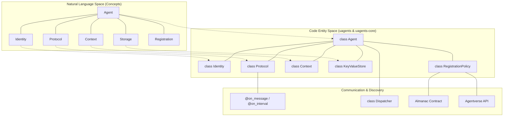
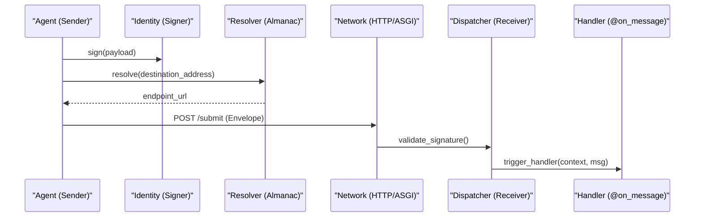

<!-- source: DeepWiki mcp.deepwiki.com · repo fetchai/uAgents · page 1 uAgents Overview · fetched 2026-10-26 -->

# uAgents Overview

Relevant source files

The following files were used as context for generating this wiki page:

- [CONTRIBUTING.md](CONTRIBUTING.md)
- [DEVELOPING.md](DEVELOPING.md)
- [LICENSE](LICENSE)
- [README.md](README.md)
- [python/pyproject.toml](python/pyproject.toml)
- [python/uagents-core/README.md](python/uagents-core/README.md)
- [python/uagents-core/poetry.lock](python/uagents-core/poetry.lock)
- [python/uagents-core/pyproject.toml](python/uagents-core/pyproject.toml)
- [python/uv.lock](python/uv.lock)

This document provides a comprehensive introduction to the uAgents framework, its purpose, key components, and how they work together. uAgents is a lightweight Python framework developed by Fetch.ai for creating autonomous AI agents that can communicate with each other, execute tasks on schedules, and respond to events.

## Purpose and Scope

The uAgents framework enables developers to build intelligent, autonomous software agents that can:

- Operate with their own identity and decision-making capabilities.
- Communicate with other agents through secure message exchange.
- Perform scheduled tasks and react to events.
- Register on the Fetch.ai blockchain for global discovery.
- Maintain persistent state across executions.

The framework is divided into three primary packages:
1.  `uagents`: The high-level framework providing the `Agent` class, decorators, and runtime [python/pyproject.toml:1-4]().
2.  `uagents-core`: Low-level definitions for agent identity, Agentverse API interaction, and basic registration [python/uagents-core/pyproject.toml:1-4]().
3.  `uagents-adapter`: (Integrated via dependencies) Provides bridges to external AI systems like LangChain and CrewAI.

For details on getting started, see [Installation and Setup](#1.1). For an in-depth look at the architecture, see [Key Concepts](#1.2).

## Framework Overview

The uAgents framework provides a foundation for building autonomous agents with secure identity, communication capabilities, persistence, and discoverability. It's designed to be lightweight yet powerful, with a focus on simplicity and extensibility.

Sources: `python/pyproject.toml`, `python/uagents-core/pyproject.toml`, `README.md`

## Package Relationships

The framework is modularized to separate core logic from the high-level developer experience:

| Package | Responsibility | Key Classes/Functions |
| :--- | :--- | :--- |
| `uagents` | High-level API, runtime, and local persistence. | `Agent`, `Bureau`, `Protocol`, `Context` |
| `uagents-core` | Cryptographic identity, Agentverse API, and CLI. | `Identity`, `register_chat_agent()`, `av` CLI |
| `uagents-ai-engine` | Integration with Fetch.ai AI Engine. | `AiEngine` |

Sources: `python/pyproject.toml:14-20()`, `python/uagents-core/pyproject.toml:35-36()`, `python/uagents-core/README.md:158-162()`

## Core Components

The uAgents framework consists of several key components that work together to create the agent ecosystem.

### Agent Class
The `Agent` class is the central element that ties together all other components. An agent has its own identity, can include multiple protocols, maintains persistent storage, and can communicate with other agents [README.md:29-31]().

Key features include:
- **Identity**: Unique cryptographic address derived from a seed [README.md:33-40]().
- **Event Loop**: Handles intervals (`@on_interval`) and messages (`@on_message`) [README.md:47-49]().
- **Registration**: Automatically joins the network via the Almanac smart contract [README.md:11-12]().

For details, see [Agent Class](#2.1).

### Identity and Addressing
Each agent has a unique cryptographic identity provided by the `uagents-core` library. It enables:
- **Deterministic Addresses**: Created from a seed phrase [python/uagents-core/README.md:60-64]().
- **Message Signing**: Ensuring authenticity and non-repudiation [python/uagents-core/README.md:69-71]().

Sources: `python/uagents-core/README.md:56-71()`

### Protocol System
The `Protocol` system defines the communication patterns between agents. It encapsulates message models (Pydantic), handlers, and allowed response patterns.

Sources: `python/pyproject.toml:16()`

### Context System
The `Context` provides the execution environment for agent code. It gives handlers access to the agent's logger, storage, and messaging methods [README.md:48-49]().

For details, see [Context System](#2.2).

## Agent Communication

Agents communicate through a secure messaging system built on HTTP (via `uvicorn` and `aiohttp`), with a layered approach to message handling [python/pyproject.toml:17-18]().

### Message Envelopes
Messages are wrapped in an `Envelope` (defined in `uagents-core`) that includes sender/receiver addresses and cryptographic signatures.

Sources: `python/uagents-core/README.md:48-54()`

## Agent Registration and Discovery

Agents can register with the **Almanac contract** on the Fetch.ai blockchain or the **Agentverse API** for discovery. Registrations via the Agentverse v2 API are permanent and do not require periodic refreshes [python/uagents-core/README.md:48-54]().

The `av` CLI tool (part of `uagents-core`) allows developers to troubleshoot address resolution and inspect registration details [python/uagents-core/README.md:134-142]().

Sources: `python/uagents-core/README.md:13-44()`, `python/uagents-core/pyproject.toml:35-36()`

## Storage and Persistence

Agents maintain state using a key-value storage system. This allows data to persist between agent restarts and across different event handler executions.

For details, see [Storage System](#2.4).

## Security Features

The uAgents framework provides several security features:
1.  **Cryptographic Identity**: Unique identity derived from seeds [README.md:33-40]().
2.  **Message Signing**: All envelopes are signed using the agent's private key [python/uagents-core/README.md:69-71]().
3.  **Verification**: Automatic signature verification on incoming messages via the ASGI server.

Sources: `README.md:12()`, `python/uagents-core/README.md:56-71()`

## Summary

The uAgents framework provides a powerful yet lightweight foundation for building autonomous agents. By combining the high-level `uagents` framework with the low-level `uagents-core` components, developers can create secure, discoverable, and persistent AI agents.

- To begin building, see [Installation and Setup](#1.1).
- To understand the underlying mechanics, see [Key Concepts](#1.2).

---

