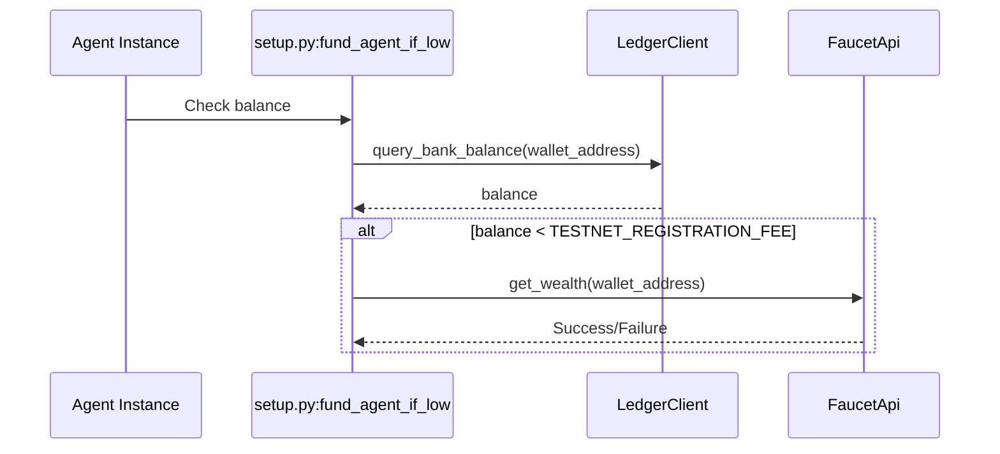

<!-- source: DeepWiki mcp.deepwiki.com · repo fetchai/uAgents · page 1.1 Installation and Setup · fetched 2026-10-26 -->

# Installation and Setup

<details>
<summary>Relevant source files</summary>

The following files were used as context for generating this wiki page:

- [CONTRIBUTING.md](CONTRIBUTING.md)
- [DEVELOPING.md](DEVELOPING.md)
- [LICENSE](LICENSE)
- [README.md](README.md)
- [python/.pre-commit-config.yaml](python/.pre-commit-config.yaml)
- [python/pyproject.toml](python/pyproject.toml)
- [python/src/uagents/setup.py](python/src/uagents/setup.py)
- [python/uv.lock](python/uv.lock)

</details>


This page provides comprehensive instructions for installing the `uAgents` framework and setting up your development environment. It covers system requirements, installation methods using modern Python tooling like `uv`, and configuration for both users and contributors.

## System Requirements

Before installing `uAgents`, ensure your system meets these requirements:

| Component | Requirement |
|-----------|-------------|
| Python    | 3.10 - 3.13 |
| Operating System | Windows, macOS, or Linux |
| Dependency Manager | `pip` or `uv` (recommended) |

Sources: [python/pyproject.toml:13-13](), [python/uv.lock:3-3](), [README.md:18-18]()

## Installation Methods

### Using pip

The standard way to install the framework is via `pip`:

```bash
pip install uagents
```

### Optional Dependencies
The framework supports optional features defined in `pyproject.toml`:
- **`all`**: Includes `litellm` for advanced AI features [python/pyproject.toml:23-25]().
- **`llm`**: Specific support for `litellm` [python/pyproject.toml:27-27]().

Sources: [README.md:20-20](), [python/pyproject.toml:22-27]()

---

## Development Environment Setup

For developers contributing to the codebase, the project uses `uv` for lightning-fast dependency management and `pre-commit` for maintaining code quality.

### 1. Clone the Repository
```bash
git clone https://github.com/fetchai/uAgents.git
cd uAgents/python
```

### 2. Initialize with uv
The project provides a `uv.lock` file to ensure reproducible environments [python/uv.lock:1-2](). Run the following to sync dependencies and set up the virtual environment:

```bash
uv sync
```

### 3. Install Pre-commit Hooks
The project uses `ruff` for linting and formatting, and `pyupgrade` to maintain modern Python syntax. These are enforced via `pre-commit` [python/.pre-commit-config.yaml:1-13]().

```bash
uv run pre-commit install
```

### 4. Running Tests
The test suite uses `pytest` and `pytest-asyncio` [python/pyproject.toml:37-38]().
```bash
uv run pytest
```

Sources: [DEVELOPING.md:18-35](), [DEVELOPING.md:52-56](), [python/pyproject.toml:34-44]()

---

## Code Entity Space: Installation & Tooling

The following diagram bridges the natural language requirements to the specific files and tools used in the codebase.

```mermaid
graph TD
    subgraph "DependencyManagement"
        A["pyproject.toml"] -- "Defines" --> B["[project.dependencies]"]
        A -- "Defines" --> C["[dependency-groups.dev]"]
        D["uv.lock"] -- "Pins" --> E["Exact Versions"]
    end

    subgraph "QualityControl"
        F[".pre-commit-config.yaml"] -- "Hooks" --> G["ruff-pre-commit"]
        F -- "Hooks" --> H["pyupgrade"]
        I["ruff"] -- "Rules" --> J["tool.ruff.lint"]
    end

    subgraph "CorePackages"
        K["uagents-core"] -- "Internal Dependency" --> B
        L["cosmpy"] -- "Ledger Interaction" --> B
    end

    B --- "uagents-core >= 0.4.6"
    C --- "pytest, ruff, pre-commit"
```

Sources: [python/pyproject.toml:14-20](), [python/pyproject.toml:35-44](), [python/pyproject.toml:56-73](), [python/.pre-commit-config.yaml:1-13]()

---

## Basic Configuration & Verification

### Creating your first Agent
The `Agent` class is the primary entry point. It can be initialized with a `name` and a `seed` for deterministic identity [README.md:30-36]().

```python
import os
from uagents import Agent, Context

# Initialize Agent
alice = Agent(name="alice", seed=os.getenv("ALICE_SEED"))

# Define a task
@alice.on_interval(period=2.0)
async def say_hello(ctx: Context):
    ctx.logger.info(f"Hello, I am {ctx.agent.name}")

if __name__ == "__main__":
    alice.run()
```

### Identity and Keys
If no `seed` is provided, the agent generates a random identity and stores the private key in a local `private_keys.json` file [README.md:39-40]().

### Automated Funding (Testnet)
For agents operating on the Fetch.ai testnet, the `fund_agent_if_low` utility in `setup.py` can automatically request funds from a faucet if the balance falls below `TESTNET_REGISTRATION_FEE` [python/src/uagents/setup.py:16-31]().



Sources: [README.md:29-70](), [python/src/uagents/setup.py:16-38](), [python/src/uagents/setup.py:9-10]()

---

## Development Guidelines

### Linting and Formatting
The project strictly uses `ruff` for both linting and formatting [python/pyproject.toml:53-54](). You can run these manually:

```bash
uv run ruff check --fix
uv run ruff format
```

### Commit Convention
Contributors must follow **Conventional Commits v1.0.0**. Supported types include:
- `feat`: New features
- `fix`: Bug fixes
- `docs`: Documentation changes
- `chore`: Maintenance tasks

Sources: [DEVELOPING.md:41-48](), [CONTRIBUTING.md:137-152]()

---

## Troubleshooting

| Symptom | Cause | Resolution |
| :--- | :--- | :--- |
| `ModuleNotFoundError: No module named 'uagents'` | Environment mismatch | Ensure `uv sync` was run and you are using `uv run` or the correct `.venv`. |
| Pre-commit failures | Linting/Formatting errors | Run `uv run ruff check --fix && uv run ruff format` before committing [DEVELOPING.md:47-48](). |
| Faucet errors | Testnet congestion | The `fund_agent_if_low` function will log an error if `get_wealth` fails [python/src/uagents/setup.py:36-37](). |

Sources: [DEVELOPING.md:39-48](), [python/src/uagents/setup.py:32-37]()

---

