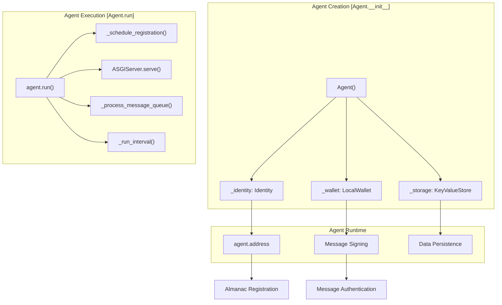
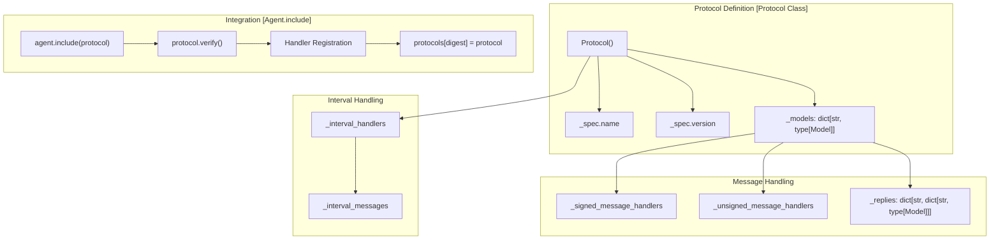
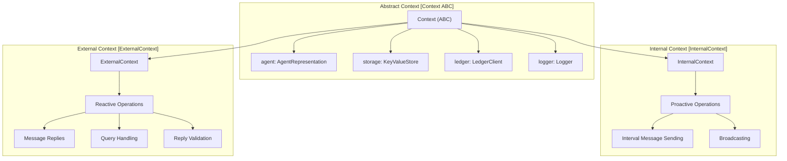
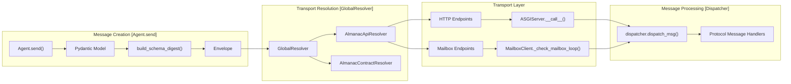
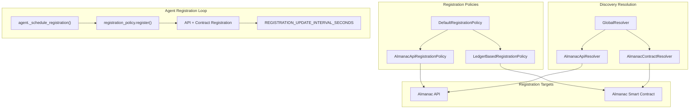
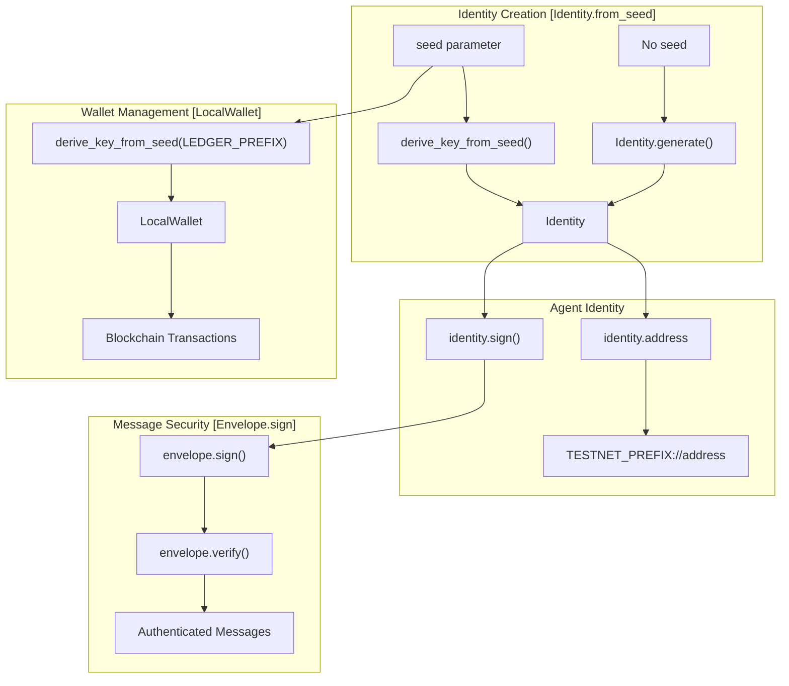

<!-- source: DeepWiki mcp.deepwiki.com · repo fetchai/uAgents · page 1.2 Key Concepts · fetched 2026-10-26 -->

# Key Concepts

Relevant source files

The following files were used as context for generating this wiki page:

- [CONTRIBUTING.md](CONTRIBUTING.md)
- [DEVELOPING.md](DEVELOPING.md)
- [LICENSE](LICENSE)
- [README.md](README.md)
- [python/docs/api/uagents/agent.md](python/docs/api/uagents/agent.md)
- [python/src/uagents/agent.py](python/src/uagents/agent.py)
- [python/uagents-core/README.md](python/uagents-core/README.md)
- [python/uagents-core/poetry.lock](python/uagents-core/poetry.lock)
- [python/uagents-core/pyproject.toml](python/uagents-core/pyproject.toml)

This document covers the fundamental concepts and architecture of the uAgents framework. These concepts form the building blocks for creating autonomous AI agents that can communicate, collaborate, and perform tasks within the uAgents ecosystem.

## Agents

An `Agent` is the fundamental entity in the uAgents framework. Each agent is an autonomous software entity with its own identity, capabilities, and lifecycle. Agents can perform tasks on schedules, respond to messages, and interact with external services.

### Agent Identity and Lifecycle

The `Agent` class inherits from `Sink` [python/src/uagents/agent.py:223-223]() and manages the core components required for autonomous operation.

**Code Entity Space Mapping**
| System Concept | Code Entity | File Reference |
|:---|:---|:---|
| Identity | `Identity` | [python/src/uagents/agent.py:19]() |
| Wallet | `LocalWallet` | [python/src/uagents/agent.py:14]() |
| Persistence | `KeyValueStore` | [python/src/uagents/agent.py:77]() |
| Internal Logic | `Protocol` | [python/src/uagents/agent.py:65]() |

Each agent has a unique address derived from its cryptographic identity, which serves as its identifier in the network [python/src/uagents/agent.py:175-210](). The agent manages its own wallet for blockchain interactions and maintains local storage for persistent data.

**Sources:** [python/src/uagents/agent.py:223-492](), [python/src/uagents/agent.py:517-546](), [python/src/uagents/agent.py:621-628]()

### Agent Configuration

Agents are configured through constructor parameters that define their network behavior, endpoints, and capabilities:

| Parameter | Type | Purpose |
|-----------|------|---------|
| `name` | `str` | Human-readable identifier |
| `seed` | `str` | Deterministic key generation [python/src/uagents/agent.py:517-525]() |
| `endpoint` | `str \| list[str]` | Communication endpoints for registration [python/src/uagents/agent.py:243]() |
| `mailbox` | `bool` | Enable mailbox for NAT traversal [python/src/uagents/agent.py:245]() |
| `network` | `"mainnet" \| "testnet"` | Blockchain network selection [python/src/uagents/agent.py:252]() |
| `registration_policy` | `AgentRegistrationPolicy` | Registration strategy [python/src/uagents/agent.py:248]() |

**Sources:** [python/src/uagents/agent.py:240-265]()

## Protocols

A `Protocol` defines a set of behaviors and message handlers that agents can include to gain specific capabilities. Protocols encapsulate the logic for handling particular types of interactions and can be shared across multiple agents.

### Protocol Structure

Protocols use decorators to register message and interval handlers, creating a declarative way to define agent behavior.

**Sources:** [python/src/uagents/protocol.py:18-58](), [python/src/uagents/agent.py:621-650]()

### Message and Interval Handlers

Protocols provide decorators for registering different types of handlers:

- `@protocol.on_message(model)` - Handle incoming messages of a specific type [python/src/uagents/protocol.py:327-361]()
- `@protocol.on_interval(period)` - Execute tasks at regular intervals [python/src/uagents/protocol.py:363-395]()
- `@protocol.on_query(model)` - Handle synchronous query-response patterns [python/src/uagents/protocol.py:299-325]()

## Contexts

The `Context` system provides agents with access to their runtime environment and capabilities during message and interval handling. There are two main context types: `InternalContext` for proactive behavior and `ExternalContext` for reactive message handling.

### Context Hierarchy

The context abstracts the agent's capabilities and provides a consistent interface for handlers to interact with the agent's state and external services.

**Sources:** [python/src/uagents/context.py:37-265](), [python/src/uagents/context.py:267-576]()

### Context Operations

Key operations available through contexts include:

- `send(destination, message)` - Send messages to other agents [python/src/uagents/context.py:172-189]()
- `broadcast(protocol, message)` - Send messages to all agents supporting a protocol [python/src/uagents/context.py:136-159]()
- `get_agents_by_protocol(digest)` - Discovery of agents by protocol [python/src/uagents/context.py:343-368]()
- `send_and_receive(destination, message, response_type)` - Synchronous communication [python/src/uagents/context.py:222-244]()

## Communication

The communication system handles secure message exchange between agents through envelopes, which contain signed and encrypted message payloads.

### Message Flow Architecture

The communication flow involves message creation, address resolution, transport selection, and final dispatch to appropriate handlers.

**Sources:** [python/src/uagents/communication.py:101-165](), [python/src/uagents/asgi.py:276-411](), [python/src/uagents/dispatch.py:49-87]()

### Envelope Structure

Messages are wrapped in `Envelope` objects defined in `uagents-core` that provide:

- **Version**: Protocol version for compatibility
- **Sender/Target**: Agent addresses for routing  
- **Session**: UUID for correlation and response tracking
- **Schema Digest**: Message type identifier
- **Signature**: Cryptographic authentication
- **Payload**: Encrypted message content

**Sources:** [python/src/uagents/communication.py:530-540](), [python/uagents-core/README.md:123-132]()

## Registration and Discovery

Agents register themselves for discovery through the Almanac system, which maintains a registry of active agents and their capabilities on the Fetch.ai blockchain.

### Registration Architecture

The framework supports multiple registration policies including `DefaultRegistrationPolicy`, `LedgerBasedRegistrationPolicy`, and `AlmanacApiRegistrationPolicy` [python/src/uagents/registration.py:66-73]().

The registration system uses a dual approach, registering with both the fast Almanac API and the decentralized blockchain contract for redundancy and performance.

**Sources:** [python/src/uagents/registration.py](), [python/src/uagents/agent.py:814-831](), [python/src/uagents/resolver.py]()

## Storage

Agents have access to persistent storage through the `KeyValueStore` interface, allowing them to maintain state between executions. By default, agents store their state in a local file-based store [python/src/uagents/storage.py:77]().

**Sources:** [python/src/uagents/storage.py](), [python/src/uagents/agent.py:360](), [python/src/uagents/agent.py:661-668]()

## Identity and Security

The uAgents framework uses cryptographic identities for secure communication and authentication. The `Identity` class in `uagents-core` provides methods for key derivation and message signing [python/uagents-core/README.md:56-72]().

### Identity Management

Each agent has both an identity for secure messaging and a separate wallet for blockchain transactions, providing separation of concerns for different cryptographic operations.

**Sources:** [python/src/uagents/agent.py:517-546](), [python/src/uagents/agent.py:736-758](), [python/uagents-core/README.md:56-72]()

---

