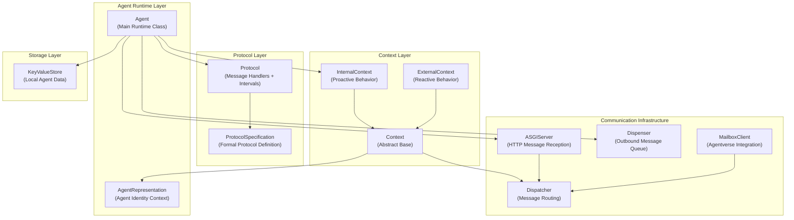
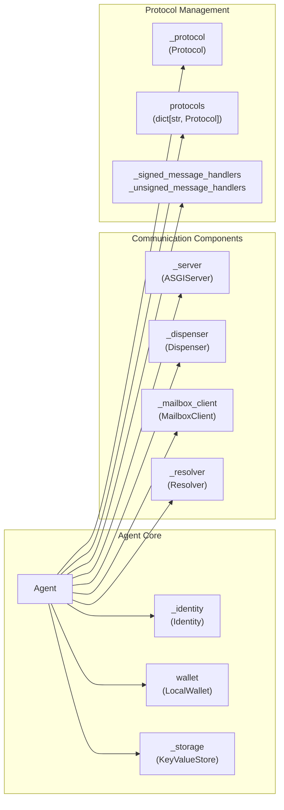
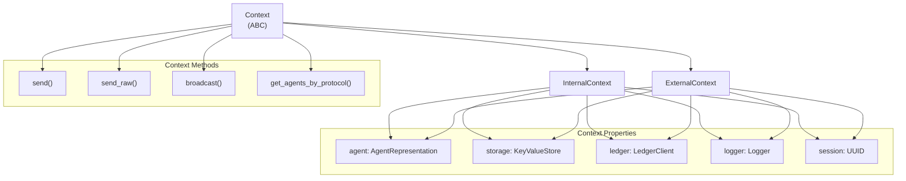
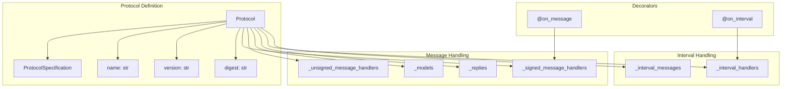
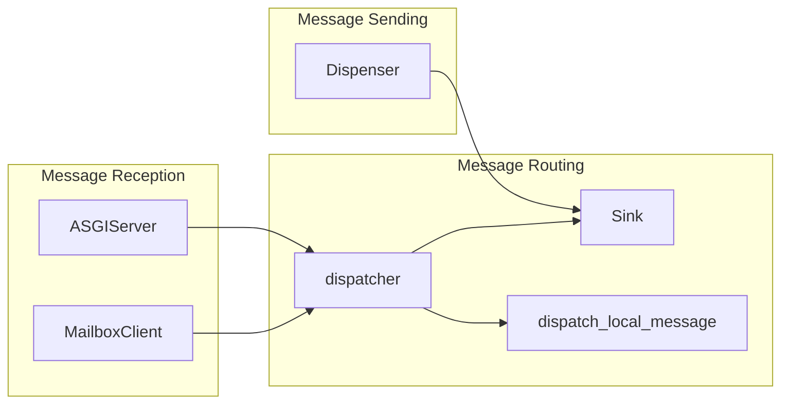

<!-- source: DeepWiki mcp.deepwiki.com · repo fetchai/uAgents · page 2 Core Components · fetched 2026-10-26 -->

# Core Components

Relevant source files

The following files were used as context for generating this wiki page:

- [python/docs/api/uagents/agent.md](python/docs/api/uagents/agent.md)
- [python/docs/api/uagents/context.md](python/docs/api/uagents/context.md)
- [python/docs/api/uagents/protocol.md](python/docs/api/uagents/protocol.md)
- [python/src/uagents/agent.py](python/src/uagents/agent.py)
- [python/src/uagents/context.py](python/src/uagents/context.py)
- [python/src/uagents/protocol.py](python/src/uagents/protocol.py)
- [python/tests/test_context.py](python/tests/test_context.py)
- [python/tests/test_model.py](python/tests/test_model.py)
- [python/tests/test_protocol.py](python/tests/test_protocol.py)

This document provides an overview of the main components that make up the uAgents framework. These components work together to enable agent-based systems with message handling, protocol execution, and communication capabilities.

For detailed information about specific components, see: [Agent Class](#2.1), [Context System](#2.2), [Protocol System](#2.3), and [Storage System](#2.4). For communication details, see [Communication](#3).

## Architecture Overview

The uAgents framework is built around several core components that work together to provide a complete agent runtime environment:

Sources: [python/src/uagents/agent.py:223-238](), [python/src/uagents/context.py:36-56](), [python/src/uagents/protocol.py:18-24](), [python/src/uagents/asgi.py:30-30](), [python/src/uagents/communication.py:31-31](), [python/src/uagents/dispatch.py:48-48]()

## Agent Runtime System

The `Agent` class serves as the main runtime container that orchestrates all other components. It manages the agent's lifecycle, identity, and coordination between subsystems.

The `Agent` class initializes with configuration parameters and sets up the necessary infrastructure components. It provides methods for protocol inclusion, message handling registration, and runtime management.

Sources: [python/src/uagents/agent.py:223-492](), [python/src/uagents/agent.py:611-641]()

## Context System

The Context system provides agents with access to their state, capabilities, and communication methods. It comes in two primary forms for different behavioral patterns:

`InternalContext` is typically used for proactive behaviors like interval handlers, while `ExternalContext` handles reactive message processing with additional context like received message info (`MsgInfo`) and reply validation.

Sources: [python/src/uagents/context.py:36-56](), [python/src/uagents/context.py:267-285](), [python/src/uagents/context.py:655-675]()

## Protocol System

Protocols encapsulate sets of related message handlers and behaviors. They define what messages an agent can process and how it responds:

Protocols are included in agents using `agent.include(protocol)` and provide decorators for registering message and interval handlers.

Sources: [python/src/uagents/protocol.py:18-58](), [python/src/uagents/protocol.py:236-240](), [python/src/uagents/protocol.py:308-312]()

## Communication Infrastructure

The communication system handles message routing, delivery, and reception through multiple transport mechanisms:

The `ASGIServer` handles incoming HTTP requests, while the `dispatcher` routes messages to appropriate `Sink` implementations (like the `Agent`). The `Dispenser` manages asynchronous outbound message delivery.

Sources: [python/src/uagents/asgi.py:30-30](), [python/src/uagents/dispatch.py:48-48](), [python/src/uagents/communication.py:31-31](), [python/src/uagents/agent.py:223-223]()

## Storage System

The framework provides persistent storage capabilities for agent state:

| Storage Type | Class | Purpose |
|--------------|-------|---------|
| Local | `KeyValueStore` | Agent state, private keys, and configuration |

`KeyValueStore` is the primary mechanism for agents to persist data across restarts. It is accessible through the `Context` during handler execution.

Sources: [python/src/uagents/storage.py:15-88](), [python/src/uagents/context.py:71-79]()

## Component Integration

These components work together in the agent lifecycle:

1. **Initialization**: `Agent` creates and configures all subsystems [python/src/uagents/agent.py:240-330]().
2. **Protocol Registration**: `Protocol` objects define message handling logic [python/src/uagents/protocol.py:18-24]().
3. **Message Reception**: `ASGIServer` or `MailboxClient` receive messages.
4. **Message Routing**: `dispatcher` routes to the agent's message queue [python/src/uagents/agent.py:48-48]().
5. **Handler Execution**: Message handlers execute with `Context` access [python/src/uagents/agent.py:734-750]().
6. **Response Sending**: `Dispenser` handles outbound messages [python/src/uagents/agent.py:31-31]().
7. **State Persistence**: `KeyValueStore` maintains data [python/src/uagents/storage.py:15-15]().

The modular design allows each component to be configured independently while maintaining clear interfaces between subsystems.

Sources: [python/src/uagents/agent.py:240-330](), [python/src/uagents/agent.py:734-750]()

---

