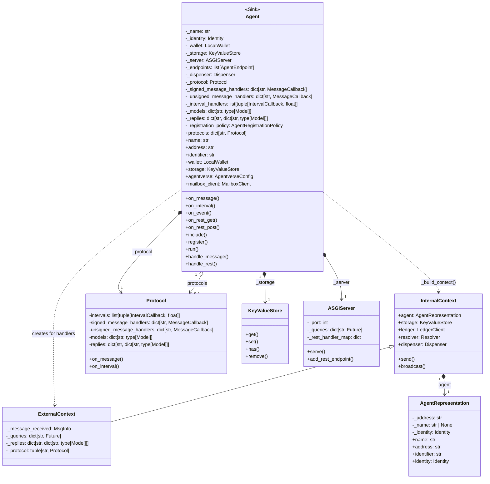
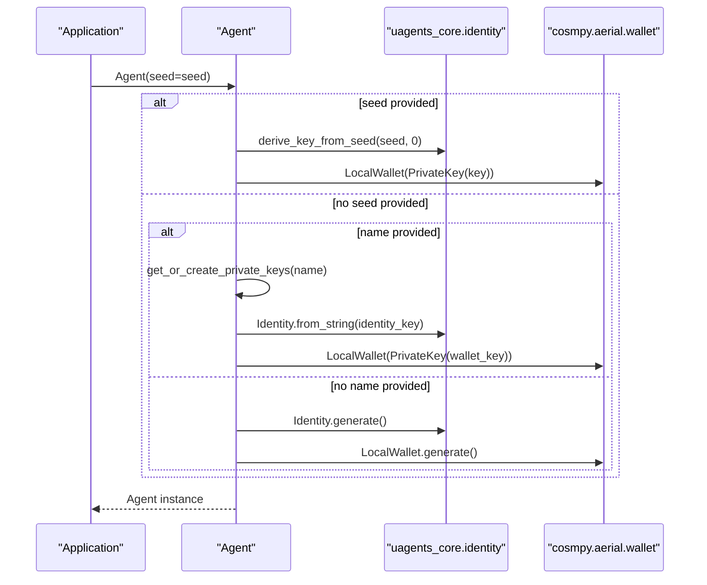
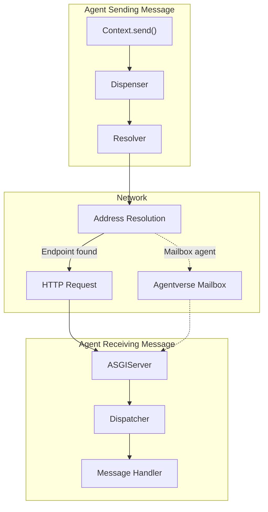
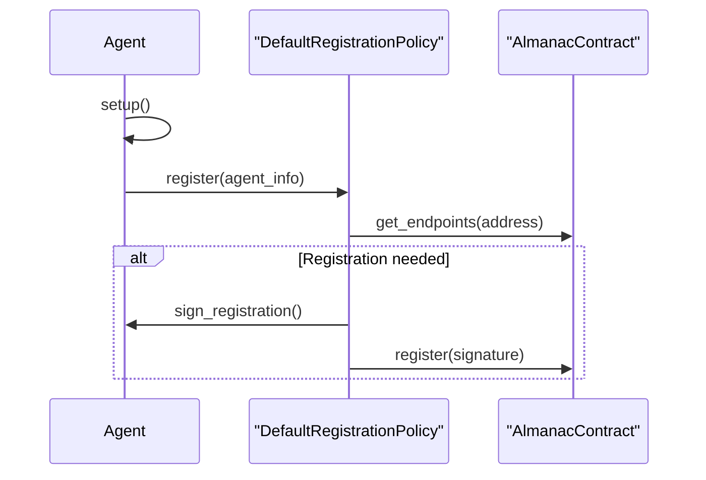

<!-- source: DeepWiki mcp.deepwiki.com · repo fetchai/uAgents · page 2.1 Agent Class · fetched 2026-10-26 -->

# Agent Class

Relevant source files

The following files were used as context for generating this wiki page:

- [python/docs/api/uagents/agent.md](python/docs/api/uagents/agent.md)
- [python/src/uagents/agent.py](python/src/uagents/agent.py)
- [python/tests/test_agent.py](python/tests/test_agent.py)
- [python/tests/test_bureau.py](python/tests/test_bureau.py)

The `Agent` class is the fundamental building block of the uAgents framework, serving as a container for identity, communication capabilities, protocol handling, and storage. This page provides a detailed technical reference for the `Agent` class, covering its structure, initialization, methods, and its role in the overall system architecture.

## Class Overview

The `Agent` class represents an autonomous agent that can communicate with other agents, execute tasks on intervals, and respond to messages. It implements the `Sink` interface [python/src/uagents/agent.py:223](), allowing it to receive messages through the dispatcher system.

### Agent Class Structure

Sources: [python/src/uagents/agent.py:223-516](), [python/src/uagents/agent.py:143-222](), [python/src/uagents/context.py:267-292](), [python/src/uagents/context.py:693-730](), [python/src/uagents/asgi.py:40-67]()

## Agent Identity and Authentication

Every agent has a unique identity providing cryptographic capabilities for signing and verification. The identity is derived from a seed or generated randomly.

The agent has two key cryptographic components:
- **Identity**: Used for signing/verifying agent messages via `uagents_core.identity` [python/src/uagents/agent.py:19]().
- **Wallet**: Used for blockchain transactions (e.g., Almanac registration) via `cosmpy` [python/src/uagents/agent.py:13-14]().

Sources: [python/src/uagents/agent.py:517-549](), [python/src/uagents/storage.py:77]()

## Agent Initialization

The `Agent` constructor configures endpoints, resolvers, storage, and message handling [python/src/uagents/agent.py:240-493]().

### Key Constructor Parameters

| Parameter | Type | Default | Description |
|-----------|------|---------|-------------|
| `name` | str | None | The name of the agent. |
| `port` | int | 8000 | The port for the agent's ASGI server. |
| `seed` | str | None | The seed for generating cryptographic keys. |
| `endpoint` | str/list/dict | None | Endpoint configuration for reaching the agent. |
| `mailbox` | bool | False | Whether to use an Agentverse mailbox. |
| `registration_policy` | AgentRegistrationPolicy | None | Policy for Almanac registration. |
| `network` | AgentNetwork | "mainnet" | The network ("mainnet" or "testnet"). |
| `enable_agent_inspector` | bool | True | Enables REST endpoints for the Agent Inspector. |

Sources: [python/src/uagents/agent.py:240-493](), [python/src/uagents/config.py:32-41]()

## Core Components

### Storage
The `KeyValueStore` provides persistent storage. Each agent uses a store identified by its address prefix [python/src/uagents/agent.py:360]().

### Communication
- **ASGIServer** (`_server`): Handles incoming HTTP and REST requests [python/src/uagents/agent.py:30]().
- **Dispenser** (`_dispenser`): Manages outbound message queues [python/src/uagents/agent.py:31]().
- **Dispatcher** (`_dispatcher`): Routes messages internally [python/src/uagents/agent.py:48]().
- **MailboxClient** (`_mailbox_client`): Interfaces with Agentverse for agents behind NAT [python/src/uagents/agent.py:52]().

Sources: [python/src/uagents/agent.py:369-381](), [python/src/uagents/agent.py:421-427](), [python/src/uagents/context.py:453-576]()

## Message Handling

Agents use decorators to register handlers for messages, intervals, and events [python/src/uagents/agent.py:833-984]().

| Decorator | Purpose | Context Type |
|-----------|---------|--------------|
| `@on_message` | Handle incoming messages | `ExternalContext` |
| `@on_interval` | Periodic task execution | `InternalContext` |
| `@on_event` | Startup/Shutdown events | `InternalContext` |
| `@on_rest_get` | REST GET requests | `Context` |
| `@on_rest_post` | REST POST requests | `Context` |

Sources: [python/src/uagents/agent.py:833-984](), [python/tests/test_agent.py:43-130]()

## Registration System

Agents register with the Almanac contract to be discoverable. The `AgentRegistrationPolicy` governs this process [python/src/uagents/registration.py:66-75]().

Sources: [python/src/uagents/agent.py:796-831](), [python/src/uagents/registration.py:72]()

## Bureau: Multi-Agent Container

The `Bureau` class allows running multiple agents within a single process, sharing an ASGI server and optimizing resource usage.

- **Endpoint Consolidation**: When agents are added to a Bureau, they can share the Bureau's endpoint [python/tests/test_bureau.py:38-41]().
- **Batch Registration**: The Bureau can use `BatchRegistrationPolicy` to register all contained agents in a single transaction [python/tests/test_bureau.py:60-63]().

Sources: [python/tests/test_bureau.py:28-111]()

## Agent Inspector

The Agent Inspector is a built-in REST interface enabled by `enable_agent_inspector=True` [python/src/uagents/agent.py:417](). It exposes endpoints via the `ASGIServer` for:
- Querying agent state.
- Inspecting supported protocols and models.
- Viewing message history if `EnvelopeHistory` is enabled [python/src/uagents/agent.py:411]().

Sources: [python/src/uagents/agent.py:411-420](), [python/src/uagents/asgi.py:112-115]()

## Lifecycle Management

1. **Setup**: The `setup()` method initializes the server, registration tasks, and mailbox [python/src/uagents/agent.py:1060-1071]().
2. **Startup**: `on_event("startup")` handlers execute.
3. **Execution**: The `run()` method starts the asyncio event loop [python/src/uagents/agent.py:1072-1090]().
4. **Shutdown**: `on_event("shutdown")` handlers execute, and background tasks are cancelled [python/src/uagents/agent.py:1091-1100]().

Sources: [python/src/uagents/agent.py:1060-1100](), [python/tests/test_agent.py:77-96]()

---

