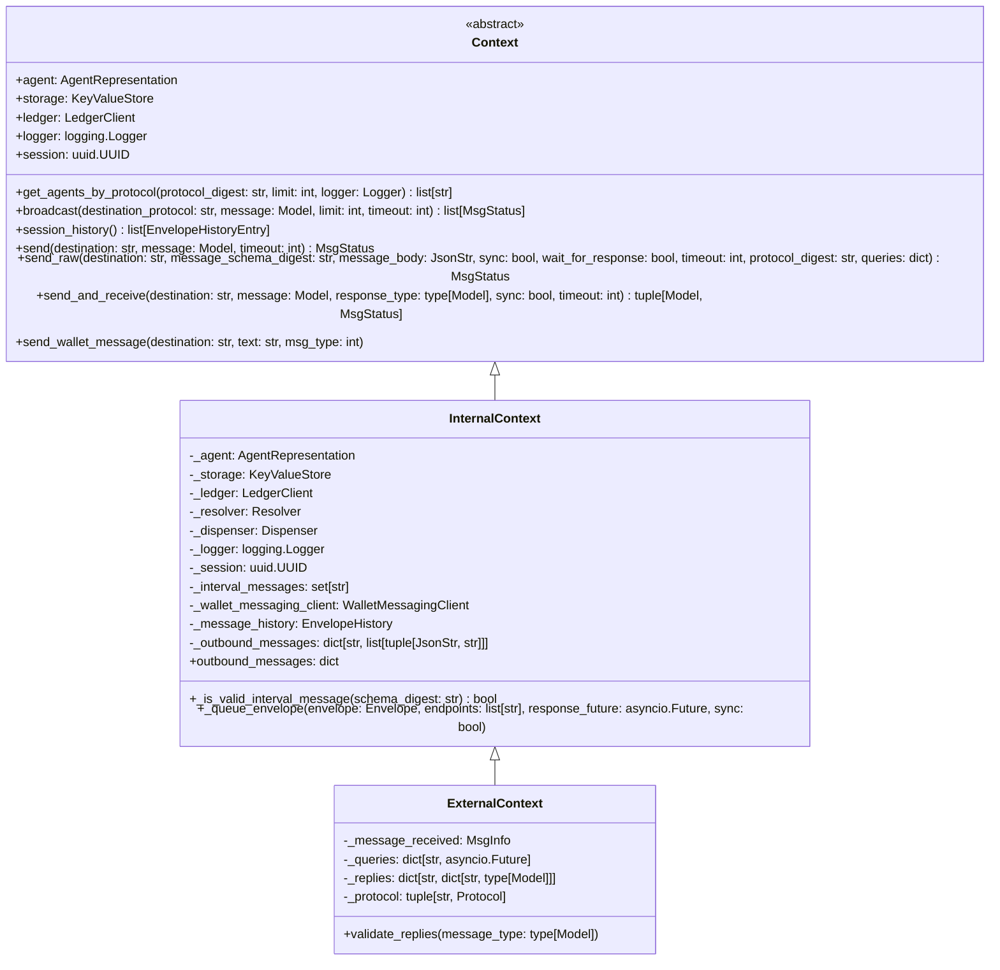
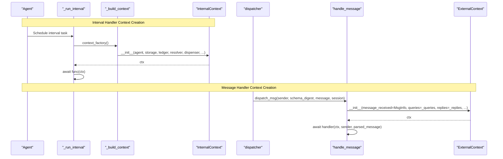
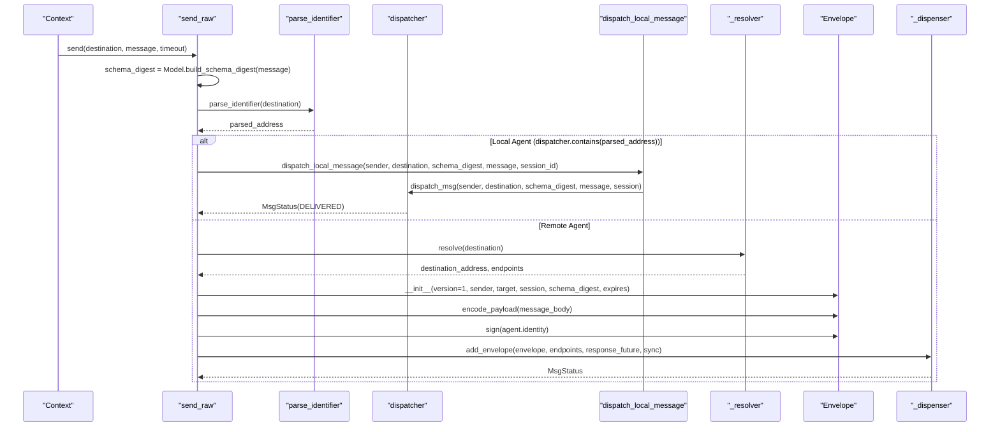
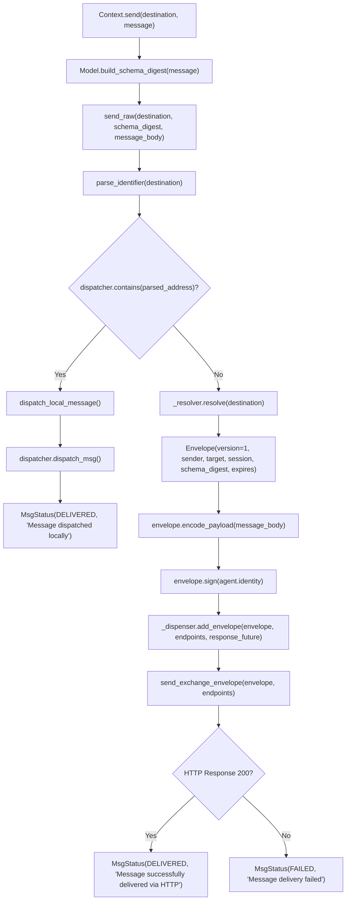
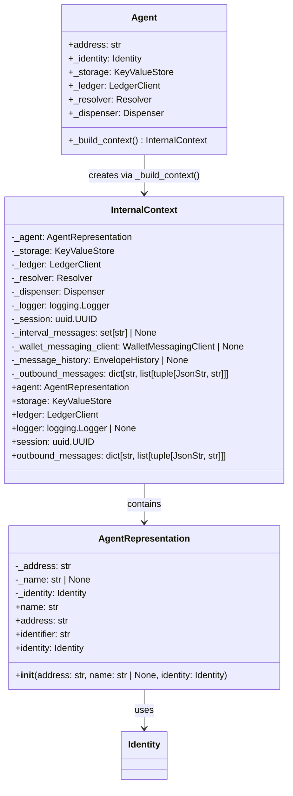
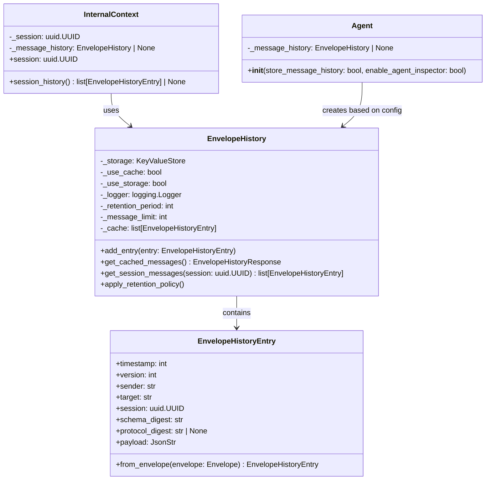
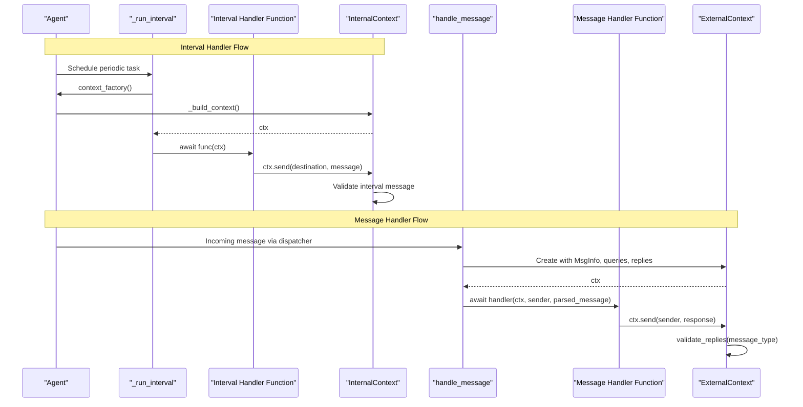

<!-- source: DeepWiki mcp.deepwiki.com · repo fetchai/uAgents · page 2.2 Context System · fetched 2026-10-26 -->

# Context System

<details>
<summary>Relevant source files</summary>

The following files were used as context for generating this wiki page:

- [python/docs/api/uagents/context.md](python/docs/api/uagents/context.md)
- [python/src/uagents/context.py](python/src/uagents/context.py)
- [python/src/uagents/utils.py](python/src/uagents/utils.py)
- [python/tests/test_context.py](python/tests/test_context.py)

</details>


The Context System provides execution environments for agent tasks and message handling through a hierarchy of context classes. It serves as the primary interface for agent-to-agent communication, storage access, and framework operations. The system distinguishes between proactive behaviors (agent-initiated) and reactive behaviors (message-triggered).

The Context System integrates with the Protocol System (see [Protocol System](#2.3)) for message handling and the Storage System (see [Storage System](#2.4)) for data persistence.

## Context Hierarchy

The uAgents framework implements a hierarchy of context classes, with an abstract `Context` base class that defines the interface, and concrete implementations for different agent execution scenarios.

**Context Class Hierarchy**



Sources: [python/src/uagents/context.py:36-264](), [python/src/uagents/context.py:267-692](), [python/src/uagents/context.py:693-837]()

### Context Types

| Context Type | Usage | Key Features |
|--------------|-------|--------------|
| **`Context`** (abstract) | Base interface | Defines message handling, storage access, and agent properties interface [python/src/uagents/context.py:36-56]() |
| **`InternalContext`** | Proactive behaviors (`on_interval`, `on_startup`) | Validates interval messages, manages outbound message tracking [python/src/uagents/context.py:267-317]() |
| **`ExternalContext`** | Reactive behaviors (`on_message`) | Includes received message info, reply validation, protocol context [python/src/uagents/context.py:693-730]() |

**`Context`**: Abstract base class defining the interface for all context implementations. Contains methods for message sending, broadcasting, and accessing agent properties [python/src/uagents/context.py:36-264]().

**`InternalContext`**: Used for agent-initiated operations. Created by `Agent._build_context()` for interval handlers and event handlers [python/src/uagents/agent.py:494-515](). Includes `_is_valid_interval_message()` for validating interval message types [python/src/uagents/context.py:403-415]().

**`ExternalContext`**: Used for message-triggered operations. Extends `InternalContext` with message-specific functionality including `validate_replies()` to ensure proper response patterns [python/src/uagents/context.py:732-771]().

Sources: [python/src/uagents/context.py:37-264](), [python/src/uagents/context.py:267-692](), [python/src/uagents/context.py:693-837]()

## Context Lifecycle and Creation

The Context System follows a specific lifecycle tightly integrated with the `Agent` class. Contexts are created on-demand for specific operations and are not persistent objects.

**Context Creation and Lifecycle**



Sources: [python/src/uagents/agent.py:494-515](), [python/src/uagents/agent.py:91-117](), [python/src/uagents/context.py:270-292]()

### Context Creation

When an agent needs to perform an operation, the appropriate context is created:

1. **Internal Context Creation**: The `Agent` class provides a `_build_context()` method that creates an `InternalContext` with references to the agent's identity, storage, ledger, and other components [python/src/uagents/agent.py:494-515]().

2. **External Context Creation**: When a message is received, an `ExternalContext` is created with additional information about the received message, available replies, and the protocol that will handle the message [python/src/uagents/context.py:693-730]().

3. **Context Factory**: For interval handlers, a context factory function is used to create a new context for each execution of the handler [python/src/uagents/agent.py:91-117]().

Sources: [python/src/uagents/agent.py:494-515](), [python/src/uagents/agent.py:91-117]()

## Message Handling Through Context

The Context System provides a structured interface for sending and receiving messages between agents. This is one of its primary responsibilities.

**Message Handling Flow**



Sources: [python/src/uagents/context.py:453-576](), [python/src/uagents/communication.py:77-98](), [python/src/uagents/dispatch.py:95-106]()

### Key Message Handling Methods

1. **`send(destination, message, timeout)`**: The primary method for sending messages to other agents. It converts the message to a schema digest and JSON representation, then delegates to `send_raw` [python/src/uagents/context.py:417-452]().

2. **`send_raw(destination, message_schema_digest, message_body, ...)`**: Handles the low-level details of message delivery, including resolving the destination address, creating the envelope, and dispatching the message [python/src/uagents/context.py:453-576]().

3. **`send_and_receive(destination, message, response_type, ...)`**: Sends a message and waits for a response of a specific type. This is useful for request-response patterns [python/src/uagents/context.py:593-675]().

4. **`broadcast(destination_protocol, message, limit, timeout)`**: Sends a message to multiple agents that support a specific protocol [python/src/uagents/context.py:370-401]().

Sources: [python/src/uagents/context.py:417-452](), [python/src/uagents/context.py:453-576](), [python/src/uagents/context.py:593-675](), [python/src/uagents/context.py:370-401]()

## Message Resolution and Delivery

The Context System works closely with the `Resolver` and `Dispenser` components to ensure messages are delivered to their intended recipients.

**Message Resolution and Delivery Process**



Sources: [python/src/uagents/context.py:453-576](), [python/src/uagents/context.py:578-592](), [python/src/uagents/communication.py:101-165]()

### Resolution Process

1. When sending a message, the Context first checks if the destination is a local agent registered in the `dispatcher` [python/src/uagents/context.py:487-498]().
2. If local, the message is dispatched internally without network communication via `dispatch_local_message` [python/src/uagents/communication.py:77-98]().
3. If remote, the Context uses a `Resolver` to convert the destination identifier into a network address and endpoints [python/src/uagents/context.py:516-522]().
4. The message is then wrapped in an `Envelope`, signed with the agent's identity, and passed to the `Dispenser` for delivery [python/src/uagents/context.py:536-576]().

Sources: [python/src/uagents/context.py:453-576]()

## Context Properties and Agent Representation

The Context System provides access to agent properties through standardized interfaces, ensuring consistent behavior across different context types.

**Context Properties and Agent Integration**



Sources: [python/src/uagents/agent.py:132-206](), [python/src/uagents/agent.py:494-515](), [python/src/uagents/context.py:270-292]()

### Agent Representation

The `AgentRepresentation` class encapsulates the essential properties of an agent that need to be exposed through the context:

1. **Address**: The unique identifier for the agent within the network [python/src/uagents/agent.py:175-183]().
2. **Name**: A human-readable name for the agent [python/src/uagents/agent.py:165-173]().
3. **Identity**: The cryptographic identity used for signing messages [python/src/uagents/agent.py:195-203]().
4. **Identifier**: The full agent identifier including the network prefix [python/src/uagents/agent.py:185-193]().

These properties allow message handlers to access agent information without direct access to the `Agent` class.

Sources: [python/src/uagents/agent.py:132-206]()

## Session Management and Message History

The Context System manages sessions for tracking related messages and maintains a history of messages for debugging and auditing purposes.

**Session Management and Message History**



Sources: [python/src/uagents/context.py:331-341](), [python/src/uagents/types.py:135-260](), [python/src/uagents/agent.py:370-379]()

### Sessions

Sessions are represented as UUIDs and are used to correlate related messages. When a message is sent, the sender's session ID is included in the envelope. This allows for tracking conversations and implementing request-response patterns.

The session is accessible through the context's `session` property and is automatically created when a context is instantiated [python/src/uagents/context.py:311-320]().

Sources: [python/src/uagents/context.py:103-113](), [python/src/uagents/context.py:311-320]()

### Message History

The Context System can optionally maintain a history of sent and received messages through the `EnvelopeHistory` class [python/src/uagents/types.py:135-260](). This history is useful for debugging and provides visibility into agent communications.

Message history can be stored in memory (cache) and/or persisted to storage, with configurable retention policies based on time and message count [python/src/uagents/types.py:145-165]().

The `session_history()` method allows access to the message history for the current session [python/src/uagents/context.py:331-341]().

Sources: [python/src/uagents/types.py:135-260](), [python/src/uagents/context.py:331-341]()

## Differences Between Internal and External Contexts

The two main context implementations serve different purposes and have some key differences:

**Context Type Comparison**

```mermaid
flowchart LR
    subgraph InternalContext["InternalContext Features"]
        direction TB
        A["_is_valid_interval_message()"]
        B["_interval_messages: set[str]"]
        C["Used in on_interval handlers"]
        D["Used in on_startup/on_shutdown"]
        E["No message context"]
    end

    subgraph ExternalContext["ExternalContext Features"]  
        direction TB
        F["_message_received: MsgInfo"]
        G["_replies: dict[str, dict[str, type[Model]]]"]
        H["_queries: dict[str, asyncio.Future]"]
        I["_protocol: tuple[str, Protocol]"]
        J["validate_replies(message_type)"]
        K["Used in on_message handlers"]
    end

    InternalContext -->|extends| ExternalContext
    
    subgraph Usage["Usage Patterns"]
        direction TB
        L["InternalContext: Agent-initiated actions"]
        M["ExternalContext: Message-triggered actions"]
    end
```

Sources: [python/src/uagents/context.py:267-692](), [python/src/uagents/context.py:693-837](), [python/src/uagents/context.py:403-415]()

### Internal Context

- Created for proactive behaviors initiated by the agent itself [python/src/uagents/agent.py:494-515]().
- Used in interval tasks, startup/shutdown events.
- Has no information about a received message.
- No concept of "replies" since there's no incoming message to reply to.
- Can validate interval messages against a whitelist [python/src/uagents/context.py:403-415]().

Sources: [python/src/uagents/context.py:267-317](), [python/src/uagents/context.py:417-452]()

### External Context

- Created in response to an incoming message [python/src/uagents/agent.py:870-887]().
- Contains information about the received message via `_message_received` [python/src/uagents/context.py:706-714]().
- Knows which replies are valid for the received message type through `_replies`.
- Can validate that sent messages are valid replies using `validate_replies()` [python/src/uagents/context.py:732-771]().
- Used in message handlers registered with `on_message`.

Sources: [python/src/uagents/context.py:693-770](), [python/src/uagents/context.py:773-837]()

## Integration with Other Framework Components

The Context System integrates with several other components of the uAgents framework to provide its functionality.

**Context System Integration**

```mermaid
flowchart TD
    subgraph Context["Context System Components"]
        InternalContext["InternalContext"]
        ExternalContext["ExternalContext"] 
        AgentRepresentation["AgentRepresentation"]
    end

    subgraph Agent["Agent System"]  
        AgentClass["Agent"]
        build_context["_build_context()"]
        handle_message["handle_message()"]
    end

    subgraph Communication["Communication System"]
        Dispenser["Dispenser"]  
        Resolver["Resolver"]
        dispatcher["dispatcher"]
        send_exchange_envelope["send_exchange_envelope()"]
    end

    subgraph Storage["Storage System"]
        KeyValueStore["KeyValueStore"]
        EnvelopeHistory["EnvelopeHistory"]
    end

    subgraph Protocol["Protocol System"] 
        ProtocolClass["Protocol"]
        on_interval["@on_interval"]
        on_message["@on_message"]
    end

    AgentClass -->|"calls"| build_context
    build_context -->|"creates"| InternalContext
    handle_message -->|"creates"| ExternalContext
    
    on_interval -->|"receives"| InternalContext
    on_message -->|"receives"| ExternalContext
    
    InternalContext -->|"uses _dispenser"| Dispenser
    InternalContext -->|"uses _resolver"| Resolver
    InternalContext -->|"uses _storage"| KeyValueStore
    ExternalContext -->|"inherits access to"| Dispenser
    
    InternalContext -->|"contains _agent"| AgentRepresentation
    dispatcher -->|"calls"| handle_message
```

Sources: [python/src/uagents/agent.py:494-515](), [python/src/uagents/context.py:267-317](), [python/src/uagents/context.py:693-732]()

### Key Integrations

1. **Agent System**: The `Agent` class creates contexts as needed and provides access to the agent's properties through the `AgentRepresentation` [python/src/uagents/agent.py:494-515]().

2. **Protocol System**: Protocols use contexts to interact with the agent and other components. Message and interval handlers receive contexts when they are called [python/src/uagents/agent.py:833-848]().

3. **Storage System**: The Context provides access to the agent's `KeyValueStore` for persisting state [python/src/uagents/context.py:69-79]().

4. **Communication System**: The Context uses the `Dispenser` for sending messages and the `Resolver` for finding endpoint addresses [python/src/uagents/context.py:270-292]().

Sources: [python/src/uagents/agent.py:494-515](), [python/src/uagents/context.py:270-292](), [python/src/uagents/context.py:453-576](), [python/src/uagents/context.py:693-730]()

## Context Usage in Agent Handlers

The Context System is designed to be used in agent handlers, providing a clean interface for interacting with the agent and other components.

**Context Usage in Agent Handlers**



Sources: [python/src/uagents/agent.py:91-117](), [python/src/uagents/agent.py:833-848](), [python/src/uagents/agent.py:870-887]()

### Context Usage Patterns

**Message Handlers** receive `ExternalContext` with received message information:

| Method | Purpose | Context Type |
|--------|---------|--------------|
| `@agent.on_message(Model, replies=ResponseModel)` | Handle incoming messages | `ExternalContext` [python/src/uagents/agent.py:870-887]() |
| `ctx.send(sender, response)` | Send reply to message sender | `ExternalContext` [python/src/uagents/context.py:773-837]() |
| `ctx.validate_replies(message_type)` | Validate reply was sent | `ExternalContext` [python/src/uagents/context.py:732-771]() |

**Interval Handlers** receive `InternalContext` for periodic operations:

| Method | Purpose | Context Type |
|--------|---------|--------------|
| `@agent.on_interval(period=60.0)` | Periodic tasks | `InternalContext` [python/src/uagents/agent.py:833-848]() |
| `ctx.send(destination, message)` | Proactive message sending | `InternalContext` [python/src/uagents/context.py:417-452]() |
| `ctx.get_agents_by_protocol(protocol_digest)` | Discover agents by protocol | `InternalContext` [python/src/uagents/context.py:343-368]() |

Sources: [python/src/uagents/agent.py:870-887](), [python/src/uagents/agent.py:833-848](), [python/src/uagents/context.py:403-415](), [python/src/uagents/context.py:732-771]()

## Advanced Context Features

The Context System provides several advanced features for specialized agent behaviors.

### Advanced Context Features

**Agent Discovery via Almanac API**:
- `get_agents_by_protocol(protocol_digest, limit, logger)`: Queries Almanac API `/search` endpoint to find agents supporting specific protocols [python/src/uagents/context.py:343-368]().
- `broadcast(destination_protocol, message, limit, timeout)`: Sends message to multiple agents discovered via protocol [python/src/uagents/context.py:370-401]().

**Synchronous Communication**:
- `send_and_receive(destination, message, response_type, sync, timeout)`: Implements request-response pattern with response type validation [python/src/uagents/context.py:593-675]().
- Uses `dispatcher.register_pending_response()` and `dispatcher.wait_for_response()` for coordination.

**Specialized Messaging**:
- `send_wallet_message(destination, text, msg_type)`: Blockchain wallet integration via `WalletMessagingClient` [python/src/uagents/context.py:677-690]().
- `send_raw()`: Low-level message sending with envelope creation and signing [python/src/uagents/context.py:453-576]().

| Feature | Method | Implementation Details |
|---------|--------|------------------------|
| Agent Discovery | `get_agents_by_protocol()` | Queries `ALMANAC_API_URL + "/search"` with protocol digest [python/src/uagents/context.py:355-364]() |
| Broadcasting | `broadcast()` | Calls `get_agents_by_protocol()` then `send()` to each agent [python/src/uagents/context.py:388-399]() |
| Synchronous Messaging | `send_and_receive()` | Uses `dispatcher` pending response tracking [python/src/uagents/context.py:644-673]() |
| Wallet Integration | `send_wallet_message()` | Requires `_wallet_messaging_client` configuration [python/src/uagents/context.py:686-690]() |

Sources: [python/src/uagents/context.py:343-368](), [python/src/uagents/context.py:370-401](), [python/src/uagents/context.py:593-675](), [python/src/uagents/context.py:677-690]()

## Summary

The Context System is a foundational component of the uAgents framework that provides a structured interface for agents to interact with each other and with framework components. Through different context implementations, it supports both proactive and reactive agent behaviors, manages sessions and message history, and integrates with other framework components.

By abstracting the details of agent communication, storage access, and other operations, the Context System allows developers to focus on implementing agent logic rather than dealing with low-level framework interactions.

---

