<!-- source: DeepWiki mcp.deepwiki.com · repo fetchai/uAgents · page 2.3 Protocol System · fetched 2026-10-26 -->

# Protocol System

Relevant source files

The following files were used as context for generating this wiki page:

- [python/docs/api/uagents/protocol.md](python/docs/api/uagents/protocol.md)
- [python/src/uagents/protocol.py](python/src/uagents/protocol.py)
- [python/tests/test_model.py](python/tests/test_model.py)
- [python/tests/test_protocol.py](python/tests/test_protocol.py)
- [python/tests/test_protocol_spec.py](python/tests/test_protocol_spec.py)
- [python/uagents-core/uagents_core/contrib/protocols/subscriptions/__init__.py](python/uagents-core/uagents_core/contrib/protocols/subscriptions/__init__.py)
- [python/uagents-core/uagents_core/envelope.py](python/uagents-core/uagents_core/envelope.py)
- [python/uagents-core/uagents_core/logger.py](python/uagents-core/uagents_core/logger.py)
- [python/uagents-core/uagents_core/models.py](python/uagents-core/uagents_core/models.py)
- [python/uagents-core/uagents_core/protocol.py](python/uagents-core/uagents_core/protocol.py)
- [python/uagents-core/uagents_core/utils/__init__.py](python/uagents-core/uagents_core/utils/__init__.py)

The Protocol System defines how agents exchange messages and execute tasks through structured communication patterns. It provides the foundational framework for agent behavior specification, message handling, and protocol discovery within the uAgents ecosystem.

This document covers the core protocol infrastructure including the `Protocol` class and `ProtocolSpecification`. For information about how protocols are integrated into agents, see [Agent Class](2.1). For details about message communication infrastructure, see [Communication](3).

## Protocol Architecture

The Protocol System consists of two main components that work together to define agent behaviors:

Title: Protocol Architecture and Data Flow
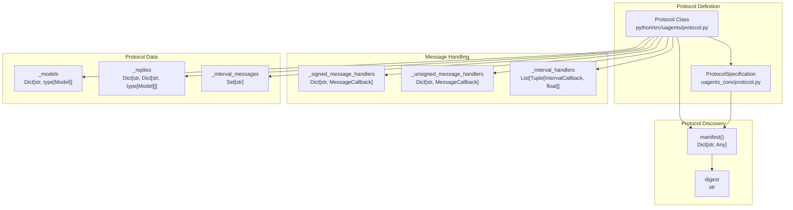

Sources: [python/src/uagents/protocol.py:18-48](), [python/uagents-core/uagents_core/protocol.py:11-129]()

## Protocol Class

The `Protocol` class encapsulates a set of functionalities for an agent, typically relating to message exchange between agents for executing specific tasks [python/src/uagents/protocol.py:18-24]().

### Core Properties

| Property | Type | Description |
|----------|------|-------------|
| `models` | `dict[str, type[Model]]` | Registered message models with schema digests as keys [python/src/uagents/protocol.py:69-77]() |
| `replies` | `dict[str, dict[str, type[Model]]]` | Mapping of message digests to allowed reply types [python/src/uagents/protocol.py:79-88]() |
| `signed_message_handlers` | `dict[str, MessageCallback]` | Handlers for verified messages [python/src/uagents/protocol.py:100-108]() |
| `unsigned_message_handlers` | `dict[str, MessageCallback]` | Handlers for unverified messages [python/src/uagents/protocol.py:110-118]() |
| `intervals` | `list[tuple[IntervalCallback, float]]` | Interval handlers with their periods [python/src/uagents/protocol.py:59-67]() |

Sources: [python/src/uagents/protocol.py:59-118]()

### Protocol Initialization

Title: Protocol Initialization Logic
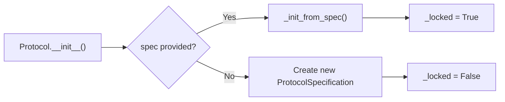

The Protocol can be initialized with or without a `ProtocolSpecification` [python/src/uagents/protocol.py:26-57](). When a specification is provided, the protocol becomes locked and validates that message handlers match the specification requirements [python/src/uagents/protocol.py:170-217]().

Sources: [python/src/uagents/protocol.py:26-58](), [python/src/uagents/protocol.py:170-217]()

## Message Handler Registration

### Message Handler Decorators

The Protocol class provides decorators for registering different types of handlers:

Title: Handler Registration Flow
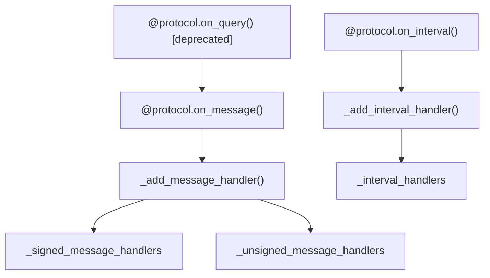

### Message Handler Flow

Title: Developer-to-Code Handler Registration
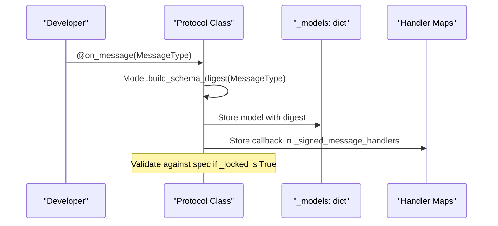

Sources: [python/src/uagents/protocol.py:308-383](), [python/src/uagents/protocol.py:236-287](), [python/tests/test_protocol.py:43-58]()

## ProtocolSpecification

The `ProtocolSpecification` class provides formal protocol definitions with structured interactions and roles [python/uagents_core/uagents_core/protocol.py:11-29]().

### Specification Structure

Title: ProtocolSpecification Entity Space
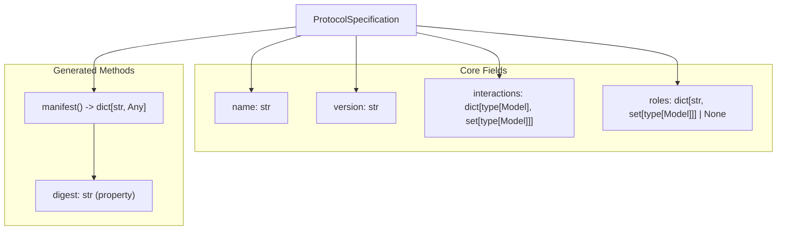

### Interaction Mapping

The `interactions` dictionary defines which message types can trigger which reply types [python/uagents_core/uagents_core/protocol.py:18-22]().

| Message Type | Valid Replies |
|--------------|---------------|
| `RequestAgentSubscriptionRenewal` | `{AcceptAgentSubscriptionUpdate, RejectAgentSubscriptionUpdate}` |
| `AcceptAgentSubscriptionUpdate` | `set()` (no replies) |

Sources: [python/uagents-core/uagents_core/protocol.py:11-53](), [python/uagents-core/uagents_core/contrib/protocols/subscriptions/__init__.py:56-75]()

## Protocol Manifest System

### Manifest Generation

The manifest system creates machine-readable protocol descriptions for discovery and verification [python/uagents_core/uagents_core/protocol.py:64-129]():

Title: Manifest Generation Process
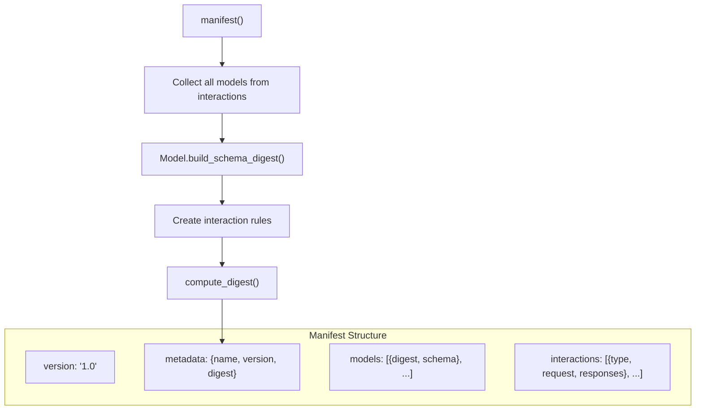

### Digest Computation

Protocol digests are computed as `proto:{sha256_hash}` where the hash is generated from a normalized JSON manifest representation [python/uagents_core/uagents_core/protocol.py:142-153]():

Title: Digest Computation Pipeline
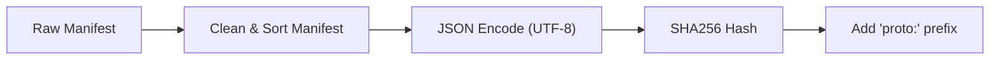

Sources: [python/uagents-core/uagents_core/protocol.py:64-154]()

## Protocol Roles

### Role-Based Protocol Implementation

When a `ProtocolSpecification` defines roles, agents can implement specific subsets of the protocol [python/uagents_core/uagents_core/protocol.py:84-89]().

Title: Role-Based Interaction Filtering
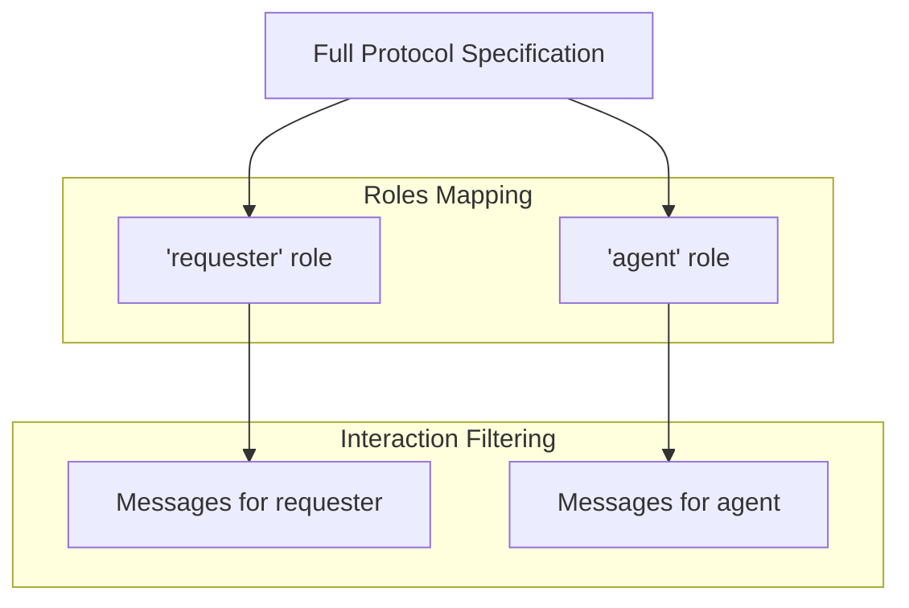

Example from the subscription protocol [python/uagents-core/uagents_core/contrib/protocols/subscriptions/__init__.py:71-75]():

| Role | Required Message Handlers |
|------|---------------------------|
| `requester` | `AcceptAgentSubscriptionUpdate`, `RejectAgentSubscriptionUpdate` |
| `agent` | `RequestAgentSubscriptionRenewal`, `RequestAgentSubscriptionUpgrade` |

Sources: [python/src/uagents/protocol.py:198-217](), [python/uagents-core/uagents_core/contrib/protocols/subscriptions/__init__.py:71-75]()

## Protocol Verification

### Handler Validation

The `verify()` method ensures that all required message types have corresponding handlers when a protocol is initialized from a specification [python/src/uagents/protocol.py:394-422]().

Title: Verification Logic
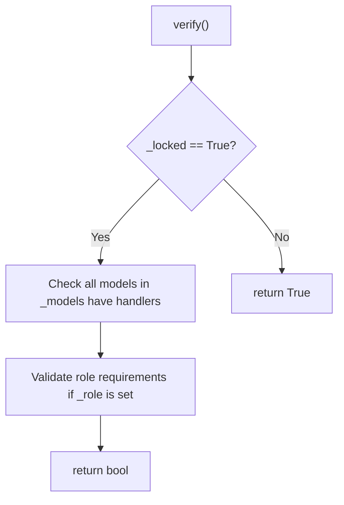

Sources: [python/src/uagents/protocol.py:394-422]()

## Integration Examples

### Subscription Protocol Specification

The subscription protocol demonstrates a complete protocol specification with roles and interactions:

Title: Subscription Protocol Model Relationships
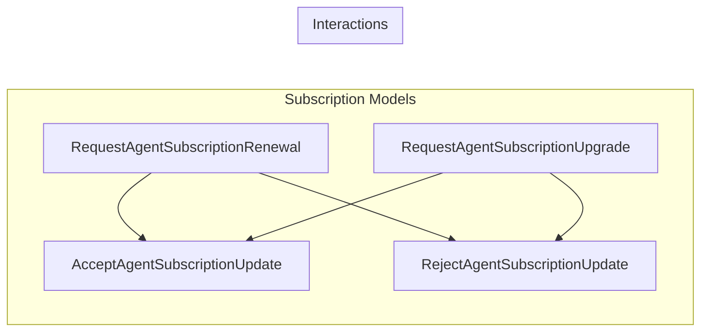

Sources: [python/uagents-core/uagents_core/contrib/protocols/subscriptions/__init__.py:56-75]()

### Protocol Registration with Agent

Protocols are integrated into agents using the `include()` method, which merges the protocol's handlers and models into the agent's runtime structures [python/tests/test_protocol.py:75-84]().

Title: Protocol Inclusion Sequence
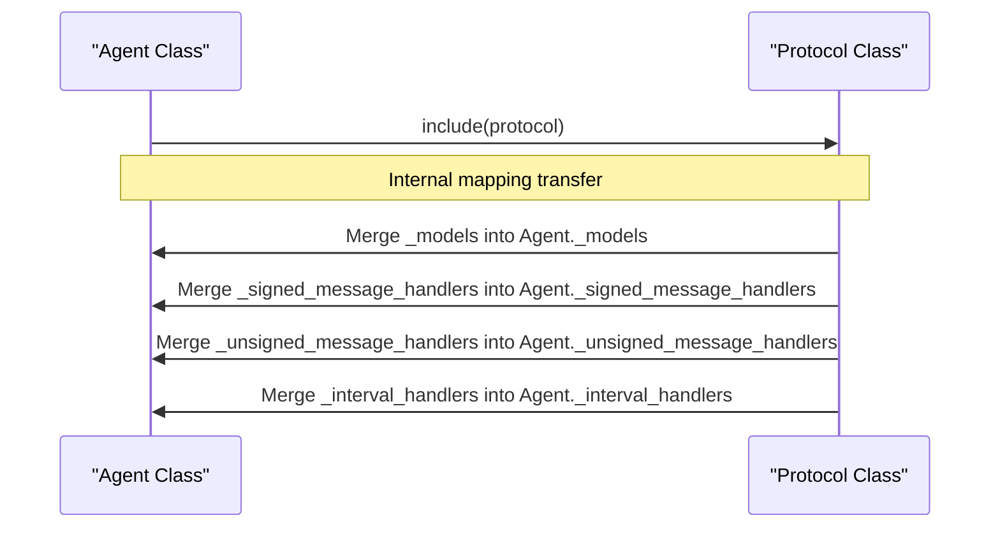

Sources: [python/tests/test_protocol.py:75-84]()

---

