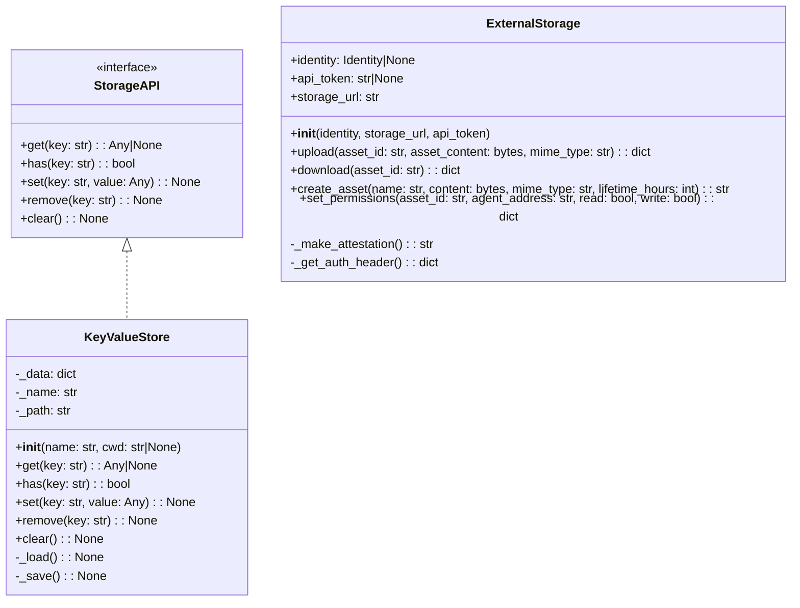
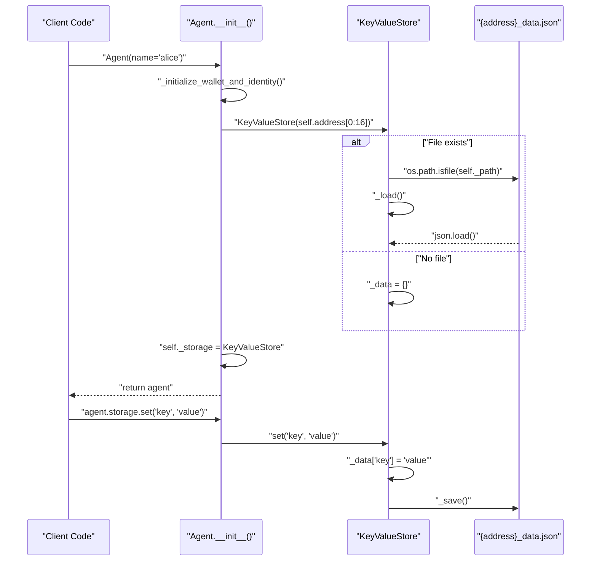
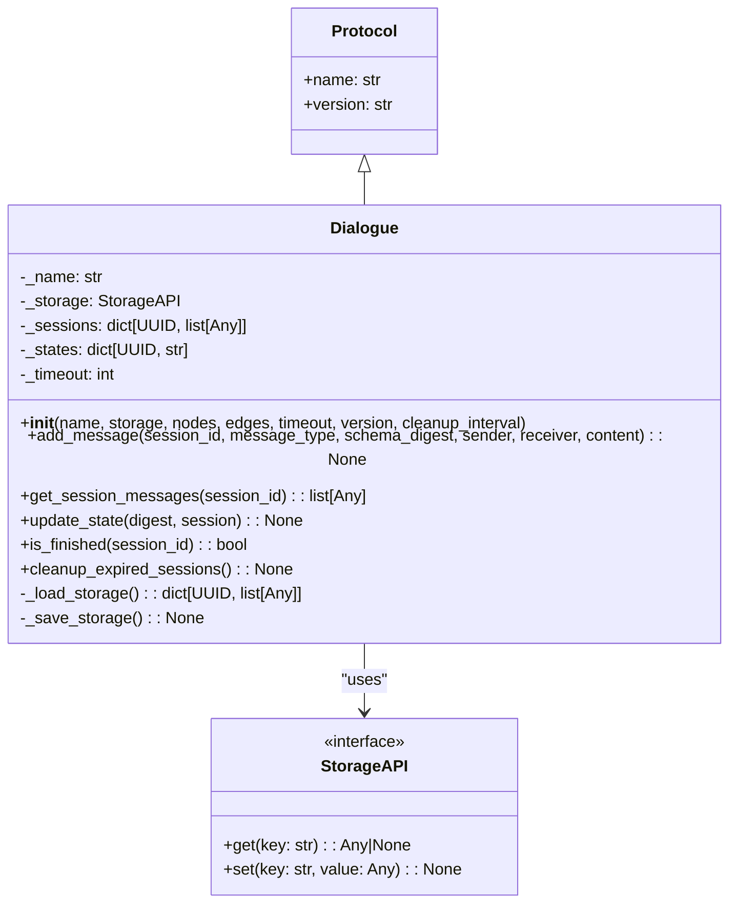
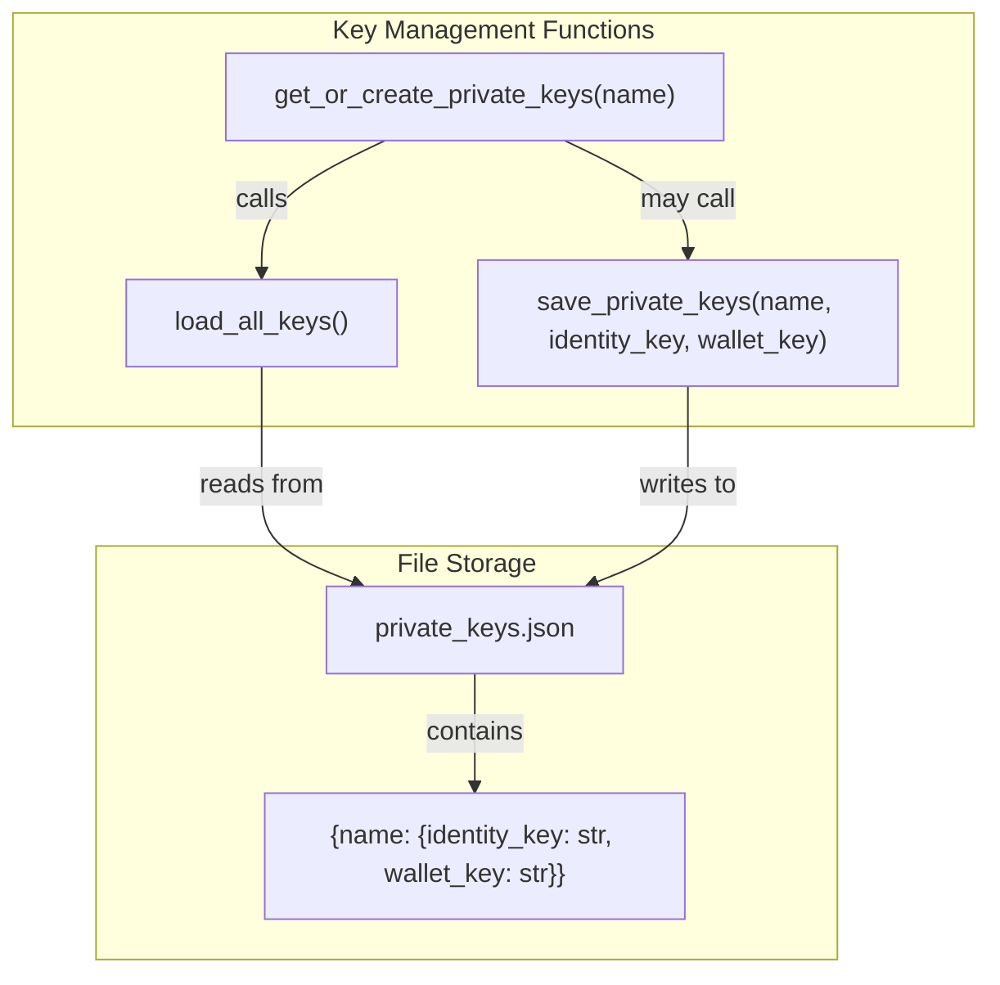
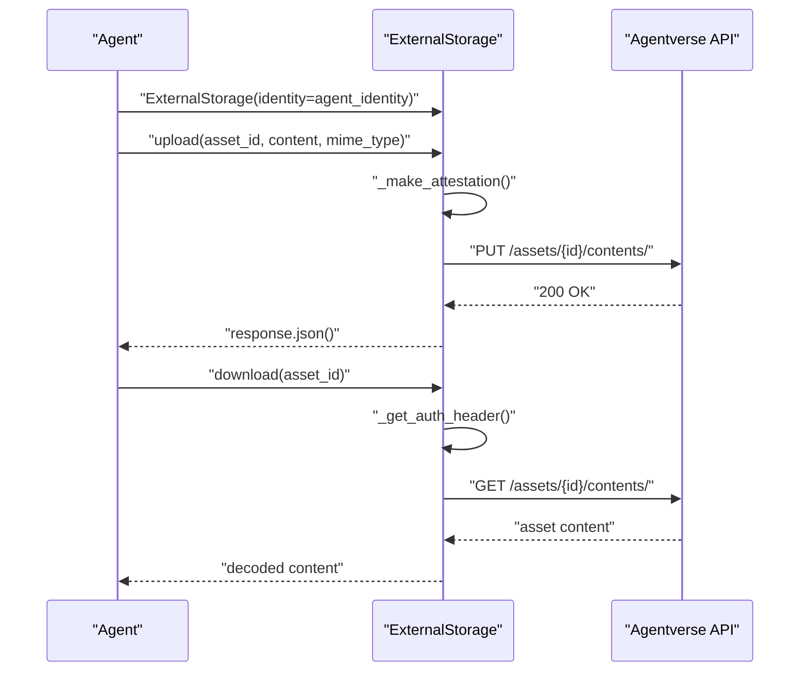

<!-- source: DeepWiki mcp.deepwiki.com · repo fetchai/uAgents · page 2.4 Storage System · fetched 2026-10-26 -->

# Storage System

<details>
<summary>Relevant source files</summary>

The following files were used as context for generating this wiki page:

- [python/docs/api/uagents/storage/__init__.md](python/docs/api/uagents/storage/__init__.md)
- [python/src/uagents/experimental/dialogues/__init__.py](python/src/uagents/experimental/dialogues/__init__.py)
- [python/src/uagents/storage/__init__.py](python/src/uagents/storage/__init__.py)
- [python/tests/test_agent_registration.py](python/tests/test_agent_registration.py)
- [python/tests/test_storage.py](python/tests/test_storage.py)
- [python/uagents-core/uagents_core/config.py](python/uagents-core/uagents_core/config.py)
- [python/uagents-core/uagents_core/contrib/protocols/chat/__init__.py](python/uagents-core/uagents_core/contrib/protocols/chat/__init__.py)
- [python/uagents-core/uagents_core/storage.py](python/uagents-core/uagents_core/storage.py)
- [python/uagents-core/uagents_core/utils/subscriptions.py](python/uagents-core/uagents_core/utils/subscriptions.py)

</details>


The Storage System provides two distinct storage mechanisms: local persistent storage via `KeyValueStore` and external cloud storage via `ExternalStorage`. Local storage handles agent state, message history, dialogue sessions, and private keys. External storage provides Agentverse-integrated asset management with authentication and permissions.

The system uses `StorageAPI` as the base interface, implemented by `KeyValueStore` for local file-based storage and utilized by components like `EnvelopeHistory` and `Dialogue` for specialized data persistence needs.

## Storage Architecture

The Storage System provides two storage abstractions: local storage via `StorageAPI`/`KeyValueStore` and external storage via `ExternalStorage`.

### Local Storage Architecture



### Storage Method Details

| Class | Method | Description |
|-------|---------|-------------|
| `StorageAPI` | `get(key: str)` | Abstract method to retrieve value by key [python/src/uagents/storage/__init__.py:14-15]() |
| `StorageAPI` | `set(key: str, value: Any)` | Abstract method to store key-value pair [python/src/uagents/storage/__init__.py:22-23]() |
| `KeyValueStore` | `_load()` | Loads data from `{name}_data.json` file [python/src/uagents/storage/__init__.py:90-92]() |
| `KeyValueStore` | `_save()` | Persists in-memory data to JSON file [python/src/uagents/storage/__init__.py:94-96]() |
| `ExternalStorage` | `_make_attestation()` | Creates signed attestation for agent authentication [python/uagents_core/uagents_core/storage.py:49-59]() |
| `ExternalStorage` | `upload(asset_id, content, mime_type)` | Uploads asset content to Agentverse storage [python/uagents_core/uagents_core/storage.py:68-92]() |

Sources:
- [python/src/uagents/storage/__init__.py:10-31]()
- [python/src/uagents/storage/__init__.py:34-96]()
- [python/uagents-core/uagents_core/storage.py:33-167]()

## Agent Storage Integration

Each `Agent` instance initializes its own `KeyValueStore` using the first 16 characters of the agent's address as the storage name. The storage is accessible via the `agent.storage` property and passed to contexts for handler access.

### Agent Storage Initialization



### Storage Property Access

The `Agent` class exposes storage through a property that provides direct access to the underlying `KeyValueStore`.

Sources:
- [python/src/uagents/storage/__init__.py:54-69]()
- [python/src/uagents/storage/__init__.py:71-80]()

## Storage System Components

The Storage System integrates with multiple uAgents components through both direct usage and composition patterns.

### Component Integration Architecture

```mermaid
graph TD
    subgraph "Storage Implementations"
        StorageAPI["StorageAPI"]
        KeyValueStore["KeyValueStore"]
        ExternalStorage["ExternalStorage"]
    end
    
    subgraph "Agent Framework"
        Agent["Agent"]
        InternalContext["InternalContext"]
        ExternalContext["ExternalContext"]
        EnvelopeHistory["EnvelopeHistory"]
        Dialogue["Dialogue"]
    end
    
    subgraph "Storage Operations"
        get_or_create_private_keys["get_or_create_private_keys()"]
        save_private_keys["save_private_keys()"]
        load_all_keys["load_all_keys()"]
    end
    
    StorageAPI <|.. KeyValueStore
    Agent --> KeyValueStore
    InternalContext --> KeyValueStore
    ExternalContext --> KeyValueStore
    EnvelopeHistory --> StorageAPI
    Dialogue --> StorageAPI
    
    Agent -.-> get_or_create_private_keys
    get_or_create_private_keys --> save_private_keys
    save_private_keys --> load_all_keys
```

### Storage Usage by Component

| Component | Storage Type | Purpose | Key Methods |
|-----------|-------------|---------|-------------|
| `Agent` | `KeyValueStore` | Agent state persistence | `self._storage = KeyValueStore(...)` |
| `EnvelopeHistory` | `StorageAPI` (optional) | Message history persistence | `self._storage` for session tracking |
| `Dialogue` | `StorageAPI` | Conversation state | `self._storage` for session management [python/src/uagents/experimental/dialogues/__init__.py:170-172]() |

Sources:
- [python/src/uagents/experimental/dialogues/__init__.py:149-155]()
- [python/src/uagents/storage/__init__.py:99-150]()

## Message History Storage

The `EnvelopeHistory` class provides configurable message persistence using optional in-memory caching and `StorageAPI`-based storage. It supports retention policies and session-based message organization.

### Storage Key Patterns

The `EnvelopeHistory` class uses structured keys for persistent storage.

| Key Pattern | Purpose |
|-------------|---------|
| `message-history:session:{session_id}` | Session message list |
| `message-history:sessions` | Session metadata mapping |

## Dialogue Storage

The `Dialogue` class extends `Protocol` to provide stateful conversation management using `StorageAPI` for session persistence. It maintains conversation state, message history, and automatic session cleanup.

### Dialogue Storage Architecture



### Dialogue Session Management

The `Dialogue` class manages conversations through these key mechanisms:

| Component | Type | Purpose |
|-----------|------|---------|
| `_sessions` | `dict[UUID, list[Any]]` | In-memory session cache [python/src/uagents/experimental/dialogues/__init__.py:173-175]() |
| `_states` | `dict[UUID, str]` | Current dialogue state per session [python/src/uagents/experimental/dialogues/__init__.py:176-178]() |
| `_storage` | `StorageAPI` | Persistent session storage [python/src/uagents/experimental/dialogues/__init__.py:170-172]() |
| `_timeout` | `int` | Session expiration time (default: 60s) [python/src/uagents/experimental/dialogues/__init__.py:16-16]() |

Sources:
- [python/src/uagents/experimental/dialogues/__init__.py:146-192]()
- [python/src/uagents/experimental/dialogues/__init__.py:169-172]()

## Private Key Storage

The Storage System provides functions for managing agent private keys through a shared `private_keys.json` file. These functions handle key generation, retrieval, and persistence for agents created without explicit seeds.

### Private Key Management Functions



### Function Signatures and Usage

| Function | Parameters | Returns | Purpose |
|----------|------------|---------|---------|
| `load_all_keys()` | None | `dict` | Loads all stored private keys [python/src/uagents/storage/__init__.py:99-110]() |
| `save_private_keys(name, identity_key, wallet_key)` | `str, str, str` | `None` | Saves keys for named agent [python/src/uagents/storage/__init__.py:113-128]() |
| `get_or_create_private_keys(name)` | `str` | `tuple[str, str]` | Gets existing or creates new keys [python/src/uagents/storage/__init__.py:130-150]() |

Sources:
- [python/src/uagents/storage/__init__.py:99-150]()

## External Storage Integration

The `ExternalStorage` class provides Agentverse-integrated storage for assets with authentication and permissions management.

### ExternalStorage Usage



### External Storage Methods

| Method | Parameters | Returns | Purpose |
|--------|------------|---------|---------|
| `upload(asset_id, content, mime_type)` | `str, bytes, str` | `dict` | Upload asset content [python/uagents_core/uagents_core/storage.py:68-92]() |
| `download(asset_id)` | `str` | `dict` | Download asset content [python/uagents_core/uagents_core/storage.py:94-107]() |
| `create_asset(name, content, mime_type, lifetime_hours)` | `str, bytes, str, int` | `str` | Create new asset [python/uagents_core/uagents_core/storage.py:109-139]() |
| `set_permissions(asset_id, agent_address, read, write)` | `str, str, bool, bool` | `dict` | Manage asset permissions [python/uagents_core/uagents_core/storage.py:141-166]() |

### Authentication and Attestation

The `ExternalStorage` class uses `compute_attestation` to generate secure tokens for Agentverse communication.

```python
def compute_attestation(
    identity: Identity, validity_start: datetime, validity_secs: int, nonce: bytes
) -> str:
    # Generates a signed attestation token
```

Sources:
- [python/uagents_core/uagents_core/storage.py:12-30]()
- [python/uagents_core/uagents_core/storage.py:33-167]()
- [python/uagents_core/uagents_core/config.py:38-39]()

## Summary

The Storage System in uAgents provides a flexible foundation for persistent data management across various components of the framework. Through a simple key-value interface, it enables storage capabilities for agent state, message history, dialogue sessions, and secure private key management, while also providing a gateway to external cloud storage via the Agentverse.

---

