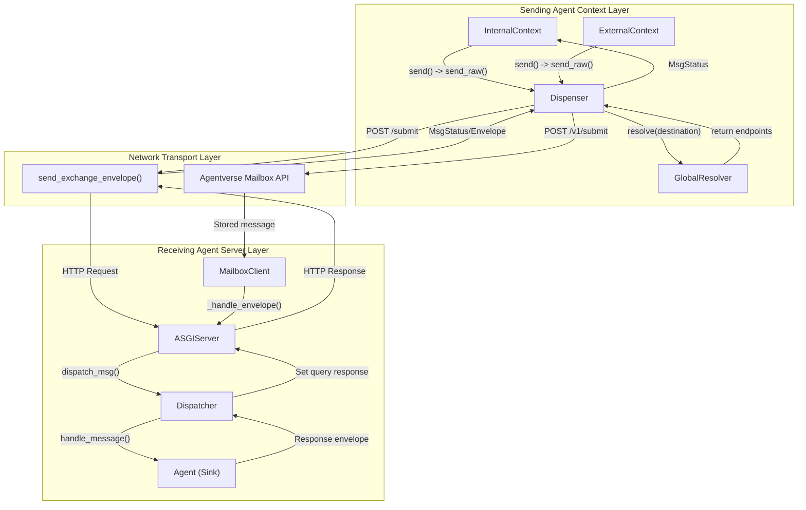
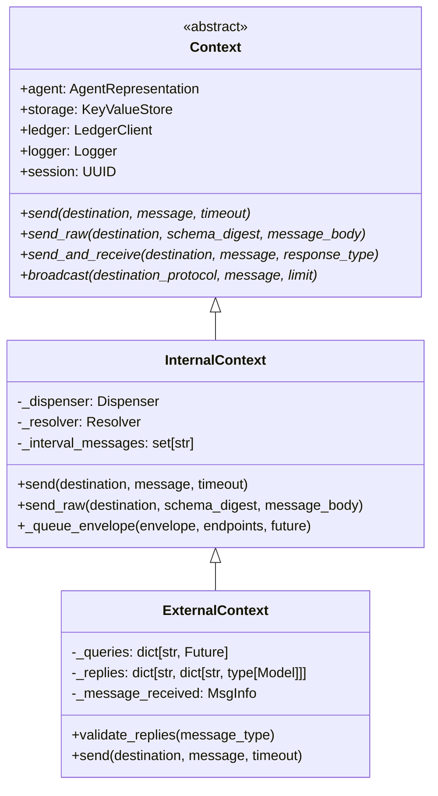
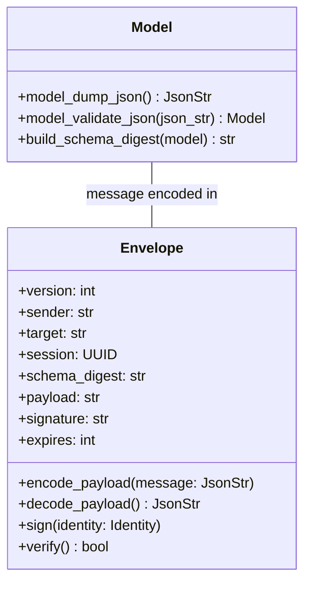
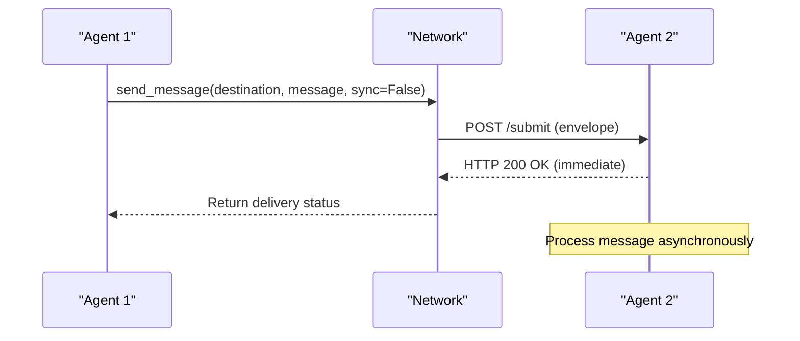
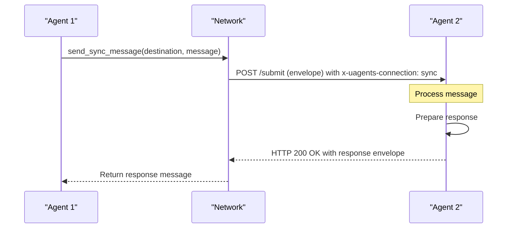

<!-- source: DeepWiki mcp.deepwiki.com · repo fetchai/uAgents · page 3 Communication · fetched 2026-10-26 -->

# Communication

Relevant source files

The following files were used as context for generating this wiki page:

- [python/docs/api/uagents/communication.md](python/docs/api/uagents/communication.md)
- [python/docs/api/uagents/dispatch.md](python/docs/api/uagents/dispatch.md)
- [python/docs/api/uagents/registration.md](python/docs/api/uagents/registration.md)
- [python/src/uagents/asgi.py](python/src/uagents/asgi.py)
- [python/src/uagents/communication.py](python/src/uagents/communication.py)
- [python/src/uagents/dispatch.py](python/src/uagents/dispatch.py)
- [python/src/uagents/query.py](python/src/uagents/query.py)
- [python/tests/test_rest.py](python/tests/test_rest.py)
- [python/tests/test_server.py](python/tests/test_server.py)

This document provides an overview of how agents communicate with each other in the uAgents framework. It covers the message exchange mechanisms, envelope structure, and network communication patterns used for agent-to-agent interaction. For information about message handling within protocols, see [Protocol System](#2.3).

## Communication System Overview

The uAgents framework provides a robust communication system that enables agents to exchange messages securely over HTTP. The system supports both synchronous (request-response) and asynchronous messaging patterns, with authentication through cryptographic signatures.

### Communication Architecture

### Context Class Hierarchy

Sources:
- [python/src/uagents/context.py:37-266]()
- [python/src/uagents/context.py:267-691]()
- [python/src/uagents/context.py:693-805]()
- [python/src/uagents/communication.py:25-76]()
- [python/src/uagents/asgi.py:41-108]()
- [python/src/uagents/dispatch.py:29-157]()

## Message Envelopes

Messages in uAgents are wrapped in an `Envelope` structure that provides metadata and security for message exchange. The envelope encapsulates the sender and recipient addresses, message content, verification information, and session tracking.

Key components of the envelope system:

- **Sender/Target**: Agent addresses that identify the message participants [python/src/uagents/communication.py:104-105]()
- **Schema Digest**: A hash of the message schema used for message type identification [python/src/uagents/communication.py:106]()
- **Payload**: The encoded message content (serialized JSON) [python/src/uagents/communication.py:107]()
- **Session**: A UUID to track conversations across multiple messages [python/src/uagents/communication.py:108]()
- **Signature**: Cryptographic signature for message verification [python/src/uagents/communication.py:157-160]()
- **Expires**: Timestamp indicating when a message is no longer valid.

For details, see [Message Envelopes](#3.1).

Sources:
- [python/src/uagents/communication.py:127-174]()
- [python/src/uagents/communication.py:379-408]()

## Message Flow Patterns

The uAgents framework supports both synchronous and asynchronous messaging patterns:

### Asynchronous Messaging

In asynchronous messaging, the sender doesn't wait for a response, making it suitable for one-way communications or when immediate responses aren't required.

### Synchronous Messaging

In synchronous messaging, the sender waits for the receiver to process the message and return a response. This is triggered by the `x-uagents-connection: sync` header [python/src/uagents/communication.py:143]().

Sources:
- [python/src/uagents/communication.py:127-188]()
- [python/src/uagents/asgi.py:276-340]()
- [python/tests/test_server.py:110-162]()

## Message Sending Components

### Dispenser

The `Dispenser` is responsible for sending messages to external agents. It maintains an internal `asyncio.Queue` of envelopes and processes them by calling `send_exchange_envelope` [python/src/uagents/communication.py:25-86]().

For details, see [Dispenser and Dispatcher](#3.4).

### Resolver System

The Resolver system translates agent addresses to network endpoints. The `GlobalResolver` orchestrates multiple resolution strategies, such as `AlmanacApiResolver` and `NameServiceResolver` [python/src/uagents/communication.py:18]().

For details, see [Address Resolution](#3.5).

Sources:
- [python/src/uagents/communication.py:25-100]()
- [python/src/uagents/resolver.py:1-20]()

## Message Receiving Components

### ASGI Server

The `ASGIServer` is the entry point for incoming HTTP communication. It handles REST endpoint registration via `add_rest_endpoint` and processes incoming envelopes at reserved paths like `/submit` [python/src/uagents/asgi.py:41-98]().

For details, see [ASGI Server](#3.2).

### Dispatcher

The `Dispatcher` routes incoming messages to internal sinks. It manages `PendingResponse` objects to resolve futures for synchronous queries [python/src/uagents/dispatch.py:47-115]().

For details, see [Dispenser and Dispatcher](#3.4).

Sources:
- [python/src/uagents/asgi.py:41-108]()
- [python/src/uagents/dispatch.py:47-159]()

## Mailbox Communication

For agents behind NAT or firewalls, the `MailboxClient` provides a polling-based mechanism to retrieve messages from the Agentverse Mailbox service.

For details, see [Mailbox Client](#3.3).

## Standalone Message Functions

The framework provides standalone functions for sending messages outside of a specific agent instance:

- `send_message`: Sends a message to a destination [python/src/uagents/communication.py:303]().
- `send_sync_message`: Sends a message and waits for a response [python/src/uagents/communication.py:342]().
- `query`: A deprecated wrapper for sending sync messages from a temporary user address [python/src/uagents/query.py:16-46]().

Sources:
- [python/src/uagents/communication.py:303-377]()
- [python/src/uagents/query.py:1-46]()

## REST API Communication

Agents can expose REST endpoints using decorators like `on_rest_get` and `on_rest_post`. These are managed by the `ASGIServer` and dispatched via `dispatch_rest` [python/src/uagents/asgi.py:200-274]().

Sources:
- [python/src/uagents/asgi.py:74-88]()
- [python/src/uagents/dispatch.py:148-157]()
- [python/tests/test_rest.py:25-97]()

---

