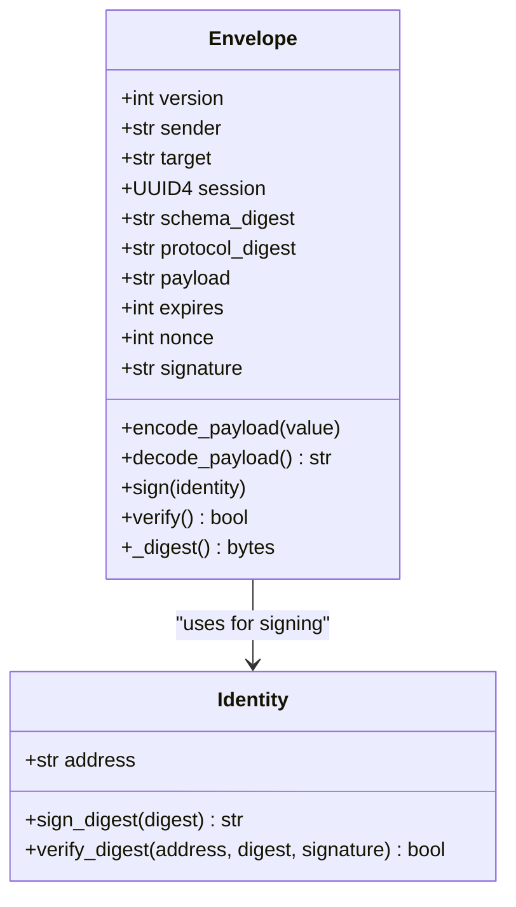
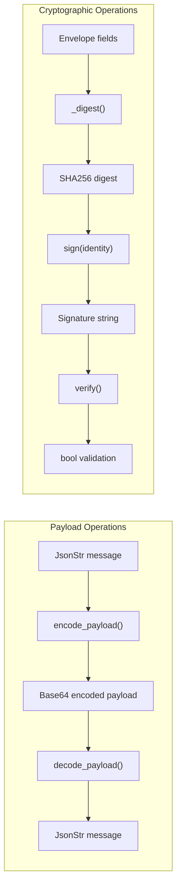
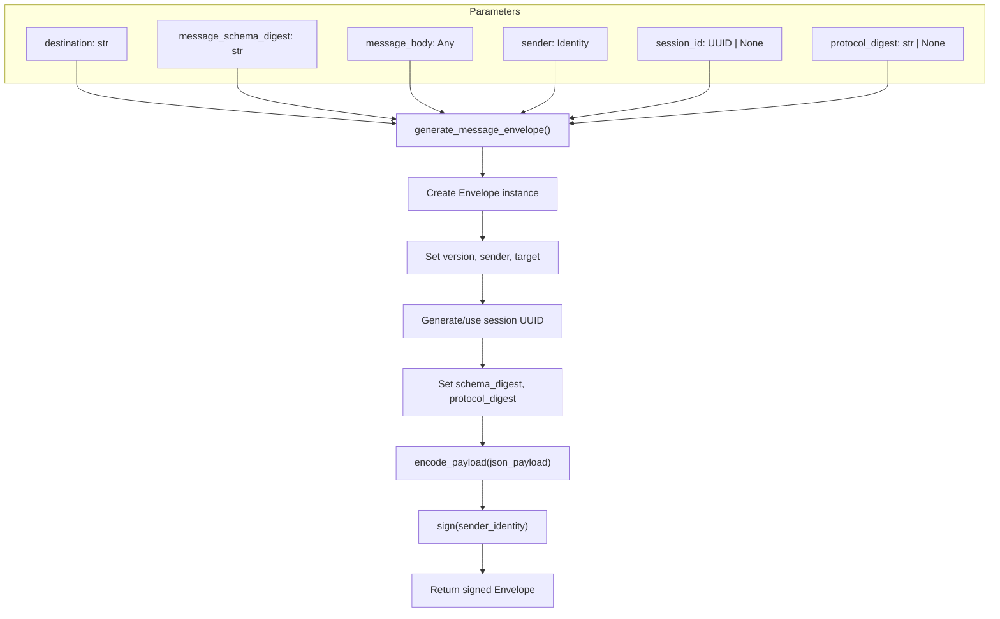
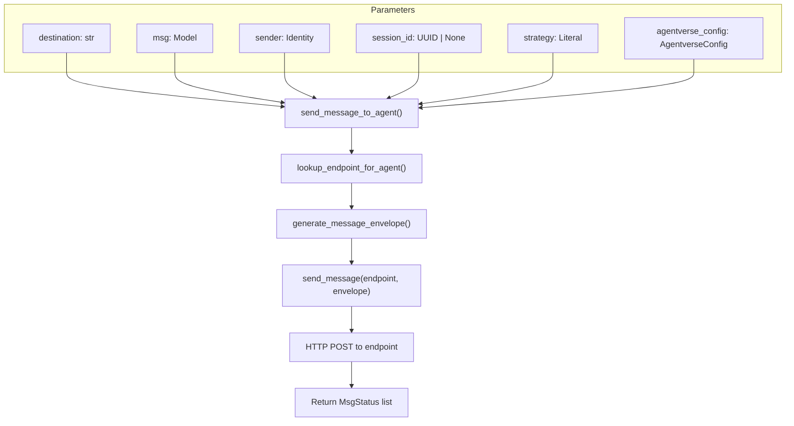
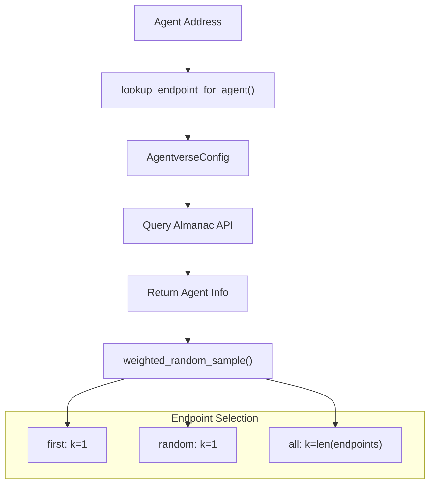
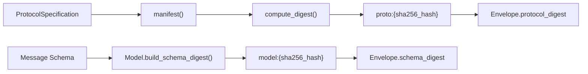
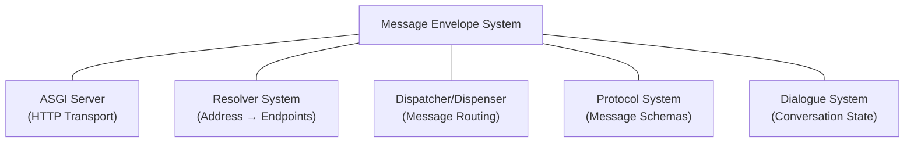

<!-- source: DeepWiki mcp.deepwiki.com · repo fetchai/uAgents · page 3.1 Message Envelopes · fetched 2026-10-26 -->

# Message Envelopes

<details>
<summary>Relevant source files</summary>

The following files were used as context for generating this wiki page:

- [python/tests/test_msg_verify.py](python/tests/test_msg_verify.py)
- [python/uagents-core/uagents_core/contrib/protocols/subscriptions/__init__.py](python/uagents-core/uagents_core/contrib/protocols/subscriptions/__init__.py)
- [python/uagents-core/uagents_core/envelope.py](python/uagents-core/uagents_core/envelope.py)
- [python/uagents-core/uagents_core/logger.py](python/uagents-core/uagents_core/logger.py)
- [python/uagents-core/uagents_core/models.py](python/uagents-core/uagents_core/models.py)
- [python/uagents-core/uagents_core/protocol.py](python/uagents-core/uagents_core/protocol.py)
- [python/uagents-core/uagents_core/types.py](python/uagents-core/uagents_core/types.py)
- [python/uagents-core/uagents_core/utils/__init__.py](python/uagents-core/uagents_core/utils/__init__.py)
- [python/uagents-core/uagents_core/utils/messages.py](python/uagents-core/uagents_core/utils/messages.py)
- [python/uagents-core/uagents_core/utils/resolver.py](python/uagents-core/uagents_core/utils/resolver.py)

</details>


Message Envelopes provide the standardized container format for secure message transmission between agents in the uAgents framework. The `Envelope` class encapsulates message payloads with cryptographic signatures, routing metadata, and session tracking for reliable agent-to-agent communication.

For information about the overall communication process including message delivery and routing, see [Dispenser and Dispatcher](#3.4). For details on how agent addresses are resolved to endpoints, see [Address Resolution](#3.5).

## Envelope Class Structure

The `Envelope` class defines the core message container with cryptographic security:



### Core Envelope Fields

| Field | Type | Description |
|---|---|---|
| `version` | `int` | Envelope format version for compatibility |
| `sender` | `str` | Address of the sending agent |
| `target` | `str` | Address of the intended recipient |
| `session` | `UUID4` | Session identifier for conversation tracking |
| `schema_digest` | `str` | Hash digest of the message schema |
| `protocol_digest` | `str \| None` | Optional protocol specification digest |
| `payload` | `str \| None` | Base64-encoded message content |
| `expires` | `int \| None` | Optional expiration timestamp |
| `nonce` | `int \| None` | Optional nonce for replay protection |
| `signature` | `str \| None` | Cryptographic signature of envelope digest |

Sources: [python/uagents-core/uagents_core/envelope.py:13-41]()

## Envelope Payload Operations

The `Envelope` class provides methods for secure payload handling and cryptographic operations:



**Key Methods:**

- `encode_payload(value: JsonStr)`: Encodes JSON message as Base64 and stores in `payload` field [python/uagents-core/uagents_core/envelope.py:43-50]().
- `decode_payload() -> str`: Decodes Base64 payload back to JSON string [python/uagents-core/uagents_core/envelope.py:52-62]().
- `sign(identity: Identity)`: Signs envelope digest using agent identity [python/uagents-core/uagents_core/envelope.py:64-74]().
- `verify() -> bool`: Verifies envelope signature against sender address [python/uagents-core/uagents_core/envelope.py:76-91]().
- `_digest() -> bytes`: Computes SHA256 hash of envelope contents for signing [python/uagents-core/uagents_core/envelope.py:93-111]().

Sources: [python/uagents-core/uagents_core/envelope.py:43-111]()

## Envelope Generation Utilities

The `generate_message_envelope` function creates properly formatted envelopes:



Sources: [python/uagents-core/uagents_core/utils/messages.py:31-65]()

## Message Sending with Envelopes

The `uagents-core` framework provides utilities for sending messages using envelopes.

### Core Message Sending Function

The `send_message_to_agent` function handles complete envelope creation and delivery:



**Function Signature:**
```python
def send_message_to_agent(
    destination: str,
    msg: Model,
    sender: Identity,
    *,
    session_id: UUID | None = None,
    strategy: Literal["first", "random", "all"] = "first",
    agentverse_config: AgentverseConfig | None = None,
    resolver: Resolver | None = None,
    sync: bool = False,
    timeout: int = DEFAULT_REQUEST_TIMEOUT,
    response_type: type[Model] | set[type[Model]] | None = None,
    track_interaction: bool = True,
) -> list[MsgStatus] | Model | JsonStr
```

Sources: [python/uagents-core/uagents_core/utils/messages.py:183-220]()

### HTTP Message Transport

The `send_message` helper function handles the HTTP transport layer using the `requests` library [python/uagents-core/uagents_core/utils/messages.py:89-94](). It sets the `x-uagents-connection: sync` header if synchronous communication is requested [python/uagents-core/uagents_core/utils/messages.py:87-88]().

Sources: [python/uagents-core/uagents_core/utils/messages.py:68-96]()

## Endpoint Resolution and Delivery

The envelope system integrates with endpoint resolution for message delivery:

### Address Resolution Flow



### Delivery Status Tracking

Each message delivery attempt returns a `MsgStatus` with outcome information:

| Field | Type | Description |
|---|---|---|
| `status` | `DeliveryStatus` | SENT, DELIVERED, or FAILED |
| `detail` | `str` | Response text or error message |
| `destination` | `str` | Target agent address |
| `endpoint` | `str` | Endpoint URL used for delivery |
| `session` | `UUID \| None` | Session identifier from envelope |

Sources: [python/uagents-core/uagents_core/types.py:64-80]()

## Protocol Integration

Envelopes carry protocol-specific information for message validation. The `protocol_digest` field in envelopes links messages to protocol specifications.

### Protocol Digest Computation

A protocol digest is computed by generating a manifest of the protocol (including metadata, models, and interaction rules) and hashing it [python/uagents-core/uagents_core/protocol.py:64-129]().



### Model Digest Computation

Every message model in the uAgents framework has a unique schema digest. This is generated by hashing the JSON schema of the `Model` [python/uagents-core/uagents_core/models.py:29-33]().

Sources: [python/uagents-core/uagents_core/protocol.py:132-153](), [python/uagents-core/uagents_core/models.py:29-33]()

## Integration with Other uAgents Components

Message Envelopes interact with several other systems in the uAgents framework:



Related components:
- **ASGI Server**: Handles HTTP transport of envelopes (incoming).
- **Address Resolution**: Resolves agent addresses to network endpoints using `AlmanacResolver` [python/uagents-core/uagents_core/utils/resolver.py:109-180]().
- **Protocol System**: Defines message schemas and handles `schema_digest` validation [python/uagents-core/uagents_core/protocol.py:11-29]().
- **Dialogue System**: Uses the `session` field in the envelope to track stateful conversation flows.

Sources: [python/uagents-core/uagents_core/utils/resolver.py:109-180](), [python/uagents-core/uagents_core/protocol.py:11-29](), [python/uagents-core/uagents_core/envelope.py:13-41]()

---

