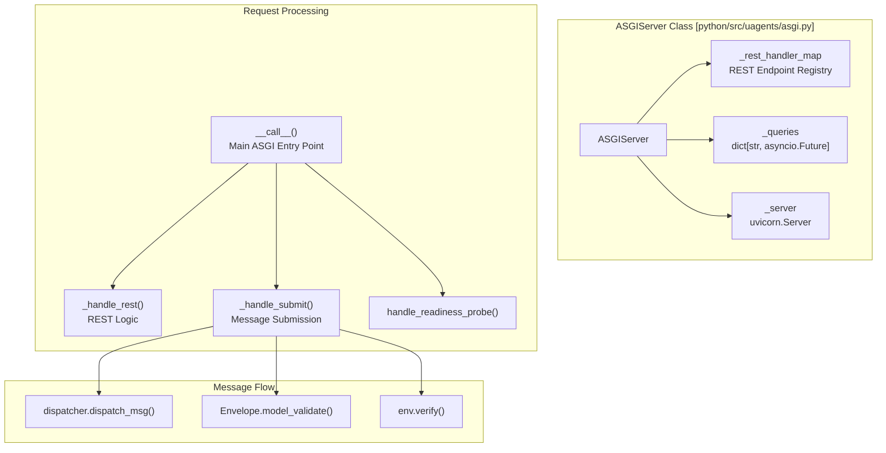
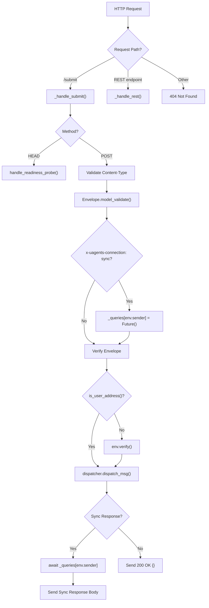
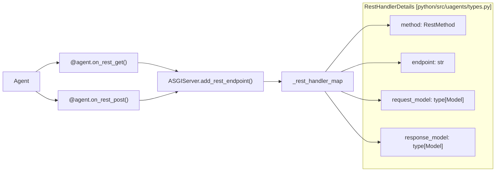
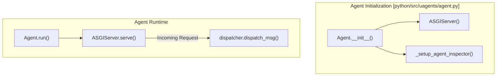

<!-- source: DeepWiki mcp.deepwiki.com · repo fetchai/uAgents · page 3.2 ASGI Server · fetched 2026-10-26 -->

# ASGI Server

Relevant source files

The following files were used as context for generating this wiki page:

- [python/docs/api/uagents/query.md](python/docs/api/uagents/query.md)
- [python/src/uagents/asgi.py](python/src/uagents/asgi.py)
- [python/src/uagents/query.py](python/src/uagents/query.py)
- [python/tests/test_rest.py](python/tests/test_rest.py)
- [python/tests/test_server.py](python/tests/test_server.py)

The ASGI Server component provides HTTP communication capabilities for uAgents, serving as the primary interface for receiving incoming message envelopes and handling REST API requests. It implements the ASGI (Asynchronous Server Gateway Interface) specification using `uvicorn` to enable agents to communicate over HTTP protocols.

This document covers the server implementation, message processing, and REST endpoint management. For information about message envelope structure and signing, see [Message Envelopes](#3.1). For mailbox-based communication patterns, see [Mailbox Client](#3.3).

## Server Architecture

The `ASGIServer` class is the core HTTP server implementation. It handles agent-to-agent message delivery via the `/submit` endpoint and custom REST API endpoints registered by the agent.

### Core Components

The server maintains several key data structures:
- `_rest_handler_map`: Maps a tuple of `(address, method, endpoint)` to `RestHandlerDetails` [python/src/uagents/asgi.py:63-65]().
- `_queries`: A dictionary of `asyncio.Future` objects used to resolve synchronous queries [python/src/uagents/asgi.py:62]().
- `_server`: The underlying `uvicorn.Server` instance [python/src/uagents/asgi.py:67]().

Sources: [python/src/uagents/asgi.py:41-67]()

### Message Processing Flow

When a request arrives at the `/submit` path, the server processes the incoming `Envelope`.

Sources: [python/src/uagents/asgi.py:276-412](), [python/src/uagents/asgi.py:139-164]()

## REST Endpoint Management

The ASGI server provides a REST API system that allows agents to expose custom endpoints using the `on_rest_get` and `on_rest_post` decorators.

### Endpoint Registration

Reserved endpoints include `/submit`, `/messages`, `/agent_info`, `/connect`, and `/disconnect` [python/src/uagents/asgi.py:25](). The server blocks registration of custom handlers on these paths [python/src/uagents/asgi.py:92-94]().

Sources: [python/src/uagents/asgi.py:74-89](), [python/src/uagents/asgi.py:25](), [python/tests/test_rest.py:26-66]()

### Agent Inspector Endpoints

If `enable_agent_inspector` is enabled in the `Agent` configuration, the server registers several management endpoints [python/src/uagents/agent.py:434-441]():

| Endpoint | Method | Purpose |
|----------|--------|---------|
| `/agent_info` | GET | Returns address, endpoints, protocols, and metadata [python/src/uagents/agent.py:443-455](). |
| `/messages` | GET | Returns cached message history via `EnvelopeHistoryResponse` [python/src/uagents/agent.py:457-466](). |
| `/connect` | POST | Triggers Agentverse registration [python/src/uagents/agent.py:468-477](). |
| `/disconnect` | POST | Triggers Agentverse unregistration [python/src/uagents/agent.py:479-488](). |

## Server Integration

### Agent Lifecycle Integration

The `ASGIServer` is initialized during `Agent` construction [python/src/uagents/agent.py:421-427]() and started when the agent's `run()` method is called [python/src/uagents/agent.py:1129-1142]().

Sources: [python/src/uagents/agent.py:421-427](), [python/src/uagents/agent.py:1129-1142]()

### Synchronous Message Handling

The server supports synchronous communication (request-response over a single HTTP connection) via the `x-uagents-connection: sync` header [python/src/uagents/asgi.py:352]().

1. **Future Creation**: The server creates a `Future` and stores it in `_queries` keyed by the sender's address [python/src/uagents/asgi.py:355-356]().
2. **Dispatch**: The message is dispatched to the agent's internal handlers via `dispatcher.dispatch_msg` [python/src/uagents/asgi.py:375]().
3. **Wait**: The server awaits the `Future` with a timeout [python/src/uagents/asgi.py:381-382]().
4. **Resolution**: When the agent sends a response, the `Dispatcher` resolves the `Future`, and the server sends the encoded response back to the client [python/src/uagents/asgi.py:397-411]().

Sources: [python/src/uagents/asgi.py:352-411](), [python/tests/test_server.py:110-143]()

## Configuration and Deployment

The server defaults to listening on `0.0.0.0` [python/src/uagents/asgi.py:23]() at the port specified in the `Agent` constructor (default 8000) [python/src/uagents/agent.py:270](). It includes default CORS headers to allow cross-origin requests from web-based agent inspectors or frontend applications [python/src/uagents/asgi.py:185-190]().

Sources: [python/src/uagents/asgi.py:173-194](), [python/src/uagents/agent.py:270-294]()

---

