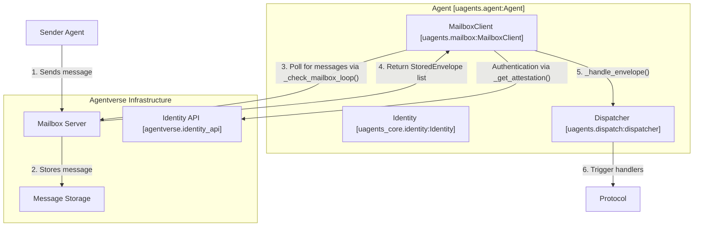
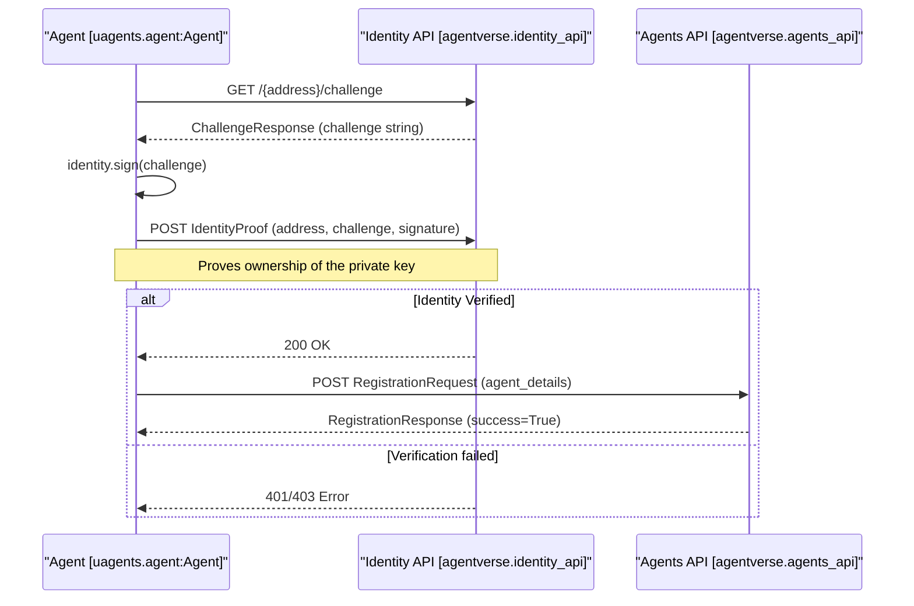
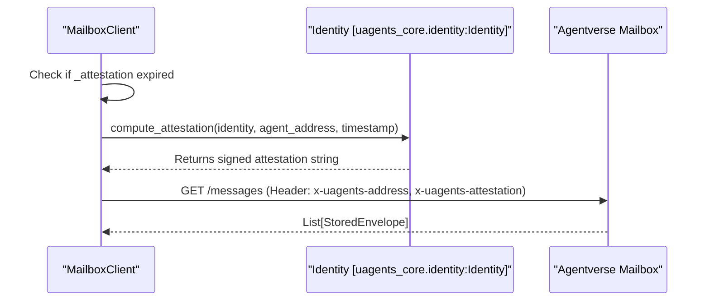
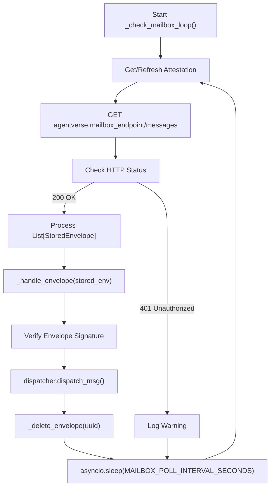

<!-- source: DeepWiki mcp.deepwiki.com · repo fetchai/uAgents · page 3.3 Mailbox Client · fetched 2026-10-26 -->

# Mailbox Client

<details>
<summary>Relevant source files</summary>

The following files were used as context for generating this wiki page:

- [python/docs/api/uagents/experimental/search/__init__.md](python/docs/api/uagents/experimental/search/__init__.md)
- [python/docs/api/uagents/mailbox.md](python/docs/api/uagents/mailbox.md)
- [python/src/uagents/experimental/search/__init__.py](python/src/uagents/experimental/search/__init__.py)
- [python/src/uagents/mailbox.py](python/src/uagents/mailbox.py)
- [python/tests/test_config.py](python/tests/test_config.py)

</details>


The Mailbox Client in the uAgents framework provides a mechanism for agents to receive messages even when they are not directly reachable via HTTP. It solves the problem of message delivery to agents that may be behind firewalls, have no public IP address, or operate intermittently (behind NAT). By connecting to the Agentverse mailbox service, agents can retrieve messages that were sent to them while they were offline or unreachable.

For information about the general message communication system, see [Message Envelopes](#3.1) and [Dispenser and Dispatcher](#3.4).

## Overview



The Mailbox Client enables agents to:

1. Register with the Agentverse mailbox service using `register_in_agentverse`.
2. Authenticate using attestation-based proofs.
3. Periodically poll for new messages using `_check_mailbox_loop`.
4. Process and dispatch received `StoredEnvelope` objects to the appropriate handlers.
5. Delete processed messages from the mailbox server via `_delete_envelope`.

Sources: [python/src/uagents/mailbox.py:194-217](), [python/src/uagents/mailbox.py:218-266]()

## Registration Process

Before an agent can use the mailbox service, it must register with Agentverse. This process establishes the agent's presence and metadata in the `Almanac` via Agentverse APIs.



The registration process uses cryptographic proof-of-identity via the `IdentityProof` model to ensure that only the owner of an agent address can register it with the mailbox service.

Sources: [python/src/uagents/mailbox.py:92-161](), [python/src/uagents/mailbox.py:28-49]()

## Authentication Flow (Attestation)

Each time the `MailboxClient` polls the server, it provides an attestation. Unlike static tokens, this is a time-bound cryptographic proof.



The attestation is valid for a duration defined by `_attestation_validity_secs`, typically derived from `MAILBOX_POLL_INTERVAL_SECONDS`.

Sources: [python/src/uagents/mailbox.py:318-330](), [python/src/uagents/mailbox.py:207-208]()

## Message Polling and Processing

The `MailboxClient` runs a background task that continuously cycles through polling and processing:



The client ensures that once a message is successfully handed off to the `dispatcher`, it is removed from the remote mailbox to prevent duplicate processing.

Sources: [python/src/uagents/mailbox.py:218-266](), [python/src/uagents/mailbox.py:267-304]()

## Key Components

### MailboxClient

The `MailboxClient` class is the primary component responsible for interacting with the Agentverse mailbox service.

| Attribute/Method | Description |
|------------------|-------------|
| `_identity` | The `Identity` object used for signing attestations. |
| `_attestation` | The current cached cryptographic proof for the server. |
| `_poll_interval` | Frequency of polling, defaults to `MAILBOX_POLL_INTERVAL_SECONDS`. |
| `run()` | Entry point that starts the `_check_mailbox_loop` as an `asyncio` task. |
| `_handle_envelope()` | Unpacks `StoredEnvelope`, verifies signatures, and calls the `dispatcher`. |

Sources: [python/src/uagents/mailbox.py:194-217](), [python/src/uagents/mailbox.py:267-280]()

### Data Models

The mailbox system relies on several Pydantic models for structured communication:

*   **`StoredEnvelope`**: Represents a message stored on the server, including its `uuid`, the `Envelope` itself, and timestamps. [python/src/uagents/mailbox.py:61-66]()
*   **`RegistrationRequest`**: Used during the initial setup to define agent metadata. [python/src/uagents/mailbox.py:16-17]()
*   **`ChallengeProof`**: A model for proving identity during registration via a signed challenge. [python/src/uagents/mailbox.py:35-39]()

## Envelope Handling and Security

When a message is retrieved, the client performs the following security checks:

1.  **Identity Verification**: It checks if the sender is a user or another agent. If it's an agent, the signature on the `Envelope` is verified using the sender's public key. [python/src/uagents/mailbox.py:282-293]()
2.  **Dispatcher Check**: It ensures the local `dispatcher` actually has a registered agent for the destination address. [python/src/uagents/mailbox.py:295-299]()
3.  **Attestation-based Auth**: All requests to the mailbox server require an attestation generated by `compute_attestation`. [python/src/uagents/mailbox.py:318-330]()

Sources: [python/src/uagents/mailbox.py:267-304](), [python/src/uagents/mailbox.py:318-330]()

## Integration with Agents

Agents are configured to use the mailbox service during initialization. The `Agent` class determines if it should act as a mailbox agent by checking the provided `mailbox` and `endpoint` parameters.

```python
# Configure an agent to use the Agentverse Mailbox
agent = Agent(mailbox=True) 

# The framework checks if the mailbox endpoint is in the agent's endpoints
# using the is_mailbox_agent utility.
```

If `mailbox` is enabled, the agent adds the `MAILBOX_ENDPOINT` to its list of `AgentEndpoint` objects. The `MailboxClient` is then instantiated and started during the agent's startup phase.

Sources: [python/tests/test_config.py:11-36](), [python/src/uagents/mailbox.py:68-77]()

## Relationship with ASGI Server

The Mailbox Client complements the `ASGIServer`. While the `ASGIServer` handles incoming HTTP POST requests (push model), the `MailboxClient` uses a pull model. Both systems feed envelopes into the same `dispatcher.dispatch_msg` method, ensuring that protocol handlers do not need to know how the message was delivered.

Sources: [python/src/uagents/mailbox.py:301-304](), [python/src/uagents/dispatch.py:22]()

---

