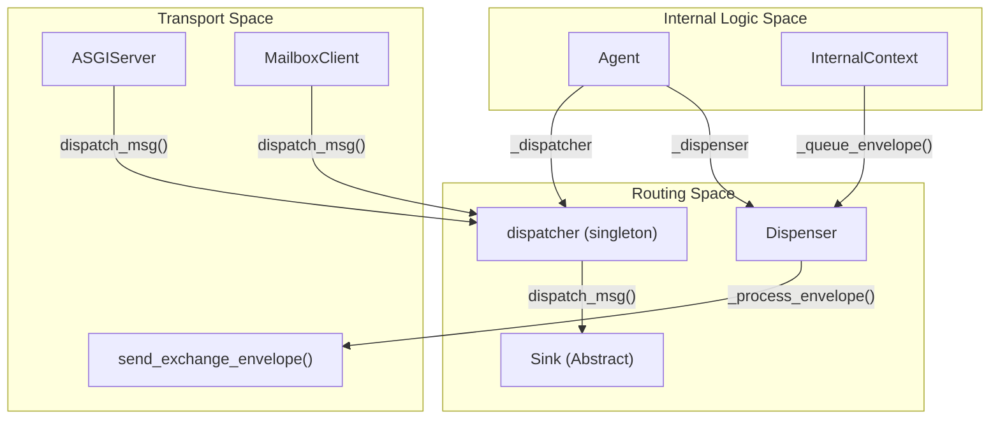
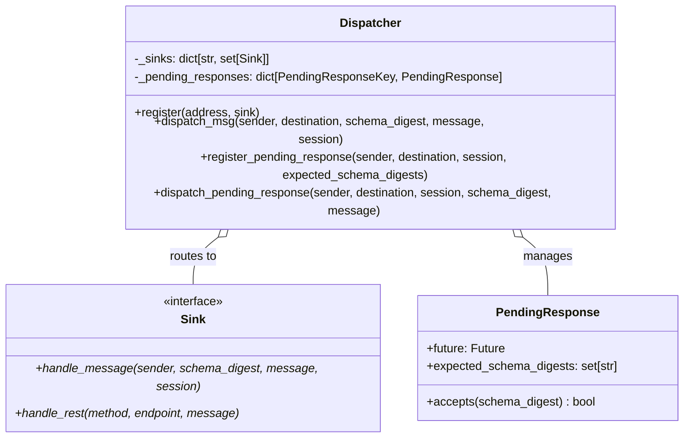
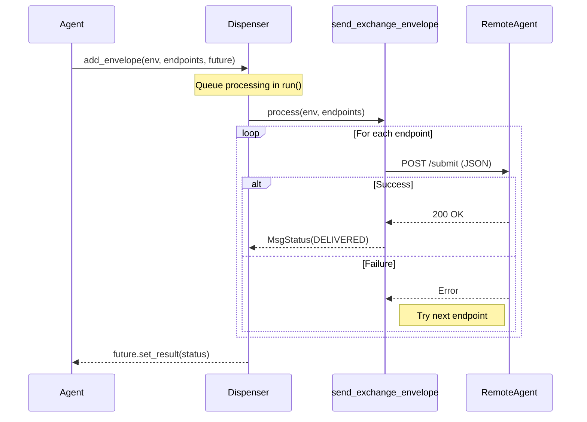
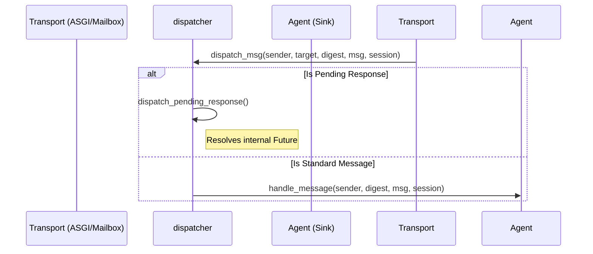

<!-- source: DeepWiki mcp.deepwiki.com · repo fetchai/uAgents · page 3.4 Dispenser and Dispatcher · fetched 2026-10-26 -->

# Dispenser and Dispatcher

<details>
<summary>Relevant source files</summary>

The following files were used as context for generating this wiki page:

- [python/docs/api/uagents/communication.md](python/docs/api/uagents/communication.md)
- [python/docs/api/uagents/dispatch.md](python/docs/api/uagents/dispatch.md)
- [python/docs/api/uagents/registration.md](python/docs/api/uagents/registration.md)
- [python/src/uagents/communication.py](python/src/uagents/communication.py)
- [python/src/uagents/dispatch.py](python/src/uagents/dispatch.py)

</details>


The `Dispenser` and `Dispatcher` classes are the core message routing and delivery mechanisms in the uAgents framework. The `Dispatcher` manages internal routing to registered agent handlers and tracks pending synchronous responses, while the `Dispenser` manages an asynchronous outbound queue for external message delivery.

## Architecture Overview

The message routing system bifurcates responsibilities between internal distribution and external transport. The `Dispatcher` acts as a central hub for incoming messages, while the `Dispenser` handles the lifecycle of outbound HTTP requests.

### Message Routing System Architecture


Sources: [python/src/uagents/communication.py:25-101](), [python/src/uagents/dispatch.py:47-159](), [python/src/uagents/dispatch.py:29-45]()

## Dispenser: Outbound Message Queue

The `Dispenser` class manages outbound message delivery through an asynchronous queue system. It decouples the agent's execution logic from the network latency associated with HTTP transport.

### Dispenser Class Structure
```mermaid
classDiagram
    class Dispenser {
        -_envelopes: asyncio.Queue
        +add_envelope(envelope, endpoints, response_future, sync)
        -_process_envelope(env, endpoints, response_future, sync)
        +run()
    }
    
    class send_exchange_envelope {
        <<async function>>
        +send_exchange_envelope(envelope, endpoints, sync)
        +returns: MsgStatus | Envelope
    }
    
    Dispenser -->|"calls"| send_exchange_envelope : via _process_envelope
```

Sources: [python/src/uagents/communication.py:25-101](), [python/src/uagents/communication.py:127-199]()

The `Dispenser` maintains a queue [python/src/uagents/communication.py:29-31]() storing:
- `envelope`: The `Envelope` object containing the signed message.
- `endpoints`: A list of target URLs for delivery.
- `response_future`: An `asyncio.Future` used to signal completion back to the sender.
- `sync`: A boolean flag indicating if the HTTP connection should remain open for a synchronous response.

### Core Methods

| Method | Purpose | Implementation |
|--------|---------|----------------|
| `add_envelope()` | Non-blocking addition of an envelope to the internal queue. | [python/src/uagents/communication.py:33-49]() |
| `_process_envelope()` | Internal method that invokes `send_exchange_envelope` and resolves the associated future. | [python/src/uagents/communication.py:51-79]() |
| `run()` | The main loop that consumes the queue and handles graceful shutdown. | [python/src/uagents/communication.py:81-101]() |

### External Delivery
The `send_exchange_envelope` function [python/src/uagents/communication.py:127-199]() iterates through provided endpoints, attempting an HTTP POST. If `sync=True`, it includes the `x-uagents-connection: sync` header [python/src/uagents/communication.py:142-143]() and waits for a signed response envelope in the HTTP body [python/src/uagents/communication.py:155-167]().

## Dispatcher: Inbound Message Router

The `Dispatcher` class routes incoming messages to registered `Sink` handlers (typically `Agent` instances) and manages synchronous message response slots. A global `dispatcher` singleton [python/src/uagents/dispatch.py:159]() is used throughout the framework.

### Dispatcher Class Structure


Sources: [python/src/uagents/dispatch.py:15-159]()

### Routing and Registration
The `Dispatcher` maintains a mapping of agent addresses to `Sink` objects [python/src/uagents/dispatch.py:53](). 
- `register()`: Adds a `Sink` to the routing table [python/src/uagents/dispatch.py:117-120]().
- `dispatch_msg()`: When a message arrives, the dispatcher first checks for a matching `PendingResponse` [python/src/uagents/dispatch.py:141-144](). If none exists, it broadcasts the message to all registered sinks for that destination [python/src/uagents/dispatch.py:145-146]().

### Synchronous Response Management
Synchronous communication (where an agent waits for a specific reply) is handled via `PendingResponse` objects [python/src/uagents/dispatch.py:15-27]().
1. **Registration**: `register_pending_response()` creates a future keyed by `(sender, destination, session)` [python/src/uagents/dispatch.py:64-75]().
2. **Filtering**: `PendingResponse.accepts()` ensures the incoming message matches the expected `schema_digest` [python/src/uagents/dispatch.py:20-26]().
3. **Resolution**: `dispatch_pending_response()` finds the future, sets the result, and returns `True` to stop further routing [python/src/uagents/dispatch.py:100-115]().

## Message Flow Patterns

### Outbound Message Sequence


Sources: [python/src/uagents/communication.py:51-79](), [python/src/uagents/communication.py:127-199]()

### Inbound Message Sequence


Sources: [python/src/uagents/dispatch.py:133-146](), [python/src/uagents/dispatch.py:100-115]()

## Utility Functions

The `communication.py` module provides high-level utilities that abstract the Dispenser/Dispatcher interaction:

| Function | Purpose | Implementation |
|----------|---------|----------------|
| `send_message()` | High-level wrapper to send a `Model` to a destination. | [python/src/uagents/communication.py:303-340]() |
| `send_sync_message()` | Sends a message and waits for the response via the Dispatcher's pending response mechanism. | [python/src/uagents/communication.py:342-377]() |
| `dispatch_local_message()` | Optimizes communication when the sender and receiver are in the same process by bypassing network transport. | [python/src/uagents/communication.py:103-124]() |

Sources: [python/src/uagents/communication.py:103-377]()

---

