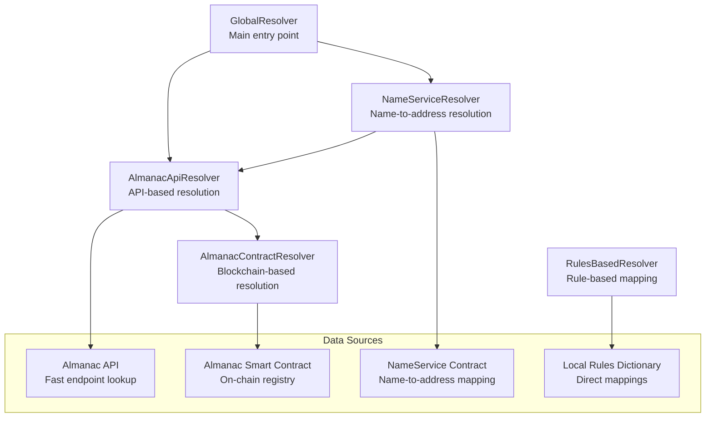
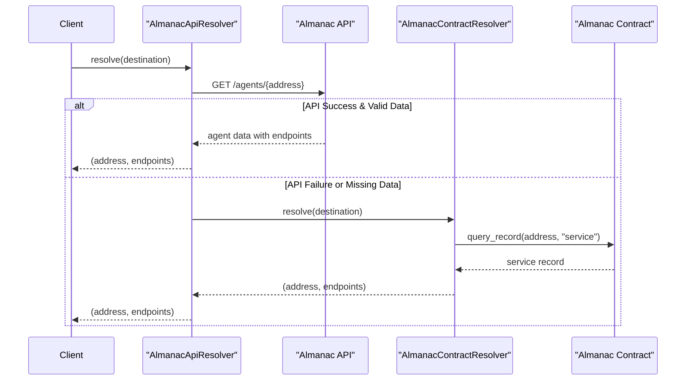
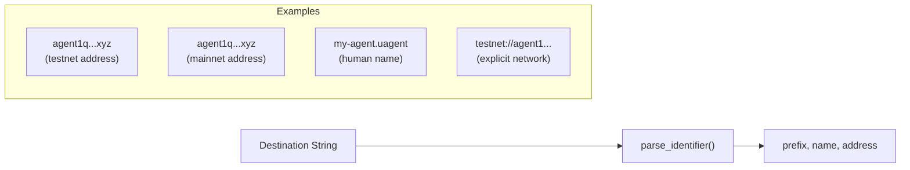
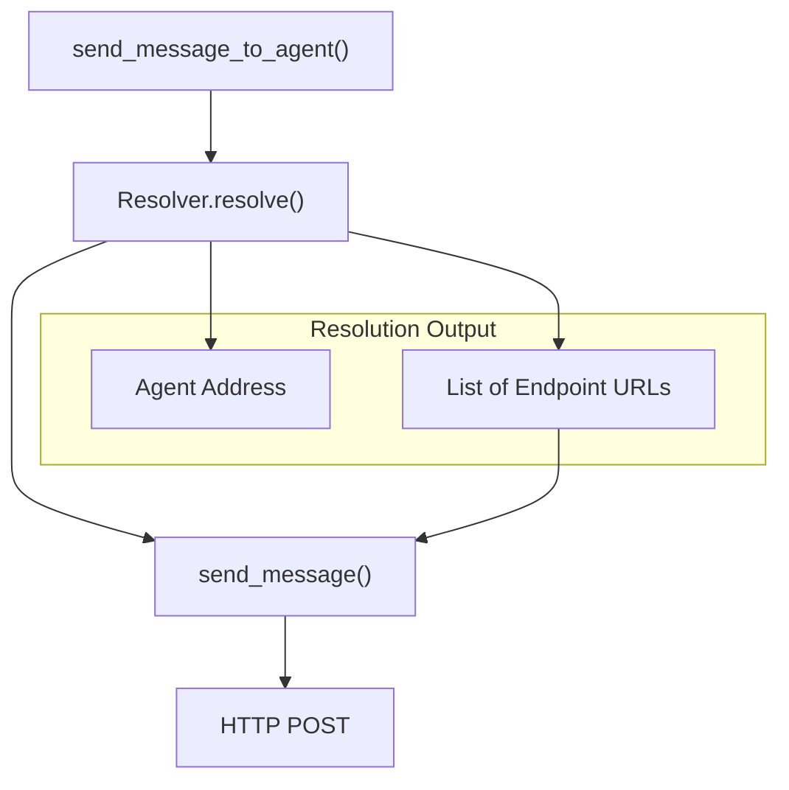

<!-- source: DeepWiki mcp.deepwiki.com · repo fetchai/uAgents · page 3.5 Address Resolution · fetched 2026-10-26 -->

# Address Resolution

Relevant source files

The following files were used as context for generating this wiki page:

- [python/docs/api/uagents/experimental/dialogues/__init__.md](python/docs/api/uagents/experimental/dialogues/__init__.md)
- [python/docs/api/uagents/resolver.md](python/docs/api/uagents/resolver.md)
- [python/src/uagents/resolver.py](python/src/uagents/resolver.py)
- [python/uagents-core/uagents_core/types.py](python/uagents-core/uagents_core/types.py)
- [python/uagents-core/uagents_core/utils/messages.py](python/uagents-core/uagents_core/utils/messages.py)
- [python/uagents-core/uagents_core/utils/resolver.py](python/uagents-core/uagents_core/utils/resolver.py)

Address resolution is the process of converting agent destinations (addresses or human-readable names) into network endpoints (URLs) where messages can be delivered. This system enables agents to communicate with each other by translating logical identifiers into concrete network locations.

For information about agent registration and discovery, see [Agent Registration](#4). For details about message envelope routing after resolution, see [Address Resolution](#3.5).

## Resolution Architecture

The address resolution system uses a hierarchical resolver pattern where different resolvers handle different types of destinations and data sources.

### Resolver Hierarchy

Sources: [python/src/uagents/resolver.py:160-482]()

## Core Resolver Classes

### GlobalResolver

The `GlobalResolver` serves as the main entry point for all address resolution requests. It determines which specialized resolver to use based on the destination format.

| Component | Function | Implementation |
|-----------|----------|----------------|
| Destination Parsing | Extracts prefix, name, and address components | `parse_identifier` from `uagents_core.identity` |
| Prefix Validation | Validates network prefixes (testnet/mainnet) | `is_valid_prefix` function |
| Resolver Routing | Routes to appropriate sub-resolver | Address vs name-based routing |

The resolver routing logic in `GlobalResolver.resolve` works as follows:
- If destination contains an address component → use `AlmanacApiResolver` [python/src/uagents/resolver.py:193-196]()
- If destination contains only a name component → use `NameServiceResolver` [python/src/uagents/resolver.py:194-196]()
- If destination has an invalid prefix → return `None, []` [python/src/uagents/resolver.py:198]()

Sources: [python/src/uagents/resolver.py:160-199](), [python/uagents-core/uagents_core/identity.py:1-100]()

### AlmanacApiResolver

The `AlmanacApiResolver` provides fast endpoint resolution using the Almanac API service with automatic fallback to blockchain queries via `AlmanacContractResolver`.

Sources: [python/src/uagents/resolver.py:256-342]()

### NameServiceResolver

The `NameServiceResolver` handles human-readable names by resolving them to agent addresses via the NameService contract, then resolving those addresses to endpoints using the `AlmanacApiResolver`.

The resolution process uses `weighted_random_sample` when multiple addresses are registered for a single name, allowing for load balancing and redundancy [python/src/uagents/resolver.py:106-115]().

Sources: [python/src/uagents/resolver.py:344-443]()

## Resolution Process Flow

### Address Format Parsing

Agent destinations follow a structured format parsed by `parse_identifier`. This determines the resolution strategy:

Sources: [python/src/uagents/resolver.py:190-196](), [python/uagents-core/uagents_core/identity.py:1-100]()

### Endpoint Selection Algorithm

When multiple endpoints are available for an agent, the system uses weighted random sampling to select endpoints:

| Parameter | Description | Source |
|-----------|-------------|---------|
| `endpoints` | List of endpoint URLs | API response or contract query |
| `weights` | Selection weights for each endpoint | Stored with endpoint data |
| `max_endpoints` | Maximum number of endpoints to return | Configuration parameter |

The `weighted_random_sample` function ensures fair distribution while respecting endpoint priorities [python/uagents-core/uagents_core/helpers.py:1-50]().

Sources: [python/src/uagents/resolver.py:307-317](), [python/uagents-core/uagents_core/utils/resolver.py:171-178]()

## Integration with Communication System

### Resolver Usage in Message Dispatch

The address resolution system integrates with the core messaging utilities through `send_message_to_agent`. This function takes an optional `Resolver` instance to find endpoints before calling `send_message`.

Sources: [python/uagents-core/uagents_core/utils/messages.py:183-260]()

### Contract Integration Functions

The resolver system provides utility functions for direct contract interaction:

| Function | Purpose | Implementation |
|----------|---------|------------|
| `query_record` | Query agent service records from Almanac contract | `contract.query` [python/src/uagents/resolver.py:70-90]() |
| `get_agent_address` | Resolve name to address via NameService contract | `weighted_random_sample` [python/src/uagents/resolver.py:93-116]() |
| `is_valid_prefix` | Check if a prefix is mainnet or testnet | `prefix in valid_prefixes` [python/src/uagents/resolver.py:56-67]() |

Sources: [python/src/uagents/resolver.py:56-116]()

## Configuration and Customization

### RulesBasedResolver

For development and testing scenarios, the `RulesBasedResolver` allows direct mapping of destinations to endpoints without external lookups. It stores rules in a dictionary where keys are destinations and values are either a single URL or a list of `AgentEndpoint` objects [python/src/uagents/resolver.py:445-456]().

Sources: [python/src/uagents/resolver.py:445-482]()

### Configuration Parameters

| Parameter | Default | Description |
|-----------|---------|-------------|
| `max_endpoints` | `DEFAULT_MAX_ENDPOINTS` | Maximum endpoints returned per resolution [python/src/uagents/config.py:16]() |
| `almanac_api_url` | `ALMANAC_API_URL` | Base URL for Almanac API service [python/src/uagents/config.py:15]() |
| Network prefixes | `TESTNET_PREFIX`, `MAINNET_PREFIX` | Valid address prefixes [python/src/uagents/config.py:17-18]() |

Sources: [python/src/uagents/resolver.py:14-24](), [python/src/uagents/config.py:1-50]()

---

