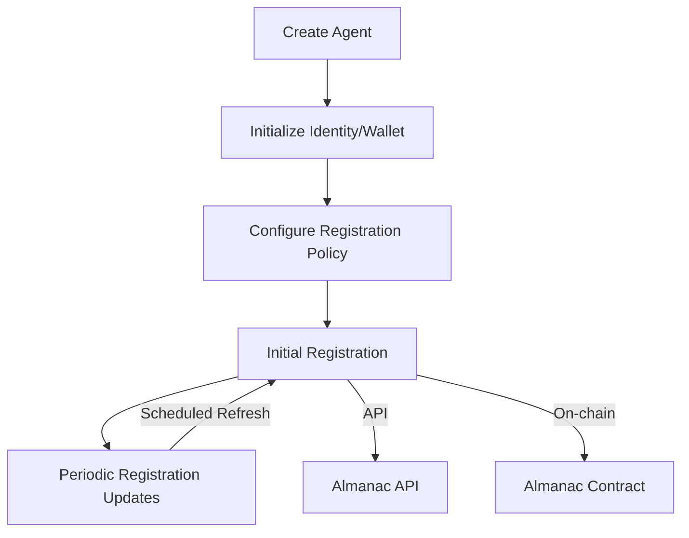
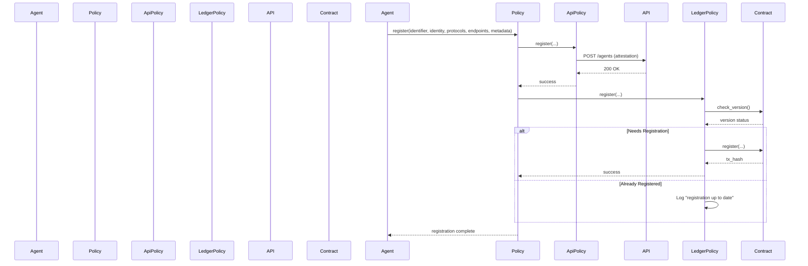

<!-- source: DeepWiki mcp.deepwiki.com · repo fetchai/uAgents · page 4 Agent Registration · fetched 2026-10-26 -->

# Agent Registration

<details>
<summary>Relevant source files</summary>

The following files were used as context for generating this wiki page:

- [python/docs/api/uagents/asgi.md](python/docs/api/uagents/asgi.md)
- [python/docs/api/uagents/types.md](python/docs/api/uagents/types.md)
- [python/src/uagents/config.py](python/src/uagents/config.py)
- [python/src/uagents/crypto/__init__.py](python/src/uagents/crypto/__init__.py)
- [python/src/uagents/network.py](python/src/uagents/network.py)
- [python/src/uagents/registration.py](python/src/uagents/registration.py)
- [python/src/uagents/types.py](python/src/uagents/types.py)
- [python/tests/test_flakey_network_registration.py](python/tests/test_flakey_network_registration.py)
- [python/tests/test_registration.py](python/tests/test_registration.py)

</details>


This page documents the agent registration system in the uAgents framework, which is how agents announce their presence, capabilities, and endpoints to enable discovery by other agents. For details about using registered agents, see [Address Resolution](#3.5).

## Overview

Agent registration in the uAgents framework allows agents to become discoverable within the agent ecosystem. When an agent registers, it publishes information about itself:

- Its unique identifier (address)
- The protocols it supports
- The endpoints where it can be reached
- Optional metadata like geolocation [registration.py:70-75]()

The registration process has two primary mechanisms:
1. **Almanac API Registration**: A centralized, quick registration method handled by `AlmanacApiRegistrationPolicy` [registration.py:109-167]().
2. **Almanac Contract Registration**: An on-chain, verifiable registration method handled by `LedgerBasedRegistrationPolicy` [registration.py:211-380]().

Agents typically register during initialization and periodically refresh their registration to maintain availability.



Sources: [registration.py:109-167](), [registration.py:211-380](), [config.py:28-31]()

## Registration System Architecture

The registration system is built around policies that define how an agent registers itself. These policies implement interfaces defined in `uagents-core`.

```mermaid
classDiagram
    class "AgentRegistrationPolicy" {
        <<interface>>
        +register(agent_identifier, identity, protocols, endpoints, metadata)* async
        +last_successful_registration: datetime
    }
    
    class "DefaultRegistrationPolicy" {
        -_api_policy: AlmanacApiRegistrationPolicy
        -_ledger_policy: LedgerBasedRegistrationPolicy
        +register(agent_identifier, identity, protocols, endpoints, metadata) async
    }
    
    class "AlmanacApiRegistrationPolicy" {
        -_almanac_api: str
        -_max_retries: int
        -_retry_delay: RetryDelayFunc
        +register(agent_identifier, identity, protocols, endpoints, metadata) async
    }
    
    class "LedgerBasedRegistrationPolicy" {
        -_wallet: LocalWallet
        -_ledger: LedgerClient
        -_almanac_contract: AlmanacContract
        -_testnet: bool
        -_registration_fee: int
        +register(agent_identifier, identity, protocols, endpoints, metadata) async
    }
    
    class "BatchRegistrationPolicy" {
        <<interface>>
        +add_agent(agent_info, identity)
        +register()* async
    }
    
    "AgentRegistrationPolicy" <|.. "DefaultRegistrationPolicy"
    "AgentRegistrationPolicy" <|.. "AlmanacApiRegistrationPolicy"
    "AgentRegistrationPolicy" <|.. "LedgerBasedRegistrationPolicy"
    
    "BatchRegistrationPolicy" <|.. "DefaultBatchRegistrationPolicy"
    
    "DefaultRegistrationPolicy" --> "AlmanacApiRegistrationPolicy"
    "DefaultRegistrationPolicy" --> "LedgerBasedRegistrationPolicy"
```

Sources: [registration.py:109-118](), [registration.py:211-220](), [registration.py:503-515](), [registration.py:578-585]()

## Registration Process

When an agent is created, it's configured with a registration policy (by default, `DefaultRegistrationPolicy`). The agent calls the `register` method, which delegates to the registration policy.



Sources: [registration.py:130-167](), [registration.py:283-356](), [registration.py:525-565](), [network.py:420-497]()

### API Registration

The API registration process creates an `AgentRegistrationAttestation` containing agent details, signs it with the agent's `Identity`, and sends it to the Almanac API via HTTP POST using `almanac_api_post` [registration.py:77-106]().

```python
# Simplified attestation creation in AlmanacApiRegistrationPolicy
attestation = AgentRegistrationAttestation(
    agent_identifier=agent_identifier,
    protocols=protocols,
    endpoints=endpoints,
    metadata=coerce_metadata_to_str(extract_geo_metadata(metadata)),
)
attestation.sign(identity)
```

For details, see [Registration Policies](#4.2).

Sources: [registration.py:139-156](), [registration.py:77-106]()

### Blockchain Registration

The blockchain registration process verifies if the agent needs registration or an update based on expiry height or protocol changes. If required, it signs a registration record using `sign_registration` [crypto/__init__.py:8-20]() and broadcasts a transaction to the `AlmanacContract` [network.py:420-497]().

For details, see [Almanac Contract](#4.1).

Sources: [registration.py:283-356](), [network.py:420-497](), [crypto/__init__.py:8-20]()

## Registration Data

The registration data includes:

| Field | Description |
|-------|-------------|
| `agent_identifier` | Full identifier (e.g., `agent://address`) [registration.py:140]() |
| `protocols` | List of protocol digests [registration.py:141]() |
| `endpoints` | List of `AgentEndpoint` objects (URL + weight) [registration.py:142]() |
| `metadata` | Optional metadata, often filtered for `geolocation` [registration.py:70-75]() |
| `signature` | Cryptographic signature verifying authenticity [registration.py:147]() |

Sources: [registration.py:139-148](), [network.py:100-114]()

## Registration Renewal

Agents refresh their registration to maintain availability. The default renewal interval is `REGISTRATION_UPDATE_INTERVAL_SECONDS` (3600 seconds) [config.py:28](). If a registration fails due to insufficient funds, the framework waits for a shorter interval based on `AVERAGE_BLOCK_INTERVAL` [config.py:30-31]().

Sources: [config.py:28-31](), [registration.py:333-345]()

## Batch Registration Policies

For registering multiple agents simultaneously, the framework provides batch registration policies such as `BatchAlmanacApiRegistrationPolicy` [registration.py:168-209]() and `BatchLedgerRegistrationPolicy` [registration.py:383-501](). These group multiple attestations or contract records into a single network call.

For details, see [Registration Policies](#4.2).

Sources: [registration.py:168-209](), [registration.py:383-501]()

## Error Handling and Retries

The registration system includes robust retry logic:
- **API Retries**: `almanac_api_post` uses `ALMANAC_API_MAX_RETRIES` (default 10) and exponential backoff [registration.py:86-105]().
- **Ledger Retries**: `LedgerBasedRegistrationPolicy` uses `broadcast_retries` and `poll_retries` to handle flakey network conditions [registration.py:222-233]().
- **Backoff**: Default exponential backoff is provided by `default_exp_backoff` [network.py:55-59]().

Sources: [registration.py:77-106](), [network.py:55-59](), [config.py:36-38]()

## Summary

Agent registration is a critical component that enables discovery. The system provides:
1. **Dual Registration**: Fast API-based and verifiable blockchain-based methods.
2. **Automatic Renewal**: Periodic refreshing of records.
3. **Fault Tolerance**: Retries and exponential backoff for network operations.
4. **Efficiency**: Batch policies for multi-agent environments.

For technical details on the underlying smart contract, see [Almanac Contract](#4.1). For details on configuring specific registration behaviors, see [Registration Policies](#4.2).

---

