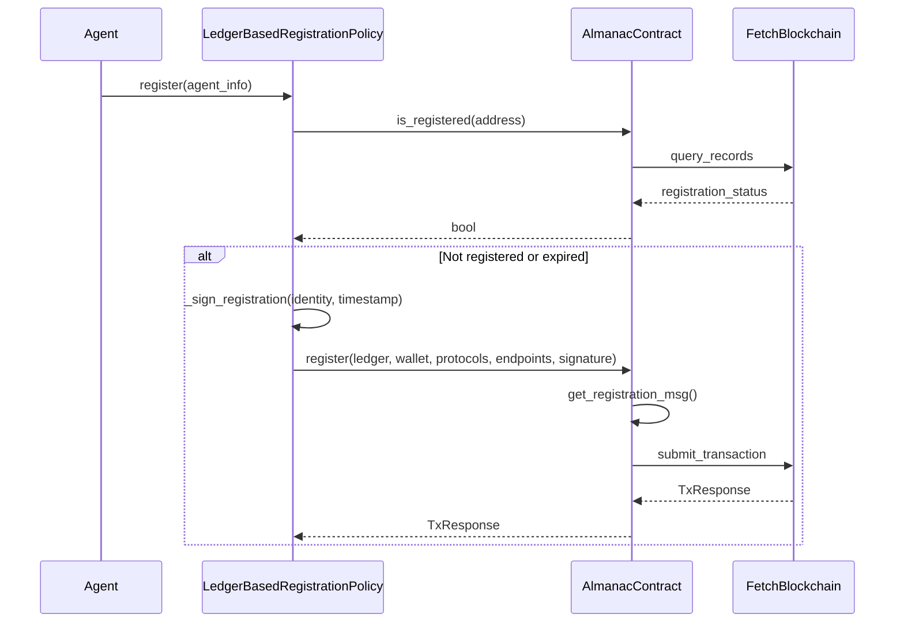

<!-- source: DeepWiki mcp.deepwiki.com · repo fetchai/uAgents · page 4.1 Almanac Contract · fetched 2026-10-26 -->

# Almanac Contract

<details>
<summary>Relevant source files</summary>

The following files were used as context for generating this wiki page:

- [python/docs/api/uagents/config.md](python/docs/api/uagents/config.md)
- [python/docs/api/uagents/crypto/__init__.md](python/docs/api/uagents/crypto/__init__.md)
- [python/docs/api/uagents/network.md](python/docs/api/uagents/network.md)
- [python/src/uagents/config.py](python/src/uagents/config.py)
- [python/src/uagents/crypto/__init__.py](python/src/uagents/crypto/__init__.py)
- [python/src/uagents/network.py](python/src/uagents/network.py)

</details>


The Almanac Contract is a smart contract deployed on the Fetch.ai blockchain that serves as a decentralized registry for agent registration and discovery. It provides persistent, on-chain storage of agent metadata including endpoints, protocols, and expiration times, enabling other agents to discover and communicate with registered agents across the network.

For information about registration policies that interact with this contract, see [Registration Policies](#4.2). For details about agent discovery and resolution, see [Address Resolution](#3.5).

## Contract Architecture

The Almanac Contract system consists of the smart contract itself and the `AlmanacContract` wrapper class that provides a Python interface for interacting with the contract.

```mermaid
graph TD
    subgraph "uAgents Python Library"
        [AlmanacContract] --> [LedgerContract]
        [NameServiceContract] --> [LedgerContract]
        [AlmanacContractRecord]
    end
    
    subgraph "Fetch.ai Blockchain"
        [Mainnet_Almanac]
        [Testnet_Almanac]
    end
    
    subgraph "Contract State"
        [AgentRecords]
        [ContractVersion]
        [RegistrationFees]
    end
    
    [AlmanacContract] --> [Mainnet_Almanac]
    [AlmanacContract] --> [Testnet_Almanac]
    
    [Mainnet_Almanac] --> [AgentRecords]
    [Mainnet_Almanac] --> [ContractVersion]
    [Mainnet_Almanac] --> [RegistrationFees]
```

Sources: [python/src/uagents/network.py:213-221](), [python/src/uagents/config.py:15-26]()

## AlmanacContract Class

The `AlmanacContract` class [python/src/uagents/network.py:213]() extends `LedgerContract` from the cosmpy library and provides methods for interacting with the Almanac smart contract. It handles both registration operations and query operations.

### Core Methods

| Method | Purpose | Return Type |
|--------|---------|-------------|
| `register()` [python/src/uagents/network.py:435]() | Register a single agent | `TxResponse` |
| `register_batch()` [python/src/uagents/network.py:537]() | Register multiple agents | `TxResponse` |
| `is_registered()` [python/src/uagents/network.py:294]() | Check if agent is registered | `bool` |
| `query_agent_record()` [python/src/uagents/network.py:339]() | Get agent's full registration record | `tuple[int, list[AgentEndpoint], list[str]]` |
| `get_registration_fee()` [python/src/uagents/network.py:268]() | Get current registration fee | `int` |
| `check_version()` [python/src/uagents/network.py:222]() | Verify contract version compatibility | `bool` |

Sources: [python/src/uagents/network.py:213-636]()

### Contract Configuration

The system supports both mainnet and testnet deployments with different contract addresses:

```python
# Contract addresses from config
MAINNET_CONTRACT_ALMANAC = "fetch1mezzhfj7qgveewzwzdk6lz5sae4dunpmmsjr9u7z0tpmdsae8zmquq3y0y"
TESTNET_CONTRACT_ALMANAC = "fetch1tjagw8g8nn4cwuw00cf0m5tl4l6wfw9c0ue507fhx9e3yrsck8zs0l3q4w"
```

Sources: [python/src/uagents/config.py:15-20]()

## Agent Registration Process

The registration process involves creating a signed registration message and submitting it to the blockchain. The contract verifies the signature and stores the agent's information.



Sources: [python/src/uagents/network.py:435-536](), [python/src/uagents/crypto/__init__.py:8-20]()

### Registration Message Structure

The registration message sent to the contract has a specific structure defined in `get_registration_msg()` [python/src/uagents/network.py:413](). It includes the agent's protocols, endpoints, cryptographic signature, and sequence number (timestamp).

```python
{
    "register": {
        "record": {
            "service": {
                "protocols": protocols,
                "endpoints": endpoints,
            }
        },
        "signature": signature,
        "sequence": sequence,
        "agent_address": agent_address,
    }
}
```

Sources: [python/src/uagents/network.py:413-433]()

## Query Operations

The contract supports various query operations to retrieve agent information and contract state:

### Agent Record Queries

```mermaid
graph LR
    [QueryMethods]
    
    [QueryMethods] --> is_registered["is_registered(address)"]
    [QueryMethods] --> get_expiry["get_expiry(address)"]
    [QueryMethods] --> get_endpoints["get_endpoints(address)"]
    [QueryMethods] --> get_protocols["get_protocols(address)"]
    [QueryMethods] --> query_agent_record["query_agent_record(address)"]
    
    [QueryMethods] --> get_registration_fee["get_registration_fee(wallet)"]
    [QueryMethods] --> get_contract_version["get_contract_version()"]
    [QueryMethods] --> registration_needs_update["registration_needs_update()"]
```

Sources: [python/src/uagents/network.py:294-411]()

### Contract State Queries

The contract maintains state information accessible through queries:

| Query | Purpose |
|-------|---------|
| `query_contract_state` [python/src/uagents/network.py:234]() | Get contract configuration including stake amounts and expiry height. |
| `query_records` [python/src/uagents/network.py:339]() | Get agent registration record and height. |
| `get_contract_version` [python/src/uagents/network.py:256]() | Retrieve the deployed contract version. |

Sources: [python/src/uagents/network.py:233-293]()

## Batch Registration

The contract supports batch registration of multiple agents in a single transaction via `register_batch()` [python/src/uagents/network.py:537](). This is used by batch registration policies to reduce transaction costs.

### AlmanacContractRecord Class

The `AlmanacContractRecord` [python/src/uagents/network.py:100]() class represents an individual agent's data for batching. It includes a `sign()` method [python/src/uagents/network.py:106]() that uses `sign_registration` to generate the cryptographic proof required by the contract.

Sources: [python/src/uagents/network.py:100-114](), [python/src/uagents/network.py:537-636]()

## Version Compatibility

The contract includes version checking [python/src/uagents/network.py:222]() to ensure compatibility between the library and the deployed contract. It compares the major version of the deployed contract against `ALMANAC_CONTRACT_VERSION` [python/src/uagents/config.py:32]().

```python
def check_version(self) -> bool:
    deployed_version = self.get_contract_version()
    deployed_major_version = deployed_version.split(".")[0]
    supported_major_version = ALMANAC_CONTRACT_VERSION.split(".")[0]
    return supported_major_version == deployed_major_version
```

Sources: [python/src/uagents/network.py:222-232](), [python/src/uagents/config.py:32]()

## Network Configuration and Access

The system provides utility functions to access the appropriate contract instance based on the network via `get_almanac_contract()` [python/src/uagents/network.py:654]().

- **Mainnet**: `MAINNET_CONTRACT_ALMANAC` [python/src/uagents/config.py:15]()
- **Testnet**: `TESTNET_CONTRACT_ALMANAC` [python/src/uagents/config.py:18]()

Sources: [python/src/uagents/network.py:654-677](), [python/src/uagents/config.py:15-26]()

## Error Handling and Resilience

The contract operations include comprehensive error handling for network failures and blockchain-specific errors:

### Transaction Broadcasting

The `wait_for_tx_to_complete()` [python/src/uagents/network.py:174]() function handles polling the ledger for transaction status with exponential backoff using `block_polling_exp_backoff()` [python/src/uagents/network.py:62]().

### Common Exceptions

| Exception | When Raised |
|-----------|-------------|
| `InsufficientFundsError` [python/src/uagents/network.py:71]() | Wallet balance is less than the registration fee. |
| `BroadcastTimeoutError` [python/src/uagents/network.py:93]() | Transaction broadcast fails due to timeout. |
| `QueryTimeoutError` | Polling for transaction result exceeds retry limit. |

Sources: [python/src/uagents/network.py:55-98](), [python/src/uagents/network.py:174-210]()

---

