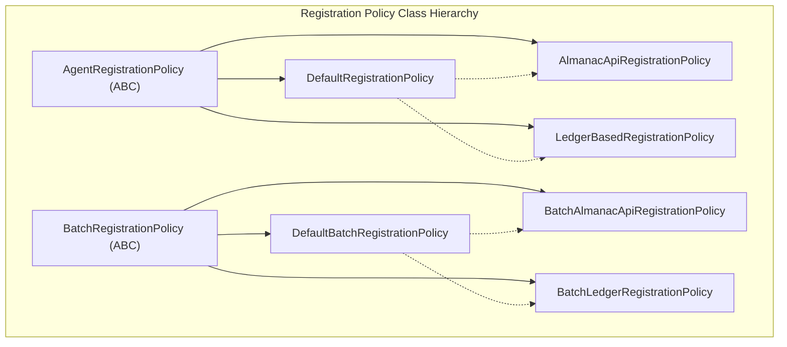
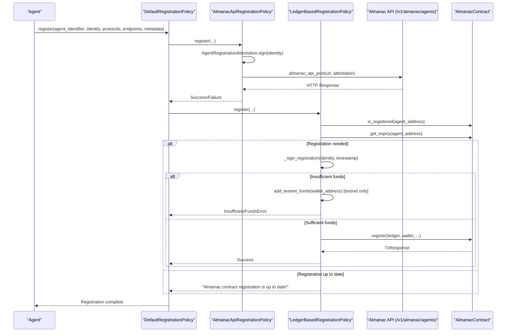
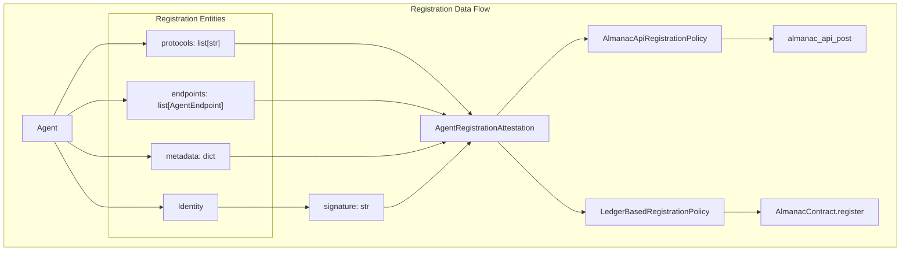
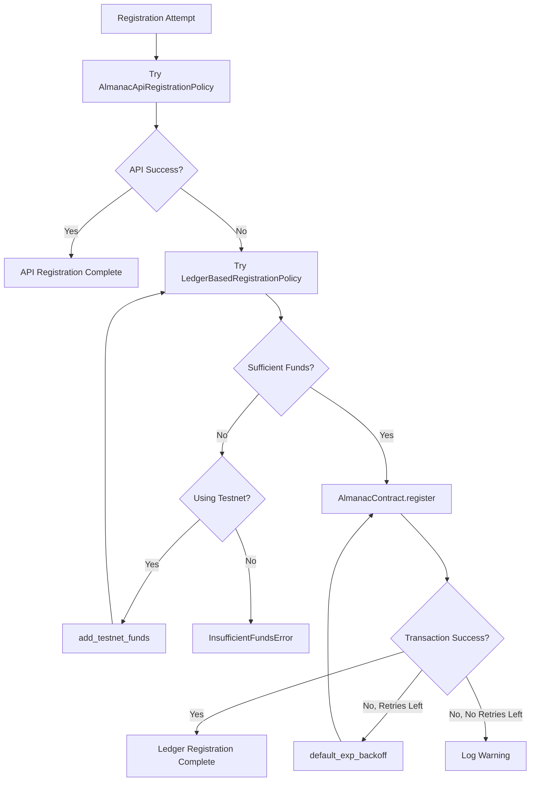

<!-- source: DeepWiki mcp.deepwiki.com · repo fetchai/uAgents · page 4.2 Registration Policies · fetched 2026-10-26 -->

# Registration Policies

<details>
<summary>Relevant source files</summary>

The following files were used as context for generating this wiki page:

- [.gitignore](.gitignore)
- [python/docs/api/uagents/asgi.md](python/docs/api/uagents/asgi.md)
- [python/docs/api/uagents/types.md](python/docs/api/uagents/types.md)
- [python/src/uagents/registration.py](python/src/uagents/registration.py)
- [python/src/uagents/types.py](python/src/uagents/types.py)
- [python/tests/test_flakey_network_registration.py](python/tests/test_flakey_network_registration.py)
- [python/tests/test_registration.py](python/tests/test_registration.py)
- [python/uagents-core/uagents_core/registration.py](python/uagents-core/uagents_core/registration.py)
- [python/uagents-core/uagents_core/utils/registration.py](python/uagents-core/uagents_core/utils/registration.py)

</details>


## Purpose and Scope

This document explains the registration policies in the uAgents framework, which define how agents register themselves with discovery services to make themselves discoverable by other agents. Registration is essential for agent communication as it allows agents to find each other by supported protocols and endpoints. For information about the Almanac Contract that stores registration data, see [Almanac Contract](#4.1).

## Registration Policy Overview

The uAgents framework supports two primary registration mechanisms:

1.  **API-based registration** - Fast registration with the Almanac API service.
2.  **Ledger-based registration** - Secure, verifiable registration on the blockchain via the Almanac smart contract.

The base interfaces for these policies are defined in `uagents-core` as `AgentRegistrationPolicy` and `BatchRegistrationPolicy` [python/uagents-core/uagents_core/registration.py:13-34]().

### Registration Policy Class Hierarchy



Sources: [python/src/uagents/registration.py:109-166](), [python/src/uagents/registration.py:221-380](), [python/src/uagents/registration.py:510-572](), [python/src/uagents/registration.py:168-218](), [python/src/uagents/registration.py:383-507](), [python/src/uagents/registration.py:585-639](), [python/uagents-core/uagents_core/registration.py:13-34]()

## Registration Policy Types

### Single Agent Registration Policies

1.  **AlmanacApiRegistrationPolicy**: Registers an agent with the Almanac API service for fast registration [python/src/uagents/registration.py:109-166]().
2.  **LedgerBasedRegistrationPolicy**: Registers an agent on-chain with the Almanac smart contract for secure, verifiable registration [python/src/uagents/registration.py:221-380]().
3.  **DefaultRegistrationPolicy**: Combines both API and Ledger approaches for optimal registration - attempting API first and then Ledger [python/src/uagents/registration.py:510-572]().

### Batch Registration Policies

1.  **BatchAlmanacApiRegistrationPolicy**: Registers multiple agents with the Almanac API in a single batch operation [python/src/uagents/registration.py:168-218]().
2.  **BatchLedgerRegistrationPolicy**: Registers multiple agents with the Almanac contract in a single blockchain transaction [python/src/uagents/registration.py:383-507]().
3.  **DefaultBatchRegistrationPolicy**: Combines both batch registration approaches [python/src/uagents/registration.py:585-639]().

## Registration Process

The registration process involves creating an attestation, signing it with the agent's identity, and submitting it to the chosen backend.



Sources: [python/src/uagents/registration.py:532-572](), [python/src/uagents/registration.py:283-356](), [python/src/uagents/registration.py:130-163](), [python/src/uagents/registration.py:77-106]()

## Registration Data

The framework uses the `AgentRegistrationAttestation` model to encapsulate registration data [python/uagents-core/uagents_core/registration.py:70-74](). This model inherits from `VerifiableModel`, which provides signing and verification capabilities [python/uagents-core/uagents_core/registration.py:37-67]().

| Data Element | Description | Code Entity |
|-------------|-------------|-------------|
| Agent Identifier | Fully qualified identifier (e.g., `agent://address`) | `agent_identifier` [python/uagents-core/uagents_core/registration.py:38]() |
| Protocols | List of protocol digests | `protocols` [python/uagents-core/uagents_core/registration.py:71]() |
| Endpoints | URLs and weights for agent access | `endpoints` [python/uagents-core/uagents_core/registration.py:72]() |
| Metadata | Optional data (e.g., geolocation) | `metadata` [python/uagents-core/uagents_core/registration.py:73]() |



Sources: [python/uagents-core/uagents_core/registration.py:70-74](), [python/src/uagents/registration.py:139-148](), [python/src/uagents/registration.py:317-340]()

## Registration Decision Process

For `LedgerBasedRegistrationPolicy`, an agent re-registers only if the existing record is missing, near expiry, or out of date [python/src/uagents/registration.py:300-306]():

```python
if (
    not self._almanac_contract.is_registered(agent_address)
    or self._almanac_contract.get_expiry(agent_address)
    < REGISTRATION_UPDATE_INTERVAL_SECONDS
    or endpoints != self._almanac_contract.get_endpoints(agent_address)
    or protocols != self._almanac_contract.get_protocols(agent_address)
):
    # Proceed with registration...
```

Sources: [python/src/uagents/registration.py:300-306]()

## Error Handling and Retry Mechanisms

Registration policies implement fault tolerance for network instability:

1.  **API Retries**: `almanac_api_post` uses configurable retries and exponential backoff [python/src/uagents/registration.py:77-106]().
2.  **Ledger Retries**: `LedgerBasedRegistrationPolicy` supports `broadcast_retries` and `poll_retries` for blockchain transactions [python/src/uagents/registration.py:226-231]().
3.  **Automatic Funding**: On testnet, policies can trigger `add_testnet_funds` if the wallet balance is insufficient for registration fees [python/src/uagents/registration.py:330-331]().



Sources: [python/src/uagents/registration.py:91-105](), [python/src/uagents/registration.py:330-335](), [python/src/uagents/network.py:38-40]()

## Batch Registration

Batch variants improve efficiency by grouping multiple agent updates into a single network call or transaction.

*   **BatchAlmanacApiRegistrationPolicy**: Collects `AgentRegistrationAttestation` objects and sends them to the API via `AgentRegistrationAttestationBatch` [python/src/uagents/registration.py:168-218]().
*   **BatchLedgerRegistrationPolicy**: Uses `AlmanacContract.register_batch` to perform a single multi-agent transaction on the ledger [python/src/uagents/registration.py:383-507]().

Sources: [python/src/uagents/registration.py:45-46](), [python/src/uagents/registration.py:202-205](), [python/src/uagents/registration.py:465-475]()

---

