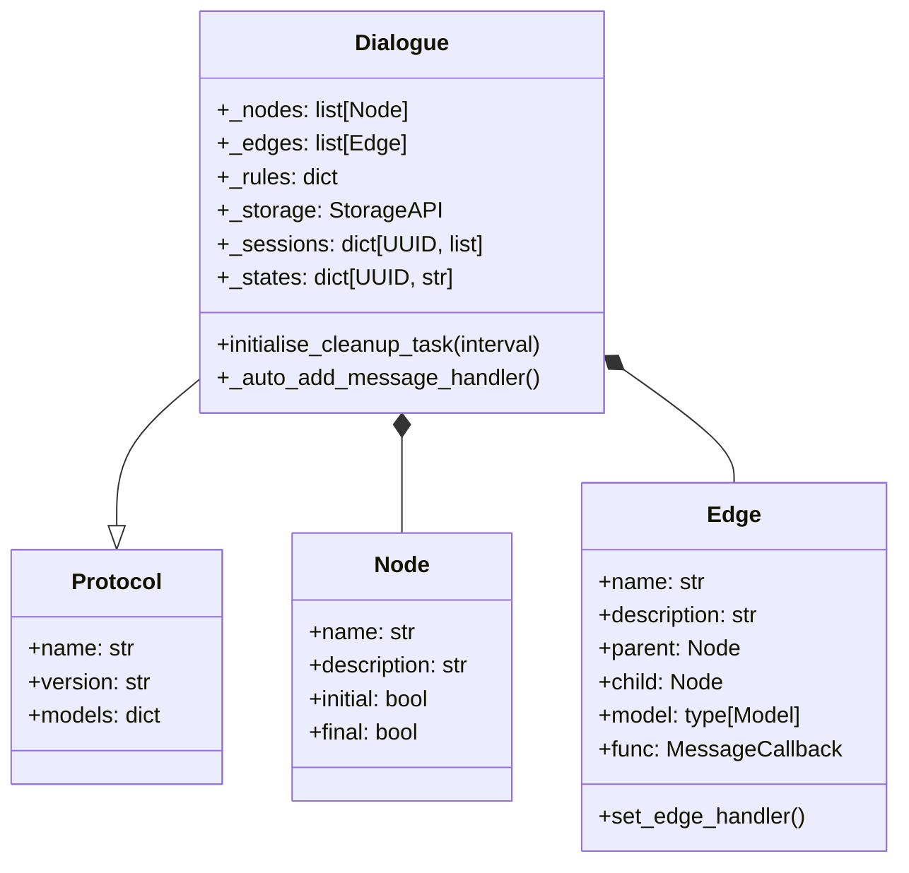
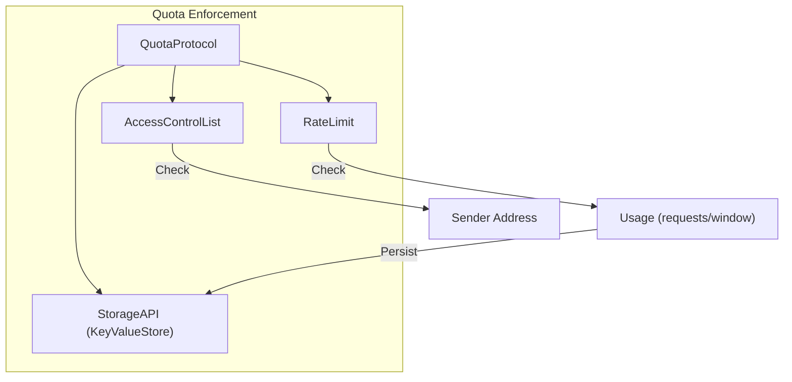

<!-- source: DeepWiki mcp.deepwiki.com · repo fetchai/uAgents · page 5 Advanced Features · fetched 2026-10-26 -->

# Advanced Features

Relevant source files

The following files were used as context for generating this wiki page:

- [python/docs/api/uagents/experimental/quota/__init__.md](python/docs/api/uagents/experimental/quota/__init__.md)
- [python/src/uagents/experimental/dialogues/__init__.py](python/src/uagents/experimental/dialogues/__init__.py)
- [python/src/uagents/experimental/quota/__init__.py](python/src/uagents/experimental/quota/__init__.py)
- [python/src/uagents/storage/__init__.py](python/src/uagents/storage/__init__.py)
- [python/tests/test_agent_registration.py](python/tests/test_agent_registration.py)

This page provides an overview of the advanced capabilities in the uAgents framework that extend the core functionality to address specialized use cases. These features build upon the basic agent messaging system described in [Core Components](#2) and [Communication](#3).

The advanced features include:
- **Dialogues** for stateful conversations.
- **Quota Protocol** for rate limiting and access control.
- **Wallet Messaging** for blockchain-enabled interactions.
- **Security Features** for enhanced communication protection.
- **Experimental Search and Mobility** for discovery and location awareness.

## Dialogues

The Dialogue system extends the standard `Protocol` class to enable stateful conversations between agents, enforcing predefined patterns of message exchanges. This is particularly useful for implementing multi-step interactions that follow a specific workflow.

A `Dialogue` defines a directed graph where:
- **Nodes** represent states in the conversation [python/src/uagents/experimental/dialogues/__init__.py:22-35]().
- **Edges** represent transitions between states triggered by messages [python/src/uagents/experimental/dialogues/__init__.py:37-52]().
- The system validates that each message follows the derived rules [python/src/uagents/experimental/dialogues/__init__.py:111-112]().
- Automatic session management tracks conversation state and history [python/src/uagents/experimental/dialogues/__init__.py:140-143]().

For details, see [Dialogues](#5.1).

Sources: [python/src/uagents/experimental/dialogues/__init__.py:22-195]()

## Quota Protocol

The `QuotaProtocol` provides rate limiting and access control for message handlers, protecting agents from abuse and controlling resource usage. It uses the agent's `StorageAPI` to persist usage data across sessions [python/src/uagents/experimental/quota/__init__.py:4-7]().

The `QuotaProtocol` serves two primary purposes:
1. **Rate Limiting**: Restricts the number of requests a sender can make in a given time window (e.g., `window_size_minutes`) [python/src/uagents/experimental/quota/__init__.py:94-97]().
2. **Access Control**: Controls which agents can access specific handlers using an `AccessControlList` (ACL) that supports `allowed`, `blocked`, and `bypass_rate_limit` sets [python/src/uagents/experimental/quota/__init__.py:99-104]().

For details, see [Quota Protocol](#5.2).

Sources: [python/src/uagents/experimental/quota/__init__.py:25-104](), [python/docs/api/uagents/experimental/quota/__init__.md:5-19]()

## Wallet Messaging

Wallet messaging enables agents to interact using blockchain identities and payment protocols. This includes support for sending messages that are tied to wallet addresses and integrating payment flows into agent interactions.

The framework supports:
- **Identity Verification**: Linking agent addresses to wallet addresses for authenticated interactions [python/tests/test_agent_registration.py:124-130]().
- **Payment Integration**: Handling transaction messages and verifying on-chain events.

For details, see [Wallet Messaging](#5.3).

Sources: [python/tests/test_agent_registration.py:124-160]()

## Security Features

The uAgents framework includes several cryptographic features to secure communications and verify agent identities.

### Cryptographic Capabilities
- **Message Signing**: All agent messages are cryptographically signed using the agent's `Identity` to ensure authenticity and integrity.
- **Registration Signing**: Agents sign registration messages for the `Almanac` contract using `sign_registration` to prove ownership of their identity [python/tests/test_agent_registration.py:125-130]().
- **Verification**: The `Identity.verify_digest` method is used to validate signatures against the sender's public key [python/tests/test_agent_registration.py:112-114]().

### Secure Storage
The `KeyValueStore` provides a mechanism for persisting sensitive data like private keys and session states [python/src/uagents/storage/__init__.py:34-52](). It manages `private_keys.json` to store `identity_key` and `wallet_key` securely for the agent [python/src/uagents/storage/__init__.py:113-128]().

For details, see [Security Features](#5.4).

Sources: [python/src/uagents/storage/__init__.py:34-150](), [python/tests/test_agent_registration.py:110-142]()

## Experimental Search and Mobility

The experimental features enable location-aware agents and advanced discovery mechanisms.

- **Search API**: Allows discovery of agents by proximity, protocol digest, or text-based search.
- **Mobility Protocols**: Provides standardized messages for location-aware agents, including check-in/check-out lifecycle events.

For details, see [Experimental Search and Mobility](#5.5).

Sources: [python/docs/api/uagents/experimental/mobility/__init__.md:1-44](), [python/docs/api/uagents/experimental/search/__init__.md:1-102]()

## Summary of Advanced Components

| Feature | Code Entity | Primary Role |
|---------|-------------|--------------|
| **Dialogues** | `Dialogue` | Manages stateful multi-message sessions [python/src/uagents/experimental/dialogues/__init__.py:103]() |
| **Rate Limiting** | `RateLimit` | Defines request quotas per time window [python/src/uagents/experimental/quota/__init__.py:94]() |
| **Access Control** | `AccessControlList` | Manages allow/block lists for agent addresses [python/src/uagents/experimental/quota/__init__.py:99]() |
| **Persistence** | `KeyValueStore` | Handles file-based JSON storage for agent state [python/src/uagents/storage/__init__.py:34]() |
| **Registration** | `AlmanacContract` | Manages on-chain registration and verification [python/tests/test_agent_registration.py:123]() |

Sources: [python/src/uagents/experimental/dialogues/__init__.py](), [python/src/uagents/experimental/quota/__init__.py](), [python/src/uagents/storage/__init__.py](), [python/tests/test_agent_registration.py]()

---

