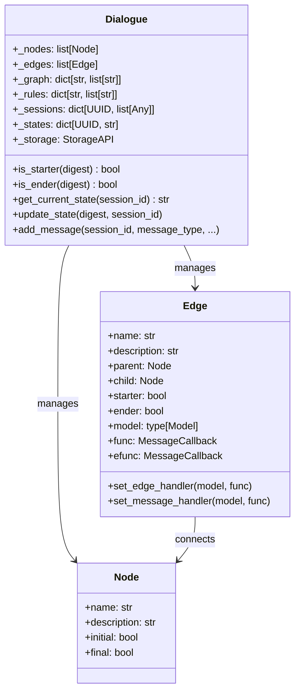
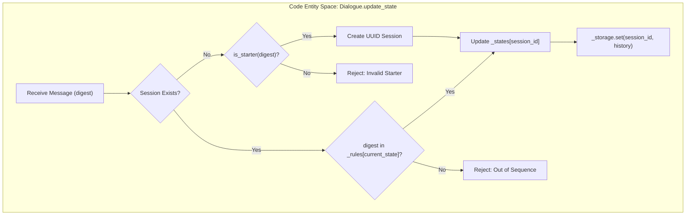
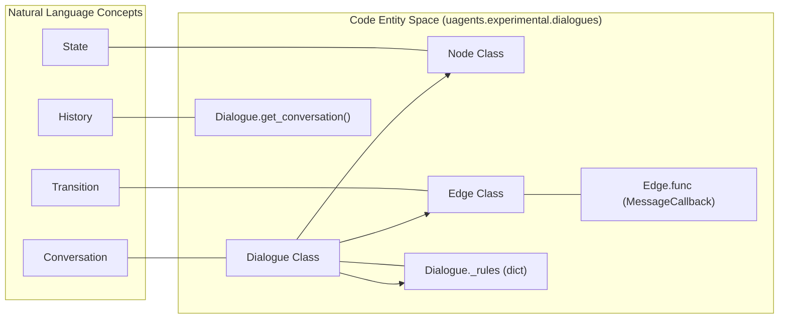

<!-- source: DeepWiki mcp.deepwiki.com · repo fetchai/uAgents · page 5.1 Dialogues · fetched 2026-10-26 -->

# Dialogues

<details>
<summary>Relevant source files</summary>

The following files were used as context for generating this wiki page:

- [python/docs/api/uagents/experimental/dialogues/__init__.md](python/docs/api/uagents/experimental/dialogues/__init__.md)
- [python/docs/api/uagents/resolver.md](python/docs/api/uagents/resolver.md)
- [python/src/uagents/experimental/dialogues/__init__.py](python/src/uagents/experimental/dialogues/__init__.py)
- [python/src/uagents/resolver.py](python/src/uagents/resolver.py)
- [python/src/uagents/storage/__init__.py](python/src/uagents/storage/__init__.py)
- [python/tests/test_agent_registration.py](python/tests/test_agent_registration.py)

</details>


## Purpose and Scope

The Dialogues system in uAgents provides a framework for creating stateful conversations between agents with structured message flows. It extends the basic Protocol system by adding state tracking, message sequence validation, and session management. This enables agents to engage in complex multi-step interactions while ensuring that messages arrive in the expected order and context.

For information about basic protocols without state management, see [Protocol System](2.3).

Sources: [python/src/uagents/experimental/dialogues/__init__.py:1-19](), [python/src/uagents/experimental/dialogues/__init__.py:103-146]().

## Core Components

The Dialogue system is built on three core components that work together to create stateful agent conversations:

### Node/Edge Graph Model

Dialogues are represented as a directed graph where `Node` objects are states and `Edge` objects are the transitions (messages) between them.



- **Node**: Represents a state in the dialogue. It can be marked as `initial` to indicate it is a valid entry point. [python/src/uagents/experimental/dialogues/__init__.py:22-35]().
- **Edge**: Represents a transition between states. It holds the logic for the transition, including the message `Model` and the `MessageCallback` handler. [python/src/uagents/experimental/dialogues/__init__.py:37-100]().
- **Dialogue**: The orchestrator that inherits from `Protocol`. it derives `_rules` from the graph to enforce message sequences. [python/src/uagents/experimental/dialogues/__init__.py:103-146]().

Sources: [python/src/uagents/experimental/dialogues/__init__.py:22-195](), [python/src/uagents/storage/__init__.py:10-31]().

## Session Management

Dialogues maintain session-based conversations, allowing multiple concurrent interactions with different agents. Each session is tracked via a unique `UUID`.

### Session Lifecycle

1.  **Initiation**: A session starts when a message matching a `starter` edge is received or sent via `start_dialogue`. [python/src/uagents/experimental/dialogues/__init__.py:638-683]().
2.  **State Tracking**: The `Dialogue` instance tracks the `_states` of all active sessions, mapped by their `UUID`. The state is represented by the schema digest of the last valid message. [python/src/uagents/experimental/dialogues/__init__.py:176-185]().
3.  **Persistence**: Sessions and their message histories are stored in `_storage` (implementing `StorageAPI`). By default, this uses `KeyValueStore` which persists to a JSON file. [python/src/uagents/experimental/dialogues/__init__.py:169-175](), [python/src/uagents/storage/__init__.py:34-67]().

### Message Validation and Flow

The dialogue enforces rules by checking if a received message's schema digest is a valid transition from the session's current state.



Sources: [python/src/uagents/experimental/dialogues/__init__.py:315-327](), [python/src/uagents/experimental/dialogues/__init__.py:427-442]().

## Cleanup and Timeouts

To prevent memory leaks and stale data, the `Dialogue` system implements an automated cleanup mechanism.

- **Timeout**: Defined by `DEFAULT_SESSION_TIMEOUT_IN_SECONDS` (60s) or passed during initialization. [python/src/uagents/experimental/dialogues/__init__.py:16-17](), [python/src/uagents/experimental/dialogues/__init__.py:152-169]().
- **Cleanup Task**: The `initialise_cleanup_task` method sets up a periodic background task (interval defined by `cleanup_interval`) that iterates through sessions and removes those exceeding the `_timeout`. [python/src/uagents/experimental/dialogues/__init__.py:684-716]().

Sources: [python/src/uagents/experimental/dialogues/__init__.py:684-716]().

## Implementation Detail: State Transitions

The system uses a internal decorator `_on_state_transition` to link message models to specific edges.

```python
# Internal registration mechanism
def _on_state_transition(self, edge_name: str, model: type[Model]):
    def decorator_on_state_transition(func: MessageCallback):
        @functools.wraps(func)
        async def wrapper(ctx: Context, sender: str, msg: Any):
            # 1. Validate sequence before execution
            # 2. Execute user handler (func)
            # 3. Update state in _states and _storage
            pass
        return wrapper
    return decorator_on_state_transition
```

When a dialogue is initialized, it calls `_auto_add_message_handler()` to register all handlers defined on its edges to the underlying `Protocol` structure. [python/src/uagents/experimental/dialogues/__init__.py:588-612](), [python/src/uagents/experimental/dialogues/__init__.py:718-735]().

## Natural Language to Code Mapping

The following diagram bridges the conceptual dialogue flow to the specific classes and methods in the codebase.



Sources: [python/src/uagents/experimental/dialogues/__init__.py:22-146](), [python/src/uagents/experimental/dialogues/__init__.py:478-503]().

---

