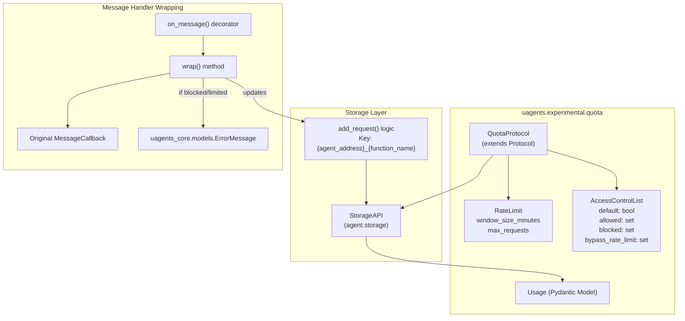
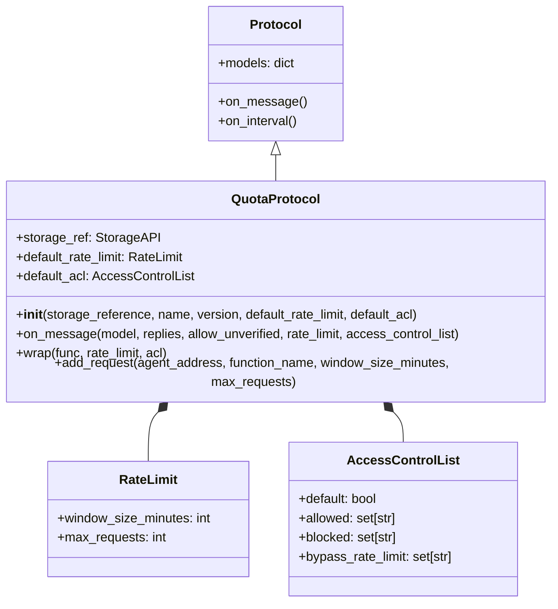
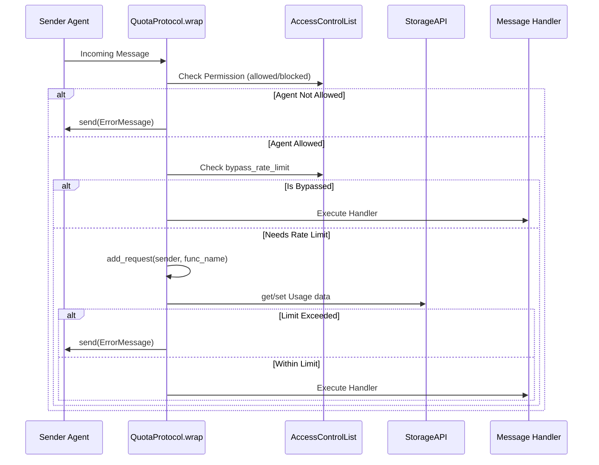

<!-- source: DeepWiki mcp.deepwiki.com · repo fetchai/uAgents · page 5.2 Quota Protocol · fetched 2026-10-26 -->

# Quota Protocol

<details>
<summary>Relevant source files</summary>

The following files were used as context for generating this wiki page:

- [python/docs/api/uagents/experimental/quota/__init__.md](python/docs/api/uagents/experimental/quota/__init__.md)
- [python/src/uagents/experimental/quota/__init__.py](python/src/uagents/experimental/quota/__init__.py)

</details>


The Quota Protocol provides rate limiting and access control capabilities for agent message handlers in the uAgents framework. It extends the standard `Protocol` class to enforce request quotas and manage agent access permissions, helping agents protect themselves from message flooding and unauthorized access.

For information about the core Protocol system that this extends, see [Protocol System](2.3). For general security features in uAgents, see [Security Features](5.4).

## Overview

The Quota Protocol implements two primary security mechanisms:

1.  **Rate Limiting**: Controls the number of requests an agent can make within a specified time window. [python/src/uagents/experimental/quota/__init__.py:4-7]()
2.  **Access Control**: Manages which agents are allowed or blocked from accessing message handlers. [python/src/uagents/experimental/quota/__init__.py:11-13]()

The system uses the agent's storage to persist rate limiting data and access control state across agent restarts. [python/src/uagents/experimental/quota/__init__.py:4-5]()

**Sources:** [python/src/uagents/experimental/quota/__init__.py:1-19](), [python/docs/api/uagents/experimental/quota/__init__.md:5-19]()

## Core Components

The following diagram maps the high-level Quota concepts to the specific classes and methods defined in the codebase.

"Quota Protocol Entity Map"


**Sources:** [python/src/uagents/experimental/quota/__init__.py:87-116](), [python/src/uagents/experimental/quota/__init__.py:134-162](), [python/src/uagents/experimental/quota/__init__.py:164-210]()

## QuotaProtocol Class Structure

The `QuotaProtocol` class inherits from the base `Protocol` class and overrides handler registration to inject quota logic.

"Quota Class Hierarchy"


**Sources:** [python/src/uagents/experimental/quota/__init__.py:94-132](), [python/src/uagents/experimental/quota/__init__.py:134-162](), [python/src/uagents/experimental/quota/__init__.py:232-240]()

## Usage Patterns

### Initialization and Basic Rate Limiting
To use the protocol, initialize `QuotaProtocol` with a reference to the agent's storage. [python/src/uagents/experimental/quota/__init__.py:25-30]()

```python
from uagents.experimental.quota import QuotaProtocol, RateLimit

quota_protocol = QuotaProtocol(
    storage_reference=agent.storage,
    name="quota_proto",
    version=agent._version,
    default_rate_limit=RateLimit(window_size_minutes=1, max_requests=3)
)

@quota_protocol.on_message(ExampleMessage)
async def handle(ctx: Context, sender: str, msg: ExampleMessage):
    # Handler automatically rate limited by default settings
    pass
```

### Access Control
The `AccessControlList` (ACL) can be used to explicitly allow or block agent addresses. [python/src/uagents/experimental/quota/__init__.py:45-51]()

```python
from uagents.experimental.quota import AccessControlList

# Block all by default, allow specific agents
acl = AccessControlList(default=False, allowed={"agent_address_123"})

@quota_protocol.on_message(
    ExampleMessage,
    access_control_list=acl
)
async def handle(ctx: Context, sender: str, msg: ExampleMessage):
    # Only allowed agents can access this handler
    pass
```

**Sources:** [python/src/uagents/experimental/quota/__init__.py:19-67](), [python/docs/api/uagents/experimental/quota/__init__.md:22-71]()

## Request Flow and Rate Limiting

When a message arrives, the wrapped handler performs sequential checks before executing the underlying logic.

"Quota Validation Flow"


**Sources:** [python/src/uagents/experimental/quota/__init__.py:188-210](), [python/src/uagents/experimental/quota/__init__.py:232-260]()

## Implementation Details

### Request Tracking
The `add_request` method manages the sliding window logic. It calculates the time window start and resets the request counter if the window has expired. [python/src/uagents/experimental/quota/__init__.py:232-260]()

1.  **Key Generation**: A unique key is generated for each agent and function pair: `{agent_address}_{function_name}`. [python/src/uagents/experimental/quota/__init__.py:241-241]()
2.  **Window Calculation**: If the current time exceeds `time_window_start + window_size`, a new window begins. [python/src/uagents/experimental/quota/__init__.py:251-255]()
3.  **Persistence**: The state is stored using the `Usage` model via `self.storage_ref.set()`. [python/src/uagents/experimental/quota/__init__.py:265-265]()

### Error Handling
If a request is blocked due to ACL or rate limits, the protocol sends a `uagents_core.models.ErrorMessage` back to the sender. [python/src/uagents/experimental/quota/__init__.py:192-195](), [python/src/uagents/experimental/quota/__init__.py:205-208]()

**Sources:** [python/src/uagents/experimental/quota/__init__.py:187-210](), [python/src/uagents/experimental/quota/__init__.py:232-270]()

---

