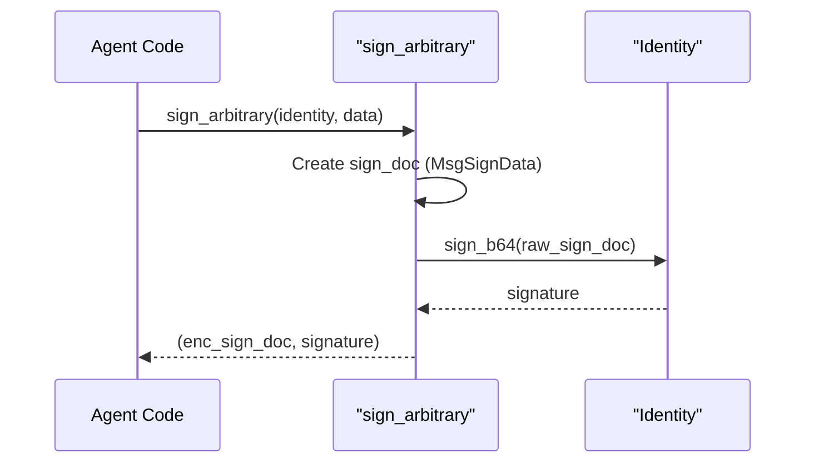
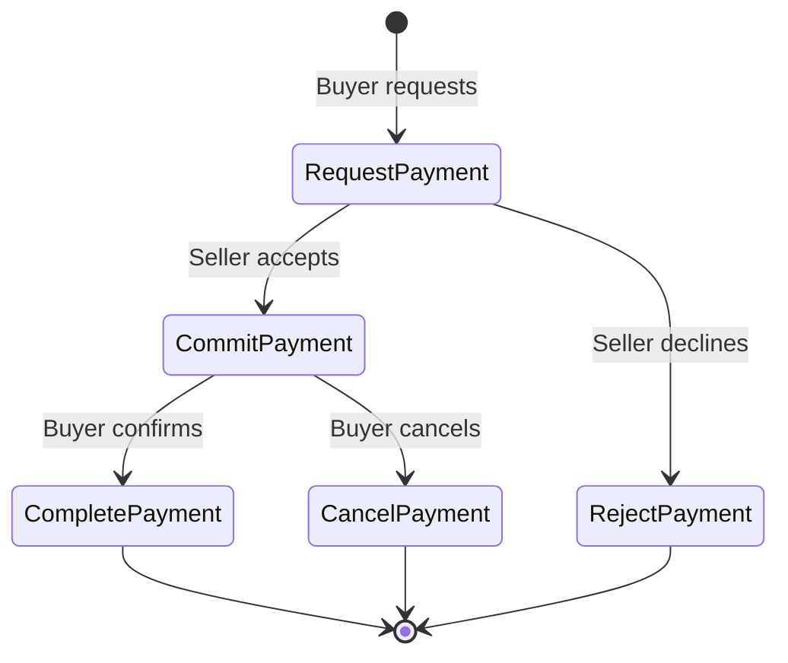
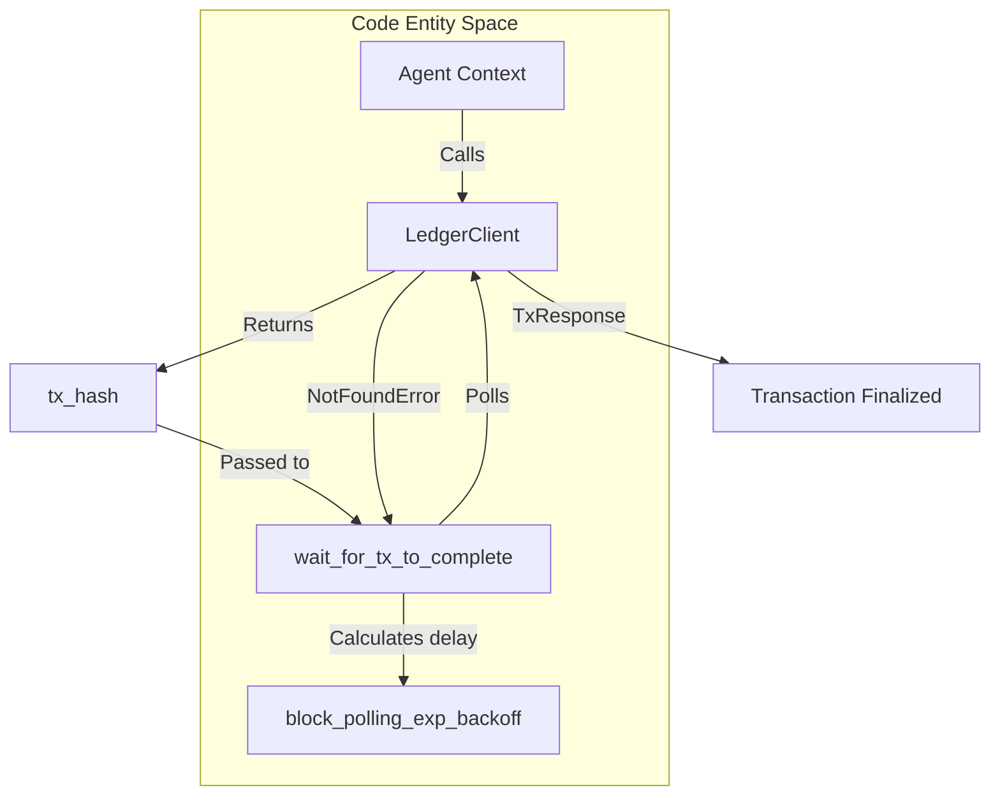

<!-- source: DeepWiki mcp.deepwiki.com · repo fetchai/uAgents · page 5.3 Wallet Messaging · fetched 2026-10-26 -->

# Wallet Messaging

Relevant source files

The following files were used as context for generating this wiki page:

- [python/src/uagents/config.py](python/src/uagents/config.py)
- [python/src/uagents/crypto/__init__.py](python/src/uagents/crypto/__init__.py)
- [python/src/uagents/network.py](python/src/uagents/network.py)
- [python/uagents-core/uagents_core/contrib/protocols/payment/__init__.py](python/uagents-core/uagents_core/contrib/protocols/payment/__init__.py)

## Introduction

Wallet messaging in the uAgents framework enables agents to perform blockchain-enabled interactions, specifically focusing on cryptographic data signing and standardized payment protocols. By leveraging the underlying ledger capabilities, agents can verify identities, sign arbitrary data for off-chain verification, and engage in structured financial exchanges using the `AgentPaymentProtocol`.

This system bridges the gap between agent communication and blockchain transactions, allowing agents to act as autonomous financial entities.

Sources: [python/src/uagents/network.py:1-41](), [python/uagents-core/uagents_core/contrib/protocols/payment/__init__.py:74-88]()

## Cryptographic Signing

Agents use their internal `Identity` to sign data, which is essential for registration and arbitrary message verification. The framework provides utilities to create signatures that are compatible with Cosmos-based ledgers.

### Arbitrary Data Signing
The `sign_arbitrary` function allows an agent to sign any byte data. It constructs a standard Cosmos `sign/MsgSignData` document, which includes the signer's address and the base64-encoded data.

### Almanac Registration Signing
For an agent to be discoverable, it must sign its registration details. The `sign_registration` function creates a SHA256 digest of the contract address, agent identity, timestamp, and wallet address before signing it.

Sources: [python/src/uagents/crypto/__init__.py:8-55](), [python/src/uagents/network.py:100-114]()

## Payment Protocol Integration

The `AgentPaymentProtocol` is a standardized `ProtocolSpecification` that defines how agents negotiate and execute payments. It uses a "Buyer" and "Seller" role model to manage the state machine of a financial transaction.

### Payment State Machine

### Protocol Components
The protocol is built on several `Model` classes that define the data schema for each step:

| Model | Role | Key Fields |
|-------|------|------------|
| `Funds` | Data | `amount`, `currency`, `payment_method` (default: `fet_direct`) |
| `RequestPayment` | Buyer | `accepted_funds`, `recipient`, `deadline_seconds` |
| `CommitPayment` | Seller | `funds`, `transaction_id`, `recipient` |
| `CompletePayment` | Buyer | `transaction_id` |

Sources: [python/uagents-core/uagents_core/contrib/protocols/payment/__init__.py:5-88]()

## Ledger Interaction

The `network.py` module provides the interface for agents to interact with the Fetch.ai ledger. This includes querying balances, broadcasting transactions, and waiting for transaction finality.

### Key Ledger Functions

- `get_ledger(network)`: Returns a `LedgerClient` for either `mainnet` or `testnet`. [python/src/uagents/network.py:116-127]()
- `wait_for_tx_to_complete(tx_hash, ledger)`: An asynchronous function that polls the ledger using exponential backoff (`block_polling_exp_backoff`) until a transaction is confirmed or a timeout is reached. [python/src/uagents/network.py:174-210]()
- `add_testnet_funds(wallet_address)`: Interfaces with the `FaucetApi` to request tokens for development on the testnet. [python/src/uagents/network.py:139-149]()

### Transaction Flow Logic

Sources: [python/src/uagents/network.py:62-69](), [python/src/uagents/network.py:116-127](), [python/src/uagents/network.py:174-210]()

## Configuration and Constants

Wallet messaging relies on specific configuration values defined in `config.py` to target the correct contracts and manage timing.

| Constant | Value / Purpose |
|----------|-----------------|
| `MAINNET_CONTRACT_ALMANAC` | The address for the production Almanac contract. |
| `TESTNET_REGISTRATION_FEE` | `500000000000000000` (0.5 FET) required for registration. |
| `AVERAGE_BLOCK_INTERVAL` | `6` seconds; used to calculate polling logic. |
| `DEFAULT_LEDGER_TX_WAIT_SECONDS` | `30` seconds; default timeout for ledger operations. |

Sources: [python/src/uagents/config.py:15-32]()

---

