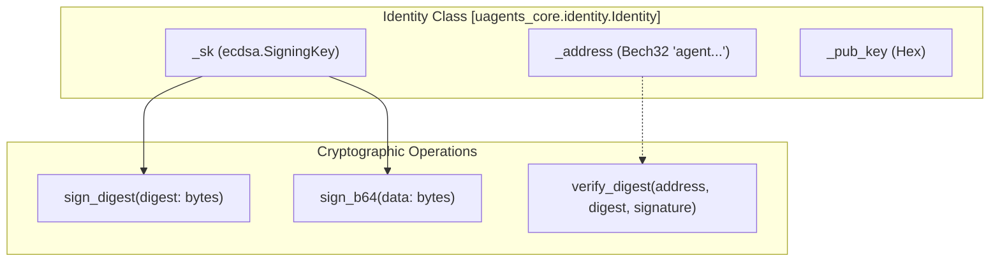
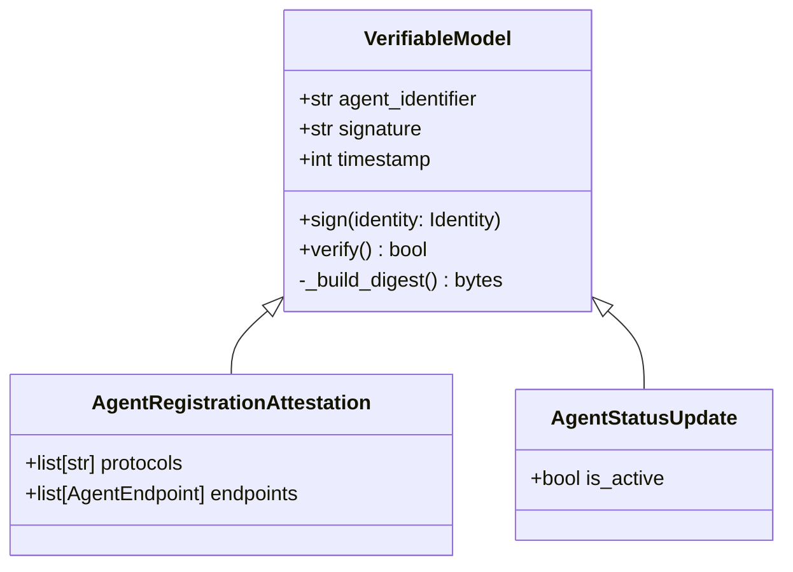
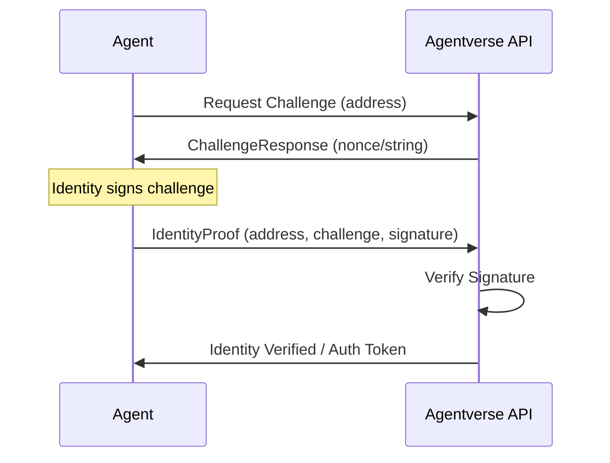

<!-- source: DeepWiki mcp.deepwiki.com · repo fetchai/uAgents · page 5.4 Security Features · fetched 2026-10-26 -->

# Security Features

Relevant source files

The following files were used as context for generating this wiki page:

- [.github/ISSUE_TEMPLATE/config.yml](.github/ISSUE_TEMPLATE/config.yml)
- [.github/PULL_REQUEST_TEMPLATE/release.md](.github/PULL_REQUEST_TEMPLATE/release.md)
- [.gitignore](.gitignore)
- [CITATION.cff](CITATION.cff)
- [SECURITY.md](SECURITY.md)
- [python/src/uagents/config.py](python/src/uagents/config.py)
- [python/src/uagents/crypto/__init__.py](python/src/uagents/crypto/__init__.py)
- [python/src/uagents/network.py](python/src/uagents/network.py)
- [python/uagents-core/uagents_core/identity.py](python/uagents-core/uagents_core/identity.py)
- [python/uagents-core/uagents_core/registration.py](python/uagents-core/uagents_core/registration.py)
- [python/uagents-core/uagents_core/utils/registration.py](python/uagents-core/uagents_core/utils/registration.py)

The uAgents framework implements a robust security architecture centered on cryptographic identities, verifiable data models, and challenge-response authentication. These mechanisms ensure that agent communication is authentic, tamper-proof, and that agent discovery via the Almanac is secure.

## Cryptographic Foundation

The security of every agent starts with its `Identity`. An identity is a SECP256k1 cryptographic keypair used to sign digests and verify signatures.

- **Key Derivation**: Identities can be deterministically generated from a seed phrase using `from_seed` [python/uagents-core/uagents_core/identity.py:91-99]().
- **Address Format**: Agent addresses are Bech32 encoded strings with the `agent` prefix, typically 65 characters long [python/uagents-core/uagents_core/identity.py:87-88](), [python/src/uagents/config.py:13]().
- **Verification**: The static method `verify_digest` allows any component to validate a signature against a specific agent address without possessing the private key [python/uagents-core/uagents_core/identity.py:150-164]().

Sources: [python/uagents-core/uagents_core/identity.py:78-164](), [python/src/uagents/config.py:8-13]()

## VerifiableModel Pattern

The `VerifiableModel` is a core Pydantic-based class used throughout the framework (especially in registration and attestation) to ensure data integrity.

### Data Flow: Signing and Verification
1. **Signing**: The `sign()` method captures the current `time.time()`, serializes the model (excluding the signature field) into a canonical JSON format, hashes it with SHA256, and signs the resulting digest using the agent's `Identity` [python/uagents-core/uagents_core/registration.py:44-47]().
2. **Canonicalization**: The `_build_digest()` method uses `sort_keys=True` and specific separators `(",", ":")` to ensure that the JSON representation is identical across different platforms before hashing [python/uagents-core/uagents_core/registration.py:57-66]().
3. **Verification**: The `verify()` method re-calculates the digest and uses `Identity.verify_digest` to check the signature against the `agent_identifier` [python/uagents-core/uagents_core/registration.py:49-55]().

Sources: [python/uagents-core/uagents_core/registration.py:37-67]()

## Challenge-Response Authentication

When registering with Agentverse services (like the Mailbox or Almanac API), agents must prove ownership of their address through a challenge-response flow. This prevents "squatting" or unauthorized updates to an agent's profile.

### Registration Flow

- **Challenge Generation**: The service provides a unique `challenge` string via `ChallengeResponse` [python/uagents-core/uagents_core/registration.py:164-165]().
- **Proof Submission**: The agent signs this string and returns an `IdentityProof` containing the `challenge_response` (the signature) [python/uagents-core/uagents_core/registration.py:168-176]().
- **Registration**: Once verified, the agent can submit an `AgentverseRegistrationRequest` including metadata, endpoints, and protocol digests [python/uagents-core/uagents_core/utils/registration.py:77-131]().

Sources: [python/uagents-core/uagents_core/registration.py:160-176](), [python/uagents-core/uagents_core/utils/registration.py:34-42]()

## Almanac Contract Security

Registration on the Fetch.ai blockchain (Almanac) requires a specific signature format to authorize the transaction.

### Almanac Signature
The `sign_registration` function in `uagents.crypto` creates a digest of length-prefixed values:
1. `contract_address`
2. `agent_address`
3. `timestamp`
4. `wallet_address` (the ledger account paying for the transaction)

This prevents "signature re-use" across different contracts or by different wallets [python/src/uagents/crypto/__init__.py:8-20](). The `AlmanacContractRecord` class uses this to prepare registration data [python/src/uagents/network.py:100-113]().

Sources: [python/src/uagents/crypto/__init__.py:8-20](), [python/src/uagents/network.py:100-113]()

## Wallet and Arbitrary Data Signing

Agents often need to sign data for external systems (e.g., Cosmos SDK chains). The `sign_arbitrary` function implements the `sign/MsgSignData` standard.

| Component | Description |
| :--- | :--- |
| **Sign Doc** | A JSON structure including `chain_id`, `account_number`, and `sequence` [python/src/uagents/crypto/__init__.py:27-30](). |
| **MsgSignData** | A specific message type containing the base64 encoded data to be signed [python/src/uagents/crypto/__init__.py:37-40](). |
| **Canonical JSON** | The document is serialized with sorted keys and no whitespace to ensure a stable hash [python/src/uagents/crypto/__init__.py:47-51](). |

Sources: [python/src/uagents/crypto/__init__.py:23-55]()

## Security Policy and Reporting

The framework maintains a strict security policy for vulnerability disclosure. Critical bugs (especially those involving loss of funds) should be reported privately to `security@fetch.ai` [SECURITY.md:5-13](). The Fetch team follows a structured disclosure policy including primary handlers and rapid patch releases to PyPI [SECURITY.md:21-28]().

Sources: [SECURITY.md:1-42]()

---

