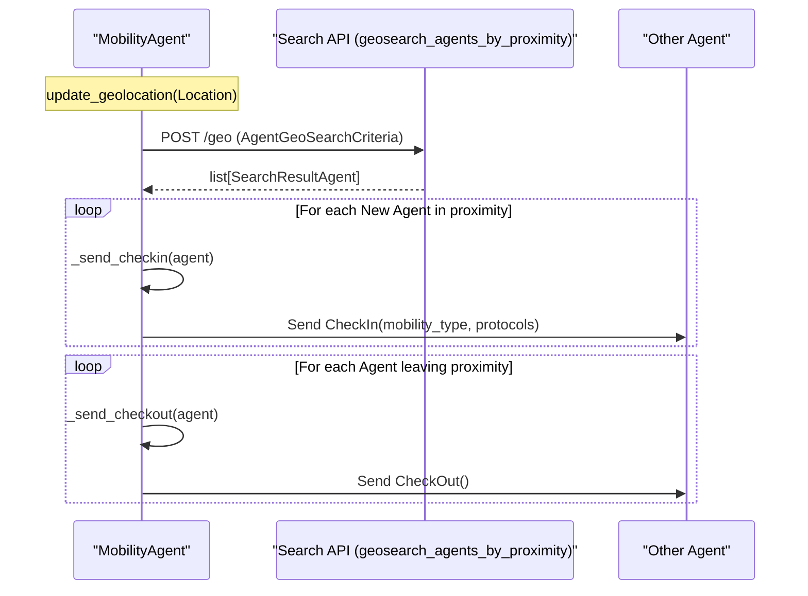
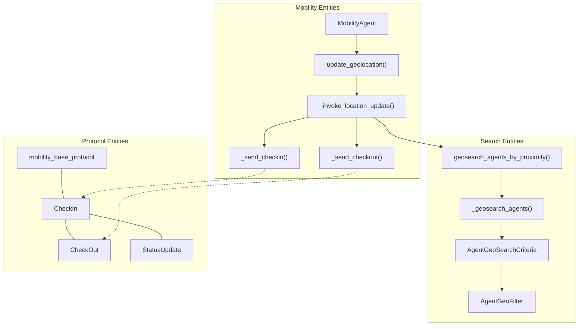

<!-- source: DeepWiki mcp.deepwiki.com · repo fetchai/uAgents · page 5.5 Experimental Search and Mobility · fetched 2026-10-26 -->

# Experimental Search and Mobility

Relevant source files

The following files were used as context for generating this wiki page:

- [python/docs/api/uagents/experimental/mobility/__init__.md](python/docs/api/uagents/experimental/mobility/__init__.md)
- [python/docs/api/uagents/experimental/mobility/protocols/base_protocol.md](python/docs/api/uagents/experimental/mobility/protocols/base_protocol.md)
- [python/docs/api/uagents/experimental/search/__init__.md](python/docs/api/uagents/experimental/search/__init__.md)
- [python/docs/api/uagents/mailbox.md](python/docs/api/uagents/mailbox.md)
- [python/src/uagents/experimental/mobility/__init__.py](python/src/uagents/experimental/mobility/__init__.py)
- [python/src/uagents/experimental/mobility/protocols/__init__.py](python/src/uagents/experimental/mobility/protocols/__init__.py)
- [python/src/uagents/experimental/mobility/protocols/base_protocol.py](python/src/uagents/experimental/mobility/protocols/base_protocol.py)
- [python/src/uagents/experimental/search/__init__.py](python/src/uagents/experimental/search/__init__.py)
- [python/src/uagents/mailbox.py](python/src/uagents/mailbox.py)
- [python/tests/test_config.py](python/tests/test_config.py)

This page documents the experimental capabilities for agent discovery and location-aware interactions within the uAgents framework. These features allow agents to be discovered via complex search criteria (proximity, protocol, or text) and facilitate dynamic interactions as agents move through physical or logical spaces.

## Experimental Search API

The search system provides a set of utilities to query the Agentverse Search API for agents based on their metadata, supported protocols, and geographical location.

### Search Criteria and Filtering

Discovery is driven by the `AgentSearchCriteria` and `AgentGeoSearchCriteria` models, which define how results are filtered and sorted.

*   **Filters**: Agents can be filtered by `StatusType` (active/inactive), `AgentType` (hosted, local, mailbox, etc.), and `AgentCategory` (fetch-ai, verified, community) [python/src/uagents/experimental/search/__init__.py:85-97]().
*   **Sorting**: Results can be ordered by relevancy, creation date, last modification, or interaction count [python/src/uagents/experimental/search/__init__.py:98-112]().
*   **Geo-Filtering**: The `AgentGeoFilter` defines a circular area using `latitude`, `longitude`, and `radius` in meters [python/src/uagents/experimental/search/__init__.py:125-137]().

### Key Discovery Functions

The following functions interface with the `SEARCH_API_URL` defined in the agent configuration [python/src/uagents/experimental/search/__init__.py:9]():

| Function | Description | Source |
| :--- | :--- | :--- |
| `geosearch_agents_by_proximity` | Returns active agents within a specific radius of coordinates. | [python/src/uagents/experimental/search/__init__.py:179-194]() |
| `geosearch_agents_by_protocol` | Returns agents within a radius that support a specific `protocol_digest`. | [python/src/uagents/experimental/search/__init__.py:197-219]() |
| `geosearch_agents_by_text` | Combines proximity search with natural language `search_text`. | [python/src/uagents/experimental/search/__init__.py:222-235]() |
| `search_agents_by_protocol` | Global search for agents implementing a specific protocol. | [python/src/uagents/experimental/search/__init__.py:238-252]() |
| `search_agents_by_text` | Global text-based search across agent names and readmes. | [python/src/uagents/experimental/search/__init__.py:254-265]() |

**Sources:** [python/src/uagents/experimental/search/__init__.py:85-265]()

## Mobility Protocols

Mobility features enable agents to react to changes in their geographical state and interact with other agents in their immediate vicinity.

### The MobilityAgent Class

The `MobilityAgent` extends the base `Agent` class to include location-aware state and automated handshake logic [python/src/uagents/experimental/mobility/__init__.py:26-33]().

*   **Internal State**: It maintains `_proximity_agents` (agents discovered nearby) and `_checkedin_agents` (agents that have initiated a handshake with this agent) [python/src/uagents/experimental/mobility/__init__.py:39-40]().
*   **Location Updates**: When `update_geolocation` is called, the agent triggers a new proximity search and manages the lifecycle of `CheckIn` and `CheckOut` messages [python/src/uagents/experimental/mobility/__init__.py:88-93]().

### Mobility Handshake Data Flow

The mobility system uses a "handshake" pattern to establish temporary relationships between moving agents (e.g., a vehicle) and stationary infrastructure (e.g., a traffic signal).

#### Mobility Discovery and Handshake Logic
This diagram illustrates how `MobilityAgent` methods translate into network messages via the `InternalContext`.

**Sources:** [python/src/uagents/experimental/mobility/__init__.py:88-141](), [python/src/uagents/experimental/search/__init__.py:145-160]()

### Handshake Models

The `basic-mobility-handshake` protocol [python/src/uagents/experimental/mobility/protocols/base_protocol.py:7-8]() defines the following models:

*   **CheckIn**: Sent by an agent entering a service area. Includes its `MobilityType` (e.g., `vehicle`, `pedestrian`) [python/src/uagents/experimental/mobility/protocols/base_protocol.py:29-36]().
*   **CheckInResponse**: Returned by the host agent. Contains a `signal` (e.g., "red" for a traffic light or "30" for a speed limit) [python/src/uagents/experimental/mobility/protocols/base_protocol.py:38-49]().
*   **StatusUpdate**: Sent by a host to all checked-in agents when its state changes (e.g., traffic light changing from green to red) [python/src/uagents/experimental/mobility/protocols/base_protocol.py:63-70]().

**Sources:** [python/src/uagents/experimental/mobility/protocols/base_protocol.py:1-79]()

## Implementation Mapping

The following diagram maps high-level mobility concepts to the specific code entities that implement them.

#### Code Entity Mapping: Search and Mobility

**Sources:** [python/src/uagents/experimental/mobility/__init__.py:26-141](), [python/src/uagents/experimental/search/__init__.py:138-194](), [python/src/uagents/experimental/mobility/protocols/base_protocol.py:29-78]()

### Summary of Mobility Types
Agents identify their physical nature using the `MobilityType` literal:
*   `traffic_signal` / `traffic_sign`
*   `speed_camera`
*   `vehicle`
*   `incident` (temporary situations)
*   `zone` (geofenced areas)

**Sources:** [python/src/uagents/experimental/mobility/protocols/base_protocol.py:18-26]()

---

