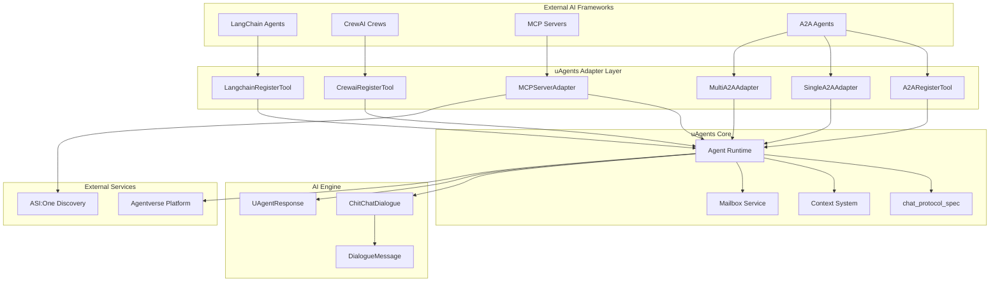
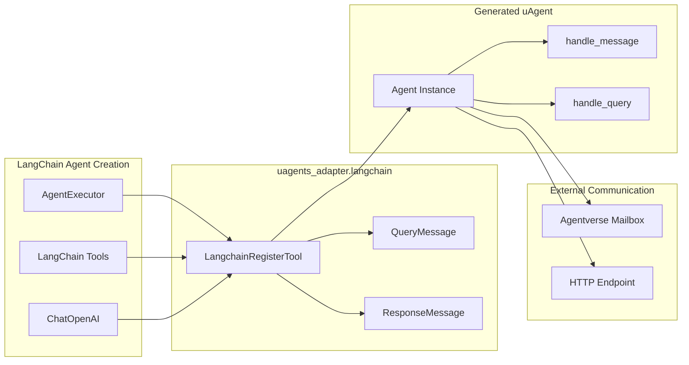
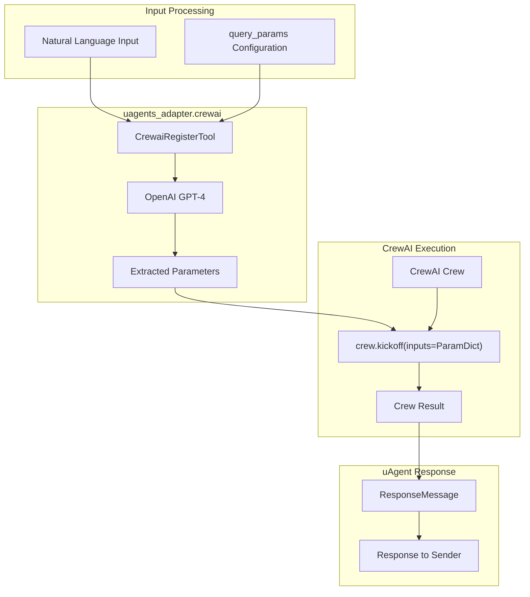
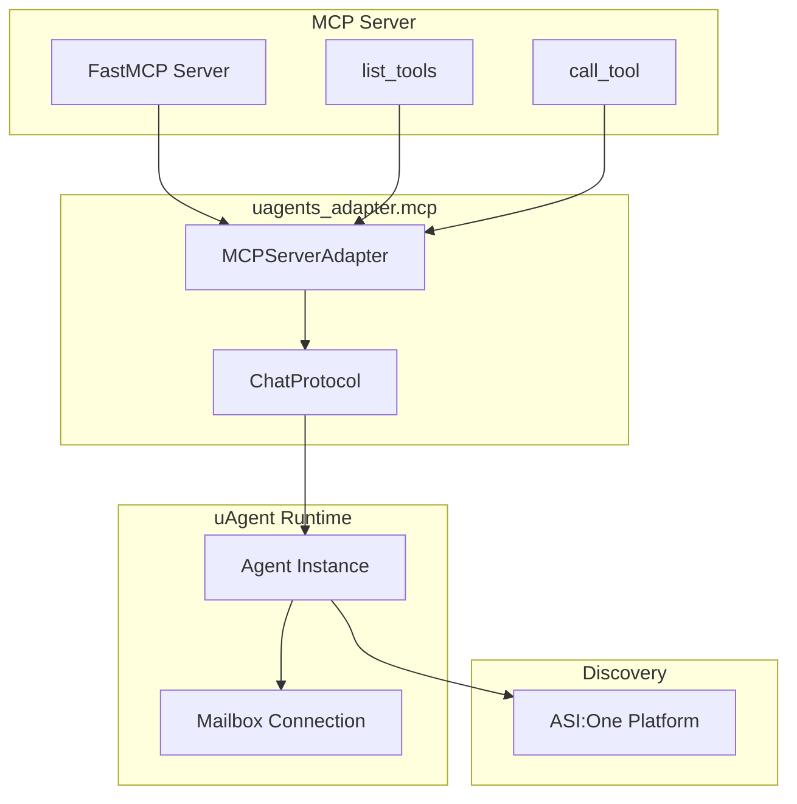
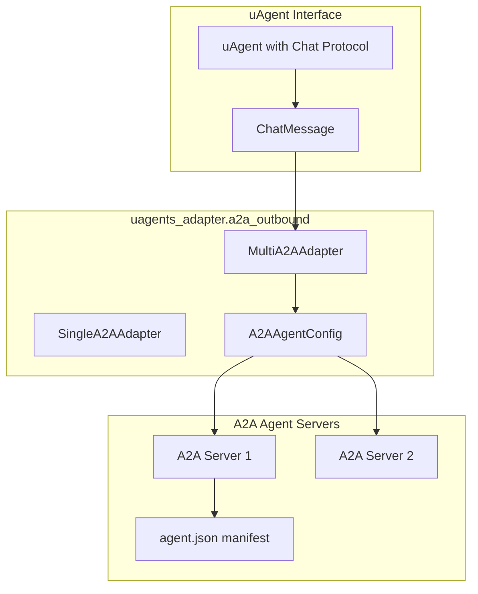
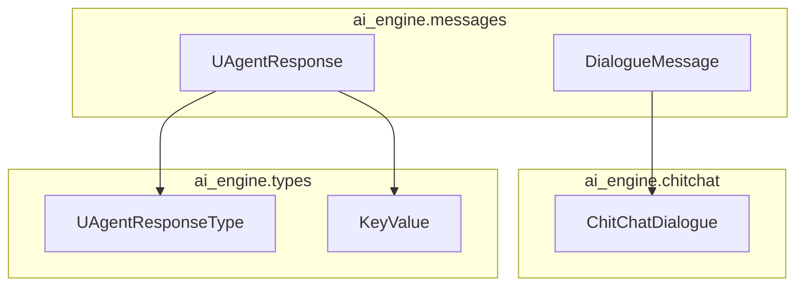

<!-- source: DeepWiki mcp.deepwiki.com · repo fetchai/uAgents · page 6 AI Integration · fetched 2026-10-26 -->

# AI Integration

Relevant source files

The following files were used as context for generating this wiki page:

- [python/uagents-adapter/README.md](python/uagents-adapter/README.md)
- [python/uagents-adapter/pyproject.toml](python/uagents-adapter/pyproject.toml)
- [python/uagents-ai-engine/pyproject.toml](python/uagents-ai-engine/pyproject.toml)

This document covers the AI integration capabilities of the uAgents framework, which enables seamless integration with popular AI frameworks and protocols. The integration supports bidirectional communication between uAgents and external AI systems through specialized adapters and protocol bridges.

The AI integration consists of three main packages: the `uagents-adapter` package for external AI framework integration, the `uagents-ai-engine` package for AI Engine dialogue management, and protocol bridges for cross-ecosystem communication. For core agent functionality, see [Agent Class](#2.1). For communication mechanisms, see [Communication](#3).

## Architecture Overview

The AI integration architecture consists of multiple adapter layers that bridge different AI ecosystems with the uAgents framework. Each adapter provides bidirectional translation between external AI frameworks and uAgent protocols.

**AI Integration Architecture**

Sources: [python/uagents-adapter/pyproject.toml:2-4](), [python/uagents-ai-engine/pyproject.toml:2-4]()

## AI Framework Adapters

### LangChain Integration

The `LangchainRegisterTool` converts LangChain agents into uAgents that can participate in the Agentverse ecosystem. The tool wraps LangChain agent executors with uAgent protocols and automatically handles message translation.

**LangChain Integration Flow**

The `LangchainRegisterTool` creates message handlers for both legacy queries and conversational chat protocols. It allows LangChain agents to use the Agentverse Mailbox service for communication behind firewalls.

For details, see [LangChain Integration](#6.1).

**Key Classes:**
- `LangchainRegisterTool` - Main registration tool for LangChain executors.
- `QueryMessage` - Simple query model for direct agent calls.
- `ResponseMessage` - Standardized response format for AI outputs.

Sources: [python/uagents-adapter/README.md:33-65]()

### CrewAI Integration

The `CrewaiRegisterTool` converts CrewAI crews into uAgents. It features dynamic Pydantic model generation from `query_params`, allowing crews to accept structured inputs while maintaining a conversational interface.

**CrewAI Parameter Extraction Flow**

The CrewAI adapter wraps the `crew.kickoff()` method and handles the mapping of natural language queries to the specific input parameters required by the CrewAI tasks.

For details, see [CrewAI Integration](#6.2).

Sources: [python/uagents-adapter/README.md:67-118]()

## MCP Integration

The Model Control Protocol (MCP) integration allows MCP servers to be hosted on Agentverse and discovered by the Fetch.ai ASI:One platform. The `MCPServerAdapter` exposes MCP tools as uAgent protocols.

**MCP Server Integration Architecture**

The MCP adapter automatically extracts tool definitions from the MCP server and registers them with the uAgent, enabling LLMs to intelligently select and invoke these tools.

For details, see [Chat Agent and MCP Adapter](#6.5).

Sources: [python/uagents-adapter/README.md:120-151]()

## A2A Protocol Bridges

### A2A Inbound and Outbound

The A2A (Agent-to-Agent) protocol bridge facilitates communication between uAgents and Google A2A servers. It supports inbound bridging (Agentverse to A2A) and outbound bridging (uAgents to A2A).

**A2A Outbound Multi-Agent Routing**

The `MultiA2AAdapter` provides routing logic to distribute queries across multiple specialized A2A servers based on their configured specialties.

For details, see [A2A Protocol Bridge](#6.3).

Sources: [python/uagents-adapter/README.md:153-195]()

## AI Engine Integration

The `uagents-ai-engine` package provides the necessary primitives for agents to communicate with the Fetch.ai AI Engine. This includes specialized message types for structured dialogue and options-based responses.

**AI Engine Message Flow**

The integration allows agents to participate in complex multi-turn dialogues orchestrated by the AI Engine, using types like `FINAL`, `SELECT_FROM_OPTIONS`, and `ERROR` to guide the conversation flow.

For details, see [AI Engine](#6.4).

Sources: [python/uagents-ai-engine/pyproject.toml:1-13]()

## Summary of Integration Packages

| Package | Purpose | Key Components |
|---------|---------|----------------|
| `uagents-adapter` | External Frameworks | `LangchainRegisterTool`, `CrewaiRegisterTool`, `MCPServerAdapter`, `SingleA2AAdapter` |
| `uagents-ai-engine` | AI Engine Dialogues | `ChitChatDialogue`, `UAgentResponse`, `DialogueMessage` |

Sources: [python/uagents-adapter/pyproject.toml:2-4](), [python/uagents-ai-engine/pyproject.toml:2-4]()

---

