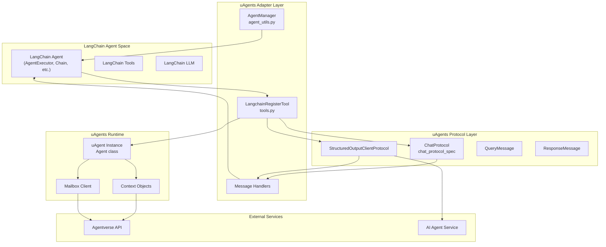
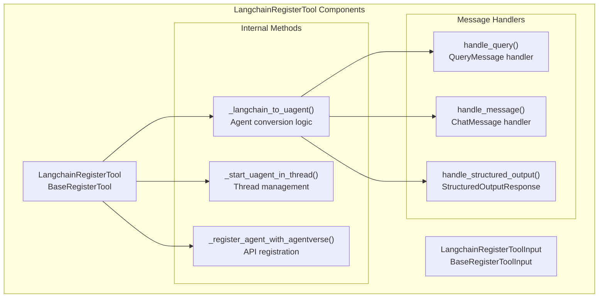
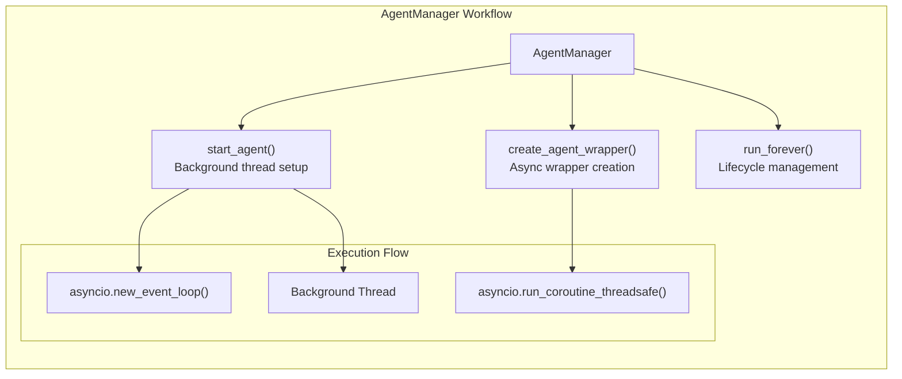
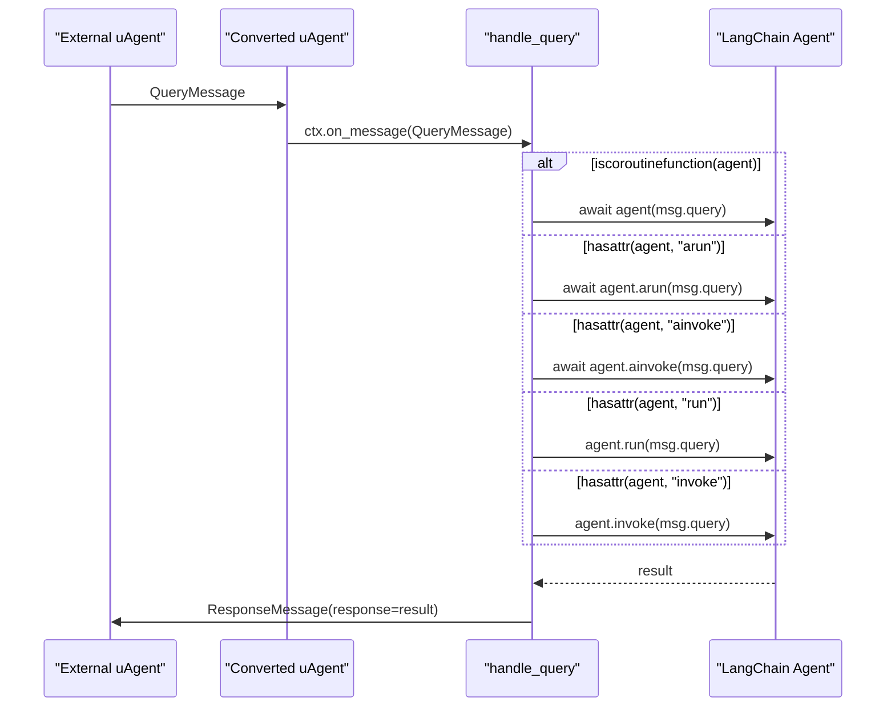
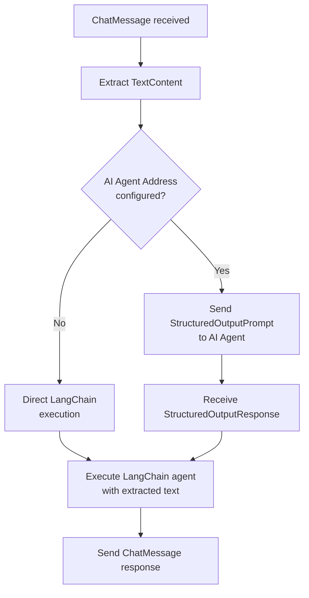
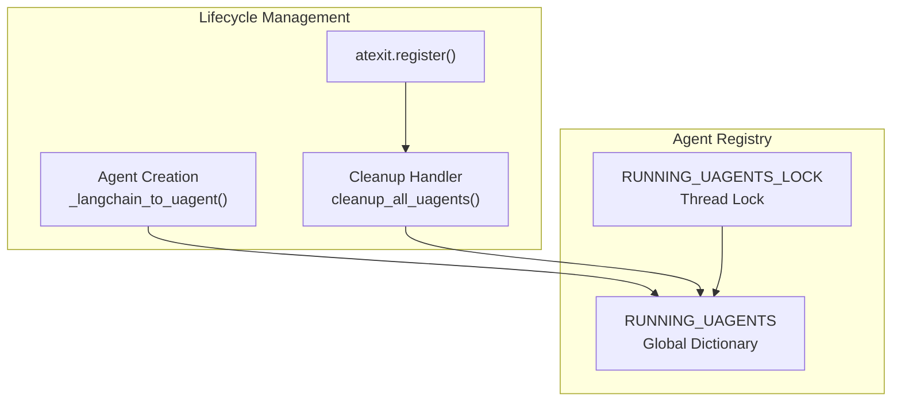

<!-- source: DeepWiki mcp.deepwiki.com · repo fetchai/uAgents · page 6.1 LangChain Integration · fetched 2026-10-26 -->

# LangChain Integration

Relevant source files

The following files were used as context for generating this wiki page:

- [python/uagents-adapter/.gitignore](python/uagents-adapter/.gitignore)
- [python/uagents-adapter/README.md](python/uagents-adapter/README.md)
- [python/uagents-adapter/pyproject.toml](python/uagents-adapter/pyproject.toml)
- [python/uagents-adapter/src/uagents_adapter/crewai/__init__.py](python/uagents-adapter/src/uagents_adapter/crewai/__init__.py)
- [python/uagents-adapter/src/uagents_adapter/langchain/__init__.py](python/uagents-adapter/src/uagents_adapter/langchain/__init__.py)
- [python/uagents-adapter/src/uagents_adapter/langchain/agent_utils.py](python/uagents-adapter/src/uagents_adapter/langchain/agent_utils.py)
- [python/uagents-adapter/src/uagents_adapter/langchain/tools.py](python/uagents-adapter/src/uagents_adapter/langchain/tools.py)

The LangChain Integration provides a bridge between LangChain agents and the uAgents ecosystem, enabling LangChain agents to participate in the Agentverse platform and communicate with other uAgents using standardized protocols. This integration transforms existing LangChain agents into fully functional uAgents while preserving their original functionality.

For information about other AI framework integrations, see [CrewAI Integration](6.2) and [A2A Protocol Bridge](6.3).

## Architecture Overview

The LangChain integration operates as an adapter layer that wraps LangChain agents within the uAgents framework, providing protocol compliance and Agentverse connectivity.

### System Components Diagram

**Sources**: [python/uagents-adapter/src/uagents_adapter/langchain/tools.py:1-664](), [python/uagents-adapter/src/uagents_adapter/langchain/__init__.py:1-21]()

## Core Components

### LangchainRegisterTool

The `LangchainRegisterTool` class [python/uagents-adapter/src/uagents_adapter/langchain/tools.py:75-82]() serves as the primary interface for converting LangChain agents into uAgents. It extends `BaseRegisterTool` and handles the complete transformation process.

Key responsibilities include:
- **Agent Wrapping**: Creates `Agent` instances that wrap LangChain agents with optional `mailbox` support [python/uagents-adapter/src/uagents_adapter/langchain/tools.py:116-129]().
- **Protocol Registration**: Registers `chat_proto` and `struct_output_client_proto` protocols [python/uagents-adapter/src/uagents_adapter/langchain/tools.py:61-64]().
- **Message Routing**: Routes messages between uAgents protocols and LangChain execution logic [python/uagents-adapter/src/uagents_adapter/langchain/tools.py:160-201]().
- **Agentverse Integration**: Handles automatic registration via `_register_agent_with_agentverse` [python/uagents-adapter/src/uagents_adapter/langchain/tools.py:429-524]().

**Sources**: [python/uagents-adapter/src/uagents_adapter/langchain/tools.py:67-83](), [python/uagents-adapter/src/uagents_adapter/langchain/tools.py:114-158]()

### Message Models and Protocols

The integration defines several `Model` classes to facilitate communication:

| Message Type | Purpose | Fields |
|--------------|---------|--------|
| `QueryMessage` | Direct agent queries (Legacy) | `query: str` |
| `StructuredOutputPrompt` | AI agent structured requests | `prompt: str`, `output_schema: dict` |
| `StructuredOutputResponse` | AI agent structured responses | `output: dict` |

**Sources**: [python/uagents-adapter/src/uagents_adapter/langchain/tools.py:47-58](), [python/uagents-adapter/src/uagents_adapter/langchain/tools.py:61-64]()

### AgentManager Utility

The `AgentManager` class [python/uagents-adapter/src/uagents_adapter/langchain/agent_utils.py:12-20]() provides utilities for handling async execution of LangChain agents in thread-safe environments.

**Sources**: [python/uagents-adapter/src/uagents_adapter/langchain/agent_utils.py:27-86]()

## Message Flow and Execution Patterns

### Direct Query Execution Flow

When a `QueryMessage` is received, the adapter attempts to invoke the LangChain object using various compatible methods:

**Sources**: [python/uagents-adapter/src/uagents_adapter/langchain/tools.py:160-201]()

### Chat Protocol Execution Flow

For conversational interactions, the system can route messages through an AI agent service for structured processing or process them directly if no `ai_agent_address` is provided.

**Sources**: [python/uagents-adapter/src/uagents_adapter/langchain/tools.py:236-325](), [python/uagents-adapter/src/uagents_adapter/langchain/tools.py:333-395]()

## Configuration and Deployment

### LangchainRegisterToolInput Schema

The `LangchainRegisterToolInput` [python/uagents-adapter/src/uagents_adapter/langchain/tools.py:67-73]() defines the parameters for agent conversion:

| Parameter | Type | Required | Description |
|-----------|------|----------|-------------|
| `agent_obj` | `Any` | Yes | LangChain agent instance (Executor/Chain) |
| `name` | `str` | Yes | Agent name |
| `port` | `int` | Yes | Agent port |
| `description` | `str` | Yes | Agent description |
| `api_token` | `str` | No | Agentverse API token |
| `ai_agent_address` | `str` | No | AI agent service address |
| `mailbox` | `bool` | No | Use mailbox vs endpoint (default: True) |

**Sources**: [python/uagents-adapter/src/uagents_adapter/langchain/tools.py:67-73](), [python/uagents-adapter/README.md:33-65]()

### Agent Lifecycle Management

The system maintains a global registry of running agents with cleanup mechanisms using `atexit`.

**Sources**: [python/uagents-adapter/src/uagents_adapter/langchain/tools.py:147-149](), [python/uagents-adapter/src/uagents_adapter/langchain/tools.py:97-101]()

## Agentverse Integration

### Registration and API Integration

When an `api_token` is provided, the system registers the converted agent with Agentverse via `_register_agent_with_agentverse` [python/uagents-adapter/src/uagents_adapter/langchain/tools.py:429-436]().

The registration process includes:
- **Mailbox Connection**: Establishing a secure communication channel [python/uagents-adapter/src/uagents_adapter/langchain/tools.py:462-477]().
- **README Generation**: Auto-generating documentation for the Agentverse profile, including the "innovationlab" badge [python/uagents-adapter/src/uagents_adapter/langchain/tools.py:484-501]().

**Sources**: [python/uagents-adapter/src/uagents_adapter/langchain/tools.py:429-524]()

---

