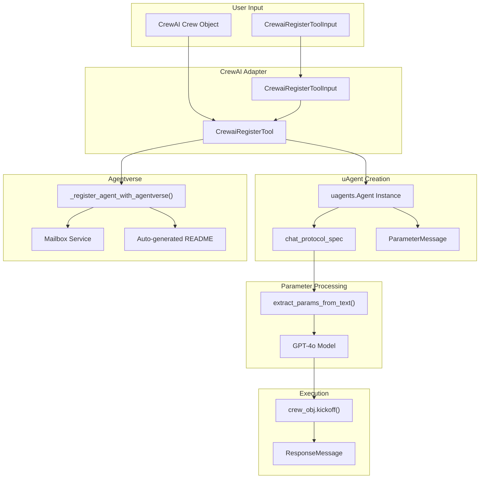
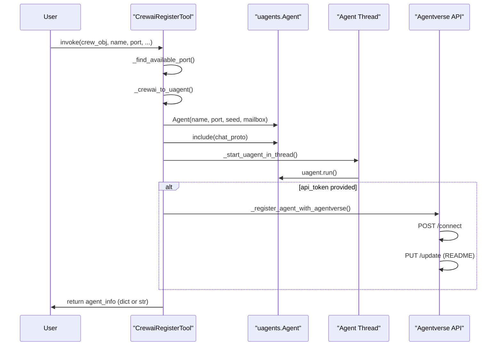
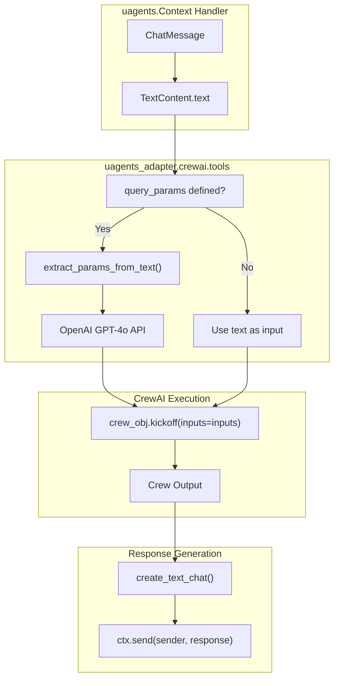
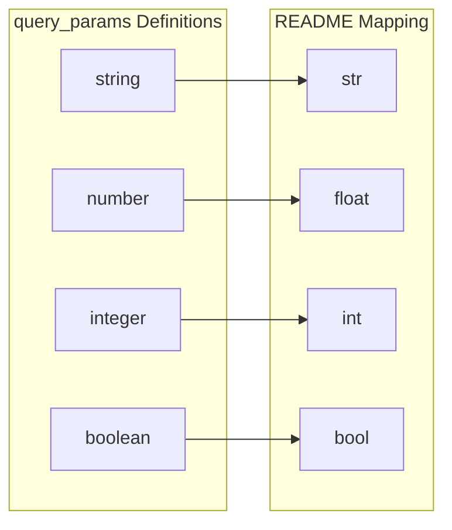

<!-- source: DeepWiki mcp.deepwiki.com · repo fetchai/uAgents · page 6.2 CrewAI Integration · fetched 2026-10-26 -->

# CrewAI Integration

<details>
<summary>Relevant source files</summary>

The following files were used as context for generating this wiki page:

- [python/uagents-adapter/README.md](python/uagents-adapter/README.md)
- [python/uagents-adapter/pyproject.toml](python/uagents-adapter/pyproject.toml)
- [python/uagents-adapter/src/uagents_adapter/a2a_outbound/adapter.py](python/uagents-adapter/src/uagents_adapter/a2a_outbound/adapter.py)
- [python/uagents-adapter/src/uagents_adapter/a2a_outbound/ap2/bridge_mapping.py](python/uagents-adapter/src/uagents_adapter/a2a_outbound/ap2/bridge_mapping.py)
- [python/uagents-adapter/src/uagents_adapter/crewai/tools.py](python/uagents-adapter/src/uagents_adapter/crewai/tools.py)

</details>


This document covers the CrewAI integration capabilities within the `uagents-adapter` framework. The CrewAI integration allows users to convert CrewAI crews into uAgents that can communicate through the Agentverse ecosystem using the chat protocol.

For information about LangChain integration, see [LangChain Integration](#6.1). For A2A protocol bridging, see [A2A Protocol Bridge](#6.3).

## Purpose and Architecture

The CrewAI integration enables seamless conversion of CrewAI crews into fully functional uAgents. The integration handles parameter extraction from natural language queries, protocol registration, and Agentverse connectivity.

**CrewAI Integration Architecture**



Sources: [python/uagents-adapter/src/uagents_adapter/crewai/tools.py:125-132](), [python/uagents-adapter/src/uagents_adapter/crewai/tools.py:111-123]()

## Core Components

### CrewaiRegisterTool

The `CrewaiRegisterTool` class serves as the primary interface for converting CrewAI crews into uAgents. It inherits from `BaseRegisterTool` and implements the conversion logic via the `invoke` method [python/uagents-adapter/src/uagents_adapter/crewai/tools.py:581-681]().

| Component | Description | File Reference |
|-----------|-------------|---------------|
| `CrewaiRegisterTool` | Main tool class for crew conversion | [python/uagents-adapter/src/uagents_adapter/crewai/tools.py:125-143]() |
| `CrewaiRegisterToolInput` | Input schema definition | [python/uagents-adapter/src/uagents_adapter/crewai/tools.py:111-123]() |
| `_crewai_to_uagent()` | Core conversion method | [python/uagents-adapter/src/uagents_adapter/crewai/tools.py:148-412]() |
| `_start_uagent_in_thread()` | Agent threading handler | [python/uagents-adapter/src/uagents_adapter/crewai/tools.py:414-433]() |

### Input Schema

The `CrewaiRegisterToolInput` extends `BaseRegisterToolInput` with CrewAI-specific parameters:

```python
crew_obj: Any  # The CrewAI crew object
query_params: Dict[str, Any] | None  # Parameters to dynamically create the QueryMessage model
example_query: str | None  # Optional example query for documentation
```

Sources: [python/uagents-adapter/src/uagents_adapter/crewai/tools.py:111-123]()

## Registration and Conversion Process

**CrewAI to uAgent Conversion Flow**



Sources: [python/uagents-adapter/src/uagents_adapter/crewai/tools.py:581-681](), [python/uagents-adapter/src/uagents_adapter/crewai/tools.py:148-412]()

### Port Management

The tool uses `_find_available_port()` from the base class to ensure the agent can start. If the requested port is busy, it increments until an available port is found [python/uagents-adapter/src/uagents_adapter/crewai/tools.py:146-146]().

## Message Processing and Parameter Extraction

### Chat Protocol Integration

The integration uses the standard `chat_protocol_spec` [python/uagents-adapter/src/uagents_adapter/crewai/tools.py:29-30](). It handles incoming `ChatMessage` instances and processes the `TextContent`.

**Message Processing Flow**



Sources: [python/uagents-adapter/src/uagents_adapter/crewai/tools.py:287-401](), [python/uagents-adapter/src/uagents_adapter/crewai/tools.py:54-108]()

### Parameter Extraction Logic

The `extract_params_from_text()` function utilizes OpenAI's `gpt-4o` model to parse natural language into a structured JSON object matching the `param_keys` [python/uagents-adapter/src/uagents_adapter/crewai/tools.py:54-108]().

```python
def extract_params_from_text(text: str, param_keys: List[str]) -> Dict[str, str]
```

It requires the `OPENAI_API_KEY` environment variable [python/uagents-adapter/src/uagents_adapter/crewai/tools.py:61-64]().

## Message Handlers

The integration registers specific handlers on the agent instance:

| Handler | Model | Purpose |
|---------|-------|---------|
| `handle_parameters` | `ParameterMessage` | Processes direct structured messages [python/uagents-adapter/src/uagents_adapter/crewai/tools.py:213-235]() |
| `handle_message` | `ChatMessage` | Processes natural language via chat protocol [python/uagents-adapter/src/uagents_adapter/crewai/tools.py:287-302]() |
| `handle_ack` | `ChatAcknowledgement` | Logs message delivery confirmations [python/uagents-adapter/src/uagents_adapter/crewai/tools.py:403-406]() |

### Parameter Message Handler

The `ParameterMessage` is a dynamic `uagents.Model` placeholder. The handler extracts all fields from the message and filters them against the expected `query_params` [python/uagents-adapter/src/uagents_adapter/crewai/tools.py:237-284]().

## Agentverse Integration

### README Generation

The system automatically generates a technical README for the Agentverse UI [python/uagents-adapter/src/uagents_adapter/crewai/tools.py:435-579](). This README includes:
- An Innovation Lab badge.
- A dynamic **Input Data Model** table generated from `query_params` [python/uagents-adapter/src/uagents_adapter/crewai/tools.py:490-556]().
- An **Output Data Model** table for the `ResponseMessage`.

**Dynamic Model Mapping**



Sources: [python/uagents-adapter/src/uagents_adapter/crewai/tools.py:516-524]()

## Configuration Options

### CrewaiRegisterToolInput Parameters

| Parameter | Type | Description |
|-----------|------|-------------|
| `crew_obj` | `Any` | The CrewAI `Crew` instance to wrap [python/uagents-adapter/src/uagents_adapter/crewai/tools.py:114-116]() |
| `query_params` | `Dict[str, Any]` | Schema for dynamic input extraction [python/uagents-adapter/src/uagents_adapter/crewai/tools.py:117-119]() |
| `example_query` | `str` | Example usage for the agent documentation [python/uagents-adapter/src/uagents_adapter/crewai/tools.py:120-122]() |

### Schema Definition

The `query_params` dictionary should define the expected inputs for the crew:

```python
query_params = {
    "topic": {
        "type": "string",
        "description": "The research topic",
        "required": True
    }
}
```

Sources: [python/uagents-adapter/src/uagents_adapter/crewai/tools.py:117-119](), [python/uagents-adapter/README.md:106-112]()

## Error Handling

The integration includes several safety mechanisms:
- **Cleanup**: Uses `cleanup_uagent` to stop running threads on process exit [python/uagents-adapter/src/uagents_adapter/common/__init__.py:75-90]().
- **OpenAI Fallback**: If parameter extraction fails or OpenAI is unavailable, it attempts to use the raw text as the primary input [python/uagents-adapter/src/uagents_adapter/crewai/tools.py:344-348]().
- **Exception Logging**: Errors during crew execution are caught, logged, and sent back to the sender as a `ChatMessage` [python/uagents-adapter/src/uagents_adapter/crewai/tools.py:381-398]().

Sources: [python/uagents-adapter/src/uagents_adapter/crewai/tools.py:381-401](), [python/uagents-adapter/src/uagents_adapter/common/__init__.py:75-90]()

---

