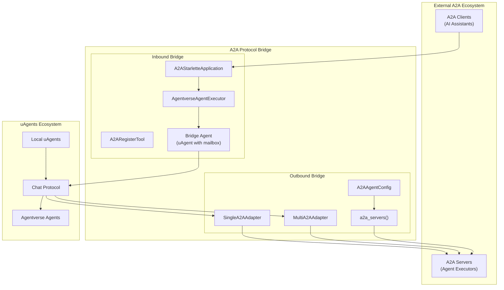
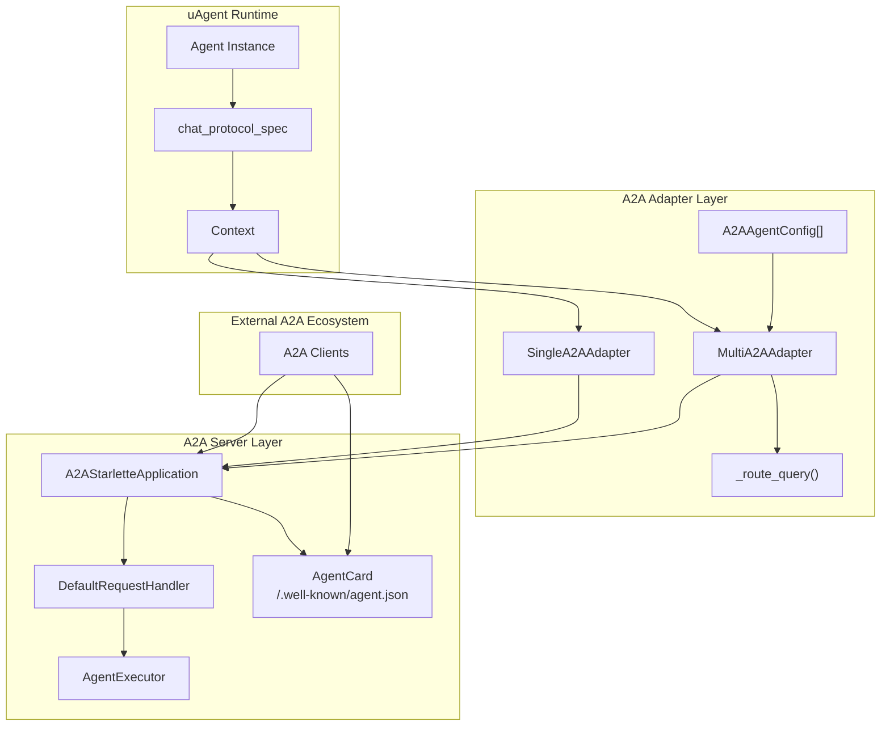
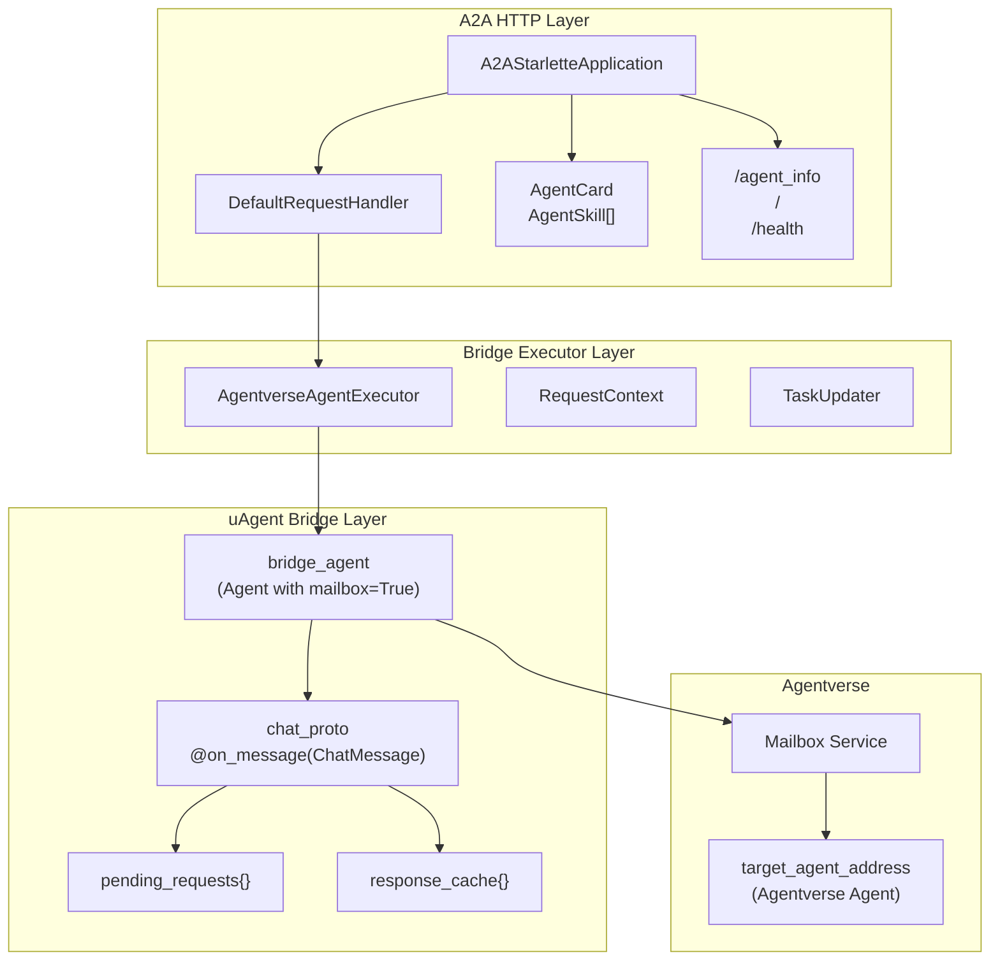
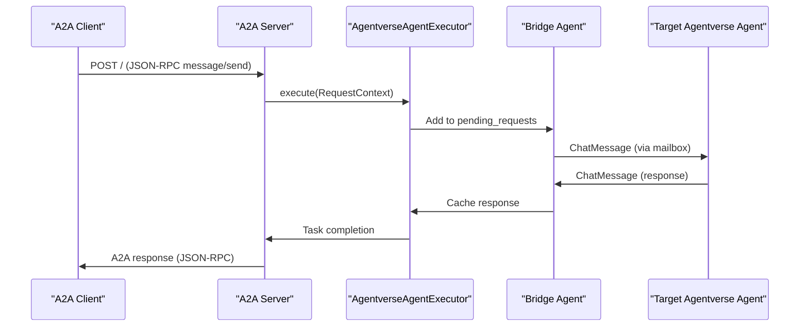

<!-- source: DeepWiki mcp.deepwiki.com · repo fetchai/uAgents · page 6.3 A2A Protocol Bridge · fetched 2026-10-26 -->

# A2A Protocol Bridge

<details>
<summary>Relevant source files</summary>

The following files were used as context for generating this wiki page:

- [python/uagents-adapter/src/uagents_adapter/a2a_inbound/README.md](python/uagents-adapter/src/uagents_adapter/a2a_inbound/README.md)
- [python/uagents-adapter/src/uagents_adapter/a2a_inbound/__init__.py](python/uagents-adapter/src/uagents_adapter/a2a_inbound/__init__.py)
- [python/uagents-adapter/src/uagents_adapter/a2a_inbound/adapter.py](python/uagents-adapter/src/uagents_adapter/a2a_inbound/adapter.py)
- [python/uagents-adapter/src/uagents_adapter/a2a_inbound/agentverse_executor.py](python/uagents-adapter/src/uagents_adapter/a2a_inbound/agentverse_executor.py)
- [python/uagents-adapter/src/uagents_adapter/a2a_inbound/cli.py](python/uagents-adapter/src/uagents_adapter/a2a_inbound/cli.py)
- [python/uagents-adapter/src/uagents_adapter/a2a_outbound/adapter.py](python/uagents-adapter/src/uagents_adapter/a2a_outbound/adapter.py)
- [python/uagents-adapter/src/uagents_adapter/a2a_outbound/ap2/artifacts.py](python/uagents-adapter/src/uagents_adapter/a2a_outbound/ap2/artifacts.py)
- [python/uagents-adapter/src/uagents_adapter/a2a_outbound/ap2/bridge_mapping.py](python/uagents-adapter/src/uagents_adapter/a2a_outbound/ap2/bridge_mapping.py)
- [python/uagents-adapter/src/uagents_adapter/a2a_outbound/readme.md](python/uagents-adapter/src/uagents_adapter/a2a_outbound/readme.md)
- [python/uagents-adapter/src/uagents_adapter/common/__init__.py](python/uagents-adapter/src/uagents_adapter/common/__init__.py)
- [python/uagents-adapter/src/uagents_adapter/crewai/tools.py](python/uagents-adapter/src/uagents_adapter/crewai/tools.py)

</details>


The A2A Protocol Bridge provides bidirectional integration between uAgents and the A2A (Agent-to-Agent) ecosystem. This system enables uAgents to communicate with A2A servers and allows A2A clients to interact with Agentverse agents through standardized HTTP protocols.

For general AI integration patterns, see [AI Integration](#6). For specific LangChain and CrewAI integrations, see [LangChain Integration](#6.1) and [CrewAI Integration](#6.2).

## Architecture Overview

The A2A Protocol Bridge operates in two directions: outbound communication (uAgents to A2A servers) and inbound communication (A2A clients to Agentverse agents). Both directions use the chat protocol for internal uAgent communication while exposing A2A-compatible HTTP interfaces.

### Overall A2A Bridge Architecture



Sources: [python/uagents-adapter/src/uagents_adapter/a2a_outbound/adapter.py:97-128](), [python/uagents-adapter/src/uagents_adapter/a2a_inbound/adapter.py:19-40](), [python/uagents-adapter/src/uagents_adapter/a2a_inbound/agentverse_executor.py:37-75]()

## Outbound Bridge (uAgent to A2A)

The outbound bridge enables uAgents to communicate with A2A servers through two adapter classes: `SingleA2AAdapter` for single-agent scenarios and `MultiA2AAdapter` for multi-agent orchestration with intelligent routing.

### Outbound Architecture Components



Sources: [python/uagents-adapter/src/uagents_adapter/a2a_outbound/adapter.py:27-63](), [python/uagents-adapter/src/uagents_adapter/a2a_outbound/adapter.py:97-128](), [python/uagents-adapter/src/uagents_adapter/a2a_outbound/adapter.py:131-189]()

### Payment Bridging (AP2 to uAgents)

The outbound bridge includes a specialized payment mapping layer that translates between the A2A Payment Protocol (AP2) and the Fetch.ai payment protocol. This allows A2A agents to trigger payment requests that uAgents can fulfill.

| AP2 Artifact | Fetch.ai Protocol Model | Function |
|--------------|-------------------------|----------|
| `CartMandate` | `RequestPayment` | `cartmandate_to_requestpayment` |
| `PaymentMandate` | `CommitPayment` | `commitpayment_to_paymentmandate` |
| `PaymentSuccess` | `CompletePayment` | `paymentsuccess_to_completepayment` |
| `PaymentFailure` | `CancelPayment` | `paymentfailure_to_cancelpayment` |

Sources: [python/uagents-adapter/src/uagents_adapter/a2a_outbound/ap2/bridge_mapping.py:199-227](), [python/uagents-adapter/src/uagents_adapter/a2a_outbound/adapter.py:31-44]()

## Inbound Bridge (A2A to uAgent)

The inbound bridge exposes Agentverse agents as A2A-compatible HTTP endpoints, enabling A2A clients and AI assistants to interact with uAgents through the standardized A2A protocol.

### Inbound Bridge Components



Sources: [python/uagents-adapter/src/uagents_adapter/a2a_inbound/agentverse_executor.py:37-75](), [python/uagents-adapter/src/uagents_adapter/a2a_inbound/adapter.py:86-152]()

### Bridge Agent Communication Flow

The `AgentverseAgentExecutor` creates a bridge agent that communicates with target Agentverse agents via the chat protocol:

1. **Request Processing**: A2A requests are received via `execute()` and converted to `ChatMessage` objects.
2. **Context Injection**: The bridge injects user context into the query using the format `[USER_CONTEXT:context_id] query`.
3. **Mailbox Communication**: Bridge agent sends messages through the Agentverse mailbox service to reach agents behind firewalls.
4. **Response Matching**: Incoming `ChatMessage` responses are matched to `pending_requests` by checking the sender address against `target_agent_address`.
5. **Acknowledgment**: The bridge automatically sends `ChatAcknowledgement` back to the sender upon receiving a valid response.

Sources: [python/uagents-adapter/src/uagents_adapter/a2a_inbound/agentverse_executor.py:116-153](), [python/uagents-adapter/src/uagents_adapter/a2a_inbound/agentverse_executor.py:163-194]()

## Message Flow and Protocol Translation

### Outbound Message Flow (Chat to A2A)

The `SingleA2AAdapter` sets up a message handler for `ChatMessage`. When a uAgent receives a message, it forwards the text to the A2A agent executor. If the A2A response contains AP2 payment objects, they are mapped to the Fetch.ai payment protocol before being sent back.

Sources: [python/uagents-adapter/src/uagents_adapter/a2a_outbound/adapter.py:134-189]()

### Inbound Message Flow (A2A to Chat)



Sources: [python/uagents-adapter/src/uagents_adapter/a2a_inbound/agentverse_executor.py:216-276](), [python/uagents-adapter/src/uagents_adapter/a2a_inbound/agentverse_executor.py:278-366]()

## Configuration and Deployment

### CLI Deployment

The inbound bridge provides a CLI interface in `uagents_adapter.a2a_inbound.cli` for standalone deployment. It allows configuring the target agent address, skills, and ports.

```bash
python -m uagents_adapter.a2a_inbound.cli \
  --agent-address agent1qv4zyd9sta4f5ksyhjp900k8kenp9vczlwqvr00xmmqmj2yetdt4se9ypat \
  --agent-name "Finance Agent" \
  --port 10000
```

Sources: [python/uagents-adapter/src/uagents_adapter/a2a_inbound/cli.py:29-84]()

### A2ARegisterTool

The `A2ARegisterTool` follows the standard adapter pattern to wrap an Agentverse agent as an A2A endpoint.

| Parameter | Type | Description |
|-----------|------|-------------|
| `agent_address` | `str` | Required - The target uAgent address |
| `name` | `str` | Descriptive name for the A2A agent card |
| `bridge_port` | `int` | Internal port for the bridge agent (auto-derived if None) |
| `skill_tags` | `List[str]` | Tags for A2A discovery |

Sources: [python/uagents-adapter/src/uagents_adapter/a2a_inbound/adapter.py:19-75]()

### Security Configuration

Bridge agents require consistent seeds for production deployments to maintain the same identity across restarts:

- **UAGENTS_BRIDGE_SEED**: Environment variable used by `AgentverseAgentExecutor` to derive the bridge agent's identity.
- **Random Fallback**: If no seed is provided, a random one is generated via `secrets.token_hex(16)`, which will result in a different agent address on every restart.

Sources: [python/uagents-adapter/src/uagents_adapter/a2a_inbound/agentverse_executor.py:76-106]()

---

