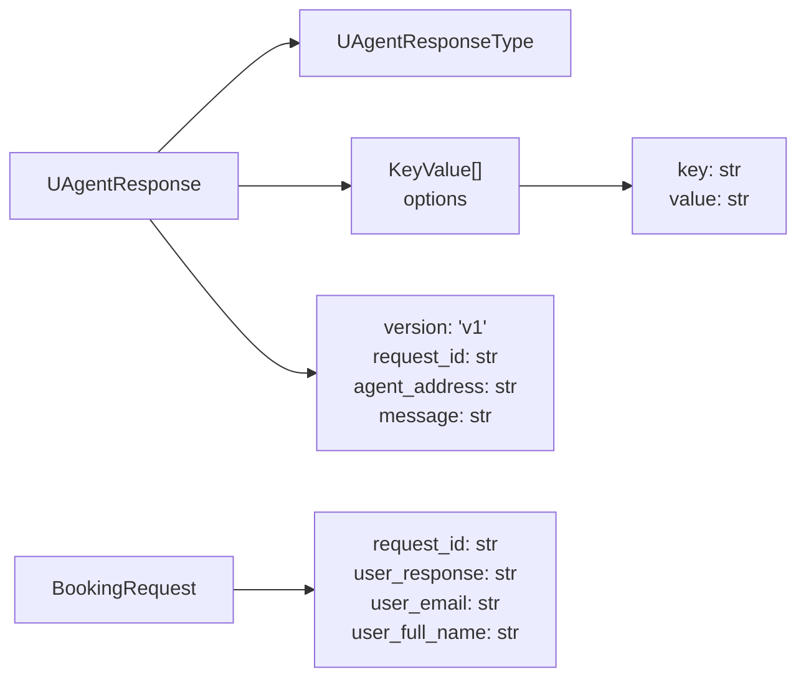
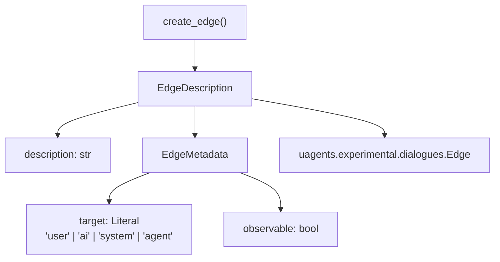
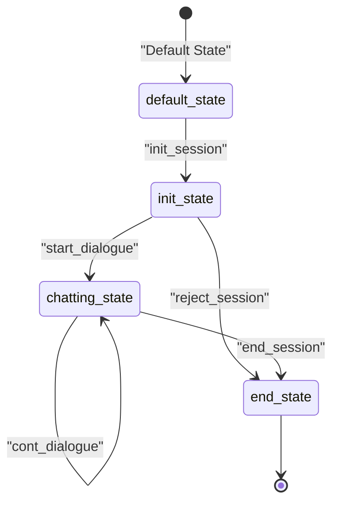
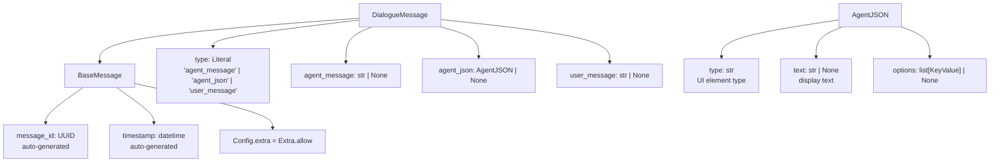
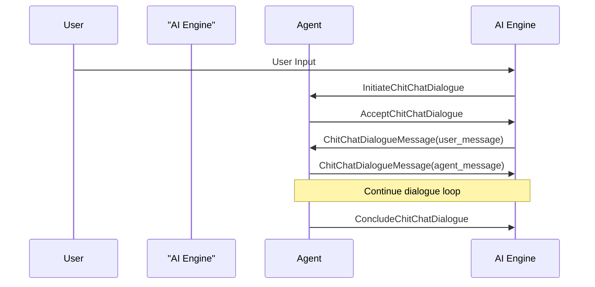

<!-- source: DeepWiki mcp.deepwiki.com · repo fetchai/uAgents · page 6.4 AI Engine · fetched 2026-10-26 -->

# AI Engine

Relevant source files

The following files were used as context for generating this wiki page:

- [python/uagents-ai-engine/examples/simple_agent.py](python/uagents-ai-engine/examples/simple_agent.py)
- [python/uagents-ai-engine/pyproject.toml](python/uagents-ai-engine/pyproject.toml)
- [python/uagents-ai-engine/src/ai_engine/__init__.py](python/uagents-ai-engine/src/ai_engine/__init__.py)
- [python/uagents-ai-engine/src/ai_engine/chitchat.py](python/uagents-ai-engine/src/ai_engine/chitchat.py)
- [python/uagents-ai-engine/src/ai_engine/dialogue.py](python/uagents-ai-engine/src/ai_engine/dialogue.py)
- [python/uagents-ai-engine/src/ai_engine/messages.py](python/uagents-ai-engine/src/ai_engine/messages.py)
- [python/uagents-ai-engine/src/ai_engine/types.py](python/uagents-ai-engine/src/ai_engine/types.py)

The AI Engine integration provides structured communication capabilities between uAgents and Fetch.ai's AI Engine platform. This system enables agents to participate in AI-facilitated dialogues and provide structured responses for intelligent interactions. The integration supports both single-exchange request-response patterns and ongoing conversational dialogues.

For information about other AI integrations, see [LangChain Integration](#6.1), [CrewAI Integration](#6.2), and [A2A Protocol Bridge](#6.3).

## Architecture Overview

The AI Engine integration consists of three main components: response types for structured communication, dialogue management for conversational flows, and message models for different interaction patterns.

```mermaid
graph TB
    subgraph "AI Engine Integration Layer"
        ResponseTypes["UAgentResponse Types<br/>Single Exchange Pattern"]
        DialogueFramework["ChitChatDialogue<br/>Conversational Pattern"]
        MessageModels["DialogueMessage Models<br/>Structured Messages"]
    end
    
    subgraph "Core Components"
        UAgentResponseType["UAgentResponseType<br/>FINAL, ERROR, VALIDATION_ERROR"]
        KeyValue["KeyValue<br/>Key-Value Options"]
        UAgentResponse["UAgentResponse<br/>Structured Response Model"]
        BookingRequest["BookingRequest<br/>User Request Model"]
    end
    
    subgraph "Dialogue Management"
        EdgeMetadata["EdgeMetadata<br/>target, observable"]
        EdgeDescription["EdgeDescription<br/>description, metadata"]
        ChitChatDialogue["ChitChatDialogue<br/>Predefined State Machine"]
        create_edge["create_edge()<br/>Edge Factory Function"]
    end
    
    subgraph "Message Models"
        BaseMessage["BaseMessage<br/>message_id, timestamp"]
        DialogueMessage["DialogueMessage<br/>agent_message, user_message"]
        AgentJSON["AgentJSON<br/>UI Element Mapping"]
    end
    
    subgraph "uAgents Core"
        Agent["Agent"]
        Context["Context"]
        Model["Model"]
        Dialogue["uagents.experimental.dialogues.Dialogue"]
    end
    
    ResponseTypes --> UAgentResponseType
    ResponseTypes --> KeyValue
    ResponseTypes --> UAgentResponse
    ResponseTypes --> BookingRequest
    
    DialogueFramework --> EdgeMetadata
    DialogueFramework --> EdgeDescription
    DialogueFramework --> ChitChatDialogue
    DialogueFramework --> create_edge
    
    MessageModels --> BaseMessage
    MessageModels --> DialogueMessage
    MessageModels --> AgentJSON
    
    ChitChatDialogue --> Dialogue
    BaseMessage --> Model
    DialogueMessage --> BaseMessage
    UAgentResponse --> Model
    BookingRequest --> Model
    
    Agent --> ChitChatDialogue
    Context --> DialogueMessage
```

**Sources:** [python/uagents-ai-engine/src/ai_engine/__init__.py:1-8](), [python/uagents-ai-engine/src/ai_engine/types.py:1-36](), [python/uagents-ai-engine/src/ai_engine/dialogue.py:1-55](), [python/uagents-ai-engine/src/ai_engine/messages.py:1-98]()

## Response Types and Models

The AI Engine integration provides structured response types for single-exchange communication patterns where agents receive requests and provide formatted responses.

### UAgentResponseType Enumeration

The `UAgentResponseType` enum defines the possible response categories that agents can return to the AI Engine:

| Response Type | Description |
|---------------|-------------|
| `FINAL` | Complete response with no further interaction needed |
| `ERROR` | Error occurred during processing |
| `VALIDATION_ERROR` | Input validation failed |
| `SELECT_FROM_OPTIONS` | User must select from provided options |
| `FINAL_OPTIONS` | Final response with options for user selection |

### Core Response Models

The `UAgentResponse` model at [python/uagents-ai-engine/src/ai_engine/types.py:20-29]() provides the standard structure for agent responses, including optional lists of `KeyValue` options for user selection. The `BookingRequest` model at [python/uagents-ai-engine/src/ai_engine/types.py:31-36]() handles user booking interactions with required user identification fields.

**Sources:** [python/uagents-ai-engine/src/ai_engine/types.py:7-36]()

## Dialogue Management Framework

The dialogue management system provides conversational capabilities through structured state machines with AI Engine integration metadata.

### Edge Metadata System

The `create_edge` function at [python/uagents-ai-engine/src/ai_engine/dialogue.py:32-54]() creates dialogue transitions with AI Engine-specific metadata. The `target` field determines the message destination: `"user"` for direct user messages, `"ai"` for AI Engine processing, `"system"` for system processing, and `"agent"` for agent-to-agent communication. The `observable` field indicates whether the AI Engine can monitor this transition.

### ChitChatDialogue Implementation

The `ChitChatDialogue` class at [python/uagents-ai-engine/src/ai_engine/chitchat.py:81-154]() provides a predefined conversation state machine. It extends the experimental `Dialogue` class from the core framework [python/uagents-ai-engine/src/ai_engine/chitchat.py:81-81]().

The dialogue defines handler methods for each transition:
- `on_initiate_session()` - handles initial dialogue requests [python/uagents-ai-engine/src/ai_engine/chitchat.py:113-121]()
- `on_reject_session()` - handles dialogue rejection [python/uagents-ai-engine/src/ai_engine/chitchat.py:122-128]()
- `on_start_dialogue()` - handles dialogue acceptance [python/uagents-ai-engine/src/ai_engine/chitchat.py:130-137]()
- `on_continue_dialogue()` - handles ongoing conversation messages [python/uagents-ai-engine/src/ai_engine/chitchat.py:139-146]()
- `on_end_session()` - handles dialogue termination [python/uagents-ai-engine/src/ai_engine/chitchat.py:148-153]()

**Sources:** [python/uagents-ai-engine/src/ai_engine/dialogue.py:11-55](), [python/uagents-ai-engine/src/ai_engine/chitchat.py:9-154]()

## Message Models

The message system provides structured formats for different types of agent communications with the AI Engine.

### Base Message Structure

The `BaseMessage` class at [python/uagents-ai-engine/src/ai_engine/messages.py:44-64]() provides automatic message identification and timestamping. The `DialogueMessage` class extends this with type-specific fields for different message sources. The `AgentJSON` model at [python/uagents-ai-engine/src/ai_engine/messages.py:22-36]() enables UI element mapping on DeltaV platform, supporting types like `"options"` for select buttons and `"date"` for date pickers.

### Integration Pattern Example

The integration pattern from [python/uagents-ai-engine/examples/simple_agent.py:1-131]() demonstrates the complete setup:

The example shows message type definitions at [python/uagents-ai-engine/examples/simple_agent.py:20-48](), dialogue instantiation at [python/uagents-ai-engine/examples/simple_agent.py:51-54](), and handler registration using decorators like `@chitchat_dialogue.on_continue_dialogue()` at [python/uagents-ai-engine/examples/simple_agent.py:95-113](). Finally, the dialogue is included in the agent with `publish_manifest=True` to expose the structure to the AI Engine [python/uagents-ai-engine/examples/simple_agent.py:125-125]().

**Sources:** [python/uagents-ai-engine/src/ai_engine/messages.py:1-98](), [python/uagents-ai-engine/examples/simple_agent.py:1-131]()

---

