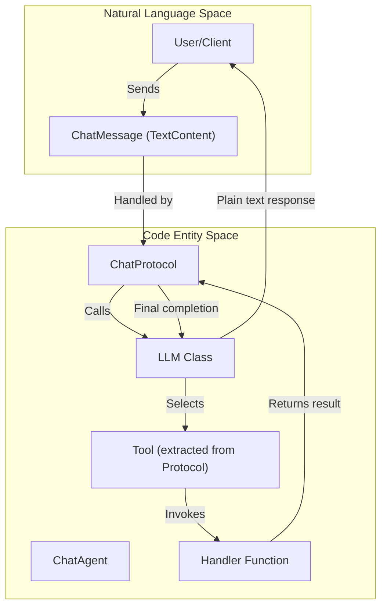
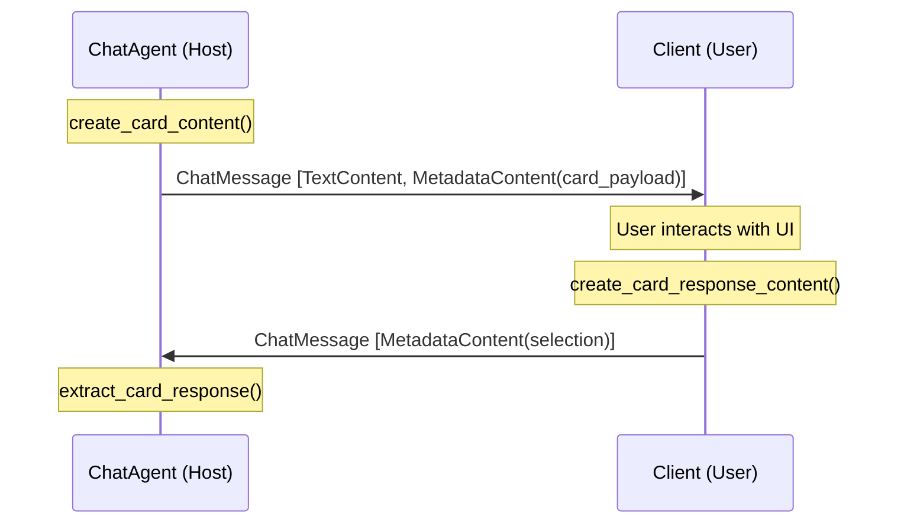

<!-- source: DeepWiki mcp.deepwiki.com · repo fetchai/uAgents · page 6.5 Chat Agent and MCP Adapter · fetched 2026-10-26 -->

# Chat Agent and MCP Adapter

Relevant source files

The following files were used as context for generating this wiki page:

- [python/src/uagents/experimental/chat_agent/README.md](python/src/uagents/experimental/chat_agent/README.md)
- [python/src/uagents/experimental/chat_agent/__init__.py](python/src/uagents/experimental/chat_agent/__init__.py)
- [python/src/uagents/experimental/chat_agent/llm.py](python/src/uagents/experimental/chat_agent/llm.py)
- [python/src/uagents/experimental/chat_agent/protocol.py](python/src/uagents/experimental/chat_agent/protocol.py)
- [python/src/uagents/experimental/chat_agent/tools.py](python/src/uagents/experimental/chat_agent/tools.py)
- [python/tests/examples/44-bureau-chat-agents/main.py](python/tests/examples/44-bureau-chat-agents/main.py)
- [python/tests/examples/44-bureau-chat-agents/protocols.py](python/tests/examples/44-bureau-chat-agents/protocols.py)
- [python/tests/examples/45-interactive-cards/protocols.py](python/tests/examples/45-interactive-cards/protocols.py)
- [python/uagents-adapter/src/uagents_adapter/mcp/__init__.py](python/uagents-adapter/src/uagents_adapter/mcp/__init__.py)
- [python/uagents-adapter/src/uagents_adapter/mcp/adapter.py](python/uagents-adapter/src/uagents_adapter/mcp/adapter.py)
- [python/uagents-adapter/src/uagents_adapter/mcp/protocol.py](python/uagents-adapter/src/uagents_adapter/mcp/protocol.py)
- [python/uagents-core/uagents_core/config.py](python/uagents-core/uagents_core/config.py)
- [python/uagents-core/uagents_core/contrib/protocols/chat/__init__.py](python/uagents-core/uagents_core/contrib/protocols/chat/__init__.py)
- [python/uagents-core/uagents_core/contrib/protocols/chat/cards/README.md](python/uagents-core/uagents_core/contrib/protocols/chat/cards/README.md)
- [python/uagents-core/uagents_core/contrib/protocols/chat/cards/__init__.py](python/uagents-core/uagents_core/contrib/protocols/chat/cards/__init__.py)
- [python/uagents-core/uagents_core/storage.py](python/uagents-core/uagents_core/storage.py)
- [python/uagents-core/uagents_core/utils/subscriptions.py](python/uagents-core/uagents_core/utils/subscriptions.py)
- [python/uagents-core/uv.lock](python/uagents-core/uv.lock)

The `ChatAgent` and its associated components provide a framework for building LLM-powered conversational agents within the uAgents ecosystem. These agents leverage the `ChatProtocol` to communicate using natural language while maintaining the ability to execute structured tasks via "tools" extracted from standard agent protocols. Additionally, the `MCPServerAdapter` allows Model Context Protocol (MCP) servers to be exposed as agents on Agentverse.

## ChatAgent and ChatProtocol

The `ChatAgent` is a specialized wrapper around the base `Agent` class [python/src/uagents/experimental/chat_agent/__init__.py:12-12](). It automates the integration of Large Language Models (LLMs) and converts standard protocol handlers into tools that the LLM can invoke during a conversation [python/src/uagents/experimental/chat_agent/README.md:3-6]().

### Data Flow: Message Processing

When a `ChatAgent` receives a `ChatMessage`, it follows a multi-step execution flow to determine whether to respond directly or invoke a tool.

1.  **Message Reception**: The `ChatProtocol` handles incoming `ChatMessage` models [python/src/uagents/experimental/chat_agent/protocol.py:115-116]().
2.  **History Reconstruction**: It builds a message history for the LLM using `build_llm_message_history`, which extracts text from previous session entries [python/src/uagents/experimental/chat_agent/protocol.py:43-63]().
3.  **LLM Processing**: The `LLM.process` method is called with the history and tool specifications [python/src/uagents/experimental/chat_agent/llm.py:145-189]().
4.  **Tool Execution**: If the LLM selects a tool, the agent validates the arguments against the tool's `model_cls` [python/src/uagents/experimental/chat_agent/protocol.py:167-177]() and executes the handler via `use_tool` [python/src/uagents/experimental/chat_agent/protocol.py:180]().
5.  **Final Completion**: After tool execution, the result is fed back to the LLM with a `FINAL_SYSTEM_PROMPT` [python/src/uagents/experimental/chat_agent/protocol.py:24-40]() to generate a human-readable response [python/src/uagents/experimental/chat_agent/protocol.py:201]().

**Chat Agent System Architecture**

Sources: [python/src/uagents/experimental/chat_agent/protocol.py:96-189](), [python/src/uagents/experimental/chat_agent/llm.py:86-143](), [python/src/uagents/experimental/chat_agent/tools.py:11-34]()

### Tool Extraction

The `ChatAgent` automatically converts standard `Protocol` objects into LLM tools. This is performed by `extract_tools_from_protocol` [python/src/uagents/experimental/chat_agent/tools.py:36-66]().

*   **Logic**: It iterates through the models registered in a protocol [python/src/uagents/experimental/chat_agent/tools.py:44]().
*   **Exclusion**: Certain models like `ErrorMessage` are excluded from being tools [python/src/uagents/experimental/chat_agent/tools.py:8-46]().
*   **Metadata**: It uses the Pydantic model name as the `tool_name` and the model's schema for the LLM's function parameters [python/src/uagents/experimental/chat_agent/tools.py:24-33]().

Sources: [python/src/uagents/experimental/chat_agent/tools.py:11-66]()

## LLM Configuration

LLM behavior is controlled via `LLMConfig` and `LLMParams`.

| Class | Purpose | Key Attributes |
| :--- | :--- | :--- |
| `LLMParams` | Model hyper-parameters | `temperature`, `max_tokens`, `tool_choice`, `parallel_tool_calls` [python/src/uagents/experimental/chat_agent/llm.py:56-62]() |
| `LLMConfig` | Provider connectivity | `provider`, `model`, `url`, `api_key` [python/src/uagents/experimental/chat_agent/llm.py:65-70]() |

The framework defaults to the `asi1` (Fetch.ai) provider if no configuration is provided [python/src/uagents/experimental/chat_agent/llm.py:72-83]().

Sources: [python/src/uagents/experimental/chat_agent/llm.py:56-83]()

## Agent Chat Protocol (AgentChatProtocol)

The `AgentChatProtocol` is the underlying communication standard defined in `uagents-core`. It uses a specific set of models to handle different types of content within a conversation.

### Core Models

*   **`ChatMessage`**: The primary container for messages, containing a list of `AgentContent` [python/uagents-core/uagents_core/contrib/protocols/chat/__init__.py:122-141]().
*   **`AgentContent`**: A union of several content types [python/uagents-core/uagents_core/contrib/protocols/chat/__init__.py:111-119]():
    *   `TextContent`: Plain UTF-8 or Markdown text [python/uagents-core/uagents_core/contrib/protocols/chat/__init__.py:24-33]().
    *   `ResourceContent`: References to external URIs or assets [python/uagents-core/uagents_core/contrib/protocols/chat/__init__.py:44-65]().
    *   `MetadataContent`: Key-value pairs used for structured data like Interactive Cards [python/uagents-core/uagents_core/contrib/protocols/chat/__init__.py:67-76]().
    *   `StartSessionContent` / `EndSessionContent`: Lifecycle signals [python/uagents-core/uagents_core/contrib/protocols/chat/__init__.py:78-90]().

### Protocol Specification
The protocol defines a simple interaction: a `ChatMessage` expects a `ChatAcknowledgement` [python/uagents-core/uagents_core/contrib/protocols/chat/__init__.py:180-187]().

Sources: [python/uagents-core/uagents_core/contrib/protocols/chat/__init__.py:1-187]()

## Interactive Cards

Interactive cards allow agents to present structured UI elements (carousels, forms, detail views) within a chat interface. These are transmitted inside `MetadataContent` blocks [python/uagents-core/uagents_core/contrib/protocols/chat/cards/README.md:1-10]().

**Card Interaction Flow**

Sources: [python/uagents-core/uagents_core/contrib/protocols/chat/cards/README.md:19-28](), [python/tests/examples/45-interactive-cards/protocols.py:96-129]()

## MCP Server Adapter

The `MCPServerAdapter` (found in `uagents-adapter`) allows existing Model Context Protocol (MCP) servers to be wrapped as uAgents. This enables LLMs on Agentverse to discover and use MCP tools as if they were native agent protocols.

*   **Protocol Mapping**: The adapter translates MCP tool definitions into uAgents `Model` schemas.
*   **Execution**: Incoming agent messages are converted into MCP JSON-RPC calls to the underlying server.
*   **Context**: It provides the necessary bridge between the asynchronous agent environment and the MCP server lifecycle.

Sources: [python/uagents-adapter/src/uagents_adapter/mcp/adapter.py](), [python/uagents-adapter/src/uagents_adapter/mcp/protocol.py]()

---

