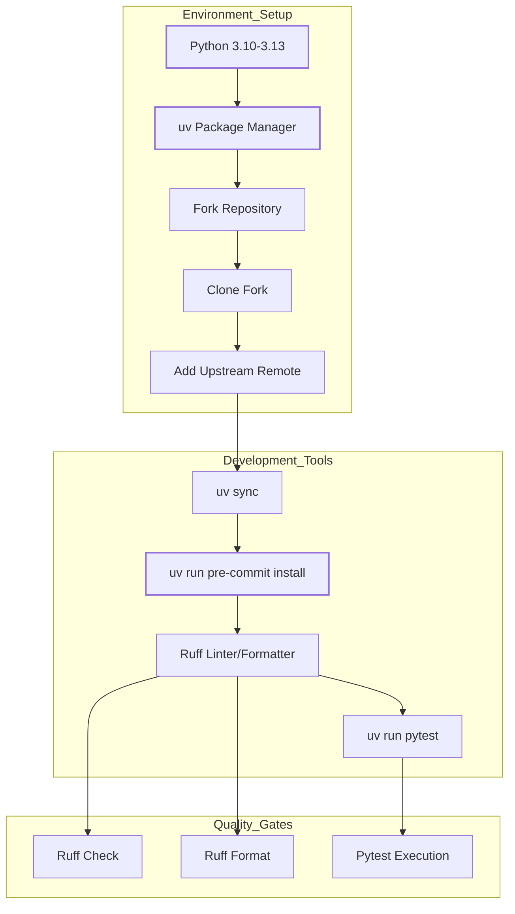
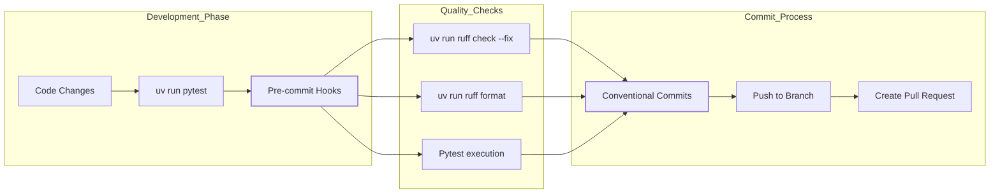
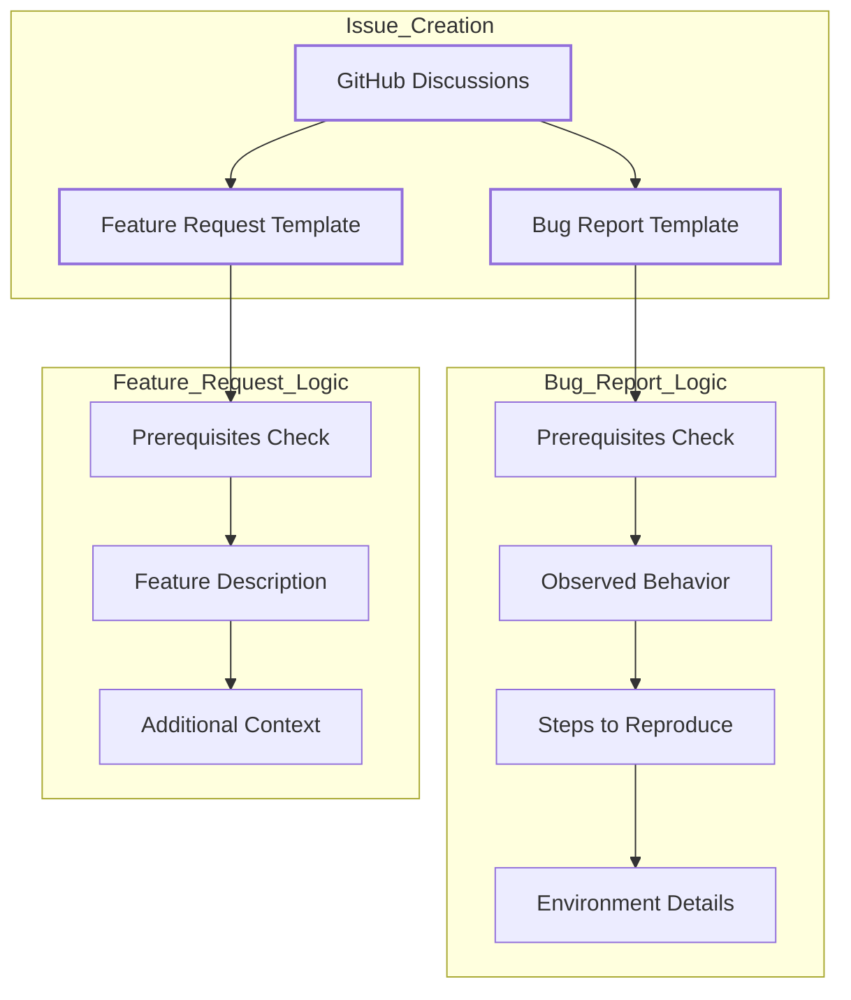

<!-- source: DeepWiki mcp.deepwiki.com · repo fetchai/uAgents · page 7.1 Contributing Guide · fetched 2026-10-26 -->

# Contributing Guide

<details>
<summary>Relevant source files</summary>

The following files were used as context for generating this wiki page:

- [.github/CODEOWNERS](.github/CODEOWNERS)
- [.github/ISSUE_TEMPLATE/bug-report.yml](.github/ISSUE_TEMPLATE/bug-report.yml)
- [.github/ISSUE_TEMPLATE/feature-request.yml](.github/ISSUE_TEMPLATE/feature-request.yml)
- [.github/pull_request_template.md](.github/pull_request_template.md)
- [.github/workflows/pr-title-linting.yml](.github/workflows/pr-title-linting.yml)
- [CONTRIBUTING.md](CONTRIBUTING.md)
- [DEVELOPING.md](DEVELOPING.md)
- [LICENSE](LICENSE)
- [README.md](README.md)
- [python/.pre-commit-config.yaml](python/.pre-commit-config.yaml)
- [python/uagents-core/uagents_core/__init__.py](python/uagents-core/uagents_core/__init__.py)

</details>


This guide covers the complete workflow for contributing to the uAgents project, including development environment setup, coding standards, testing procedures, and the submission process for issues and pull requests. It provides the technical foundation for developers to effectively contribute to the uAgents ecosystem.

For information about the release process and package management, see [Release Process](#7.2).

## Development Environment Setup

Setting up a proper development environment is essential for contributing to uAgents. The project uses a standardized Python development stack with `uv` for dependency management and `ruff` for code quality.

### Environment Requirements

The uAgents project supports Python versions 3.10 through 3.13 [README.md:18-18](). The recommended setup uses the `uv` tool for fast dependency resolution and environment synchronization [DEVELOPING.md:29-35]().



**Development Environment Setup Workflow**

Sources: [DEVELOPING.md:13-35](), [README.md:18-20]()

### Repository Structure

The uAgents repository follows a monorepo structure with the main Python packages located in the `python/` directory.

| Directory/File | Purpose |
|---|---|
| `python/` | Main Python packages and source code [README.md:100-102]() |
| `python/uagents-core/` | Core uAgents functionality and definitions [README.md:104-106]() |
| `CONTRIBUTING.md` | Contribution guidelines [CONTRIBUTING.md:1-12]() |
| `DEVELOPING.md` | Development setup and testing instructions [DEVELOPING.md:1-7]() |
| `.github/` | GitHub workflows, issue templates, and PR templates [CONTRIBUTING.md:55-56]() |

Sources: [README.md:100-106](), [DEVELOPING.md:1-7](), [CONTRIBUTING.md:1-12]()

## Development Workflow

The development workflow emphasizes code quality through automated checks and follows conventional commit practices.

### Code Quality Pipeline

The project uses `ruff` for both linting and formatting. Contributors are encouraged to integrate `ruff` into their IDEs or run it manually to ensure code meets standards before committing [DEVELOPING.md:38-43]().



**Code Quality and Commit Process**

Sources: [DEVELOPING.md:38-49](), [CONTRIBUTING.md:126-133]()

### Commit Message Standards

The project follows the Conventional Commits v1.0.0 specification to automate release notes and versioning [CONTRIBUTING.md:139-140]().

| Commit Type | Purpose |
|---|---|
| `feat` | A new feature [CONTRIBUTING.md:144-144]() |
| `fix` | A bug fix [CONTRIBUTING.md:145-145]() |
| `docs` | Changes to documentation [CONTRIBUTING.md:143-143]() |
| `test` | Adding or correcting tests [CONTRIBUTING.md:147-147]() |
| `refactor` | Code change that neither fixes a bug nor adds a feature [CONTRIBUTING.md:146-146]() |
| `chore` | Maintenance of the project or surrounding processes [CONTRIBUTING.md:141-141]() |
| `ci` | Changes to CI configuration files and scripts [CONTRIBUTING.md:142-142]() |
| `style` | Formatting or style changes without functionality impact [CONTRIBUTING.md:149-149]() |
| `perf` | Performance improvements [CONTRIBUTING.md:150-150]() |
| `revert` | Reverting a previous commit [CONTRIBUTING.md:148-148]() |

Sources: [CONTRIBUTING.md:139-151]()

## Issue Management

The project uses GitHub Issues for bug reports and feature requests. Support questions should be directed to GitHub Discussions [CONTRIBUTING.md:22-26]().

### Issue Types and Templates



**Issue Management Workflow**

### Bug Report Requirements

The bug report template in `.github/ISSUE_TEMPLATE/bug-report.yml` requires specific information to ensure the core team can reproduce and confirm the issue [CONTRIBUTING.md:53-54]():

- **Prerequisites**: Confirm documentation was checked and no similar issues exist [.github/ISSUE_TEMPLATE/bug-report.yml:12-21]().
- **Expected vs. Observed Behavior**: Clear description of the failure [.github/ISSUE_TEMPLATE/bug-report.yml:32-45]().
- **Reproduction**: Minimal reproducible example in code [.github/ISSUE_TEMPLATE/bug-report.yml:47-52]().
- **Environment**: Version number and OS/Python details [.github/ISSUE_TEMPLATE/bug-report.yml:53-68]().

Sources: [.github/ISSUE_TEMPLATE/bug-report.yml:1-85](), [CONTRIBUTING.md:48-58]()

### Feature Request Process

- **Small Features**: Can be submitted directly as a Pull Request [CONTRIBUTING.md:44-44]().
- **Major Features**: Require an issue to outline the proposal for discussion before implementation [CONTRIBUTING.md:43-43]().
- **Prerequisites**: Check existing documentation and issues before requesting [.github/ISSUE_TEMPLATE/feature-request.yml:12-21]().

Sources: [.github/ISSUE_TEMPLATE/feature-request.yml:1-38](), [CONTRIBUTING.md:38-44]()

## Pull Request Process

The pull request workflow enforces quality standards through automated checks and a structured review process.

### PR Title and Content Standards

The project uses a PR title linting workflow to ensure semantic versioning and clean changelogs.

**Valid Types**: `chore`, `docs`, `feat`, `fix`, `refactor`, `style`, `perf`, `ci`, `test`, `revert` [.github/workflows/pr-title-linting.yml:19-29]().

**Valid Scopes**: `uagents`, `core`, `libs`, `example`, `integration`, `experimental` [.github/workflows/pr-title-linting.yml:31-37]().

Sources: [.github/workflows/pr-title-linting.yml:1-39]()

### PR Template Requirements

The pull request template in `.github/pull_request_template.md` requires:

- **Proposed Changes**: A description of the modifications [.github/pull_request_template.md:1-3]().
- **Linked Issues**: Reference to the issue being resolved [.github/pull_request_template.md:5-7]().
- **Checklist**: Confirmation that tests pass locally and documentation (API docs generated via `python/scripts/generate_api_docs.py`) is updated [.github/pull_request_template.md:19-30]().

Sources: [.github/pull_request_template.md:1-34]()

## Code Review and Merging

### Code Ownership

The repository uses a `CODEOWNERS` file to automatically assign reviewers. Default owners include `@jrriehl`, `@Archento`, `@lrahmani`, `@qati`, and `@Alejandro-Morales` [.github/CODEOWNERS:2]().

### Review Requirements

Code reviews address:
- **Test Coverage**: All features and bug fixes must include tests [CONTRIBUTING.md:129-132]().
- **Compatibility**: API compatibility must be maintained, especially for versions above 1.0.0 [CONTRIBUTING.md:135-136]().
- **Documentation**: All public features must be documented [CONTRIBUTING.md:134-134]().

### Merge Strategy

The project uses a **Squash and Merge** strategy. This collapses all commits in a PR into a single conventional commit on the `main` branch, which is then used to generate release notes [CONTRIBUTING.md:163-165]().

Sources: [CONTRIBUTING.md:96-105](), [CONTRIBUTING.md:120-136](), [CONTRIBUTING.md:161-165](), [.github/CODEOWNERS:1-3]()

## Testing and Quality Assurance

Testing is mandatory for all functional changes.

### Testing Requirements

- **Unit Tests**: Required for proving code correctness [CONTRIBUTING.md:131-131]().
- **Integration Tests**: Required for complex feature interactions [CONTRIBUTING.md:129-129]().
- **Regression Tests**: Bug fixes must include tests that would have caught the bug [CONTRIBUTING.md:129-130]().

Tests are executed using `pytest`:
```bash
uv run pytest
```
Sources: [DEVELOPING.md:50-57](), [CONTRIBUTING.md:129-133]()

### Quality Standards (Pre-commit)

The pre-commit configuration in `python/.pre-commit-config.yaml` enforces:
- **Ruff**: Linting and automatic fixing of common issues [python/.pre-commit-config.yaml:5-6]().
- **Ruff Format**: Standardized code formatting [python/.pre-commit-config.yaml:7-7]().
- **Pyupgrade**: Automatic upgrade of syntax for Python 3.10+ [python/.pre-commit-config.yaml:8-12]().

Sources: [python/.pre-commit-config.yaml:1-13]()

---

