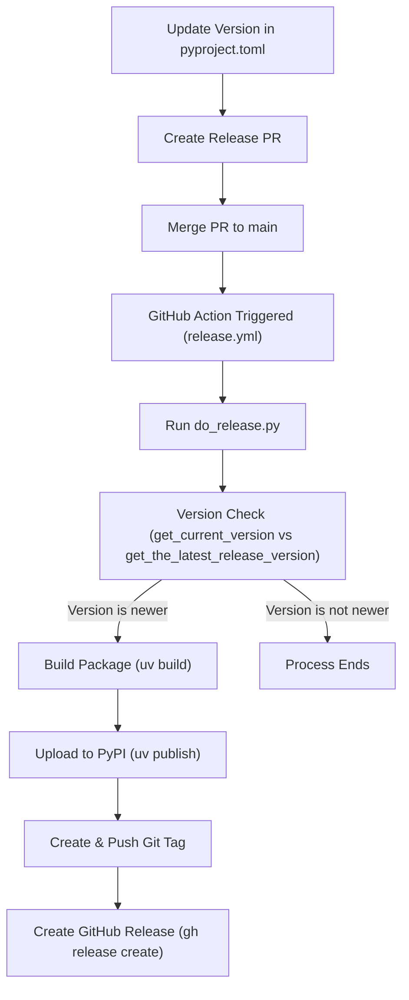
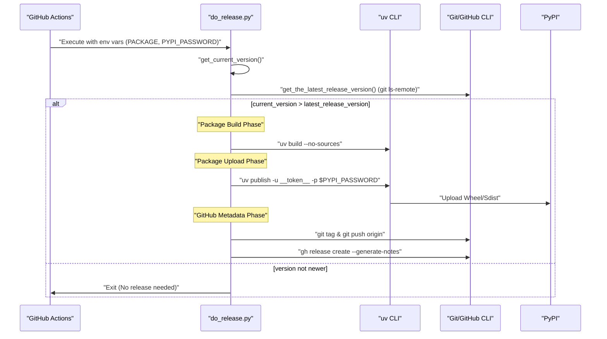

<!-- source: DeepWiki mcp.deepwiki.com · repo fetchai/uAgents · page 7.2 Release Process · fetched 2026-10-26 -->

# Release Process

Relevant source files

The following files were used as context for generating this wiki page:

- [.github/workflows/ci-tests.yml](.github/workflows/ci-tests.yml)
- [.github/workflows/coverage.yml](.github/workflows/coverage.yml)
- [.github/workflows/release.yml](.github/workflows/release.yml)
- [python/README.md](python/README.md)
- [python/scripts/do_release.py](python/scripts/do_release.py)
- [python/uagents-adapter/uv.lock](python/uagents-adapter/uv.lock)

This document details the automated release process for the uAgents packages. The process ensures consistent versioning, tagging, and publishing of packages to PyPI through a GitHub Actions workflow using the `uv` package manager.

## Overview

The uAgents framework uses a semi-automated release process that triggers when a properly formatted release pull request is merged into the `main` branch. This process handles version checking, package building, PyPI publishing, Git tagging, and GitHub release creation.

Sources: [python/scripts/do_release.py:131-172](), [.github/workflows/release.yml:1-11]()

## Supported Packages

The release process supports three separate packages within the uAgents repository, each with its own directory and tag prefix:

| Package | Description | Tag Prefix | Path |
|---------|-------------|------------|------|
| main    | Main uAgents package | `v` | `/python` |
| core    | uAgents-core package | `core@` | `/python/uagents-core` |
| adapter | uAgents-adapter package | `adapter@` | `/python/uagents-adapter` |

Sources: [python/scripts/do_release.py:25-41](), [python/README.md:7-12]()

## Release Process Flow

### 1. Version Update and Pull Request

To initiate a release, a developer must update the version in the corresponding `pyproject.toml` and create a pull request. The workflow specifically triggers when a PR is merged from a branch starting with `release` into `main`.

*   **Core package branch:** `release/core@*`
*   **Adapter package branch:** `release/adapter@*`
*   **Main package branch:** `release/*` (typically `release/v*`)

Sources: [.github/workflows/release.yml:7-10](), [.github/workflows/release.yml:19-19](), [.github/workflows/release.yml:47-57]()

### 2. Automated Release Workflow Execution

The GitHub Action `release.yml` prepares the environment and executes the `do_release.py` script. It dynamically sets the `PACKAGE` environment variable and selects the appropriate PyPI token based on the branch name.

Sources: [.github/workflows/release.yml:34-60](), [python/scripts/do_release.py:131-172]()

## Release Tool Implementation

### The ReleaseTool Class

The `ReleaseTool` class in `python/scripts/do_release.py` encapsulates the release logic. It uses `pydantic-settings` to load credentials and package targets.

| Method | Role | Code Entity |
|--------|------|-------------|
| `__init__` | Initializes with `Settings` (PyPI creds, package type) | [python/scripts/do_release.py:107-109]() |
| `upload_packages` | Executes `uv publish` in the package directory | [python/scripts/do_release.py:111-130]() |
| `main` | Orchestrates version comparison, building, and tagging | [python/scripts/do_release.py:131-172]() |

### Versioning Logic

The script uses the `packaging` library to handle semantic version comparisons.

*   **`get_current_version(package)`**: Parses the `pyproject.toml` file in the package directory using `tomli` [python/scripts/do_release.py:54-59]().
*   **`get_the_latest_release_version(package)`**: Queries remote tags via `git ls-remote --tags origin`, filters by the package prefix, and returns the highest version found [python/scripts/do_release.py:44-51]().

Sources: [python/scripts/do_release.py:8-9](), [python/scripts/do_release.py:61-65]()

### Build and Release Utilities

The script relies on several helper functions to interact with the OS and Git:

*   **`build_packages(package)`**: Invokes `uv build --no-sources` within the specific package path [python/scripts/do_release.py:96-102]().
*   **`make_tag(current_version, package)`**: Creates a local annotated git tag with a package-specific message [python/scripts/do_release.py:68-79]().
*   **`make_release(current_version, package)`**: Uses the GitHub CLI (`gh`) to create a formal release on GitHub with auto-generated release notes [python/scripts/do_release.py:86-94]().

Sources: [python/scripts/do_release.py:2-3]()

## Environment and Secrets Management

The workflow manages multiple PyPI tokens to ensure that the CI bot has the correct permissions for the specific package being released.

| Environment Variable | Source | Logic |
|----------------------|--------|-------|
| `PYPI_USERNAME` | Hardcoded `__token__` | Standard for PyPI token auth [/.github/workflows/release.yml:36-36]() |
| `PYPI_PASSWORD` | `secrets.FETCHBOT_PYPI_TOKEN` | Default for main package [/.github/workflows/release.yml:37-37]() |
| `PYPI_PASSWORD` (Override) | `secrets.FETCHBOT_PYPI_TOKEN_FOR_CORE` | Used if branch is `release/core@*` [/.github/workflows/release.yml:47-51]() |
| `PYPI_PASSWORD` (Override) | `secrets.FETCHBOT_PYPI_TOKEN_FOR_ADAPTER` | Used if branch is `release/adapter@*` [/.github/workflows/release.yml:53-57]() |
| `GH_TOKEN` | `github.token` | Required for `gh release create` [/.github/workflows/release.yml:41-41]() |

## Special Handling for Main Package

For the main `uagents` package release, the script performs an additional step: it copies the root `README.md` to the `python/` directory. This ensures that the documentation displayed on the PyPI project page is up-to-date with the repository's primary documentation.

Sources: [python/scripts/do_release.py:146-150]()

---

