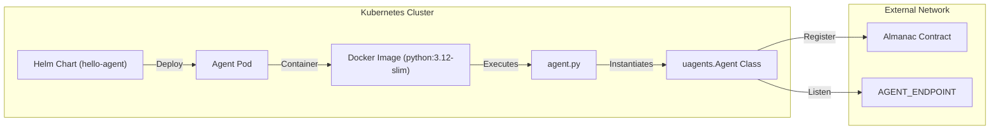

<!-- source: DeepWiki mcp.deepwiki.com · repo fetchai/uAgents · page 7.3 Deployment · fetched 2026-10-26 -->

# Deployment

<details>
<summary>Relevant source files</summary>

The following files were used as context for generating this wiki page:

- [python/deployment/docker/Dockerfile](python/deployment/docker/Dockerfile)
- [python/deployment/docker/onbuild.Dockerfile](python/deployment/docker/onbuild.Dockerfile)
- [python/deployment/hello-agent/.dockerignore](python/deployment/hello-agent/.dockerignore)
- [python/deployment/hello-agent/README.md](python/deployment/hello-agent/README.md)
- [python/deployment/hello-agent/agent.py](python/deployment/hello-agent/agent.py)
- [python/deployment/hello-agent/requirements.txt](python/deployment/hello-agent/requirements.txt)
- [python/deployment/helm/uagent/.helmignore](python/deployment/helm/uagent/.helmignore)
- [python/deployment/helm/uagent/Chart.yaml](python/deployment/helm/uagent/Chart.yaml)

</details>


This page documents the strategies and configurations for deploying uAgents into production environments. The framework supports containerization via Docker and orchestration through Kubernetes using Helm charts. A reference implementation, `hello-agent`, is provided to demonstrate these deployment patterns.

## Overview of Deployment Architecture

Deploying a uAgent involves wrapping the Python agent logic into a portable unit that can interact with the Fetch.ai network. The deployment process typically focuses on configuring environment variables that the `Agent` class uses for initialization, such as network settings, identity (seed), and communication modes (Mailbox vs. HTTP).

### Natural Language to Code Entity Space: Agent Initialization
The following diagram illustrates how deployment configuration (environment variables) maps to the `Agent` class instantiation.

| System Concept | Code Entity / Variable | File Reference |
| :--- | :--- | :--- |
| Agent Identity | `AGENT_SEED` / `seed` | [python/deployment/hello-agent/agent.py:6-14]() |
| Network Context | `AGENT_NETWORK` / `network` | [python/deployment/hello-agent/agent.py:8-18]() |
| Communication Mode | `AGENT_TYPE` / `mailbox` | [python/deployment/hello-agent/agent.py:7-15]() |
| Public Endpoint | `AGENT_ENDPOINT` / `endpoint` | [python/deployment/hello-agent/agent.py:9-17]() |

```mermaid
graph TD
    ENV["Environment Variables (OS)"] -->|UAGENT_NAME| A["Agent(name=...)"]
    ENV -->|UAGENT_SEED| A
    ENV -->|UAGENT_NETWORK| A
    ENV -->|UAGENT_TYPE| MBX{"Type == 'mailbox'?"}
    MBX -->|Yes| A["Agent(mailbox=True)"]
    MBX -->|No| A["Agent(mailbox=False)"]
    A -->|on_event('startup')| LOG["ctx.logger.info('Agent has started')"]
    A -->|run()| LOOP["Event Loop"]

    subgraph "Code Entities"
    A
    LOG
    LOOP
    end
```
**Sources:** [python/deployment/hello-agent/agent.py:5-34]()

---

## Docker Containerization

The primary method for deploying uAgents is through Docker. This ensures a consistent runtime environment across different host systems.

### Standard Dockerfile
The standard deployment uses a `python:3.12-slim-bookworm` base image to minimize footprint. The build process installs dependencies from `requirements.txt` and sets the entrypoint to the agent's execution script.

*   **Base Image**: `python:3.12-slim-bookworm` [python/deployment/docker/Dockerfile:1]()
*   **Working Directory**: `/agent` [python/deployment/docker/Dockerfile:3]()
*   **Entrypoint**: `python3 /agent/agent.py` [python/deployment/docker/Dockerfile:10]()

### On-Build Pattern
The repository also provides an `onbuild.Dockerfile` variant. This utilizes Docker's `ONBUILD` triggers to simplify child images. When a developer uses this as a base image, it automatically copies `requirements.txt`, runs `pip install`, and copies the source code without needing explicit commands in the child Dockerfile.

**Sources:** [python/deployment/docker/Dockerfile:1-11](), [python/deployment/docker/onbuild.Dockerfile:1-11]()

---

## Kubernetes and Helm Configuration

For scaling and managing multiple agents, uAgents provides a Helm chart template located in `python/deployment/helm/uagent/`.

### Chart Structure
The Helm chart is defined as an `application` type [python/deployment/helm/uagent/Chart.yaml:13](). It tracks both the chart version and the `appVersion`, which corresponds to the container image version [python/deployment/helm/uagent/Chart.yaml:18-24]().

### Deployment Workflow Diagram
This diagram maps the Kubernetes deployment components to the uAgent lifecycle.


**Sources:** [python/deployment/helm/uagent/Chart.yaml:1-24](), [python/deployment/hello-agent/agent.py:12-20]()

---

## Reference Deployment: hello-agent

The `hello-agent` directory provides a complete, deployable example of a uAgent.

### Configuration via Environment
The agent logic is designed to be fully configurable without code changes by fetching values from the environment:
*   **`UAGENT_NAME`**: The identifier for the agent (defaults to "agent") [python/deployment/hello-agent/agent.py:5]().
*   **`UAGENT_SEED`**: The secret seed for identity generation [python/deployment/hello-agent/agent.py:6]().
*   **`UAGENT_TYPE`**: Determines if the agent uses a `mailbox` (for agents behind NAT) or a `proxy` [python/deployment/hello-agent/agent.py:15-16]().
*   **`UAGENT_ENDPOINT`**: The URL where the agent receives messages [python/deployment/hello-agent/agent.py:9]().

### Implementation Details
The agent utilizes standard lifecycle decorators:
1.  **`on_event("startup")`**: Triggered when the agent starts, used for logging initialization [python/deployment/hello-agent/agent.py:23-25]().
2.  **`on_interval(period=5)`**: A periodic task that logs "Agent is still alive" every 5 seconds to verify the container is running correctly [python/deployment/hello-agent/agent.py:28-30]().

### Exclusion Rules
To keep images lean, the deployment includes `.dockerignore` and `.helmignore` files to exclude local virtual environments (`.venv`), git history (`.git`), and metadata files (`.toml`, `.lock`) from the build context.

**Sources:** [python/deployment/hello-agent/agent.py:1-34](), [python/deployment/hello-agent/.dockerignore:1-13](), [python/deployment/helm/uagent/.helmignore:1-23]()

---

