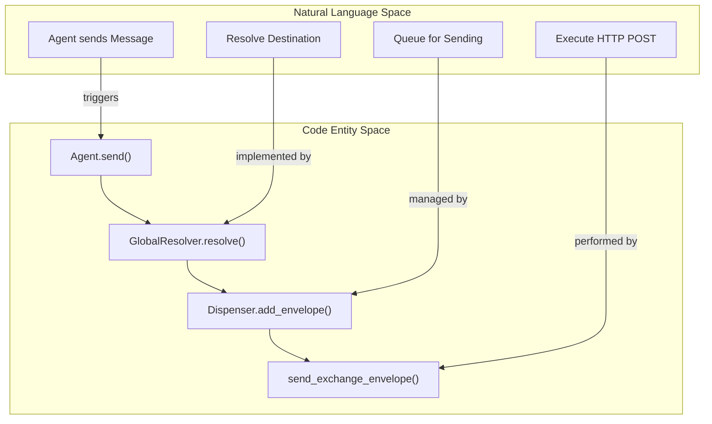
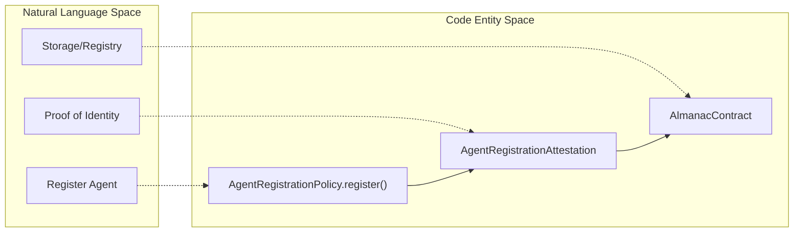

<!-- source: DeepWiki mcp.deepwiki.com · repo fetchai/uAgents · page 8 Glossary · fetched 2026-10-26 -->

# Glossary

Relevant source files

The following files were used as context for generating this wiki page:

- [CONTRIBUTING.md](CONTRIBUTING.md)
- [DEVELOPING.md](DEVELOPING.md)
- [LICENSE](LICENSE)
- [README.md](README.md)
- [python/docs/api/uagents/agent.md](python/docs/api/uagents/agent.md)
- [python/docs/api/uagents/asgi.md](python/docs/api/uagents/asgi.md)
- [python/docs/api/uagents/communication.md](python/docs/api/uagents/communication.md)
- [python/docs/api/uagents/dispatch.md](python/docs/api/uagents/dispatch.md)
- [python/docs/api/uagents/registration.md](python/docs/api/uagents/registration.md)
- [python/docs/api/uagents/types.md](python/docs/api/uagents/types.md)
- [python/src/uagents/agent.py](python/src/uagents/agent.py)
- [python/src/uagents/communication.py](python/src/uagents/communication.py)
- [python/src/uagents/config.py](python/src/uagents/config.py)
- [python/src/uagents/crypto/__init__.py](python/src/uagents/crypto/__init__.py)
- [python/src/uagents/dispatch.py](python/src/uagents/dispatch.py)
- [python/src/uagents/network.py](python/src/uagents/network.py)
- [python/src/uagents/registration.py](python/src/uagents/registration.py)
- [python/src/uagents/types.py](python/src/uagents/types.py)
- [python/tests/test_flakey_network_registration.py](python/tests/test_flakey_network_registration.py)
- [python/tests/test_registration.py](python/tests/test_registration.py)
- [python/uagents-adapter/README.md](python/uagents-adapter/README.md)
- [python/uagents-adapter/pyproject.toml](python/uagents-adapter/pyproject.toml)
- [python/uagents-core/README.md](python/uagents-core/README.md)
- [python/uagents-core/poetry.lock](python/uagents-core/poetry.lock)
- [python/uagents-core/pyproject.toml](python/uagents-core/pyproject.toml)

This page provides definitions for codebase-specific terms, jargon, and domain concepts essential for an onboarding engineer. It includes technical details on implementation and data flow, along with pointers to the relevant classes and files.

## Core Framework Concepts

### Agent
An autonomous entity that performs tasks on a schedule or in response to events [README.md:6-7](). In the codebase, the `Agent` class is the primary interface for developers, inheriting from `Sink` to handle incoming messages [python/src/uagents/agent.py:223-224]().
*   **Agent Identifier**: A string combining the network prefix and the agent's bech32 address (e.g., `agent1...` or `test-agent1...`) [python/src/uagents/agent.py:203-211]().
*   **Identity**: A cryptographic object containing the agent's private key and address, used for signing envelopes and registration attestations [python/src/uagents/agent.py:150-157]().

### Context (`ctx`)
A temporary object provided to every handler (interval, message, or event) that gives the agent access to its internal state, messaging functions, and logger [python/src/uagents/agent.py:42-47](). It acts as the bridge between the handler logic and the `Agent` instance [python/src/uagents/agent.py:153-153]().

### Model
A Pydantic-based class used to define the schema of a message. Every message sent between agents must be an instance of a `Model` [python/src/uagents/agent.py:20-20](). The framework uses these models to generate a `schema_digest` for message validation [python/src/uagents/types.py:54-67]().

---

## Communication and Routing

### Envelope
The standard container for agent-to-agent communication. It wraps the message payload with metadata including the sender, target, session ID, schema digest, and a cryptographic signature [python/src/uagents/types.py:69-78]().
*   **Source**: `uagents_core.envelope.Envelope` [python/src/uagents/communication.py:11-11]().

### Dispenser
A component responsible for managing the asynchronous queue of outbound envelopes. It processes the queue and sends envelopes to their resolved endpoints via HTTP [python/src/uagents/communication.py:25-31]().

### Dispatcher
The internal routing engine that directs incoming messages to the appropriate handlers based on the message's schema digest [python/src/uagents/dispatch.py:48-48]().

### Resolver
A service used to translate an agent's bech32 address into a list of reachable network endpoints [python/src/uagents/agent.py:76-76](). The `GlobalResolver` typically queries the Almanac contract or Agentverse API [python/src/uagents/resolver.py:18-18]().

### Natural Language to Code Entity Mapping: Communication
The following diagram illustrates how high-level communication concepts map to specific code entities.

**Communication Flow: Message Sending**

**Sources:** [python/src/uagents/agent.py:231-231](), [python/src/uagents/communication.py:25-50](), [python/src/uagents/communication.py:127-130]().

---

## Registration and Discovery

### Almanac
A smart contract deployed on the Fetch.ai blockchain (Mainnet and Testnet) that serves as a decentralized directory of agents and their endpoints [python/src/uagents/config.py:15-26](). Agents register their availability here to be discoverable by others [python/src/uagents/network.py:213-220]().

### Registration Policy
A strategy determining how and where an agent registers itself. 
*   **AlmanacApiRegistrationPolicy**: Registers the agent via a centralized API (Agentverse) [python/src/uagents/registration.py:109-118]().
*   **LedgerBasedRegistrationPolicy**: Registers the agent directly on the blockchain by submitting a transaction to the Almanac contract [python/src/uagents/agent.py:73-73]().

### Attestation
A signed data structure (`AgentRegistrationAttestation`) used to prove that an agent identity (address) authorizes a specific set of protocols and endpoints [python/src/uagents/registration.py:139-147]().

**Registration Logic Mapping**

**Sources:** [python/src/uagents/registration.py:109-167](), [python/src/uagents/network.py:213-220]().

---

## Technical Abbreviations & Jargon

| Term | Definition | Code Pointer |
| :--- | :--- | :--- |
| **ASGI** | Asynchronous Server Gateway Interface. Used by agents to host a web server for receiving messages. | [python/src/uagents/asgi.py:30-30]() |
| **Bech32** | The address format used for Fetch.ai agent and wallet addresses (starts with `agent1...` or `fetch1...`). | [python/uagents-core/pyproject.toml:18-18]() |
| **Digest** | A SHA-256 hash (usually of a Model schema) used to uniquely identify message types. | [python/src/uagents/types.py:61-61]() |
| **Mailbox** | A service (Agentverse) that buffers messages for agents that are not continuously online or are behind a NAT. | [python/src/uagents/mailbox.py:52-52]() |
| **Sink** | A base class for entities that can receive and process message envelopes. | [python/src/uagents/agent.py:223-223]() |
| **Testnet** | A non-production blockchain network (Fetch.ai "Dorado") used for development and testing. | [python/src/uagents/config.py:11-11]() |

---

## Infrastructure and Tooling

### uagents-core
A lightweight package containing the fundamental data models and cryptographic primitives (Identity, Envelope, Model) required for agent interaction, without the full runtime overhead of the `uagents` library [python/uagents-core/README.md:105-106]().

### uagents-adapter
A package providing integration layers for third-party frameworks like LangChain, CrewAI, and the Model Context Protocol (MCP) [python/uagents-adapter/pyproject.toml:2-4]().

### LedgerClient
The component from the `cosmpy` library used to interact with the Fetch.ai blockchain for querying balances and executing contract transactions [python/src/uagents/network.py:10-16]().

**Sources:**
*   `Agent` and `Identity` definitions: [python/src/uagents/agent.py:1-240]()
*   Registration and Attestations: [python/src/uagents/registration.py:1-200]()
*   Communication and Envelopes: [python/src/uagents/communication.py:1-150]()
*   Network and Contracts: [python/src/uagents/network.py:1-220]()
*   Configuration and Prefixes: [python/src/uagents/config.py:1-100]()