# Page: uAgents Overview

# uAgents Overview

<details>
<summary>Relevant source files</summary>

The following files were used as context for generating this wiki page:

- [CONTRIBUTING.md](CONTRIBUTING.md)
- [DEVELOPING.md](DEVELOPING.md)
- [LICENSE](LICENSE)
- [README.md](README.md)
- [python/pyproject.toml](python/pyproject.toml)
- [python/uagents-core/README.md](python/uagents-core/README.md)
- [python/uagents-core/poetry.lock](python/uagents-core/poetry.lock)
- [python/uagents-core/pyproject.toml](python/uagents-core/pyproject.toml)
- [python/uv.lock](python/uv.lock)

</details>


This document provides a comprehensive introduction to the uAgents framework, its purpose, key components, and how they work together. uAgents is a lightweight Python framework developed by Fetch.ai for creating autonomous AI agents that can communicate with each other, execute tasks on schedules, and respond to events.

## Purpose and Scope

The uAgents framework enables developers to build intelligent, autonomous software agents that can:

- Operate with their own identity and decision-making capabilities.
- Communicate with other agents through secure message exchange.
- Perform scheduled tasks and react to events.
- Register on the Fetch.ai blockchain for global discovery.
- Maintain persistent state across executions.

The framework is divided into three primary packages:
1.  `uagents`: The high-level framework providing the `Agent` class, decorators, and runtime [python/pyproject.toml:1-4]().
2.  `uagents-core`: Low-level definitions for agent identity, Agentverse API interaction, and basic registration [python/uagents-core/pyproject.toml:1-4]().
3.  `uagents-adapter`: (Integrated via dependencies) Provides bridges to external AI systems like LangChain and CrewAI.

For details on getting started, see [Installation and Setup](#1.1). For an in-depth look at the architecture, see [Key Concepts](#1.2).

## Framework Overview

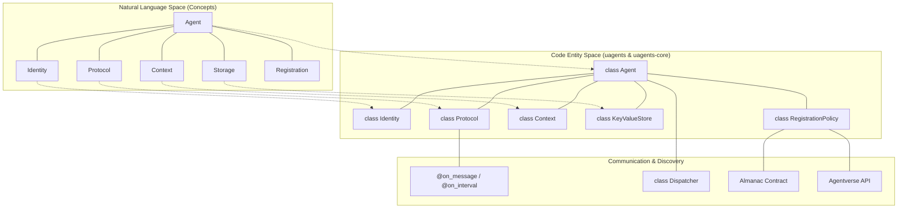

The uAgents framework provides a foundation for building autonomous agents with secure identity, communication capabilities, persistence, and discoverability. It's designed to be lightweight yet powerful, with a focus on simplicity and extensibility.

Sources: `python/pyproject.toml`, `python/uagents-core/pyproject.toml`, `README.md`

## Package Relationships

The framework is modularized to separate core logic from the high-level developer experience:

| Package | Responsibility | Key Classes/Functions |
| :--- | :--- | :--- |
| `uagents` | High-level API, runtime, and local persistence. | `Agent`, `Bureau`, `Protocol`, `Context` |
| `uagents-core` | Cryptographic identity, Agentverse API, and CLI. | `Identity`, `register_chat_agent()`, `av` CLI |
| `uagents-ai-engine` | Integration with Fetch.ai AI Engine. | `AiEngine` |

Sources: `python/pyproject.toml:14-20()`, `python/uagents-core/pyproject.toml:35-36()`, `python/uagents-core/README.md:158-162()`

## Core Components

The uAgents framework consists of several key components that work together to create the agent ecosystem.

### Agent Class
The `Agent` class is the central element that ties together all other components. An agent has its own identity, can include multiple protocols, maintains persistent storage, and can communicate with other agents [README.md:29-31]().

Key features include:
- **Identity**: Unique cryptographic address derived from a seed [README.md:33-40]().
- **Event Loop**: Handles intervals (`@on_interval`) and messages (`@on_message`) [README.md:47-49]().
- **Registration**: Automatically joins the network via the Almanac smart contract [README.md:11-12]().

For details, see [Agent Class](#2.1).

### Identity and Addressing
Each agent has a unique cryptographic identity provided by the `uagents-core` library. It enables:
- **Deterministic Addresses**: Created from a seed phrase [python/uagents-core/README.md:60-64]().
- **Message Signing**: Ensuring authenticity and non-repudiation [python/uagents-core/README.md:69-71]().

Sources: `python/uagents-core/README.md:56-71()`

### Protocol System
The `Protocol` system defines the communication patterns between agents. It encapsulates message models (Pydantic), handlers, and allowed response patterns.

Sources: `python/pyproject.toml:16()`

### Context System
The `Context` provides the execution environment for agent code. It gives handlers access to the agent's logger, storage, and messaging methods [README.md:48-49]().

For details, see [Context System](#2.2).

## Agent Communication

Agents communicate through a secure messaging system built on HTTP (via `uvicorn` and `aiohttp`), with a layered approach to message handling [python/pyproject.toml:17-18]().

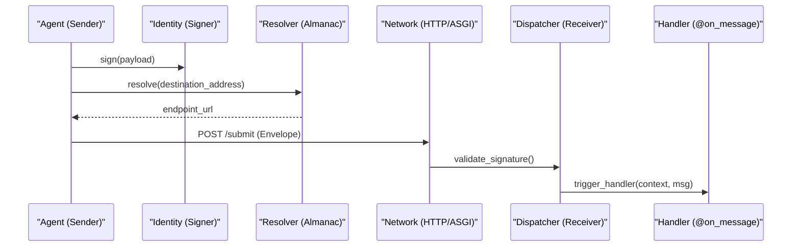

### Message Envelopes
Messages are wrapped in an `Envelope` (defined in `uagents-core`) that includes sender/receiver addresses and cryptographic signatures.

Sources: `python/uagents-core/README.md:48-54()`

## Agent Registration and Discovery

Agents can register with the **Almanac contract** on the Fetch.ai blockchain or the **Agentverse API** for discovery. Registrations via the Agentverse v2 API are permanent and do not require periodic refreshes [python/uagents-core/README.md:48-54]().

The `av` CLI tool (part of `uagents-core`) allows developers to troubleshoot address resolution and inspect registration details [python/uagents-core/README.md:134-142]().

Sources: `python/uagents-core/README.md:13-44()`, `python/uagents-core/pyproject.toml:35-36()`

## Storage and Persistence

Agents maintain state using a key-value storage system. This allows data to persist between agent restarts and across different event handler executions.

For details, see [Storage System](#2.4).

## Security Features

The uAgents framework provides several security features:
1.  **Cryptographic Identity**: Unique identity derived from seeds [README.md:33-40]().
2.  **Message Signing**: All envelopes are signed using the agent's private key [python/uagents-core/README.md:69-71]().
3.  **Verification**: Automatic signature verification on incoming messages via the ASGI server.

Sources: `README.md:12()`, `python/uagents-core/README.md:56-71()`

## Summary

The uAgents framework provides a powerful yet lightweight foundation for building autonomous agents. By combining the high-level `uagents` framework with the low-level `uagents-core` components, developers can create secure, discoverable, and persistent AI agents.

- To begin building, see [Installation and Setup](#1.1).
- To understand the underlying mechanics, see [Key Concepts](#1.2).

---

# Page: Installation and Setup

# Installation and Setup

<details>
<summary>Relevant source files</summary>

The following files were used as context for generating this wiki page:

- [CONTRIBUTING.md](CONTRIBUTING.md)
- [DEVELOPING.md](DEVELOPING.md)
- [LICENSE](LICENSE)
- [README.md](README.md)
- [python/.pre-commit-config.yaml](python/.pre-commit-config.yaml)
- [python/pyproject.toml](python/pyproject.toml)
- [python/src/uagents/setup.py](python/src/uagents/setup.py)
- [python/uv.lock](python/uv.lock)

</details>


This page provides comprehensive instructions for installing the `uAgents` framework and setting up your development environment. It covers system requirements, installation methods using modern Python tooling like `uv`, and configuration for both users and contributors.

## System Requirements

Before installing `uAgents`, ensure your system meets these requirements:

| Component | Requirement |
|-----------|-------------|
| Python    | 3.10 - 3.13 |
| Operating System | Windows, macOS, or Linux |
| Dependency Manager | `pip` or `uv` (recommended) |

Sources: [python/pyproject.toml:13-13](), [python/uv.lock:3-3](), [README.md:18-18]()

## Installation Methods

### Using pip

The standard way to install the framework is via `pip`:

```bash
pip install uagents
```

### Optional Dependencies
The framework supports optional features defined in `pyproject.toml`:
- **`all`**: Includes `litellm` for advanced AI features [python/pyproject.toml:23-25]().
- **`llm`**: Specific support for `litellm` [python/pyproject.toml:27-27]().

Sources: [README.md:20-20](), [python/pyproject.toml:22-27]()

---

## Development Environment Setup

For developers contributing to the codebase, the project uses `uv` for lightning-fast dependency management and `pre-commit` for maintaining code quality.

### 1. Clone the Repository
```bash
git clone https://github.com/fetchai/uAgents.git
cd uAgents/python
```

### 2. Initialize with uv
The project provides a `uv.lock` file to ensure reproducible environments [python/uv.lock:1-2](). Run the following to sync dependencies and set up the virtual environment:

```bash
uv sync
```

### 3. Install Pre-commit Hooks
The project uses `ruff` for linting and formatting, and `pyupgrade` to maintain modern Python syntax. These are enforced via `pre-commit` [python/.pre-commit-config.yaml:1-13]().

```bash
uv run pre-commit install
```

### 4. Running Tests
The test suite uses `pytest` and `pytest-asyncio` [python/pyproject.toml:37-38]().
```bash
uv run pytest
```

Sources: [DEVELOPING.md:18-35](), [DEVELOPING.md:52-56](), [python/pyproject.toml:34-44]()

---

## Code Entity Space: Installation & Tooling

The following diagram bridges the natural language requirements to the specific files and tools used in the codebase.

```mermaid
graph TD
    subgraph "DependencyManagement"
        A["pyproject.toml"] -- "Defines" --> B["[project.dependencies]"]
        A -- "Defines" --> C["[dependency-groups.dev]"]
        D["uv.lock"] -- "Pins" --> E["Exact Versions"]
    end

    subgraph "QualityControl"
        F[".pre-commit-config.yaml"] -- "Hooks" --> G["ruff-pre-commit"]
        F -- "Hooks" --> H["pyupgrade"]
        I["ruff"] -- "Rules" --> J["tool.ruff.lint"]
    end

    subgraph "CorePackages"
        K["uagents-core"] -- "Internal Dependency" --> B
        L["cosmpy"] -- "Ledger Interaction" --> B
    end

    B --- "uagents-core >= 0.4.6"
    C --- "pytest, ruff, pre-commit"
```

Sources: [python/pyproject.toml:14-20](), [python/pyproject.toml:35-44](), [python/pyproject.toml:56-73](), [python/.pre-commit-config.yaml:1-13]()

---

## Basic Configuration & Verification

### Creating your first Agent
The `Agent` class is the primary entry point. It can be initialized with a `name` and a `seed` for deterministic identity [README.md:30-36]().

```python
import os
from uagents import Agent, Context

# Initialize Agent
alice = Agent(name="alice", seed=os.getenv("ALICE_SEED"))

# Define a task
@alice.on_interval(period=2.0)
async def say_hello(ctx: Context):
    ctx.logger.info(f"Hello, I am {ctx.agent.name}")

if __name__ == "__main__":
    alice.run()
```

### Identity and Keys
If no `seed` is provided, the agent generates a random identity and stores the private key in a local `private_keys.json` file [README.md:39-40]().

### Automated Funding (Testnet)
For agents operating on the Fetch.ai testnet, the `fund_agent_if_low` utility in `setup.py` can automatically request funds from a faucet if the balance falls below `TESTNET_REGISTRATION_FEE` [python/src/uagents/setup.py:16-31]().

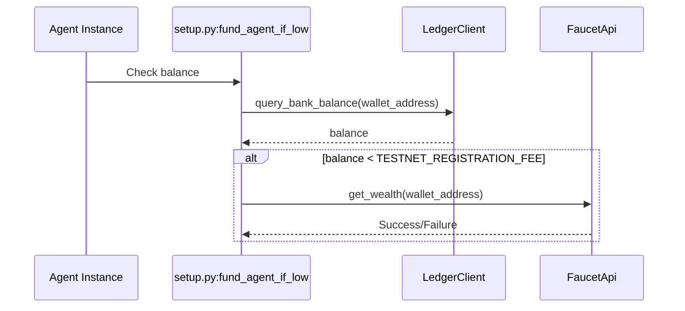

Sources: [README.md:29-70](), [python/src/uagents/setup.py:16-38](), [python/src/uagents/setup.py:9-10]()

---

## Development Guidelines

### Linting and Formatting
The project strictly uses `ruff` for both linting and formatting [python/pyproject.toml:53-54](). You can run these manually:

```bash
uv run ruff check --fix
uv run ruff format
```

### Commit Convention
Contributors must follow **Conventional Commits v1.0.0**. Supported types include:
- `feat`: New features
- `fix`: Bug fixes
- `docs`: Documentation changes
- `chore`: Maintenance tasks

Sources: [DEVELOPING.md:41-48](), [CONTRIBUTING.md:137-152]()

---

## Troubleshooting

| Symptom | Cause | Resolution |
| :--- | :--- | :--- |
| `ModuleNotFoundError: No module named 'uagents'` | Environment mismatch | Ensure `uv sync` was run and you are using `uv run` or the correct `.venv`. |
| Pre-commit failures | Linting/Formatting errors | Run `uv run ruff check --fix && uv run ruff format` before committing [DEVELOPING.md:47-48](). |
| Faucet errors | Testnet congestion | The `fund_agent_if_low` function will log an error if `get_wealth` fails [python/src/uagents/setup.py:36-37](). |

Sources: [DEVELOPING.md:39-48](), [python/src/uagents/setup.py:32-37]()

---

# Page: Key Concepts

# Key Concepts

<details>
<summary>Relevant source files</summary>

The following files were used as context for generating this wiki page:

- [CONTRIBUTING.md](CONTRIBUTING.md)
- [DEVELOPING.md](DEVELOPING.md)
- [LICENSE](LICENSE)
- [README.md](README.md)
- [python/docs/api/uagents/agent.md](python/docs/api/uagents/agent.md)
- [python/src/uagents/agent.py](python/src/uagents/agent.py)
- [python/uagents-core/README.md](python/uagents-core/README.md)
- [python/uagents-core/poetry.lock](python/uagents-core/poetry.lock)
- [python/uagents-core/pyproject.toml](python/uagents-core/pyproject.toml)

</details>


This document covers the fundamental concepts and architecture of the uAgents framework. These concepts form the building blocks for creating autonomous AI agents that can communicate, collaborate, and perform tasks within the uAgents ecosystem.

## Agents

An `Agent` is the fundamental entity in the uAgents framework. Each agent is an autonomous software entity with its own identity, capabilities, and lifecycle. Agents can perform tasks on schedules, respond to messages, and interact with external services.

### Agent Identity and Lifecycle

The `Agent` class inherits from `Sink` [python/src/uagents/agent.py:223-223]() and manages the core components required for autonomous operation.

**Code Entity Space Mapping**
| System Concept | Code Entity | File Reference |
|:---|:---|:---|
| Identity | `Identity` | [python/src/uagents/agent.py:19]() |
| Wallet | `LocalWallet` | [python/src/uagents/agent.py:14]() |
| Persistence | `KeyValueStore` | [python/src/uagents/agent.py:77]() |
| Internal Logic | `Protocol` | [python/src/uagents/agent.py:65]() |

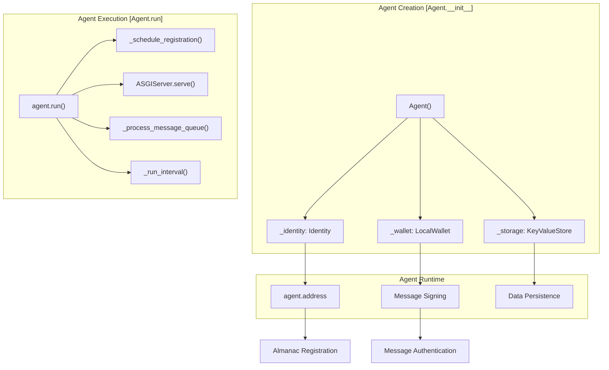

Each agent has a unique address derived from its cryptographic identity, which serves as its identifier in the network [python/src/uagents/agent.py:175-210](). The agent manages its own wallet for blockchain interactions and maintains local storage for persistent data.

**Sources:** [python/src/uagents/agent.py:223-492](), [python/src/uagents/agent.py:517-546](), [python/src/uagents/agent.py:621-628]()

### Agent Configuration

Agents are configured through constructor parameters that define their network behavior, endpoints, and capabilities:

| Parameter | Type | Purpose |
|-----------|------|---------|
| `name` | `str` | Human-readable identifier |
| `seed` | `str` | Deterministic key generation [python/src/uagents/agent.py:517-525]() |
| `endpoint` | `str \| list[str]` | Communication endpoints for registration [python/src/uagents/agent.py:243]() |
| `mailbox` | `bool` | Enable mailbox for NAT traversal [python/src/uagents/agent.py:245]() |
| `network` | `"mainnet" \| "testnet"` | Blockchain network selection [python/src/uagents/agent.py:252]() |
| `registration_policy` | `AgentRegistrationPolicy` | Registration strategy [python/src/uagents/agent.py:248]() |

**Sources:** [python/src/uagents/agent.py:240-265]()

## Protocols

A `Protocol` defines a set of behaviors and message handlers that agents can include to gain specific capabilities. Protocols encapsulate the logic for handling particular types of interactions and can be shared across multiple agents.

### Protocol Structure

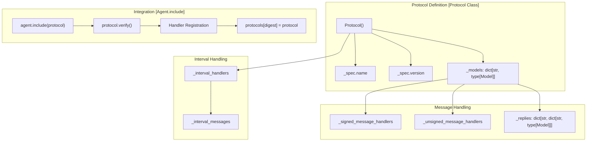

Protocols use decorators to register message and interval handlers, creating a declarative way to define agent behavior.

**Sources:** [python/src/uagents/protocol.py:18-58](), [python/src/uagents/agent.py:621-650]()

### Message and Interval Handlers

Protocols provide decorators for registering different types of handlers:

- `@protocol.on_message(model)` - Handle incoming messages of a specific type [python/src/uagents/protocol.py:327-361]()
- `@protocol.on_interval(period)` - Execute tasks at regular intervals [python/src/uagents/protocol.py:363-395]()
- `@protocol.on_query(model)` - Handle synchronous query-response patterns [python/src/uagents/protocol.py:299-325]()

## Contexts

The `Context` system provides agents with access to their runtime environment and capabilities during message and interval handling. There are two main context types: `InternalContext` for proactive behavior and `ExternalContext` for reactive message handling.

### Context Hierarchy

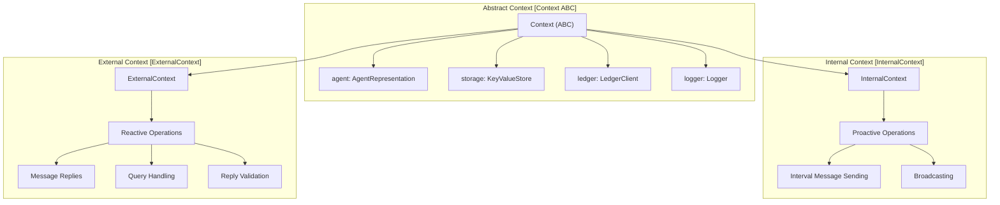

The context abstracts the agent's capabilities and provides a consistent interface for handlers to interact with the agent's state and external services.

**Sources:** [python/src/uagents/context.py:37-265](), [python/src/uagents/context.py:267-576]()

### Context Operations

Key operations available through contexts include:

- `send(destination, message)` - Send messages to other agents [python/src/uagents/context.py:172-189]()
- `broadcast(protocol, message)` - Send messages to all agents supporting a protocol [python/src/uagents/context.py:136-159]()
- `get_agents_by_protocol(digest)` - Discovery of agents by protocol [python/src/uagents/context.py:343-368]()
- `send_and_receive(destination, message, response_type)` - Synchronous communication [python/src/uagents/context.py:222-244]()

## Communication

The communication system handles secure message exchange between agents through envelopes, which contain signed and encrypted message payloads.

### Message Flow Architecture

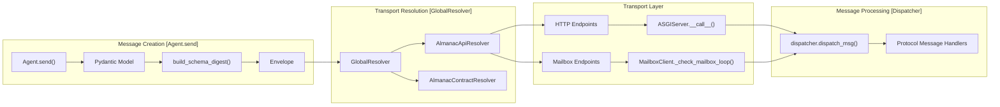

The communication flow involves message creation, address resolution, transport selection, and final dispatch to appropriate handlers.

**Sources:** [python/src/uagents/communication.py:101-165](), [python/src/uagents/asgi.py:276-411](), [python/src/uagents/dispatch.py:49-87]()

### Envelope Structure

Messages are wrapped in `Envelope` objects defined in `uagents-core` that provide:

- **Version**: Protocol version for compatibility
- **Sender/Target**: Agent addresses for routing  
- **Session**: UUID for correlation and response tracking
- **Schema Digest**: Message type identifier
- **Signature**: Cryptographic authentication
- **Payload**: Encrypted message content

**Sources:** [python/src/uagents/communication.py:530-540](), [python/uagents-core/README.md:123-132]()

## Registration and Discovery

Agents register themselves for discovery through the Almanac system, which maintains a registry of active agents and their capabilities on the Fetch.ai blockchain.

### Registration Architecture

The framework supports multiple registration policies including `DefaultRegistrationPolicy`, `LedgerBasedRegistrationPolicy`, and `AlmanacApiRegistrationPolicy` [python/src/uagents/registration.py:66-73]().

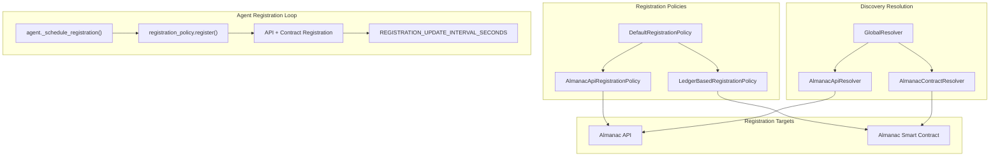

The registration system uses a dual approach, registering with both the fast Almanac API and the decentralized blockchain contract for redundancy and performance.

**Sources:** [python/src/uagents/registration.py](), [python/src/uagents/agent.py:814-831](), [python/src/uagents/resolver.py]()

## Storage

Agents have access to persistent storage through the `KeyValueStore` interface, allowing them to maintain state between executions. By default, agents store their state in a local file-based store [python/src/uagents/storage.py:77]().

**Sources:** [python/src/uagents/storage.py](), [python/src/uagents/agent.py:360](), [python/src/uagents/agent.py:661-668]()

## Identity and Security

The uAgents framework uses cryptographic identities for secure communication and authentication. The `Identity` class in `uagents-core` provides methods for key derivation and message signing [python/uagents-core/README.md:56-72]().

### Identity Management

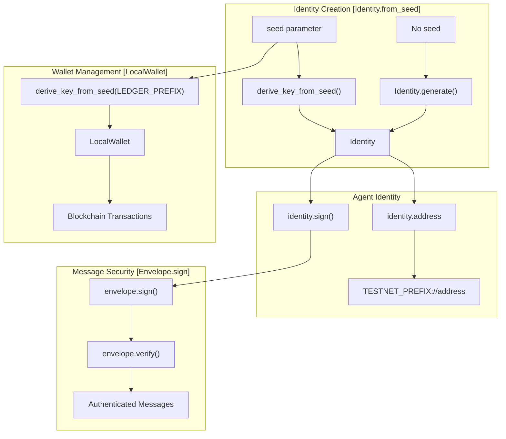

Each agent has both an identity for secure messaging and a separate wallet for blockchain transactions, providing separation of concerns for different cryptographic operations.

**Sources:** [python/src/uagents/agent.py:517-546](), [python/src/uagents/agent.py:736-758](), [python/uagents-core/README.md:56-72]()

---

# Page: Core Components

# Core Components

<details>
<summary>Relevant source files</summary>

The following files were used as context for generating this wiki page:

- [python/docs/api/uagents/agent.md](python/docs/api/uagents/agent.md)
- [python/docs/api/uagents/context.md](python/docs/api/uagents/context.md)
- [python/docs/api/uagents/protocol.md](python/docs/api/uagents/protocol.md)
- [python/src/uagents/agent.py](python/src/uagents/agent.py)
- [python/src/uagents/context.py](python/src/uagents/context.py)
- [python/src/uagents/protocol.py](python/src/uagents/protocol.py)
- [python/tests/test_context.py](python/tests/test_context.py)
- [python/tests/test_model.py](python/tests/test_model.py)
- [python/tests/test_protocol.py](python/tests/test_protocol.py)

</details>


This document provides an overview of the main components that make up the uAgents framework. These components work together to enable agent-based systems with message handling, protocol execution, and communication capabilities.

For detailed information about specific components, see: [Agent Class](#2.1), [Context System](#2.2), [Protocol System](#2.3), and [Storage System](#2.4). For communication details, see [Communication](#3).

## Architecture Overview

The uAgents framework is built around several core components that work together to provide a complete agent runtime environment:

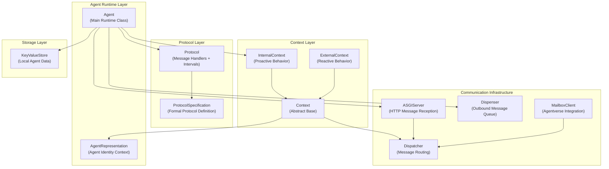

Sources: [python/src/uagents/agent.py:223-238](), [python/src/uagents/context.py:36-56](), [python/src/uagents/protocol.py:18-24](), [python/src/uagents/asgi.py:30-30](), [python/src/uagents/communication.py:31-31](), [python/src/uagents/dispatch.py:48-48]()

## Agent Runtime System

The `Agent` class serves as the main runtime container that orchestrates all other components. It manages the agent's lifecycle, identity, and coordination between subsystems.

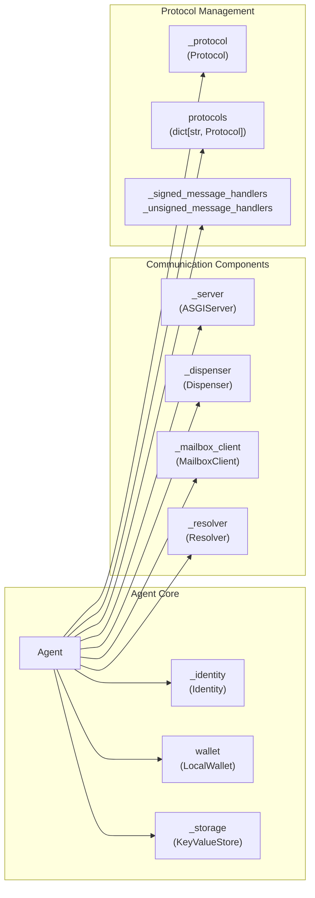

The `Agent` class initializes with configuration parameters and sets up the necessary infrastructure components. It provides methods for protocol inclusion, message handling registration, and runtime management.

Sources: [python/src/uagents/agent.py:223-492](), [python/src/uagents/agent.py:611-641]()

## Context System

The Context system provides agents with access to their state, capabilities, and communication methods. It comes in two primary forms for different behavioral patterns:

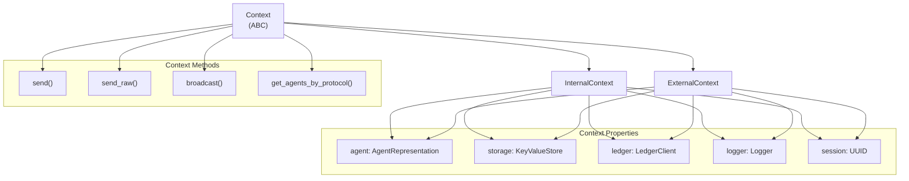

`InternalContext` is typically used for proactive behaviors like interval handlers, while `ExternalContext` handles reactive message processing with additional context like received message info (`MsgInfo`) and reply validation.

Sources: [python/src/uagents/context.py:36-56](), [python/src/uagents/context.py:267-285](), [python/src/uagents/context.py:655-675]()

## Protocol System

Protocols encapsulate sets of related message handlers and behaviors. They define what messages an agent can process and how it responds:

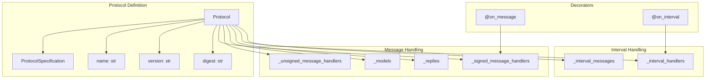

Protocols are included in agents using `agent.include(protocol)` and provide decorators for registering message and interval handlers.

Sources: [python/src/uagents/protocol.py:18-58](), [python/src/uagents/protocol.py:236-240](), [python/src/uagents/protocol.py:308-312]()

## Communication Infrastructure

The communication system handles message routing, delivery, and reception through multiple transport mechanisms:

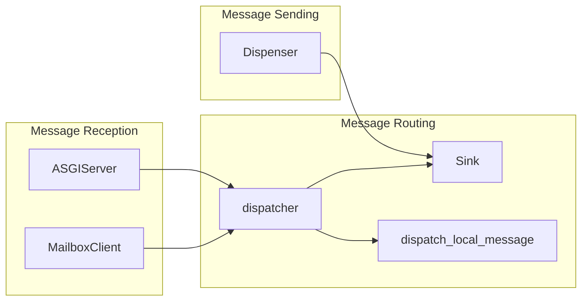

The `ASGIServer` handles incoming HTTP requests, while the `dispatcher` routes messages to appropriate `Sink` implementations (like the `Agent`). The `Dispenser` manages asynchronous outbound message delivery.

Sources: [python/src/uagents/asgi.py:30-30](), [python/src/uagents/dispatch.py:48-48](), [python/src/uagents/communication.py:31-31](), [python/src/uagents/agent.py:223-223]()

## Storage System

The framework provides persistent storage capabilities for agent state:

| Storage Type | Class | Purpose |
|--------------|-------|---------|
| Local | `KeyValueStore` | Agent state, private keys, and configuration |

`KeyValueStore` is the primary mechanism for agents to persist data across restarts. It is accessible through the `Context` during handler execution.

Sources: [python/src/uagents/storage.py:15-88](), [python/src/uagents/context.py:71-79]()

## Component Integration

These components work together in the agent lifecycle:

1. **Initialization**: `Agent` creates and configures all subsystems [python/src/uagents/agent.py:240-330]().
2. **Protocol Registration**: `Protocol` objects define message handling logic [python/src/uagents/protocol.py:18-24]().
3. **Message Reception**: `ASGIServer` or `MailboxClient` receive messages.
4. **Message Routing**: `dispatcher` routes to the agent's message queue [python/src/uagents/agent.py:48-48]().
5. **Handler Execution**: Message handlers execute with `Context` access [python/src/uagents/agent.py:734-750]().
6. **Response Sending**: `Dispenser` handles outbound messages [python/src/uagents/agent.py:31-31]().
7. **State Persistence**: `KeyValueStore` maintains data [python/src/uagents/storage.py:15-15]().

The modular design allows each component to be configured independently while maintaining clear interfaces between subsystems.

Sources: [python/src/uagents/agent.py:240-330](), [python/src/uagents/agent.py:734-750]()

---

# Page: Agent Class

# Agent Class

<details>
<summary>Relevant source files</summary>

The following files were used as context for generating this wiki page:

- [python/docs/api/uagents/agent.md](python/docs/api/uagents/agent.md)
- [python/src/uagents/agent.py](python/src/uagents/agent.py)
- [python/tests/test_agent.py](python/tests/test_agent.py)
- [python/tests/test_bureau.py](python/tests/test_bureau.py)

</details>


The `Agent` class is the fundamental building block of the uAgents framework, serving as a container for identity, communication capabilities, protocol handling, and storage. This page provides a detailed technical reference for the `Agent` class, covering its structure, initialization, methods, and its role in the overall system architecture.

## Class Overview

The `Agent` class represents an autonomous agent that can communicate with other agents, execute tasks on intervals, and respond to messages. It implements the `Sink` interface [python/src/uagents/agent.py:223](), allowing it to receive messages through the dispatcher system.

### Agent Class Structure

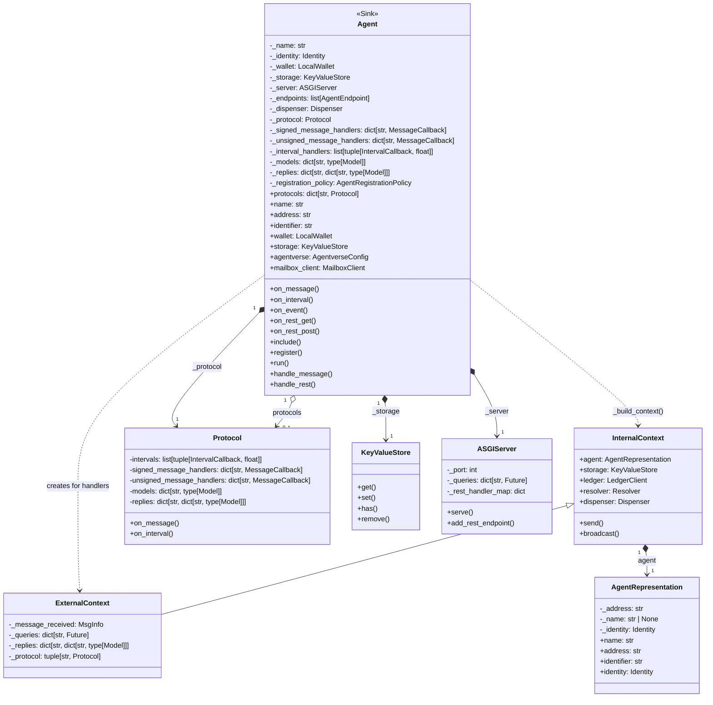

Sources: [python/src/uagents/agent.py:223-516](), [python/src/uagents/agent.py:143-222](), [python/src/uagents/context.py:267-292](), [python/src/uagents/context.py:693-730](), [python/src/uagents/asgi.py:40-67]()

## Agent Identity and Authentication

Every agent has a unique identity providing cryptographic capabilities for signing and verification. The identity is derived from a seed or generated randomly.

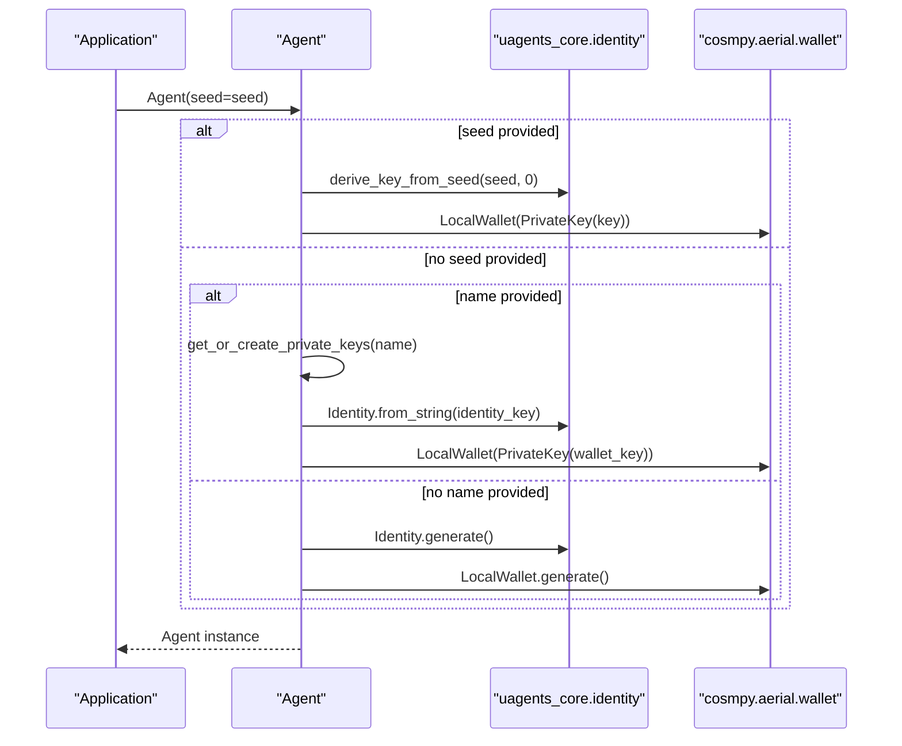

The agent has two key cryptographic components:
- **Identity**: Used for signing/verifying agent messages via `uagents_core.identity` [python/src/uagents/agent.py:19]().
- **Wallet**: Used for blockchain transactions (e.g., Almanac registration) via `cosmpy` [python/src/uagents/agent.py:13-14]().

Sources: [python/src/uagents/agent.py:517-549](), [python/src/uagents/storage.py:77]()

## Agent Initialization

The `Agent` constructor configures endpoints, resolvers, storage, and message handling [python/src/uagents/agent.py:240-493]().

### Key Constructor Parameters

| Parameter | Type | Default | Description |
|-----------|------|---------|-------------|
| `name` | str | None | The name of the agent. |
| `port` | int | 8000 | The port for the agent's ASGI server. |
| `seed` | str | None | The seed for generating cryptographic keys. |
| `endpoint` | str/list/dict | None | Endpoint configuration for reaching the agent. |
| `mailbox` | bool | False | Whether to use an Agentverse mailbox. |
| `registration_policy` | AgentRegistrationPolicy | None | Policy for Almanac registration. |
| `network` | AgentNetwork | "mainnet" | The network ("mainnet" or "testnet"). |
| `enable_agent_inspector` | bool | True | Enables REST endpoints for the Agent Inspector. |

Sources: [python/src/uagents/agent.py:240-493](), [python/src/uagents/config.py:32-41]()

## Core Components

### Storage
The `KeyValueStore` provides persistent storage. Each agent uses a store identified by its address prefix [python/src/uagents/agent.py:360]().

### Communication
- **ASGIServer** (`_server`): Handles incoming HTTP and REST requests [python/src/uagents/agent.py:30]().
- **Dispenser** (`_dispenser`): Manages outbound message queues [python/src/uagents/agent.py:31]().
- **Dispatcher** (`_dispatcher`): Routes messages internally [python/src/uagents/agent.py:48]().
- **MailboxClient** (`_mailbox_client`): Interfaces with Agentverse for agents behind NAT [python/src/uagents/agent.py:52]().

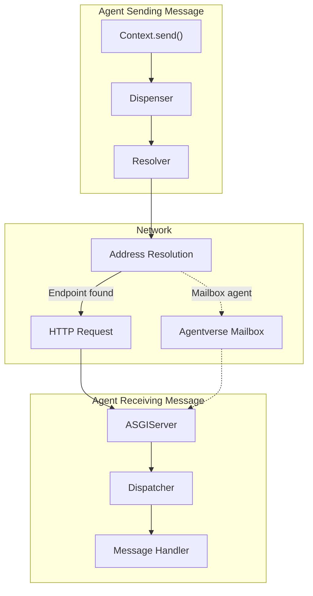

Sources: [python/src/uagents/agent.py:369-381](), [python/src/uagents/agent.py:421-427](), [python/src/uagents/context.py:453-576]()

## Message Handling

Agents use decorators to register handlers for messages, intervals, and events [python/src/uagents/agent.py:833-984]().

| Decorator | Purpose | Context Type |
|-----------|---------|--------------|
| `@on_message` | Handle incoming messages | `ExternalContext` |
| `@on_interval` | Periodic task execution | `InternalContext` |
| `@on_event` | Startup/Shutdown events | `InternalContext` |
| `@on_rest_get` | REST GET requests | `Context` |
| `@on_rest_post` | REST POST requests | `Context` |

Sources: [python/src/uagents/agent.py:833-984](), [python/tests/test_agent.py:43-130]()

## Registration System

Agents register with the Almanac contract to be discoverable. The `AgentRegistrationPolicy` governs this process [python/src/uagents/registration.py:66-75]().

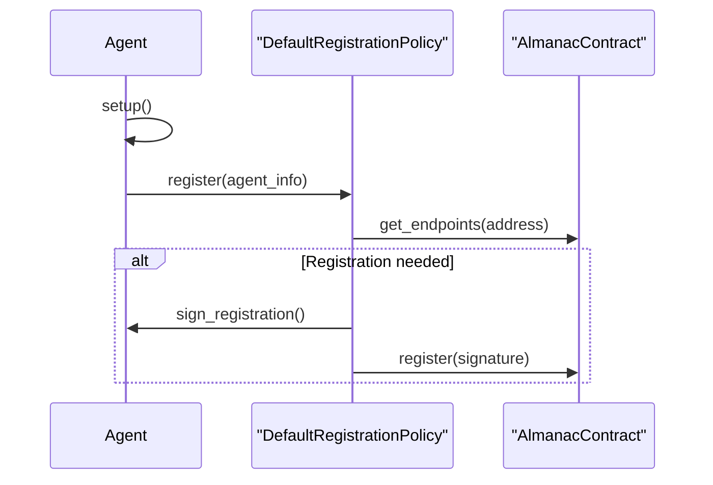

Sources: [python/src/uagents/agent.py:796-831](), [python/src/uagents/registration.py:72]()

## Bureau: Multi-Agent Container

The `Bureau` class allows running multiple agents within a single process, sharing an ASGI server and optimizing resource usage.

- **Endpoint Consolidation**: When agents are added to a Bureau, they can share the Bureau's endpoint [python/tests/test_bureau.py:38-41]().
- **Batch Registration**: The Bureau can use `BatchRegistrationPolicy` to register all contained agents in a single transaction [python/tests/test_bureau.py:60-63]().

Sources: [python/tests/test_bureau.py:28-111]()

## Agent Inspector

The Agent Inspector is a built-in REST interface enabled by `enable_agent_inspector=True` [python/src/uagents/agent.py:417](). It exposes endpoints via the `ASGIServer` for:
- Querying agent state.
- Inspecting supported protocols and models.
- Viewing message history if `EnvelopeHistory` is enabled [python/src/uagents/agent.py:411]().

Sources: [python/src/uagents/agent.py:411-420](), [python/src/uagents/asgi.py:112-115]()

## Lifecycle Management

1. **Setup**: The `setup()` method initializes the server, registration tasks, and mailbox [python/src/uagents/agent.py:1060-1071]().
2. **Startup**: `on_event("startup")` handlers execute.
3. **Execution**: The `run()` method starts the asyncio event loop [python/src/uagents/agent.py:1072-1090]().
4. **Shutdown**: `on_event("shutdown")` handlers execute, and background tasks are cancelled [python/src/uagents/agent.py:1091-1100]().

Sources: [python/src/uagents/agent.py:1060-1100](), [python/tests/test_agent.py:77-96]()

---

# Page: Context System

# Context System

<details>
<summary>Relevant source files</summary>

The following files were used as context for generating this wiki page:

- [python/docs/api/uagents/context.md](python/docs/api/uagents/context.md)
- [python/src/uagents/context.py](python/src/uagents/context.py)
- [python/src/uagents/utils.py](python/src/uagents/utils.py)
- [python/tests/test_context.py](python/tests/test_context.py)

</details>


The Context System provides execution environments for agent tasks and message handling through a hierarchy of context classes. It serves as the primary interface for agent-to-agent communication, storage access, and framework operations. The system distinguishes between proactive behaviors (agent-initiated) and reactive behaviors (message-triggered).

The Context System integrates with the Protocol System (see [Protocol System](#2.3)) for message handling and the Storage System (see [Storage System](#2.4)) for data persistence.

## Context Hierarchy

The uAgents framework implements a hierarchy of context classes, with an abstract `Context` base class that defines the interface, and concrete implementations for different agent execution scenarios.

**Context Class Hierarchy**

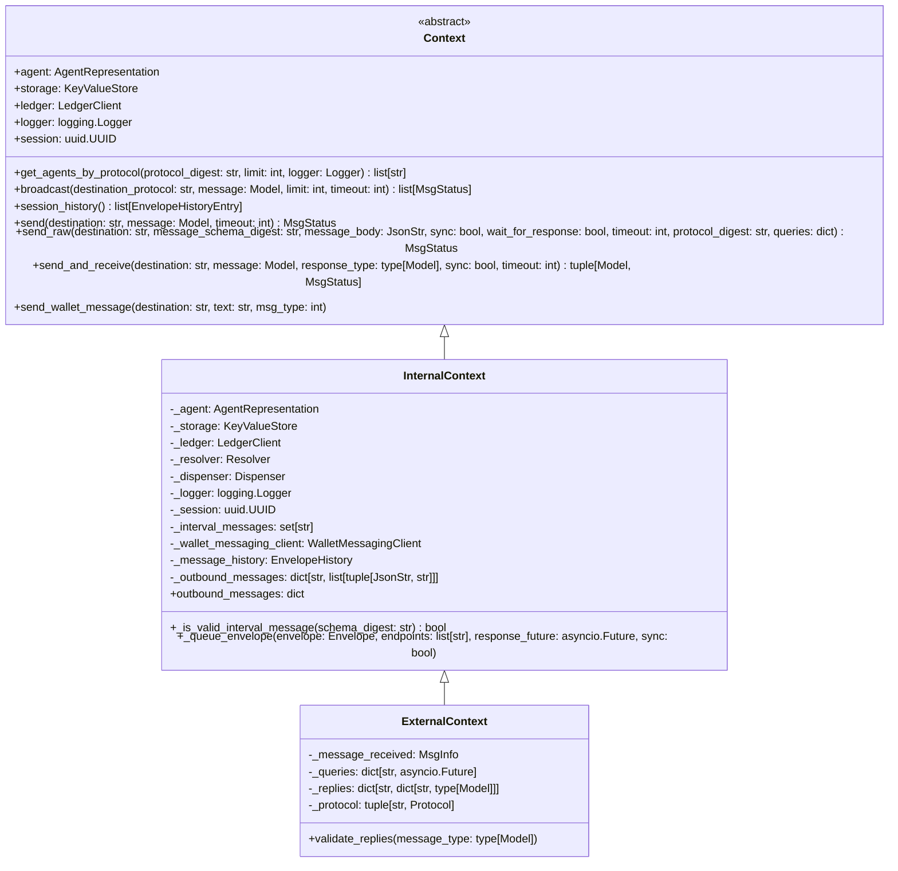

Sources: [python/src/uagents/context.py:36-264](), [python/src/uagents/context.py:267-692](), [python/src/uagents/context.py:693-837]()

### Context Types

| Context Type | Usage | Key Features |
|--------------|-------|--------------|
| **`Context`** (abstract) | Base interface | Defines message handling, storage access, and agent properties interface [python/src/uagents/context.py:36-56]() |
| **`InternalContext`** | Proactive behaviors (`on_interval`, `on_startup`) | Validates interval messages, manages outbound message tracking [python/src/uagents/context.py:267-317]() |
| **`ExternalContext`** | Reactive behaviors (`on_message`) | Includes received message info, reply validation, protocol context [python/src/uagents/context.py:693-730]() |

**`Context`**: Abstract base class defining the interface for all context implementations. Contains methods for message sending, broadcasting, and accessing agent properties [python/src/uagents/context.py:36-264]().

**`InternalContext`**: Used for agent-initiated operations. Created by `Agent._build_context()` for interval handlers and event handlers [python/src/uagents/agent.py:494-515](). Includes `_is_valid_interval_message()` for validating interval message types [python/src/uagents/context.py:403-415]().

**`ExternalContext`**: Used for message-triggered operations. Extends `InternalContext` with message-specific functionality including `validate_replies()` to ensure proper response patterns [python/src/uagents/context.py:732-771]().

Sources: [python/src/uagents/context.py:37-264](), [python/src/uagents/context.py:267-692](), [python/src/uagents/context.py:693-837]()

## Context Lifecycle and Creation

The Context System follows a specific lifecycle tightly integrated with the `Agent` class. Contexts are created on-demand for specific operations and are not persistent objects.

**Context Creation and Lifecycle**

```mermaid
sequenceDiagram
    participant Agent as "Agent"
    participant _run_interval as "_run_interval"
    participant _build_context as "_build_context"
    participant InternalContext as "InternalContext"
    participant dispatcher as "dispatcher"
    participant handle_message as "handle_message"
    participant ExternalContext as "ExternalContext"

    Note over Agent,InternalContext: Interval Handler Context Creation
    Agent->>_run_interval: Schedule interval task
    _run_interval->>_build_context: context_factory()
    _build_context->>InternalContext: __init__(agent, storage, ledger, resolver, dispenser, ...)
    InternalContext-->>_run_interval: ctx
    _run_interval->>_run_interval: await func(ctx)

    Note over Agent,ExternalContext: Message Handler Context Creation  
    dispatcher->>handle_message: dispatch_msg(sender, schema_digest, message, session)
    handle_message->>ExternalContext: __init__(message_received=MsgInfo, queries=_queries, replies=_replies, ...)
    ExternalContext-->>handle_message: ctx
    handle_message->>handle_message: await handler(ctx, sender, parsed_message)
```

Sources: [python/src/uagents/agent.py:494-515](), [python/src/uagents/agent.py:91-117](), [python/src/uagents/context.py:270-292]()

### Context Creation

When an agent needs to perform an operation, the appropriate context is created:

1. **Internal Context Creation**: The `Agent` class provides a `_build_context()` method that creates an `InternalContext` with references to the agent's identity, storage, ledger, and other components [python/src/uagents/agent.py:494-515]().

2. **External Context Creation**: When a message is received, an `ExternalContext` is created with additional information about the received message, available replies, and the protocol that will handle the message [python/src/uagents/context.py:693-730]().

3. **Context Factory**: For interval handlers, a context factory function is used to create a new context for each execution of the handler [python/src/uagents/agent.py:91-117]().

Sources: [python/src/uagents/agent.py:494-515](), [python/src/uagents/agent.py:91-117]()

## Message Handling Through Context

The Context System provides a structured interface for sending and receiving messages between agents. This is one of its primary responsibilities.

**Message Handling Flow**

```mermaid
sequenceDiagram
    participant ctx as "Context"
    participant send_raw as "send_raw"
    participant parse_identifier as "parse_identifier"
    participant dispatcher as "dispatcher"
    participant dispatch_local_message as "dispatch_local_message"
    participant _resolver as "_resolver"
    participant Envelope as "Envelope"
    participant _dispenser as "_dispenser"
    
    ctx->>send_raw: send(destination, message, timeout)
    send_raw->>send_raw: schema_digest = Model.build_schema_digest(message)
    send_raw->>parse_identifier: parse_identifier(destination)
    parse_identifier-->>send_raw: parsed_address
    
    alt Local Agent (dispatcher.contains(parsed_address))
        send_raw->>dispatch_local_message: dispatch_local_message(sender, destination, schema_digest, message, session_id)
        dispatch_local_message->>dispatcher: dispatch_msg(sender, destination, schema_digest, message, session)
        dispatcher-->>send_raw: MsgStatus(DELIVERED)
    else Remote Agent
        send_raw->>_resolver: resolve(destination)
        _resolver-->>send_raw: destination_address, endpoints
        send_raw->>Envelope: __init__(version=1, sender, target, session, schema_digest, expires)
        send_raw->>Envelope: encode_payload(message_body)
        send_raw->>Envelope: sign(agent.identity)
        send_raw->>_dispenser: add_envelope(envelope, endpoints, response_future, sync)
        _dispenser-->>send_raw: MsgStatus
    end
```

Sources: [python/src/uagents/context.py:453-576](), [python/src/uagents/communication.py:77-98](), [python/src/uagents/dispatch.py:95-106]()

### Key Message Handling Methods

1. **`send(destination, message, timeout)`**: The primary method for sending messages to other agents. It converts the message to a schema digest and JSON representation, then delegates to `send_raw` [python/src/uagents/context.py:417-452]().

2. **`send_raw(destination, message_schema_digest, message_body, ...)`**: Handles the low-level details of message delivery, including resolving the destination address, creating the envelope, and dispatching the message [python/src/uagents/context.py:453-576]().

3. **`send_and_receive(destination, message, response_type, ...)`**: Sends a message and waits for a response of a specific type. This is useful for request-response patterns [python/src/uagents/context.py:593-675]().

4. **`broadcast(destination_protocol, message, limit, timeout)`**: Sends a message to multiple agents that support a specific protocol [python/src/uagents/context.py:370-401]().

Sources: [python/src/uagents/context.py:417-452](), [python/src/uagents/context.py:453-576](), [python/src/uagents/context.py:593-675](), [python/src/uagents/context.py:370-401]()

## Message Resolution and Delivery

The Context System works closely with the `Resolver` and `Dispenser` components to ensure messages are delivered to their intended recipients.

**Message Resolution and Delivery Process**

```mermaid
flowchart TD
    A["Context.send(destination, message)"] --> B["Model.build_schema_digest(message)"]
    B --> C["send_raw(destination, schema_digest, message_body)"]
    C --> D["parse_identifier(destination)"]
    D --> E{"dispatcher.contains(parsed_address)?"}

    E -->|Yes| F["dispatch_local_message()"]
    F --> G["dispatcher.dispatch_msg()"]
    G --> H["MsgStatus(DELIVERED, 'Message dispatched locally')"]

    E -->|No| I["_resolver.resolve(destination)"]
    I --> J["Envelope(version=1, sender, target, session, schema_digest, expires)"]
    J --> K["envelope.encode_payload(message_body)"]
    K --> L["envelope.sign(agent.identity)"]
    L --> M["_dispenser.add_envelope(envelope, endpoints, response_future)"]
    
    M --> N["send_exchange_envelope(envelope, endpoints)"]
    N --> O{"HTTP Response 200?"}
    O -->|Yes| P["MsgStatus(DELIVERED, 'Message successfully delivered via HTTP')"]
    O -->|No| Q["MsgStatus(FAILED, 'Message delivery failed')"]
```

Sources: [python/src/uagents/context.py:453-576](), [python/src/uagents/context.py:578-592](), [python/src/uagents/communication.py:101-165]()

### Resolution Process

1. When sending a message, the Context first checks if the destination is a local agent registered in the `dispatcher` [python/src/uagents/context.py:487-498]().
2. If local, the message is dispatched internally without network communication via `dispatch_local_message` [python/src/uagents/communication.py:77-98]().
3. If remote, the Context uses a `Resolver` to convert the destination identifier into a network address and endpoints [python/src/uagents/context.py:516-522]().
4. The message is then wrapped in an `Envelope`, signed with the agent's identity, and passed to the `Dispenser` for delivery [python/src/uagents/context.py:536-576]().

Sources: [python/src/uagents/context.py:453-576]()

## Context Properties and Agent Representation

The Context System provides access to agent properties through standardized interfaces, ensuring consistent behavior across different context types.

**Context Properties and Agent Integration**

```mermaid
classDiagram
    class AgentRepresentation {
        -_address: str
        -_name: str | None
        -_identity: Identity
        +__init__(address: str, name: str | None, identity: Identity)
        +name: str
        +address: str  
        +identifier: str
        +identity: Identity
    }
    
    class InternalContext {
        -_agent: AgentRepresentation
        -_storage: KeyValueStore
        -_ledger: LedgerClient
        -_resolver: Resolver
        -_dispenser: Dispenser
        -_logger: logging.Logger
        -_session: uuid.UUID
        -_interval_messages: set[str] | None
        -_wallet_messaging_client: WalletMessagingClient | None
        -_message_history: EnvelopeHistory | None
        -_outbound_messages: dict[str, list[tuple[JsonStr, str]]]
        +agent: AgentRepresentation
        +storage: KeyValueStore
        +ledger: LedgerClient
        +logger: logging.Logger | None
        +session: uuid.UUID
        +outbound_messages: dict[str, list[tuple[JsonStr, str]]]
    }
    
    class Agent {
        +_build_context() InternalContext
        +address: str
        +_identity: Identity
        +_storage: KeyValueStore
        +_ledger: LedgerClient
        +_resolver: Resolver
        +_dispenser: Dispenser
    }
    
    Agent --> InternalContext : creates via _build_context()
    InternalContext --> AgentRepresentation : contains
    AgentRepresentation --> Identity : uses
```

Sources: [python/src/uagents/agent.py:132-206](), [python/src/uagents/agent.py:494-515](), [python/src/uagents/context.py:270-292]()

### Agent Representation

The `AgentRepresentation` class encapsulates the essential properties of an agent that need to be exposed through the context:

1. **Address**: The unique identifier for the agent within the network [python/src/uagents/agent.py:175-183]().
2. **Name**: A human-readable name for the agent [python/src/uagents/agent.py:165-173]().
3. **Identity**: The cryptographic identity used for signing messages [python/src/uagents/agent.py:195-203]().
4. **Identifier**: The full agent identifier including the network prefix [python/src/uagents/agent.py:185-193]().

These properties allow message handlers to access agent information without direct access to the `Agent` class.

Sources: [python/src/uagents/agent.py:132-206]()

## Session Management and Message History

The Context System manages sessions for tracking related messages and maintains a history of messages for debugging and auditing purposes.

**Session Management and Message History**

```mermaid
classDiagram
    class InternalContext {
        -_session: uuid.UUID
        -_message_history: EnvelopeHistory | None
        +session: uuid.UUID
        +session_history() list[EnvelopeHistoryEntry] | None
    }
    
    class EnvelopeHistory {
        -_storage: KeyValueStore
        -_use_cache: bool
        -_use_storage: bool  
        -_logger: logging.Logger
        -_retention_period: int
        -_message_limit: int
        -_cache: list[EnvelopeHistoryEntry]
        +add_entry(entry: EnvelopeHistoryEntry)
        +get_cached_messages() EnvelopeHistoryResponse
        +get_session_messages(session: uuid.UUID) list[EnvelopeHistoryEntry]
        +apply_retention_policy()
    }
    
    class EnvelopeHistoryEntry {
        +timestamp: int
        +version: int
        +sender: str
        +target: str
        +session: uuid.UUID
        +schema_digest: str
        +protocol_digest: str | None
        +payload: JsonStr
        +from_envelope(envelope: Envelope) EnvelopeHistoryEntry
    }
    
    class Agent {
        +__init__(store_message_history: bool, enable_agent_inspector: bool)
        -_message_history: EnvelopeHistory | None
    }
    
    InternalContext --> EnvelopeHistory : uses
    EnvelopeHistory --> EnvelopeHistoryEntry : contains
    Agent --> EnvelopeHistory : creates based on config
```

Sources: [python/src/uagents/context.py:331-341](), [python/src/uagents/types.py:135-260](), [python/src/uagents/agent.py:370-379]()

### Sessions

Sessions are represented as UUIDs and are used to correlate related messages. When a message is sent, the sender's session ID is included in the envelope. This allows for tracking conversations and implementing request-response patterns.

The session is accessible through the context's `session` property and is automatically created when a context is instantiated [python/src/uagents/context.py:311-320]().

Sources: [python/src/uagents/context.py:103-113](), [python/src/uagents/context.py:311-320]()

### Message History

The Context System can optionally maintain a history of sent and received messages through the `EnvelopeHistory` class [python/src/uagents/types.py:135-260](). This history is useful for debugging and provides visibility into agent communications.

Message history can be stored in memory (cache) and/or persisted to storage, with configurable retention policies based on time and message count [python/src/uagents/types.py:145-165]().

The `session_history()` method allows access to the message history for the current session [python/src/uagents/context.py:331-341]().

Sources: [python/src/uagents/types.py:135-260](), [python/src/uagents/context.py:331-341]()

## Differences Between Internal and External Contexts

The two main context implementations serve different purposes and have some key differences:

**Context Type Comparison**

```mermaid
flowchart LR
    subgraph InternalContext["InternalContext Features"]
        direction TB
        A["_is_valid_interval_message()"]
        B["_interval_messages: set[str]"]
        C["Used in on_interval handlers"]
        D["Used in on_startup/on_shutdown"]
        E["No message context"]
    end

    subgraph ExternalContext["ExternalContext Features"]  
        direction TB
        F["_message_received: MsgInfo"]
        G["_replies: dict[str, dict[str, type[Model]]]"]
        H["_queries: dict[str, asyncio.Future]"]
        I["_protocol: tuple[str, Protocol]"]
        J["validate_replies(message_type)"]
        K["Used in on_message handlers"]
    end

    InternalContext -->|extends| ExternalContext
    
    subgraph Usage["Usage Patterns"]
        direction TB
        L["InternalContext: Agent-initiated actions"]
        M["ExternalContext: Message-triggered actions"]
    end
```

Sources: [python/src/uagents/context.py:267-692](), [python/src/uagents/context.py:693-837](), [python/src/uagents/context.py:403-415]()

### Internal Context

- Created for proactive behaviors initiated by the agent itself [python/src/uagents/agent.py:494-515]().
- Used in interval tasks, startup/shutdown events.
- Has no information about a received message.
- No concept of "replies" since there's no incoming message to reply to.
- Can validate interval messages against a whitelist [python/src/uagents/context.py:403-415]().

Sources: [python/src/uagents/context.py:267-317](), [python/src/uagents/context.py:417-452]()

### External Context

- Created in response to an incoming message [python/src/uagents/agent.py:870-887]().
- Contains information about the received message via `_message_received` [python/src/uagents/context.py:706-714]().
- Knows which replies are valid for the received message type through `_replies`.
- Can validate that sent messages are valid replies using `validate_replies()` [python/src/uagents/context.py:732-771]().
- Used in message handlers registered with `on_message`.

Sources: [python/src/uagents/context.py:693-770](), [python/src/uagents/context.py:773-837]()

## Integration with Other Framework Components

The Context System integrates with several other components of the uAgents framework to provide its functionality.

**Context System Integration**

```mermaid
flowchart TD
    subgraph Context["Context System Components"]
        InternalContext["InternalContext"]
        ExternalContext["ExternalContext"] 
        AgentRepresentation["AgentRepresentation"]
    end

    subgraph Agent["Agent System"]  
        AgentClass["Agent"]
        build_context["_build_context()"]
        handle_message["handle_message()"]
    end

    subgraph Communication["Communication System"]
        Dispenser["Dispenser"]  
        Resolver["Resolver"]
        dispatcher["dispatcher"]
        send_exchange_envelope["send_exchange_envelope()"]
    end

    subgraph Storage["Storage System"]
        KeyValueStore["KeyValueStore"]
        EnvelopeHistory["EnvelopeHistory"]
    end

    subgraph Protocol["Protocol System"] 
        ProtocolClass["Protocol"]
        on_interval["@on_interval"]
        on_message["@on_message"]
    end

    AgentClass -->|"calls"| build_context
    build_context -->|"creates"| InternalContext
    handle_message -->|"creates"| ExternalContext
    
    on_interval -->|"receives"| InternalContext
    on_message -->|"receives"| ExternalContext
    
    InternalContext -->|"uses _dispenser"| Dispenser
    InternalContext -->|"uses _resolver"| Resolver
    InternalContext -->|"uses _storage"| KeyValueStore
    ExternalContext -->|"inherits access to"| Dispenser
    
    InternalContext -->|"contains _agent"| AgentRepresentation
    dispatcher -->|"calls"| handle_message
```

Sources: [python/src/uagents/agent.py:494-515](), [python/src/uagents/context.py:267-317](), [python/src/uagents/context.py:693-732]()

### Key Integrations

1. **Agent System**: The `Agent` class creates contexts as needed and provides access to the agent's properties through the `AgentRepresentation` [python/src/uagents/agent.py:494-515]().

2. **Protocol System**: Protocols use contexts to interact with the agent and other components. Message and interval handlers receive contexts when they are called [python/src/uagents/agent.py:833-848]().

3. **Storage System**: The Context provides access to the agent's `KeyValueStore` for persisting state [python/src/uagents/context.py:69-79]().

4. **Communication System**: The Context uses the `Dispenser` for sending messages and the `Resolver` for finding endpoint addresses [python/src/uagents/context.py:270-292]().

Sources: [python/src/uagents/agent.py:494-515](), [python/src/uagents/context.py:270-292](), [python/src/uagents/context.py:453-576](), [python/src/uagents/context.py:693-730]()

## Context Usage in Agent Handlers

The Context System is designed to be used in agent handlers, providing a clean interface for interacting with the agent and other components.

**Context Usage in Agent Handlers**

```mermaid
sequenceDiagram
    participant Agent as "Agent"
    participant _run_interval as "_run_interval"
    participant IntervalHandler as "Interval Handler Function"
    participant InternalContext as "InternalContext"
    participant handle_message as "handle_message"
    participant MessageHandler as "Message Handler Function"  
    participant ExternalContext as "ExternalContext"

    Note over Agent,InternalContext: Interval Handler Flow
    Agent->>_run_interval: Schedule periodic task
    _run_interval->>Agent: context_factory()
    Agent->>InternalContext: _build_context()
    InternalContext-->>_run_interval: ctx
    _run_interval->>IntervalHandler: await func(ctx)
    IntervalHandler->>InternalContext: ctx.send(destination, message)
    InternalContext->>InternalContext: Validate interval message

    Note over Agent,ExternalContext: Message Handler Flow  
    Agent->>handle_message: Incoming message via dispatcher
    handle_message->>ExternalContext: Create with MsgInfo, queries, replies
    ExternalContext-->>handle_message: ctx
    handle_message->>MessageHandler: await handler(ctx, sender, parsed_message)
    MessageHandler->>ExternalContext: ctx.send(sender, response)
    ExternalContext->>ExternalContext: validate_replies(message_type)
```

Sources: [python/src/uagents/agent.py:91-117](), [python/src/uagents/agent.py:833-848](), [python/src/uagents/agent.py:870-887]()

### Context Usage Patterns

**Message Handlers** receive `ExternalContext` with received message information:

| Method | Purpose | Context Type |
|--------|---------|--------------|
| `@agent.on_message(Model, replies=ResponseModel)` | Handle incoming messages | `ExternalContext` [python/src/uagents/agent.py:870-887]() |
| `ctx.send(sender, response)` | Send reply to message sender | `ExternalContext` [python/src/uagents/context.py:773-837]() |
| `ctx.validate_replies(message_type)` | Validate reply was sent | `ExternalContext` [python/src/uagents/context.py:732-771]() |

**Interval Handlers** receive `InternalContext` for periodic operations:

| Method | Purpose | Context Type |
|--------|---------|--------------|
| `@agent.on_interval(period=60.0)` | Periodic tasks | `InternalContext` [python/src/uagents/agent.py:833-848]() |
| `ctx.send(destination, message)` | Proactive message sending | `InternalContext` [python/src/uagents/context.py:417-452]() |
| `ctx.get_agents_by_protocol(protocol_digest)` | Discover agents by protocol | `InternalContext` [python/src/uagents/context.py:343-368]() |

Sources: [python/src/uagents/agent.py:870-887](), [python/src/uagents/agent.py:833-848](), [python/src/uagents/context.py:403-415](), [python/src/uagents/context.py:732-771]()

## Advanced Context Features

The Context System provides several advanced features for specialized agent behaviors.

### Advanced Context Features

**Agent Discovery via Almanac API**:
- `get_agents_by_protocol(protocol_digest, limit, logger)`: Queries Almanac API `/search` endpoint to find agents supporting specific protocols [python/src/uagents/context.py:343-368]().
- `broadcast(destination_protocol, message, limit, timeout)`: Sends message to multiple agents discovered via protocol [python/src/uagents/context.py:370-401]().

**Synchronous Communication**:
- `send_and_receive(destination, message, response_type, sync, timeout)`: Implements request-response pattern with response type validation [python/src/uagents/context.py:593-675]().
- Uses `dispatcher.register_pending_response()` and `dispatcher.wait_for_response()` for coordination.

**Specialized Messaging**:
- `send_wallet_message(destination, text, msg_type)`: Blockchain wallet integration via `WalletMessagingClient` [python/src/uagents/context.py:677-690]().
- `send_raw()`: Low-level message sending with envelope creation and signing [python/src/uagents/context.py:453-576]().

| Feature | Method | Implementation Details |
|---------|--------|------------------------|
| Agent Discovery | `get_agents_by_protocol()` | Queries `ALMANAC_API_URL + "/search"` with protocol digest [python/src/uagents/context.py:355-364]() |
| Broadcasting | `broadcast()` | Calls `get_agents_by_protocol()` then `send()` to each agent [python/src/uagents/context.py:388-399]() |
| Synchronous Messaging | `send_and_receive()` | Uses `dispatcher` pending response tracking [python/src/uagents/context.py:644-673]() |
| Wallet Integration | `send_wallet_message()` | Requires `_wallet_messaging_client` configuration [python/src/uagents/context.py:686-690]() |

Sources: [python/src/uagents/context.py:343-368](), [python/src/uagents/context.py:370-401](), [python/src/uagents/context.py:593-675](), [python/src/uagents/context.py:677-690]()

## Summary

The Context System is a foundational component of the uAgents framework that provides a structured interface for agents to interact with each other and with framework components. Through different context implementations, it supports both proactive and reactive agent behaviors, manages sessions and message history, and integrates with other framework components.

By abstracting the details of agent communication, storage access, and other operations, the Context System allows developers to focus on implementing agent logic rather than dealing with low-level framework interactions.

---

# Page: Protocol System

# Protocol System

<details>
<summary>Relevant source files</summary>

The following files were used as context for generating this wiki page:

- [python/docs/api/uagents/protocol.md](python/docs/api/uagents/protocol.md)
- [python/src/uagents/protocol.py](python/src/uagents/protocol.py)
- [python/tests/test_model.py](python/tests/test_model.py)
- [python/tests/test_protocol.py](python/tests/test_protocol.py)
- [python/tests/test_protocol_spec.py](python/tests/test_protocol_spec.py)
- [python/uagents-core/uagents_core/contrib/protocols/subscriptions/__init__.py](python/uagents-core/uagents_core/contrib/protocols/subscriptions/__init__.py)
- [python/uagents-core/uagents_core/envelope.py](python/uagents-core/uagents_core/envelope.py)
- [python/uagents-core/uagents_core/logger.py](python/uagents-core/uagents_core/logger.py)
- [python/uagents-core/uagents_core/models.py](python/uagents-core/uagents_core/models.py)
- [python/uagents-core/uagents_core/protocol.py](python/uagents-core/uagents_core/protocol.py)
- [python/uagents-core/uagents_core/utils/__init__.py](python/uagents-core/uagents_core/utils/__init__.py)

</details>


The Protocol System defines how agents exchange messages and execute tasks through structured communication patterns. It provides the foundational framework for agent behavior specification, message handling, and protocol discovery within the uAgents ecosystem.

This document covers the core protocol infrastructure including the `Protocol` class and `ProtocolSpecification`. For information about how protocols are integrated into agents, see [Agent Class](2.1). For details about message communication infrastructure, see [Communication](3).

## Protocol Architecture

The Protocol System consists of two main components that work together to define agent behaviors:

Title: Protocol Architecture and Data Flow
```mermaid
graph TB
    subgraph "Protocol Definition"
        Protocol["Protocol Class<br/>python/src/uagents/protocol.py"]
        ProtocolSpec["ProtocolSpecification<br/>uagents_core/protocol.py"]
    end
    
    subgraph "Message Handling"
        SignedHandlers["_signed_message_handlers<br/>Dict[str, MessageCallback]"]
        UnsignedHandlers["_unsigned_message_handlers<br/>Dict[str, MessageCallback]"]
        IntervalHandlers["_interval_handlers<br/>List[Tuple[IntervalCallback, float]]"]
    end
    
    subgraph "Protocol Data"
        Models["_models<br/>Dict[str, type[Model]]"]
        Replies["_replies<br/>Dict[str, Dict[str, type[Model]]]"]
        IntervalMessages["_interval_messages<br/>Set[str]"]
    end
    
    subgraph "Protocol Discovery"
        Manifest["manifest()<br/>Dict[str, Any]"]
        Digest["digest<br/>str"]
    end
    
    Protocol --> ProtocolSpec
    Protocol --> SignedHandlers
    Protocol --> UnsignedHandlers
    Protocol --> IntervalHandlers
    Protocol --> Models
    Protocol --> Replies
    Protocol --> IntervalMessages
    Protocol --> Manifest
    ProtocolSpec --> Manifest
    Manifest --> Digest
```

Sources: [python/src/uagents/protocol.py:18-48](), [python/uagents-core/uagents_core/protocol.py:11-129]()

## Protocol Class

The `Protocol` class encapsulates a set of functionalities for an agent, typically relating to message exchange between agents for executing specific tasks [python/src/uagents/protocol.py:18-24]().

### Core Properties

| Property | Type | Description |
|----------|------|-------------|
| `models` | `dict[str, type[Model]]` | Registered message models with schema digests as keys [python/src/uagents/protocol.py:69-77]() |
| `replies` | `dict[str, dict[str, type[Model]]]` | Mapping of message digests to allowed reply types [python/src/uagents/protocol.py:79-88]() |
| `signed_message_handlers` | `dict[str, MessageCallback]` | Handlers for verified messages [python/src/uagents/protocol.py:100-108]() |
| `unsigned_message_handlers` | `dict[str, MessageCallback]` | Handlers for unverified messages [python/src/uagents/protocol.py:110-118]() |
| `intervals` | `list[tuple[IntervalCallback, float]]` | Interval handlers with their periods [python/src/uagents/protocol.py:59-67]() |

Sources: [python/src/uagents/protocol.py:59-118]()

### Protocol Initialization

Title: Protocol Initialization Logic
```mermaid
graph LR
    Init["Protocol.__init__()"]
    SpecProvided{"spec provided?"}
    InitFromSpec["_init_from_spec()"]
    CreateSpec["Create new ProtocolSpecification"]
    
    Init --> SpecProvided
    SpecProvided -->|Yes| InitFromSpec
    SpecProvided -->|No| CreateSpec
    
    InitFromSpec --> Locked["_locked = True"]
    CreateSpec --> Unlocked["_locked = False"]
```

The Protocol can be initialized with or without a `ProtocolSpecification` [python/src/uagents/protocol.py:26-57](). When a specification is provided, the protocol becomes locked and validates that message handlers match the specification requirements [python/src/uagents/protocol.py:170-217]().

Sources: [python/src/uagents/protocol.py:26-58](), [python/src/uagents/protocol.py:170-217]()

## Message Handler Registration

### Message Handler Decorators

The Protocol class provides decorators for registering different types of handlers:

Title: Handler Registration Flow
```mermaid
graph TD
    OnMessage["@protocol.on_message()"]
    OnInterval["@protocol.on_interval()"]
    OnQuery["@protocol.on_query() [deprecated]"]
    
    OnMessage --> AddMessageHandler["_add_message_handler()"]
    OnInterval --> AddIntervalHandler["_add_interval_handler()"]
    OnQuery --> OnMessage
    
    AddMessageHandler --> SignedHandlers["_signed_message_handlers"]
    AddMessageHandler --> UnsignedHandlers["_unsigned_message_handlers"]
    AddIntervalHandler --> IntervalHandlers["_interval_handlers"]
```

### Message Handler Flow

Title: Developer-to-Code Handler Registration
```mermaid
sequenceDiagram
    participant Dev as "Developer"
    participant Protocol as "Protocol Class"
    participant Models as "_models: dict"
    participant Handlers as "Handler Maps"
    
    Dev->>Protocol: @on_message(MessageType)
    Protocol->>Protocol: Model.build_schema_digest(MessageType)
    Protocol->>Models: Store model with digest
    Protocol->>Handlers: Store callback in _signed_message_handlers
    Note over Protocol: Validate against spec if _locked is True
```

Sources: [python/src/uagents/protocol.py:308-383](), [python/src/uagents/protocol.py:236-287](), [python/tests/test_protocol.py:43-58]()

## ProtocolSpecification

The `ProtocolSpecification` class provides formal protocol definitions with structured interactions and roles [python/uagents_core/uagents_core/protocol.py:11-29]().

### Specification Structure

Title: ProtocolSpecification Entity Space
```mermaid
graph TB
    ProtocolSpec["ProtocolSpecification"]
    
    subgraph "Core Fields"
        Name["name: str"]
        Version["version: str"]
        Interactions["interactions: dict[type[Model], set[type[Model]]]"]
        Roles["roles: dict[str, set[type[Model]]] | None"]
    end
    
    subgraph "Generated Methods"
        Manifest["manifest() -> dict[str, Any]"]
        Digest["digest: str (property)"]
    end
    
    ProtocolSpec --> Name
    ProtocolSpec --> Version
    ProtocolSpec --> Interactions
    ProtocolSpec --> Roles
    ProtocolSpec --> Manifest
    Manifest --> Digest
```

### Interaction Mapping

The `interactions` dictionary defines which message types can trigger which reply types [python/uagents_core/uagents_core/protocol.py:18-22]().

| Message Type | Valid Replies |
|--------------|---------------|
| `RequestAgentSubscriptionRenewal` | `{AcceptAgentSubscriptionUpdate, RejectAgentSubscriptionUpdate}` |
| `AcceptAgentSubscriptionUpdate` | `set()` (no replies) |

Sources: [python/uagents-core/uagents_core/protocol.py:11-53](), [python/uagents-core/uagents_core/contrib/protocols/subscriptions/__init__.py:56-75]()

## Protocol Manifest System

### Manifest Generation

The manifest system creates machine-readable protocol descriptions for discovery and verification [python/uagents_core/uagents_core/protocol.py:64-129]():

Title: Manifest Generation Process
```mermaid
graph TD
    GenerateManifest["manifest()"]
    CollectModels["Collect all models from interactions"]
    BuildSchemas["Model.build_schema_digest()"]
    CreateInteractions["Create interaction rules"]
    ComputeDigest["compute_digest()"]
    
    GenerateManifest --> CollectModels
    CollectModels --> BuildSchemas
    BuildSchemas --> CreateInteractions
    CreateInteractions --> ComputeDigest
    
    subgraph "Manifest Structure"
        Version["version: '1.0'"]
        Metadata["metadata: {name, version, digest}"]
        ModelsList["models: [{digest, schema}, ...]"]
        InteractionsList["interactions: [{type, request, responses}, ...]"]
    end
    
    ComputeDigest --> Metadata
```

### Digest Computation

Protocol digests are computed as `proto:{sha256_hash}` where the hash is generated from a normalized JSON manifest representation [python/uagents_core/uagents_core/protocol.py:142-153]():

Title: Digest Computation Pipeline
```mermaid
graph LR
    Manifest["Raw Manifest"]
    Clean["Clean & Sort Manifest"]
    Encode["JSON Encode (UTF-8)"]
    Hash["SHA256 Hash"]
    Prefix["Add 'proto:' prefix"]
    
    Manifest --> Clean
    Clean --> Encode
    Encode --> Hash
    Hash --> Prefix
```

Sources: [python/uagents-core/uagents_core/protocol.py:64-154]()

## Protocol Roles

### Role-Based Protocol Implementation

When a `ProtocolSpecification` defines roles, agents can implement specific subsets of the protocol [python/uagents_core/uagents_core/protocol.py:84-89]().

Title: Role-Based Interaction Filtering
```mermaid
graph TB
    FullSpec["Full Protocol Specification"]
    
    subgraph "Roles Mapping"
        RequesterRole["'requester' role"]
        AgentRole["'agent' role"]
    end
    
    subgraph "Interaction Filtering"
        RequesterMessages["Messages for requester"]
        AgentMessages["Messages for agent"]
    end
    
    FullSpec --> RequesterRole
    FullSpec --> AgentRole
    RequesterRole --> RequesterMessages
    AgentRole --> AgentMessages
```

Example from the subscription protocol [python/uagents-core/uagents_core/contrib/protocols/subscriptions/__init__.py:71-75]():

| Role | Required Message Handlers |
|------|---------------------------|
| `requester` | `AcceptAgentSubscriptionUpdate`, `RejectAgentSubscriptionUpdate` |
| `agent` | `RequestAgentSubscriptionRenewal`, `RequestAgentSubscriptionUpgrade` |

Sources: [python/src/uagents/protocol.py:198-217](), [python/uagents-core/uagents_core/contrib/protocols/subscriptions/__init__.py:71-75]()

## Protocol Verification

### Handler Validation

The `verify()` method ensures that all required message types have corresponding handlers when a protocol is initialized from a specification [python/src/uagents/protocol.py:394-422]().

Title: Verification Logic
```mermaid
graph TD
    Verify["verify()"]
    Locked{"_locked == True?"}
    CheckHandlers["Check all models in _models have handlers"]
    ValidateRole["Validate role requirements if _role is set"]
    
    Verify --> Locked
    Locked -->|Yes| CheckHandlers
    Locked -->|No| ReturnTrue["return True"]
    CheckHandlers --> ValidateRole
    ValidateRole --> Result["return bool"]
```

Sources: [python/src/uagents/protocol.py:394-422]()

## Integration Examples

### Subscription Protocol Specification

The subscription protocol demonstrates a complete protocol specification with roles and interactions:

Title: Subscription Protocol Model Relationships
```mermaid
graph LR
    subgraph "Subscription Models"
        Renewal["RequestAgentSubscriptionRenewal"]
        Upgrade["RequestAgentSubscriptionUpgrade"]
        Accept["AcceptAgentSubscriptionUpdate"]
        Reject["RejectAgentSubscriptionUpdate"]
    end
    
    subgraph "Interactions"
        Renewal --> Accept
        Renewal --> Reject
        Upgrade --> Accept
        Upgrade --> Reject
    end
```

Sources: [python/uagents-core/uagents_core/contrib/protocols/subscriptions/__init__.py:56-75]()

### Protocol Registration with Agent

Protocols are integrated into agents using the `include()` method, which merges the protocol's handlers and models into the agent's runtime structures [python/tests/test_protocol.py:75-84]().

Title: Protocol Inclusion Sequence
```mermaid
sequenceDiagram
    participant Agent as "Agent Class"
    participant Protocol as "Protocol Class"
    
    Agent->>Protocol: include(protocol)
    Note over Agent, Protocol: Internal mapping transfer
    Protocol->>Agent: Merge _models into Agent._models
    Protocol->>Agent: Merge _signed_message_handlers into Agent._signed_message_handlers
    Protocol->>Agent: Merge _unsigned_message_handlers into Agent._unsigned_message_handlers
    Protocol->>Agent: Merge _interval_handlers into Agent._interval_handlers
```

Sources: [python/tests/test_protocol.py:75-84]()

---

# Page: Storage System

# Storage System

<details>
<summary>Relevant source files</summary>

The following files were used as context for generating this wiki page:

- [python/docs/api/uagents/storage/__init__.md](python/docs/api/uagents/storage/__init__.md)
- [python/src/uagents/experimental/dialogues/__init__.py](python/src/uagents/experimental/dialogues/__init__.py)
- [python/src/uagents/storage/__init__.py](python/src/uagents/storage/__init__.py)
- [python/tests/test_agent_registration.py](python/tests/test_agent_registration.py)
- [python/tests/test_storage.py](python/tests/test_storage.py)
- [python/uagents-core/uagents_core/config.py](python/uagents-core/uagents_core/config.py)
- [python/uagents-core/uagents_core/contrib/protocols/chat/__init__.py](python/uagents-core/uagents_core/contrib/protocols/chat/__init__.py)
- [python/uagents-core/uagents_core/storage.py](python/uagents-core/uagents_core/storage.py)
- [python/uagents-core/uagents_core/utils/subscriptions.py](python/uagents-core/uagents_core/utils/subscriptions.py)

</details>


The Storage System provides two distinct storage mechanisms: local persistent storage via `KeyValueStore` and external cloud storage via `ExternalStorage`. Local storage handles agent state, message history, dialogue sessions, and private keys. External storage provides Agentverse-integrated asset management with authentication and permissions.

The system uses `StorageAPI` as the base interface, implemented by `KeyValueStore` for local file-based storage and utilized by components like `EnvelopeHistory` and `Dialogue` for specialized data persistence needs.

## Storage Architecture

The Storage System provides two storage abstractions: local storage via `StorageAPI`/`KeyValueStore` and external storage via `ExternalStorage`.

### Local Storage Architecture

```mermaid
classDiagram
    class StorageAPI {
        <<interface>>
        +get(key: str): Any|None
        +has(key: str): bool
        +set(key: str, value: Any): None
        +remove(key: str): None
        +clear(): None
    }

    class KeyValueStore {
        -_data: dict
        -_name: str
        -_path: str
        +__init__(name: str, cwd: str|None)
        +get(key: str): Any|None
        +has(key: str): bool
        +set(key: str, value: Any): None
        +remove(key: str): None
        +clear(): None
        -_load(): None
        -_save(): None
    }

    class ExternalStorage {
        +identity: Identity|None
        +api_token: str|None
        +storage_url: str
        +__init__(identity, storage_url, api_token)
        +upload(asset_id: str, asset_content: bytes, mime_type: str): dict
        +download(asset_id: str): dict
        +create_asset(name: str, content: bytes, mime_type: str, lifetime_hours: int): str
        +set_permissions(asset_id: str, agent_address: str, read: bool, write: bool): dict
        -_make_attestation(): str
        -_get_auth_header(): dict
    }

    StorageAPI <|.. KeyValueStore
```

### Storage Method Details

| Class | Method | Description |
|-------|---------|-------------|
| `StorageAPI` | `get(key: str)` | Abstract method to retrieve value by key [python/src/uagents/storage/__init__.py:14-15]() |
| `StorageAPI` | `set(key: str, value: Any)` | Abstract method to store key-value pair [python/src/uagents/storage/__init__.py:22-23]() |
| `KeyValueStore` | `_load()` | Loads data from `{name}_data.json` file [python/src/uagents/storage/__init__.py:90-92]() |
| `KeyValueStore` | `_save()` | Persists in-memory data to JSON file [python/src/uagents/storage/__init__.py:94-96]() |
| `ExternalStorage` | `_make_attestation()` | Creates signed attestation for agent authentication [python/uagents_core/uagents_core/storage.py:49-59]() |
| `ExternalStorage` | `upload(asset_id, content, mime_type)` | Uploads asset content to Agentverse storage [python/uagents_core/uagents_core/storage.py:68-92]() |

Sources:
- [python/src/uagents/storage/__init__.py:10-31]()
- [python/src/uagents/storage/__init__.py:34-96]()
- [python/uagents-core/uagents_core/storage.py:33-167]()

## Agent Storage Integration

Each `Agent` instance initializes its own `KeyValueStore` using the first 16 characters of the agent's address as the storage name. The storage is accessible via the `agent.storage` property and passed to contexts for handler access.

### Agent Storage Initialization

```mermaid
sequenceDiagram
    participant Client as "Client Code"
    participant Agent as "Agent.__init__()"
    participant KVStore as "KeyValueStore"
    participant File as "{address}_data.json"
    
    Client->>Agent: "Agent(name='alice')"
    Agent->>Agent: "_initialize_wallet_and_identity()"
    Agent->>KVStore: "KeyValueStore(self.address[0:16])"
    
    alt "File exists"
        KVStore->>File: "os.path.isfile(self._path)"
        KVStore->>KVStore: "_load()"
        File-->>KVStore: "json.load()"
    else "No file"
        KVStore->>KVStore: "_data = {}"
    end
    
    Agent->>Agent: "self._storage = KeyValueStore"
    Agent-->>Client: "return agent"
    
    Client->>Agent: "agent.storage.set('key', 'value')"
    Agent->>KVStore: "set('key', 'value')"
    KVStore->>KVStore: "_data['key'] = 'value'"
    KVStore->>File: "_save()"
```

### Storage Property Access

The `Agent` class exposes storage through a property that provides direct access to the underlying `KeyValueStore`.

Sources:
- [python/src/uagents/storage/__init__.py:54-69]()
- [python/src/uagents/storage/__init__.py:71-80]()

## Storage System Components

The Storage System integrates with multiple uAgents components through both direct usage and composition patterns.

### Component Integration Architecture

```mermaid
graph TD
    subgraph "Storage Implementations"
        StorageAPI["StorageAPI"]
        KeyValueStore["KeyValueStore"]
        ExternalStorage["ExternalStorage"]
    end
    
    subgraph "Agent Framework"
        Agent["Agent"]
        InternalContext["InternalContext"]
        ExternalContext["ExternalContext"]
        EnvelopeHistory["EnvelopeHistory"]
        Dialogue["Dialogue"]
    end
    
    subgraph "Storage Operations"
        get_or_create_private_keys["get_or_create_private_keys()"]
        save_private_keys["save_private_keys()"]
        load_all_keys["load_all_keys()"]
    end
    
    StorageAPI <|.. KeyValueStore
    Agent --> KeyValueStore
    InternalContext --> KeyValueStore
    ExternalContext --> KeyValueStore
    EnvelopeHistory --> StorageAPI
    Dialogue --> StorageAPI
    
    Agent -.-> get_or_create_private_keys
    get_or_create_private_keys --> save_private_keys
    save_private_keys --> load_all_keys
```

### Storage Usage by Component

| Component | Storage Type | Purpose | Key Methods |
|-----------|-------------|---------|-------------|
| `Agent` | `KeyValueStore` | Agent state persistence | `self._storage = KeyValueStore(...)` |
| `EnvelopeHistory` | `StorageAPI` (optional) | Message history persistence | `self._storage` for session tracking |
| `Dialogue` | `StorageAPI` | Conversation state | `self._storage` for session management [python/src/uagents/experimental/dialogues/__init__.py:170-172]() |

Sources:
- [python/src/uagents/experimental/dialogues/__init__.py:149-155]()
- [python/src/uagents/storage/__init__.py:99-150]()

## Message History Storage

The `EnvelopeHistory` class provides configurable message persistence using optional in-memory caching and `StorageAPI`-based storage. It supports retention policies and session-based message organization.

### Storage Key Patterns

The `EnvelopeHistory` class uses structured keys for persistent storage.

| Key Pattern | Purpose |
|-------------|---------|
| `message-history:session:{session_id}` | Session message list |
| `message-history:sessions` | Session metadata mapping |

## Dialogue Storage

The `Dialogue` class extends `Protocol` to provide stateful conversation management using `StorageAPI` for session persistence. It maintains conversation state, message history, and automatic session cleanup.

### Dialogue Storage Architecture

```mermaid
classDiagram
    class Dialogue {
        -_name: str
        -_storage: StorageAPI
        -_sessions: dict[UUID, list[Any]]
        -_states: dict[UUID, str]
        -_timeout: int
        +__init__(name, storage, nodes, edges, timeout, version, cleanup_interval)
        +add_message(session_id, message_type, schema_digest, sender, receiver, content): None
        +get_session_messages(session_id): list[Any]
        +update_state(digest, session): None
        +is_finished(session_id): bool
        +cleanup_expired_sessions(): None
        -_load_storage(): dict[UUID, list[Any]]
        -_save_storage(): None
    }
    
    class Protocol {
        +name: str
        +version: str
    }
    
    class StorageAPI {
        <<interface>>
        +get(key: str): Any|None
        +set(key: str, value: Any): None
    }
    
    Protocol <|-- Dialogue
    Dialogue --> StorageAPI : "uses"
```

### Dialogue Session Management

The `Dialogue` class manages conversations through these key mechanisms:

| Component | Type | Purpose |
|-----------|------|---------|
| `_sessions` | `dict[UUID, list[Any]]` | In-memory session cache [python/src/uagents/experimental/dialogues/__init__.py:173-175]() |
| `_states` | `dict[UUID, str]` | Current dialogue state per session [python/src/uagents/experimental/dialogues/__init__.py:176-178]() |
| `_storage` | `StorageAPI` | Persistent session storage [python/src/uagents/experimental/dialogues/__init__.py:170-172]() |
| `_timeout` | `int` | Session expiration time (default: 60s) [python/src/uagents/experimental/dialogues/__init__.py:16-16]() |

Sources:
- [python/src/uagents/experimental/dialogues/__init__.py:146-192]()
- [python/src/uagents/experimental/dialogues/__init__.py:169-172]()

## Private Key Storage

The Storage System provides functions for managing agent private keys through a shared `private_keys.json` file. These functions handle key generation, retrieval, and persistence for agents created without explicit seeds.

### Private Key Management Functions

```mermaid
flowchart TD
    subgraph "Key Management Functions"
        load_all_keys["load_all_keys()"]
        save_private_keys["save_private_keys(name, identity_key, wallet_key)"]
        get_or_create_private_keys["get_or_create_private_keys(name)"]
    end
    
    subgraph "File Storage"
        private_keys_json["private_keys.json"]
        key_structure["{name: {identity_key: str, wallet_key: str}}"]
        
        private_keys_json -->|"contains"| key_structure
    end
    
    get_or_create_private_keys -->|"calls"| load_all_keys
    get_or_create_private_keys -->|"may call"| save_private_keys
    load_all_keys -->|"reads from"| private_keys_json
    save_private_keys -->|"writes to"| private_keys_json
```

### Function Signatures and Usage

| Function | Parameters | Returns | Purpose |
|----------|------------|---------|---------|
| `load_all_keys()` | None | `dict` | Loads all stored private keys [python/src/uagents/storage/__init__.py:99-110]() |
| `save_private_keys(name, identity_key, wallet_key)` | `str, str, str` | `None` | Saves keys for named agent [python/src/uagents/storage/__init__.py:113-128]() |
| `get_or_create_private_keys(name)` | `str` | `tuple[str, str]` | Gets existing or creates new keys [python/src/uagents/storage/__init__.py:130-150]() |

Sources:
- [python/src/uagents/storage/__init__.py:99-150]()

## External Storage Integration

The `ExternalStorage` class provides Agentverse-integrated storage for assets with authentication and permissions management.

### ExternalStorage Usage

```mermaid
sequenceDiagram
    participant Agent as "Agent"
    participant ExtStorage as "ExternalStorage"
    participant Agentverse as "Agentverse API"
    
    Agent->>ExtStorage: "ExternalStorage(identity=agent_identity)"
    Agent->>ExtStorage: "upload(asset_id, content, mime_type)"
    ExtStorage->>ExtStorage: "_make_attestation()"
    ExtStorage->>Agentverse: "PUT /assets/{id}/contents/"
    Agentverse-->>ExtStorage: "200 OK"
    ExtStorage-->>Agent: "response.json()"
    
    Agent->>ExtStorage: "download(asset_id)"
    ExtStorage->>ExtStorage: "_get_auth_header()"
    ExtStorage->>Agentverse: "GET /assets/{id}/contents/"
    Agentverse-->>ExtStorage: "asset content"
    ExtStorage-->>Agent: "decoded content"
```

### External Storage Methods

| Method | Parameters | Returns | Purpose |
|--------|------------|---------|---------|
| `upload(asset_id, content, mime_type)` | `str, bytes, str` | `dict` | Upload asset content [python/uagents_core/uagents_core/storage.py:68-92]() |
| `download(asset_id)` | `str` | `dict` | Download asset content [python/uagents_core/uagents_core/storage.py:94-107]() |
| `create_asset(name, content, mime_type, lifetime_hours)` | `str, bytes, str, int` | `str` | Create new asset [python/uagents_core/uagents_core/storage.py:109-139]() |
| `set_permissions(asset_id, agent_address, read, write)` | `str, str, bool, bool` | `dict` | Manage asset permissions [python/uagents_core/uagents_core/storage.py:141-166]() |

### Authentication and Attestation

The `ExternalStorage` class uses `compute_attestation` to generate secure tokens for Agentverse communication.

```python
def compute_attestation(
    identity: Identity, validity_start: datetime, validity_secs: int, nonce: bytes
) -> str:
    # Generates a signed attestation token
```

Sources:
- [python/uagents_core/uagents_core/storage.py:12-30]()
- [python/uagents_core/uagents_core/storage.py:33-167]()
- [python/uagents_core/uagents_core/config.py:38-39]()

## Summary

The Storage System in uAgents provides a flexible foundation for persistent data management across various components of the framework. Through a simple key-value interface, it enables storage capabilities for agent state, message history, dialogue sessions, and secure private key management, while also providing a gateway to external cloud storage via the Agentverse.

---

# Page: Communication

# Communication

<details>
<summary>Relevant source files</summary>

The following files were used as context for generating this wiki page:

- [python/docs/api/uagents/communication.md](python/docs/api/uagents/communication.md)
- [python/docs/api/uagents/dispatch.md](python/docs/api/uagents/dispatch.md)
- [python/docs/api/uagents/registration.md](python/docs/api/uagents/registration.md)
- [python/src/uagents/asgi.py](python/src/uagents/asgi.py)
- [python/src/uagents/communication.py](python/src/uagents/communication.py)
- [python/src/uagents/dispatch.py](python/src/uagents/dispatch.py)
- [python/src/uagents/query.py](python/src/uagents/query.py)
- [python/tests/test_rest.py](python/tests/test_rest.py)
- [python/tests/test_server.py](python/tests/test_server.py)

</details>


This document provides an overview of how agents communicate with each other in the uAgents framework. It covers the message exchange mechanisms, envelope structure, and network communication patterns used for agent-to-agent interaction. For information about message handling within protocols, see [Protocol System](#2.3).

## Communication System Overview

The uAgents framework provides a robust communication system that enables agents to exchange messages securely over HTTP. The system supports both synchronous (request-response) and asynchronous messaging patterns, with authentication through cryptographic signatures.

### Communication Architecture

```mermaid
graph TD
    subgraph "Sending Agent Context Layer"
        InternalContext["InternalContext"]
        ExternalContext["ExternalContext"]
        Dispenser["Dispenser"]
        GlobalResolver["GlobalResolver"]
    end
    
    subgraph "Network Transport Layer"
        HTTP["send_exchange_envelope()"]
        Mailbox["Agentverse Mailbox API"]
    end
    
    subgraph "Receiving Agent Server Layer"
        ASGIServer["ASGIServer"]
        MailboxClient["MailboxClient"]
        Dispatcher["Dispatcher"]
        Sink["Agent (Sink)"]
    end
    
    InternalContext -->|"send() -> send_raw()"| Dispenser
    ExternalContext -->|"send() -> send_raw()"| Dispenser
    Dispenser -->|"resolve(destination)"| GlobalResolver
    GlobalResolver -->|"return endpoints"| Dispenser
    Dispenser -->|"POST /submit"| HTTP
    Dispenser -->|"POST /v1/submit"| Mailbox
    HTTP -->|"HTTP Request"| ASGIServer
    Mailbox -->|"Stored message"| MailboxClient
    MailboxClient -->|"_handle_envelope()"| ASGIServer
    ASGIServer -->|"dispatch_msg()"| Dispatcher
    Dispatcher -->|"handle_message()"| Sink
    Sink -->|"Response envelope"| Dispatcher
    Dispatcher -->|"Set query response"| ASGIServer
    ASGIServer -->|"HTTP Response"| HTTP
    HTTP -->|"MsgStatus/Envelope"| Dispenser
    Dispenser -->|"MsgStatus"| InternalContext
```

### Context Class Hierarchy

```mermaid
classDiagram
    class Context {
        <<abstract>>
        +agent: AgentRepresentation
        +storage: KeyValueStore
        +ledger: LedgerClient
        +logger: Logger
        +session: UUID
        +send(destination, message, timeout)*
        +send_raw(destination, schema_digest, message_body)*
        +send_and_receive(destination, message, response_type)*
        +broadcast(destination_protocol, message, limit)*
    }
    
    class InternalContext {
        -_dispenser: Dispenser
        -_resolver: Resolver
        -_interval_messages: set[str]
        +send(destination, message, timeout)
        +send_raw(destination, schema_digest, message_body)
        +_queue_envelope(envelope, endpoints, future)
    }
    
    class ExternalContext {
        -_queries: dict[str, Future]
        -_replies: dict[str, dict[str, type[Model]]]
        -_message_received: MsgInfo
        +validate_replies(message_type)
        +send(destination, message, timeout)
    }
    
    Context <|-- InternalContext
    InternalContext <|-- ExternalContext
```

Sources:
- [python/src/uagents/context.py:37-266]()
- [python/src/uagents/context.py:267-691]()
- [python/src/uagents/context.py:693-805]()
- [python/src/uagents/communication.py:25-76]()
- [python/src/uagents/asgi.py:41-108]()
- [python/src/uagents/dispatch.py:29-157]()

## Message Envelopes

Messages in uAgents are wrapped in an `Envelope` structure that provides metadata and security for message exchange. The envelope encapsulates the sender and recipient addresses, message content, verification information, and session tracking.

```mermaid
classDiagram
    class Envelope {
        +version: int
        +sender: str
        +target: str
        +session: UUID
        +schema_digest: str
        +payload: str
        +signature: str
        +expires: int
        +encode_payload(message: JsonStr)
        +decode_payload() JsonStr
        +sign(identity: Identity)
        +verify() bool
    }
    
    class Model {
        +model_dump_json() JsonStr
        +model_validate_json(json_str) Model
        +build_schema_digest(model) str
    }
    
    Model -- Envelope : message encoded in
```

Key components of the envelope system:

- **Sender/Target**: Agent addresses that identify the message participants [python/src/uagents/communication.py:104-105]()
- **Schema Digest**: A hash of the message schema used for message type identification [python/src/uagents/communication.py:106]()
- **Payload**: The encoded message content (serialized JSON) [python/src/uagents/communication.py:107]()
- **Session**: A UUID to track conversations across multiple messages [python/src/uagents/communication.py:108]()
- **Signature**: Cryptographic signature for message verification [python/src/uagents/communication.py:157-160]()
- **Expires**: Timestamp indicating when a message is no longer valid.

For details, see [Message Envelopes](#3.1).

Sources:
- [python/src/uagents/communication.py:127-174]()
- [python/src/uagents/communication.py:379-408]()

## Message Flow Patterns

The uAgents framework supports both synchronous and asynchronous messaging patterns:

### Asynchronous Messaging

In asynchronous messaging, the sender doesn't wait for a response, making it suitable for one-way communications or when immediate responses aren't required.

```mermaid
sequenceDiagram
    participant Agent1 as "Agent 1"
    participant Network as "Network"
    participant Agent2 as "Agent 2"
    
    Agent1->>Network: send_message(destination, message, sync=False)
    Network->>Agent2: POST /submit (envelope)
    Agent2-->>Network: HTTP 200 OK (immediate)
    Network-->>Agent1: Return delivery status
    
    Note over Agent2: Process message asynchronously
```

### Synchronous Messaging

In synchronous messaging, the sender waits for the receiver to process the message and return a response. This is triggered by the `x-uagents-connection: sync` header [python/src/uagents/communication.py:143]().

```mermaid
sequenceDiagram
    participant Agent1 as "Agent 1"
    participant Network as "Network"
    participant Agent2 as "Agent 2"
    
    Agent1->>Network: send_sync_message(destination, message)
    Network->>Agent2: POST /submit (envelope) with x-uagents-connection: sync
    
    Note over Agent2: Process message
    
    Agent2->>Agent2: Prepare response
    Agent2-->>Network: HTTP 200 OK with response envelope
    Network-->>Agent1: Return response message
```

Sources:
- [python/src/uagents/communication.py:127-188]()
- [python/src/uagents/asgi.py:276-340]()
- [python/tests/test_server.py:110-162]()

## Message Sending Components

### Dispenser

The `Dispenser` is responsible for sending messages to external agents. It maintains an internal `asyncio.Queue` of envelopes and processes them by calling `send_exchange_envelope` [python/src/uagents/communication.py:25-86]().

For details, see [Dispenser and Dispatcher](#3.4).

### Resolver System

The Resolver system translates agent addresses to network endpoints. The `GlobalResolver` orchestrates multiple resolution strategies, such as `AlmanacApiResolver` and `NameServiceResolver` [python/src/uagents/communication.py:18]().

For details, see [Address Resolution](#3.5).

Sources:
- [python/src/uagents/communication.py:25-100]()
- [python/src/uagents/resolver.py:1-20]()

## Message Receiving Components

### ASGI Server

The `ASGIServer` is the entry point for incoming HTTP communication. It handles REST endpoint registration via `add_rest_endpoint` and processes incoming envelopes at reserved paths like `/submit` [python/src/uagents/asgi.py:41-98]().

For details, see [ASGI Server](#3.2).

### Dispatcher

The `Dispatcher` routes incoming messages to internal sinks. It manages `PendingResponse` objects to resolve futures for synchronous queries [python/src/uagents/dispatch.py:47-115]().

For details, see [Dispenser and Dispatcher](#3.4).

Sources:
- [python/src/uagents/asgi.py:41-108]()
- [python/src/uagents/dispatch.py:47-159]()

## Mailbox Communication

For agents behind NAT or firewalls, the `MailboxClient` provides a polling-based mechanism to retrieve messages from the Agentverse Mailbox service.

For details, see [Mailbox Client](#3.3).

## Standalone Message Functions

The framework provides standalone functions for sending messages outside of a specific agent instance:

- `send_message`: Sends a message to a destination [python/src/uagents/communication.py:303]().
- `send_sync_message`: Sends a message and waits for a response [python/src/uagents/communication.py:342]().
- `query`: A deprecated wrapper for sending sync messages from a temporary user address [python/src/uagents/query.py:16-46]().

Sources:
- [python/src/uagents/communication.py:303-377]()
- [python/src/uagents/query.py:1-46]()

## REST API Communication

Agents can expose REST endpoints using decorators like `on_rest_get` and `on_rest_post`. These are managed by the `ASGIServer` and dispatched via `dispatch_rest` [python/src/uagents/asgi.py:200-274]().

Sources:
- [python/src/uagents/asgi.py:74-88]()
- [python/src/uagents/dispatch.py:148-157]()
- [python/tests/test_rest.py:25-97]()

---

# Page: Message Envelopes

# Message Envelopes

<details>
<summary>Relevant source files</summary>

The following files were used as context for generating this wiki page:

- [python/tests/test_msg_verify.py](python/tests/test_msg_verify.py)
- [python/uagents-core/uagents_core/contrib/protocols/subscriptions/__init__.py](python/uagents-core/uagents_core/contrib/protocols/subscriptions/__init__.py)
- [python/uagents-core/uagents_core/envelope.py](python/uagents-core/uagents_core/envelope.py)
- [python/uagents-core/uagents_core/logger.py](python/uagents-core/uagents_core/logger.py)
- [python/uagents-core/uagents_core/models.py](python/uagents-core/uagents_core/models.py)
- [python/uagents-core/uagents_core/protocol.py](python/uagents-core/uagents_core/protocol.py)
- [python/uagents-core/uagents_core/types.py](python/uagents-core/uagents_core/types.py)
- [python/uagents-core/uagents_core/utils/__init__.py](python/uagents-core/uagents_core/utils/__init__.py)
- [python/uagents-core/uagents_core/utils/messages.py](python/uagents-core/uagents_core/utils/messages.py)
- [python/uagents-core/uagents_core/utils/resolver.py](python/uagents-core/uagents_core/utils/resolver.py)

</details>


Message Envelopes provide the standardized container format for secure message transmission between agents in the uAgents framework. The `Envelope` class encapsulates message payloads with cryptographic signatures, routing metadata, and session tracking for reliable agent-to-agent communication.

For information about the overall communication process including message delivery and routing, see [Dispenser and Dispatcher](#3.4). For details on how agent addresses are resolved to endpoints, see [Address Resolution](#3.5).

## Envelope Class Structure

The `Envelope` class defines the core message container with cryptographic security:

```mermaid
classDiagram
    class Envelope {
        +int version
        +str sender
        +str target  
        +UUID4 session
        +str schema_digest
        +str protocol_digest
        +str payload
        +int expires
        +int nonce
        +str signature
        +encode_payload(value)
        +decode_payload() str
        +sign(identity)
        +verify() bool
        +_digest() bytes
    }
    
    class Identity {
        +str address
        +sign_digest(digest) str
        +verify_digest(address, digest, signature) bool
    }
    
    Envelope --> Identity : "uses for signing"
```

### Core Envelope Fields

| Field | Type | Description |
|---|---|---|
| `version` | `int` | Envelope format version for compatibility |
| `sender` | `str` | Address of the sending agent |
| `target` | `str` | Address of the intended recipient |
| `session` | `UUID4` | Session identifier for conversation tracking |
| `schema_digest` | `str` | Hash digest of the message schema |
| `protocol_digest` | `str \| None` | Optional protocol specification digest |
| `payload` | `str \| None` | Base64-encoded message content |
| `expires` | `int \| None` | Optional expiration timestamp |
| `nonce` | `int \| None` | Optional nonce for replay protection |
| `signature` | `str \| None` | Cryptographic signature of envelope digest |

Sources: [python/uagents-core/uagents_core/envelope.py:13-41]()

## Envelope Payload Operations

The `Envelope` class provides methods for secure payload handling and cryptographic operations:

```mermaid
flowchart LR
    subgraph "Payload Operations"
        A["JsonStr message"] --> B["encode_payload()"]
        B --> C["Base64 encoded payload"]
        C --> D["decode_payload()"]
        D --> E["JsonStr message"]
    end
    
    subgraph "Cryptographic Operations"
        F["Envelope fields"] --> G["_digest()"]
        G --> H["SHA256 digest"]
        H --> I["sign(identity)"]
        I --> J["Signature string"]
        J --> K["verify()"]
        K --> L["bool validation"]
    end
```

**Key Methods:**

- `encode_payload(value: JsonStr)`: Encodes JSON message as Base64 and stores in `payload` field [python/uagents-core/uagents_core/envelope.py:43-50]().
- `decode_payload() -> str`: Decodes Base64 payload back to JSON string [python/uagents-core/uagents_core/envelope.py:52-62]().
- `sign(identity: Identity)`: Signs envelope digest using agent identity [python/uagents-core/uagents_core/envelope.py:64-74]().
- `verify() -> bool`: Verifies envelope signature against sender address [python/uagents-core/uagents_core/envelope.py:76-91]().
- `_digest() -> bytes`: Computes SHA256 hash of envelope contents for signing [python/uagents-core/uagents_core/envelope.py:93-111]().

Sources: [python/uagents-core/uagents_core/envelope.py:43-111]()

## Envelope Generation Utilities

The `generate_message_envelope` function creates properly formatted envelopes:

```mermaid
flowchart TB
    A["generate_message_envelope()"] --> B["Create Envelope instance"]
    B --> C["Set version, sender, target"]
    C --> D["Generate/use session UUID"]
    D --> E["Set schema_digest, protocol_digest"]
    E --> F["encode_payload(json_payload)"]
    F --> G["sign(sender_identity)"]
    G --> H["Return signed Envelope"]
    
    subgraph "Parameters"
        I["destination: str"]
        J["message_schema_digest: str"] 
        K["message_body: Any"]
        L["sender: Identity"]
        M["session_id: UUID | None"]
        N["protocol_digest: str | None"]
    end
    
    I --> A
    J --> A
    K --> A
    L --> A
    M --> A
    N --> A
```

Sources: [python/uagents-core/uagents_core/utils/messages.py:31-65]()

## Message Sending with Envelopes

The `uagents-core` framework provides utilities for sending messages using envelopes.

### Core Message Sending Function

The `send_message_to_agent` function handles complete envelope creation and delivery:

```mermaid
flowchart TB
    A["send_message_to_agent()"] --> B["lookup_endpoint_for_agent()"]
    B --> C["generate_message_envelope()"]
    C --> D["send_message(endpoint, envelope)"]
    D --> E["HTTP POST to endpoint"]
    E --> F["Return MsgStatus list"]
    
    subgraph "Parameters"
        G["destination: str"]
        H["msg: Model"]
        I["sender: Identity"]
        J["session_id: UUID | None"]
        K["strategy: Literal"]
        L["agentverse_config: AgentverseConfig"]
    end
    
    G --> A
    H --> A
    I --> A
    J --> A
    K --> A
    L --> A
```

**Function Signature:**
```python
def send_message_to_agent(
    destination: str,
    msg: Model,
    sender: Identity,
    *,
    session_id: UUID | None = None,
    strategy: Literal["first", "random", "all"] = "first",
    agentverse_config: AgentverseConfig | None = None,
    resolver: Resolver | None = None,
    sync: bool = False,
    timeout: int = DEFAULT_REQUEST_TIMEOUT,
    response_type: type[Model] | set[type[Model]] | None = None,
    track_interaction: bool = True,
) -> list[MsgStatus] | Model | JsonStr
```

Sources: [python/uagents-core/uagents_core/utils/messages.py:183-220]()

### HTTP Message Transport

The `send_message` helper function handles the HTTP transport layer using the `requests` library [python/uagents-core/uagents_core/utils/messages.py:89-94](). It sets the `x-uagents-connection: sync` header if synchronous communication is requested [python/uagents-core/uagents_core/utils/messages.py:87-88]().

Sources: [python/uagents-core/uagents_core/utils/messages.py:68-96]()

## Endpoint Resolution and Delivery

The envelope system integrates with endpoint resolution for message delivery:

### Address Resolution Flow

```mermaid
flowchart TB
    A["Agent Address"] --> B["lookup_endpoint_for_agent()"]
    B --> C["AgentverseConfig"]
    C --> D["Query Almanac API"]
    D --> E["Return Agent Info"]
    E --> F["weighted_random_sample()"]
    
    subgraph "Endpoint Selection"
        G["first: k=1"]
        H["random: k=1"]  
        I["all: k=len(endpoints)"]
    end
    
    F --> G
    F --> H
    F --> I
```

### Delivery Status Tracking

Each message delivery attempt returns a `MsgStatus` with outcome information:

| Field | Type | Description |
|---|---|---|
| `status` | `DeliveryStatus` | SENT, DELIVERED, or FAILED |
| `detail` | `str` | Response text or error message |
| `destination` | `str` | Target agent address |
| `endpoint` | `str` | Endpoint URL used for delivery |
| `session` | `UUID \| None` | Session identifier from envelope |

Sources: [python/uagents-core/uagents_core/types.py:64-80]()

## Protocol Integration

Envelopes carry protocol-specific information for message validation. The `protocol_digest` field in envelopes links messages to protocol specifications.

### Protocol Digest Computation

A protocol digest is computed by generating a manifest of the protocol (including metadata, models, and interaction rules) and hashing it [python/uagents-core/uagents_core/protocol.py:64-129]().

```mermaid
flowchart LR
    A["ProtocolSpecification"] --> B["manifest()"]
    B --> C["compute_digest()"]
    C --> D["proto:{sha256_hash}"]
    D --> E["Envelope.protocol_digest"]
    
    F["Message Schema"] --> G["Model.build_schema_digest()"]
    G --> H["model:{sha256_hash}"]
    H --> I["Envelope.schema_digest"]
```

### Model Digest Computation

Every message model in the uAgents framework has a unique schema digest. This is generated by hashing the JSON schema of the `Model` [python/uagents-core/uagents_core/models.py:29-33]().

Sources: [python/uagents-core/uagents_core/protocol.py:132-153](), [python/uagents-core/uagents_core/models.py:29-33]()

## Integration with Other uAgents Components

Message Envelopes interact with several other systems in the uAgents framework:

```mermaid
flowchart TD
    ME["Message Envelope System"]
    
    AS["ASGI Server 
    (HTTP Transport)"]
    
    RS["Resolver System
    (Address → Endpoints)"]
    
    DD["Dispatcher/Dispenser
    (Message Routing)"]
    
    PR["Protocol System
    (Message Schemas)"]
    
    DL["Dialogue System
    (Conversation State)"]
    
    ME --- AS
    ME --- RS
    ME --- DD
    ME --- PR
    ME --- DL
```

Related components:
- **ASGI Server**: Handles HTTP transport of envelopes (incoming).
- **Address Resolution**: Resolves agent addresses to network endpoints using `AlmanacResolver` [python/uagents-core/uagents_core/utils/resolver.py:109-180]().
- **Protocol System**: Defines message schemas and handles `schema_digest` validation [python/uagents-core/uagents_core/protocol.py:11-29]().
- **Dialogue System**: Uses the `session` field in the envelope to track stateful conversation flows.

Sources: [python/uagents-core/uagents_core/utils/resolver.py:109-180](), [python/uagents-core/uagents_core/protocol.py:11-29](), [python/uagents-core/uagents_core/envelope.py:13-41]()

---

# Page: ASGI Server

# ASGI Server

<details>
<summary>Relevant source files</summary>

The following files were used as context for generating this wiki page:

- [python/docs/api/uagents/query.md](python/docs/api/uagents/query.md)
- [python/src/uagents/asgi.py](python/src/uagents/asgi.py)
- [python/src/uagents/query.py](python/src/uagents/query.py)
- [python/tests/test_rest.py](python/tests/test_rest.py)
- [python/tests/test_server.py](python/tests/test_server.py)

</details>


The ASGI Server component provides HTTP communication capabilities for uAgents, serving as the primary interface for receiving incoming message envelopes and handling REST API requests. It implements the ASGI (Asynchronous Server Gateway Interface) specification using `uvicorn` to enable agents to communicate over HTTP protocols.

This document covers the server implementation, message processing, and REST endpoint management. For information about message envelope structure and signing, see [Message Envelopes](#3.1). For mailbox-based communication patterns, see [Mailbox Client](#3.3).

## Server Architecture

The `ASGIServer` class is the core HTTP server implementation. It handles agent-to-agent message delivery via the `/submit` endpoint and custom REST API endpoints registered by the agent.

### Core Components

```mermaid
graph TB
    subgraph "ASGIServer Class [python/src/uagents/asgi.py]"
        Server["ASGIServer"]
        RestMap["_rest_handler_map<br/>REST Endpoint Registry"]
        Queries["_queries<br/>dict[str, asyncio.Future]"]
        UvicornServer["_server<br/>uvicorn.Server"]
    end
    
    subgraph "Request Processing"
        CallMethod["__call__()<br/>Main ASGI Entry Point"]
        RestHandler["_handle_rest()<br/>REST Logic"]
        SubmitHandler["_handle_submit()<br/>Message Submission"]
        ProbeHandler["handle_readiness_probe()"]
    end
    
    subgraph "Message Flow"
        Dispatcher["dispatcher.dispatch_msg()"]
        EnvelopeValidation["Envelope.model_validate()"]
        SignatureVerify["env.verify()"]
    end
    
    Server --> RestMap
    Server --> Queries
    Server --> UvicornServer
    
    CallMethod --> RestHandler
    CallMethod --> SubmitHandler  
    CallMethod --> ProbeHandler
    
    SubmitHandler --> EnvelopeValidation
    SubmitHandler --> SignatureVerify
    SubmitHandler --> Dispatcher
```

The server maintains several key data structures:
- `_rest_handler_map`: Maps a tuple of `(address, method, endpoint)` to `RestHandlerDetails` [python/src/uagents/asgi.py:63-65]().
- `_queries`: A dictionary of `asyncio.Future` objects used to resolve synchronous queries [python/src/uagents/asgi.py:62]().
- `_server`: The underlying `uvicorn.Server` instance [python/src/uagents/asgi.py:67]().

Sources: [python/src/uagents/asgi.py:41-67]()

### Message Processing Flow

When a request arrives at the `/submit` path, the server processes the incoming `Envelope`.

```mermaid
flowchart TD
    HTTPRequest["HTTP Request"] --> PathCheck{"Request Path?"}
    
    PathCheck -->|"/submit"| SubmitFlow["_handle_submit()"]
    PathCheck -->|"REST endpoint"| RESTFlow["_handle_rest()"] 
    PathCheck -->|"Other"| NotFound["404 Not Found"]
    
    SubmitFlow --> MethodCheck{"Method?"}
    MethodCheck -->|"HEAD"| ReadinessProbe["handle_readiness_probe()"]
    MethodCheck -->|"POST"| ValidateContent["Validate Content-Type"]
    
    ValidateContent --> ParseEnvelope["Envelope.model_validate()"]
    ParseEnvelope --> CheckSync{"x-uagents-connection: sync?"}
    
    CheckSync -->|"Yes"| SetupFuture["_queries[env.sender] = Future()"]
    CheckSync -->|"No"| VerifyEnv["Verify Envelope"]
    SetupFuture --> VerifyEnv
    
    VerifyEnv --> UserCheck{"is_user_address()?"}
    UserCheck -->|"No"| SignatureVerify["env.verify()"]
    UserCheck -->|"Yes"| DispatchMsg["dispatcher.dispatch_msg()"]
    SignatureVerify --> DispatchMsg
    
    DispatchMsg --> SyncCheck{"Sync Response?"}
    SyncCheck -->|"Yes"| WaitResponse["await _queries[env.sender]"]
    SyncCheck -->|"No"| SendResponse["Send 200 OK {}"]
    
    WaitResponse --> SendSyncResponse["Send Sync Response Body"]
```

Sources: [python/src/uagents/asgi.py:276-412](), [python/src/uagents/asgi.py:139-164]()

## REST Endpoint Management

The ASGI server provides a REST API system that allows agents to expose custom endpoints using the `on_rest_get` and `on_rest_post` decorators.

### Endpoint Registration

```mermaid
graph LR
    Agent["Agent"] --> OnRestGet["@agent.on_rest_get()"]
    Agent --> OnRestPost["@agent.on_rest_post()"]
    
    OnRestGet --> AddEndpoint["ASGIServer.add_rest_endpoint()"]
    OnRestPost --> AddEndpoint
    
    AddEndpoint --> RestHandlerMap["_rest_handler_map"]
    
    subgraph "RestHandlerDetails [python/src/uagents/types.py]"
        Method["method: RestMethod"]
        Endpoint["endpoint: str"] 
        RequestModel["request_model: type[Model]"]
        ResponseModel["response_model: type[Model]"]
    end
    
    RestHandlerMap --> Method
    RestHandlerMap --> Endpoint
    RestHandlerMap --> RequestModel
    RestHandlerMap --> ResponseModel
```

Reserved endpoints include `/submit`, `/messages`, `/agent_info`, `/connect`, and `/disconnect` [python/src/uagents/asgi.py:25](). The server blocks registration of custom handlers on these paths [python/src/uagents/asgi.py:92-94]().

Sources: [python/src/uagents/asgi.py:74-89](), [python/src/uagents/asgi.py:25](), [python/tests/test_rest.py:26-66]()

### Agent Inspector Endpoints

If `enable_agent_inspector` is enabled in the `Agent` configuration, the server registers several management endpoints [python/src/uagents/agent.py:434-441]():

| Endpoint | Method | Purpose |
|----------|--------|---------|
| `/agent_info` | GET | Returns address, endpoints, protocols, and metadata [python/src/uagents/agent.py:443-455](). |
| `/messages` | GET | Returns cached message history via `EnvelopeHistoryResponse` [python/src/uagents/agent.py:457-466](). |
| `/connect` | POST | Triggers Agentverse registration [python/src/uagents/agent.py:468-477](). |
| `/disconnect` | POST | Triggers Agentverse unregistration [python/src/uagents/agent.py:479-488](). |

## Server Integration

### Agent Lifecycle Integration

The `ASGIServer` is initialized during `Agent` construction [python/src/uagents/agent.py:421-427]() and started when the agent's `run()` method is called [python/src/uagents/agent.py:1129-1142]().

```mermaid
graph TB
    subgraph "Agent Initialization [python/src/uagents/agent.py]"
        AgentInit["Agent.__init__()"]
        CreateServer["ASGIServer()"]
        RegisterInspect["_setup_agent_inspector()"]
    end
    
    subgraph "Agent Runtime"
        AgentRun["Agent.run()"]
        ServerServe["ASGIServer.serve()"]
        Dispatcher["dispatcher.dispatch_msg()"]
    end
    
    AgentInit --> CreateServer
    AgentInit --> RegisterInspect
    AgentRun --> ServerServe
    ServerServe -- "Incoming Request" --> Dispatcher
```

Sources: [python/src/uagents/agent.py:421-427](), [python/src/uagents/agent.py:1129-1142]()

### Synchronous Message Handling

The server supports synchronous communication (request-response over a single HTTP connection) via the `x-uagents-connection: sync` header [python/src/uagents/asgi.py:352]().

1. **Future Creation**: The server creates a `Future` and stores it in `_queries` keyed by the sender's address [python/src/uagents/asgi.py:355-356]().
2. **Dispatch**: The message is dispatched to the agent's internal handlers via `dispatcher.dispatch_msg` [python/src/uagents/asgi.py:375]().
3. **Wait**: The server awaits the `Future` with a timeout [python/src/uagents/asgi.py:381-382]().
4. **Resolution**: When the agent sends a response, the `Dispatcher` resolves the `Future`, and the server sends the encoded response back to the client [python/src/uagents/asgi.py:397-411]().

Sources: [python/src/uagents/asgi.py:352-411](), [python/tests/test_server.py:110-143]()

## Configuration and Deployment

The server defaults to listening on `0.0.0.0` [python/src/uagents/asgi.py:23]() at the port specified in the `Agent` constructor (default 8000) [python/src/uagents/agent.py:270](). It includes default CORS headers to allow cross-origin requests from web-based agent inspectors or frontend applications [python/src/uagents/asgi.py:185-190]().

Sources: [python/src/uagents/asgi.py:173-194](), [python/src/uagents/agent.py:270-294]()

---

# Page: Mailbox Client

# Mailbox Client

<details>
<summary>Relevant source files</summary>

The following files were used as context for generating this wiki page:

- [python/docs/api/uagents/experimental/search/__init__.md](python/docs/api/uagents/experimental/search/__init__.md)
- [python/docs/api/uagents/mailbox.md](python/docs/api/uagents/mailbox.md)
- [python/src/uagents/experimental/search/__init__.py](python/src/uagents/experimental/search/__init__.py)
- [python/src/uagents/mailbox.py](python/src/uagents/mailbox.py)
- [python/tests/test_config.py](python/tests/test_config.py)

</details>


The Mailbox Client in the uAgents framework provides a mechanism for agents to receive messages even when they are not directly reachable via HTTP. It solves the problem of message delivery to agents that may be behind firewalls, have no public IP address, or operate intermittently (behind NAT). By connecting to the Agentverse mailbox service, agents can retrieve messages that were sent to them while they were offline or unreachable.

For information about the general message communication system, see [Message Envelopes](#3.1) and [Dispenser and Dispatcher](#3.4).

## Overview

```mermaid
flowchart TD
    subgraph "Agent [uagents.agent:Agent]"
        Identity["Identity [uagents_core.identity:Identity]"]
        Dispatcher["Dispatcher [uagents.dispatch:dispatcher]"]
        MailboxClient["MailboxClient [uagents.mailbox:MailboxClient]"]
    end

    subgraph "Agentverse Infrastructure"
        MailboxServer["Mailbox Server"]
        AuthService["Identity API [agentverse.identity_api]"]
        Storage["Message Storage"]
    end

    SenderAgent["Sender Agent"] -- "1. Sends message" --> MailboxServer
    MailboxServer -- "2. Stores message" --> Storage
    MailboxClient -- "3. Poll for messages via _check_mailbox_loop()" --> MailboxServer
    MailboxServer -- "4. Return StoredEnvelope list" --> MailboxClient
    MailboxClient -- "5. _handle_envelope()" --> Dispatcher
    Dispatcher -- "6. Trigger handlers" --> Protocol["Protocol"]
    
    MailboxClient -- "Authentication via _get_attestation()" --> AuthService
```

The Mailbox Client enables agents to:

1. Register with the Agentverse mailbox service using `register_in_agentverse`.
2. Authenticate using attestation-based proofs.
3. Periodically poll for new messages using `_check_mailbox_loop`.
4. Process and dispatch received `StoredEnvelope` objects to the appropriate handlers.
5. Delete processed messages from the mailbox server via `_delete_envelope`.

Sources: [python/src/uagents/mailbox.py:194-217](), [python/src/uagents/mailbox.py:218-266]()

## Registration Process

Before an agent can use the mailbox service, it must register with Agentverse. This process establishes the agent's presence and metadata in the `Almanac` via Agentverse APIs.

```mermaid
sequenceDiagram
    participant Agent as "Agent [uagents.agent:Agent]"
    participant IdentityAPI as "Identity API [agentverse.identity_api]"
    participant AgentsAPI as "Agents API [agentverse.agents_api]"
    
    Agent->>IdentityAPI: GET /{address}/challenge
    IdentityAPI-->>Agent: ChallengeResponse (challenge string)
    Agent->>Agent: identity.sign(challenge)
    Agent->>IdentityAPI: POST IdentityProof (address, challenge, signature)
    Note over Agent,IdentityAPI: Proves ownership of the private key
    
    alt Identity Verified
        IdentityAPI-->>Agent: 200 OK
        Agent->>AgentsAPI: POST RegistrationRequest (agent_details)
        AgentsAPI-->>Agent: RegistrationResponse (success=True)
    else Verification failed
        IdentityAPI-->>Agent: 401/403 Error
    end
```

The registration process uses cryptographic proof-of-identity via the `IdentityProof` model to ensure that only the owner of an agent address can register it with the mailbox service.

Sources: [python/src/uagents/mailbox.py:92-161](), [python/src/uagents/mailbox.py:28-49]()

## Authentication Flow (Attestation)

Each time the `MailboxClient` polls the server, it provides an attestation. Unlike static tokens, this is a time-bound cryptographic proof.

```mermaid
sequenceDiagram
    participant MailboxClient as "MailboxClient"
    participant Identity as "Identity [uagents_core.identity:Identity]"
    participant Server as "Agentverse Mailbox"
    
    MailboxClient->>MailboxClient: Check if _attestation expired
    MailboxClient->>Identity: compute_attestation(identity, agent_address, timestamp)
    Identity-->>MailboxClient: Returns signed attestation string
    MailboxClient->>Server: GET /messages (Header: x-uagents-address, x-uagents-attestation)
    Server-->>MailboxClient: List[StoredEnvelope]
```

The attestation is valid for a duration defined by `_attestation_validity_secs`, typically derived from `MAILBOX_POLL_INTERVAL_SECONDS`.

Sources: [python/src/uagents/mailbox.py:318-330](), [python/src/uagents/mailbox.py:207-208]()

## Message Polling and Processing

The `MailboxClient` runs a background task that continuously cycles through polling and processing:

```mermaid
flowchart TD
    Start["Start _check_mailbox_loop()"] --> Attestation["Get/Refresh Attestation"]
    
    Attestation --> PollMailbox["GET agentverse.mailbox_endpoint/messages"]
    
    PollMailbox --> CheckResponse["Check HTTP Status"]
    
    CheckResponse -- "200 OK" --> ProcessMessages["Process List[StoredEnvelope]"]
    ProcessMessages --> HandleEnvelopes["_handle_envelope(stored_env)"]
    HandleEnvelopes --> ValidateEnvelope["Verify Envelope Signature"]
    ValidateEnvelope --> DispatchMessage["dispatcher.dispatch_msg()"]
    DispatchMessage --> DeleteEnvelope["_delete_envelope(uuid)"]
    DeleteEnvelope --> Sleep
    
    CheckResponse -- "401 Unauthorized" --> LogWarn["Log Warning"]
    LogWarn --> Sleep
    
    Sleep["asyncio.sleep(MAILBOX_POLL_INTERVAL_SECONDS)"] --> Attestation
```

The client ensures that once a message is successfully handed off to the `dispatcher`, it is removed from the remote mailbox to prevent duplicate processing.

Sources: [python/src/uagents/mailbox.py:218-266](), [python/src/uagents/mailbox.py:267-304]()

## Key Components

### MailboxClient

The `MailboxClient` class is the primary component responsible for interacting with the Agentverse mailbox service.

| Attribute/Method | Description |
|------------------|-------------|
| `_identity` | The `Identity` object used for signing attestations. |
| `_attestation` | The current cached cryptographic proof for the server. |
| `_poll_interval` | Frequency of polling, defaults to `MAILBOX_POLL_INTERVAL_SECONDS`. |
| `run()` | Entry point that starts the `_check_mailbox_loop` as an `asyncio` task. |
| `_handle_envelope()` | Unpacks `StoredEnvelope`, verifies signatures, and calls the `dispatcher`. |

Sources: [python/src/uagents/mailbox.py:194-217](), [python/src/uagents/mailbox.py:267-280]()

### Data Models

The mailbox system relies on several Pydantic models for structured communication:

*   **`StoredEnvelope`**: Represents a message stored on the server, including its `uuid`, the `Envelope` itself, and timestamps. [python/src/uagents/mailbox.py:61-66]()
*   **`RegistrationRequest`**: Used during the initial setup to define agent metadata. [python/src/uagents/mailbox.py:16-17]()
*   **`ChallengeProof`**: A model for proving identity during registration via a signed challenge. [python/src/uagents/mailbox.py:35-39]()

## Envelope Handling and Security

When a message is retrieved, the client performs the following security checks:

1.  **Identity Verification**: It checks if the sender is a user or another agent. If it's an agent, the signature on the `Envelope` is verified using the sender's public key. [python/src/uagents/mailbox.py:282-293]()
2.  **Dispatcher Check**: It ensures the local `dispatcher` actually has a registered agent for the destination address. [python/src/uagents/mailbox.py:295-299]()
3.  **Attestation-based Auth**: All requests to the mailbox server require an attestation generated by `compute_attestation`. [python/src/uagents/mailbox.py:318-330]()

Sources: [python/src/uagents/mailbox.py:267-304](), [python/src/uagents/mailbox.py:318-330]()

## Integration with Agents

Agents are configured to use the mailbox service during initialization. The `Agent` class determines if it should act as a mailbox agent by checking the provided `mailbox` and `endpoint` parameters.

```python
# Configure an agent to use the Agentverse Mailbox
agent = Agent(mailbox=True) 

# The framework checks if the mailbox endpoint is in the agent's endpoints
# using the is_mailbox_agent utility.
```

If `mailbox` is enabled, the agent adds the `MAILBOX_ENDPOINT` to its list of `AgentEndpoint` objects. The `MailboxClient` is then instantiated and started during the agent's startup phase.

Sources: [python/tests/test_config.py:11-36](), [python/src/uagents/mailbox.py:68-77]()

## Relationship with ASGI Server

The Mailbox Client complements the `ASGIServer`. While the `ASGIServer` handles incoming HTTP POST requests (push model), the `MailboxClient` uses a pull model. Both systems feed envelopes into the same `dispatcher.dispatch_msg` method, ensuring that protocol handlers do not need to know how the message was delivered.

Sources: [python/src/uagents/mailbox.py:301-304](), [python/src/uagents/dispatch.py:22]()

---

# Page: Dispenser and Dispatcher

# Dispenser and Dispatcher

<details>
<summary>Relevant source files</summary>

The following files were used as context for generating this wiki page:

- [python/docs/api/uagents/communication.md](python/docs/api/uagents/communication.md)
- [python/docs/api/uagents/dispatch.md](python/docs/api/uagents/dispatch.md)
- [python/docs/api/uagents/registration.md](python/docs/api/uagents/registration.md)
- [python/src/uagents/communication.py](python/src/uagents/communication.py)
- [python/src/uagents/dispatch.py](python/src/uagents/dispatch.py)

</details>


The `Dispenser` and `Dispatcher` classes are the core message routing and delivery mechanisms in the uAgents framework. The `Dispatcher` manages internal routing to registered agent handlers and tracks pending synchronous responses, while the `Dispenser` manages an asynchronous outbound queue for external message delivery.

## Architecture Overview

The message routing system bifurcates responsibilities between internal distribution and external transport. The `Dispatcher` acts as a central hub for incoming messages, while the `Dispenser` handles the lifecycle of outbound HTTP requests.

### Message Routing System Architecture
```mermaid
flowchart TD
    subgraph "Internal Logic Space"
        Agent_class["Agent"]
        InternalContext_class["InternalContext"]
    end
    
    subgraph "Routing Space" 
        Dispenser_class["Dispenser"]
        dispatcher_singleton["dispatcher (singleton)"]
        Sink_interface["Sink (Abstract)"]
    end
    
    subgraph "Transport Space"
        ASGIServer_class["ASGIServer"] 
        MailboxClient_class["MailboxClient"]
        send_exchange_envelope["send_exchange_envelope()"]
    end
    
    Agent_class -->|"_dispenser"| Dispenser_class
    Agent_class -->|"_dispatcher"| dispatcher_singleton
    InternalContext_class -->|"_queue_envelope()"| Dispenser_class
    
    dispatcher_singleton -->|"dispatch_msg()"| Sink_interface
    ASGIServer_class -->|"dispatch_msg()"| dispatcher_singleton
    MailboxClient_class -->|"dispatch_msg()"| dispatcher_singleton
    
    Dispenser_class -->|"_process_envelope()"| send_exchange_envelope
```

Sources: [python/src/uagents/communication.py:25-101](), [python/src/uagents/dispatch.py:47-159](), [python/src/uagents/dispatch.py:29-45]()

## Dispenser: Outbound Message Queue

The `Dispenser` class manages outbound message delivery through an asynchronous queue system. It decouples the agent's execution logic from the network latency associated with HTTP transport.

### Dispenser Class Structure
```mermaid
classDiagram
    class Dispenser {
        -_envelopes: asyncio.Queue
        +add_envelope(envelope, endpoints, response_future, sync)
        -_process_envelope(env, endpoints, response_future, sync)
        +run()
    }
    
    class send_exchange_envelope {
        <<async function>>
        +send_exchange_envelope(envelope, endpoints, sync)
        +returns: MsgStatus | Envelope
    }
    
    Dispenser -->|"calls"| send_exchange_envelope : via _process_envelope
```

Sources: [python/src/uagents/communication.py:25-101](), [python/src/uagents/communication.py:127-199]()

The `Dispenser` maintains a queue [python/src/uagents/communication.py:29-31]() storing:
- `envelope`: The `Envelope` object containing the signed message.
- `endpoints`: A list of target URLs for delivery.
- `response_future`: An `asyncio.Future` used to signal completion back to the sender.
- `sync`: A boolean flag indicating if the HTTP connection should remain open for a synchronous response.

### Core Methods

| Method | Purpose | Implementation |
|--------|---------|----------------|
| `add_envelope()` | Non-blocking addition of an envelope to the internal queue. | [python/src/uagents/communication.py:33-49]() |
| `_process_envelope()` | Internal method that invokes `send_exchange_envelope` and resolves the associated future. | [python/src/uagents/communication.py:51-79]() |
| `run()` | The main loop that consumes the queue and handles graceful shutdown. | [python/src/uagents/communication.py:81-101]() |

### External Delivery
The `send_exchange_envelope` function [python/src/uagents/communication.py:127-199]() iterates through provided endpoints, attempting an HTTP POST. If `sync=True`, it includes the `x-uagents-connection: sync` header [python/src/uagents/communication.py:142-143]() and waits for a signed response envelope in the HTTP body [python/src/uagents/communication.py:155-167]().

## Dispatcher: Inbound Message Router

The `Dispatcher` class routes incoming messages to registered `Sink` handlers (typically `Agent` instances) and manages synchronous message response slots. A global `dispatcher` singleton [python/src/uagents/dispatch.py:159]() is used throughout the framework.

### Dispatcher Class Structure
```mermaid
classDiagram
    class Sink {
        <<interface>>
        +handle_message(sender, schema_digest, message, session)*
        +handle_rest(method, endpoint, message)*
    }
    
    class Dispatcher {
        -_sinks: dict[str, set[Sink]]
        -_pending_responses: dict[PendingResponseKey, PendingResponse]
        +register(address, sink)
        +dispatch_msg(sender, destination, schema_digest, message, session)
        +register_pending_response(sender, destination, session, expected_schema_digests)
        +dispatch_pending_response(sender, destination, session, schema_digest, message)
    }
    
    class PendingResponse {
        +future: Future
        +expected_schema_digests: set[str]
        +accepts(schema_digest) bool
    }
    
    Dispatcher o-- Sink : routes to
    Dispatcher o-- PendingResponse : manages
```

Sources: [python/src/uagents/dispatch.py:15-159]()

### Routing and Registration
The `Dispatcher` maintains a mapping of agent addresses to `Sink` objects [python/src/uagents/dispatch.py:53](). 
- `register()`: Adds a `Sink` to the routing table [python/src/uagents/dispatch.py:117-120]().
- `dispatch_msg()`: When a message arrives, the dispatcher first checks for a matching `PendingResponse` [python/src/uagents/dispatch.py:141-144](). If none exists, it broadcasts the message to all registered sinks for that destination [python/src/uagents/dispatch.py:145-146]().

### Synchronous Response Management
Synchronous communication (where an agent waits for a specific reply) is handled via `PendingResponse` objects [python/src/uagents/dispatch.py:15-27]().
1. **Registration**: `register_pending_response()` creates a future keyed by `(sender, destination, session)` [python/src/uagents/dispatch.py:64-75]().
2. **Filtering**: `PendingResponse.accepts()` ensures the incoming message matches the expected `schema_digest` [python/src/uagents/dispatch.py:20-26]().
3. **Resolution**: `dispatch_pending_response()` finds the future, sets the result, and returns `True` to stop further routing [python/src/uagents/dispatch.py:100-115]().

## Message Flow Patterns

### Outbound Message Sequence
```mermaid
sequenceDiagram
    participant Agent
    participant Dispenser
    participant send_exchange_envelope
    participant RemoteAgent

    Agent->>Dispenser: add_envelope(env, endpoints, future)
    Note over Dispenser: Queue processing in run()
    Dispenser->>send_exchange_envelope: process(env, endpoints)
    
    loop For each endpoint
        send_exchange_envelope->>RemoteAgent: POST /submit (JSON)
        alt Success
            RemoteAgent-->>send_exchange_envelope: 200 OK
            send_exchange_envelope-->>Dispenser: MsgStatus(DELIVERED)
        else Failure
            RemoteAgent-->>send_exchange_envelope: Error
            Note right of send_exchange_envelope: Try next endpoint
        end
    end
    
    Dispenser-->>Agent: future.set_result(status)
```

Sources: [python/src/uagents/communication.py:51-79](), [python/src/uagents/communication.py:127-199]()

### Inbound Message Sequence
```mermaid
sequenceDiagram
    participant Transport (ASGI/Mailbox)
    participant dispatcher
    participant Agent (Sink)

    Transport->>dispatcher: dispatch_msg(sender, target, digest, msg, session)
    
    alt Is Pending Response
        dispatcher->>dispatcher: dispatch_pending_response()
        Note right of dispatcher: Resolves internal Future
    else Is Standard Message
        dispatcher->>Agent: handle_message(sender, digest, msg, session)
    end
```

Sources: [python/src/uagents/dispatch.py:133-146](), [python/src/uagents/dispatch.py:100-115]()

## Utility Functions

The `communication.py` module provides high-level utilities that abstract the Dispenser/Dispatcher interaction:

| Function | Purpose | Implementation |
|----------|---------|----------------|
| `send_message()` | High-level wrapper to send a `Model` to a destination. | [python/src/uagents/communication.py:303-340]() |
| `send_sync_message()` | Sends a message and waits for the response via the Dispatcher's pending response mechanism. | [python/src/uagents/communication.py:342-377]() |
| `dispatch_local_message()` | Optimizes communication when the sender and receiver are in the same process by bypassing network transport. | [python/src/uagents/communication.py:103-124]() |

Sources: [python/src/uagents/communication.py:103-377]()

---

# Page: Address Resolution

# Address Resolution

<details>
<summary>Relevant source files</summary>

The following files were used as context for generating this wiki page:

- [python/docs/api/uagents/experimental/dialogues/__init__.md](python/docs/api/uagents/experimental/dialogues/__init__.md)
- [python/docs/api/uagents/resolver.md](python/docs/api/uagents/resolver.md)
- [python/src/uagents/resolver.py](python/src/uagents/resolver.py)
- [python/uagents-core/uagents_core/types.py](python/uagents-core/uagents_core/types.py)
- [python/uagents-core/uagents_core/utils/messages.py](python/uagents-core/uagents_core/utils/messages.py)
- [python/uagents-core/uagents_core/utils/resolver.py](python/uagents-core/uagents_core/utils/resolver.py)

</details>


Address resolution is the process of converting agent destinations (addresses or human-readable names) into network endpoints (URLs) where messages can be delivered. This system enables agents to communicate with each other by translating logical identifiers into concrete network locations.

For information about agent registration and discovery, see [Agent Registration](#4). For details about message envelope routing after resolution, see [Address Resolution](#3.5).

## Resolution Architecture

The address resolution system uses a hierarchical resolver pattern where different resolvers handle different types of destinations and data sources.

### Resolver Hierarchy

```mermaid
graph TD
    GlobalResolver["GlobalResolver<br/>Main entry point"]
    AlmanacApiResolver["AlmanacApiResolver<br/>API-based resolution"]
    AlmanacContractResolver["AlmanacContractResolver<br/>Blockchain-based resolution"]
    NameServiceResolver["NameServiceResolver<br/>Name-to-address resolution"]
    RulesBasedResolver["RulesBasedResolver<br/>Rule-based mapping"]
    
    GlobalResolver --> AlmanacApiResolver
    GlobalResolver --> NameServiceResolver
    AlmanacApiResolver --> AlmanacContractResolver
    NameServiceResolver --> AlmanacApiResolver
    
    subgraph "Data Sources"
        AlmanacAPI["Almanac API<br/>Fast endpoint lookup"]
        AlmanacContract["Almanac Smart Contract<br/>On-chain registry"]
        NameServiceContract["NameService Contract<br/>Name-to-address mapping"]
        LocalRules["Local Rules Dictionary<br/>Direct mappings"]
    end
    
    AlmanacApiResolver --> AlmanacAPI
    AlmanacContractResolver --> AlmanacContract
    NameServiceResolver --> NameServiceContract
    RulesBasedResolver --> LocalRules
```

Sources: [python/src/uagents/resolver.py:160-482]()

## Core Resolver Classes

### GlobalResolver

The `GlobalResolver` serves as the main entry point for all address resolution requests. It determines which specialized resolver to use based on the destination format.

| Component | Function | Implementation |
|-----------|----------|----------------|
| Destination Parsing | Extracts prefix, name, and address components | `parse_identifier` from `uagents_core.identity` |
| Prefix Validation | Validates network prefixes (testnet/mainnet) | `is_valid_prefix` function |
| Resolver Routing | Routes to appropriate sub-resolver | Address vs name-based routing |

The resolver routing logic in `GlobalResolver.resolve` works as follows:
- If destination contains an address component → use `AlmanacApiResolver` [python/src/uagents/resolver.py:193-196]()
- If destination contains only a name component → use `NameServiceResolver` [python/src/uagents/resolver.py:194-196]()
- If destination has an invalid prefix → return `None, []` [python/src/uagents/resolver.py:198]()

Sources: [python/src/uagents/resolver.py:160-199](), [python/uagents-core/uagents_core/identity.py:1-100]()

### AlmanacApiResolver

The `AlmanacApiResolver` provides fast endpoint resolution using the Almanac API service with automatic fallback to blockchain queries via `AlmanacContractResolver`.

```mermaid
sequenceDiagram
    participant Client
    participant ApiResolver as "AlmanacApiResolver"
    participant API as "Almanac API"
    participant ContractResolver as "AlmanacContractResolver"
    participant Contract as "Almanac Contract"
    
    Client->>ApiResolver: resolve(destination)
    ApiResolver->>API: GET /agents/{address}
    
    alt API Success & Valid Data
        API-->>ApiResolver: agent data with endpoints
        ApiResolver-->>Client: (address, endpoints)
    else API Failure or Missing Data
        ApiResolver->>ContractResolver: resolve(destination)
        ContractResolver->>Contract: query_record(address, "service")
        Contract-->>ContractResolver: service record
        ContractResolver-->>ApiResolver: (address, endpoints)
        ApiResolver-->>Client: (address, endpoints)
    end
```

Sources: [python/src/uagents/resolver.py:256-342]()

### NameServiceResolver

The `NameServiceResolver` handles human-readable names by resolving them to agent addresses via the NameService contract, then resolving those addresses to endpoints using the `AlmanacApiResolver`.

The resolution process uses `weighted_random_sample` when multiple addresses are registered for a single name, allowing for load balancing and redundancy [python/src/uagents/resolver.py:106-115]().

Sources: [python/src/uagents/resolver.py:344-443]()

## Resolution Process Flow

### Address Format Parsing

Agent destinations follow a structured format parsed by `parse_identifier`. This determines the resolution strategy:

```mermaid
graph LR
    Input["Destination String"]
    Parser["parse_identifier()"]
    Components["prefix, name, address"]
    
    Input --> Parser
    Parser --> Components
    
    subgraph "Examples"
        Ex1["agent1q...xyz<br/>(testnet address)"]
        Ex2["agent1q...xyz<br/>(mainnet address)"]  
        Ex3["my-agent.uagent<br/>(human name)"]
        Ex4["testnet://agent1...<br/>(explicit network)"]
    end
```

Sources: [python/src/uagents/resolver.py:190-196](), [python/uagents-core/uagents_core/identity.py:1-100]()

### Endpoint Selection Algorithm

When multiple endpoints are available for an agent, the system uses weighted random sampling to select endpoints:

| Parameter | Description | Source |
|-----------|-------------|---------|
| `endpoints` | List of endpoint URLs | API response or contract query |
| `weights` | Selection weights for each endpoint | Stored with endpoint data |
| `max_endpoints` | Maximum number of endpoints to return | Configuration parameter |

The `weighted_random_sample` function ensures fair distribution while respecting endpoint priorities [python/uagents-core/uagents_core/helpers.py:1-50]().

Sources: [python/src/uagents/resolver.py:307-317](), [python/uagents-core/uagents_core/utils/resolver.py:171-178]()

## Integration with Communication System

### Resolver Usage in Message Dispatch

The address resolution system integrates with the core messaging utilities through `send_message_to_agent`. This function takes an optional `Resolver` instance to find endpoints before calling `send_message`.

```mermaid
graph TD
    SendMessage["send_message_to_agent()"]
    Resolver["Resolver.resolve()"]
    Send["send_message()"]
    Transport["HTTP POST"]
    
    SendMessage --> Resolver
    Resolver --> Send
    Send --> Transport
    
    subgraph "Resolution Output"
        Address["Agent Address"]
        Endpoints["List of Endpoint URLs"]
    end
    
    Resolver --> Address
    Resolver --> Endpoints
    Endpoints --> Send
```

Sources: [python/uagents-core/uagents_core/utils/messages.py:183-260]()

### Contract Integration Functions

The resolver system provides utility functions for direct contract interaction:

| Function | Purpose | Implementation |
|----------|---------|------------|
| `query_record` | Query agent service records from Almanac contract | `contract.query` [python/src/uagents/resolver.py:70-90]() |
| `get_agent_address` | Resolve name to address via NameService contract | `weighted_random_sample` [python/src/uagents/resolver.py:93-116]() |
| `is_valid_prefix` | Check if a prefix is mainnet or testnet | `prefix in valid_prefixes` [python/src/uagents/resolver.py:56-67]() |

Sources: [python/src/uagents/resolver.py:56-116]()

## Configuration and Customization

### RulesBasedResolver

For development and testing scenarios, the `RulesBasedResolver` allows direct mapping of destinations to endpoints without external lookups. It stores rules in a dictionary where keys are destinations and values are either a single URL or a list of `AgentEndpoint` objects [python/src/uagents/resolver.py:445-456]().

Sources: [python/src/uagents/resolver.py:445-482]()

### Configuration Parameters

| Parameter | Default | Description |
|-----------|---------|-------------|
| `max_endpoints` | `DEFAULT_MAX_ENDPOINTS` | Maximum endpoints returned per resolution [python/src/uagents/config.py:16]() |
| `almanac_api_url` | `ALMANAC_API_URL` | Base URL for Almanac API service [python/src/uagents/config.py:15]() |
| Network prefixes | `TESTNET_PREFIX`, `MAINNET_PREFIX` | Valid address prefixes [python/src/uagents/config.py:17-18]() |

Sources: [python/src/uagents/resolver.py:14-24](), [python/src/uagents/config.py:1-50]()

---

# Page: Agent Registration

# Agent Registration

<details>
<summary>Relevant source files</summary>

The following files were used as context for generating this wiki page:

- [python/docs/api/uagents/asgi.md](python/docs/api/uagents/asgi.md)
- [python/docs/api/uagents/types.md](python/docs/api/uagents/types.md)
- [python/src/uagents/config.py](python/src/uagents/config.py)
- [python/src/uagents/crypto/__init__.py](python/src/uagents/crypto/__init__.py)
- [python/src/uagents/network.py](python/src/uagents/network.py)
- [python/src/uagents/registration.py](python/src/uagents/registration.py)
- [python/src/uagents/types.py](python/src/uagents/types.py)
- [python/tests/test_flakey_network_registration.py](python/tests/test_flakey_network_registration.py)
- [python/tests/test_registration.py](python/tests/test_registration.py)

</details>


This page documents the agent registration system in the uAgents framework, which is how agents announce their presence, capabilities, and endpoints to enable discovery by other agents. For details about using registered agents, see [Address Resolution](#3.5).

## Overview

Agent registration in the uAgents framework allows agents to become discoverable within the agent ecosystem. When an agent registers, it publishes information about itself:

- Its unique identifier (address)
- The protocols it supports
- The endpoints where it can be reached
- Optional metadata like geolocation [registration.py:70-75]()

The registration process has two primary mechanisms:
1. **Almanac API Registration**: A centralized, quick registration method handled by `AlmanacApiRegistrationPolicy` [registration.py:109-167]().
2. **Almanac Contract Registration**: An on-chain, verifiable registration method handled by `LedgerBasedRegistrationPolicy` [registration.py:211-380]().

Agents typically register during initialization and periodically refresh their registration to maintain availability.

```mermaid
flowchart TD
    A["Create Agent"] --> B["Initialize Identity/Wallet"]
    B --> C["Configure Registration Policy"]
    C --> D["Initial Registration"]
    D --> E["Periodic Registration Updates"]
    
    D -->|"API"| F["Almanac API"]
    D -->|"On-chain"| G["Almanac Contract"]
    E -->|"Scheduled Refresh"| D
```

Sources: [registration.py:109-167](), [registration.py:211-380](), [config.py:28-31]()

## Registration System Architecture

The registration system is built around policies that define how an agent registers itself. These policies implement interfaces defined in `uagents-core`.

```mermaid
classDiagram
    class "AgentRegistrationPolicy" {
        <<interface>>
        +register(agent_identifier, identity, protocols, endpoints, metadata)* async
        +last_successful_registration: datetime
    }
    
    class "DefaultRegistrationPolicy" {
        -_api_policy: AlmanacApiRegistrationPolicy
        -_ledger_policy: LedgerBasedRegistrationPolicy
        +register(agent_identifier, identity, protocols, endpoints, metadata) async
    }
    
    class "AlmanacApiRegistrationPolicy" {
        -_almanac_api: str
        -_max_retries: int
        -_retry_delay: RetryDelayFunc
        +register(agent_identifier, identity, protocols, endpoints, metadata) async
    }
    
    class "LedgerBasedRegistrationPolicy" {
        -_wallet: LocalWallet
        -_ledger: LedgerClient
        -_almanac_contract: AlmanacContract
        -_testnet: bool
        -_registration_fee: int
        +register(agent_identifier, identity, protocols, endpoints, metadata) async
    }
    
    class "BatchRegistrationPolicy" {
        <<interface>>
        +add_agent(agent_info, identity)
        +register()* async
    }
    
    "AgentRegistrationPolicy" <|.. "DefaultRegistrationPolicy"
    "AgentRegistrationPolicy" <|.. "AlmanacApiRegistrationPolicy"
    "AgentRegistrationPolicy" <|.. "LedgerBasedRegistrationPolicy"
    
    "BatchRegistrationPolicy" <|.. "DefaultBatchRegistrationPolicy"
    
    "DefaultRegistrationPolicy" --> "AlmanacApiRegistrationPolicy"
    "DefaultRegistrationPolicy" --> "LedgerBasedRegistrationPolicy"
```

Sources: [registration.py:109-118](), [registration.py:211-220](), [registration.py:503-515](), [registration.py:578-585]()

## Registration Process

When an agent is created, it's configured with a registration policy (by default, `DefaultRegistrationPolicy`). The agent calls the `register` method, which delegates to the registration policy.

```mermaid
sequenceDiagram
    participant "Agent" as Agent
    participant "DefaultRegistrationPolicy" as Policy
    participant "AlmanacApiPolicy" as ApiPolicy
    participant "LedgerPolicy" as LedgerPolicy
    participant "AlmanacAPI" as API
    participant "AlmanacContract" as Contract

    Agent->>Policy: register(identifier, identity, protocols, endpoints, metadata)
    
    Policy->>ApiPolicy: register(...)
    ApiPolicy->>API: POST /agents (attestation)
    API-->>ApiPolicy: 200 OK
    ApiPolicy-->>Policy: success
    
    Policy->>LedgerPolicy: register(...)
    LedgerPolicy->>Contract: check_version()
    Contract-->>LedgerPolicy: version status
    
    alt Needs Registration
        LedgerPolicy->>Contract: register(...)
        Contract-->>LedgerPolicy: tx_hash
        LedgerPolicy-->>Policy: success
    else Already Registered
        LedgerPolicy->>LedgerPolicy: Log "registration up to date"
    end
    
    Policy-->>Agent: registration complete
```

Sources: [registration.py:130-167](), [registration.py:283-356](), [registration.py:525-565](), [network.py:420-497]()

### API Registration

The API registration process creates an `AgentRegistrationAttestation` containing agent details, signs it with the agent's `Identity`, and sends it to the Almanac API via HTTP POST using `almanac_api_post` [registration.py:77-106]().

```python
# Simplified attestation creation in AlmanacApiRegistrationPolicy
attestation = AgentRegistrationAttestation(
    agent_identifier=agent_identifier,
    protocols=protocols,
    endpoints=endpoints,
    metadata=coerce_metadata_to_str(extract_geo_metadata(metadata)),
)
attestation.sign(identity)
```

For details, see [Registration Policies](#4.2).

Sources: [registration.py:139-156](), [registration.py:77-106]()

### Blockchain Registration

The blockchain registration process verifies if the agent needs registration or an update based on expiry height or protocol changes. If required, it signs a registration record using `sign_registration` [crypto/__init__.py:8-20]() and broadcasts a transaction to the `AlmanacContract` [network.py:420-497]().

For details, see [Almanac Contract](#4.1).

Sources: [registration.py:283-356](), [network.py:420-497](), [crypto/__init__.py:8-20]()

## Registration Data

The registration data includes:

| Field | Description |
|-------|-------------|
| `agent_identifier` | Full identifier (e.g., `agent://address`) [registration.py:140]() |
| `protocols` | List of protocol digests [registration.py:141]() |
| `endpoints` | List of `AgentEndpoint` objects (URL + weight) [registration.py:142]() |
| `metadata` | Optional metadata, often filtered for `geolocation` [registration.py:70-75]() |
| `signature` | Cryptographic signature verifying authenticity [registration.py:147]() |

Sources: [registration.py:139-148](), [network.py:100-114]()

## Registration Renewal

Agents refresh their registration to maintain availability. The default renewal interval is `REGISTRATION_UPDATE_INTERVAL_SECONDS` (3600 seconds) [config.py:28](). If a registration fails due to insufficient funds, the framework waits for a shorter interval based on `AVERAGE_BLOCK_INTERVAL` [config.py:30-31]().

Sources: [config.py:28-31](), [registration.py:333-345]()

## Batch Registration Policies

For registering multiple agents simultaneously, the framework provides batch registration policies such as `BatchAlmanacApiRegistrationPolicy` [registration.py:168-209]() and `BatchLedgerRegistrationPolicy` [registration.py:383-501](). These group multiple attestations or contract records into a single network call.

For details, see [Registration Policies](#4.2).

Sources: [registration.py:168-209](), [registration.py:383-501]()

## Error Handling and Retries

The registration system includes robust retry logic:
- **API Retries**: `almanac_api_post` uses `ALMANAC_API_MAX_RETRIES` (default 10) and exponential backoff [registration.py:86-105]().
- **Ledger Retries**: `LedgerBasedRegistrationPolicy` uses `broadcast_retries` and `poll_retries` to handle flakey network conditions [registration.py:222-233]().
- **Backoff**: Default exponential backoff is provided by `default_exp_backoff` [network.py:55-59]().

Sources: [registration.py:77-106](), [network.py:55-59](), [config.py:36-38]()

## Summary

Agent registration is a critical component that enables discovery. The system provides:
1. **Dual Registration**: Fast API-based and verifiable blockchain-based methods.
2. **Automatic Renewal**: Periodic refreshing of records.
3. **Fault Tolerance**: Retries and exponential backoff for network operations.
4. **Efficiency**: Batch policies for multi-agent environments.

For technical details on the underlying smart contract, see [Almanac Contract](#4.1). For details on configuring specific registration behaviors, see [Registration Policies](#4.2).

---

# Page: Almanac Contract

# Almanac Contract

<details>
<summary>Relevant source files</summary>

The following files were used as context for generating this wiki page:

- [python/docs/api/uagents/config.md](python/docs/api/uagents/config.md)
- [python/docs/api/uagents/crypto/__init__.md](python/docs/api/uagents/crypto/__init__.md)
- [python/docs/api/uagents/network.md](python/docs/api/uagents/network.md)
- [python/src/uagents/config.py](python/src/uagents/config.py)
- [python/src/uagents/crypto/__init__.py](python/src/uagents/crypto/__init__.py)
- [python/src/uagents/network.py](python/src/uagents/network.py)

</details>


The Almanac Contract is a smart contract deployed on the Fetch.ai blockchain that serves as a decentralized registry for agent registration and discovery. It provides persistent, on-chain storage of agent metadata including endpoints, protocols, and expiration times, enabling other agents to discover and communicate with registered agents across the network.

For information about registration policies that interact with this contract, see [Registration Policies](#4.2). For details about agent discovery and resolution, see [Address Resolution](#3.5).

## Contract Architecture

The Almanac Contract system consists of the smart contract itself and the `AlmanacContract` wrapper class that provides a Python interface for interacting with the contract.

```mermaid
graph TD
    subgraph "uAgents Python Library"
        [AlmanacContract] --> [LedgerContract]
        [NameServiceContract] --> [LedgerContract]
        [AlmanacContractRecord]
    end
    
    subgraph "Fetch.ai Blockchain"
        [Mainnet_Almanac]
        [Testnet_Almanac]
    end
    
    subgraph "Contract State"
        [AgentRecords]
        [ContractVersion]
        [RegistrationFees]
    end
    
    [AlmanacContract] --> [Mainnet_Almanac]
    [AlmanacContract] --> [Testnet_Almanac]
    
    [Mainnet_Almanac] --> [AgentRecords]
    [Mainnet_Almanac] --> [ContractVersion]
    [Mainnet_Almanac] --> [RegistrationFees]
```

Sources: [python/src/uagents/network.py:213-221](), [python/src/uagents/config.py:15-26]()

## AlmanacContract Class

The `AlmanacContract` class [python/src/uagents/network.py:213]() extends `LedgerContract` from the cosmpy library and provides methods for interacting with the Almanac smart contract. It handles both registration operations and query operations.

### Core Methods

| Method | Purpose | Return Type |
|--------|---------|-------------|
| `register()` [python/src/uagents/network.py:435]() | Register a single agent | `TxResponse` |
| `register_batch()` [python/src/uagents/network.py:537]() | Register multiple agents | `TxResponse` |
| `is_registered()` [python/src/uagents/network.py:294]() | Check if agent is registered | `bool` |
| `query_agent_record()` [python/src/uagents/network.py:339]() | Get agent's full registration record | `tuple[int, list[AgentEndpoint], list[str]]` |
| `get_registration_fee()` [python/src/uagents/network.py:268]() | Get current registration fee | `int` |
| `check_version()` [python/src/uagents/network.py:222]() | Verify contract version compatibility | `bool` |

Sources: [python/src/uagents/network.py:213-636]()

### Contract Configuration

The system supports both mainnet and testnet deployments with different contract addresses:

```python
# Contract addresses from config
MAINNET_CONTRACT_ALMANAC = "fetch1mezzhfj7qgveewzwzdk6lz5sae4dunpmmsjr9u7z0tpmdsae8zmquq3y0y"
TESTNET_CONTRACT_ALMANAC = "fetch1tjagw8g8nn4cwuw00cf0m5tl4l6wfw9c0ue507fhx9e3yrsck8zs0l3q4w"
```

Sources: [python/src/uagents/config.py:15-20]()

## Agent Registration Process

The registration process involves creating a signed registration message and submitting it to the blockchain. The contract verifies the signature and stores the agent's information.

```mermaid
sequenceDiagram
    participant Agent
    participant LedgerBasedRegistrationPolicy
    participant AlmanacContract
    participant FetchBlockchain
    
    Agent->>LedgerBasedRegistrationPolicy: register(agent_info)
    LedgerBasedRegistrationPolicy->>AlmanacContract: is_registered(address)
    AlmanacContract->>FetchBlockchain: query_records
    FetchBlockchain-->>AlmanacContract: registration_status
    AlmanacContract-->>LedgerBasedRegistrationPolicy: bool
    
    alt Not registered or expired
        LedgerBasedRegistrationPolicy->>LedgerBasedRegistrationPolicy: _sign_registration(identity, timestamp)
        LedgerBasedRegistrationPolicy->>AlmanacContract: register(ledger, wallet, protocols, endpoints, signature)
        AlmanacContract->>AlmanacContract: get_registration_msg()
        AlmanacContract->>FetchBlockchain: submit_transaction
        FetchBlockchain-->>AlmanacContract: TxResponse
        AlmanacContract-->>LedgerBasedRegistrationPolicy: TxResponse
    end
```

Sources: [python/src/uagents/network.py:435-536](), [python/src/uagents/crypto/__init__.py:8-20]()

### Registration Message Structure

The registration message sent to the contract has a specific structure defined in `get_registration_msg()` [python/src/uagents/network.py:413](). It includes the agent's protocols, endpoints, cryptographic signature, and sequence number (timestamp).

```python
{
    "register": {
        "record": {
            "service": {
                "protocols": protocols,
                "endpoints": endpoints,
            }
        },
        "signature": signature,
        "sequence": sequence,
        "agent_address": agent_address,
    }
}
```

Sources: [python/src/uagents/network.py:413-433]()

## Query Operations

The contract supports various query operations to retrieve agent information and contract state:

### Agent Record Queries

```mermaid
graph LR
    [QueryMethods]
    
    [QueryMethods] --> is_registered["is_registered(address)"]
    [QueryMethods] --> get_expiry["get_expiry(address)"]
    [QueryMethods] --> get_endpoints["get_endpoints(address)"]
    [QueryMethods] --> get_protocols["get_protocols(address)"]
    [QueryMethods] --> query_agent_record["query_agent_record(address)"]
    
    [QueryMethods] --> get_registration_fee["get_registration_fee(wallet)"]
    [QueryMethods] --> get_contract_version["get_contract_version()"]
    [QueryMethods] --> registration_needs_update["registration_needs_update()"]
```

Sources: [python/src/uagents/network.py:294-411]()

### Contract State Queries

The contract maintains state information accessible through queries:

| Query | Purpose |
|-------|---------|
| `query_contract_state` [python/src/uagents/network.py:234]() | Get contract configuration including stake amounts and expiry height. |
| `query_records` [python/src/uagents/network.py:339]() | Get agent registration record and height. |
| `get_contract_version` [python/src/uagents/network.py:256]() | Retrieve the deployed contract version. |

Sources: [python/src/uagents/network.py:233-293]()

## Batch Registration

The contract supports batch registration of multiple agents in a single transaction via `register_batch()` [python/src/uagents/network.py:537](). This is used by batch registration policies to reduce transaction costs.

### AlmanacContractRecord Class

The `AlmanacContractRecord` [python/src/uagents/network.py:100]() class represents an individual agent's data for batching. It includes a `sign()` method [python/src/uagents/network.py:106]() that uses `sign_registration` to generate the cryptographic proof required by the contract.

Sources: [python/src/uagents/network.py:100-114](), [python/src/uagents/network.py:537-636]()

## Version Compatibility

The contract includes version checking [python/src/uagents/network.py:222]() to ensure compatibility between the library and the deployed contract. It compares the major version of the deployed contract against `ALMANAC_CONTRACT_VERSION` [python/src/uagents/config.py:32]().

```python
def check_version(self) -> bool:
    deployed_version = self.get_contract_version()
    deployed_major_version = deployed_version.split(".")[0]
    supported_major_version = ALMANAC_CONTRACT_VERSION.split(".")[0]
    return supported_major_version == deployed_major_version
```

Sources: [python/src/uagents/network.py:222-232](), [python/src/uagents/config.py:32]()

## Network Configuration and Access

The system provides utility functions to access the appropriate contract instance based on the network via `get_almanac_contract()` [python/src/uagents/network.py:654]().

- **Mainnet**: `MAINNET_CONTRACT_ALMANAC` [python/src/uagents/config.py:15]()
- **Testnet**: `TESTNET_CONTRACT_ALMANAC` [python/src/uagents/config.py:18]()

Sources: [python/src/uagents/network.py:654-677](), [python/src/uagents/config.py:15-26]()

## Error Handling and Resilience

The contract operations include comprehensive error handling for network failures and blockchain-specific errors:

### Transaction Broadcasting

The `wait_for_tx_to_complete()` [python/src/uagents/network.py:174]() function handles polling the ledger for transaction status with exponential backoff using `block_polling_exp_backoff()` [python/src/uagents/network.py:62]().

### Common Exceptions

| Exception | When Raised |
|-----------|-------------|
| `InsufficientFundsError` [python/src/uagents/network.py:71]() | Wallet balance is less than the registration fee. |
| `BroadcastTimeoutError` [python/src/uagents/network.py:93]() | Transaction broadcast fails due to timeout. |
| `QueryTimeoutError` | Polling for transaction result exceeds retry limit. |

Sources: [python/src/uagents/network.py:55-98](), [python/src/uagents/network.py:174-210]()

---

# Page: Registration Policies

# Registration Policies

<details>
<summary>Relevant source files</summary>

The following files were used as context for generating this wiki page:

- [.gitignore](.gitignore)
- [python/docs/api/uagents/asgi.md](python/docs/api/uagents/asgi.md)
- [python/docs/api/uagents/types.md](python/docs/api/uagents/types.md)
- [python/src/uagents/registration.py](python/src/uagents/registration.py)
- [python/src/uagents/types.py](python/src/uagents/types.py)
- [python/tests/test_flakey_network_registration.py](python/tests/test_flakey_network_registration.py)
- [python/tests/test_registration.py](python/tests/test_registration.py)
- [python/uagents-core/uagents_core/registration.py](python/uagents-core/uagents_core/registration.py)
- [python/uagents-core/uagents_core/utils/registration.py](python/uagents-core/uagents_core/utils/registration.py)

</details>


## Purpose and Scope

This document explains the registration policies in the uAgents framework, which define how agents register themselves with discovery services to make themselves discoverable by other agents. Registration is essential for agent communication as it allows agents to find each other by supported protocols and endpoints. For information about the Almanac Contract that stores registration data, see [Almanac Contract](#4.1).

## Registration Policy Overview

The uAgents framework supports two primary registration mechanisms:

1.  **API-based registration** - Fast registration with the Almanac API service.
2.  **Ledger-based registration** - Secure, verifiable registration on the blockchain via the Almanac smart contract.

The base interfaces for these policies are defined in `uagents-core` as `AgentRegistrationPolicy` and `BatchRegistrationPolicy` [python/uagents-core/uagents_core/registration.py:13-34]().

### Registration Policy Class Hierarchy

```mermaid
flowchart TB
    subgraph "Registration Policy Class Hierarchy"
        AgentRegistrationPolicy["AgentRegistrationPolicy (ABC)"]
        BatchRegistrationPolicy["BatchRegistrationPolicy (ABC)"]
        
        AlmanacApiRegistrationPolicy["AlmanacApiRegistrationPolicy"]
        LedgerBasedRegistrationPolicy["LedgerBasedRegistrationPolicy"]
        DefaultRegistrationPolicy["DefaultRegistrationPolicy"]
        
        BatchAlmanacApiRegistrationPolicy["BatchAlmanacApiRegistrationPolicy"]
        BatchLedgerRegistrationPolicy["BatchLedgerRegistrationPolicy"]
        DefaultBatchRegistrationPolicy["DefaultBatchRegistrationPolicy"]
        
        AgentRegistrationPolicy --> AlmanacApiRegistrationPolicy
        AgentRegistrationPolicy --> LedgerBasedRegistrationPolicy
        AgentRegistrationPolicy --> DefaultRegistrationPolicy
        
        BatchRegistrationPolicy --> BatchAlmanacApiRegistrationPolicy
        BatchRegistrationPolicy --> BatchLedgerRegistrationPolicy
        BatchRegistrationPolicy --> DefaultBatchRegistrationPolicy
        
        DefaultRegistrationPolicy -.-> AlmanacApiRegistrationPolicy
        DefaultRegistrationPolicy -.-> LedgerBasedRegistrationPolicy
        
        DefaultBatchRegistrationPolicy -.-> BatchAlmanacApiRegistrationPolicy
        DefaultBatchRegistrationPolicy -.-> BatchLedgerRegistrationPolicy
    end
```

Sources: [python/src/uagents/registration.py:109-166](), [python/src/uagents/registration.py:221-380](), [python/src/uagents/registration.py:510-572](), [python/src/uagents/registration.py:168-218](), [python/src/uagents/registration.py:383-507](), [python/src/uagents/registration.py:585-639](), [python/uagents-core/uagents_core/registration.py:13-34]()

## Registration Policy Types

### Single Agent Registration Policies

1.  **AlmanacApiRegistrationPolicy**: Registers an agent with the Almanac API service for fast registration [python/src/uagents/registration.py:109-166]().
2.  **LedgerBasedRegistrationPolicy**: Registers an agent on-chain with the Almanac smart contract for secure, verifiable registration [python/src/uagents/registration.py:221-380]().
3.  **DefaultRegistrationPolicy**: Combines both API and Ledger approaches for optimal registration - attempting API first and then Ledger [python/src/uagents/registration.py:510-572]().

### Batch Registration Policies

1.  **BatchAlmanacApiRegistrationPolicy**: Registers multiple agents with the Almanac API in a single batch operation [python/src/uagents/registration.py:168-218]().
2.  **BatchLedgerRegistrationPolicy**: Registers multiple agents with the Almanac contract in a single blockchain transaction [python/src/uagents/registration.py:383-507]().
3.  **DefaultBatchRegistrationPolicy**: Combines both batch registration approaches [python/src/uagents/registration.py:585-639]().

## Registration Process

The registration process involves creating an attestation, signing it with the agent's identity, and submitting it to the chosen backend.

```mermaid
sequenceDiagram
    participant Agent as "Agent"
    participant DefaultRegistrationPolicy as "DefaultRegistrationPolicy"
    participant AlmanacApiRegistrationPolicy as "AlmanacApiRegistrationPolicy"
    participant LedgerBasedRegistrationPolicy as "LedgerBasedRegistrationPolicy" 
    participant AlmanacAPI as "Almanac API (/v1/almanac/agents)"
    participant AlmanacContract as "AlmanacContract"
    
    Agent->>DefaultRegistrationPolicy: register(agent_identifier, identity, protocols, endpoints, metadata)
    
    DefaultRegistrationPolicy->>AlmanacApiRegistrationPolicy: register(...)
    AlmanacApiRegistrationPolicy->>AlmanacApiRegistrationPolicy: AgentRegistrationAttestation.sign(identity)
    AlmanacApiRegistrationPolicy->>AlmanacAPI: almanac_api_post(url, attestation)
    AlmanacAPI-->>AlmanacApiRegistrationPolicy: HTTP Response
    AlmanacApiRegistrationPolicy-->>DefaultRegistrationPolicy: Success/Failure
    
    DefaultRegistrationPolicy->>LedgerBasedRegistrationPolicy: register(...)
    LedgerBasedRegistrationPolicy->>AlmanacContract: is_registered(agent_address)
    LedgerBasedRegistrationPolicy->>AlmanacContract: get_expiry(agent_address)
    
    alt Registration needed
        LedgerBasedRegistrationPolicy->>LedgerBasedRegistrationPolicy: _sign_registration(identity, timestamp)
        
        alt Insufficient funds
            LedgerBasedRegistrationPolicy->>LedgerBasedRegistrationPolicy: add_testnet_funds(wallet_address) [testnet only]
            LedgerBasedRegistrationPolicy-->>DefaultRegistrationPolicy: InsufficientFundsError
        else Sufficient funds
            LedgerBasedRegistrationPolicy->>AlmanacContract: register(ledger, wallet, ...)
            AlmanacContract-->>LedgerBasedRegistrationPolicy: TxResponse
            LedgerBasedRegistrationPolicy-->>DefaultRegistrationPolicy: Success
        end
    else Registration up to date
        LedgerBasedRegistrationPolicy-->>DefaultRegistrationPolicy: "Almanac contract registration is up to date!"
    end
    
    DefaultRegistrationPolicy-->>Agent: Registration complete
```

Sources: [python/src/uagents/registration.py:532-572](), [python/src/uagents/registration.py:283-356](), [python/src/uagents/registration.py:130-163](), [python/src/uagents/registration.py:77-106]()

## Registration Data

The framework uses the `AgentRegistrationAttestation` model to encapsulate registration data [python/uagents-core/uagents_core/registration.py:70-74](). This model inherits from `VerifiableModel`, which provides signing and verification capabilities [python/uagents-core/uagents_core/registration.py:37-67]().

| Data Element | Description | Code Entity |
|-------------|-------------|-------------|
| Agent Identifier | Fully qualified identifier (e.g., `agent://address`) | `agent_identifier` [python/uagents-core/uagents_core/registration.py:38]() |
| Protocols | List of protocol digests | `protocols` [python/uagents-core/uagents_core/registration.py:71]() |
| Endpoints | URLs and weights for agent access | `endpoints` [python/uagents-core/uagents_core/registration.py:72]() |
| Metadata | Optional data (e.g., geolocation) | `metadata` [python/uagents-core/uagents_core/registration.py:73]() |

```mermaid
flowchart TB
    subgraph "Registration Data Flow"
        Agent["Agent"]
        
        subgraph "Registration Entities"
            Identity["Identity"]
            Protocols["protocols: list[str]"]
            Endpoints["endpoints: list[AgentEndpoint]"]
            Metadata["metadata: dict"]
        end
        
        Agent --> Identity
        Agent --> Protocols
        Agent --> Endpoints
        Agent --> Metadata
        
        Identity --> Signature["signature: str"]
        
        Protocols --> Attestation["AgentRegistrationAttestation"]
        Endpoints --> Attestation
        Metadata --> Attestation
        Signature --> Attestation
        
        Attestation --> APIRegistration["AlmanacApiRegistrationPolicy"]
        Attestation --> LedgerRegistration["LedgerBasedRegistrationPolicy"]
        
        APIRegistration --> AlmanacAPI["almanac_api_post"]
        LedgerRegistration --> AlmanacContract["AlmanacContract.register"]
    end
```

Sources: [python/uagents-core/uagents_core/registration.py:70-74](), [python/src/uagents/registration.py:139-148](), [python/src/uagents/registration.py:317-340]()

## Registration Decision Process

For `LedgerBasedRegistrationPolicy`, an agent re-registers only if the existing record is missing, near expiry, or out of date [python/src/uagents/registration.py:300-306]():

```python
if (
    not self._almanac_contract.is_registered(agent_address)
    or self._almanac_contract.get_expiry(agent_address)
    < REGISTRATION_UPDATE_INTERVAL_SECONDS
    or endpoints != self._almanac_contract.get_endpoints(agent_address)
    or protocols != self._almanac_contract.get_protocols(agent_address)
):
    # Proceed with registration...
```

Sources: [python/src/uagents/registration.py:300-306]()

## Error Handling and Retry Mechanisms

Registration policies implement fault tolerance for network instability:

1.  **API Retries**: `almanac_api_post` uses configurable retries and exponential backoff [python/src/uagents/registration.py:77-106]().
2.  **Ledger Retries**: `LedgerBasedRegistrationPolicy` supports `broadcast_retries` and `poll_retries` for blockchain transactions [python/src/uagents/registration.py:226-231]().
3.  **Automatic Funding**: On testnet, policies can trigger `add_testnet_funds` if the wallet balance is insufficient for registration fees [python/src/uagents/registration.py:330-331]().

```mermaid
flowchart TD
    Start["Registration Attempt"] --> API["Try AlmanacApiRegistrationPolicy"]
    API --> ApiSuccess{"API Success?"}
    
    ApiSuccess -->|Yes| Done["API Registration Complete"]
    ApiSuccess -->|No| Ledger["Try LedgerBasedRegistrationPolicy"]
    
    Ledger --> FundsCheck{"Sufficient Funds?"}
    FundsCheck -->|No| TestnetCheck{"Using Testnet?"}
    TestnetCheck -->|Yes| AddFunds["add_testnet_funds"] --> Ledger
    TestnetCheck -->|No| FundsError["InsufficientFundsError"]
    
    FundsCheck -->|Yes| LedgerTx["AlmanacContract.register"]
    LedgerTx --> TxSuccess{"Transaction Success?"}
    TxSuccess -->|Yes| LedgerDone["Ledger Registration Complete"]
    TxSuccess -->|No, Retries Left| RetryDelay["default_exp_backoff"] --> LedgerTx
    TxSuccess -->|No, No Retries Left| TxError["Log Warning"]
```

Sources: [python/src/uagents/registration.py:91-105](), [python/src/uagents/registration.py:330-335](), [python/src/uagents/network.py:38-40]()

## Batch Registration

Batch variants improve efficiency by grouping multiple agent updates into a single network call or transaction.

*   **BatchAlmanacApiRegistrationPolicy**: Collects `AgentRegistrationAttestation` objects and sends them to the API via `AgentRegistrationAttestationBatch` [python/src/uagents/registration.py:168-218]().
*   **BatchLedgerRegistrationPolicy**: Uses `AlmanacContract.register_batch` to perform a single multi-agent transaction on the ledger [python/src/uagents/registration.py:383-507]().

Sources: [python/src/uagents/registration.py:45-46](), [python/src/uagents/registration.py:202-205](), [python/src/uagents/registration.py:465-475]()

---

# Page: Advanced Features

# Advanced Features

<details>
<summary>Relevant source files</summary>

The following files were used as context for generating this wiki page:

- [python/docs/api/uagents/experimental/quota/__init__.md](python/docs/api/uagents/experimental/quota/__init__.md)
- [python/src/uagents/experimental/dialogues/__init__.py](python/src/uagents/experimental/dialogues/__init__.py)
- [python/src/uagents/experimental/quota/__init__.py](python/src/uagents/experimental/quota/__init__.py)
- [python/src/uagents/storage/__init__.py](python/src/uagents/storage/__init__.py)
- [python/tests/test_agent_registration.py](python/tests/test_agent_registration.py)

</details>


This page provides an overview of the advanced capabilities in the uAgents framework that extend the core functionality to address specialized use cases. These features build upon the basic agent messaging system described in [Core Components](#2) and [Communication](#3).

The advanced features include:
- **Dialogues** for stateful conversations.
- **Quota Protocol** for rate limiting and access control.
- **Wallet Messaging** for blockchain-enabled interactions.
- **Security Features** for enhanced communication protection.
- **Experimental Search and Mobility** for discovery and location awareness.

## Dialogues

The Dialogue system extends the standard `Protocol` class to enable stateful conversations between agents, enforcing predefined patterns of message exchanges. This is particularly useful for implementing multi-step interactions that follow a specific workflow.

```mermaid
classDiagram
    class Dialogue {
        +_nodes: list[Node]
        +_edges: list[Edge]
        +_rules: dict
        +_storage: StorageAPI
        +_sessions: dict[UUID, list]
        +_states: dict[UUID, str]
        +initialise_cleanup_task(interval)
        +_auto_add_message_handler()
    }
    
    class Protocol {
        +name: str
        +version: str
        +models: dict
    }
    
    class Node {
        +name: str
        +description: str
        +initial: bool
        +final: bool
    }
    
    class Edge {
        +name: str
        +description: str
        +parent: Node
        +child: Node
        +model: type[Model]
        +func: MessageCallback
        +set_edge_handler()
    }
    
    Dialogue --|> Protocol
    Dialogue *-- Node
    Dialogue *-- Edge
```

A `Dialogue` defines a directed graph where:
- **Nodes** represent states in the conversation [python/src/uagents/experimental/dialogues/__init__.py:22-35]().
- **Edges** represent transitions between states triggered by messages [python/src/uagents/experimental/dialogues/__init__.py:37-52]().
- The system validates that each message follows the derived rules [python/src/uagents/experimental/dialogues/__init__.py:111-112]().
- Automatic session management tracks conversation state and history [python/src/uagents/experimental/dialogues/__init__.py:140-143]().

For details, see [Dialogues](#5.1).

Sources: [python/src/uagents/experimental/dialogues/__init__.py:22-195]()

## Quota Protocol

The `QuotaProtocol` provides rate limiting and access control for message handlers, protecting agents from abuse and controlling resource usage. It uses the agent's `StorageAPI` to persist usage data across sessions [python/src/uagents/experimental/quota/__init__.py:4-7]().

```mermaid
graph TD
    subgraph "Quota Enforcement"
        QP["QuotaProtocol"] --> ACL["AccessControlList"]
        QP --> RL["RateLimit"]
        QP --> ST["StorageAPI (KeyValueStore)"]
    end
    
    ACL -- "Check" --> Sender["Sender Address"]
    RL -- "Check" --> Usage["Usage (requests/window)"]
    Usage -- "Persist" --> ST
```

The `QuotaProtocol` serves two primary purposes:
1. **Rate Limiting**: Restricts the number of requests a sender can make in a given time window (e.g., `window_size_minutes`) [python/src/uagents/experimental/quota/__init__.py:94-97]().
2. **Access Control**: Controls which agents can access specific handlers using an `AccessControlList` (ACL) that supports `allowed`, `blocked`, and `bypass_rate_limit` sets [python/src/uagents/experimental/quota/__init__.py:99-104]().

For details, see [Quota Protocol](#5.2).

Sources: [python/src/uagents/experimental/quota/__init__.py:25-104](), [python/docs/api/uagents/experimental/quota/__init__.md:5-19]()

## Wallet Messaging

Wallet messaging enables agents to interact using blockchain identities and payment protocols. This includes support for sending messages that are tied to wallet addresses and integrating payment flows into agent interactions.

The framework supports:
- **Identity Verification**: Linking agent addresses to wallet addresses for authenticated interactions [python/tests/test_agent_registration.py:124-130]().
- **Payment Integration**: Handling transaction messages and verifying on-chain events.

For details, see [Wallet Messaging](#5.3).

Sources: [python/tests/test_agent_registration.py:124-160]()

## Security Features

The uAgents framework includes several cryptographic features to secure communications and verify agent identities.

### Cryptographic Capabilities
- **Message Signing**: All agent messages are cryptographically signed using the agent's `Identity` to ensure authenticity and integrity.
- **Registration Signing**: Agents sign registration messages for the `Almanac` contract using `sign_registration` to prove ownership of their identity [python/tests/test_agent_registration.py:125-130]().
- **Verification**: The `Identity.verify_digest` method is used to validate signatures against the sender's public key [python/tests/test_agent_registration.py:112-114]().

### Secure Storage
The `KeyValueStore` provides a mechanism for persisting sensitive data like private keys and session states [python/src/uagents/storage/__init__.py:34-52](). It manages `private_keys.json` to store `identity_key` and `wallet_key` securely for the agent [python/src/uagents/storage/__init__.py:113-128]().

For details, see [Security Features](#5.4).

Sources: [python/src/uagents/storage/__init__.py:34-150](), [python/tests/test_agent_registration.py:110-142]()

## Experimental Search and Mobility

The experimental features enable location-aware agents and advanced discovery mechanisms.

- **Search API**: Allows discovery of agents by proximity, protocol digest, or text-based search.
- **Mobility Protocols**: Provides standardized messages for location-aware agents, including check-in/check-out lifecycle events.

For details, see [Experimental Search and Mobility](#5.5).

Sources: [python/docs/api/uagents/experimental/mobility/__init__.md:1-44](), [python/docs/api/uagents/experimental/search/__init__.md:1-102]()

## Summary of Advanced Components

| Feature | Code Entity | Primary Role |
|---------|-------------|--------------|
| **Dialogues** | `Dialogue` | Manages stateful multi-message sessions [python/src/uagents/experimental/dialogues/__init__.py:103]() |
| **Rate Limiting** | `RateLimit` | Defines request quotas per time window [python/src/uagents/experimental/quota/__init__.py:94]() |
| **Access Control** | `AccessControlList` | Manages allow/block lists for agent addresses [python/src/uagents/experimental/quota/__init__.py:99]() |
| **Persistence** | `KeyValueStore` | Handles file-based JSON storage for agent state [python/src/uagents/storage/__init__.py:34]() |
| **Registration** | `AlmanacContract` | Manages on-chain registration and verification [python/tests/test_agent_registration.py:123]() |

Sources: [python/src/uagents/experimental/dialogues/__init__.py](), [python/src/uagents/experimental/quota/__init__.py](), [python/src/uagents/storage/__init__.py](), [python/tests/test_agent_registration.py]()

---

# Page: Dialogues

# Dialogues

<details>
<summary>Relevant source files</summary>

The following files were used as context for generating this wiki page:

- [python/docs/api/uagents/experimental/dialogues/__init__.md](python/docs/api/uagents/experimental/dialogues/__init__.md)
- [python/docs/api/uagents/resolver.md](python/docs/api/uagents/resolver.md)
- [python/src/uagents/experimental/dialogues/__init__.py](python/src/uagents/experimental/dialogues/__init__.py)
- [python/src/uagents/resolver.py](python/src/uagents/resolver.py)
- [python/src/uagents/storage/__init__.py](python/src/uagents/storage/__init__.py)
- [python/tests/test_agent_registration.py](python/tests/test_agent_registration.py)

</details>


## Purpose and Scope

The Dialogues system in uAgents provides a framework for creating stateful conversations between agents with structured message flows. It extends the basic Protocol system by adding state tracking, message sequence validation, and session management. This enables agents to engage in complex multi-step interactions while ensuring that messages arrive in the expected order and context.

For information about basic protocols without state management, see [Protocol System](2.3).

Sources: [python/src/uagents/experimental/dialogues/__init__.py:1-19](), [python/src/uagents/experimental/dialogues/__init__.py:103-146]().

## Core Components

The Dialogue system is built on three core components that work together to create stateful agent conversations:

### Node/Edge Graph Model

Dialogues are represented as a directed graph where `Node` objects are states and `Edge` objects are the transitions (messages) between them.

```mermaid
classDiagram
    class Node {
        +name: str
        +description: str
        +initial: bool
        +final: bool
    }
    
    class Edge {
        +name: str
        +description: str
        +parent: Node
        +child: Node
        +starter: bool
        +ender: bool
        +model: type[Model]
        +func: MessageCallback
        +efunc: MessageCallback
        +set_edge_handler(model, func)
        +set_message_handler(model, func)
    }
    
    class Dialogue {
        +_nodes: list[Node]
        +_edges: list[Edge]
        +_graph: dict[str, list[str]]
        +_rules: dict[str, list[str]]
        +_sessions: dict[UUID, list[Any]]
        +_states: dict[UUID, str]
        +_storage: StorageAPI
        +is_starter(digest) bool
        +is_ender(digest) bool
        +get_current_state(session_id) str
        +update_state(digest, session_id)
        +add_message(session_id, message_type, ...)
    }
    
    Dialogue --> Node : manages
    Dialogue --> Edge : manages
    Edge --> Node : connects
```

- **Node**: Represents a state in the dialogue. It can be marked as `initial` to indicate it is a valid entry point. [python/src/uagents/experimental/dialogues/__init__.py:22-35]().
- **Edge**: Represents a transition between states. It holds the logic for the transition, including the message `Model` and the `MessageCallback` handler. [python/src/uagents/experimental/dialogues/__init__.py:37-100]().
- **Dialogue**: The orchestrator that inherits from `Protocol`. it derives `_rules` from the graph to enforce message sequences. [python/src/uagents/experimental/dialogues/__init__.py:103-146]().

Sources: [python/src/uagents/experimental/dialogues/__init__.py:22-195](), [python/src/uagents/storage/__init__.py:10-31]().

## Session Management

Dialogues maintain session-based conversations, allowing multiple concurrent interactions with different agents. Each session is tracked via a unique `UUID`.

### Session Lifecycle

1.  **Initiation**: A session starts when a message matching a `starter` edge is received or sent via `start_dialogue`. [python/src/uagents/experimental/dialogues/__init__.py:638-683]().
2.  **State Tracking**: The `Dialogue` instance tracks the `_states` of all active sessions, mapped by their `UUID`. The state is represented by the schema digest of the last valid message. [python/src/uagents/experimental/dialogues/__init__.py:176-185]().
3.  **Persistence**: Sessions and their message histories are stored in `_storage` (implementing `StorageAPI`). By default, this uses `KeyValueStore` which persists to a JSON file. [python/src/uagents/experimental/dialogues/__init__.py:169-175](), [python/src/uagents/storage/__init__.py:34-67]().

### Message Validation and Flow

The dialogue enforces rules by checking if a received message's schema digest is a valid transition from the session's current state.

```mermaid
flowchart TD
    subgraph "Code Entity Space: Dialogue.update_state"
        Receive["Receive Message (digest)"] --> CheckSession{"Session Exists?"}
        CheckSession -- "No" --> IsStarter{"is_starter(digest)?"}
        IsStarter -- "Yes" --> CreateSession["Create UUID Session"]
        IsStarter -- "No" --> Reject["Reject: Invalid Starter"]
        
        CheckSession -- "Yes" --> ValidTrans{"digest in _rules[current_state]?"}
        ValidTrans -- "Yes" --> Update["Update _states[session_id]"]
        ValidTrans -- "No" --> Error["Reject: Out of Sequence"]
        
        CreateSession --> Update
        Update --> Save["_storage.set(session_id, history)"]
    end
```

Sources: [python/src/uagents/experimental/dialogues/__init__.py:315-327](), [python/src/uagents/experimental/dialogues/__init__.py:427-442]().

## Cleanup and Timeouts

To prevent memory leaks and stale data, the `Dialogue` system implements an automated cleanup mechanism.

- **Timeout**: Defined by `DEFAULT_SESSION_TIMEOUT_IN_SECONDS` (60s) or passed during initialization. [python/src/uagents/experimental/dialogues/__init__.py:16-17](), [python/src/uagents/experimental/dialogues/__init__.py:152-169]().
- **Cleanup Task**: The `initialise_cleanup_task` method sets up a periodic background task (interval defined by `cleanup_interval`) that iterates through sessions and removes those exceeding the `_timeout`. [python/src/uagents/experimental/dialogues/__init__.py:684-716]().

Sources: [python/src/uagents/experimental/dialogues/__init__.py:684-716]().

## Implementation Detail: State Transitions

The system uses a internal decorator `_on_state_transition` to link message models to specific edges.

```python
# Internal registration mechanism
def _on_state_transition(self, edge_name: str, model: type[Model]):
    def decorator_on_state_transition(func: MessageCallback):
        @functools.wraps(func)
        async def wrapper(ctx: Context, sender: str, msg: Any):
            # 1. Validate sequence before execution
            # 2. Execute user handler (func)
            # 3. Update state in _states and _storage
            pass
        return wrapper
    return decorator_on_state_transition
```

When a dialogue is initialized, it calls `_auto_add_message_handler()` to register all handlers defined on its edges to the underlying `Protocol` structure. [python/src/uagents/experimental/dialogues/__init__.py:588-612](), [python/src/uagents/experimental/dialogues/__init__.py:718-735]().

## Natural Language to Code Mapping

The following diagram bridges the conceptual dialogue flow to the specific classes and methods in the codebase.

```mermaid
graph LR
    subgraph "Natural Language Concepts"
        S["State"]
        T["Transition"]
        C["Conversation"]
        H["History"]
    end

    subgraph "Code Entity Space (uagents.experimental.dialogues)"
        S --- Node["Node Class"]
        T --- Edge["Edge Class"]
        C --- Dialogue["Dialogue Class"]
        H --- GetConv["Dialogue.get_conversation()"]
        
        Edge --- Handler["Edge.func (MessageCallback)"]
        Dialogue --- Rules["Dialogue._rules (dict)"]
    end
    
    Dialogue --> Rules
    Dialogue --> Node
    Dialogue --> Edge
```

Sources: [python/src/uagents/experimental/dialogues/__init__.py:22-146](), [python/src/uagents/experimental/dialogues/__init__.py:478-503]().

---

# Page: Quota Protocol

# Quota Protocol

<details>
<summary>Relevant source files</summary>

The following files were used as context for generating this wiki page:

- [python/docs/api/uagents/experimental/quota/__init__.md](python/docs/api/uagents/experimental/quota/__init__.md)
- [python/src/uagents/experimental/quota/__init__.py](python/src/uagents/experimental/quota/__init__.py)

</details>


The Quota Protocol provides rate limiting and access control capabilities for agent message handlers in the uAgents framework. It extends the standard `Protocol` class to enforce request quotas and manage agent access permissions, helping agents protect themselves from message flooding and unauthorized access.

For information about the core Protocol system that this extends, see [Protocol System](2.3). For general security features in uAgents, see [Security Features](5.4).

## Overview

The Quota Protocol implements two primary security mechanisms:

1.  **Rate Limiting**: Controls the number of requests an agent can make within a specified time window. [python/src/uagents/experimental/quota/__init__.py:4-7]()
2.  **Access Control**: Manages which agents are allowed or blocked from accessing message handlers. [python/src/uagents/experimental/quota/__init__.py:11-13]()

The system uses the agent's storage to persist rate limiting data and access control state across agent restarts. [python/src/uagents/experimental/quota/__init__.py:4-5]()

**Sources:** [python/src/uagents/experimental/quota/__init__.py:1-19](), [python/docs/api/uagents/experimental/quota/__init__.md:5-19]()

## Core Components

The following diagram maps the high-level Quota concepts to the specific classes and methods defined in the codebase.

"Quota Protocol Entity Map"
```mermaid
graph TB
    subgraph "uagents.experimental.quota"
        QuotaProtocol["QuotaProtocol<br/>(extends Protocol)"]
        RateLimit["RateLimit<br/>window_size_minutes<br/>max_requests"]
        AccessControlList["AccessControlList<br/>default: bool<br/>allowed: set<br/>blocked: set<br/>bypass_rate_limit: set"]
        Usage["Usage (Pydantic Model)"]
    end
    
    subgraph "Storage Layer"
        StorageAPI["StorageAPI<br/>(agent.storage)"]
        RequestTracker["add_request() logic<br/>Key: {agent_address}_{function_name}"]
    end
    
    subgraph "Message Handler Wrapping"
        on_message["on_message() decorator"]
        wrap["wrap() method"]
        MessageHandler["Original MessageCallback"]
        ErrorMessage["uagents_core.models.ErrorMessage"]
    end
    
    QuotaProtocol --> RateLimit
    QuotaProtocol --> AccessControlList
    QuotaProtocol --> StorageAPI
    StorageAPI --> Usage
    
    on_message --> wrap
    wrap --> MessageHandler
    wrap -- "if blocked/limited" --> ErrorMessage
    wrap -- "updates" --> RequestTracker
    
    RequestTracker --> StorageAPI
```

**Sources:** [python/src/uagents/experimental/quota/__init__.py:87-116](), [python/src/uagents/experimental/quota/__init__.py:134-162](), [python/src/uagents/experimental/quota/__init__.py:164-210]()

## QuotaProtocol Class Structure

The `QuotaProtocol` class inherits from the base `Protocol` class and overrides handler registration to inject quota logic.

"Quota Class Hierarchy"
```mermaid
classDiagram
    class Protocol {
        +on_message()
        +on_interval()
        +models: dict
    }
    
    class QuotaProtocol {
        +storage_ref: StorageAPI
        +default_rate_limit: RateLimit
        +default_acl: AccessControlList
        +__init__(storage_reference, name, version, default_rate_limit, default_acl)
        +on_message(model, replies, allow_unverified, rate_limit, access_control_list)
        +wrap(func, rate_limit, acl)
        +add_request(agent_address, function_name, window_size_minutes, max_requests)
    }
    
    class RateLimit {
        +window_size_minutes: int
        +max_requests: int
    }
    
    class AccessControlList {
        +default: bool
        +allowed: set[str]
        +blocked: set[str]
        +bypass_rate_limit: set[str]
    }
    
    Protocol <|-- QuotaProtocol
    QuotaProtocol *-- RateLimit
    QuotaProtocol *-- AccessControlList
```

**Sources:** [python/src/uagents/experimental/quota/__init__.py:94-132](), [python/src/uagents/experimental/quota/__init__.py:134-162](), [python/src/uagents/experimental/quota/__init__.py:232-240]()

## Usage Patterns

### Initialization and Basic Rate Limiting
To use the protocol, initialize `QuotaProtocol` with a reference to the agent's storage. [python/src/uagents/experimental/quota/__init__.py:25-30]()

```python
from uagents.experimental.quota import QuotaProtocol, RateLimit

quota_protocol = QuotaProtocol(
    storage_reference=agent.storage,
    name="quota_proto",
    version=agent._version,
    default_rate_limit=RateLimit(window_size_minutes=1, max_requests=3)
)

@quota_protocol.on_message(ExampleMessage)
async def handle(ctx: Context, sender: str, msg: ExampleMessage):
    # Handler automatically rate limited by default settings
    pass
```

### Access Control
The `AccessControlList` (ACL) can be used to explicitly allow or block agent addresses. [python/src/uagents/experimental/quota/__init__.py:45-51]()

```python
from uagents.experimental.quota import AccessControlList

# Block all by default, allow specific agents
acl = AccessControlList(default=False, allowed={"agent_address_123"})

@quota_protocol.on_message(
    ExampleMessage,
    access_control_list=acl
)
async def handle(ctx: Context, sender: str, msg: ExampleMessage):
    # Only allowed agents can access this handler
    pass
```

**Sources:** [python/src/uagents/experimental/quota/__init__.py:19-67](), [python/docs/api/uagents/experimental/quota/__init__.md:22-71]()

## Request Flow and Rate Limiting

When a message arrives, the wrapped handler performs sequential checks before executing the underlying logic.

"Quota Validation Flow"
```mermaid
sequenceDiagram
    participant S as Sender Agent
    participant Q as QuotaProtocol.wrap
    participant ACL as AccessControlList
    participant ST as StorageAPI
    participant H as Message Handler

    S->>Q: Incoming Message
    Q->>ACL: Check Permission (allowed/blocked)
    alt Agent Not Allowed
        Q->>S: send(ErrorMessage)
    else Agent Allowed
        Q->>ACL: Check bypass_rate_limit
        alt Is Bypassed
            Q->>H: Execute Handler
        else Needs Rate Limit
            Q->>Q: add_request(sender, func_name)
            Q->>ST: get/set Usage data
            alt Limit Exceeded
                Q->>S: send(ErrorMessage)
            else Within Limit
                Q->>H: Execute Handler
            end
        end
    end
```

**Sources:** [python/src/uagents/experimental/quota/__init__.py:188-210](), [python/src/uagents/experimental/quota/__init__.py:232-260]()

## Implementation Details

### Request Tracking
The `add_request` method manages the sliding window logic. It calculates the time window start and resets the request counter if the window has expired. [python/src/uagents/experimental/quota/__init__.py:232-260]()

1.  **Key Generation**: A unique key is generated for each agent and function pair: `{agent_address}_{function_name}`. [python/src/uagents/experimental/quota/__init__.py:241-241]()
2.  **Window Calculation**: If the current time exceeds `time_window_start + window_size`, a new window begins. [python/src/uagents/experimental/quota/__init__.py:251-255]()
3.  **Persistence**: The state is stored using the `Usage` model via `self.storage_ref.set()`. [python/src/uagents/experimental/quota/__init__.py:265-265]()

### Error Handling
If a request is blocked due to ACL or rate limits, the protocol sends a `uagents_core.models.ErrorMessage` back to the sender. [python/src/uagents/experimental/quota/__init__.py:192-195](), [python/src/uagents/experimental/quota/__init__.py:205-208]()

**Sources:** [python/src/uagents/experimental/quota/__init__.py:187-210](), [python/src/uagents/experimental/quota/__init__.py:232-270]()

---

# Page: Wallet Messaging

# Wallet Messaging

<details>
<summary>Relevant source files</summary>

The following files were used as context for generating this wiki page:

- [python/src/uagents/config.py](python/src/uagents/config.py)
- [python/src/uagents/crypto/__init__.py](python/src/uagents/crypto/__init__.py)
- [python/src/uagents/network.py](python/src/uagents/network.py)
- [python/uagents-core/uagents_core/contrib/protocols/payment/__init__.py](python/uagents-core/uagents_core/contrib/protocols/payment/__init__.py)

</details>


## Introduction

Wallet messaging in the uAgents framework enables agents to perform blockchain-enabled interactions, specifically focusing on cryptographic data signing and standardized payment protocols. By leveraging the underlying ledger capabilities, agents can verify identities, sign arbitrary data for off-chain verification, and engage in structured financial exchanges using the `AgentPaymentProtocol`.

This system bridges the gap between agent communication and blockchain transactions, allowing agents to act as autonomous financial entities.

Sources: [python/src/uagents/network.py:1-41](), [python/uagents-core/uagents_core/contrib/protocols/payment/__init__.py:74-88]()

## Cryptographic Signing

Agents use their internal `Identity` to sign data, which is essential for registration and arbitrary message verification. The framework provides utilities to create signatures that are compatible with Cosmos-based ledgers.

### Arbitrary Data Signing
The `sign_arbitrary` function allows an agent to sign any byte data. It constructs a standard Cosmos `sign/MsgSignData` document, which includes the signer's address and the base64-encoded data.

```mermaid
sequenceDiagram
    participant A as Agent Code
    participant C as "sign_arbitrary"
    participant I as "Identity"
    
    A->>C: sign_arbitrary(identity, data)
    C->>C: Create sign_doc (MsgSignData)
    C->>I: sign_b64(raw_sign_doc)
    I-->>C: signature
    C-->>A: (enc_sign_doc, signature)
```

### Almanac Registration Signing
For an agent to be discoverable, it must sign its registration details. The `sign_registration` function creates a SHA256 digest of the contract address, agent identity, timestamp, and wallet address before signing it.

Sources: [python/src/uagents/crypto/__init__.py:8-55](), [python/src/uagents/network.py:100-114]()

## Payment Protocol Integration

The `AgentPaymentProtocol` is a standardized `ProtocolSpecification` that defines how agents negotiate and execute payments. It uses a "Buyer" and "Seller" role model to manage the state machine of a financial transaction.

### Payment State Machine

```mermaid
stateDiagram-v2
    [*] --> RequestPayment: Buyer requests
    RequestPayment --> CommitPayment: Seller accepts
    RequestPayment --> RejectPayment: Seller declines
    CommitPayment --> CompletePayment: Buyer confirms
    CommitPayment --> CancelPayment: Buyer cancels
    CompletePayment --> [*]
    CancelPayment --> [*]
    RejectPayment --> [*]
```

### Protocol Components
The protocol is built on several `Model` classes that define the data schema for each step:

| Model | Role | Key Fields |
|-------|------|------------|
| `Funds` | Data | `amount`, `currency`, `payment_method` (default: `fet_direct`) |
| `RequestPayment` | Buyer | `accepted_funds`, `recipient`, `deadline_seconds` |
| `CommitPayment` | Seller | `funds`, `transaction_id`, `recipient` |
| `CompletePayment` | Buyer | `transaction_id` |

Sources: [python/uagents-core/uagents_core/contrib/protocols/payment/__init__.py:5-88]()

## Ledger Interaction

The `network.py` module provides the interface for agents to interact with the Fetch.ai ledger. This includes querying balances, broadcasting transactions, and waiting for transaction finality.

### Key Ledger Functions

- `get_ledger(network)`: Returns a `LedgerClient` for either `mainnet` or `testnet`. [python/src/uagents/network.py:116-127]()
- `wait_for_tx_to_complete(tx_hash, ledger)`: An asynchronous function that polls the ledger using exponential backoff (`block_polling_exp_backoff`) until a transaction is confirmed or a timeout is reached. [python/src/uagents/network.py:174-210]()
- `add_testnet_funds(wallet_address)`: Interfaces with the `FaucetApi` to request tokens for development on the testnet. [python/src/uagents/network.py:139-149]()

### Transaction Flow Logic

```mermaid
flowchart TD
    subgraph "Code Entity Space"
        Agent["Agent Context"]
        LC["LedgerClient"]
        WFT["wait_for_tx_to_complete"]
        BEB["block_polling_exp_backoff"]
    end

    Agent -->|"Calls"| LC
    LC -->|"Returns"| TX["tx_hash"]
    TX -->|"Passed to"| WFT
    WFT -->|"Calculates delay"| BEB
    WFT -->|"Polls"| LC
    LC --"NotFoundError"--> WFT
    LC --"TxResponse"--> Final["Transaction Finalized"]
```

Sources: [python/src/uagents/network.py:62-69](), [python/src/uagents/network.py:116-127](), [python/src/uagents/network.py:174-210]()

## Configuration and Constants

Wallet messaging relies on specific configuration values defined in `config.py` to target the correct contracts and manage timing.

| Constant | Value / Purpose |
|----------|-----------------|
| `MAINNET_CONTRACT_ALMANAC` | The address for the production Almanac contract. |
| `TESTNET_REGISTRATION_FEE` | `500000000000000000` (0.5 FET) required for registration. |
| `AVERAGE_BLOCK_INTERVAL` | `6` seconds; used to calculate polling logic. |
| `DEFAULT_LEDGER_TX_WAIT_SECONDS` | `30` seconds; default timeout for ledger operations. |

Sources: [python/src/uagents/config.py:15-32]()

---

# Page: Security Features

# Security Features

<details>
<summary>Relevant source files</summary>

The following files were used as context for generating this wiki page:

- [.github/ISSUE_TEMPLATE/config.yml](.github/ISSUE_TEMPLATE/config.yml)
- [.github/PULL_REQUEST_TEMPLATE/release.md](.github/PULL_REQUEST_TEMPLATE/release.md)
- [.gitignore](.gitignore)
- [CITATION.cff](CITATION.cff)
- [SECURITY.md](SECURITY.md)
- [python/src/uagents/config.py](python/src/uagents/config.py)
- [python/src/uagents/crypto/__init__.py](python/src/uagents/crypto/__init__.py)
- [python/src/uagents/network.py](python/src/uagents/network.py)
- [python/uagents-core/uagents_core/identity.py](python/uagents-core/uagents_core/identity.py)
- [python/uagents-core/uagents_core/registration.py](python/uagents-core/uagents_core/registration.py)
- [python/uagents-core/uagents_core/utils/registration.py](python/uagents-core/uagents_core/utils/registration.py)

</details>


The uAgents framework implements a robust security architecture centered on cryptographic identities, verifiable data models, and challenge-response authentication. These mechanisms ensure that agent communication is authentic, tamper-proof, and that agent discovery via the Almanac is secure.

## Cryptographic Foundation

The security of every agent starts with its `Identity`. An identity is a SECP256k1 cryptographic keypair used to sign digests and verify signatures.

```mermaid
graph TB
    subgraph "Identity Class [uagents_core.identity.Identity]"
        SK["_sk (ecdsa.SigningKey)"]
        Addr["_address (Bech32 'agent...')"]
        PubKey["_pub_key (Hex)"]
    end

    subgraph "Cryptographic Operations"
        SignDigest["sign_digest(digest: bytes)"]
        VerifyDigest["verify_digest(address, digest, signature)"]
        SignB64["sign_b64(data: bytes)"]
    end

    SK --> SignDigest
    SK --> SignB64
    Addr -.-> VerifyDigest
```

- **Key Derivation**: Identities can be deterministically generated from a seed phrase using `from_seed` [python/uagents-core/uagents_core/identity.py:91-99]().
- **Address Format**: Agent addresses are Bech32 encoded strings with the `agent` prefix, typically 65 characters long [python/uagents-core/uagents_core/identity.py:87-88](), [python/src/uagents/config.py:13]().
- **Verification**: The static method `verify_digest` allows any component to validate a signature against a specific agent address without possessing the private key [python/uagents-core/uagents_core/identity.py:150-164]().

Sources: [python/uagents-core/uagents_core/identity.py:78-164](), [python/src/uagents/config.py:8-13]()

## VerifiableModel Pattern

The `VerifiableModel` is a core Pydantic-based class used throughout the framework (especially in registration and attestation) to ensure data integrity.

```mermaid
classDiagram
    class VerifiableModel {
        +str agent_identifier
        +str signature
        +int timestamp
        +sign(identity: Identity)
        +verify() bool
        -_build_digest() bytes
    }
    class AgentRegistrationAttestation {
        +list[str] protocols
        +list[AgentEndpoint] endpoints
    }
    class AgentStatusUpdate {
        +bool is_active
    }
    VerifiableModel <|-- AgentRegistrationAttestation
    VerifiableModel <|-- AgentStatusUpdate
```

### Data Flow: Signing and Verification
1. **Signing**: The `sign()` method captures the current `time.time()`, serializes the model (excluding the signature field) into a canonical JSON format, hashes it with SHA256, and signs the resulting digest using the agent's `Identity` [python/uagents-core/uagents_core/registration.py:44-47]().
2. **Canonicalization**: The `_build_digest()` method uses `sort_keys=True` and specific separators `(",", ":")` to ensure that the JSON representation is identical across different platforms before hashing [python/uagents-core/uagents_core/registration.py:57-66]().
3. **Verification**: The `verify()` method re-calculates the digest and uses `Identity.verify_digest` to check the signature against the `agent_identifier` [python/uagents-core/uagents_core/registration.py:49-55]().

Sources: [python/uagents-core/uagents_core/registration.py:37-67]()

## Challenge-Response Authentication

When registering with Agentverse services (like the Mailbox or Almanac API), agents must prove ownership of their address through a challenge-response flow. This prevents "squatting" or unauthorized updates to an agent's profile.

### Registration Flow

```mermaid
sequenceDiagram
    participant A as Agent
    participant AV as Agentverse API
    
    A->>AV: Request Challenge (address)
    AV->>A: ChallengeResponse (nonce/string)
    Note over A: Identity signs challenge
    A->>AV: IdentityProof (address, challenge, signature)
    AV->>AV: Verify Signature
    AV->>A: Identity Verified / Auth Token
```

- **Challenge Generation**: The service provides a unique `challenge` string via `ChallengeResponse` [python/uagents-core/uagents_core/registration.py:164-165]().
- **Proof Submission**: The agent signs this string and returns an `IdentityProof` containing the `challenge_response` (the signature) [python/uagents-core/uagents_core/registration.py:168-176]().
- **Registration**: Once verified, the agent can submit an `AgentverseRegistrationRequest` including metadata, endpoints, and protocol digests [python/uagents-core/uagents_core/utils/registration.py:77-131]().

Sources: [python/uagents-core/uagents_core/registration.py:160-176](), [python/uagents-core/uagents_core/utils/registration.py:34-42]()

## Almanac Contract Security

Registration on the Fetch.ai blockchain (Almanac) requires a specific signature format to authorize the transaction.

### Almanac Signature
The `sign_registration` function in `uagents.crypto` creates a digest of length-prefixed values:
1. `contract_address`
2. `agent_address`
3. `timestamp`
4. `wallet_address` (the ledger account paying for the transaction)

This prevents "signature re-use" across different contracts or by different wallets [python/src/uagents/crypto/__init__.py:8-20](). The `AlmanacContractRecord` class uses this to prepare registration data [python/src/uagents/network.py:100-113]().

Sources: [python/src/uagents/crypto/__init__.py:8-20](), [python/src/uagents/network.py:100-113]()

## Wallet and Arbitrary Data Signing

Agents often need to sign data for external systems (e.g., Cosmos SDK chains). The `sign_arbitrary` function implements the `sign/MsgSignData` standard.

| Component | Description |
| :--- | :--- |
| **Sign Doc** | A JSON structure including `chain_id`, `account_number`, and `sequence` [python/src/uagents/crypto/__init__.py:27-30](). |
| **MsgSignData** | A specific message type containing the base64 encoded data to be signed [python/src/uagents/crypto/__init__.py:37-40](). |
| **Canonical JSON** | The document is serialized with sorted keys and no whitespace to ensure a stable hash [python/src/uagents/crypto/__init__.py:47-51](). |

Sources: [python/src/uagents/crypto/__init__.py:23-55]()

## Security Policy and Reporting

The framework maintains a strict security policy for vulnerability disclosure. Critical bugs (especially those involving loss of funds) should be reported privately to `security@fetch.ai` [SECURITY.md:5-13](). The Fetch team follows a structured disclosure policy including primary handlers and rapid patch releases to PyPI [SECURITY.md:21-28]().

Sources: [SECURITY.md:1-42]()

---

# Page: Experimental Search and Mobility

# Experimental Search and Mobility

<details>
<summary>Relevant source files</summary>

The following files were used as context for generating this wiki page:

- [python/docs/api/uagents/experimental/mobility/__init__.md](python/docs/api/uagents/experimental/mobility/__init__.md)
- [python/docs/api/uagents/experimental/mobility/protocols/base_protocol.md](python/docs/api/uagents/experimental/mobility/protocols/base_protocol.md)
- [python/docs/api/uagents/experimental/search/__init__.md](python/docs/api/uagents/experimental/search/__init__.md)
- [python/docs/api/uagents/mailbox.md](python/docs/api/uagents/mailbox.md)
- [python/src/uagents/experimental/mobility/__init__.py](python/src/uagents/experimental/mobility/__init__.py)
- [python/src/uagents/experimental/mobility/protocols/__init__.py](python/src/uagents/experimental/mobility/protocols/__init__.py)
- [python/src/uagents/experimental/mobility/protocols/base_protocol.py](python/src/uagents/experimental/mobility/protocols/base_protocol.py)
- [python/src/uagents/experimental/search/__init__.py](python/src/uagents/experimental/search/__init__.py)
- [python/src/uagents/mailbox.py](python/src/uagents/mailbox.py)
- [python/tests/test_config.py](python/tests/test_config.py)

</details>


This page documents the experimental capabilities for agent discovery and location-aware interactions within the uAgents framework. These features allow agents to be discovered via complex search criteria (proximity, protocol, or text) and facilitate dynamic interactions as agents move through physical or logical spaces.

## Experimental Search API

The search system provides a set of utilities to query the Agentverse Search API for agents based on their metadata, supported protocols, and geographical location.

### Search Criteria and Filtering

Discovery is driven by the `AgentSearchCriteria` and `AgentGeoSearchCriteria` models, which define how results are filtered and sorted.

*   **Filters**: Agents can be filtered by `StatusType` (active/inactive), `AgentType` (hosted, local, mailbox, etc.), and `AgentCategory` (fetch-ai, verified, community) [python/src/uagents/experimental/search/__init__.py:85-97]().
*   **Sorting**: Results can be ordered by relevancy, creation date, last modification, or interaction count [python/src/uagents/experimental/search/__init__.py:98-112]().
*   **Geo-Filtering**: The `AgentGeoFilter` defines a circular area using `latitude`, `longitude`, and `radius` in meters [python/src/uagents/experimental/search/__init__.py:125-137]().

### Key Discovery Functions

The following functions interface with the `SEARCH_API_URL` defined in the agent configuration [python/src/uagents/experimental/search/__init__.py:9]():

| Function | Description | Source |
| :--- | :--- | :--- |
| `geosearch_agents_by_proximity` | Returns active agents within a specific radius of coordinates. | [python/src/uagents/experimental/search/__init__.py:179-194]() |
| `geosearch_agents_by_protocol` | Returns agents within a radius that support a specific `protocol_digest`. | [python/src/uagents/experimental/search/__init__.py:197-219]() |
| `geosearch_agents_by_text` | Combines proximity search with natural language `search_text`. | [python/src/uagents/experimental/search/__init__.py:222-235]() |
| `search_agents_by_protocol` | Global search for agents implementing a specific protocol. | [python/src/uagents/experimental/search/__init__.py:238-252]() |
| `search_agents_by_text` | Global text-based search across agent names and readmes. | [python/src/uagents/experimental/search/__init__.py:254-265]() |

**Sources:** [python/src/uagents/experimental/search/__init__.py:85-265]()

## Mobility Protocols

Mobility features enable agents to react to changes in their geographical state and interact with other agents in their immediate vicinity.

### The MobilityAgent Class

The `MobilityAgent` extends the base `Agent` class to include location-aware state and automated handshake logic [python/src/uagents/experimental/mobility/__init__.py:26-33]().

*   **Internal State**: It maintains `_proximity_agents` (agents discovered nearby) and `_checkedin_agents` (agents that have initiated a handshake with this agent) [python/src/uagents/experimental/mobility/__init__.py:39-40]().
*   **Location Updates**: When `update_geolocation` is called, the agent triggers a new proximity search and manages the lifecycle of `CheckIn` and `CheckOut` messages [python/src/uagents/experimental/mobility/__init__.py:88-93]().

### Mobility Handshake Data Flow

The mobility system uses a "handshake" pattern to establish temporary relationships between moving agents (e.g., a vehicle) and stationary infrastructure (e.g., a traffic signal).

#### Mobility Discovery and Handshake Logic
This diagram illustrates how `MobilityAgent` methods translate into network messages via the `InternalContext`.

```mermaid
sequenceDiagram
    participant MA as "MobilityAgent"
    participant SAPI as "Search API (geosearch_agents_by_proximity)"
    participant OA as "Other Agent"

    Note over MA: update_geolocation(Location)
    MA->>SAPI: POST /geo (AgentGeoSearchCriteria)
    SAPI-->>MA: list[SearchResultAgent]
    
    loop For each New Agent in proximity
        MA->>MA: _send_checkin(agent)
        MA->>OA: Send CheckIn(mobility_type, protocols)
    end

    loop For each Agent leaving proximity
        MA->>MA: _send_checkout(agent)
        MA->>OA: Send CheckOut()
    end
```
**Sources:** [python/src/uagents/experimental/mobility/__init__.py:88-141](), [python/src/uagents/experimental/search/__init__.py:145-160]()

### Handshake Models

The `basic-mobility-handshake` protocol [python/src/uagents/experimental/mobility/protocols/base_protocol.py:7-8]() defines the following models:

*   **CheckIn**: Sent by an agent entering a service area. Includes its `MobilityType` (e.g., `vehicle`, `pedestrian`) [python/src/uagents/experimental/mobility/protocols/base_protocol.py:29-36]().
*   **CheckInResponse**: Returned by the host agent. Contains a `signal` (e.g., "red" for a traffic light or "30" for a speed limit) [python/src/uagents/experimental/mobility/protocols/base_protocol.py:38-49]().
*   **StatusUpdate**: Sent by a host to all checked-in agents when its state changes (e.g., traffic light changing from green to red) [python/src/uagents/experimental/mobility/protocols/base_protocol.py:63-70]().

**Sources:** [python/src/uagents/experimental/mobility/protocols/base_protocol.py:1-79]()

## Implementation Mapping

The following diagram maps high-level mobility concepts to the specific code entities that implement them.

#### Code Entity Mapping: Search and Mobility
```mermaid
graph TD
    subgraph "Search Entities"
        S1["geosearch_agents_by_proximity()"] --> S2["_geosearch_agents()"]
        S2 --> S3["AgentGeoSearchCriteria"]
        S3 --> S4["AgentGeoFilter"]
    end

    subgraph "Mobility Entities"
        M1["MobilityAgent"] --> M2["update_geolocation()"]
        M2 --> M3["_invoke_location_update()"]
        M3 --> S1
        M3 --> M4["_send_checkin()"]
        M3 --> M5["_send_checkout()"]
    end

    subgraph "Protocol Entities"
        P1["CheckIn"] --- P2["CheckOut"]
        P1 --- P3["StatusUpdate"]
        P4["mobility_base_protocol"] --- P1
    end

    M4 -.-> P1
    M5 -.-> P2
```
**Sources:** [python/src/uagents/experimental/mobility/__init__.py:26-141](), [python/src/uagents/experimental/search/__init__.py:138-194](), [python/src/uagents/experimental/mobility/protocols/base_protocol.py:29-78]()

### Summary of Mobility Types
Agents identify their physical nature using the `MobilityType` literal:
*   `traffic_signal` / `traffic_sign`
*   `speed_camera`
*   `vehicle`
*   `incident` (temporary situations)
*   `zone` (geofenced areas)

**Sources:** [python/src/uagents/experimental/mobility/protocols/base_protocol.py:18-26]()

---

# Page: AI Integration

# AI Integration

<details>
<summary>Relevant source files</summary>

The following files were used as context for generating this wiki page:

- [python/uagents-adapter/README.md](python/uagents-adapter/README.md)
- [python/uagents-adapter/pyproject.toml](python/uagents-adapter/pyproject.toml)
- [python/uagents-ai-engine/pyproject.toml](python/uagents-ai-engine/pyproject.toml)

</details>


This document covers the AI integration capabilities of the uAgents framework, which enables seamless integration with popular AI frameworks and protocols. The integration supports bidirectional communication between uAgents and external AI systems through specialized adapters and protocol bridges.

The AI integration consists of three main packages: the `uagents-adapter` package for external AI framework integration, the `uagents-ai-engine` package for AI Engine dialogue management, and protocol bridges for cross-ecosystem communication. For core agent functionality, see [Agent Class](#2.1). For communication mechanisms, see [Communication](#3).

## Architecture Overview

The AI integration architecture consists of multiple adapter layers that bridge different AI ecosystems with the uAgents framework. Each adapter provides bidirectional translation between external AI frameworks and uAgent protocols.

**AI Integration Architecture**

```mermaid
graph TB
    subgraph "External AI Frameworks"
        LangChain["LangChain Agents"]
        CrewAI["CrewAI Crews"]
        MCP["MCP Servers"]
        A2A_External["A2A Agents"]
    end
    
    subgraph "uAgents Adapter Layer"
        LangchainRegisterTool["LangchainRegisterTool"]
        CrewaiRegisterTool["CrewaiRegisterTool"] 
        MCPServerAdapter["MCPServerAdapter"]
        A2ARegisterTool["A2ARegisterTool"]
        SingleA2AAdapter["SingleA2AAdapter"]
        MultiA2AAdapter["MultiA2AAdapter"]
    end
    
    subgraph "uAgents Core"
        Agent["Agent Runtime"]
        ChatProtocol["chat_protocol_spec"]
        Context["Context System"]
        Mailbox["Mailbox Service"]
    end
    
    subgraph "AI Engine"
        ChitChatDialogue["ChitChatDialogue"]
        DialogueMessage["DialogueMessage"]
        UAgentResponse["UAgentResponse"]
    end
    
    subgraph "External Services"
        Agentverse["Agentverse Platform"]
        ASI1["ASI:One Discovery"]
    end
    
    LangChain --> LangchainRegisterTool
    CrewAI --> CrewaiRegisterTool
    MCP --> MCPServerAdapter
    A2A_External --> A2ARegisterTool
    A2A_External --> SingleA2AAdapter
    A2A_External --> MultiA2AAdapter
    
    LangchainRegisterTool --> Agent
    CrewaiRegisterTool --> Agent
    MCPServerAdapter --> Agent
    A2ARegisterTool --> Agent
    SingleA2AAdapter --> Agent
    MultiA2AAdapter --> Agent
    
    Agent --> ChatProtocol
    Agent --> Context
    Agent --> Mailbox
    
    Agent --> ChitChatDialogue
    ChitChatDialogue --> DialogueMessage
    Agent --> UAgentResponse
    
    Agent --> Agentverse
    MCPServerAdapter --> ASI1
```

Sources: [python/uagents-adapter/pyproject.toml:2-4](), [python/uagents-ai-engine/pyproject.toml:2-4]()

## AI Framework Adapters

### LangChain Integration

The `LangchainRegisterTool` converts LangChain agents into uAgents that can participate in the Agentverse ecosystem. The tool wraps LangChain agent executors with uAgent protocols and automatically handles message translation.

**LangChain Integration Flow**

```mermaid
graph LR
    subgraph "LangChain Agent Creation"
        LC_Agent["AgentExecutor"]
        LC_Tools["LangChain Tools"]
        LC_LLM["ChatOpenAI"]
    end
    
    subgraph "uagents_adapter.langchain"
        RegisterTool["LangchainRegisterTool"]
        QueryMessage["QueryMessage"]
        ResponseMessage["ResponseMessage"]
    end
    
    subgraph "Generated uAgent"
        UAgent["Agent Instance"]
        ChatHandler["handle_message"]
        QueryHandler["handle_query"]
    end
    
    subgraph "External Communication"
        Agentverse_Mailbox["Agentverse Mailbox"]
        HTTP_Endpoint["HTTP Endpoint"]
    end
    
    LC_Agent --> RegisterTool
    LC_Tools --> RegisterTool
    LC_LLM --> RegisterTool
    
    RegisterTool --> UAgent
    RegisterTool --> QueryMessage
    RegisterTool --> ResponseMessage
    
    UAgent --> ChatHandler
    UAgent --> QueryHandler
    
    UAgent --> Agentverse_Mailbox
    UAgent --> HTTP_Endpoint
```

The `LangchainRegisterTool` creates message handlers for both legacy queries and conversational chat protocols. It allows LangChain agents to use the Agentverse Mailbox service for communication behind firewalls.

For details, see [LangChain Integration](#6.1).

**Key Classes:**
- `LangchainRegisterTool` - Main registration tool for LangChain executors.
- `QueryMessage` - Simple query model for direct agent calls.
- `ResponseMessage` - Standardized response format for AI outputs.

Sources: [python/uagents-adapter/README.md:33-65]()

### CrewAI Integration

The `CrewaiRegisterTool` converts CrewAI crews into uAgents. It features dynamic Pydantic model generation from `query_params`, allowing crews to accept structured inputs while maintaining a conversational interface.

**CrewAI Parameter Extraction Flow**

```mermaid
graph TD
    subgraph "Input Processing"
        TextInput["Natural Language Input"]
        QueryParams["query_params Configuration"]
    end
    
    subgraph "uagents_adapter.crewai"
        RegisterTool["CrewaiRegisterTool"]
        GPT4["OpenAI GPT-4"]
        ParamDict["Extracted Parameters"]
    end
    
    subgraph "CrewAI Execution"
        CrewObject["CrewAI Crew"]
        CrewKickoff["crew.kickoff(inputs=ParamDict)"]
        CrewResult["Crew Result"]
    end
    
    subgraph "uAgent Response"
        ResponseMessage["ResponseMessage"]
        Agentverse_Response["Response to Sender"]
    end
    
    TextInput --> RegisterTool
    QueryParams --> RegisterTool
    RegisterTool --> GPT4
    GPT4 --> ParamDict
    
    ParamDict --> CrewKickoff
    CrewObject --> CrewKickoff
    CrewKickoff --> CrewResult
    
    CrewResult --> ResponseMessage
    ResponseMessage --> Agentverse_Response
```

The CrewAI adapter wraps the `crew.kickoff()` method and handles the mapping of natural language queries to the specific input parameters required by the CrewAI tasks.

For details, see [CrewAI Integration](#6.2).

Sources: [python/uagents-adapter/README.md:67-118]()

## MCP Integration

The Model Control Protocol (MCP) integration allows MCP servers to be hosted on Agentverse and discovered by the Fetch.ai ASI:One platform. The `MCPServerAdapter` exposes MCP tools as uAgent protocols.

**MCP Server Integration Architecture**

```mermaid
graph TB
    subgraph "MCP Server"
        MCPServer["FastMCP Server"]
        ListTools["list_tools"]
        CallTool["call_tool"]
    end
    
    subgraph "uagents_adapter.mcp"
        Adapter["MCPServerAdapter"]
        ChatProtocol["ChatProtocol"]
    end
    
    subgraph "uAgent Runtime"
        Agent["Agent Instance"]
        Mailbox["Mailbox Connection"]
    end
    
    subgraph "Discovery"
        ASI1["ASI:One Platform"]
    end
    
    MCPServer --> Adapter
    ListTools --> Adapter
    CallTool --> Adapter
    
    Adapter --> ChatProtocol
    ChatProtocol --> Agent
    Agent --> Mailbox
    Agent --> ASI1
```

The MCP adapter automatically extracts tool definitions from the MCP server and registers them with the uAgent, enabling LLMs to intelligently select and invoke these tools.

For details, see [Chat Agent and MCP Adapter](#6.5).

Sources: [python/uagents-adapter/README.md:120-151]()

## A2A Protocol Bridges

### A2A Inbound and Outbound

The A2A (Agent-to-Agent) protocol bridge facilitates communication between uAgents and Google A2A servers. It supports inbound bridging (Agentverse to A2A) and outbound bridging (uAgents to A2A).

**A2A Outbound Multi-Agent Routing**

```mermaid
graph TD
    subgraph "uAgent Interface"
        UAgent["uAgent with Chat Protocol"]
        ChatMessage["ChatMessage"]
    end
    
    subgraph "uagents_adapter.a2a_outbound"
        SingleA2AAdapter["SingleA2AAdapter"]
        MultiA2AAdapter["MultiA2AAdapter"]
        A2AAgentConfig["A2AAgentConfig"]
    end
    
    subgraph "A2A Agent Servers"
        A2AServer1["A2A Server 1"]
        A2AServer2["A2A Server 2"]
        AgentManifest["agent.json manifest"]
    end
    
    UAgent --> ChatMessage
    ChatMessage --> MultiA2AAdapter
    MultiA2AAdapter --> A2AAgentConfig
    
    A2AAgentConfig --> A2AServer1
    A2AAgentConfig --> A2AServer2
    A2AServer1 --> AgentManifest
```

The `MultiA2AAdapter` provides routing logic to distribute queries across multiple specialized A2A servers based on their configured specialties.

For details, see [A2A Protocol Bridge](#6.3).

Sources: [python/uagents-adapter/README.md:153-195]()

## AI Engine Integration

The `uagents-ai-engine` package provides the necessary primitives for agents to communicate with the Fetch.ai AI Engine. This includes specialized message types for structured dialogue and options-based responses.

**AI Engine Message Flow**

```mermaid
graph TB
    subgraph "ai_engine.messages"
        DialogueMessage["DialogueMessage"]
        UAgentResponse["UAgentResponse"]
    end
    
    subgraph "ai_engine.chitchat"
        ChitChatDialogue["ChitChatDialogue"]
    end
    
    subgraph "ai_engine.types"
        UAgentResponseType["UAgentResponseType"]
        KeyValue["KeyValue"]
    end
    
    DialogueMessage --> ChitChatDialogue
    UAgentResponse --> UAgentResponseType
    UAgentResponse --> KeyValue
```

The integration allows agents to participate in complex multi-turn dialogues orchestrated by the AI Engine, using types like `FINAL`, `SELECT_FROM_OPTIONS`, and `ERROR` to guide the conversation flow.

For details, see [AI Engine](#6.4).

Sources: [python/uagents-ai-engine/pyproject.toml:1-13]()

## Summary of Integration Packages

| Package | Purpose | Key Components |
|---------|---------|----------------|
| `uagents-adapter` | External Frameworks | `LangchainRegisterTool`, `CrewaiRegisterTool`, `MCPServerAdapter`, `SingleA2AAdapter` |
| `uagents-ai-engine` | AI Engine Dialogues | `ChitChatDialogue`, `UAgentResponse`, `DialogueMessage` |

Sources: [python/uagents-adapter/pyproject.toml:2-4](), [python/uagents-ai-engine/pyproject.toml:2-4]()

---

# Page: LangChain Integration

# LangChain Integration

<details>
<summary>Relevant source files</summary>

The following files were used as context for generating this wiki page:

- [python/uagents-adapter/.gitignore](python/uagents-adapter/.gitignore)
- [python/uagents-adapter/README.md](python/uagents-adapter/README.md)
- [python/uagents-adapter/pyproject.toml](python/uagents-adapter/pyproject.toml)
- [python/uagents-adapter/src/uagents_adapter/crewai/__init__.py](python/uagents-adapter/src/uagents_adapter/crewai/__init__.py)
- [python/uagents-adapter/src/uagents_adapter/langchain/__init__.py](python/uagents-adapter/src/uagents_adapter/langchain/__init__.py)
- [python/uagents-adapter/src/uagents_adapter/langchain/agent_utils.py](python/uagents-adapter/src/uagents_adapter/langchain/agent_utils.py)
- [python/uagents-adapter/src/uagents_adapter/langchain/tools.py](python/uagents-adapter/src/uagents_adapter/langchain/tools.py)

</details>


The LangChain Integration provides a bridge between LangChain agents and the uAgents ecosystem, enabling LangChain agents to participate in the Agentverse platform and communicate with other uAgents using standardized protocols. This integration transforms existing LangChain agents into fully functional uAgents while preserving their original functionality.

For information about other AI framework integrations, see [CrewAI Integration](6.2) and [A2A Protocol Bridge](6.3).

## Architecture Overview

The LangChain integration operates as an adapter layer that wraps LangChain agents within the uAgents framework, providing protocol compliance and Agentverse connectivity.

### System Components Diagram
```mermaid
graph TB
    subgraph "LangChain Agent Space"
        LangChainAgent["LangChain Agent<br/>(AgentExecutor, Chain, etc.)"]
        LangChainTools["LangChain Tools"]
        LangChainLLM["LangChain LLM"]
    end
    
    subgraph "uAgents Adapter Layer"
        LangchainRegisterTool["LangchainRegisterTool<br/>tools.py"]
        AgentManager["AgentManager<br/>agent_utils.py"]
        MessageHandlers["Message Handlers"]
    end
    
    subgraph "uAgents Protocol Layer"
        ChatProtocol["ChatProtocol<br/>chat_protocol_spec"]
        StructOutputProtocol["StructuredOutputClientProtocol"]
        QueryMessage["QueryMessage"]
        ResponseMessage["ResponseMessage"]
    end
    
    subgraph "uAgents Runtime"
        UAgent["uAgent Instance<br/>Agent class"]
        Context["Context Objects"]
        MailboxClient["Mailbox Client"]
    end
    
    subgraph "External Services"
        AgentverseAPI["Agentverse API"]
        AIAgentService["AI Agent Service"]
    end
    
    LangChainAgent --> LangchainRegisterTool
    LangchainRegisterTool --> UAgent
    LangchainRegisterTool --> ChatProtocol
    LangchainRegisterTool --> StructOutputProtocol
    
    UAgent --> Context
    UAgent --> MailboxClient
    Context --> AgentverseAPI
    
    ChatProtocol --> MessageHandlers
    StructOutputProtocol --> MessageHandlers
    MessageHandlers --> LangChainAgent
    
    AgentManager --> LangChainAgent
    
    MailboxClient --> AgentverseAPI
    StructOutputProtocol --> AIAgentService
```

**Sources**: [python/uagents-adapter/src/uagents_adapter/langchain/tools.py:1-664](), [python/uagents-adapter/src/uagents_adapter/langchain/__init__.py:1-21]()

## Core Components

### LangchainRegisterTool

The `LangchainRegisterTool` class [python/uagents-adapter/src/uagents_adapter/langchain/tools.py:75-82]() serves as the primary interface for converting LangChain agents into uAgents. It extends `BaseRegisterTool` and handles the complete transformation process.

```mermaid
graph TD
    subgraph "LangchainRegisterTool Components"
        LangchainRegisterTool["LangchainRegisterTool<br/>BaseRegisterTool"]
        LangchainRegisterToolInput["LangchainRegisterToolInput<br/>BaseRegisterToolInput"]
        
        subgraph "Internal Methods"
            _langchain_to_uagent["_langchain_to_uagent()<br/>Agent conversion logic"]
            _start_uagent_in_thread["_start_uagent_in_thread()<br/>Thread management"]
            _register_agent_with_agentverse["_register_agent_with_agentverse()<br/>API registration"]
        end
        
        subgraph "Message Handlers"
            handle_query["handle_query()<br/>QueryMessage handler"]
            handle_message["handle_message()<br/>ChatMessage handler"]
            handle_structured_output["handle_structured_output()<br/>StructuredOutputResponse"]
        end
    end
    
    LangchainRegisterTool --> _langchain_to_uagent
    _langchain_to_uagent --> handle_query
    _langchain_to_uagent --> handle_message
    _langchain_to_uagent --> handle_structured_output
    
    LangchainRegisterTool --> _start_uagent_in_thread
    LangchainRegisterTool --> _register_agent_with_agentverse
```

Key responsibilities include:
- **Agent Wrapping**: Creates `Agent` instances that wrap LangChain agents with optional `mailbox` support [python/uagents-adapter/src/uagents_adapter/langchain/tools.py:116-129]().
- **Protocol Registration**: Registers `chat_proto` and `struct_output_client_proto` protocols [python/uagents-adapter/src/uagents_adapter/langchain/tools.py:61-64]().
- **Message Routing**: Routes messages between uAgents protocols and LangChain execution logic [python/uagents-adapter/src/uagents_adapter/langchain/tools.py:160-201]().
- **Agentverse Integration**: Handles automatic registration via `_register_agent_with_agentverse` [python/uagents-adapter/src/uagents_adapter/langchain/tools.py:429-524]().

**Sources**: [python/uagents-adapter/src/uagents_adapter/langchain/tools.py:67-83](), [python/uagents-adapter/src/uagents_adapter/langchain/tools.py:114-158]()

### Message Models and Protocols

The integration defines several `Model` classes to facilitate communication:

| Message Type | Purpose | Fields |
|--------------|---------|--------|
| `QueryMessage` | Direct agent queries (Legacy) | `query: str` |
| `StructuredOutputPrompt` | AI agent structured requests | `prompt: str`, `output_schema: dict` |
| `StructuredOutputResponse` | AI agent structured responses | `output: dict` |

**Sources**: [python/uagents-adapter/src/uagents_adapter/langchain/tools.py:47-58](), [python/uagents-adapter/src/uagents_adapter/langchain/tools.py:61-64]()

### AgentManager Utility

The `AgentManager` class [python/uagents-adapter/src/uagents_adapter/langchain/agent_utils.py:12-20]() provides utilities for handling async execution of LangChain agents in thread-safe environments.

```mermaid
graph LR
    subgraph "AgentManager Workflow"
        AgentManager["AgentManager"]
        create_agent_wrapper["create_agent_wrapper()<br/>Async wrapper creation"]
        start_agent["start_agent()<br/>Background thread setup"]
        run_forever["run_forever()<br/>Lifecycle management"]
        
        subgraph "Execution Flow"
            EventLoop["asyncio.new_event_loop()"]
            AgentThread["Background Thread"]
            FutureResult["asyncio.run_coroutine_threadsafe()"]
        end
    end
    
    AgentManager --> create_agent_wrapper
    AgentManager --> start_agent
    AgentManager --> run_forever
    
    start_agent --> EventLoop
    start_agent --> AgentThread
    create_agent_wrapper --> FutureResult
```

**Sources**: [python/uagents-adapter/src/uagents_adapter/langchain/agent_utils.py:27-86]()

## Message Flow and Execution Patterns

### Direct Query Execution Flow

When a `QueryMessage` is received, the adapter attempts to invoke the LangChain object using various compatible methods:

```mermaid
sequenceDiagram
    participant Sender as "External uAgent"
    participant UAgent as "Converted uAgent"
    participant Handler as "handle_query"
    participant LangChain as "LangChain Agent"
    
    Sender->>UAgent: QueryMessage
    UAgent->>Handler: ctx.on_message(QueryMessage)
    
    alt iscoroutinefunction(agent)
        Handler->>LangChain: await agent(msg.query)
    else hasattr(agent, "arun")
        Handler->>LangChain: await agent.arun(msg.query)
    else hasattr(agent, "ainvoke")
        Handler->>LangChain: await agent.ainvoke(msg.query)
    else hasattr(agent, "run")
        Handler->>LangChain: agent.run(msg.query)
    else hasattr(agent, "invoke")
        Handler->>LangChain: agent.invoke(msg.query)
    end
    
    LangChain-->>Handler: result
    Handler->>Sender: ResponseMessage(response=result)
```

**Sources**: [python/uagents-adapter/src/uagents_adapter/langchain/tools.py:160-201]()

### Chat Protocol Execution Flow

For conversational interactions, the system can route messages through an AI agent service for structured processing or process them directly if no `ai_agent_address` is provided.

```mermaid
graph TD
    ChatMessage["ChatMessage received"]
    TextContent["Extract TextContent"]
    
    AIAddressCheck{"AI Agent Address<br/>configured?"}
    DirectProcessing["Direct LangChain<br/>execution"]
    StructuredOutput["Send StructuredOutputPrompt<br/>to AI Agent"]
    
    LangChainExecution["Execute LangChain agent<br/>with extracted text"]
    AIResponse["Receive StructuredOutputResponse"]
    
    SendResponse["Send ChatMessage response"]
    
    ChatMessage --> TextContent
    TextContent --> AIAddressCheck
    
    AIAddressCheck -->|No| DirectProcessing
    AIAddressCheck -->|Yes| StructuredOutput
    
    DirectProcessing --> LangChainExecution
    StructuredOutput --> AIResponse
    AIResponse --> LangChainExecution
    
    LangChainExecution --> SendResponse
```

**Sources**: [python/uagents-adapter/src/uagents_adapter/langchain/tools.py:236-325](), [python/uagents-adapter/src/uagents_adapter/langchain/tools.py:333-395]()

## Configuration and Deployment

### LangchainRegisterToolInput Schema

The `LangchainRegisterToolInput` [python/uagents-adapter/src/uagents_adapter/langchain/tools.py:67-73]() defines the parameters for agent conversion:

| Parameter | Type | Required | Description |
|-----------|------|----------|-------------|
| `agent_obj` | `Any` | Yes | LangChain agent instance (Executor/Chain) |
| `name` | `str` | Yes | Agent name |
| `port` | `int` | Yes | Agent port |
| `description` | `str` | Yes | Agent description |
| `api_token` | `str` | No | Agentverse API token |
| `ai_agent_address` | `str` | No | AI agent service address |
| `mailbox` | `bool` | No | Use mailbox vs endpoint (default: True) |

**Sources**: [python/uagents-adapter/src/uagents_adapter/langchain/tools.py:67-73](), [python/uagents-adapter/README.md:33-65]()

### Agent Lifecycle Management

The system maintains a global registry of running agents with cleanup mechanisms using `atexit`.

```mermaid
graph TD
    subgraph "Agent Registry"
        RUNNING_UAGENTS["RUNNING_UAGENTS<br/>Global Dictionary"]
        RUNNING_UAGENTS_LOCK["RUNNING_UAGENTS_LOCK<br/>Thread Lock"]
    end
    
    subgraph "Lifecycle Management"
        AgentCreation["Agent Creation<br/>_langchain_to_uagent()"]
        CleanupHandler["Cleanup Handler<br/>cleanup_all_uagents()"]
        AtexitRegistry["atexit.register()"]
    end
    
    AgentCreation --> RUNNING_UAGENTS
    CleanupHandler --> RUNNING_UAGENTS
    AtexitRegistry --> CleanupHandler
    
    RUNNING_UAGENTS_LOCK --> RUNNING_UAGENTS
```

**Sources**: [python/uagents-adapter/src/uagents_adapter/langchain/tools.py:147-149](), [python/uagents-adapter/src/uagents_adapter/langchain/tools.py:97-101]()

## Agentverse Integration

### Registration and API Integration

When an `api_token` is provided, the system registers the converted agent with Agentverse via `_register_agent_with_agentverse` [python/uagents-adapter/src/uagents_adapter/langchain/tools.py:429-436]().

The registration process includes:
- **Mailbox Connection**: Establishing a secure communication channel [python/uagents-adapter/src/uagents_adapter/langchain/tools.py:462-477]().
- **README Generation**: Auto-generating documentation for the Agentverse profile, including the "innovationlab" badge [python/uagents-adapter/src/uagents_adapter/langchain/tools.py:484-501]().

**Sources**: [python/uagents-adapter/src/uagents_adapter/langchain/tools.py:429-524]()

---

# Page: CrewAI Integration

# CrewAI Integration

<details>
<summary>Relevant source files</summary>

The following files were used as context for generating this wiki page:

- [python/uagents-adapter/README.md](python/uagents-adapter/README.md)
- [python/uagents-adapter/pyproject.toml](python/uagents-adapter/pyproject.toml)
- [python/uagents-adapter/src/uagents_adapter/a2a_outbound/adapter.py](python/uagents-adapter/src/uagents_adapter/a2a_outbound/adapter.py)
- [python/uagents-adapter/src/uagents_adapter/a2a_outbound/ap2/bridge_mapping.py](python/uagents-adapter/src/uagents_adapter/a2a_outbound/ap2/bridge_mapping.py)
- [python/uagents-adapter/src/uagents_adapter/crewai/tools.py](python/uagents-adapter/src/uagents_adapter/crewai/tools.py)

</details>


This document covers the CrewAI integration capabilities within the `uagents-adapter` framework. The CrewAI integration allows users to convert CrewAI crews into uAgents that can communicate through the Agentverse ecosystem using the chat protocol.

For information about LangChain integration, see [LangChain Integration](#6.1). For A2A protocol bridging, see [A2A Protocol Bridge](#6.3).

## Purpose and Architecture

The CrewAI integration enables seamless conversion of CrewAI crews into fully functional uAgents. The integration handles parameter extraction from natural language queries, protocol registration, and Agentverse connectivity.

**CrewAI Integration Architecture**

```mermaid
graph TB
    subgraph "User Input"
        CrewObj["CrewAI Crew Object"]
        Config["CrewaiRegisterToolInput"]
    end
    
    subgraph "CrewAI Adapter"
        CRT["CrewaiRegisterTool"]
        CRTI["CrewaiRegisterToolInput"]
    end
    
    subgraph "uAgent Creation"
        UA["uagents.Agent Instance"]
        ChatProto["chat_protocol_spec"]
        ParamMsg["ParameterMessage"]
    end
    
    subgraph "Parameter Processing"
        OpenAI["extract_params_from_text()"]
        GPT4["GPT-4o Model"]
    end
    
    subgraph "Execution"
        CrewExec["crew_obj.kickoff()"]
        Response["ResponseMessage"]
    end
    
    subgraph "Agentverse"
        Registration["_register_agent_with_agentverse()"]
        Mailbox["Mailbox Service"]
        README["Auto-generated README"]
    end
    
    CrewObj --> CRT
    Config --> CRTI
    CRTI --> CRT
    CRT --> UA
    UA --> ChatProto
    UA --> ParamMsg
    
    ChatProto --> OpenAI
    OpenAI --> GPT4
    GPT4 --> CrewExec
    CrewExec --> Response
    
    CRT --> Registration
    Registration --> Mailbox
    Registration --> README
```

Sources: [python/uagents-adapter/src/uagents_adapter/crewai/tools.py:125-132](), [python/uagents-adapter/src/uagents_adapter/crewai/tools.py:111-123]()

## Core Components

### CrewaiRegisterTool

The `CrewaiRegisterTool` class serves as the primary interface for converting CrewAI crews into uAgents. It inherits from `BaseRegisterTool` and implements the conversion logic via the `invoke` method [python/uagents-adapter/src/uagents_adapter/crewai/tools.py:581-681]().

| Component | Description | File Reference |
|-----------|-------------|---------------|
| `CrewaiRegisterTool` | Main tool class for crew conversion | [python/uagents-adapter/src/uagents_adapter/crewai/tools.py:125-143]() |
| `CrewaiRegisterToolInput` | Input schema definition | [python/uagents-adapter/src/uagents_adapter/crewai/tools.py:111-123]() |
| `_crewai_to_uagent()` | Core conversion method | [python/uagents-adapter/src/uagents_adapter/crewai/tools.py:148-412]() |
| `_start_uagent_in_thread()` | Agent threading handler | [python/uagents-adapter/src/uagents_adapter/crewai/tools.py:414-433]() |

### Input Schema

The `CrewaiRegisterToolInput` extends `BaseRegisterToolInput` with CrewAI-specific parameters:

```python
crew_obj: Any  # The CrewAI crew object
query_params: Dict[str, Any] | None  # Parameters to dynamically create the QueryMessage model
example_query: str | None  # Optional example query for documentation
```

Sources: [python/uagents-adapter/src/uagents_adapter/crewai/tools.py:111-123]()

## Registration and Conversion Process

**CrewAI to uAgent Conversion Flow**

```mermaid
sequenceDiagram
    participant User
    participant CRT as "CrewaiRegisterTool"
    participant UA as "uagents.Agent"
    participant Thread as "Agent Thread"
    participant AV as "Agentverse API"
    
    User->>CRT: invoke(crew_obj, name, port, ...)
    CRT->>CRT: _find_available_port()
    CRT->>CRT: _crewai_to_uagent()
    CRT->>UA: Agent(name, port, seed, mailbox)
    CRT->>UA: include(chat_proto)
    CRT->>Thread: _start_uagent_in_thread()
    Thread->>UA: uagent.run()
    
    alt api_token provided
        CRT->>AV: _register_agent_with_agentverse()
        AV->>AV: POST /connect
        AV->>AV: PUT /update (README)
    end
    
    CRT->>User: return agent_info (dict or str)
```

Sources: [python/uagents-adapter/src/uagents_adapter/crewai/tools.py:581-681](), [python/uagents-adapter/src/uagents_adapter/crewai/tools.py:148-412]()

### Port Management

The tool uses `_find_available_port()` from the base class to ensure the agent can start. If the requested port is busy, it increments until an available port is found [python/uagents-adapter/src/uagents_adapter/crewai/tools.py:146-146]().

## Message Processing and Parameter Extraction

### Chat Protocol Integration

The integration uses the standard `chat_protocol_spec` [python/uagents-adapter/src/uagents_adapter/crewai/tools.py:29-30](). It handles incoming `ChatMessage` instances and processes the `TextContent`.

**Message Processing Flow**

```mermaid
graph TB
    subgraph "uagents.Context Handler"
        ChatMsg["ChatMessage"]
        TextContent["TextContent.text"]
    end
    
    subgraph "uagents_adapter.crewai.tools"
        QueryParams["query_params defined?"]
        ExtractParams["extract_params_from_text()"]
        OpenAICall["OpenAI GPT-4o API"]
        DirectInput["Use text as input"]
    end
    
    subgraph "CrewAI Execution"
        CrewKickoff["crew_obj.kickoff(inputs=inputs)"]
        Result["Crew Output"]
    end
    
    subgraph "Response Generation"
        CreateTextChat["create_text_chat()"]
        SendResponse["ctx.send(sender, response)"]
    end
    
    ChatMsg --> TextContent
    TextContent --> QueryParams
    
    QueryParams -->|Yes| ExtractParams
    QueryParams -->|No| DirectInput
    
    ExtractParams --> OpenAICall
    OpenAICall --> CrewKickoff
    DirectInput --> CrewKickoff
    
    CrewKickoff --> Result
    Result --> CreateTextChat
    CreateTextChat --> SendResponse
```

Sources: [python/uagents-adapter/src/uagents_adapter/crewai/tools.py:287-401](), [python/uagents-adapter/src/uagents_adapter/crewai/tools.py:54-108]()

### Parameter Extraction Logic

The `extract_params_from_text()` function utilizes OpenAI's `gpt-4o` model to parse natural language into a structured JSON object matching the `param_keys` [python/uagents-adapter/src/uagents_adapter/crewai/tools.py:54-108]().

```python
def extract_params_from_text(text: str, param_keys: List[str]) -> Dict[str, str]
```

It requires the `OPENAI_API_KEY` environment variable [python/uagents-adapter/src/uagents_adapter/crewai/tools.py:61-64]().

## Message Handlers

The integration registers specific handlers on the agent instance:

| Handler | Model | Purpose |
|---------|-------|---------|
| `handle_parameters` | `ParameterMessage` | Processes direct structured messages [python/uagents-adapter/src/uagents_adapter/crewai/tools.py:213-235]() |
| `handle_message` | `ChatMessage` | Processes natural language via chat protocol [python/uagents-adapter/src/uagents_adapter/crewai/tools.py:287-302]() |
| `handle_ack` | `ChatAcknowledgement` | Logs message delivery confirmations [python/uagents-adapter/src/uagents_adapter/crewai/tools.py:403-406]() |

### Parameter Message Handler

The `ParameterMessage` is a dynamic `uagents.Model` placeholder. The handler extracts all fields from the message and filters them against the expected `query_params` [python/uagents-adapter/src/uagents_adapter/crewai/tools.py:237-284]().

## Agentverse Integration

### README Generation

The system automatically generates a technical README for the Agentverse UI [python/uagents-adapter/src/uagents_adapter/crewai/tools.py:435-579](). This README includes:
- An Innovation Lab badge.
- A dynamic **Input Data Model** table generated from `query_params` [python/uagents-adapter/src/uagents_adapter/crewai/tools.py:490-556]().
- An **Output Data Model** table for the `ResponseMessage`.

**Dynamic Model Mapping**

```mermaid
graph LR
    subgraph "query_params Definitions"
        S["string"]
        N["number"] 
        I["integer"]
        B["boolean"]
    end
    
    subgraph "README Mapping"
        PStr["str"]
        PFloat["float"]
        PInt["int"]
        PBool["bool"]
    end
    
    S --> PStr
    N --> PFloat
    I --> PInt
    B --> PBool
```

Sources: [python/uagents-adapter/src/uagents_adapter/crewai/tools.py:516-524]()

## Configuration Options

### CrewaiRegisterToolInput Parameters

| Parameter | Type | Description |
|-----------|------|-------------|
| `crew_obj` | `Any` | The CrewAI `Crew` instance to wrap [python/uagents-adapter/src/uagents_adapter/crewai/tools.py:114-116]() |
| `query_params` | `Dict[str, Any]` | Schema for dynamic input extraction [python/uagents-adapter/src/uagents_adapter/crewai/tools.py:117-119]() |
| `example_query` | `str` | Example usage for the agent documentation [python/uagents-adapter/src/uagents_adapter/crewai/tools.py:120-122]() |

### Schema Definition

The `query_params` dictionary should define the expected inputs for the crew:

```python
query_params = {
    "topic": {
        "type": "string",
        "description": "The research topic",
        "required": True
    }
}
```

Sources: [python/uagents-adapter/src/uagents_adapter/crewai/tools.py:117-119](), [python/uagents-adapter/README.md:106-112]()

## Error Handling

The integration includes several safety mechanisms:
- **Cleanup**: Uses `cleanup_uagent` to stop running threads on process exit [python/uagents-adapter/src/uagents_adapter/common/__init__.py:75-90]().
- **OpenAI Fallback**: If parameter extraction fails or OpenAI is unavailable, it attempts to use the raw text as the primary input [python/uagents-adapter/src/uagents_adapter/crewai/tools.py:344-348]().
- **Exception Logging**: Errors during crew execution are caught, logged, and sent back to the sender as a `ChatMessage` [python/uagents-adapter/src/uagents_adapter/crewai/tools.py:381-398]().

Sources: [python/uagents-adapter/src/uagents_adapter/crewai/tools.py:381-401](), [python/uagents-adapter/src/uagents_adapter/common/__init__.py:75-90]()

---

# Page: A2A Protocol Bridge

# A2A Protocol Bridge

<details>
<summary>Relevant source files</summary>

The following files were used as context for generating this wiki page:

- [python/uagents-adapter/src/uagents_adapter/a2a_inbound/README.md](python/uagents-adapter/src/uagents_adapter/a2a_inbound/README.md)
- [python/uagents-adapter/src/uagents_adapter/a2a_inbound/__init__.py](python/uagents-adapter/src/uagents_adapter/a2a_inbound/__init__.py)
- [python/uagents-adapter/src/uagents_adapter/a2a_inbound/adapter.py](python/uagents-adapter/src/uagents_adapter/a2a_inbound/adapter.py)
- [python/uagents-adapter/src/uagents_adapter/a2a_inbound/agentverse_executor.py](python/uagents-adapter/src/uagents_adapter/a2a_inbound/agentverse_executor.py)
- [python/uagents-adapter/src/uagents_adapter/a2a_inbound/cli.py](python/uagents-adapter/src/uagents_adapter/a2a_inbound/cli.py)
- [python/uagents-adapter/src/uagents_adapter/a2a_outbound/adapter.py](python/uagents-adapter/src/uagents_adapter/a2a_outbound/adapter.py)
- [python/uagents-adapter/src/uagents_adapter/a2a_outbound/ap2/artifacts.py](python/uagents-adapter/src/uagents_adapter/a2a_outbound/ap2/artifacts.py)
- [python/uagents-adapter/src/uagents_adapter/a2a_outbound/ap2/bridge_mapping.py](python/uagents-adapter/src/uagents_adapter/a2a_outbound/ap2/bridge_mapping.py)
- [python/uagents-adapter/src/uagents_adapter/a2a_outbound/readme.md](python/uagents-adapter/src/uagents_adapter/a2a_outbound/readme.md)
- [python/uagents-adapter/src/uagents_adapter/common/__init__.py](python/uagents-adapter/src/uagents_adapter/common/__init__.py)
- [python/uagents-adapter/src/uagents_adapter/crewai/tools.py](python/uagents-adapter/src/uagents_adapter/crewai/tools.py)

</details>


The A2A Protocol Bridge provides bidirectional integration between uAgents and the A2A (Agent-to-Agent) ecosystem. This system enables uAgents to communicate with A2A servers and allows A2A clients to interact with Agentverse agents through standardized HTTP protocols.

For general AI integration patterns, see [AI Integration](#6). For specific LangChain and CrewAI integrations, see [LangChain Integration](#6.1) and [CrewAI Integration](#6.2).

## Architecture Overview

The A2A Protocol Bridge operates in two directions: outbound communication (uAgents to A2A servers) and inbound communication (A2A clients to Agentverse agents). Both directions use the chat protocol for internal uAgent communication while exposing A2A-compatible HTTP interfaces.

### Overall A2A Bridge Architecture

```mermaid
graph TB
    subgraph "External A2A Ecosystem"
        A2AClients["A2A Clients<br/>(AI Assistants)"]
        A2AServers["A2A Servers<br/>(Agent Executors)"]
    end
    
    subgraph "A2A Protocol Bridge"
        subgraph "Inbound Bridge"
            A2ARegisterTool["A2ARegisterTool"]
            A2AStarlette["A2AStarletteApplication"]
            AgentverseExecutor["AgentverseAgentExecutor"]
            BridgeAgent["Bridge Agent<br/>(uAgent with mailbox)"]
        end
        
        subgraph "Outbound Bridge"
            SingleAdapter["SingleA2AAdapter"]
            MultiAdapter["MultiA2AAdapter"] 
            A2AConfig["A2AAgentConfig"]
            ServerFunction["a2a_servers()"]
        end
    end
    
    subgraph "uAgents Ecosystem"
        AgentverseAgents["Agentverse Agents"]
        LocalAgents["Local uAgents"]
        ChatProtocol["Chat Protocol"]
    end
    
    A2AClients --> A2AStarlette
    A2AStarlette --> AgentverseExecutor
    AgentverseExecutor --> BridgeAgent
    BridgeAgent --> ChatProtocol
    ChatProtocol --> AgentverseAgents
    
    LocalAgents --> ChatProtocol
    ChatProtocol --> SingleAdapter
    ChatProtocol --> MultiAdapter
    SingleAdapter --> A2AServers
    MultiAdapter --> A2AServers
    
    A2AConfig --> ServerFunction
    ServerFunction --> A2AServers
```

Sources: [python/uagents-adapter/src/uagents_adapter/a2a_outbound/adapter.py:97-128](), [python/uagents-adapter/src/uagents_adapter/a2a_inbound/adapter.py:19-40](), [python/uagents-adapter/src/uagents_adapter/a2a_inbound/agentverse_executor.py:37-75]()

## Outbound Bridge (uAgent to A2A)

The outbound bridge enables uAgents to communicate with A2A servers through two adapter classes: `SingleA2AAdapter` for single-agent scenarios and `MultiA2AAdapter` for multi-agent orchestration with intelligent routing.

### Outbound Architecture Components

```mermaid
graph TB
    subgraph "uAgent Runtime"
        ChatProto["chat_protocol_spec"]
        uAgent["Agent Instance"]
        Context["Context"]
    end
    
    subgraph "A2A Adapter Layer"
        SingleA2AAdapter["SingleA2AAdapter"]
        MultiA2AAdapter["MultiA2AAdapter"]
        A2AAgentConfig["A2AAgentConfig[]"]
        RoutingEngine["_route_query()"]
    end
    
    subgraph "A2A Server Layer" 
        A2AStarletteApp["A2AStarletteApplication"]
        DefaultRequestHandler["DefaultRequestHandler"]
        AgentExecutor["AgentExecutor"]
        AgentCard["AgentCard<br/>/.well-known/agent.json"]
    end
    
    subgraph "External A2A Ecosystem"
        A2AClients["A2A Clients"]
    end
    
    uAgent --> ChatProto
    ChatProto --> Context
    Context --> SingleA2AAdapter
    Context --> MultiA2AAdapter
    
    A2AAgentConfig --> MultiA2AAdapter
    MultiA2AAdapter --> RoutingEngine
    
    SingleA2AAdapter --> A2AStarletteApp
    MultiA2AAdapter --> A2AStarletteApp
    A2AStarletteApp --> DefaultRequestHandler
    DefaultRequestHandler --> AgentExecutor
    A2AStarletteApp --> AgentCard
    
    A2AClients --> AgentCard
    A2AClients --> A2AStarletteApp
```

Sources: [python/uagents-adapter/src/uagents_adapter/a2a_outbound/adapter.py:27-63](), [python/uagents-adapter/src/uagents_adapter/a2a_outbound/adapter.py:97-128](), [python/uagents-adapter/src/uagents_adapter/a2a_outbound/adapter.py:131-189]()

### Payment Bridging (AP2 to uAgents)

The outbound bridge includes a specialized payment mapping layer that translates between the A2A Payment Protocol (AP2) and the Fetch.ai payment protocol. This allows A2A agents to trigger payment requests that uAgents can fulfill.

| AP2 Artifact | Fetch.ai Protocol Model | Function |
|--------------|-------------------------|----------|
| `CartMandate` | `RequestPayment` | `cartmandate_to_requestpayment` |
| `PaymentMandate` | `CommitPayment` | `commitpayment_to_paymentmandate` |
| `PaymentSuccess` | `CompletePayment` | `paymentsuccess_to_completepayment` |
| `PaymentFailure` | `CancelPayment` | `paymentfailure_to_cancelpayment` |

Sources: [python/uagents-adapter/src/uagents_adapter/a2a_outbound/ap2/bridge_mapping.py:199-227](), [python/uagents-adapter/src/uagents_adapter/a2a_outbound/adapter.py:31-44]()

## Inbound Bridge (A2A to uAgent)

The inbound bridge exposes Agentverse agents as A2A-compatible HTTP endpoints, enabling A2A clients and AI assistants to interact with uAgents through the standardized A2A protocol.

### Inbound Bridge Components

```mermaid
graph TB
    subgraph "A2A HTTP Layer"
        A2AStarletteApplication["A2AStarletteApplication"]
        DefaultRequestHandler["DefaultRequestHandler"]
        AgentCard["AgentCard<br/>AgentSkill[]"]
        A2AEndpoints["/agent_info<br/>/<br/>/health"]
    end
    
    subgraph "Bridge Executor Layer"
        AgentverseAgentExecutor["AgentverseAgentExecutor"]
        RequestContext["RequestContext"]
        TaskUpdater["TaskUpdater"]
    end
    
    subgraph "uAgent Bridge Layer"
        BridgeAgent["bridge_agent<br/>(Agent with mailbox=True)"]
        ChatProtocolHandler["chat_proto<br/>@on_message(ChatMessage)"]
        PendingRequests["pending_requests{}"]
        ResponseCache["response_cache{}"]
    end
    
    subgraph "Agentverse"
        TargetAgent["target_agent_address<br/>(Agentverse Agent)"]
        MailboxService["Mailbox Service"]
    end
    
    A2AStarletteApplication --> DefaultRequestHandler
    DefaultRequestHandler --> AgentverseAgentExecutor
    
    AgentverseAgentExecutor --> BridgeAgent
    BridgeAgent --> ChatProtocolHandler
    ChatProtocolHandler --> PendingRequests
    ChatProtocolHandler --> ResponseCache
    
    BridgeAgent --> MailboxService
    MailboxService --> TargetAgent
    
    A2AStarletteApplication --> AgentCard
    A2AStarletteApplication --> A2AEndpoints
```

Sources: [python/uagents-adapter/src/uagents_adapter/a2a_inbound/agentverse_executor.py:37-75](), [python/uagents-adapter/src/uagents_adapter/a2a_inbound/adapter.py:86-152]()

### Bridge Agent Communication Flow

The `AgentverseAgentExecutor` creates a bridge agent that communicates with target Agentverse agents via the chat protocol:

1. **Request Processing**: A2A requests are received via `execute()` and converted to `ChatMessage` objects.
2. **Context Injection**: The bridge injects user context into the query using the format `[USER_CONTEXT:context_id] query`.
3. **Mailbox Communication**: Bridge agent sends messages through the Agentverse mailbox service to reach agents behind firewalls.
4. **Response Matching**: Incoming `ChatMessage` responses are matched to `pending_requests` by checking the sender address against `target_agent_address`.
5. **Acknowledgment**: The bridge automatically sends `ChatAcknowledgement` back to the sender upon receiving a valid response.

Sources: [python/uagents-adapter/src/uagents_adapter/a2a_inbound/agentverse_executor.py:116-153](), [python/uagents-adapter/src/uagents_adapter/a2a_inbound/agentverse_executor.py:163-194]()

## Message Flow and Protocol Translation

### Outbound Message Flow (Chat to A2A)

The `SingleA2AAdapter` sets up a message handler for `ChatMessage`. When a uAgent receives a message, it forwards the text to the A2A agent executor. If the A2A response contains AP2 payment objects, they are mapped to the Fetch.ai payment protocol before being sent back.

Sources: [python/uagents-adapter/src/uagents_adapter/a2a_outbound/adapter.py:134-189]()

### Inbound Message Flow (A2A to Chat)

```mermaid
sequenceDiagram
    participant AC as "A2A Client"
    participant AS as "A2A Server"
    participant AE as "AgentverseAgentExecutor" 
    participant BA as "Bridge Agent"
    participant TA as "Target Agentverse Agent"
    
    AC->>AS: POST / (JSON-RPC message/send)
    AS->>AE: execute(RequestContext)
    AE->>BA: Add to pending_requests
    BA->>TA: ChatMessage (via mailbox)
    TA->>BA: ChatMessage (response)
    BA->>AE: Cache response
    AE->>AS: Task completion
    AS->>AC: A2A response (JSON-RPC)
```

Sources: [python/uagents-adapter/src/uagents_adapter/a2a_inbound/agentverse_executor.py:216-276](), [python/uagents-adapter/src/uagents_adapter/a2a_inbound/agentverse_executor.py:278-366]()

## Configuration and Deployment

### CLI Deployment

The inbound bridge provides a CLI interface in `uagents_adapter.a2a_inbound.cli` for standalone deployment. It allows configuring the target agent address, skills, and ports.

```bash
python -m uagents_adapter.a2a_inbound.cli \
  --agent-address agent1qv4zyd9sta4f5ksyhjp900k8kenp9vczlwqvr00xmmqmj2yetdt4se9ypat \
  --agent-name "Finance Agent" \
  --port 10000
```

Sources: [python/uagents-adapter/src/uagents_adapter/a2a_inbound/cli.py:29-84]()

### A2ARegisterTool

The `A2ARegisterTool` follows the standard adapter pattern to wrap an Agentverse agent as an A2A endpoint.

| Parameter | Type | Description |
|-----------|------|-------------|
| `agent_address` | `str` | Required - The target uAgent address |
| `name` | `str` | Descriptive name for the A2A agent card |
| `bridge_port` | `int` | Internal port for the bridge agent (auto-derived if None) |
| `skill_tags` | `List[str]` | Tags for A2A discovery |

Sources: [python/uagents-adapter/src/uagents_adapter/a2a_inbound/adapter.py:19-75]()

### Security Configuration

Bridge agents require consistent seeds for production deployments to maintain the same identity across restarts:

- **UAGENTS_BRIDGE_SEED**: Environment variable used by `AgentverseAgentExecutor` to derive the bridge agent's identity.
- **Random Fallback**: If no seed is provided, a random one is generated via `secrets.token_hex(16)`, which will result in a different agent address on every restart.

Sources: [python/uagents-adapter/src/uagents_adapter/a2a_inbound/agentverse_executor.py:76-106]()

---

# Page: AI Engine

# AI Engine

<details>
<summary>Relevant source files</summary>

The following files were used as context for generating this wiki page:

- [python/uagents-ai-engine/examples/simple_agent.py](python/uagents-ai-engine/examples/simple_agent.py)
- [python/uagents-ai-engine/pyproject.toml](python/uagents-ai-engine/pyproject.toml)
- [python/uagents-ai-engine/src/ai_engine/__init__.py](python/uagents-ai-engine/src/ai_engine/__init__.py)
- [python/uagents-ai-engine/src/ai_engine/chitchat.py](python/uagents-ai-engine/src/ai_engine/chitchat.py)
- [python/uagents-ai-engine/src/ai_engine/dialogue.py](python/uagents-ai-engine/src/ai_engine/dialogue.py)
- [python/uagents-ai-engine/src/ai_engine/messages.py](python/uagents-ai-engine/src/ai_engine/messages.py)
- [python/uagents-ai-engine/src/ai_engine/types.py](python/uagents-ai-engine/src/ai_engine/types.py)

</details>


The AI Engine integration provides structured communication capabilities between uAgents and Fetch.ai's AI Engine platform. This system enables agents to participate in AI-facilitated dialogues and provide structured responses for intelligent interactions. The integration supports both single-exchange request-response patterns and ongoing conversational dialogues.

For information about other AI integrations, see [LangChain Integration](#6.1), [CrewAI Integration](#6.2), and [A2A Protocol Bridge](#6.3).

## Architecture Overview

The AI Engine integration consists of three main components: response types for structured communication, dialogue management for conversational flows, and message models for different interaction patterns.

```mermaid
graph TB
    subgraph "AI Engine Integration Layer"
        ResponseTypes["UAgentResponse Types<br/>Single Exchange Pattern"]
        DialogueFramework["ChitChatDialogue<br/>Conversational Pattern"]
        MessageModels["DialogueMessage Models<br/>Structured Messages"]
    end
    
    subgraph "Core Components"
        UAgentResponseType["UAgentResponseType<br/>FINAL, ERROR, VALIDATION_ERROR"]
        KeyValue["KeyValue<br/>Key-Value Options"]
        UAgentResponse["UAgentResponse<br/>Structured Response Model"]
        BookingRequest["BookingRequest<br/>User Request Model"]
    end
    
    subgraph "Dialogue Management"
        EdgeMetadata["EdgeMetadata<br/>target, observable"]
        EdgeDescription["EdgeDescription<br/>description, metadata"]
        ChitChatDialogue["ChitChatDialogue<br/>Predefined State Machine"]
        create_edge["create_edge()<br/>Edge Factory Function"]
    end
    
    subgraph "Message Models"
        BaseMessage["BaseMessage<br/>message_id, timestamp"]
        DialogueMessage["DialogueMessage<br/>agent_message, user_message"]
        AgentJSON["AgentJSON<br/>UI Element Mapping"]
    end
    
    subgraph "uAgents Core"
        Agent["Agent"]
        Context["Context"]
        Model["Model"]
        Dialogue["uagents.experimental.dialogues.Dialogue"]
    end
    
    ResponseTypes --> UAgentResponseType
    ResponseTypes --> KeyValue
    ResponseTypes --> UAgentResponse
    ResponseTypes --> BookingRequest
    
    DialogueFramework --> EdgeMetadata
    DialogueFramework --> EdgeDescription
    DialogueFramework --> ChitChatDialogue
    DialogueFramework --> create_edge
    
    MessageModels --> BaseMessage
    MessageModels --> DialogueMessage
    MessageModels --> AgentJSON
    
    ChitChatDialogue --> Dialogue
    BaseMessage --> Model
    DialogueMessage --> BaseMessage
    UAgentResponse --> Model
    BookingRequest --> Model
    
    Agent --> ChitChatDialogue
    Context --> DialogueMessage
```

**Sources:** [python/uagents-ai-engine/src/ai_engine/__init__.py:1-8](), [python/uagents-ai-engine/src/ai_engine/types.py:1-36](), [python/uagents-ai-engine/src/ai_engine/dialogue.py:1-55](), [python/uagents-ai-engine/src/ai_engine/messages.py:1-98]()

## Response Types and Models

The AI Engine integration provides structured response types for single-exchange communication patterns where agents receive requests and provide formatted responses.

### UAgentResponseType Enumeration

The `UAgentResponseType` enum defines the possible response categories that agents can return to the AI Engine:

| Response Type | Description |
|---------------|-------------|
| `FINAL` | Complete response with no further interaction needed |
| `ERROR` | Error occurred during processing |
| `VALIDATION_ERROR` | Input validation failed |
| `SELECT_FROM_OPTIONS` | User must select from provided options |
| `FINAL_OPTIONS` | Final response with options for user selection |

### Core Response Models

```mermaid
graph LR
    UAgentResponse["UAgentResponse"] --> UAgentResponseType["UAgentResponseType"]
    UAgentResponse --> KeyValue["KeyValue[]<br/>options"]
    UAgentResponse --> Properties["version: 'v1'<br/>request_id: str<br/>agent_address: str<br/>message: str"]
    
    BookingRequest["BookingRequest"] --> RequestProps["request_id: str<br/>user_response: str<br/>user_email: str<br/>user_full_name: str"]
    
    KeyValue --> KeyProps["key: str<br/>value: str"]
```

The `UAgentResponse` model at [python/uagents-ai-engine/src/ai_engine/types.py:20-29]() provides the standard structure for agent responses, including optional lists of `KeyValue` options for user selection. The `BookingRequest` model at [python/uagents-ai-engine/src/ai_engine/types.py:31-36]() handles user booking interactions with required user identification fields.

**Sources:** [python/uagents-ai-engine/src/ai_engine/types.py:7-36]()

## Dialogue Management Framework

The dialogue management system provides conversational capabilities through structured state machines with AI Engine integration metadata.

### Edge Metadata System

```mermaid
graph TD
    create_edge["create_edge()"] --> EdgeDescription["EdgeDescription"]
    EdgeDescription --> description["description: str"]
    EdgeDescription --> EdgeMetadata["EdgeMetadata"]
    
    EdgeMetadata --> target["target: Literal<br/>'user' | 'ai' | 'system' | 'agent'"]
    EdgeMetadata --> observable["observable: bool"]
    
    EdgeDescription --> Edge["uagents.experimental.dialogues.Edge"]
```

The `create_edge` function at [python/uagents-ai-engine/src/ai_engine/dialogue.py:32-54]() creates dialogue transitions with AI Engine-specific metadata. The `target` field determines the message destination: `"user"` for direct user messages, `"ai"` for AI Engine processing, `"system"` for system processing, and `"agent"` for agent-to-agent communication. The `observable` field indicates whether the AI Engine can monitor this transition.

### ChitChatDialogue Implementation

The `ChitChatDialogue` class at [python/uagents-ai-engine/src/ai_engine/chitchat.py:81-154]() provides a predefined conversation state machine. It extends the experimental `Dialogue` class from the core framework [python/uagents-ai-engine/src/ai_engine/chitchat.py:81-81]().

```mermaid
stateDiagram-v2
    [*] --> default_state: "Default State"
    default_state --> init_state: "init_session"
    init_state --> chatting_state: "start_dialogue" 
    init_state --> end_state: "reject_session"
    chatting_state --> chatting_state: "cont_dialogue"
    chatting_state --> end_state: "end_session"
    end_state --> [*]
```

The dialogue defines handler methods for each transition:
- `on_initiate_session()` - handles initial dialogue requests [python/uagents-ai-engine/src/ai_engine/chitchat.py:113-121]()
- `on_reject_session()` - handles dialogue rejection [python/uagents-ai-engine/src/ai_engine/chitchat.py:122-128]()
- `on_start_dialogue()` - handles dialogue acceptance [python/uagents-ai-engine/src/ai_engine/chitchat.py:130-137]()
- `on_continue_dialogue()` - handles ongoing conversation messages [python/uagents-ai-engine/src/ai_engine/chitchat.py:139-146]()
- `on_end_session()` - handles dialogue termination [python/uagents-ai-engine/src/ai_engine/chitchat.py:148-153]()

**Sources:** [python/uagents-ai-engine/src/ai_engine/dialogue.py:11-55](), [python/uagents-ai-engine/src/ai_engine/chitchat.py:9-154]()

## Message Models

The message system provides structured formats for different types of agent communications with the AI Engine.

### Base Message Structure

```mermaid
graph TD
    BaseMessage["BaseMessage"] --> message_id["message_id: UUID<br/>auto-generated"]
    BaseMessage --> timestamp["timestamp: datetime<br/>auto-generated"]
    BaseMessage --> Config["Config.extra = Extra.allow"]
    
    DialogueMessage["DialogueMessage"] --> BaseMessage
    DialogueMessage --> type["type: Literal<br/>'agent_message' | 'agent_json' | 'user_message'"]
    DialogueMessage --> agent_message["agent_message: str | None"]
    DialogueMessage --> agent_json["agent_json: AgentJSON | None"]
    DialogueMessage --> user_message["user_message: str | None"]
    
    AgentJSON["AgentJSON"] --> ui_type["type: str<br/>UI element type"]
    AgentJSON --> text["text: str | None<br/>display text"]
    AgentJSON --> options["options: list[KeyValue] | None"]
```

The `BaseMessage` class at [python/uagents-ai-engine/src/ai_engine/messages.py:44-64]() provides automatic message identification and timestamping. The `DialogueMessage` class extends this with type-specific fields for different message sources. The `AgentJSON` model at [python/uagents-ai-engine/src/ai_engine/messages.py:22-36]() enables UI element mapping on DeltaV platform, supporting types like `"options"` for select buttons and `"date"` for date pickers.

### Integration Pattern Example

The integration pattern from [python/uagents-ai-engine/examples/simple_agent.py:1-131]() demonstrates the complete setup:

```mermaid
sequenceDiagram
    participant User
    participant "AI Engine"
    participant Agent
    
    User->>AI Engine: User Input
    AI Engine->>Agent: InitiateChitChatDialogue
    Agent->>AI Engine: AcceptChitChatDialogue
    AI Engine->>Agent: ChitChatDialogueMessage(user_message)
    Agent->>AI Engine: ChitChatDialogueMessage(agent_message)
    Note over Agent,AI Engine: Continue dialogue loop
    Agent->>AI Engine: ConcludeChitChatDialogue
```

The example shows message type definitions at [python/uagents-ai-engine/examples/simple_agent.py:20-48](), dialogue instantiation at [python/uagents-ai-engine/examples/simple_agent.py:51-54](), and handler registration using decorators like `@chitchat_dialogue.on_continue_dialogue()` at [python/uagents-ai-engine/examples/simple_agent.py:95-113](). Finally, the dialogue is included in the agent with `publish_manifest=True` to expose the structure to the AI Engine [python/uagents-ai-engine/examples/simple_agent.py:125-125]().

**Sources:** [python/uagents-ai-engine/src/ai_engine/messages.py:1-98](), [python/uagents-ai-engine/examples/simple_agent.py:1-131]()

---

# Page: Chat Agent and MCP Adapter

# Chat Agent and MCP Adapter

<details>
<summary>Relevant source files</summary>

The following files were used as context for generating this wiki page:

- [python/src/uagents/experimental/chat_agent/README.md](python/src/uagents/experimental/chat_agent/README.md)
- [python/src/uagents/experimental/chat_agent/__init__.py](python/src/uagents/experimental/chat_agent/__init__.py)
- [python/src/uagents/experimental/chat_agent/llm.py](python/src/uagents/experimental/chat_agent/llm.py)
- [python/src/uagents/experimental/chat_agent/protocol.py](python/src/uagents/experimental/chat_agent/protocol.py)
- [python/src/uagents/experimental/chat_agent/tools.py](python/src/uagents/experimental/chat_agent/tools.py)
- [python/tests/examples/44-bureau-chat-agents/main.py](python/tests/examples/44-bureau-chat-agents/main.py)
- [python/tests/examples/44-bureau-chat-agents/protocols.py](python/tests/examples/44-bureau-chat-agents/protocols.py)
- [python/tests/examples/45-interactive-cards/protocols.py](python/tests/examples/45-interactive-cards/protocols.py)
- [python/uagents-adapter/src/uagents_adapter/mcp/__init__.py](python/uagents-adapter/src/uagents_adapter/mcp/__init__.py)
- [python/uagents-adapter/src/uagents_adapter/mcp/adapter.py](python/uagents-adapter/src/uagents_adapter/mcp/adapter.py)
- [python/uagents-adapter/src/uagents_adapter/mcp/protocol.py](python/uagents-adapter/src/uagents_adapter/mcp/protocol.py)
- [python/uagents-core/uagents_core/config.py](python/uagents-core/uagents_core/config.py)
- [python/uagents-core/uagents_core/contrib/protocols/chat/__init__.py](python/uagents-core/uagents_core/contrib/protocols/chat/__init__.py)
- [python/uagents-core/uagents_core/contrib/protocols/chat/cards/README.md](python/uagents-core/uagents_core/contrib/protocols/chat/cards/README.md)
- [python/uagents-core/uagents_core/contrib/protocols/chat/cards/__init__.py](python/uagents-core/uagents_core/contrib/protocols/chat/cards/__init__.py)
- [python/uagents-core/uagents_core/storage.py](python/uagents-core/uagents_core/storage.py)
- [python/uagents-core/uagents_core/utils/subscriptions.py](python/uagents-core/uagents_core/utils/subscriptions.py)
- [python/uagents-core/uv.lock](python/uagents-core/uv.lock)

</details>


The `ChatAgent` and its associated components provide a framework for building LLM-powered conversational agents within the uAgents ecosystem. These agents leverage the `ChatProtocol` to communicate using natural language while maintaining the ability to execute structured tasks via "tools" extracted from standard agent protocols. Additionally, the `MCPServerAdapter` allows Model Context Protocol (MCP) servers to be exposed as agents on Agentverse.

## ChatAgent and ChatProtocol

The `ChatAgent` is a specialized wrapper around the base `Agent` class [python/src/uagents/experimental/chat_agent/__init__.py:12-12](). It automates the integration of Large Language Models (LLMs) and converts standard protocol handlers into tools that the LLM can invoke during a conversation [python/src/uagents/experimental/chat_agent/README.md:3-6]().

### Data Flow: Message Processing

When a `ChatAgent` receives a `ChatMessage`, it follows a multi-step execution flow to determine whether to respond directly or invoke a tool.

1.  **Message Reception**: The `ChatProtocol` handles incoming `ChatMessage` models [python/src/uagents/experimental/chat_agent/protocol.py:115-116]().
2.  **History Reconstruction**: It builds a message history for the LLM using `build_llm_message_history`, which extracts text from previous session entries [python/src/uagents/experimental/chat_agent/protocol.py:43-63]().
3.  **LLM Processing**: The `LLM.process` method is called with the history and tool specifications [python/src/uagents/experimental/chat_agent/llm.py:145-189]().
4.  **Tool Execution**: If the LLM selects a tool, the agent validates the arguments against the tool's `model_cls` [python/src/uagents/experimental/chat_agent/protocol.py:167-177]() and executes the handler via `use_tool` [python/src/uagents/experimental/chat_agent/protocol.py:180]().
5.  **Final Completion**: After tool execution, the result is fed back to the LLM with a `FINAL_SYSTEM_PROMPT` [python/src/uagents/experimental/chat_agent/protocol.py:24-40]() to generate a human-readable response [python/src/uagents/experimental/chat_agent/protocol.py:201]().

**Chat Agent System Architecture**

```mermaid
graph TD
    subgraph "Natural Language Space"
        User["User/Client"]
        NL_Msg["ChatMessage (TextContent)"]
    end

    subgraph "Code Entity Space"
        CA["ChatAgent"]
        CP["ChatProtocol"]
        LLM_C["LLM Class"]
        T["Tool (extracted from Protocol)"]
        H["Handler Function"]
    end

    User -- "Sends" --> NL_Msg
    NL_Msg -- "Handled by" --> CP
    CP -- "Calls" --> LLM_C
    LLM_C -- "Selects" --> T
    T -- "Invokes" --> H
    H -- "Returns result" --> CP
    CP -- "Final completion" --> LLM_C
    LLM_C -- "Plain text response" --> User
```
Sources: [python/src/uagents/experimental/chat_agent/protocol.py:96-189](), [python/src/uagents/experimental/chat_agent/llm.py:86-143](), [python/src/uagents/experimental/chat_agent/tools.py:11-34]()

### Tool Extraction

The `ChatAgent` automatically converts standard `Protocol` objects into LLM tools. This is performed by `extract_tools_from_protocol` [python/src/uagents/experimental/chat_agent/tools.py:36-66]().

*   **Logic**: It iterates through the models registered in a protocol [python/src/uagents/experimental/chat_agent/tools.py:44]().
*   **Exclusion**: Certain models like `ErrorMessage` are excluded from being tools [python/src/uagents/experimental/chat_agent/tools.py:8-46]().
*   **Metadata**: It uses the Pydantic model name as the `tool_name` and the model's schema for the LLM's function parameters [python/src/uagents/experimental/chat_agent/tools.py:24-33]().

Sources: [python/src/uagents/experimental/chat_agent/tools.py:11-66]()

## LLM Configuration

LLM behavior is controlled via `LLMConfig` and `LLMParams`.

| Class | Purpose | Key Attributes |
| :--- | :--- | :--- |
| `LLMParams` | Model hyper-parameters | `temperature`, `max_tokens`, `tool_choice`, `parallel_tool_calls` [python/src/uagents/experimental/chat_agent/llm.py:56-62]() |
| `LLMConfig` | Provider connectivity | `provider`, `model`, `url`, `api_key` [python/src/uagents/experimental/chat_agent/llm.py:65-70]() |

The framework defaults to the `asi1` (Fetch.ai) provider if no configuration is provided [python/src/uagents/experimental/chat_agent/llm.py:72-83]().

Sources: [python/src/uagents/experimental/chat_agent/llm.py:56-83]()

## Agent Chat Protocol (AgentChatProtocol)

The `AgentChatProtocol` is the underlying communication standard defined in `uagents-core`. It uses a specific set of models to handle different types of content within a conversation.

### Core Models

*   **`ChatMessage`**: The primary container for messages, containing a list of `AgentContent` [python/uagents-core/uagents_core/contrib/protocols/chat/__init__.py:122-141]().
*   **`AgentContent`**: A union of several content types [python/uagents-core/uagents_core/contrib/protocols/chat/__init__.py:111-119]():
    *   `TextContent`: Plain UTF-8 or Markdown text [python/uagents-core/uagents_core/contrib/protocols/chat/__init__.py:24-33]().
    *   `ResourceContent`: References to external URIs or assets [python/uagents-core/uagents_core/contrib/protocols/chat/__init__.py:44-65]().
    *   `MetadataContent`: Key-value pairs used for structured data like Interactive Cards [python/uagents-core/uagents_core/contrib/protocols/chat/__init__.py:67-76]().
    *   `StartSessionContent` / `EndSessionContent`: Lifecycle signals [python/uagents-core/uagents_core/contrib/protocols/chat/__init__.py:78-90]().

### Protocol Specification
The protocol defines a simple interaction: a `ChatMessage` expects a `ChatAcknowledgement` [python/uagents-core/uagents_core/contrib/protocols/chat/__init__.py:180-187]().

Sources: [python/uagents-core/uagents_core/contrib/protocols/chat/__init__.py:1-187]()

## Interactive Cards

Interactive cards allow agents to present structured UI elements (carousels, forms, detail views) within a chat interface. These are transmitted inside `MetadataContent` blocks [python/uagents-core/uagents_core/contrib/protocols/chat/cards/README.md:1-10]().

**Card Interaction Flow**

```mermaid
sequenceDiagram
    participant A as ChatAgent (Host)
    participant B as Client (User)
    
    Note over A: create_card_content()
    A->>B: ChatMessage [TextContent, MetadataContent(card_payload)]
    Note over B: User interacts with UI
    Note over B: create_card_response_content()
    B->>A: ChatMessage [MetadataContent(selection)]
    Note over A: extract_card_response()
```
Sources: [python/uagents-core/uagents_core/contrib/protocols/chat/cards/README.md:19-28](), [python/tests/examples/45-interactive-cards/protocols.py:96-129]()

## MCP Server Adapter

The `MCPServerAdapter` (found in `uagents-adapter`) allows existing Model Context Protocol (MCP) servers to be wrapped as uAgents. This enables LLMs on Agentverse to discover and use MCP tools as if they were native agent protocols.

*   **Protocol Mapping**: The adapter translates MCP tool definitions into uAgents `Model` schemas.
*   **Execution**: Incoming agent messages are converted into MCP JSON-RPC calls to the underlying server.
*   **Context**: It provides the necessary bridge between the asynchronous agent environment and the MCP server lifecycle.

Sources: [python/uagents-adapter/src/uagents_adapter/mcp/adapter.py](), [python/uagents-adapter/src/uagents_adapter/mcp/protocol.py]()

---

# Page: Development

# Development

<details>
<summary>Relevant source files</summary>

The following files were used as context for generating this wiki page:

- [.github/CODEOWNERS](.github/CODEOWNERS)
- [.github/ISSUE_TEMPLATE/bug-report.yml](.github/ISSUE_TEMPLATE/bug-report.yml)
- [.github/ISSUE_TEMPLATE/feature-request.yml](.github/ISSUE_TEMPLATE/feature-request.yml)
- [.github/pull_request_template.md](.github/pull_request_template.md)
- [.github/workflows/pr-title-linting.yml](.github/workflows/pr-title-linting.yml)
- [CONTRIBUTING.md](CONTRIBUTING.md)
- [DEVELOPING.md](DEVELOPING.md)
- [LICENSE](LICENSE)
- [README.md](README.md)
- [python/uagents-core/uagents_core/__init__.py](python/uagents-core/uagents_core/__init__.py)

</details>


This document provides comprehensive guidance for developers contributing to the uAgents project. It covers development environment setup, contribution workflows, code quality standards, testing procedures, and release processes.

For detailed guidelines, see the following child pages:
- [Contributing Guide](#7.1) — Detailed instructions on commit conventions, PR requirements, and code standards.
- [Release Process](#7.2) — Documentation of the automated release pipeline and versioning strategy.
- [Deployment](#7.3) — Guides for containerization and cloud deployment.

## Development Environment Setup

Setting up a development environment for uAgents requires Python 3.10-3.13 and [uv](https://docs.astral.sh/uv/) for dependency management. The project follows a structured approach with pre-commit hooks for code quality enforcement.

### Environment Configuration

```mermaid
flowchart TD
    Fork["Fork Repository"] --> Clone["Clone Fork"]
    Clone["git clone"] --> SetupUpstream["git remote add upstream"]
    SetupUpstream --> InstallUV["Install uv"]
    InstallUV --> UVSync["uv sync"]
    UVSync --> PreCommit["uv run pre-commit install"]
    PreCommit --> DevReady["Development Ready"]
    
    subgraph "Workspace"
        UVSync --> Venv["python/.venv"]
    end
```

The development setup process is centered in the `python` directory. Running `uv sync` prepares the virtual environment, and `pre-commit install` ensures that linting and formatting are checked during `git commit`.

**Sources:** [DEVELOPING.md:13-35](), [DEVELOPING.md:39-40]()

### Code Quality Standards

The project enforces strict code quality standards using [Ruff](https://github.com/astral-sh/ruff) for linting and formatting.

```mermaid
flowchart LR
    Developer["Developer"] --> CodeChanges["Make Code Changes"]
    CodeChanges --> ManualCheck["uv run ruff check --fix"]
    ManualCheck --> ManualFormat["uv run ruff format"]
    ManualFormat --> CommitStage["git commit"]
    CommitStage --> PreCommitHook["Pre-commit Hooks"]
    PreCommitHook --> CIChecks["CI Quality Checks"]
```

Consistency is maintained through automated formatting. Developers are encouraged to add `ruff` to their IDE to speed up development.

**Sources:** [DEVELOPING.md:41-49](), [CONTRIBUTING.md:126]()

## Testing Infrastructure

The project uses `pytest` for unit and integration testing. All new features and bug fixes must include tests to ensure correctness and prevent regressions.

### Test Execution Workflow

```mermaid
flowchart TD
    LocalDev["Local Development"] --> RunTests["uv run pytest"]
    RunTests --> TestResults["Test Results"]
    TestResults --> PassLocal["Tests Pass Locally"]
    
    PRCreate["Create PR"] --> CITrigger["CI Tests Triggered"]
    CITrigger --> CITests["ci-tests.yml"]
    CITests --> Success["PR Ready for Review"]
    
    PassLocal --> PRCreate
```

Testing is a prerequisite for any PR submission. Local execution via `uv run pytest` saves CI hours and ensures only clean code is committed.

**Sources:** [DEVELOPING.md:52-56](), [CONTRIBUTING.md:129-133]()

## Contribution Workflow

The contribution process follows GitHub Flow. Major features require an initial proposal issue, while small features and bug fixes can be submitted directly as Pull Requests.

### PR Submission Process

```mermaid
flowchart TD
    IssueCheck["Search Issue Tracker"] --> CreateIssue["Create Issue (Bug/Feature)"]
    CreateIssue --> ForkRepo["Fork & Create Branch"]
    ForkRepo --> MakeChanges["Implement Changes"]
    MakeChanges --> AddTests["Add Tests & Docs"]
    AddTests --> CommitChanges["Commit (Conventional Commits)"]
    CommitChanges --> CreatePR["Create PR against fetchai:main"]
    CreatePR --> PRReview["Code Owner Review"]
    PRReview --> SquashMerge["Squash and Merge"]
```

The project uses `Conventional Commits` to determine versioning and generate release notes. PR titles are automatically linted to ensure they follow types like `feat`, `fix`, `docs`, etc.

**Sources:** [CONTRIBUTING.md:60-95](), [.github/workflows/pr-title-linting.yml:19-29](), [.github/pull_request_template.md:1-30]()

## Release and Deployment

The release process is automated via GitHub Actions and the `do_release.py` script. It supports multiple packages within the monorepo: `uagents`, `uagents-core`, and `uagents-ai-engine`.

### Release Automation

```mermaid
flowchart TD
    subgraph "Trigger"
        Merge["Merge Release PR to main"]
    end
    
    subgraph "Action: release.yml"
        Check["Check Version vs Tags"]
        Build["poetry build"]
        Publish["Upload to PyPI"]
        Tag["Create & Push Git Tag"]
        GHRelease["Create GitHub Release"]
    end
    
    Merge --> Check
    Check --> Build --> Publish --> Tag --> GHRelease
```

For deployment, uAgents can be containerized using Docker or deployed at scale using Kubernetes. Reference implementations like `hello-agent` provide templates for these configurations.

For details, see [Release Process](#7.2) and [Deployment](#7.3).

**Sources:** [README.md:104-106](), [CONTRIBUTING.md:135](), [.github/CODEOWNERS:1-3]()

---

# Page: Contributing Guide

# Contributing Guide

<details>
<summary>Relevant source files</summary>

The following files were used as context for generating this wiki page:

- [.github/CODEOWNERS](.github/CODEOWNERS)
- [.github/ISSUE_TEMPLATE/bug-report.yml](.github/ISSUE_TEMPLATE/bug-report.yml)
- [.github/ISSUE_TEMPLATE/feature-request.yml](.github/ISSUE_TEMPLATE/feature-request.yml)
- [.github/pull_request_template.md](.github/pull_request_template.md)
- [.github/workflows/pr-title-linting.yml](.github/workflows/pr-title-linting.yml)
- [CONTRIBUTING.md](CONTRIBUTING.md)
- [DEVELOPING.md](DEVELOPING.md)
- [LICENSE](LICENSE)
- [README.md](README.md)
- [python/.pre-commit-config.yaml](python/.pre-commit-config.yaml)
- [python/uagents-core/uagents_core/__init__.py](python/uagents-core/uagents_core/__init__.py)

</details>


This guide covers the complete workflow for contributing to the uAgents project, including development environment setup, coding standards, testing procedures, and the submission process for issues and pull requests. It provides the technical foundation for developers to effectively contribute to the uAgents ecosystem.

For information about the release process and package management, see [Release Process](#7.2).

## Development Environment Setup

Setting up a proper development environment is essential for contributing to uAgents. The project uses a standardized Python development stack with `uv` for dependency management and `ruff` for code quality.

### Environment Requirements

The uAgents project supports Python versions 3.10 through 3.13 [README.md:18-18](). The recommended setup uses the `uv` tool for fast dependency resolution and environment synchronization [DEVELOPING.md:29-35]().

```mermaid
graph TD
    subgraph "Environment_Setup"
        Python["Python 3.10-3.13"]
        UV["uv Package Manager"]
        Fork["Fork Repository"]
        Clone["Clone Fork"]
        Remote["Add Upstream Remote"]
    end
    
    subgraph "Development_Tools"
        UVSync["uv sync"]
        PreCommit["uv run pre-commit install"]
        Ruff["Ruff Linter/Formatter"]
        Pytest["uv run pytest"]
    end
    
    subgraph "Quality_Gates"
        Lint["Ruff Check"]
        Format["Ruff Format"]
        Tests["Pytest Execution"]
    end
    
    Python --> UV
    UV --> Fork
    Fork --> Clone
    Clone --> Remote
    Remote --> UVSync
    UVSync --> PreCommit
    PreCommit --> Ruff
    Ruff --> Pytest
    
    Ruff --> Lint
    Ruff --> Format
    Pytest --> Tests

    style Python stroke-width:2px
    style UV stroke-width:2px
    style PreCommit stroke-width:2px
```

**Development Environment Setup Workflow**

Sources: [DEVELOPING.md:13-35](), [README.md:18-20]()

### Repository Structure

The uAgents repository follows a monorepo structure with the main Python packages located in the `python/` directory.

| Directory/File | Purpose |
|---|---|
| `python/` | Main Python packages and source code [README.md:100-102]() |
| `python/uagents-core/` | Core uAgents functionality and definitions [README.md:104-106]() |
| `CONTRIBUTING.md` | Contribution guidelines [CONTRIBUTING.md:1-12]() |
| `DEVELOPING.md` | Development setup and testing instructions [DEVELOPING.md:1-7]() |
| `.github/` | GitHub workflows, issue templates, and PR templates [CONTRIBUTING.md:55-56]() |

Sources: [README.md:100-106](), [DEVELOPING.md:1-7](), [CONTRIBUTING.md:1-12]()

## Development Workflow

The development workflow emphasizes code quality through automated checks and follows conventional commit practices.

### Code Quality Pipeline

The project uses `ruff` for both linting and formatting. Contributors are encouraged to integrate `ruff` into their IDEs or run it manually to ensure code meets standards before committing [DEVELOPING.md:38-43]().

```mermaid
graph LR
    subgraph "Development_Phase"
        Edit["Code Changes"]
        LocalTest["uv run pytest"]
        PreCommitHooks["Pre-commit Hooks"]
    end
    
    subgraph "Quality_Checks"
        RuffCheck["uv run ruff check --fix"]
        RuffFormat["uv run ruff format"] 
        PytestRun["Pytest execution"]
    end
    
    subgraph "Commit_Process"
        ConventionalCommit["Conventional Commits"]
        PushBranch["Push to Branch"]
        CreatePR["Create Pull Request"]
    end
    
    Edit --> LocalTest
    LocalTest --> PreCommitHooks
    PreCommitHooks --> RuffCheck
    PreCommitHooks --> RuffFormat
    PreCommitHooks --> PytestRun
    
    RuffCheck --> ConventionalCommit
    RuffFormat --> ConventionalCommit
    PytestRun --> ConventionalCommit
    
    ConventionalCommit --> PushBranch
    PushBranch --> CreatePR

    style PreCommitHooks stroke-width:2px
    style ConventionalCommit stroke-width:2px
```

**Code Quality and Commit Process**

Sources: [DEVELOPING.md:38-49](), [CONTRIBUTING.md:126-133]()

### Commit Message Standards

The project follows the Conventional Commits v1.0.0 specification to automate release notes and versioning [CONTRIBUTING.md:139-140]().

| Commit Type | Purpose |
|---|---|
| `feat` | A new feature [CONTRIBUTING.md:144-144]() |
| `fix` | A bug fix [CONTRIBUTING.md:145-145]() |
| `docs` | Changes to documentation [CONTRIBUTING.md:143-143]() |
| `test` | Adding or correcting tests [CONTRIBUTING.md:147-147]() |
| `refactor` | Code change that neither fixes a bug nor adds a feature [CONTRIBUTING.md:146-146]() |
| `chore` | Maintenance of the project or surrounding processes [CONTRIBUTING.md:141-141]() |
| `ci` | Changes to CI configuration files and scripts [CONTRIBUTING.md:142-142]() |
| `style` | Formatting or style changes without functionality impact [CONTRIBUTING.md:149-149]() |
| `perf` | Performance improvements [CONTRIBUTING.md:150-150]() |
| `revert` | Reverting a previous commit [CONTRIBUTING.md:148-148]() |

Sources: [CONTRIBUTING.md:139-151]()

## Issue Management

The project uses GitHub Issues for bug reports and feature requests. Support questions should be directed to GitHub Discussions [CONTRIBUTING.md:22-26]().

### Issue Types and Templates

```mermaid
graph TD
    subgraph "Issue_Creation"
        BugReport["Bug Report Template"]
        FeatureRequest["Feature Request Template"]
        Discussion["GitHub Discussions"]
    end
    
    subgraph "Bug_Report_Logic"
        PrereqCheck["Prerequisites Check"]
        ObservedBeh["Observed Behavior"]
        Reproduction["Steps to Reproduce"]
        EnvDetails["Environment Details"]
    end
    
    subgraph "Feature_Request_Logic"
        FeatPrereq["Prerequisites Check"] 
        FeatDesc["Feature Description"]
        FeatContext["Additional Context"]
    end
    
    BugReport --> PrereqCheck
    PrereqCheck --> ObservedBeh
    ObservedBeh --> Reproduction
    Reproduction --> EnvDetails
    
    FeatureRequest --> FeatPrereq
    FeatPrereq --> FeatDesc
    FeatDesc --> FeatContext
    
    Discussion --> BugReport
    Discussion --> FeatureRequest

    style BugReport stroke-width:2px
    style FeatureRequest stroke-width:2px
    style Discussion stroke-width:2px
```

**Issue Management Workflow**

### Bug Report Requirements

The bug report template in `.github/ISSUE_TEMPLATE/bug-report.yml` requires specific information to ensure the core team can reproduce and confirm the issue [CONTRIBUTING.md:53-54]():

- **Prerequisites**: Confirm documentation was checked and no similar issues exist [.github/ISSUE_TEMPLATE/bug-report.yml:12-21]().
- **Expected vs. Observed Behavior**: Clear description of the failure [.github/ISSUE_TEMPLATE/bug-report.yml:32-45]().
- **Reproduction**: Minimal reproducible example in code [.github/ISSUE_TEMPLATE/bug-report.yml:47-52]().
- **Environment**: Version number and OS/Python details [.github/ISSUE_TEMPLATE/bug-report.yml:53-68]().

Sources: [.github/ISSUE_TEMPLATE/bug-report.yml:1-85](), [CONTRIBUTING.md:48-58]()

### Feature Request Process

- **Small Features**: Can be submitted directly as a Pull Request [CONTRIBUTING.md:44-44]().
- **Major Features**: Require an issue to outline the proposal for discussion before implementation [CONTRIBUTING.md:43-43]().
- **Prerequisites**: Check existing documentation and issues before requesting [.github/ISSUE_TEMPLATE/feature-request.yml:12-21]().

Sources: [.github/ISSUE_TEMPLATE/feature-request.yml:1-38](), [CONTRIBUTING.md:38-44]()

## Pull Request Process

The pull request workflow enforces quality standards through automated checks and a structured review process.

### PR Title and Content Standards

The project uses a PR title linting workflow to ensure semantic versioning and clean changelogs.

**Valid Types**: `chore`, `docs`, `feat`, `fix`, `refactor`, `style`, `perf`, `ci`, `test`, `revert` [.github/workflows/pr-title-linting.yml:19-29]().

**Valid Scopes**: `uagents`, `core`, `libs`, `example`, `integration`, `experimental` [.github/workflows/pr-title-linting.yml:31-37]().

Sources: [.github/workflows/pr-title-linting.yml:1-39]()

### PR Template Requirements

The pull request template in `.github/pull_request_template.md` requires:

- **Proposed Changes**: A description of the modifications [.github/pull_request_template.md:1-3]().
- **Linked Issues**: Reference to the issue being resolved [.github/pull_request_template.md:5-7]().
- **Checklist**: Confirmation that tests pass locally and documentation (API docs generated via `python/scripts/generate_api_docs.py`) is updated [.github/pull_request_template.md:19-30]().

Sources: [.github/pull_request_template.md:1-34]()

## Code Review and Merging

### Code Ownership

The repository uses a `CODEOWNERS` file to automatically assign reviewers. Default owners include `@jrriehl`, `@Archento`, `@lrahmani`, `@qati`, and `@Alejandro-Morales` [.github/CODEOWNERS:2]().

### Review Requirements

Code reviews address:
- **Test Coverage**: All features and bug fixes must include tests [CONTRIBUTING.md:129-132]().
- **Compatibility**: API compatibility must be maintained, especially for versions above 1.0.0 [CONTRIBUTING.md:135-136]().
- **Documentation**: All public features must be documented [CONTRIBUTING.md:134-134]().

### Merge Strategy

The project uses a **Squash and Merge** strategy. This collapses all commits in a PR into a single conventional commit on the `main` branch, which is then used to generate release notes [CONTRIBUTING.md:163-165]().

Sources: [CONTRIBUTING.md:96-105](), [CONTRIBUTING.md:120-136](), [CONTRIBUTING.md:161-165](), [.github/CODEOWNERS:1-3]()

## Testing and Quality Assurance

Testing is mandatory for all functional changes.

### Testing Requirements

- **Unit Tests**: Required for proving code correctness [CONTRIBUTING.md:131-131]().
- **Integration Tests**: Required for complex feature interactions [CONTRIBUTING.md:129-129]().
- **Regression Tests**: Bug fixes must include tests that would have caught the bug [CONTRIBUTING.md:129-130]().

Tests are executed using `pytest`:
```bash
uv run pytest
```
Sources: [DEVELOPING.md:50-57](), [CONTRIBUTING.md:129-133]()

### Quality Standards (Pre-commit)

The pre-commit configuration in `python/.pre-commit-config.yaml` enforces:
- **Ruff**: Linting and automatic fixing of common issues [python/.pre-commit-config.yaml:5-6]().
- **Ruff Format**: Standardized code formatting [python/.pre-commit-config.yaml:7-7]().
- **Pyupgrade**: Automatic upgrade of syntax for Python 3.10+ [python/.pre-commit-config.yaml:8-12]().

Sources: [python/.pre-commit-config.yaml:1-13]()

---

# Page: Release Process

# Release Process

<details>
<summary>Relevant source files</summary>

The following files were used as context for generating this wiki page:

- [.github/workflows/ci-tests.yml](.github/workflows/ci-tests.yml)
- [.github/workflows/coverage.yml](.github/workflows/coverage.yml)
- [.github/workflows/release.yml](.github/workflows/release.yml)
- [python/README.md](python/README.md)
- [python/scripts/do_release.py](python/scripts/do_release.py)
- [python/uagents-adapter/uv.lock](python/uagents-adapter/uv.lock)

</details>


This document details the automated release process for the uAgents packages. The process ensures consistent versioning, tagging, and publishing of packages to PyPI through a GitHub Actions workflow using the `uv` package manager.

## Overview

The uAgents framework uses a semi-automated release process that triggers when a properly formatted release pull request is merged into the `main` branch. This process handles version checking, package building, PyPI publishing, Git tagging, and GitHub release creation.

```mermaid
flowchart TD
    A["Update Version in pyproject.toml"] --> B["Create Release PR"]
    B --> C["Merge PR to main"]
    C --> D["GitHub Action Triggered (release.yml)"]
    D --> E["Run do_release.py"]
    E --> F["Version Check (get_current_version vs get_the_latest_release_version)"]
    F -- "Version is newer" --> G["Build Package (uv build)"]
    G --> H["Upload to PyPI (uv publish)"]
    H --> I["Create & Push Git Tag"]
    I --> J["Create GitHub Release (gh release create)"]
    F -- "Version is not newer" --> K["Process Ends"]
```

Sources: [python/scripts/do_release.py:131-172](), [.github/workflows/release.yml:1-11]()

## Supported Packages

The release process supports three separate packages within the uAgents repository, each with its own directory and tag prefix:

| Package | Description | Tag Prefix | Path |
|---------|-------------|------------|------|
| main    | Main uAgents package | `v` | `/python` |
| core    | uAgents-core package | `core@` | `/python/uagents-core` |
| adapter | uAgents-adapter package | `adapter@` | `/python/uagents-adapter` |

Sources: [python/scripts/do_release.py:25-41](), [python/README.md:7-12]()

## Release Process Flow

### 1. Version Update and Pull Request

To initiate a release, a developer must update the version in the corresponding `pyproject.toml` and create a pull request. The workflow specifically triggers when a PR is merged from a branch starting with `release` into `main`.

*   **Core package branch:** `release/core@*`
*   **Adapter package branch:** `release/adapter@*`
*   **Main package branch:** `release/*` (typically `release/v*`)

Sources: [.github/workflows/release.yml:7-10](), [.github/workflows/release.yml:19-19](), [.github/workflows/release.yml:47-57]()

### 2. Automated Release Workflow Execution

The GitHub Action `release.yml` prepares the environment and executes the `do_release.py` script. It dynamically sets the `PACKAGE` environment variable and selects the appropriate PyPI token based on the branch name.

```mermaid
sequenceDiagram
    participant GH as "GitHub Actions"
    participant Script as "do_release.py"
    participant UV as "uv CLI"
    participant Git as "Git/GitHub CLI"
    participant PyPI as "PyPI"

    GH->>Script: "Execute with env vars (PACKAGE, PYPI_PASSWORD)"
    Script->>Script: "get_current_version()"
    Script->>Git: "get_the_latest_release_version() (git ls-remote)"
    
    alt current_version > latest_release_version
        Note over Script: "Package Build Phase"
        Script->>UV: "uv build --no-sources"
        Note over Script: "Package Upload Phase"
        Script->>UV: "uv publish -u __token__ -p $PYPI_PASSWORD"
        UV->>PyPI: "Upload Wheel/Sdist"
        Note over Script: "GitHub Metadata Phase"
        Script->>Git: "git tag & git push origin"
        Script->>Git: "gh release create --generate-notes"
    else version not newer
        Script->>GH: "Exit (No release needed)"
    end
```

Sources: [.github/workflows/release.yml:34-60](), [python/scripts/do_release.py:131-172]()

## Release Tool Implementation

### The ReleaseTool Class

The `ReleaseTool` class in `python/scripts/do_release.py` encapsulates the release logic. It uses `pydantic-settings` to load credentials and package targets.

| Method | Role | Code Entity |
|--------|------|-------------|
| `__init__` | Initializes with `Settings` (PyPI creds, package type) | [python/scripts/do_release.py:107-109]() |
| `upload_packages` | Executes `uv publish` in the package directory | [python/scripts/do_release.py:111-130]() |
| `main` | Orchestrates version comparison, building, and tagging | [python/scripts/do_release.py:131-172]() |

### Versioning Logic

The script uses the `packaging` library to handle semantic version comparisons.

*   **`get_current_version(package)`**: Parses the `pyproject.toml` file in the package directory using `tomli` [python/scripts/do_release.py:54-59]().
*   **`get_the_latest_release_version(package)`**: Queries remote tags via `git ls-remote --tags origin`, filters by the package prefix, and returns the highest version found [python/scripts/do_release.py:44-51]().

Sources: [python/scripts/do_release.py:8-9](), [python/scripts/do_release.py:61-65]()

### Build and Release Utilities

The script relies on several helper functions to interact with the OS and Git:

*   **`build_packages(package)`**: Invokes `uv build --no-sources` within the specific package path [python/scripts/do_release.py:96-102]().
*   **`make_tag(current_version, package)`**: Creates a local annotated git tag with a package-specific message [python/scripts/do_release.py:68-79]().
*   **`make_release(current_version, package)`**: Uses the GitHub CLI (`gh`) to create a formal release on GitHub with auto-generated release notes [python/scripts/do_release.py:86-94]().

Sources: [python/scripts/do_release.py:2-3]()

## Environment and Secrets Management

The workflow manages multiple PyPI tokens to ensure that the CI bot has the correct permissions for the specific package being released.

| Environment Variable | Source | Logic |
|----------------------|--------|-------|
| `PYPI_USERNAME` | Hardcoded `__token__` | Standard for PyPI token auth [/.github/workflows/release.yml:36-36]() |
| `PYPI_PASSWORD` | `secrets.FETCHBOT_PYPI_TOKEN` | Default for main package [/.github/workflows/release.yml:37-37]() |
| `PYPI_PASSWORD` (Override) | `secrets.FETCHBOT_PYPI_TOKEN_FOR_CORE` | Used if branch is `release/core@*` [/.github/workflows/release.yml:47-51]() |
| `PYPI_PASSWORD` (Override) | `secrets.FETCHBOT_PYPI_TOKEN_FOR_ADAPTER` | Used if branch is `release/adapter@*` [/.github/workflows/release.yml:53-57]() |
| `GH_TOKEN` | `github.token` | Required for `gh release create` [/.github/workflows/release.yml:41-41]() |

## Special Handling for Main Package

For the main `uagents` package release, the script performs an additional step: it copies the root `README.md` to the `python/` directory. This ensures that the documentation displayed on the PyPI project page is up-to-date with the repository's primary documentation.

Sources: [python/scripts/do_release.py:146-150]()

---

# Page: Deployment

# Deployment

<details>
<summary>Relevant source files</summary>

The following files were used as context for generating this wiki page:

- [python/deployment/docker/Dockerfile](python/deployment/docker/Dockerfile)
- [python/deployment/docker/onbuild.Dockerfile](python/deployment/docker/onbuild.Dockerfile)
- [python/deployment/hello-agent/.dockerignore](python/deployment/hello-agent/.dockerignore)
- [python/deployment/hello-agent/README.md](python/deployment/hello-agent/README.md)
- [python/deployment/hello-agent/agent.py](python/deployment/hello-agent/agent.py)
- [python/deployment/hello-agent/requirements.txt](python/deployment/hello-agent/requirements.txt)
- [python/deployment/helm/uagent/.helmignore](python/deployment/helm/uagent/.helmignore)
- [python/deployment/helm/uagent/Chart.yaml](python/deployment/helm/uagent/Chart.yaml)

</details>


This page documents the strategies and configurations for deploying uAgents into production environments. The framework supports containerization via Docker and orchestration through Kubernetes using Helm charts. A reference implementation, `hello-agent`, is provided to demonstrate these deployment patterns.

## Overview of Deployment Architecture

Deploying a uAgent involves wrapping the Python agent logic into a portable unit that can interact with the Fetch.ai network. The deployment process typically focuses on configuring environment variables that the `Agent` class uses for initialization, such as network settings, identity (seed), and communication modes (Mailbox vs. HTTP).

### Natural Language to Code Entity Space: Agent Initialization
The following diagram illustrates how deployment configuration (environment variables) maps to the `Agent` class instantiation.

| System Concept | Code Entity / Variable | File Reference |
| :--- | :--- | :--- |
| Agent Identity | `AGENT_SEED` / `seed` | [python/deployment/hello-agent/agent.py:6-14]() |
| Network Context | `AGENT_NETWORK` / `network` | [python/deployment/hello-agent/agent.py:8-18]() |
| Communication Mode | `AGENT_TYPE` / `mailbox` | [python/deployment/hello-agent/agent.py:7-15]() |
| Public Endpoint | `AGENT_ENDPOINT` / `endpoint` | [python/deployment/hello-agent/agent.py:9-17]() |

```mermaid
graph TD
    ENV["Environment Variables (OS)"] -->|UAGENT_NAME| A["Agent(name=...)"]
    ENV -->|UAGENT_SEED| A
    ENV -->|UAGENT_NETWORK| A
    ENV -->|UAGENT_TYPE| MBX{"Type == 'mailbox'?"}
    MBX -->|Yes| A["Agent(mailbox=True)"]
    MBX -->|No| A["Agent(mailbox=False)"]
    A -->|on_event('startup')| LOG["ctx.logger.info('Agent has started')"]
    A -->|run()| LOOP["Event Loop"]

    subgraph "Code Entities"
    A
    LOG
    LOOP
    end
```
**Sources:** [python/deployment/hello-agent/agent.py:5-34]()

---

## Docker Containerization

The primary method for deploying uAgents is through Docker. This ensures a consistent runtime environment across different host systems.

### Standard Dockerfile
The standard deployment uses a `python:3.12-slim-bookworm` base image to minimize footprint. The build process installs dependencies from `requirements.txt` and sets the entrypoint to the agent's execution script.

*   **Base Image**: `python:3.12-slim-bookworm` [python/deployment/docker/Dockerfile:1]()
*   **Working Directory**: `/agent` [python/deployment/docker/Dockerfile:3]()
*   **Entrypoint**: `python3 /agent/agent.py` [python/deployment/docker/Dockerfile:10]()

### On-Build Pattern
The repository also provides an `onbuild.Dockerfile` variant. This utilizes Docker's `ONBUILD` triggers to simplify child images. When a developer uses this as a base image, it automatically copies `requirements.txt`, runs `pip install`, and copies the source code without needing explicit commands in the child Dockerfile.

**Sources:** [python/deployment/docker/Dockerfile:1-11](), [python/deployment/docker/onbuild.Dockerfile:1-11]()

---

## Kubernetes and Helm Configuration

For scaling and managing multiple agents, uAgents provides a Helm chart template located in `python/deployment/helm/uagent/`.

### Chart Structure
The Helm chart is defined as an `application` type [python/deployment/helm/uagent/Chart.yaml:13](). It tracks both the chart version and the `appVersion`, which corresponds to the container image version [python/deployment/helm/uagent/Chart.yaml:18-24]().

### Deployment Workflow Diagram
This diagram maps the Kubernetes deployment components to the uAgent lifecycle.

```mermaid
graph LR
    subgraph "Kubernetes Cluster"
        HELM["Helm Chart (hello-agent)"] -->|Deploy| POD["Agent Pod"]
        POD -->|Container| IMG["Docker Image (python:3.12-slim)"]
        IMG -->|Executes| PY["agent.py"]
        PY -->|Instantiates| AGT["uagents.Agent Class"]
    end

    subgraph "External Network"
        AGT -->|Register| ALM["Almanac Contract"]
        AGT -->|Listen| EP["AGENT_ENDPOINT"]
    end
```
**Sources:** [python/deployment/helm/uagent/Chart.yaml:1-24](), [python/deployment/hello-agent/agent.py:12-20]()

---

## Reference Deployment: hello-agent

The `hello-agent` directory provides a complete, deployable example of a uAgent.

### Configuration via Environment
The agent logic is designed to be fully configurable without code changes by fetching values from the environment:
*   **`UAGENT_NAME`**: The identifier for the agent (defaults to "agent") [python/deployment/hello-agent/agent.py:5]().
*   **`UAGENT_SEED`**: The secret seed for identity generation [python/deployment/hello-agent/agent.py:6]().
*   **`UAGENT_TYPE`**: Determines if the agent uses a `mailbox` (for agents behind NAT) or a `proxy` [python/deployment/hello-agent/agent.py:15-16]().
*   **`UAGENT_ENDPOINT`**: The URL where the agent receives messages [python/deployment/hello-agent/agent.py:9]().

### Implementation Details
The agent utilizes standard lifecycle decorators:
1.  **`on_event("startup")`**: Triggered when the agent starts, used for logging initialization [python/deployment/hello-agent/agent.py:23-25]().
2.  **`on_interval(period=5)`**: A periodic task that logs "Agent is still alive" every 5 seconds to verify the container is running correctly [python/deployment/hello-agent/agent.py:28-30]().

### Exclusion Rules
To keep images lean, the deployment includes `.dockerignore` and `.helmignore` files to exclude local virtual environments (`.venv`), git history (`.git`), and metadata files (`.toml`, `.lock`) from the build context.

**Sources:** [python/deployment/hello-agent/agent.py:1-34](), [python/deployment/hello-agent/.dockerignore:1-13](), [python/deployment/helm/uagent/.helmignore:1-23]()

---

# Page: Glossary

# Glossary

<details>
<summary>Relevant source files</summary>

The following files were used as context for generating this wiki page:

- [CONTRIBUTING.md](CONTRIBUTING.md)
- [DEVELOPING.md](DEVELOPING.md)
- [LICENSE](LICENSE)
- [README.md](README.md)
- [python/docs/api/uagents/agent.md](python/docs/api/uagents/agent.md)
- [python/docs/api/uagents/asgi.md](python/docs/api/uagents/asgi.md)
- [python/docs/api/uagents/communication.md](python/docs/api/uagents/communication.md)
- [python/docs/api/uagents/dispatch.md](python/docs/api/uagents/dispatch.md)
- [python/docs/api/uagents/registration.md](python/docs/api/uagents/registration.md)
- [python/docs/api/uagents/types.md](python/docs/api/uagents/types.md)
- [python/src/uagents/agent.py](python/src/uagents/agent.py)
- [python/src/uagents/communication.py](python/src/uagents/communication.py)
- [python/src/uagents/config.py](python/src/uagents/config.py)
- [python/src/uagents/crypto/__init__.py](python/src/uagents/crypto/__init__.py)
- [python/src/uagents/dispatch.py](python/src/uagents/dispatch.py)
- [python/src/uagents/network.py](python/src/uagents/network.py)
- [python/src/uagents/registration.py](python/src/uagents/registration.py)
- [python/src/uagents/types.py](python/src/uagents/types.py)
- [python/tests/test_flakey_network_registration.py](python/tests/test_flakey_network_registration.py)
- [python/tests/test_registration.py](python/tests/test_registration.py)
- [python/uagents-adapter/README.md](python/uagents-adapter/README.md)
- [python/uagents-adapter/pyproject.toml](python/uagents-adapter/pyproject.toml)
- [python/uagents-core/README.md](python/uagents-core/README.md)
- [python/uagents-core/poetry.lock](python/uagents-core/poetry.lock)
- [python/uagents-core/pyproject.toml](python/uagents-core/pyproject.toml)

</details>


This page provides definitions for codebase-specific terms, jargon, and domain concepts essential for an onboarding engineer. It includes technical details on implementation and data flow, along with pointers to the relevant classes and files.

## Core Framework Concepts

### Agent
An autonomous entity that performs tasks on a schedule or in response to events [README.md:6-7](). In the codebase, the `Agent` class is the primary interface for developers, inheriting from `Sink` to handle incoming messages [python/src/uagents/agent.py:223-224]().
*   **Agent Identifier**: A string combining the network prefix and the agent's bech32 address (e.g., `agent1...` or `test-agent1...`) [python/src/uagents/agent.py:203-211]().
*   **Identity**: A cryptographic object containing the agent's private key and address, used for signing envelopes and registration attestations [python/src/uagents/agent.py:150-157]().

### Context (`ctx`)
A temporary object provided to every handler (interval, message, or event) that gives the agent access to its internal state, messaging functions, and logger [python/src/uagents/agent.py:42-47](). It acts as the bridge between the handler logic and the `Agent` instance [python/src/uagents/agent.py:153-153]().

### Model
A Pydantic-based class used to define the schema of a message. Every message sent between agents must be an instance of a `Model` [python/src/uagents/agent.py:20-20](). The framework uses these models to generate a `schema_digest` for message validation [python/src/uagents/types.py:54-67]().

---

## Communication and Routing

### Envelope
The standard container for agent-to-agent communication. It wraps the message payload with metadata including the sender, target, session ID, schema digest, and a cryptographic signature [python/src/uagents/types.py:69-78]().
*   **Source**: `uagents_core.envelope.Envelope` [python/src/uagents/communication.py:11-11]().

### Dispenser
A component responsible for managing the asynchronous queue of outbound envelopes. It processes the queue and sends envelopes to their resolved endpoints via HTTP [python/src/uagents/communication.py:25-31]().

### Dispatcher
The internal routing engine that directs incoming messages to the appropriate handlers based on the message's schema digest [python/src/uagents/dispatch.py:48-48]().

### Resolver
A service used to translate an agent's bech32 address into a list of reachable network endpoints [python/src/uagents/agent.py:76-76](). The `GlobalResolver` typically queries the Almanac contract or Agentverse API [python/src/uagents/resolver.py:18-18]().

### Natural Language to Code Entity Mapping: Communication
The following diagram illustrates how high-level communication concepts map to specific code entities.

**Communication Flow: Message Sending**
```mermaid
graph TD
    subgraph "Natural Language Space"
        A["Agent sends Message"]
        B["Resolve Destination"]
        C["Queue for Sending"]
        D["Execute HTTP POST"]
    end

    subgraph "Code Entity Space"
        A1["Agent.send()"] --> B1["GlobalResolver.resolve()"]
        B1 --> C1["Dispenser.add_envelope()"]
        C1 --> D1["send_exchange_envelope()"]
    end

    A -- "triggers" --> A1
    B -- "implemented by" --> B1
    C -- "managed by" --> C1
    D -- "performed by" --> D1
```
**Sources:** [python/src/uagents/agent.py:231-231](), [python/src/uagents/communication.py:25-50](), [python/src/uagents/communication.py:127-130]().

---

## Registration and Discovery

### Almanac
A smart contract deployed on the Fetch.ai blockchain (Mainnet and Testnet) that serves as a decentralized directory of agents and their endpoints [python/src/uagents/config.py:15-26](). Agents register their availability here to be discoverable by others [python/src/uagents/network.py:213-220]().

### Registration Policy
A strategy determining how and where an agent registers itself. 
*   **AlmanacApiRegistrationPolicy**: Registers the agent via a centralized API (Agentverse) [python/src/uagents/registration.py:109-118]().
*   **LedgerBasedRegistrationPolicy**: Registers the agent directly on the blockchain by submitting a transaction to the Almanac contract [python/src/uagents/agent.py:73-73]().

### Attestation
A signed data structure (`AgentRegistrationAttestation`) used to prove that an agent identity (address) authorizes a specific set of protocols and endpoints [python/src/uagents/registration.py:139-147]().

**Registration Logic Mapping**
```mermaid
graph LR
    subgraph "Natural Language Space"
        R["Register Agent"]
        P["Proof of Identity"]
        S["Storage/Registry"]
    end

    subgraph "Code Entity Space"
        R1["AgentRegistrationPolicy.register()"]
        P1["AgentRegistrationAttestation"]
        S1["AlmanacContract"]
    end

    R -.-> R1
    P -.-> P1
    S -.-> S1

    R1 --> P1
    P1 --> S1
```
**Sources:** [python/src/uagents/registration.py:109-167](), [python/src/uagents/network.py:213-220]().

---

## Technical Abbreviations & Jargon

| Term | Definition | Code Pointer |
| :--- | :--- | :--- |
| **ASGI** | Asynchronous Server Gateway Interface. Used by agents to host a web server for receiving messages. | [python/src/uagents/asgi.py:30-30]() |
| **Bech32** | The address format used for Fetch.ai agent and wallet addresses (starts with `agent1...` or `fetch1...`). | [python/uagents-core/pyproject.toml:18-18]() |
| **Digest** | A SHA-256 hash (usually of a Model schema) used to uniquely identify message types. | [python/src/uagents/types.py:61-61]() |
| **Mailbox** | A service (Agentverse) that buffers messages for agents that are not continuously online or are behind a NAT. | [python/src/uagents/mailbox.py:52-52]() |
| **Sink** | A base class for entities that can receive and process message envelopes. | [python/src/uagents/agent.py:223-223]() |
| **Testnet** | A non-production blockchain network (Fetch.ai "Dorado") used for development and testing. | [python/src/uagents/config.py:11-11]() |

---

## Infrastructure and Tooling

### uagents-core
A lightweight package containing the fundamental data models and cryptographic primitives (Identity, Envelope, Model) required for agent interaction, without the full runtime overhead of the `uagents` library [python/uagents-core/README.md:105-106]().

### uagents-adapter
A package providing integration layers for third-party frameworks like LangChain, CrewAI, and the Model Context Protocol (MCP) [python/uagents-adapter/pyproject.toml:2-4]().

### LedgerClient
The component from the `cosmpy` library used to interact with the Fetch.ai blockchain for querying balances and executing contract transactions [python/src/uagents/network.py:10-16]().

**Sources:**
*   `Agent` and `Identity` definitions: [python/src/uagents/agent.py:1-240]()
*   Registration and Attestations: [python/src/uagents/registration.py:1-200]()
*   Communication and Envelopes: [python/src/uagents/communication.py:1-150]()
*   Network and Contracts: [python/src/uagents/network.py:1-220]()
*   Configuration and Prefixes: [python/src/uagents/config.py:1-100]()