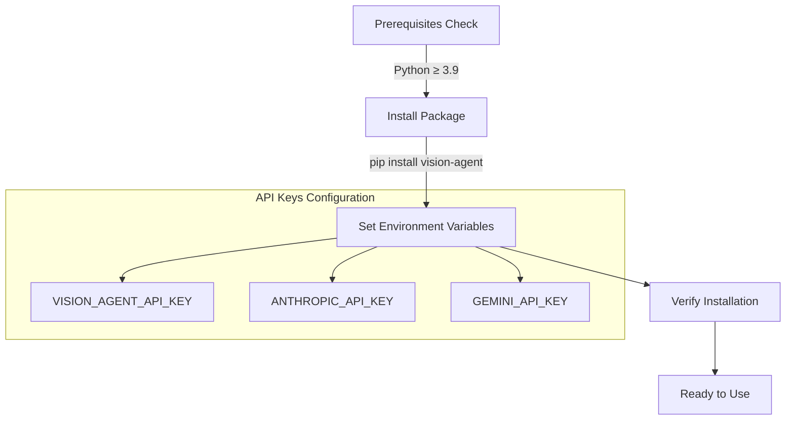
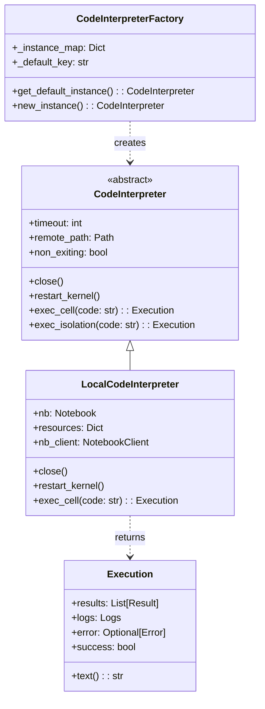
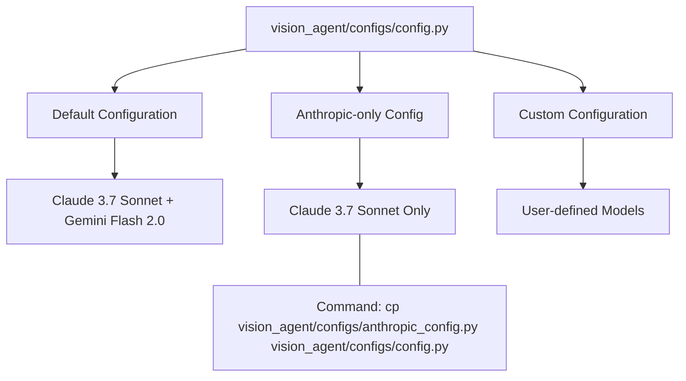

<!-- source: DeepWiki mcp.deepwiki.com · repo landing-ai/vision-agent · page 1.2 Installation and Dependencies · fetched 2026-10-26 -->

# Installation and Dependencies

<details>
<summary>Relevant source files</summary>

The following files were used as context for generating this wiki page:

- [README.md](README.md)
- [docs/index.md](docs/index.md)
- [poetry.lock](poetry.lock)
- [pyproject.toml](pyproject.toml)
- [vision_agent/utils/execute.py](vision_agent/utils/execute.py)

</details>


This page documents the installation process and required dependencies for the vision-agent library. It covers prerequisites, installation steps, API key configuration, and dependency structure. For information about the system architecture, see [System Architecture](#1.1).

## Prerequisites

Before installing the vision-agent library, you need:

- Python version 3.9 or higher
- Three API keys:
  - Vision Agent API key (from LandingAI)
  - Anthropic API key
  - Gemini API key 

### Installation Workflow



Sources: [README.md:54-69](). [README.md:23-52]()

## Why API Keys Are Required

VisionAgent uses models from Anthropic and Google to respond to prompts and generate code. When using the web-based version, the app uses LandingAI's API keys to access these models. However, when running VisionAgent programmatically, your personal API keys are required to:

1. Ensure your projects aren't limited by LandingAI's rate limits
2. Prevent multiple users from overloading LandingAI's rate limits

Each service (Anthropic and Google) has its own rate limits and pricing tiers.

Sources: [README.md:31-40]()

## Basic Installation

Install the vision-agent library using pip:

```bash
pip install vision-agent
```

This command installs the package and all required dependencies.

Sources: [README.md:54-57]()

## API Key Configuration

### Obtaining API Keys

1. **Vision Agent API Key**:
   - Sign up at [va.landing.ai/agent](https://va.landing.ai/agent)
   - Obtain your API key from [va.landing.ai/account/api-key](https://va.landing.ai/account/api-key)

2. **Anthropic API Key**:
   - Create an Anthropic Console account at [console.anthropic.com](https://console.anthropic.com/)
   - Go to the API Keys page
   - Generate an API key

3. **Gemini API Key**:
   - Create a Google AI Studio account at [aistudio.google.com](https://aistudio.google.com/)
   - Go to the Get API Key page
   - Generate an API key

Sources: [README.md:23-52]()

### Setting Environment Variables

Before running VisionAgent code, set the API keys as environment variables:

```bash
export VISION_AGENT_API_KEY="your-api-key"
export ANTHROPIC_API_KEY="your-api-key"
export GEMINI_API_KEY="your-api-key"
```

The library automatically loads these variables using the `dotenv` package as shown in [vision_agent/utils/execute.py:16-27]().

Sources: [README.md:71-79](). [vision_agent/utils/execute.py:16-27]()

## Dependency Structure

The vision-agent system has a comprehensive set of dependencies organized by their functional purpose:

```mermaid
graph TD
    VA["vision-agent"] --> Core["Core Libraries"]
    VA --> Vision["Vision Processing"]
    VA --> Execution["Code Execution"]
    VA --> LLM["LLM Integrations"]
    VA --> Utils["Utilities"]
    
    subgraph "Core Libraries"
        Core --> Python["Python ≥ 3.9"]
        Core --> Numpy["numpy ≥ 1.21.0"]
        Core --> Pandas["pandas 2.*"]
        Core --> Typing["typing_extensions 4.*"]
        Core --> Pydantic["pydantic ≥ 2.0.0"]
    end
    
    subgraph "Vision Processing"
        Vision --> OpenCV["opencv-python 4.*"]
        Vision --> Pillow["pillow 10.*"]
        Vision --> PillowHeif["pillow-heif 0.16.0"]
        Vision --> PyMuPDF["pymupdf 1.23.0"]
        Vision --> AV["av 11.0.0"]
        Vision --> SciPy["scipy 1.13.*"]
    end
    
    subgraph "Code Execution"
        Execution --> NBClient["nbclient 0.10.0"]
        Execution --> NBFormat["nbformat 5.10.4"]
        Execution --> IPyKernel["ipykernel 6.29.4"]
    end
    
    subgraph "LLM Integrations"
        LLM --> OpenAI["openai 1.*"]
        LLM --> Anthropic["anthropic 0.31.0"]
    end
    
    subgraph "Utilities"
        Utils --> Tabulate["tabulate 0.9.0"]
        Utils --> Rich["rich 13.7.1"]
        Utils --> Requests["requests 2.*"]
        Utils --> Matplotlib["matplotlib 3.9.2"]
        Utils --> ScikitLearn["scikit-learn 1.5.2"]
        Utils --> PyTube["pytube 15.0.0"]
    end
```



Sources: [pyproject.toml:19-49]()

### Main Dependencies

The following table lists key dependencies and their purposes:

| Dependency | Version | Purpose |
|------------|---------|---------|
| Python | >=3.9,<4.0 | Runtime environment |
| numpy | >=1.21.0,<2.0.0 | Numerical computing |
| pillow | 10.* | Image processing |
| opencv-python | 4.* | Computer vision algorithms |
| pandas | 2.* | Data manipulation |
| openai | 1.* | OpenAI API integration |
| anthropic | ^0.31.0 | Anthropic API integration |
| nbclient | ^0.10.0 | Notebook execution |
| nbformat | ^5.10.4 | Notebook format handling |
| ipykernel | ^6.29.4 | Jupyter kernel for code execution |
| matplotlib | ^3.9.2 | Plotting and visualization |
| scikit-learn | ^1.5.2 | Machine learning utilities |
| av | ^11.0.0 | Audio/video processing |
| pymupdf | ^1.23.0 | PDF document processing |
| pytube | 15.0.0 | YouTube video downloading |

Sources: [pyproject.toml:19-49]()

### Development Dependencies

For development and contributing to the project, additional dependencies are required:

| Dependency | Version | Purpose |
|------------|---------|---------|
| pytest | 7.* | Testing framework |
| black | >=23,<25 | Code formatting |
| isort | 5.* | Import sorting |
| mypy | <1.8.0 | Static type checking |
| pre-commit | ^3.8.0 | Pre-commit hooks |

Sources: [pyproject.toml:50-68]()

## Code Execution System

Vision-agent uses a notebook-based execution system for running generated code:



Sources: [vision_agent/utils/execute.py:345-553]()

The execution system relies on:
- `nbclient` to execute code cells
- `nbformat` to handle notebook format
- `ipykernel` to provide the Python kernel

The `LocalCodeInterpreter` class implements the execution environment that runs generated code in a Jupyter notebook context.

Sources: [vision_agent/utils/execute.py:391-512]()

## Alternative LLM Provider Configuration

VisionAgent uses Anthropic Claude 3.7 Sonnet and Gemini Flash 2.0 Experimental by default, but you can configure different LLM providers:



To use only the Anthropic model:

```bash
cp vision_agent/configs/anthropic_config.py vision_agent/configs/config.py
```

Alternatively, you can manually modify the configuration file to use different LLM providers.

Sources: [README.md:176-210]()

## Troubleshooting

### Common Installation Issues

1. **API Keys Not Found**:
   - Verify environment variables are set correctly
   - Ensure `.env` file is in the correct directory if using one

2. **Dependency Conflicts**:
   Consider using a virtual environment:

   ```bash
   python -m venv visionagent-env
   source visionagent-env/bin/activate  # On Windows: visionagent-env\Scripts\activate
   pip install vision-agent
   ```

3. **Code Execution Errors**:
   - Ensure `ipykernel` is properly installed
   - Check that your Python environment has all required dependencies
   - Try restarting the kernel with the `restart_kernel()` method

## Next Steps

After installation, you can:

- See [Basic Usage](#7.1) for getting started with vision-agent
- Check [Custom Tools](#7.2) for extending functionality
- Explore [Vision Tools](#3) to understand available capabilities

Sources: [README.md:114-153]()

---

